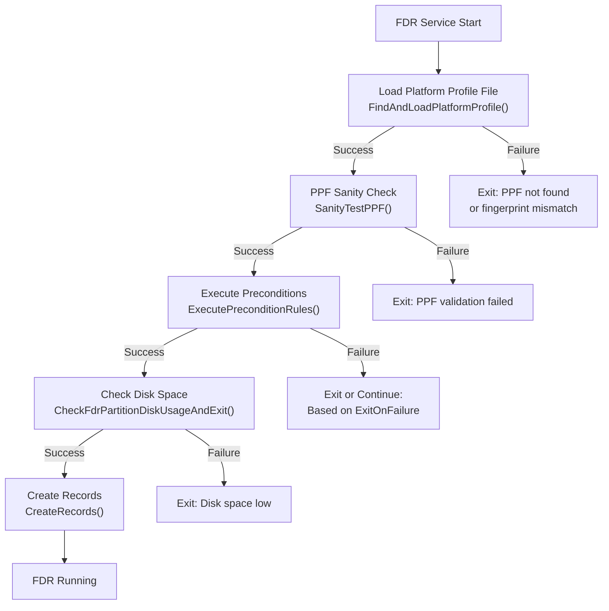
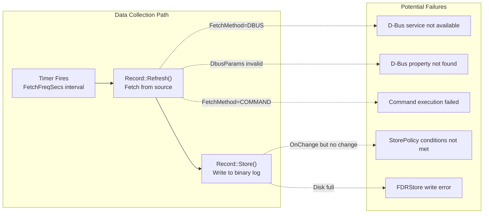
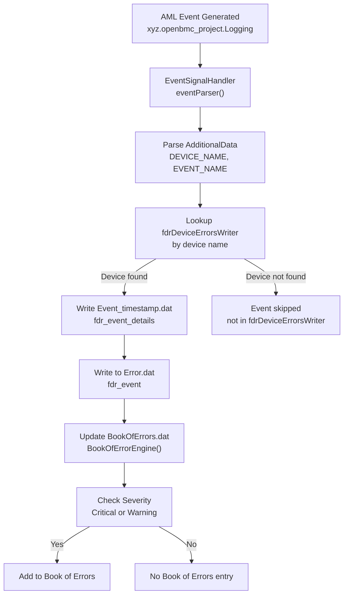
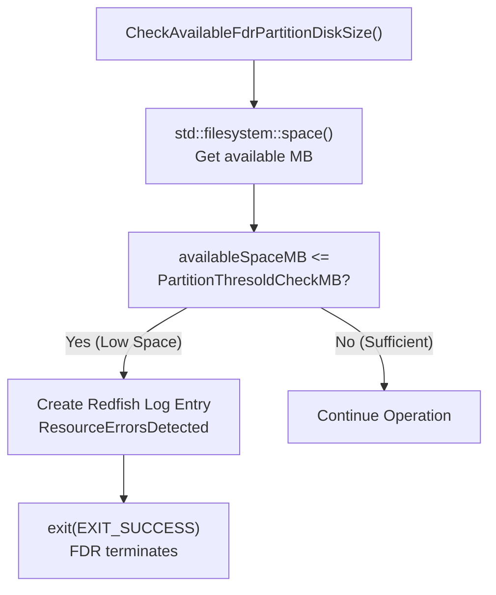
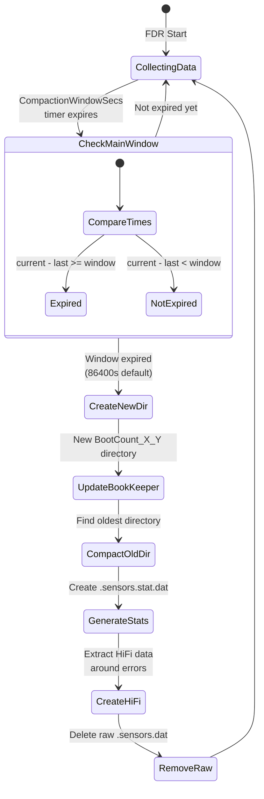
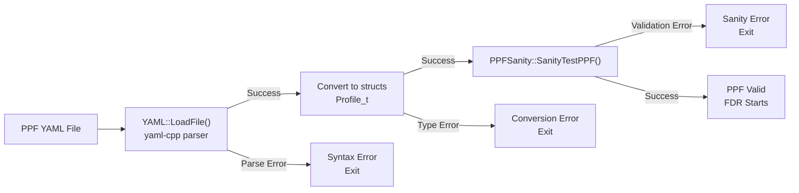
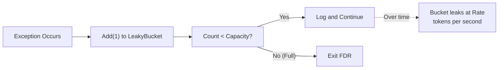
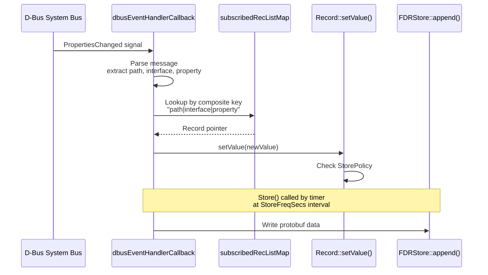

<!-- source: DeepWiki mcp.deepwiki.com · repo NVIDIA/nvidia-fdr · page 8 Troubleshooting and FAQ · fetched 2026-10-26 -->

# Troubleshooting and FAQ

<details>
<summary>Relevant source files</summary>

The following files were used as context for generating this wiki page:

- [fdr.cpp](fdr.cpp)
- [fdr.hpp](fdr.hpp)
- [fdr_events.cpp](fdr_events.cpp)
- [fdr_events.hpp](fdr_events.hpp)
- [fdr_timers.cpp](fdr_timers.cpp)
- [main.cpp](main.cpp)

</details>


This page provides troubleshooting guidance, common error messages, and frequently asked questions for the NVIDIA FDR (Flight Data Recorder) system. It covers issues that may arise during installation, configuration, runtime operation, and data collection/export.

For information about system configuration, see [Platform Configuration](#5). For details on building and deployment, see [Getting Started](#2). For internal architecture details that may help with debugging, see [System Architecture](#4).

---

## Quick Diagnostic Checklist

When FDR is not working as expected, check these items in order:

| Check Item | Command/Location | Expected State |
|------------|------------------|----------------|
| Service Status | `systemctl status nvidia-fdr` | Active (running) |
| FDR Logs | `/var/emmc/fdr/Bookkeeper/fdr.dat` | Recent timestamps |
| Storage Mount | `df -h /var/emmc/fdr` | Mounted, >1.5GB free |
| D-Bus Service | `busctl list \| grep FDR` | `xyz.openbmc_project.FDR` present |
| Platform Detection | Check PPF loading in fdr.dat | Correct PPF loaded |
| Birth Certificate | `/var/emmc/fdr/Bookkeeper/BirthCertificate.tar` | Exists and immutable |

---

## Startup and Initialization Issues

### FDR Fails to Start

**Symptom**: Service fails to start or exits immediately after starting.



**Common Causes and Solutions**:

1. **Platform Detection Failure**
   - **Error**: `"Not able to find the right PPF file for this platform"`
   - **Cause**: Fingerprint checks in PPF files don't match the platform
   - **Solution**: 
     - Verify `PLATFORMS_PATH` environment variable points to correct directory
     - Check PPF files exist in `/etc/nvidia-fdr/platforms/`
     - Manually specify PPF: `/usr/bin/nvidia-fdr /path/to/ppf.yaml`
     - Review fingerprint rules in PPF `FingerPrint.Checks` section

2. **PPF Sanity Check Failed**
   - **Error**: `"PPF failed sanity test! Please fix the above issue(s)"`
   - **Cause**: Duplicate ParamIDs, invalid configurations, or schema violations
   - **Solution**: Review error messages above this line for specific issues
   - See [PPF Validation](#ppf-validation-errors) section below

3. **Storage Mount Check Failed**
   - **Error**: `"Fdr storage is not mounted"`
   - **Cause**: Precondition check for `/var/emmc/fdr` mount point failed
   - **Solution**:
     - Verify mount: `mount | grep /var/emmc/fdr`
     - Check filesystem: `df -h /var/emmc/fdr`
     - Restart HMC if persistent

4. **Insufficient Disk Space**
   - **Error**: `"availableSpaceMB XMB is less than fdr threshold YMB"`
   - **Cause**: Available storage below `PartitionThresoldCheckMB` (default: 1536MB)
   - **Solution**:
     - Download FDR logs via Redfish API
     - Clear storage: Use FDR log clear API
     - Increase partition size if possible

Sources: [fdr.cpp:211-292](), [fdr.cpp:395-487](), [fdr.cpp:382-392](), [fdr.cpp:55-166]()

---

### PPF Validation Errors

The `PPFSanity` checker validates PPF structure and catches common configuration errors.

**Common PPF Errors**:

| Error Type | Description | Fix |
|------------|-------------|-----|
| Duplicate ParamID | Same ParamID used for multiple parameters | Assign unique ParamIDs (see [Adding New Parameters](#7.2)) |
| Invalid FetchMethod | Unsupported fetch method specified | Use: `DBUS`, `SHMEM`, `REDFISH`, `COMMAND` |
| Missing Required Fields | ParamID, DataType, or FetchFreqSecs not set | Add required fields to InfoList |
| Invalid StorePolicy | StorePolicy not recognized | Use: `OnChange`, `EveryFetch`, `Periodic` |
| Invalid FetchType | FetchType not recognized | Use: `Poll`, `Subscribe`, `GroupPoll` |

**Diagnostic Steps**:

1. Check FDR log for detailed validation errors: `grep "PPF failed sanity" /var/emmc/fdr/Bookkeeper/fdr.dat`
2. Validate PPF syntax: `yaml-cpp` parse errors indicate YAML syntax issues
3. Review PPF structure against [PPF File Structure Reference](#5.1)

Sources: [fdr.cpp:76-85](), [ppf_sanity.cpp (referenced)]()

---

## Runtime Operation Issues

### Data Not Being Collected

**Symptom**: FDR is running but specific parameters show no data or stale timestamps.



**Debugging Steps**:

1. **Verify Timer is Running**
   - Check logs for timer callbacks: `grep "PollRecordTimerCB\|GroupPollRecordTimerCB" /var/emmc/fdr/Bookkeeper/fdr.dat`
   - Expected interval matches `FetchFreqSecs` in PPF

2. **Check D-Bus Connectivity**
   ```bash
   # List D-Bus services
   busctl list | grep -E "xyz.openbmc_project|com.nvidia"
   
   # Test specific property access
   busctl get-property <service> <object_path> <interface> <property>
   ```

3. **Examine Exception Rate Limiter**
   - **Error**: `"ExceptionRateLimiter: Uncaught exceptions exceeded the capacity"`
   - **Cause**: Too many exceptions (default: 100 exceptions at 0.0033 rate)
   - **Solution**: 
     - Fix underlying issues causing exceptions
     - Adjust `ExceptionAllowRate` or `ExceptionAllowNumber` in PPF
     - Check logs for specific exception messages

4. **Verify StorePolicy Behavior**
   - `OnChange`: Data written only when value changes (may appear stale if value is constant)
   - `EveryFetch`: Data written on every fetch (always updates)
   - `Periodic`: Data written at `StoreFreqSecs` intervals

Sources: [fdr.cpp:836-909](), [fdr.cpp:188-209](), [fdr_timers.cpp:141-230](), [fdr_record.cpp (referenced)]()

---

### D-Bus Signal Subscription Issues

**Symptom**: Subscribe-type records not updating when D-Bus properties change.

**Common Causes**:

1. **Signal Not Registered**
   - Check logs for: `"Registering for Subscribe Store Record time"`
   - Verify: `subscribedPaths` populated during initialization

2. **D-Bus Match Rule Incorrect**
   ```cpp
   // Match rule format in dbusEventHandlerCallback
   "type='signal',interface='org.freedesktop.DBus.Properties',"
   "member='PropertiesChanged',path='<ObjectPath>'"
   ```

3. **Property Path Mismatch**
   - Verify `DbusParams.ObjectPath`, `Interface`, and `Property` in PPF match actual D-Bus interface

**Verification Commands**:
```bash
# Monitor D-Bus signals for specific path
dbus-monitor --system "type='signal',path='/xyz/openbmc_project/inventory/system/chassis/HGX_GPU_SXM_0'"

# List available properties
busctl introspect <service> <object_path>
```

Sources: [fdr.cpp:704-717](), [fdr_events.cpp:304-335](), [fdr.hpp:174-176]()

---

### Event Handling and Book of Errors

**Symptom**: AML events not appearing in Book of Errors or event logs.



**Troubleshooting Steps**:

1. **Verify Event Signal Registration**
   - Check: `eventHandlerMatcher` initialized in [fdr_events.cpp:304-335]()
   - Expected match rule: `InterfacesAdded` on `/xyz/openbmc_project/logging/entry`

2. **Check Device Name Mapping**
   - Event device names must map to FDR component IDs
   - Mapping logic: [fdr_events.cpp:43-66]()
   - Example: `GPU_SXM_1` → `HGX_GPU_SXM_1`

3. **Verify Error Infogroup Exists**
   - Device must have `InfoGroup` with ID containing "Error"
   - Check: `fdrDeviceErrorsWriter` map populated at [fdr.cpp:624-635]()

4. **Review Severity Filtering**
   - Only `Critical` and `Warning` events trigger Book of Errors
   - Check event severity in D-Bus message

Sources: [fdr_events.cpp:124-302](), [fdr.cpp:624-635](), [fdr_compact.cpp (Book of Errors logic)]()

---

## Storage and Compaction Issues

### Disk Space Problems

**FDR Exit on Low Disk Space**:

FDR performs disk space checks at two points:
1. During initialization
2. On every compaction window expiry

**Disk Space Check Logic**:



**Resolution Steps**:

1. **Check Current Usage**:
   ```bash
   df -h /var/emmc/fdr
   du -sh /var/emmc/fdr/*
   ```

2. **Collect and Clear Logs**:
   ```bash
   # Collect via fdr_dump.sh
   /usr/bin/fdr_dump.sh
   
   # Or via Redfish API
   curl -k -u user:pass https://<HMC_IP>/redfish/v1/Systems/HGX_Baseboard_0/LogServices/FDR/Actions/LogService.CollectDiagnosticData
   
   # Clear logs (after collecting)
   # Use Redfish Clear action
   ```

3. **Adjust Threshold (if needed)**:
   - Modify `PartitionThresoldCheckMB` in PPF (default: 1536)
   - Lower value = more aggressive space management

Sources: [fdr.cpp:342-392](), [fdr_compact.cpp (compaction logic)]()

---

### Compaction Not Running

**Symptom**: Old directories accumulating, no `.stat.dat` files generated.

**Compaction Window Flow**:



**Troubleshooting**:

1. **Verify Compaction Timer**
   - Check logs: `grep "CompactionWindowTimerCB" /var/emmc/fdr/Bookkeeper/fdr.dat`
   - Expected frequency: `CompactionWindowSecs` (default: 86400 seconds = 24 hours)

2. **Check Sub-Window Statistics**
   - Stats generated at: `CompactionSubWindowSecs` intervals (default: 1800 seconds = 30 minutes)
   - Files: `*.sensors.stat.dat`

3. **Examine Compactor BookKeeper**
   ```bash
   # View compaction history
   # Requires nvidia-fdrtool to decode
   nvidia-fdrtool decode --input /var/emmc/fdr/Bookkeeper/Compactor.dat
   ```

4. **Review High-Fidelity Data Preservation**
   - HiFi data preserved: ±`HiFiDataPreserveTimeSecs` around errors (default: 300s)
   - Files: `*.sensors.hifi.dat`
   - Depends on Book of Errors entries

Sources: [fdr.cpp:1285-1450](), [fdr_timers.cpp:220-231](), [fdr_compact.cpp (compaction engine)]()

---

## Configuration and PPF Issues

### Invalid Configuration Syntax

**YAML Parsing Errors**:

```
Exception while parsing <file.yaml>: yaml-cpp: error at line X, column Y
```

**Common YAML Issues**:

| Error | Cause | Fix |
|-------|-------|-----|
| `bad conversion` | Type mismatch (e.g., string for integer) | Verify data types match schema |
| `unrecognized node` | Extra/misspelled field | Check field names against [PPF Structure](#5.1) |
| `invalid anchor` | YAML anchor/alias issue | Verify anchor definitions (`&name`) precede references (`*name`) |
| `expected sequence` | Array expected but got scalar | Wrap single items in `[]` or use list syntax |

**Validation Process**:



Sources: [fdr.cpp:296-319](), [ppf_sanity.cpp (validation)]()

---

### Fingerprint Matching Issues

**Symptom**: FDR loads wrong PPF or fails to find any matching PPF.

**Fingerprint Execution Flow**:

1. FDR iterates through all `.yaml` files in `PLATFORMS_PATH`
2. For each PPF, executes `FingerPrint.Checks` commands
3. First PPF where all checks return 0 (success) is loaded

**Debugging Fingerprint Rules**:

```bash
# Test fingerprint commands manually
# Example from PPF:
cat /etc/os-release | grep -q "nvidia-hgx"
echo $?  # Should be 0 for match

# Check platform ID
dmidecode -s system-product-name
```

**Common Issues**:

- Command syntax error → Check shell escaping
- Platform ID mismatch → Verify against actual hardware
- Order matters → PPFs processed alphabetically; more specific PPFs should sort first

Sources: [fdr.cpp:211-292](), [fdr.cpp:322-340]()

---

## Error Messages Reference

### Fatal Errors (FDR Exits)

| Error Message | Location | Cause | Recovery |
|---------------|----------|-------|----------|
| `"Error loading PPF file..Exiting!"` | [fdr.cpp:72]() | PPF parsing failed | Fix PPF syntax |
| `"PPF failed sanity test!"` | [fdr.cpp:81-84]() | PPF validation failed | Fix validation issues |
| `"Platform precheck conditions failed"` | [fdr.cpp:126]() | Precondition check failed with `ExitOnFailure=true` | Fix platform condition |
| `"High disk usage..Exiting FDR!!"` | [fdr.cpp:389]() | Disk space below threshold | Clear logs |
| `"ExceptionRateLimiter: Uncaught exceptions exceeded capacity"` | [fdr.cpp:196-198]() | Too many exceptions | Fix underlying issues |
| `"Failed to connect to system bus"` | [main.cpp:75-77]() | D-Bus connection failed | Check D-Bus daemon |

### Warning Messages (Non-Fatal)

| Warning Message | Meaning | Action Needed |
|-----------------|---------|---------------|
| `"Precheck failed: <cmd> and ExitOnFailure is false"` | Precondition failed but continuing | Investigate if behavior is expected |
| `"RefreshAndStore(): <exception>"` | Record fetch/store failed | Check specific parameter configuration |
| `"Failed to create directory: <path>"` | Directory creation failed | Check filesystem permissions |
| `"Got empty event AdditionalData info"` | Event missing expected data | Check event format |

### Info Messages (Normal Operation)

| Info Message | Meaning |
|--------------|---------|
| `"Found the PPF file: <filename>"` | Platform detected successfully |
| `"All precheck conditions passed"` | Preconditions satisfied |
| `"Registering for Poll Record time: X"` | Timer initialized for X second interval |
| `"Available space: X MB"` | Current disk space |

Sources: [fdr.cpp:72-129](), [fdr.cpp:188-209](), [fdr.cpp:389](), [main.cpp:54-89]()

---

## Debugging Techniques

### Enabling Debug Logging

**Spdlog-based Logging** (when `FDR_USE_SPDLOG` defined):

```yaml
# In PPF GeneralConfig section
GeneralConfig:
  LoggingLevel: "debug"  # Options: trace, debug, info, warn, error, critical
  LoggingFileMaxSize: 5242880  # 5MB
  LoggingFileNumber: 5  # Keep 5 rotated files
```

**Phosphor-logging** (OpenBMC):
- Logging level controlled by phosphor-logging service
- View logs: `journalctl -u nvidia-fdr -f`

### Analyzing FDR Internal Logs

**Primary Log Location**: `/var/emmc/fdr/Bookkeeper/fdr.dat`

```bash
# View recent activity
tail -f /var/emmc/fdr/Bookkeeper/fdr.dat

# Search for specific errors
grep -i "error\|warn\|fail" /var/emmc/fdr/Bookkeeper/fdr.dat

# Check timer activity
grep "TimerCB" /var/emmc/fdr/Bookkeeper/fdr.dat

# View Record creation
grep "CreateRecords" /var/emmc/fdr/Bookkeeper/fdr.dat
```

### Examining Binary Log Files

**Structure**:
```
/var/emmc/fdr/
├── Bookkeeper/
│   ├── fdr.dat                    # FDR internal logs
│   ├── BirthCertificate.tar       # Immutable initial state
│   ├── Compactor.dat              # Compaction history (protobuf)
│   ├── BookOfErrors.dat           # Error events (protobuf)
│   ├── BootEvent.dat              # Boot history (protobuf)
│   └── ParamDescription.dat       # Parameter schema (protobuf)
└── BootCount_<N>_<timestamp>/
    └── <Section>.<ComponentID>.<file>
        ├── .sensors.dat           # Raw sensor data
        ├── .sensors.stat.dat      # Statistics
        ├── .sensors.hifi.dat      # High-fidelity error data
        └── .others.dat            # Non-sensor data
```

**Decoding Binary Files**:
```bash
# Use nvidia-fdrtool (see #6.2)
nvidia-fdrtool decode --input /var/emmc/fdr/BootCount_1_1234567890/GPU.GPU0.sensors.dat --output decoded.json

# Or use catalog system
python3 -m catalog.catalog --input <file.dat> --format json
```

### Manual Testing of Data Collection

**Test D-Bus Property Access**:
```bash
# From PPF DbusParams
SERVICE="xyz.openbmc_project.Inventory.Manager"
OBJECT="/xyz/openbmc_project/inventory/system/chassis/HGX_GPU_SXM_0"
INTERFACE="xyz.openbmc_project.State.Decorator.OperationalStatus"
PROPERTY="Functional"

busctl get-property $SERVICE $OBJECT $INTERFACE $PROPERTY
```

**Test Command Execution**:
```bash
# From PPF CommandParams.Command
nvidia-smi --query-gpu=temperature.gpu --format=csv,noheader,nounits -i 0
```

**Test Redfish Endpoint**:
```bash
# From PPF RedfishParams
curl -k -u user:pass https://<HMC_IP>/redfish/v1/Systems/HGX_Baseboard_0/Processors/HGX_GPU_SXM_0
```

Sources: [fdr.cpp:90-97](), [fdr_store.cpp (binary storage)](), [dbus_accessor.cpp (D-Bus access)]()

---

## Frequently Asked Questions

### Q: Why is FDR using so much disk space?

**A**: FDR collects high-frequency telemetry which can generate significant data volume. Factors affecting storage:

- **Collection Frequency**: Lower `FetchFreqSecs` = more data points
- **Number of Parameters**: More InfoList entries = more files
- **Compaction Disabled**: Raw data accumulates if compaction doesn't run
- **High-Fidelity Error Data**: Preserved around each error event

**Management**:
- Regular log collection and clearing via Redfish API
- Adjust compaction windows (`CompactionWindowSecs`, `CompactionSubWindowSecs`)
- Use appropriate `StorePolicy` (prefer `OnChange` for stable metrics)

### Q: Can I add parameters without rebuilding FDR?

**A**: Yes, parameters can be added by modifying PPF files without code changes, as long as:

1. Data source (D-Bus, Shmem, Redfish, Command) is accessible
2. Unique `ParamID` is assigned
3. Appropriate `DataType` is specified
4. PPF passes sanity validation

After modifying PPF:
```bash
systemctl restart nvidia-fdr
```

See [Adding New Parameters](#7.2) for detailed steps.

### Q: What happens if FDR crashes or is killed?

**A**: FDR is designed to be stateless and resume operation:

- Binary log files are flushed regularly (protobuf serialization)
- BookKeeper files maintain state (compaction history, errors, boot events)
- On restart, FDR:
  - Increments boot counter (if HMC rebooted) or reuses counter (if FDR restarted)
  - Creates new timestamp directory
  - Resumes data collection
  - Continues compaction from where it left off

**Data Loss**: Only data collected between last write and crash is lost (typically < `FetchFreqSecs` seconds).

### Q: How do I know if data is being collected correctly?

**A**: Verification methods:

1. **Check Timestamps**:
   ```bash
   ls -lht /var/emmc/fdr/BootCount_*/
   # Files should have recent modification times
   ```

2. **Monitor FDR Logs**:
   ```bash
   tail -f /var/emmc/fdr/Bookkeeper/fdr.dat
   # Look for timer callbacks and record updates
   ```

3. **Decode and Inspect**:
   ```bash
   nvidia-fdrtool decode --input <file.dat> | jq '.[0]'
   # Verify timestamps and values
   ```

4. **Use Coverage Reports**:
   ```bash
   # Generate coverage report (see #6.3)
   python3 -m catalog.coverage --fdr-dump <dump_dir>
   ```

### Q: Why are some parameters not in the output?

**A**: Common reasons:

- **StorePolicy=OnChange**: Value hasn't changed, no new data points written
- **Data Source Unavailable**: D-Bus service not running, property doesn't exist
- **Compaction**: Raw data compacted into statistics (check `.stat.dat` files)
- **Fetch Failed**: Exception occurred during fetch (check logs for errors)
- **Not in PPF**: Parameter not configured for collection

### Q: Can FDR collect data while the system is under heavy load?

**A**: Yes, FDR is designed for continuous operation:

- Timer-based collection is independent of system load
- Exception rate limiter prevents runaway failures
- Disk space checks prevent filling partition
- Low-priority event loop doesn't block critical operations

However, under extreme load:
- D-Bus calls may timeout → catch exceptions
- Disk I/O may slow down → buffered writes mitigate this
- Consider increasing `FetchFreqSecs` for less critical metrics

### Q: How do I interpret the Birth Certificate?

**A**: Birth Certificate (`BirthCertificate.tar`) contains:

- Initial state snapshot at first FDR boot
- All `.others.dat` files (Inventory, Config, Status)
- Bookkeeper files at creation time
- Made immutable with `chattr +i`

**Purpose**:
- Baseline system configuration
- Hardware inventory reference
- Initial firmware versions

**Extraction**:
```bash
tar -xJf /var/emmc/fdr/Bookkeeper/BirthCertificate.tar
```

### Q: What is the Book of Errors and how is it used?

**A**: Book of Errors (`/var/emmc/fdr/Bookkeeper/BookOfErrors.dat`) tracks:

- Critical and Warning AML events
- Device name, error timestamp, error type
- Used to trigger High-Fidelity data preservation

**Usage in Analysis**:
1. Identifies time windows with errors
2. Compaction preserves raw data ±`HiFiDataPreserveTimeSecs` around these times
3. Post-analysis correlates errors with telemetry anomalies

**Access**:
```bash
nvidia-fdrtool decode --input BookOfErrors.dat --output errors.json
jq '.' errors.json
```

### Q: How do I collect FDR logs for support analysis?

**A**: Three methods:

1. **Redfish API** (Recommended):
   ```bash
   # Trigger collection
   curl -k -X POST -u user:pass \
     https://<HMC_IP>/redfish/v1/Systems/HGX_Baseboard_0/LogServices/FDR/Actions/LogService.CollectDiagnosticData \
     -d '{"DiagnosticDataType":"Manager","OEMDiagnosticDataType":"FDR"}'
   
   # Download from attachment URI
   ```

2. **fdr_dump.sh Script**:
   ```bash
   /usr/bin/fdr_dump.sh
   # Creates tar.xz in /tmp/
   ```

3. **Manual SCP**:
   ```bash
   scp -r root@<HMC_IP>:/var/emmc/fdr /local/path/
   ```

See [fdr_dump.sh Collection Script](#6.1) for details.

### Q: What does "ExceptionRateLimiter" do?

**A**: Protects against cascading failures:



**Configuration** (in PPF):
```yaml
GeneralConfig:
  ExceptionAllowNumber: 100      # Capacity (tokens)
  ExceptionAllowRate: 0.0033333  # Rate (tokens/sec)
```

**Behavior**:
- Bucket capacity: 100 exceptions
- Leak rate: ~1 exception per 5 minutes
- If exceptions occur faster than leak rate, bucket fills → FDR exits

**Purpose**: Prevents FDR from running indefinitely with persistent errors that spam logs and consume resources.

**Disable**: Set `ExceptionAllowRate: 0.0` (not recommended for production).

Sources: [fdr.cpp:168-209]()

---

## Advanced Diagnostics

### Analyzing Timer Execution

**Timer Registration Map**:

```mermaid
flowchart TD
    subgraph "RecListPollMap"
        P600["FetchFreqSecs: 600<br/>Records: [...]"]
        P3600["FetchFreqSecs: 3600<br/>Records: [...]"]
    end
    
    subgraph "RecListGrpPollMap"
        G600["FetchFreqSecs: 600<br/>Groups: [(key1, records), ...]"]
    end
    
    subgraph "RecListSubscribeStoreMap"
        S600["StoreFreqSecs: 600<br/>Records: [...]"]
        S3600["StoreFreqSecs: 3600<br/>Records: [...]"]
    end
    
    subgraph "Special Timers"
        CW["CompactionWindowSecs: 86400"]
        CS["CompactionSubWindowSecs: 1800"]
    end
    
    P600 --> Timer1["Timer<br/>600s interval<br/>PollRecordTimerCBEngine(600)"]
    P3600 --> Timer2["Timer<br/>3600s interval<br/>PollRecordTimerCBEngine(3600)"]
    G600 --> Timer3["Timer<br/>600s interval<br/>GroupPollRecordTimerCBEngine(600)"]
    S600 --> Timer4["Timer<br/>600s interval<br/>SubscribeStoreRecordTimerCBEngine(600)"]
    S3600 --> Timer5["Timer<br/>3600s interval<br/>SubscribeStoreRecordTimerCBEngine(3600)"]
    CW --> Timer6["Timer<br/>86400s interval<br/>CompactionWindowTimerCBEngine()"]
    CS --> Timer7["Timer<br/>1800s interval<br/>CompactionSubWindowTimerCBEngine()"]
```



**Debugging Timer Issues**:

1. Check log for timer registration:
   ```bash
   grep "Registering for.*Record time" /var/emmc/fdr/Bookkeeper/fdr.dat
   ```

2. Verify timer callbacks execute:
   ```bash
   grep "TimerCB" /var/emmc/fdr/Bookkeeper/fdr.dat | tail -20
   ```

3. Check for timer delays:
   - Timestamp between callbacks should match timer interval
   - Large delays indicate system load or blocking operations

Sources: [fdr_timers.cpp:233-389](), [fdr.hpp:52-68]()

### Tracing D-Bus Signal Flow

**PropertiesChanged Signal Path**:



**Debug Signal Registration**:
```bash
# List registered signals
busctl monitor --system | grep PropertiesChanged

# Check FDR's registered paths
# (Logged during initialization)
grep "subscribedPaths" /var/emmc/fdr/Bookkeeper/fdr.dat
```

Sources: [fdr.cpp:704-717](), [fdr.hpp:176](), [dbus_accessor.cpp (signal handling)]()

---

## Performance Tuning

### Optimizing Collection Frequency

**Guidelines**:

| Metric Type | Recommended FetchFreqSecs | Rationale |
|-------------|---------------------------|-----------|
| High-frequency sensors (temp, power) | 600 (10 min) | Captures trends without excessive data |
| Inventory/static config | OnBoot only | Rarely changes |
| Error counters | 3600 (1 hour) | Sufficient for trend analysis |
| Status flags | Subscribe + StoreFreqSecs 600 | Real-time on change, periodic backup |

**Impact Analysis**:

- **Lower frequency (e.g., 300s)**: 2x data points, 2x storage
- **Higher frequency (e.g., 1200s)**: 0.5x data points, may miss transient issues
- **StorePolicy=OnChange**: Significant reduction for stable metrics

### Balancing StorePolicy

| Policy | Write Frequency | Use Case |
|--------|-----------------|----------|
| `EveryFetch` | Every fetch | Critical metrics, error counters |
| `OnChange` | Only when value changes | Inventory, stable configurations |
| `Periodic` | At StoreFreqSecs | Subscribe-based metrics |

**Recommendation**: Use `OnChange` for any metric expected to remain stable >90% of the time.

Sources: [fdr_record.cpp (StorePolicy logic)]()

---

This troubleshooting guide covers the most common issues encountered with NVIDIA FDR. For issues not covered here, examine FDR internal logs (`/var/emmc/fdr/Bookkeeper/fdr.dat`) for detailed error messages, and refer to the [System Architecture](#4) documentation to understand internal behavior.