# Page: Overview

# Overview

<details>
<summary>Relevant source files</summary>

The following files were used as context for generating this wiki page:

- [README.md](README.md)
- [fdr.cpp](fdr.cpp)
- [fdr.hpp](fdr.hpp)
- [main.cpp](main.cpp)

</details>


## Purpose and Scope

The NVIDIA FDR (Flight Data Recorder) is a telemetry collection and monitoring platform designed for NVIDIA HGX systems. It continuously collects hardware metrics, configuration data, and error information from GPUs, network interfaces, NVLink interconnects, and other system components. The system stores this data in binary protobuf format with intelligent compaction policies, enabling post-mortem analysis of system behavior and error conditions.

This document provides a high-level overview of the FDR architecture, its major components, and how they interact. For specific topics:
- Build and deployment instructions: see [Getting Started](#2)
- Configuration details: see [Platform Profile Files](#3.1)
- Internal architecture details: see [System Architecture](#4)
- Analysis tools: see [Tools and Utilities](#6)

**Sources:** [README.md:1-25](), [fdr.cpp:1-166](), [main.cpp:1-56]()

## System Purpose

FDR serves three primary functions:

1. **Continuous Telemetry Collection**: Monitors hardware metrics at configurable intervals (600-3600 seconds) via multiple data sources including D-Bus services, shared memory, Redfish APIs, and command execution
2. **Error Tracking**: Maintains a "Book of Errors" that logs all hardware errors with timestamps and preserves high-fidelity data around error events
3. **Data Retention Management**: Implements multi-tier storage with compaction policies that balance data granularity with storage constraints

**Sources:** [fdr.cpp:155-166](), [main.cpp:51-66]()

## High-Level Architecture

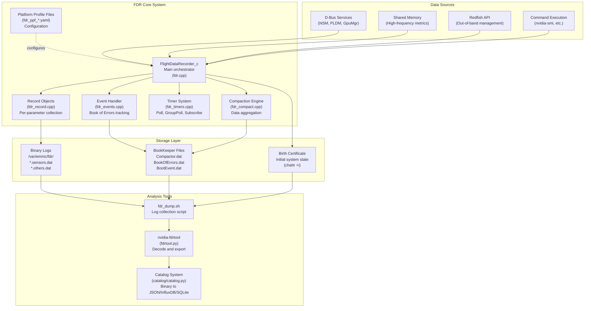

**Sources:** [fdr.hpp:38-177](), [fdr.cpp:55-166](), [main.cpp:19-148]()

## Core Components

### FlightDataRecorder_c

The `FlightDataRecorder_c` class is the main orchestrator that manages the entire data collection lifecycle. It initializes from a Platform Profile File (PPF), creates Record objects for each configured parameter, manages timers for periodic data collection, and coordinates the compaction engine.

| Component | Location | Purpose |
|-----------|----------|---------|
| Constructor | [fdr.cpp:55-166]() | PPF loading, fingerprint detection, preconditions validation |
| Record Creation | [fdr.cpp:574-746]() | Instantiates Record objects from PPF configuration |
| Event Loop | [main.cpp:83-90]() | Runs timer-based event processing (when `FDR_TIMER_EVENT_ENABLED`) |
| Polling Loop | [main.cpp:95-143]() | Alternative polling-based execution model |

**Sources:** [fdr.hpp:38-177](), [fdr.cpp:55-166]()

### Record System

Each telemetry parameter is represented by a `Record` object that encapsulates:
- Fetch logic (D-Bus property read, shared memory access, Redfish API call, or command execution)
- Storage policy (OnChange, EveryFetch, Periodic)
- Data type conversion and validation
- Reference to parent configuration (Section, Component, InfoGroup)

Records are organized into maps based on their fetch type:

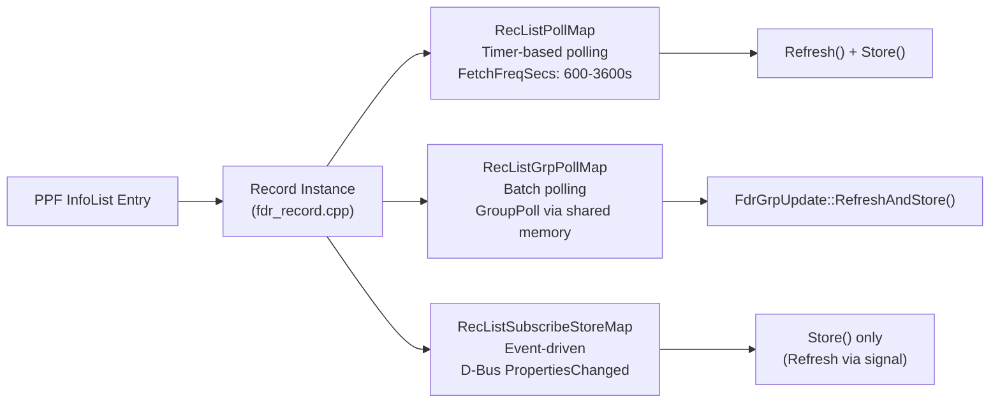

**Sources:** [fdr.cpp:574-746](), [fdr.hpp:42-51]()

### Platform Profile Files (PPF)

PPF files are YAML configuration files that define:
- **Fingerprint**: Shell commands to detect platform type
- **GeneralConfig**: Base paths, compaction windows, logging settings
- **Preconditions**: Mount checks, disk space validation
- **Sections**: Organized by hardware type (GPU, NIC, etc.)
- **Components**: Individual devices within each section
- **InfoGroups**: Categories like Inventory, Config, Error, Sensor
- **InfoList**: Individual parameters with fetch method, frequency, and storage policy

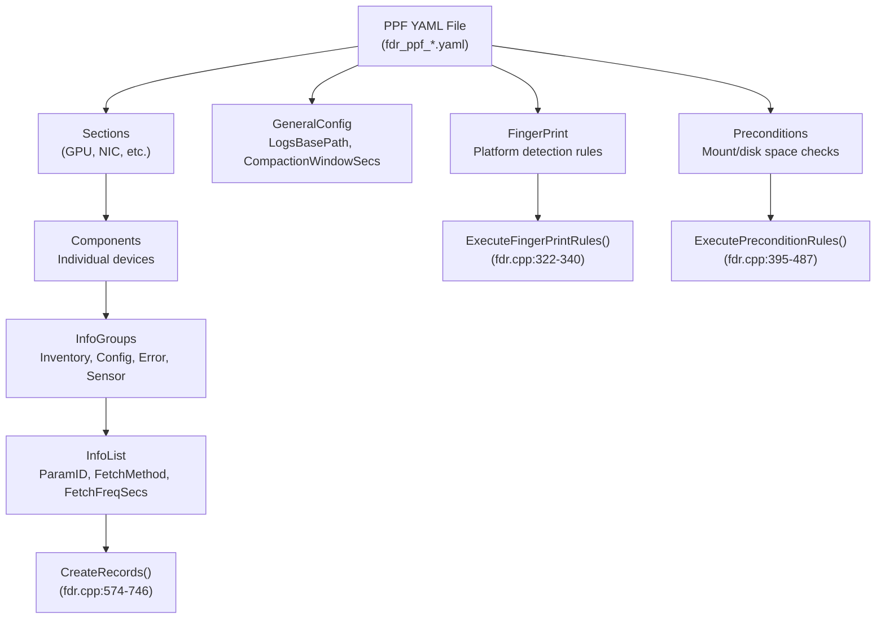

**Sources:** [fdr.cpp:296-319](), [fdr.cpp:211-292]()

## Data Collection Pipeline

The system operates in distinct stages from initialization through continuous monitoring to data export:

```mermaid
flowchart LR
    INIT["Initialization<br/>FindAndLoadPlatformProfile()<br/>(fdr.cpp:211-292)"]
    
    SANITY["PPF Sanity Check<br/>SanityTestPPF()<br/>(fdr.cpp:77-85)"]
    
    PRECON["Preconditions<br/>ExecutePreconditionRules()<br/>(fdr.cpp:395-487)"]
    
    BOOT["Boot Counter Update<br/>UpdateGlobVariables()<br/>(fdr.cpp:1003-1048)"]
    
    RECORDS["Create Records<br/>CreateRecords()<br/>(fdr.cpp:574-746)"]
    
    BIRTH["Birth Certificate<br/>CollectAndArchieveBirthCertificate()<br/>(fdr.cpp:767-832)"]
    
    TIMERS["Initialize Timers<br/>InitTimerEvents()<br/>(fdr_timers.cpp)"]
    
    LOOP["Event Loop<br/>RunEventLoop() or polling<br/>(main.cpp:83-143)"]
    
    INIT --> SANITY --> PRECON --> BOOT --> RECORDS --> BIRTH --> TIMERS --> LOOP
```

During continuous operation, the system processes three types of data collection:

| Fetch Type | Trigger | Implementation | Store Frequency |
|------------|---------|----------------|-----------------|
| **Poll** | Timer (FetchFreqSecs) | `RefreshAndStore()` [fdr.cpp:836-863]() | After each refresh |
| **GroupPoll** | Timer (FetchFreqSecs) | `GroupRefreshAndStore()` [fdr.cpp:865-904]() | After batch refresh |
| **Subscribe** | D-Bus signal | `dbusEventHandlerCallback()` [fdr.cpp:1206-1270]() | Timer (StoreFreqSecs) |

**Sources:** [fdr.cpp:55-166](), [main.cpp:51-90]()

## Storage Architecture

FDR implements a multi-tier storage strategy:

### Directory Structure

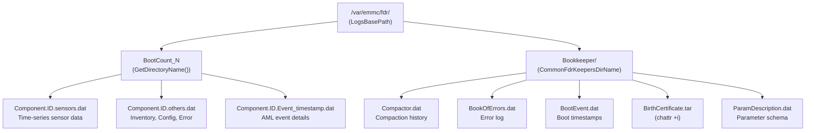

**Sources:** [fdr.cpp:491-521](), [fdr.cpp:525-572](), [fdr.cpp:87-149]()

### Compaction Strategy

The compaction engine operates on configurable time windows:

| Setting | Default | Purpose |
|---------|---------|---------|
| `CompactionWindowSecs` | 86400 (24 hours) | Creates new directory, triggers full compaction |
| `CompactionSubWindowSecs` | 1800 (30 minutes) | Generates statistics files (*.sensors.stat.dat) |
| `HiFiDataPreserveTimeSecs` | 300 (±5 minutes) | Preserves full-resolution data around errors |

When a compaction window expires:
1. Creates statistics files with averaged sensor data
2. Preserves high-fidelity data within ±300s of error events
3. Retains one `*.others.dat` file per boot cycle (oldest)
4. Removes original sensor data files after compaction
5. Updates `Compactor.dat` bookkeeper file

**Sources:** [fdr.cpp:1426-1507](), [fdr_common.hpp with GeneralConfig_t structure]()

## Event Handling and Error Tracking

### Book of Errors

The `BookOfErrors.dat` file maintains a chronological log of all hardware errors detected via:
- D-Bus error events (AML events from NSM/PLDM services)
- Error threshold violations in sensor data
- Component-specific error signals

Each error entry includes:
- Error timestamp
- Component ID
- Parameter ID
- Error message
- Event type

When an error occurs, FDR preserves high-fidelity sensor data in `*.sensors.hifi.dat` files within the time window defined by `HiFiDataPreserveTimeSecs` around the error timestamp.

**Sources:** [fdr.cpp:1637-1703](), [fdr_events.cpp implementation]()

### D-Bus Signal Handling

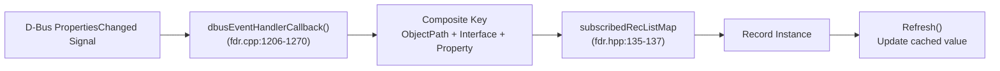

**Sources:** [fdr.cpp:1206-1270](), [fdr.hpp:135-137](), [fdr.cpp:704-716]()

## Runtime Execution Models

FDR supports two execution models, selected at compile time:

### Timer-Based Event Model (Default)

When `FDR_TIMER_EVENT_ENABLED` is defined:
- Uses `sdeventplus` library for event-driven execution
- Registers timers for each unique FetchFreqSecs and StoreFreqSecs value
- Processes D-Bus signals asynchronously
- Runs compaction checks via timer callbacks

**Implementation:** [main.cpp:67-90](), [fdr_timers.cpp implementation]()

### Polling Model

When `FDR_TIMER_EVENT_ENABLED` is not defined:
- Simple while loop with 1-second sleep
- Calls `RefreshAndStore()` and `Compactor()` on each iteration
- Records internally track last execution time to enforce frequency limits
- Processes D-Bus messages via `bus.process_discard()`

**Implementation:** [main.cpp:92-145]()

**Sources:** [main.cpp:67-145](), [fdr.hpp:32-36]()

## Build and Deployment Overview

The FDR system is built using:
- **Native builds**: Meson/Ninja on Ubuntu 22.04 for development
- **Cross-compilation**: Yocto/BitBake for ARM targets (HGX OpenBMC)
- **Dependencies**: sdbusplus, systemd, yaml-cpp, protobuf, curl, spdlog
- **Deployment**: systemd service with D-Bus configuration

Once deployed on HGX systems, FDR runs as a systemd service (`nvidia-fdr.service`) with:
- D-Bus service name: `xyz.openbmc_project.FDR`
- Configuration directory: `/etc/nvidia-fdr/platforms/`
- Data directory: `/var/emmc/fdr/` (or path specified in PPF)
- Environment variable: `PLATFORMS_PATH` points to PPF directory

**Sources:** [README.md:1-171](), [fdr.cpp:218-224]()

## Analysis and Export

Data extraction occurs through:

1. **fdr_dump.sh**: Bash script that collects FDR logs, creates tar.xz archives, and exposes them via Redfish API
2. **nvidia-fdrtool**: Python tool that downloads archives via Redfish and decodes protobuf logs
3. **Catalog System**: Converts binary logs to JSON, InfluxDB line protocol, or SQLite database format

The workflow for analysis:
```
Binary Logs → fdr_dump.sh → Tar Archive → nvidia-fdrtool → Catalog → JSON/InfluxDB/SQLite
```

Detailed information about these tools is available in [Tools and Utilities](#6).

**Sources:** [fdr_dump.sh script](), [fdrtool.py implementation](), [catalog/catalog.py implementation]()

## Data Format

All telemetry data is stored using Protocol Buffers (protobuf) with schema defined in `fdr_logs.proto`. The protobuf format provides:
- Binary serialization for efficient storage
- Schema versioning for backward compatibility
- Language-agnostic decoding
- Type safety and validation

The system tracks format version in `BootEvent.dat` (current version: 2) to handle changes in directory structure and file organization.

**Sources:** [fdr.cpp:42-46](), [fdr.cpp:1053-1070](), [fdr_logs.proto schema file]()

## Exception Handling and Rate Limiting

FDR implements a "leaky bucket" rate limiter to prevent exit due to transient errors:
- **ExceptionAllowNumber**: Maximum uncaught exceptions allowed (capacity)
- **ExceptionAllowRate**: Rate at which exception count decreases
- **Behavior**: FDR exits if exception count exceeds capacity

This prevents cascading failures while allowing recovery from temporary issues.

**Sources:** [fdr.cpp:168-209](), [fdr.hpp:88-89]()

## Next Steps

For detailed information about specific subsystems:
- Configuration file structure: [PPF File Structure Reference](#5.1)
- Internal architecture: [System Architecture](#4)
- Adding new telemetry: [Adding New Parameters](#7.2)
- Troubleshooting: [Troubleshooting and FAQ](#8)

---

# Page: Getting Started

# Getting Started

<details>
<summary>Relevant source files</summary>

The following files were used as context for generating this wiki page:

- [README.md](README.md)
- [fdr_git.bb](fdr_git.bb)
- [main.cpp](main.cpp)

</details>


This page provides a practical guide to building, deploying, and running the NVIDIA FDR (Flight Data Recorder) system. It covers the essential steps needed to get FDR operational on both development machines (native Ubuntu builds) and target HGX platforms (Yocto/OpenBMC cross-compilation).

For architectural concepts and system design, see [Overview](#1). For detailed configuration of platform-specific settings, see [Platform Configuration](#5).

## Scope and Prerequisites

FDR is designed to run on NVIDIA HGX systems with OpenBMC firmware, but can be built and tested on standard Ubuntu development machines. This guide addresses two deployment scenarios:

**Development Environment:**
- Native builds on Ubuntu 22.04 using meson/ninja
- Testing with mock D-Bus services
- Local debugging and validation

**Production Environment:**
- Cross-compilation for ARM targets using Yocto/BitBake
- Deployment as a systemd service on HGX baseboard
- Integration with OpenBMC infrastructure

### System Requirements

| Component | Development | Production |
|-----------|-------------|------------|
| **Operating System** | Ubuntu 22.04 or later | OpenBMC (Yocto-based) |
| **Architecture** | x86_64 (amd64) | ARMv7 (armv7ahf_vfpv4d16) |
| **Compiler** | GCC 12+ or Clang | GCC cross-compiler |
| **Build System** | Meson 0.57+, Ninja | BitBake, CMake |
| **Runtime** | systemd, D-Bus | systemd, D-Bus, HGX hardware |
| **Storage** | Any local filesystem | `/var/emmc/fdr/` (embedded MMC) |

Sources: [README.md:1-18](), [fdr_git.bb:1-35]()

## Getting Started Workflow

The following diagram illustrates the high-level workflow for building and deploying FDR:

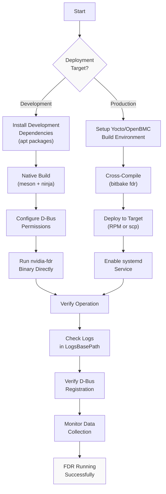

Sources: [README.md:1-171](), [main.cpp:29-148]()

## Main Entry Point and Initialization

The FDR application is implemented as a single-threaded C++ program that initializes the `FlightDataRecorder_c` core system and enters either an event-driven loop (timer-based) or a polling loop. Understanding this initialization sequence is critical for debugging deployment issues.

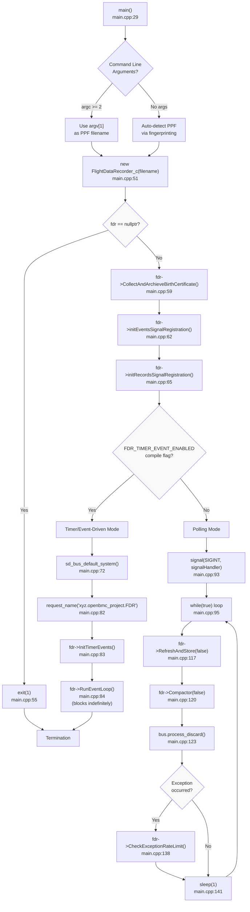

**Key Initialization Steps:**

1. **PPF Selection** [main.cpp:46-50](): If a filename argument is provided, FDR uses that specific Platform Profile File; otherwise, it performs automatic platform detection.

2. **Birth Certificate** [main.cpp:59](): Captures the initial system state for baseline comparison. This is a one-time operation per boot.

3. **Signal Registration** [main.cpp:62-65](): Registers D-Bus signal handlers for both event monitoring and property change notifications.

4. **Runtime Mode**:
   - **Timer Mode** (default on production): Uses `sd_event` based timers with asynchronous callbacks [main.cpp:68-90]()
   - **Polling Mode**: Simple synchronous loop with 1-second sleep intervals [main.cpp:92-145]()

Sources: [main.cpp:29-148]()

## Build Process Overview

FDR supports two build methods depending on the target environment. Both methods produce the same core binary (`nvidia-fdr`) but with different configurations.

| Build Method | Use Case | Output Location | Details |
|--------------|----------|-----------------|---------|
| **Meson/Ninja** | Development, testing, debugging | `build/nvidia-fdr` | See [Building the System](#2.1) |
| **BitBake** | Production deployment on HGX | `build/hgx/tmp/deploy/rpm/` | See [Building the System](#2.1) |

### Native Build Quick Start

For development on Ubuntu 22.04:

```bash
# Install dependencies (see section 2.1 for complete list)
sudo apt install meson ninja-build g++-12 libsystemd-dev \
    nlohmann-json3-dev libyaml-cpp-dev libcurl4-gnutls-dev

# Configure build
meson setup build

# Compile
ninja -C build
```

### Cross-Compilation Quick Start

For production builds targeting ARM HGX platforms:

```bash
# Setup Yocto environment (one-time)
git clone ssh://git@gitlab-master.nvidia.com:12051/dgx/bmc/openbmc.git
cd openbmc
git checkout fdr-integration
. setup hgx

# Build FDR
bitbake fdr
```

For complete dependency lists, build options, and troubleshooting, see [Building the System](#2.1).

Sources: [README.md:1-170](), [fdr_git.bb:27-34]()

## Deployment and Runtime Configuration

Once built, FDR requires proper D-Bus permissions and systemd configuration to operate correctly.

### D-Bus Service Registration

FDR registers on the D-Bus system bus as `xyz.openbmc_project.FDR` [main.cpp:68,82](). This requires appropriate D-Bus policy configuration:

**Development Environment:**
```bash
# Create D-Bus policy file
cat > /etc/dbus-1/system.d/xyz.openbmc_project.FDR.conf << EOF
<!DOCTYPE busconfig PUBLIC
 "-//freedesktop//DTD D-BUS Bus Configuration 1.0//EN"
 "http://www.freedesktop.org/standards/dbus/1.0/busconfig.dtd">
<busconfig>
  <policy user="root">
    <allow own="xyz.openbmc_project.FDR"/>
  </policy>
</busconfig>
EOF

# Reload D-Bus configuration
sudo systemctl reload dbus
```

**Production Environment:**
The OpenBMC build automatically installs the D-Bus configuration file via the BitBake recipe.

### Running FDR

**Manual Execution (Development):**
```bash
cd build
sudo ./nvidia-fdr

# Or specify a custom PPF file
sudo ./nvidia-fdr /path/to/custom_ppf.yaml
```

**Systemd Service (Production):**
```bash
# Check service status
systemctl status nvidia-fdr.service

# Start/stop/restart service
systemctl start nvidia-fdr.service
systemctl stop nvidia-fdr.service
systemctl restart nvidia-fdr.service

# Enable automatic start on boot
systemctl enable nvidia-fdr.service
```

For detailed deployment procedures, environment variables, and configuration options, see [Running and Deployment](#2.2).

Sources: [README.md:66-90,158-166](), [main.cpp:68,82]()

## Verification and Validation

After deployment, verify that FDR is operating correctly:

### 1. Check Process Status

```bash
# Verify the process is running
ps aux | grep nvidia-fdr

# Check D-Bus name ownership
busctl list | grep xyz.openbmc_project.FDR
```

### 2. Inspect Log Output

FDR uses either `spdlog` (development) or `phosphor-logging` (production) for logging [main.cpp:31-35]():

```bash
# View systemd journal logs
journalctl -u nvidia-fdr.service -f

# Look for initialization messages
journalctl -u nvidia-fdr.service | grep -E "(CollectAndArchieveBirthCertificate|initEventsSignalRegistration|initRecordsSignalRegistration)"
```

### 3. Verify Data Collection

FDR writes binary protobuf logs to the path specified in the Platform Profile File (typically `/var/emmc/fdr/`):

```bash
# Check log directory structure
ls -lR /var/emmc/fdr/

# Expected directory structure:
# /var/emmc/fdr/
# ├── BootCount_X/          (current boot cycle)
# │   ├── *.sensors.dat
# │   ├── *.others.dat
# │   └── Event_*.dat
# ├── BootCount_X-1/        (previous boot, compacted)
# │   ├── *.sensors.stat.dat
# │   ├── *.sensors.hifi.dat
# │   └── *.others.dat
# ├── Bookkeeper/
# │   ├── Compactor.dat
# │   ├── BookOfError.dat
# │   └── BootEvent.dat
# └── BirthCertificate_*.tar.xz
```

### 4. Validate D-Bus Communication

```bash
# List FDR's D-Bus objects
busctl tree xyz.openbmc_project.FDR

# Monitor D-Bus signal subscriptions
dbus-monitor --system "sender='xyz.openbmc_project.FDR'"
```

### 5. Test Data Export

Use the FDR collection tools to verify that logs can be decoded:

```bash
# Generate a dump archive
/usr/bin/fdr_dump.sh

# Decode the archive (requires nvidia-fdrtool)
nvidia-fdrtool --collect --local /path/to/dump.tar.xz --output /tmp/fdr_output
```

For troubleshooting common issues, see [Troubleshooting and FAQ](#8).

Sources: [README.md:90-99,158-166](), [main.cpp:31-35,59-65]()

## Core Runtime Loop Components

Understanding the main runtime loop helps diagnose operational issues:

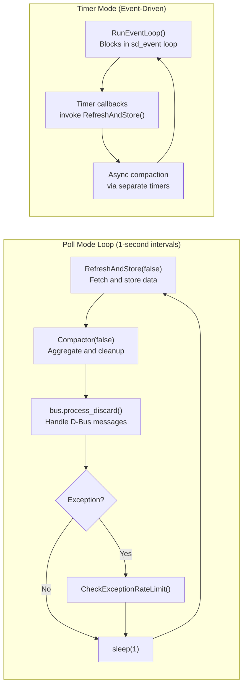

**Key Methods:**

- `RefreshAndStore(false)` [main.cpp:117](): Iterates through all configured records, fetches data based on timer schedules, and writes to disk according to store policies.

- `Compactor(false)` [main.cpp:120](): Checks if compaction window has elapsed and aggregates data into statistics files while preserving high-fidelity data around errors.

- `CheckExceptionRateLimit()` [main.cpp:138](): Monitors exception frequency and terminates FDR if error rate exceeds threshold (fail-safe mechanism).

Sources: [main.cpp:95-145]()

## Next Steps

Once FDR is successfully running:

1. **Understand Configuration**: Review [Platform Profile Files](#3.1) to learn how data collection is configured
2. **Explore Data Collection**: Read [Records and Data Collection](#3.2) to understand fetch methods and store policies
3. **Analyze Collected Data**: Use [nvidia-fdrtool](#6.2) and [Catalog System](#6.3) to decode and export logs
4. **Add Custom Parameters**: Follow [Adding New Parameters](#7.2) to extend telemetry coverage
5. **Validate Coverage**: Use [Testing and Validation](#7.3) tools to ensure all required parameters are being collected

For platform-specific configuration examples, see:
- [Vulcan Platform Configuration](#5.2)
- [HGXB HMC Platform Configuration](#5.3)

---

Sources: [main.cpp:1-153](), [README.md:1-171](), [fdr_git.bb:1-35]()

---

# Page: Building the System

# Building the System

<details>
<summary>Relevant source files</summary>

The following files were used as context for generating this wiki page:

- [README.md](README.md)
- [fdr_git.bb](fdr_git.bb)

</details>


## Purpose and Scope

This page provides detailed instructions for building the NVIDIA FDR system from source. It covers two primary build methods: native builds for development and testing on x86_64 Ubuntu systems using **meson/ninja**, and cross-compilation builds for ARM-based OpenBMC target platforms using **bitbake**. 

For information about deploying and running the built binaries, see [Running and Deployment](#2.2). For details on the build system internals and dependency management from a development perspective, see [Build System and Dependencies](#7.1).

---

## Build Method Overview

The FDR system supports two distinct build workflows depending on the target environment:

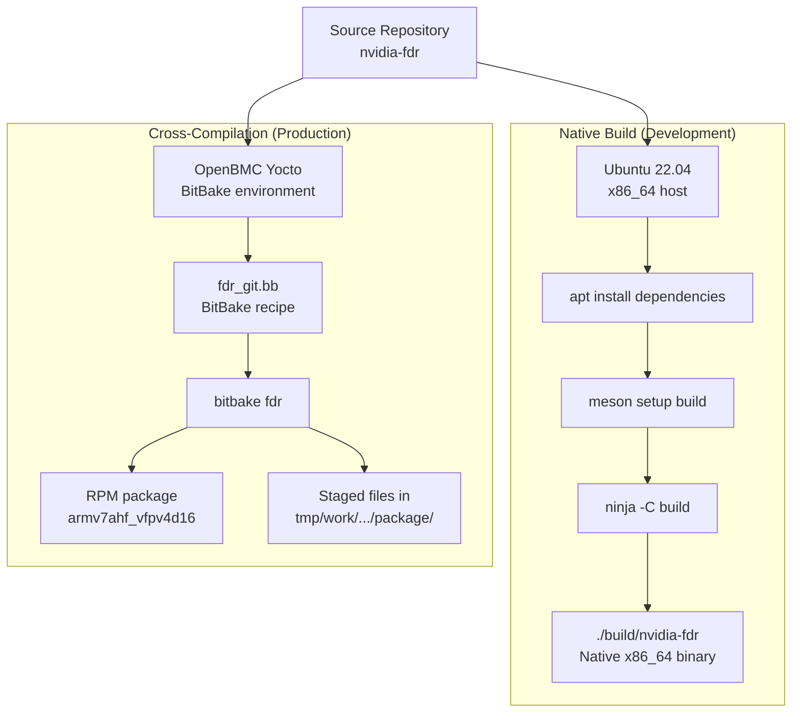

**Build Method Comparison**

| Aspect | Native Build | Cross-Compilation Build |
|--------|-------------|------------------------|
| **Build System** | meson + ninja | cmake via BitBake |
| **Target Platform** | x86_64 Linux | ARM (armv7ahf-vfpv4d16) |
| **Primary Use Case** | Development, testing, debugging | Production deployment to HGX |
| **Dependency Management** | Manual apt install | Automatic via BitBake |
| **Output Format** | Raw binary | RPM package + staged files |
| **Configuration** | `meson setup` options | `EXTRA_OECMAKE` in recipe |

Sources: [README.md:1-171](), [fdr_git.bb:1-35]()

---

## Development Environment Setup

### Host System Requirements

The FDR system has been verified to build on **Ubuntu 22.04**. The build process requires specific compiler versions and system libraries.

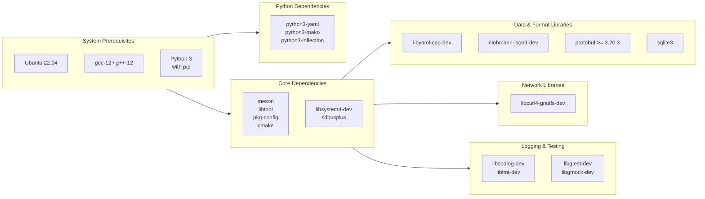

### Installing Dependencies

**Step 1: Install sdbusplus dependencies**

The `sdbusplus` library provides D-Bus C++ bindings and is a critical dependency for FDR's communication with system services.

```bash
sudo apt install git meson libtool pkg-config g++-12 libsystemd-dev \
    python3 python3-pip python3-yaml python3-mako python3-inflection
```

**Step 2: Install FDR-specific dependencies**

```bash
sudo apt install cmake clang-tools nlohmann-json3-dev \
    libyaml-cpp-dev libcurl4-gnutls-dev python3-yaml \
    libspdlog-dev libfmt-dev clang-tools libgtest-dev libgmock-dev
```

**Step 3: Build and install Protobuf 3.20.3**

The system requires Protobuf >= 3.20.3 to support the `optional` keyword used in the protobuf schema. The Ubuntu 22.04 bundled version is insufficient.

```bash
wget https://github.com/protocolbuffers/protobuf/releases/download/v3.20.3/protobuf-all-3.20.3.tar.gz
tar zxvf protobuf-all-3.20.3.tar.gz
cd protobuf-3.20.3/
./configure --prefix=/usr
make
sudo make install
```

**Step 4: Set default GCC/G++ version**

The `sdbusplus` headers require GCC 12 for compilation. If multiple GCC versions are installed, set version 12 as the default:

```bash
sudo update-alternatives --install /usr/bin/gcc gcc /usr/bin/gcc-12 10
sudo update-alternatives --install /usr/bin/g++ g++ /usr/bin/g++-12 10
```

The priority value `10` ensures GCC 12 takes precedence.

Sources: [README.md:1-43]()

---

## Native Build (meson/ninja)

### Build Configuration

The native build uses **meson** as the build configuration tool and **ninja** as the build executor. Meson generates the build files, which ninja then uses to compile the source.

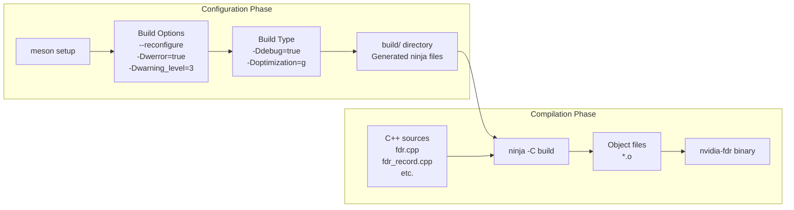

**Standard build (Release configuration):**

```bash
meson setup --reconfigure build
ninja -C build
```

**Debug build configuration:**

For debug builds with all warnings enabled (matching CI/CD unit test configuration):

```bash
meson setup --reconfigure build \
    -Db_colorout=never \
    -Dwerror=true \
    -Dwarning_level=3 \
    -Ddebug=true \
    -Doptimization=g
```

**Alternative compilation method:**

```bash
meson compile -C build
```

Both `meson compile` and `ninja` produce identical results. The `ninja` command is more commonly used in the development workflow.

### Build Output

After a successful build, the main binary is located at:

```
./build/nvidia-fdr
```

Additional build artifacts include:
- Compiled object files: `build/*.o`
- Test executables (if tests are enabled)
- Protobuf-generated code

Sources: [README.md:44-62]()

---

## Cross-Compilation Build (Yocto/BitBake)

### OpenBMC Repository Setup

Cross-compilation for ARM targets uses the **OpenBMC Yocto Project** infrastructure with **BitBake** as the build tool.

**Step 1: Clone the OpenBMC repository**

```bash
git clone ssh://git@gitlab-master.nvidia.com:12051/dgx/bmc/openbmc.git
cd openbmc
```

**Step 2: Switch to FDR integration branch**

```bash
git checkout fdr-integration
```

**Step 3: Initialize the HGX build environment**

```bash
. setup hgx
```

This script configures the BitBake environment variables and sets up the build directory structure.

### BitBake Recipe Structure

The `fdr_git.bb` recipe defines how FDR is built within the Yocto environment:

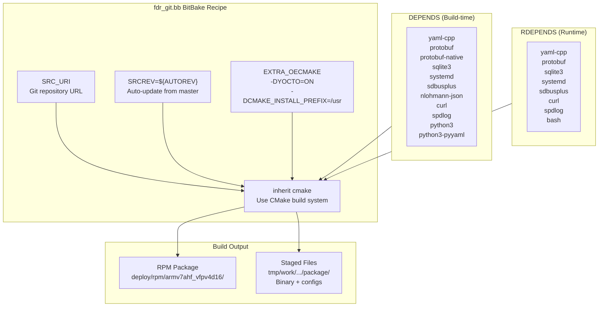

**Key recipe components:**

| Component | Value | Purpose |
|-----------|-------|---------|
| `LICENSE` | `CLOSED` | Proprietary NVIDIA code |
| `SRC_URI` | `git://...nvidia-fdr.git` | Source repository location |
| `SRCREV` | `${AUTOREV}` | Always use latest master commit |
| `inherit cmake` | - | Use CMake as build system (not meson) |
| `EXTRA_OECMAKE` | `-DYOCTO=ON -DCMAKE_INSTALL_PREFIX=/usr` | Yocto-specific build flags |

**Note:** The Yocto build uses **CMake** instead of meson, as specified by `inherit cmake` at [fdr_git.bb:27]().

Sources: [README.md:123-150](), [fdr_git.bb:1-35]()

### Building FDR Package

**Build FDR only:**

```bash
bitbake fdr
```

**Build complete OpenBMC image with FDR:**

```bash
bitbake obmc-phosphor-image
```

### Build Output Locations

After a successful BitBake build:

**RPM Package:**
```
openbmc/build/hgx/tmp/deploy/rpm/armv7ahf_vfpv4d16/
```

**Unpacked files (binary, configs, scripts):**
```
openbmc/build/hgx/tmp/work/armv7ahf-vfpv4d16-openbmc-linux-gnueabi/nvidia-fdr/git-r0/package/
```

The unpacked files location is useful for:
- Manually copying binaries to a running OpenBMC system via SCP
- Inspecting installed file structure
- Debugging packaging issues

**Build logs (if errors occur):**
```
openbmc/build/hgx/tmp/work/armv7ahf-vfpv4d16-openbmc-linux-gnueabi/nvidia-fdr/git-r0/temp/
```

Sources: [README.md:137-149]()

---

## Build Artifacts and Installation Layout

### Installed File Structure

The build process generates several types of artifacts that are installed to specific locations on the target system:

| Artifact Type | Build Output | Target Installation Path | Description |
|--------------|--------------|-------------------------|-------------|
| Main binary | `nvidia-fdr` | `/usr/bin/nvidia-fdr` | Core FDR service executable |
| Collection script | `fdr_dump.sh` | `/usr/bin/fdr_dump.sh` | Log collection utility |
| Python tools | `fdrtool/*` | `/usr/lib/python/site-packages/` | Analysis and decoding tools |
| Platform profiles | `platforms/fdr_ppf_*.yaml` | `/etc/nvidia-fdr/platforms/` | Configuration files |
| Systemd service | `nvidia-fdr.service` | `/lib/systemd/system/` | Service definition |
| D-Bus config | `xyz.openbmc_project.FDR.conf` | `/etc/dbus-1/system.d/` | D-Bus permissions |

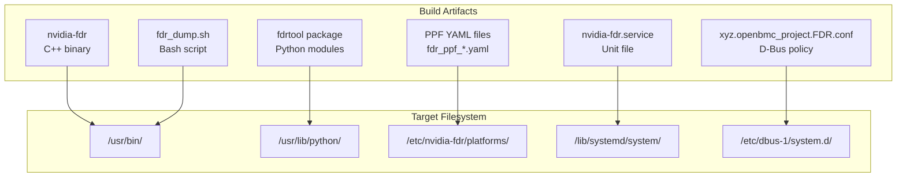

### CMake Installation Rules

The installation paths are defined by CMake configuration when using Yocto builds. The `EXTRA_OECMAKE` variable at [fdr_git.bb:30]() sets:

```
-DCMAKE_INSTALL_PREFIX=/usr
```

This ensures all files are installed under `/usr` rather than the CMake default `/usr/local`.

Sources: [fdr_git.bb:30](), [README.md:146-148]()

---

## Build Validation and Testing

### Unit Tests

Unit tests are executed using meson's test framework with code coverage enabled:

```bash
meson setup --reconfigure build_coverage -Db_coverage=True
meson test -v -C build_coverage
```

**Coverage report locations:**
- Text format: `./build_coverage/meson-logs/coverage.txt`
- HTML format: `./build_coverage/meson-logs/coveragehtml/`

### Static Analysis

Run Clang static analyzer:

```bash
ninja scan-build -C builddir
```

### Docker-based Code Coverage

For consistent CI/CD-style coverage testing:

```bash
./coverage/coverage.sh
```

This script runs the test suite in a Docker container matching the CI environment and generates coverage reports.

### Local CI Pipeline Execution

To run the complete CI pipeline locally (requires GitLab Runner):

See: [https://gitlab-master.nvidia.com/dgx/bmc/docs/-/blob/develop/testing/local-ci-build.md](https://gitlab-master.nvidia.com/dgx/bmc/docs/-/blob/develop/testing/local-ci-build.md)

Sources: [README.md:92-120]()

---

## Build Troubleshooting

### Common Issues

**Problem: Protobuf version too old**

Symptom: Build fails with errors about `optional` keyword not supported

Solution: Install Protobuf 3.20.3 or newer as described in the dependencies section above.

**Problem: GCC version mismatch**

Symptom: Compilation errors in `sdbusplus` headers

Solution: Ensure GCC 12 is the default compiler using `update-alternatives` as shown above.

**Problem: BitBake build fails**

Symptom: `bitbake fdr` command fails during compilation

Solution: Check build logs at:
```
openbmc/build/hgx/tmp/work/armv7ahf-vfpv4d16-openbmc-linux-gnueabi/nvidia-fdr/git-r0/temp/
```

Look for specific error messages in `log.do_compile` or `log.do_configure`.

**Problem: Missing PLATFORMS_PATH at runtime**

Symptom: FDR binary cannot find PPF configuration files

Solution: This is a runtime issue, not a build issue. See [Running and Deployment](#2.2) for environment variable configuration.

Sources: [README.md:1-171]()

---

# Page: Running and Deployment

# Running and Deployment

<details>
<summary>Relevant source files</summary>

The following files were used as context for generating this wiki page:

- [README.md](README.md)
- [fdr.cpp](fdr.cpp)
- [fdr.hpp](fdr.hpp)
- [main.cpp](main.cpp)

</details>


This page describes how to deploy and run the NVIDIA FDR system on target platforms. It covers service configuration, directory requirements, startup procedures, and verification steps for both development and production environments.

For information about building the FDR binary and dependencies, see [Building the System](#2.1). For details on configuring platform-specific telemetry collection, see [Platform Profile Files](#3.1).

## Overview

The FDR system runs as a systemd service (`nvidia-fdr.service`) on NVIDIA HGX platforms. The main components include:

- **Binary**: `nvidia-fdr` executable located in `/usr/bin/`
- **Configuration**: Platform Profile Files (PPF) in `/etc/nvidia-fdr/platforms/`
- **Data Storage**: Binary logs and bookkeeper files in `/var/emmc/fdr/`
- **D-Bus Registration**: Service name `xyz.openbmc_project.FDR`

## Startup Sequence

The following diagram shows the FDR initialization flow from service start to active telemetry collection:

```mermaid
flowchart TD
    START["systemd starts nvidia-fdr.service"]
    MAIN["main() entry point<br/>main.cpp:29"]
    CONSTRUCT["FlightDataRecorder_c constructor<br/>fdr.cpp:55"]
    
    subgraph "Platform Detection & Configuration"
        LOAD_PPF["Load PPF file<br/>- Use cmdline arg if provided<br/>- Otherwise auto-detect via fingerprints<br/>fdr.cpp:59-69"]
        FINGERPRINT["ExecuteFingerPrintRules()<br/>Test shell commands<br/>fdr.cpp:322-340"]
        SANITY["PPFSanity check<br/>Validate PPF structure<br/>fdr.cpp:77-85"]
    end
    
    subgraph "Environment Validation"
        PRECHECK["ExecutePreconditionRules()<br/>fdr.cpp:395"]
        CHECK_MOUNT["Check storage mount<br/>Preconditions.Checks"]
        CHECK_DISK["CheckFdrPartitionDiskUsageAndExit()<br/>Verify free space<br/>fdr.cpp:382"]
    end
    
    subgraph "Initialization"
        BOOT_CTR["UpdateGlobVariables()<br/>Read/update boot counter<br/>fdr.cpp:1003"]
        BOOT_LOG["UpdateBootEventLog()<br/>Log FDR start event<br/>fdr.cpp:1053"]
        CREATE_REC["CreateRecords()<br/>Build Record objects from PPF<br/>fdr.cpp:574"]
        BIRTH_CERT["CollectAndArchieveBirthCertificate()<br/>Create initial snapshot<br/>fdr.cpp:767"]
    end
    
    subgraph "Signal Registration"
        REG_EVENTS["initEventsSignalRegistration()<br/>Book of Errors monitoring"]
        REG_DBUS["initRecordsSignalRegistration()<br/>D-Bus property changes"]
    end
    
    LOOP_CHOICE{FDR_TIMER_EVENT_ENABLED?}
    TIMER_MODE["InitTimerEvents()<br/>Setup periodic timers"]
    EVENT_LOOP["RunEventLoop()<br/>Event-driven execution"]
    POLL_MODE["Polling loop<br/>main.cpp:95-142"]
    
    ACTIVE["Active Telemetry Collection<br/>RefreshAndStore() cycles"]
    
    START --> MAIN
    MAIN --> CONSTRUCT
    CONSTRUCT --> LOAD_PPF
    LOAD_PPF --> FINGERPRINT
    FINGERPRINT --> SANITY
    SANITY --> PRECHECK
    PRECHECK --> CHECK_MOUNT
    CHECK_MOUNT --> CHECK_DISK
    CHECK_DISK --> BOOT_CTR
    BOOT_CTR --> BOOT_LOG
    BOOT_LOG --> CREATE_REC
    CREATE_REC --> BIRTH_CERT
    BIRTH_CERT --> REG_EVENTS
    REG_EVENTS --> REG_DBUS
    REG_DBUS --> LOOP_CHOICE
    LOOP_CHOICE -->|"Defined"| TIMER_MODE
    LOOP_CHOICE -->|"Not defined"| POLL_MODE
    TIMER_MODE --> EVENT_LOOP
    EVENT_LOOP --> ACTIVE
    POLL_MODE --> ACTIVE
```

**Sources**: [main.cpp:29-148](), [fdr.cpp:55-166](), [fdr.cpp:211-292](), [fdr.cpp:322-340](), [fdr.cpp:395-487]()

## Prerequisites

### System Requirements

The following must be available before starting FDR:

| Requirement | Description | Configuration Location |
|-------------|-------------|------------------------|
| **Storage Mount** | Persistent storage partition must be mounted | `Preconditions.Checks` in PPF |
| **Free Disk Space** | Minimum available space threshold | `GeneralConfig.PartitionThresoldCheckMB` |
| **D-Bus System Bus** | Active system D-Bus daemon | systemd dependency |
| **Platform Services** | NSM, PLDM, GpuMgr services running | `Preconditions.Checks` in PPF |

The precondition validation logic in [fdr.cpp:395-487]() executes shell commands defined in the PPF to verify these requirements. Each check can be configured with:
- `CommandRetryPolicy`: Whether to retry on failure
- `ExitOnFailure`: Whether to abort FDR startup if check fails
- `Threshold`: Maximum time to wait for check to pass

**Sources**: [fdr.cpp:395-487]()

### Directory Structure

FDR expects the following directory layout:

```
/etc/nvidia-fdr/platforms/        # PPF configuration files (referenced by PLATFORMS_PATH)
    fdr_ppf_*.yaml                # Platform-specific YAML files

/usr/bin/
    nvidia-fdr                    # Main FDR binary
    fdr_dump.sh                   # Log collection script
    FdrBootCounter.sh             # Boot counter management script

/var/emmc/fdr/                    # Data storage (GeneralConfig.LogsBasePath)
    Bookkeeper/                   # Persistent metadata
        BootCount.txt             # Boot counter value
        BootEvent.dat             # Boot event log (protobuf)
        BirthCertificate.tar      # Initial system state snapshot
        Compactor.dat             # Compaction history (protobuf)
        BookOfErrors.dat          # Error event log (protobuf)
        ParamDescription.dat      # Parameter schema (protobuf)
    <bootcount>_<timestamp>/      # Per-boot telemetry directories
        *.sensors.dat             # Sensor telemetry (protobuf)
        *.others.dat              # Non-sensor data (protobuf)
        *.sensors.stat.dat        # Aggregated statistics (protobuf)
        *.sensors.hifi.dat        # High-fidelity error context (protobuf)

/tmp/
    .fdrHmcAlive                  # Runtime marker file (hidden)
```

**Sources**: [fdr.cpp:87-89](), [fdr.cpp:498-521](), [fdr.cpp:534-572](), [fdr.cpp:962-991]()

## D-Bus Configuration

### Service Registration

FDR registers on the D-Bus system bus with the name `xyz.openbmc_project.FDR`. This requires a policy configuration file:

**File**: `/etc/dbus-1/system.d/xyz.openbmc_project.FDR.conf`

```xml
<!DOCTYPE busconfig PUBLIC
 "-//freedesktop//DTD D-BUS Bus Configuration 1.0//EN"
 "http://www.freedesktop.org/standards/dbus/1.0/busconfig.dtd">
<busconfig>
  <policy user="root">
    <allow own="xyz.openbmc_project.FDR"/>
  </policy>
</busconfig>
```

After creating this file, reload the D-Bus daemon:

```bash
sudo systemctl reload dbus
```

**Sources**: [README.md:66-81](), [main.cpp:68]()

### Signal Subscriptions

FDR subscribes to D-Bus signals for event-driven data collection:

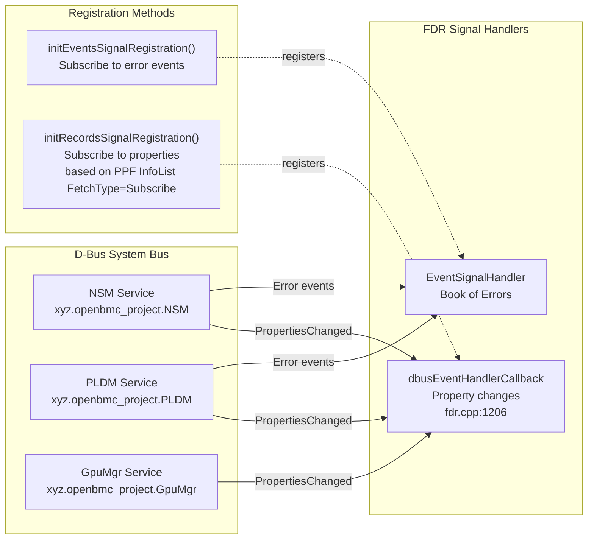

The registration occurs in [main.cpp:62-65]() after the FlightDataRecorder_c object is constructed.

**Sources**: [main.cpp:62-65](), [fdr.cpp:1206-1275]()

## Environment Variables

### PLATFORMS_PATH

The `PLATFORMS_PATH` environment variable specifies the directory containing PPF files. This is typically set in the systemd service file.

**Default behavior** (if not set): Look for PPF files in `./platforms` relative to the binary location (development mode).

**Production deployment**: Set to `/etc/nvidia-fdr/platforms`

```bash
# In systemd service file:
Environment="PLATFORMS_PATH=/etc/nvidia-fdr/platforms"
```

The platform detection logic in [fdr.cpp:218-224]() checks this variable:

```cpp
const char* platforms_path = getenv("PLATFORMS_PATH");
std::string SupportedPlatformsDir = 
    (platforms_path != NULL ? platforms_path : "./platforms");
```

**Sources**: [fdr.cpp:218-224]()

## Running FDR

### Systemd Service (Production)

The recommended deployment method is via systemd service management:

```bash
# Check service status
systemctl status nvidia-fdr.service

# Start the service
systemctl start nvidia-fdr.service

# Stop the service
systemctl stop nvidia-fdr.service

# Restart after configuration changes
systemctl restart nvidia-fdr.service

# Enable auto-start on boot
systemctl enable nvidia-fdr.service

# View service logs
journalctl -u nvidia-fdr.service -f
```

**Sources**: [README.md:158-166]()

### Manual Execution (Development)

For development and testing, FDR can be run directly:

```bash
# Run with automatic PPF detection
sudo ./nvidia-fdr

# Run with specific PPF file
sudo ./nvidia-fdr /path/to/fdr_ppf_custom.yaml

# Set environment variables
sudo PLATFORMS_PATH=/custom/path ./nvidia-fdr
```

The binary requires root privileges to:
- Access D-Bus system bus
- Write to `/var/emmc/fdr/` storage
- Execute privileged shell commands for precondition checks

**Sources**: [README.md:83-90](), [main.cpp:46-51]()

### Command-Line Arguments

The `main()` function accepts an optional PPF file path as the first argument:

| Argument | Description |
|----------|-------------|
| (none) | Auto-detect platform via fingerprint checks |
| `<path>` | Use specified PPF file, skip platform detection |

**Sources**: [main.cpp:46-51](), [fdr.cpp:59-64]()

## Runtime Operation Modes

FDR supports two operational modes controlled by the `FDR_TIMER_EVENT_ENABLED` compile-time flag:

### Timer-Based Mode (Default)

When `FDR_TIMER_EVENT_ENABLED` is defined (default):

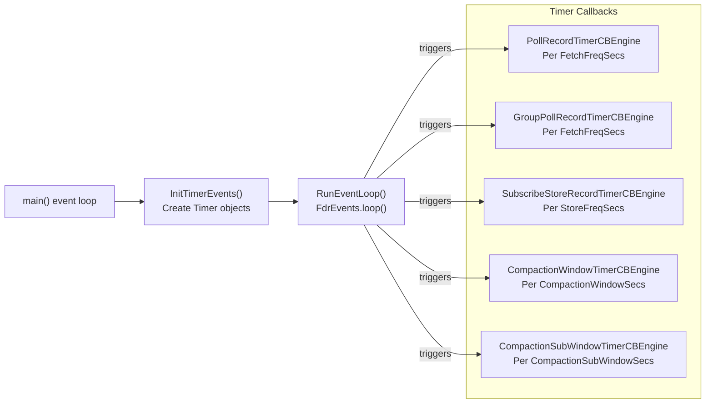

This mode uses `sdeventplus::utility::Timer` objects for precise, event-driven scheduling.

**Sources**: [main.cpp:67-90](), [fdr.hpp:32]()

### Polling Mode

When `FDR_TIMER_EVENT_ENABLED` is not defined:

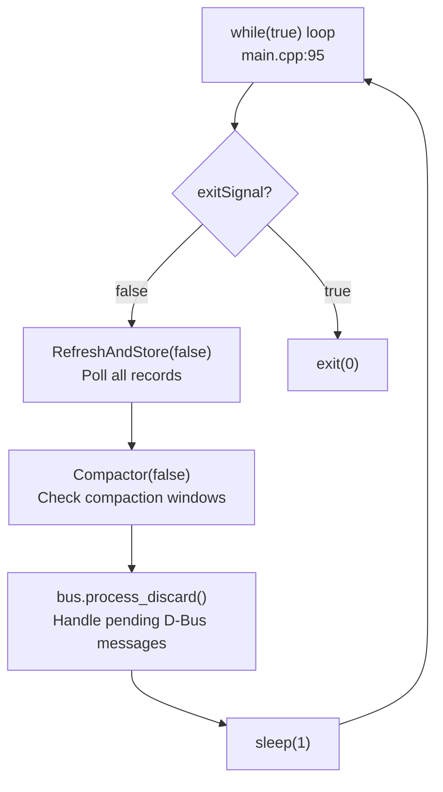

This mode uses a simple 1-second polling loop, suitable for platforms where timer infrastructure is unreliable.

**Sources**: [main.cpp:95-142]()

## Verification

### Service Health Checks

**1. Service Status**
```bash
systemctl status nvidia-fdr.service
```
Expected output should show "active (running)" status.

**2. D-Bus Registration**
```bash
busctl list | grep FDR
```
Should show: `xyz.openbmc_project.FDR`

**3. Process Running**
```bash
ps aux | grep nvidia-fdr
```
Should show the `nvidia-fdr` process with PID.

**4. Log File Creation**
```bash
ls -lh /var/emmc/fdr/
```
Should show:
- `Bookkeeper/` directory with metadata files
- Boot-specific directories named `<bootcount>_<timestamp>/`

**5. Service Logs**
```bash
journalctl -u nvidia-fdr.service -n 50
```
Check for:
- "Found the PPF file" message indicating successful platform detection
- "All precheck conditions passed" indicating preconditions met
- No error messages about disk space or missing services

### Validation Checklist

| Check | Command | Expected Result |
|-------|---------|-----------------|
| PPF Loaded | `journalctl -u nvidia-fdr.service \| grep "PPF file"` | Shows detected PPF filename |
| Boot Counter | `cat /var/emmc/fdr/Bookkeeper/BootCount.txt` | Contains numeric boot count |
| Birth Certificate | `ls /var/emmc/fdr/Bookkeeper/BirthCertificate.tar` | File exists (after first boot) |
| Data Collection | `ls /var/emmc/fdr/<bootcount>_*/` | Shows `.dat` files being created |
| Disk Space | `df -h /var/emmc/fdr` | Available space above threshold |
| D-Bus Connection | `busctl tree xyz.openbmc_project.FDR` | Shows service object tree |

**Sources**: [fdr.cpp:260-286](), [fdr.cpp:1053-1070]()

## Deployment Scenarios

### Development Environment (Native Ubuntu)

For native development on Ubuntu 22.04:

1. **Install D-Bus policy**: Place policy file in `/etc/dbus-1/system.d/` and reload
2. **Set PLATFORMS_PATH**: Point to local PPF directory
   ```bash
   export PLATFORMS_PATH=./platforms
   ```
3. **Create data directory**: 
   ```bash
   sudo mkdir -p /var/emmc/fdr
   sudo chown $USER:$USER /var/emmc/fdr
   ```
4. **Run manually**: `sudo ./build/nvidia-fdr`

**Sources**: [README.md:66-90]()

### Production Deployment (HGX Platform)

On NVIDIA HGX systems deployed via Yocto/OpenBMC:

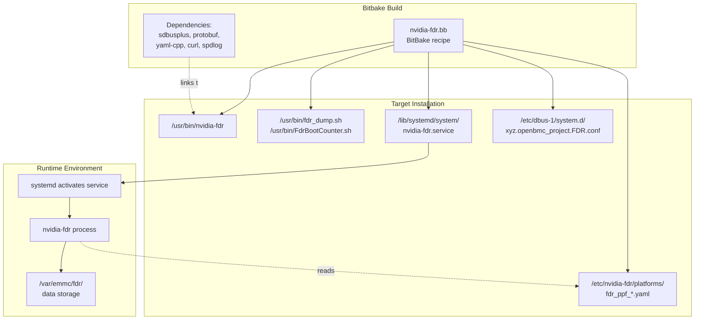

Key differences from development deployment:
- All files installed via package manager (RPM)
- systemd service auto-starts on boot
- `PLATFORMS_PATH` set in service file to `/etc/nvidia-fdr/platforms`
- Storage on persistent eMMC partition mounted at `/var/emmc/`

**Sources**: [README.md:123-166]()

### Special Runtime Files

**Boot Counter Management**

The `/tmp/.fdrHmcAlive` hidden file is used to distinguish between:
- **HMC reboot**: File does not exist (tmpfs cleared)
- **FDR restart**: File exists (service restart without HMC reboot)

This affects boot counter logic in [fdr.cpp:962-991]() and `/usr/bin/FdrBootCounter.sh`.

**Birth Certificate**

The `BirthCertificate.tar` file in [fdr.cpp:767-832]() contains:
- All `*.others.dat` files from first boot (inventory, config, versions)
- Bookkeeper metadata files

It is made immutable using `chattr +i` in [fdr.cpp:748-762]() to prevent accidental deletion.

**Sources**: [fdr.cpp:748-832](), [fdr.cpp:962-991](), [fdr.cpp:1003-1048]()

## Error Handling and Recovery

### Initialization Failures

FDR will exit with `EXIT_FAILURE` if:

| Failure Condition | Check Location | Action |
|-------------------|----------------|--------|
| PPF not found or invalid | [fdr.cpp:70-74]() | Log error, exit |
| PPF fails sanity check | [fdr.cpp:79-85]() | Log validation errors, exit |
| Preconditions fail with `ExitOnFailure=true` | [fdr.cpp:459-465]() | Log error, exit |
| Disk space below threshold | [fdr.cpp:382-391]() | Log warning, exit with `EXIT_SUCCESS` |

### Runtime Exception Handling

FDR implements a rate limiter for uncaught exceptions (configurable via `GeneralConfig.ExceptionAllowRate` in PPF):

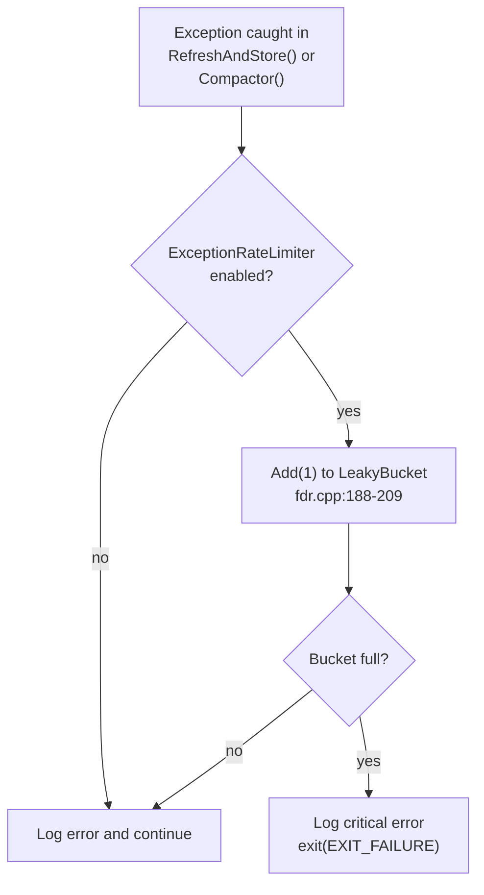

This prevents cascading failures from causing FDR to crash immediately, while still exiting if exceptions become too frequent.

**Sources**: [fdr.cpp:168-209](), [fdr.cpp:838-863]()

### Disk Space Monitoring

FDR continuously monitors disk space in [fdr.cpp:342-378]():
- Checked on startup
- Checked after each compaction window
- If free space falls below `PartitionThresoldCheckMB`, FDR exits gracefully with `EXIT_SUCCESS`
- Creates a critical Redfish log entry before exiting

**Sources**: [fdr.cpp:342-391]()

## Configuration Files Reference

### systemd Service File

Typical systemd unit file for FDR (installed by BitBake):

```ini
[Unit]
Description=NVIDIA Flight Data Recorder Service
After=network.target

[Service]
Type=simple
ExecStart=/usr/bin/nvidia-fdr
Restart=always
RestartSec=10
Environment="PLATFORMS_PATH=/etc/nvidia-fdr/platforms"

[Install]
WantedBy=multi-user.target
```

### Logging Configuration

FDR logging behavior is controlled by PPF `GeneralConfig` section:

```yaml
GeneralConfig:
  LoggingLevel: "debug"  # spdlog level: trace, debug, info, warn, error
  LoggingFileMaxSize: 10485760  # 10MB per log file
  LoggingFileNumber: 5  # Keep 5 rotating log files
```

When compiled with `FDR_USE_SPDLOG`, logs are written to `<LogsBasePath>/fdr.dat`. Otherwise, logs go to phosphor-logging/journald.

**Sources**: [fdr.cpp:90-97]()

---

# Page: Core Concepts

# Core Concepts

<details>
<summary>Relevant source files</summary>

The following files were used as context for generating this wiki page:

- [fdr.cpp](fdr.cpp)
- [fdr.hpp](fdr.hpp)
- [fdr_compact.cpp](fdr_compact.cpp)
- [fdr_record.cpp](fdr_record.cpp)
- [platforms/fdr_ppf_example.yaml](platforms/fdr_ppf_example.yaml)
- [platforms/fdr_ppf_vulcan.yaml](platforms/fdr_ppf_vulcan.yaml)

</details>


This page introduces the fundamental concepts that drive the NVIDIA FDR system's operation. It provides an overview of how configuration files define data collection behavior, how the Record abstraction manages individual parameters, the various data collection methods available, and how data is stored and retained over time.

For detailed information about specific topics, see:
- Platform Profile File structure and syntax: [Platform Profile Files (PPF)](#3.1)
- Record lifecycle, fetch types, and store policies: [Records and Data Collection](#3.2)
- Binary log format and protobuf schema: [Storage Format and Protobuf](#3.3)
- Complete PPF file specifications: [PPF File Structure Reference](#5.1)

---

## Configuration-Driven Architecture

The FDR system operates entirely based on **Platform Profile Files (PPF)**, which are YAML configuration files that define what telemetry to collect, how frequently to sample it, and where to retrieve the data. The system automatically detects the appropriate PPF file at startup by executing fingerprint checks, then constructs the entire monitoring infrastructure from the configuration.

```mermaid
graph TB
    subgraph "Platform Detection & Configuration Loading"
        PPF_DIR["PPF Directory<br/>/etc/nvidia-fdr/platforms/"]
        FINGERPRINT["FingerPrint Checks<br/>Shell commands<br/>grep platform ID"]
        PPF_FILE["Selected PPF File<br/>fdr_ppf_vulcan.yaml"]
        YAML_PARSER["YAML Parser<br/>ConvertPPFToStruct()"]
        PROFILE["Profile_t struct<br/>In-memory configuration"]
    end
    
    subgraph "PPF Structure"
        GENERAL["GeneralConfig<br/>LogsBasePath<br/>CompactionWindowSecs"]
        SECTIONS["Sections[]<br/>GPU, NIC, etc."]
        COMPONENTS["Components[]<br/>GPU0, GPU1, etc."]
        INFOGROUPS["InfoGroups[]<br/>Inventory, Config, Sensor.*"]
        INFOLIST["InfoList[]<br/>Individual parameters"]
    end
    
    subgraph "Runtime Objects"
        FDR_MAIN["FlightDataRecorder_c<br/>Main orchestrator"]
        RECORDS["Record objects<br/>One per InfoList entry"]
        TIMERS["Timer objects<br/>Periodic callbacks"]
        STORES["FDRStore objects<br/>File writers"]
    end
    
    PPF_DIR --> FINGERPRINT
    FINGERPRINT --> PPF_FILE
    PPF_FILE --> YAML_PARSER
    YAML_PARSER --> PROFILE
    
    PROFILE --> GENERAL
    PROFILE --> SECTIONS
    SECTIONS --> COMPONENTS
    COMPONENTS --> INFOGROUPS
    INFOGROUPS --> INFOLIST
    
    PROFILE --> FDR_MAIN
    INFOLIST --> RECORDS
    RECORDS --> TIMERS
    RECORDS --> STORES
```

**Sources:** [fdr.cpp:211-292](), [fdr.cpp:296-319](), [fdr.hpp:140](), [platforms/fdr_ppf_vulcan.yaml:18-22]()

---

## Records: The Data Collection Unit

Each parameter defined in a PPF file instantiates a **Record** object, which encapsulates all logic for fetching, processing, and storing that specific metric. The `Record` class ([fdr_record.cpp:23-30]()) maintains:

- References to its configuration (`Info_t`, `InfoGroup_t`, `Component_t`)
- Fetch timing state (`LastFetchedAt`, `LastStoredAt`)
- Current data value (`fdr_sample_ext data`)
- Statistics for compaction (`runningStatus`)
- File writer pointers (`fdrLogReaderWriter`, `fdrStatwriter`)

```mermaid
graph LR
    subgraph "PPF Configuration"
        INFO["Info_t<br/>ID: 'GPU-TEMP'<br/>ParamID: 168<br/>FetchMethod: 'DBUS'<br/>FetchFreqSecs: 600<br/>StorePolicy: 'EveryFetch'"]
    end
    
    subgraph "Record Instance"
        REC["Record object<br/>fdr_record.cpp"]
        REFRESH["Refresh()<br/>Fetch data"]
        STORE["Store()<br/>Write data"]
        STATS["RunningStatisticEngine()<br/>Update aggregates"]
    end
    
    subgraph "Data Sources"
        DBUS["D-Bus<br/>readDbusProperty()"]
        SHMEM["Shared Memory<br/>Shmem client"]
        REDFISH["Redfish API<br/>query_uint64t()"]
        CMD["Command<br/>exec()"]
    end
    
    subgraph "Storage"
        BINARY["Binary Log<br/>GPU.GPU0.sensors.dat"]
        STAT["Statistics Log<br/>GPU.GPU0.sensors.stat.dat"]
    end
    
    INFO --> REC
    REC --> REFRESH
    REC --> STORE
    REC --> STATS
    
    REFRESH --> DBUS
    REFRESH --> SHMEM
    REFRESH --> REDFISH
    REFRESH --> CMD
    
    STORE --> BINARY
    STATS --> STAT
```

**Sources:** [fdr_record.cpp:23-69](), [fdr_record.cpp:136-423](), [fdr_record.cpp:578-621]()

---

## Data Collection Methods and Fetch Types

FDR supports multiple **FetchMethods** for retrieving telemetry, each suited to different data sources:

| FetchMethod | Description | Implementation | Use Case |
|-------------|-------------|----------------|----------|
| `DBUS` | D-Bus property reads | `dbus::readDbusProperty()` | GPU Manager, NSM services |
| `Shmem` | Shared memory reads | `telemetry_mrd_client` | High-frequency GPU metrics |
| `Redfish` | HTTP REST API calls | `RedfishClient::query_*()` | Out-of-band BMC data |
| `Command` | Shell command execution | `exec()` | nvidia-smi, shell scripts |
| `DBUS_DGD` | D-Bus Device Get Property | `readDbusDGDProperty()` | GPU device-specific queries |
| `DBUS_PT` | D-Bus Passthrough (FPGA) | `readDbusPTProperty()` | FPGA register reads |

**Sources:** [fdr_record.cpp:152-414](), [fdr_record.cpp:293-357](), [fdr_record.cpp:359-380]()

### Fetch Types

Records are organized by **FetchType**, which determines when data is collected:

```mermaid
graph TB
    subgraph "FetchType: Poll"
        POLL_TIMER["Timer<br/>FetchFreqSecs"]
        POLL_CB["Timer Callback<br/>PollRecordTimerCBEngine()"]
        POLL_RECORDS["RecListPollMap<br/>Map<int, vector<Record*>>"]
        POLL_REFRESH["Refresh() + Store()"]
    end
    
    subgraph "FetchType: GroupPoll"
        GRPPOLL_TIMER["Timer<br/>FetchFreqSecs"]
        GRPPOLL_CB["Timer Callback<br/>GroupPollRecordTimerCBEngine()"]
        GRPPOLL_RECORDS["RecListGrpPollMap<br/>Grouped by key"]
        GRPPOLL_UPDATE["FdrGrpUpdate<br/>Batch fetch from Shmem"]
    end
    
    subgraph "FetchType: Subscribe"
        DBUS_SIGNAL["D-Bus Signal<br/>PropertiesChanged"]
        SIGNAL_CB["Signal Callback<br/>dbusEventHandlerCallback()"]
        SUBS_RECORDS["subscribedRecListMap<br/>Map<string, Record*>"]
        SUBS_REFRESH["refreshDataCallback()"]
        STORE_TIMER["Timer<br/>StoreFreqSecs"]
        SUBS_STORE["Store()"]
    end
    
    POLL_TIMER --> POLL_CB
    POLL_CB --> POLL_RECORDS
    POLL_RECORDS --> POLL_REFRESH
    
    GRPPOLL_TIMER --> GRPPOLL_CB
    GRPPOLL_CB --> GRPPOLL_RECORDS
    GRPPOLL_RECORDS --> GRPPOLL_UPDATE
    
    DBUS_SIGNAL --> SIGNAL_CB
    SIGNAL_CB --> SUBS_RECORDS
    SUBS_RECORDS --> SUBS_REFRESH
    SUBS_REFRESH --> STORE_TIMER
    STORE_TIMER --> SUBS_STORE
```

**Sources:** [fdr.cpp:664-721](), [fdr.hpp:42-51](), [fdr_record.cpp:623-648]()

---

## Store Policies

Once data is fetched, the **StorePolicy** determines when it is written to disk:

| StorePolicy | Behavior | Implementation | Typical Use |
|-------------|----------|----------------|-------------|
| `OnChange` | Write only if value differs | `same_data_values()` comparison | Inventory, configuration |
| `EveryFetch` | Write on every successful fetch | Check `LastFetchedAt` vs `LastStoredAt` | High-value metrics |
| `Periodic` | Write at `StoreFreqSecs` intervals | Check `StoreFreqSecs` elapsed | Low-priority data |

**Sources:** [fdr_record.cpp:578-603](), [fdr_record.cpp:525-563]()

---

## Data Storage and Compaction

FDR writes telemetry to **protobuf-encoded binary files** organized in a directory hierarchy. The system implements a multi-tier retention strategy:

```mermaid
graph TB
    subgraph "Current Directory<br/>BootId_BootCount_Timestamp"
        SENSORS["*.sensors.dat<br/>High-frequency data"]
        OTHERS["*.others.dat<br/>Inventory, Config, Errors"]
    end
    
    subgraph "Compaction Process"
        WINDOW_TIMER["CompactionWindowSecs<br/>86400s = 1 day"]
        SUBWINDOW_TIMER["CompactionSubWindowSecs<br/>1800s = 30 min"]
        COMPACTOR["Compactor()<br/>fdr_compact.cpp"]
    end
    
    subgraph "Compacted Directory<br/>N-2 boot cycles old"
        STAT["*.sensors.stat.dat<br/>30-minute aggregates<br/>avg, min, max"]
        HIFI["*.sensors.hifi.dat<br/>±300s around errors"]
        OTHERS_OLD["*.others.dat<br/>Retained from oldest"]
    end
    
    subgraph "BookKeeper Files<br/>/Bookkeeper/"
        COMPACTOR_DAT["Compactor.dat<br/>Directories to compact"]
        BOE["BookOfErrors.dat<br/>Error timestamps"]
        BOOT_EVENT["BootEvent.dat<br/>Boot events + format version"]
    end
    
    SENSORS --> WINDOW_TIMER
    OTHERS --> WINDOW_TIMER
    WINDOW_TIMER --> COMPACTOR
    SUBWINDOW_TIMER --> COMPACTOR
    
    COMPACTOR --> STAT
    COMPACTOR --> HIFI
    COMPACTOR --> OTHERS_OLD
    
    COMPACTOR --> COMPACTOR_DAT
    COMPACTOR --> BOE
    COMPACTOR --> BOOT_EVENT
```

**Sources:** [fdr_compact.cpp:129-176](), [fdr_compact.cpp:179-246](), [fdr_compact.cpp:384-488]()

### Compaction Workflow

1. **Sub-Window Expiry** (every 1800s): Append statistics to `*.sensors.stat.dat` files using running averages computed by `RunningStatisticEngine()` ([fdr_record.cpp:429-487]()).

2. **Main Window Expiry** (every 86400s): 
   - Check `Compactor.dat` for N-2 directories to process
   - Scan `BookOfErrors.dat` for errors in the time range
   - Extract high-fidelity logs (±300s around errors) to `*.sensors.hifi.dat`
   - Delete `*.sensors.dat` files (raw data)
   - Retain `*.others.dat` from oldest boot cycle

3. **Data Format Versioning**: The `currentDataFormatVersion` constant ([fdr.cpp:45]()) tracks the directory structure format. Compaction skips directories with mismatched versions ([fdr_compact.cpp:808-821]()).

**Sources:** [fdr_compact.cpp:285-333](), [fdr_compact.cpp:896-937](), [fdr.cpp:45]()

---

## Protobuf Data Structures

All telemetry is serialized using Protocol Buffers, with the schema defined in `fdr_logs.proto`. Key message types:

| Message Type | Purpose | Fields | File Extension |
|--------------|---------|--------|----------------|
| `fdr_sample` | Individual sample | `timestamp`, `paramid`, `paramvalue*` | `.dat` |
| `fdr_statistic` | Aggregated statistics | `avg`, `min`, `max`, `numsamples`, timestamps | `.stat.dat` |
| `fdr_book_of_errors` | Error event | `erroroccurtimestamp`, `paramid`, `deviceinstance` | `BookOfErrors.dat` |
| `fdr_compactor_bookkeep` | Compaction tracking | `compactdirectory` | `Compactor.dat` |
| `fdr_params` | Parameter metadata | `paramid`, `paramname`, `paramtype`, `compclass` | `ParamDescription.dat` |

The `FDRStore` class ([fdr_store.cpp]()) provides `append()` and `readnext()` methods for reading and writing protobuf messages.

**Sources:** [fdr_record.cpp:429-487](), [fdr_record.cpp:489-523](), [fdr.cpp:726-737]()

---

## Configuration-to-Runtime Mapping

The following table shows how PPF configuration translates to runtime behavior:

| PPF Field | Runtime Effect | Code Location |
|-----------|----------------|---------------|
| `FetchFreqSecs` | Timer interval for Poll/GroupPoll | `RecListPollMap[freq]` |
| `StoreFreqSecs` | Timer interval for Subscribe storage | `RecListSubscribeStoreMap[freq]` |
| `FetchMethod` | Data source selection in `Refresh()` | [fdr_record.cpp:152-414]() |
| `StorePolicy` | Condition checked in `Store()` | [fdr_record.cpp:581-603]() |
| `CompactionMethod: Average` | Enable statistics generation | [fdr_record.cpp:419-422]() |
| `RecordRetentionPolicy: Recreate` | Delete and recreate Record objects | [fdr.cpp:269]() |
| `CompactionWindowSecs` | Main compaction timer | [fdr_compact.cpp:194-195]() |
| `ParamID` | Unique identifier in protobuf | `fdr_sample.set_paramid()` |

**Sources:** [fdr.cpp:664-721](), [fdr_record.cpp:136-143](), [fdr.cpp:252-282]()

---

## Summary

The FDR system's core concepts work together as follows:

1. **PPF files** define the monitoring scope and parameters
2. **Record objects** encapsulate fetch/store logic for each parameter
3. **Fetch methods** retrieve data from various sources (D-Bus, Shmem, Redfish, commands)
4. **Fetch types** organize records by collection pattern (Poll, GroupPoll, Subscribe)
5. **Store policies** optimize disk writes based on data characteristics
6. **Protobuf format** provides efficient binary serialization
7. **Compaction** implements multi-tier retention with statistics and error-triggered high-fidelity preservation

This architecture enables flexible, configuration-driven telemetry collection that scales to monitor hundreds of parameters across multiple hardware components while managing storage efficiently through automatic data aggregation and retention policies.

---

# Page: Platform Profile Files (PPF)

# Platform Profile Files (PPF)

<details>
<summary>Relevant source files</summary>

The following files were used as context for generating this wiki page:

- [fdr.cpp](fdr.cpp)
- [fdr.hpp](fdr.hpp)
- [fdr_compact.cpp](fdr_compact.cpp)
- [platforms/fdr_ppf_example.yaml](platforms/fdr_ppf_example.yaml)
- [platforms/fdr_ppf_hgxb_hmc.yaml](platforms/fdr_ppf_hgxb_hmc.yaml)
- [platforms/fdr_ppf_vulcan.yaml](platforms/fdr_ppf_vulcan.yaml)
- [tools/data_validation/platform/exempt_telemetry_list_hgxb.yaml](tools/data_validation/platform/exempt_telemetry_list_hgxb.yaml)

</details>


## Purpose and Scope

Platform Profile Files (PPF) are YAML-based configuration files that define what telemetry data FDR collects, how often to collect it, where to fetch it from, and how to store it. Each supported hardware platform has its own PPF that specifies the complete monitoring profile for that system. This page explains the structure, loading process, and core concepts of PPFs.

For detailed parameter reference and field specifications, see [PPF File Structure Reference](#5.1). For platform-specific examples, see [Vulcan Platform Configuration](#5.2) and [HGXB HMC Platform Configuration](#5.3). For how PPF definitions translate to runtime data collection, see [Records and Data Collection](#3.2).

---

## PPF File Organization and Discovery

### File Location and Naming

PPF files are stored in the `platforms/` directory with the naming convention `fdr_ppf_<platform>.yaml`. The system searches this directory at startup to find the appropriate configuration for the running platform.

**Sources:** [fdr.cpp:211-292]()

```
platforms/
├── fdr_ppf_example.yaml
├── fdr_ppf_hgxb_hmc.yaml
└── fdr_ppf_vulcan.yaml
```

### Platform Detection Process

```mermaid
flowchart TD
    Start["FDR Startup"] --> GetEnv["Check PLATFORMS_PATH<br/>environment variable"]
    GetEnv --> DirPath{"Directory<br/>exists?"}
    DirPath -->|No| Error["Exit with error"]
    DirPath -->|Yes| ScanDir["Scan directory for<br/>*.yaml files"]
    ScanDir --> SortFiles["Sort files alphabetically"]
    
    SortFiles --> Loop["For each PPF file"]
    Loop --> Parse["ConvertPPFToStruct()<br/>Parse YAML to structs"]
    Parse --> ParseOK{"Parse<br/>successful?"}
    ParseOK -->|No| NextFile["Try next file"]
    
    ParseOK -->|Yes| Fingerprint["ExecuteFingerPrintRules()<br/>Run shell commands"]
    Fingerprint --> FPMatch{"All commands<br/>exit 0?"}
    FPMatch -->|No| NextFile
    FPMatch -->|Yes| Sanity["PPFSanity.SanityTestPPF()<br/>Check for duplicates"]
    Sanity --> SanityOK{"Sanity<br/>passed?"}
    SanityOK -->|No| Error
    SanityOK -->|Yes| Precon["ExecutePreconditionRules()<br/>Validate prerequisites"]
    Precon --> PreconOK{"Preconditions<br/>met?"}
    PreconOK -->|No| Error
    PreconOK -->|Yes| Success["PPF loaded successfully<br/>Store in profile struct"]
    
    NextFile --> Loop
```

**Sources:** [fdr.cpp:211-292](), [fdr.cpp:296-319](), [fdr.cpp:322-340](), [fdr.cpp:395-487]()

The `FlightDataRecorder_c` constructor calls `FindAndLoadPlatformProfile()` which:
1. Reads `PLATFORMS_PATH` environment variable (defaults to `./platforms`)
2. Iterates through all `.yaml` files alphabetically
3. For each file, parses it using `ConvertPPFToStruct()`
4. Executes the `FingerPrint.Checks` shell commands
5. If all checks pass, validates with `PPFSanity::SanityTestPPF()`
6. Executes `Preconditions` checks
7. Uses the first matching PPF

---

## PPF File Structure Hierarchy

### Top-Level Sections

A PPF file contains four main top-level sections:

```mermaid
graph TB
    PPF["PPF YAML File"]
    
    PPF --> FP["FingerPrint"]
    PPF --> GC["GeneralConfig"]
    PPF --> PC["Preconditions"]
    PPF --> SEC["Sections[]"]
    
    FP --> FP_Checks["Checks:<br/>Shell commands for<br/>platform detection"]
    
    GC --> GC_Format["LogsFormat: BINARY"]
    GC --> GC_Path["LogsBasePath: /var/emmc/fdr/"]
    GC --> GC_Compact["CompactionWindowSecs: 86400"]
    GC --> GC_SubWindow["CompactionSubWindowSecs: 1800"]
    GC --> GC_HiFi["HiFiDataPreserveTimeSecs: 300"]
    GC --> GC_Other["Logging, Exception,<br/>Redfish settings"]
    
    PC --> PC_Threshold["Threshold: 300"]
    PC --> PC_Checks["Checks[]:<br/>Mount points,<br/>disk space, etc."]
    
    SEC --> Section1["Section"]
    SEC --> SectionN["..."]
    
    Section1 --> Comp["Components[]"]
    Comp --> InfoGrp["InfoGroups[]"]
    InfoGrp --> InfoList["InfoList[]"]
```

**Sources:** [fdr.cpp:296-319](), [platforms/fdr_ppf_hgxb_hmc.yaml:18-51](), [platforms/fdr_ppf_vulcan.yaml:18-52]()

| Section | Purpose | Key Fields |
|---------|---------|------------|
| **FingerPrint** | Platform detection rules | `Checks` (list of shell commands) |
| **GeneralConfig** | System-wide configuration | `LogsFormat`, `LogsBasePath`, `CompactionWindowSecs`, `CompactionSubWindowSecs`, `HiFiDataPreserveTimeSecs`, `PartitionThresoldCheckMB` |
| **Preconditions** | Pre-flight validation checks | `Threshold`, `Checks` (ID, Command, ExitOnFailure) |
| **Sections** | Hardware component definitions | Array of `Section` objects |

---

## Section, Component, and InfoGroup Hierarchy

### Organizational Structure

```mermaid
graph TB
    Sections["Sections[]<br/>Top-level hardware categories"]
    
    Sections --> S_GPU["Section:<br/>ID: GPU"]
    Sections --> S_NIC["Section:<br/>ID: NIC"]
    Sections --> S_Other["Section:<br/>ID: ..."]
    
    S_GPU --> C_GPU0["Component:<br/>ID: GPU_SXM_1"]
    S_GPU --> C_GPU1["Component:<br/>ID: GPU_SXM_2"]
    
    C_GPU0 --> Params["Params:<br/>name: gpuid<br/>value: 1"]
    C_GPU0 --> IG_Inv["InfoGroup:<br/>ID: Inventory"]
    C_GPU0 --> IG_Cfg["InfoGroup:<br/>ID: Config"]
    C_GPU0 --> IG_Err["InfoGroup:<br/>ID: Error"]
    C_GPU0 --> IG_Sens["InfoGroup:<br/>ID: Sensor.*"]
    
    IG_Inv --> IL_Inv["InfoList[]:<br/>VENDOR, SERIAL, etc."]
    IG_Cfg --> IL_Cfg["InfoList[]:<br/>FW-VER, ECC-MODE, etc."]
    IG_Err --> IL_Err["InfoList[]:<br/>ECC-ERR-CTR-CE, etc."]
    IG_Sens --> IL_Sens["InfoList[]:<br/>TEMP, POWER, etc."]
    
    IG_Sens --> Compact["CompactionMethod: Average<br/>RecordRetentionPolicy: Recreate"]
```

**Sources:** [fdr.cpp:574-746](), [platforms/fdr_ppf_hgxb_hmc.yaml:53-267]()

### Runtime Object Mapping

The PPF hierarchy maps directly to runtime C++ objects during `CreateRecords()`:

```mermaid
flowchart LR
    subgraph "PPF YAML"
        PPF_Sec["Section"]
        PPF_Comp["Component"]
        PPF_IG["InfoGroup"]
        PPF_IL["InfoList"]
    end
    
    subgraph "C++ Structs"
        Struct_Sec["Section_t<br/>profile.Sections"]
        Struct_Comp["Component_t<br/>section.Components"]
        Struct_IG["InfoGroup_t<br/>component.InfoGroups"]
        Struct_IL["InfoList_t<br/>infogroup.InfoList"]
    end
    
    subgraph "Runtime Objects"
        Record["Record*<br/>RecList vector"]
        FDRStore["FDRStore*<br/>File writers"]
        Timer["Timer objects<br/>RecListPollMap"]
    end
    
    PPF_Sec --> Struct_Sec
    PPF_Comp --> Struct_Comp
    PPF_IG --> Struct_IG
    PPF_IL --> Struct_IL
    
    Struct_IL --> Record
    Struct_IG --> FDRStore
    Struct_IL --> Timer
```

**Sources:** [fdr.cpp:574-746](), [fdr.hpp:38-177]()

The `FlightDataRecorder_c::CreateRecords()` method iterates through the PPF structure:

```cpp
for (auto& section : profile.Sections) {
    for (auto& component : section.Components) {
        for (auto& infogroup : component.InfoGroups) {
            // Create shared FDRStore per InfoGroup
            std::shared_ptr<FDRStore> fdrStoreObj;
            CreateSamplesWriter(profile, section.ID, component.ID, 
                              infogroup.ID, fileExtension, fdrStoreObj);
            
            for (auto& info : infogroup.InfoList) {
                // Create one Record per InfoList item
                Record* resource = new Record(profile, section, component,
                                            fdrStoreObj, fdrStatStoreObj,
                                            infogroup, info);
                RecList.push_back(resource);
                
                // Organize by fetch type
                if (info.FetchType == "Poll") {
                    RecListPollMap[info.FetchFreqSecs].push_back(resource);
                }
                else if (info.FetchType == "Subscribe") {
                    RecListSubscribeStoreMap[info.StoreFreqSecs].push_back(resource);
                }
                else if (info.FetchType == "GroupPoll") {
                    RecListGrpPollMap[info.FetchFreqSecs][groupKey].push_back(resource);
                }
            }
        }
    }
}
```

---

## InfoGroup Organization

### Standard InfoGroup IDs

InfoGroups categorize parameters into logical classes. Common InfoGroup IDs include:

| InfoGroup ID | Purpose | File Extension | Example Parameters |
|--------------|---------|----------------|-------------------|
| `Inventory` | Static hardware identification | `.others.dat` | VENDOR, SERIAL, PART-NUM, UUID |
| `Config` | Configuration and version info | `.others.dat` | FW-VER, DRVR-VER, ECC-MODE |
| `Error` | Error counters and states | `.others.dat` | ECC-ERR-CTR-CE, PCI-ERR-CTR-CORR |
| `Specs` | Hardware specifications | `.others.dat` | MEM-SIZE, CLK-MAX, PWR-LIMIT-MAX |
| `Sensor.*` | Time-series sensor data | `.sensors.dat` | TEMP, POWER, CLOCK, UTILIZATION |

**Sources:** [fdr.cpp:600-644](), [platforms/fdr_ppf_hgxb_hmc.yaml:58-267]()

### Compaction Settings

InfoGroups with `Sensor.*` IDs typically include compaction settings:

```yaml
- ID: Sensor.Thermal
  InfoList:
    - ID: GPU-TEMP
      # ... parameter definition
  RecordRetentionPolicy: Recreate
  CompactionMethod: Average
```

These settings control how data is aggregated and retained during the compaction process (see [Storage and Compaction System](#4.4)).

**Sources:** [platforms/fdr_ppf_hgxb_hmc.yaml:31-34](), [fdr_compact.cpp:317-327]()

---

## InfoList Parameter Definitions

### Parameter Structure

Each InfoList entry defines a single telemetry parameter:

```mermaid
graph TB
    Info["InfoList Entry"]
    
    Info --> Meta["Metadata"]
    Info --> Fetch["Fetch Config"]
    Info --> Store["Store Config"]
    Info --> Source["Data Source"]
    
    Meta --> ID["ID: string<br/>Human-readable name"]
    Meta --> ParamID["ParamID: uint<br/>Unique numeric ID"]
    Meta --> DataType["DataType:<br/>string, Uint64, Double, etc."]
    
    Fetch --> FetchMethod["FetchMethod:<br/>DBUS, Shmem, Command, Redfish"]
    Fetch --> FetchType["FetchType:<br/>Poll, Subscribe, GroupPoll"]
    Fetch --> FetchFreq["FetchFreqSecs: int<br/>Sampling interval"]
    
    Store --> StorePolicy["StorePolicy:<br/>OnChange, EveryFetch, Periodic"]
    Store --> StoreFreq["StoreFreqSecs: int<br/>Storage interval"]
    
    Source --> DbusP["DbusParams:<br/>Service, ObjectPath,<br/>Interface, Property"]
    Source --> ShmemP["ShmemParams:<br/>Key, Namespace"]
    Source --> CmdP["CommandParams:<br/>Command"]
    Source --> RfP["RedfishParams:<br/>URI, JsonPath"]
```

**Sources:** [platforms/fdr_ppf_hgxb_hmc.yaml:59-86](), [platforms/fdr_ppf_vulcan.yaml:60-218]()

### Example Parameter Definition

```yaml
- ID: ECC-ERR-CTR-CE
  ParamID: 11
  DataType: Uint64
  FetchMethod: Shmem
  FetchType: GroupPoll
  FetchFreqSecs: 600
  StorePolicy: OnChange
  StoreFreqSecs: 600
  ShmemParams:
    Key: /xyz/openbmc_project/inventory/system/memory/GPU_SXM_$gpuid_DRAM_0/xyz.openbmc_project.Memory.MemoryECC.ceCount
    Namespace: "nsmd_HGX_MemoryMetrics_0"
  DbusParams:
    Interface: xyz.openbmc_project.Memory.MemoryECC
    ObjectPath: /xyz/openbmc_project/inventory/system/memory/GPU_SXM_$gpuid_DRAM_0
    Property: ceCount
    Service: xyz.openbmc_project.NSM
```

**Sources:** [platforms/fdr_ppf_hgxb_hmc.yaml:233-248]()

### Parameter Field Reference

| Field | Type | Required | Description |
|-------|------|----------|-------------|
| `ID` | string | Yes | Human-readable parameter name |
| `ParamID` | uint | Yes | Unique numeric identifier (never change once assigned) |
| `DataType` | string | Yes | `string`, `Uint64`, `Int64`, `Double`, `Bool` |
| `FetchMethod` | string | Yes | `DBUS`, `Shmem`, `Command`, `Redfish` |
| `FetchType` | string | Yes | `Poll` (timer), `Subscribe` (event), `GroupPoll` (batch) |
| `FetchFreqSecs` | int | Yes | How often to fetch data (seconds) |
| `StorePolicy` | string | Yes | `OnChange`, `EveryFetch`, `Periodic` |
| `StoreFreqSecs` | int | Yes | How often to store data (seconds) |
| `DbusParams` | object | Conditional | Required if `FetchMethod: DBUS` |
| `ShmemParams` | object | Conditional | Required if `FetchMethod: Shmem` |
| `CommandParams` | object | Conditional | Required if `FetchMethod: Command` |
| `RedfishParams` | object | Conditional | Required if `FetchMethod: Redfish` |

---

## YAML Templating with Anchors and Aliases

### Component Templates

PPF files use YAML anchors (`&`) and aliases (`*`) to reduce duplication. A common pattern is defining a component template and reusing it:

```yaml
GPU: &gpu
  Params:
    - name: gpuid
      value: 1
  InfoGroups:
    - ID: Config
      InfoList:
        - ID: FW-VER
          DataType: string
          # ... common parameters

Sections:
  - ID: GPU
    Components:
      - ID: GPU_SXM_1
        <<: *gpu      # Inherit template
        Params:       # Override parameter value
          - name: gpuid
            value: 1
      - ID: GPU_SXM_2
        <<: *gpu
        Params:
          - name: gpuid
            value: 2
```

**Sources:** [platforms/fdr_ppf_hgxb_hmc.yaml:53-86](), [platforms/fdr_ppf_example.yaml:86-295]()

### Parameter Defaults

Similar pattern for parameter defaults:

```yaml
- &gpu-config-defaults
  ID: FW-VER
  DataType: string
  FetchMethod: DBUS
  FetchType: Subscribe
  FetchFreqSecs: 3600
  StorePolicy: OnChange
  StoreFreqSecs: 3600
  ParamID: 16
  
- ID: DRVR-VER
  <<: *gpu-config-defaults
  ParamID: 15
  DbusParams:
    Service: xyz.openbmc_project.GpuMgr
    # ...
```

**Sources:** [platforms/fdr_ppf_vulcan.yaml:205-218]()

### Parameter Substitution

The `Params` section defines variables that are substituted into strings elsewhere in the component definition:

```yaml
Components:
  - ID: GPU_SXM_1
    Params:
      - name: gpuid
        value: 1
    InfoGroups:
      - InfoList:
          - DbusParams:
              ObjectPath: /xyz/openbmc_project/inventory/system/processors/GPU_SXM_$gpuid
              # Becomes: /xyz/openbmc_project/inventory/system/processors/GPU_SXM_1
```

The substitution is performed at runtime during parameter fetching, not during PPF parsing.

**Sources:** [platforms/fdr_ppf_hgxb_hmc.yaml:53-86]()

---

## PPF Validation and Sanity Checks

### PPFSanity Class

After a PPF is loaded, the `PPFSanity` class performs validation:

```mermaid
flowchart TD
    Load["PPF Loaded"] --> Create["Create PPFSanity object"]
    Create --> Test["SanityTestPPF(filename)"]
    
    Test --> CheckDup["Check for duplicate ParamIDs<br/>within each Component"]
    CheckDup --> DupFound{"Duplicates<br/>found?"}
    
    DupFound -->|Yes| LogError["Log error with:<br/>- Component ID<br/>- ParamID<br/>- Duplicate parameter names"]
    LogError --> Fail["Return FDR_ERR_GENFAILURE"]
    
    DupFound -->|No| Pass["Return FDR_SUCCESS"]
    
    Fail --> Exit["FDR exits"]
```

**Sources:** [fdr.cpp:76-85](), [ppf_sanity.cpp]()

The sanity checker ensures:
- No duplicate `ParamID` values within the same Component
- Each `ParamID` is unique across all InfoGroups in a Component

Example error message:
```
Error: PPF failed sanity test! Please fix the above issue(s) in the PPF /etc/nvidia-fdr/platforms/fdr_ppf_hgxb_hmc.yaml
```

---

## PPF to Record Creation Flow

### Complete Initialization Process

```mermaid
sequenceDiagram
    participant Main as main.cpp
    participant FDR as FlightDataRecorder_c
    participant PPF as PPF Loader
    participant Sanity as PPFSanity
    participant Precon as Precondition Checker
    participant Creator as Record Creator
    
    Main->>FDR: Constructor()
    FDR->>PPF: FindAndLoadPlatformProfile()
    PPF->>PPF: Scan platforms/ directory
    PPF->>PPF: ConvertPPFToStruct(file.yaml)
    PPF->>PPF: ExecuteFingerPrintRules()
    PPF-->>FDR: PPF loaded to profile struct
    
    FDR->>Sanity: SanityTestPPF(filename)
    Sanity->>Sanity: Check duplicate ParamIDs
    Sanity-->>FDR: FDR_SUCCESS or exit
    
    FDR->>Precon: ExecutePreconditionRules()
    Precon->>Precon: Run shell commands
    Precon->>Precon: Check mount points, disk space
    Precon-->>FDR: FDR_SUCCESS or exit
    
    FDR->>Creator: CreateRecords()
    loop For each Section
        loop For each Component
            loop For each InfoGroup
                Creator->>Creator: CreateSamplesWriter()<br/>Create FDRStore
                loop For each InfoList
                    Creator->>Creator: new Record(params)
                    Creator->>Creator: Add to RecList
                    Creator->>Creator: Add to RecListPollMap/<br/>RecListSubscribeStoreMap/<br/>RecListGrpPollMap
                end
            end
        end
    end
    Creator-->>FDR: All Records created
    
    FDR->>FDR: InitTimerEvents()
    FDR->>FDR: initRecordsSignalRegistration()
```

**Sources:** [fdr.cpp:55-166](), [fdr.cpp:574-746]()

---

## Key PPF Processing Functions

| Function | Location | Purpose |
|----------|----------|---------|
| `FindAndLoadPlatformProfile()` | [fdr.cpp:211-292]() | Scans platform directory and loads matching PPF |
| `ConvertPPFToStruct()` | [fdr.cpp:296-319]() | Parses YAML to `Profile_t` struct |
| `ExecuteFingerPrintRules()` | [fdr.cpp:322-340]() | Runs platform detection commands |
| `ExecutePreconditionRules()` | [fdr.cpp:395-487]() | Validates system prerequisites |
| `PPFSanity::SanityTestPPF()` | [ppf_sanity.cpp]() | Checks for duplicate ParamIDs |
| `CreateRecords()` | [fdr.cpp:574-746]() | Creates Record objects from PPF |
| `CreateSamplesWriter()` | [fdr.cpp:525-572]() | Creates FDRStore writers per InfoGroup |

---

## File Naming from PPF Structure

The PPF hierarchy determines output file naming:

```
LogsBasePath/BootCounter_BootID_Timestamp/
├── GPU.GPU_SXM_1.sensors.dat          # Section.Component.sensors.dat
├── GPU.GPU_SXM_1.others.dat           # Section.Component.others.dat
├── GPU.GPU_SXM_1.sensors.stat.dat     # Created during compaction
├── GPU.GPU_SXM_1.sensors.hifi.dat     # Created for error context
├── GPU.GPU_SXM_2.sensors.dat
├── GPU.GPU_SXM_2.others.dat
└── ...
```

**Sources:** [fdr.cpp:534-572](), [fdr.cpp:600-620]()

| File Type | InfoGroup Pattern | Purpose |
|-----------|-------------------|---------|
| `.sensors.dat` | `Sensor.*` | High-frequency time-series data |
| `.others.dat` | `Inventory`, `Config`, `Error`, `Specs` | Low-frequency configuration/state |
| `.sensors.stat.dat` | `Sensor.*` with `CompactionMethod: Average` | Aggregated statistics |
| `.sensors.hifi.dat` | `Sensor.*` near errors | High-fidelity error context |

---

## Summary

Platform Profile Files provide a declarative, hierarchical configuration system that drives all FDR telemetry collection:

1. **Discovery**: FDR scans `platforms/` directory and tests each `.yaml` file against `FingerPrint` rules
2. **Validation**: Sanity checks ensure no duplicate ParamIDs; preconditions verify system readiness
3. **Hierarchy**: PPF structure flows from Section → Component → InfoGroup → InfoList
4. **Templating**: YAML anchors and aliases enable component and parameter reuse
5. **Runtime**: Each InfoList entry creates a `Record` object organized by FetchType
6. **Storage**: InfoGroup ID determines file naming (`.sensors.dat` vs `.others.dat`)

The PPF system enables platform-specific configuration without code changes, supporting different hardware topologies and data sources through declarative YAML.

**Sources:** [fdr.cpp:55-166](), [fdr.cpp:211-487](), [fdr.cpp:574-746](), [platforms/fdr_ppf_hgxb_hmc.yaml](), [platforms/fdr_ppf_vulcan.yaml](), [platforms/fdr_ppf_example.yaml]()

---

# Page: Records and Data Collection

# Records and Data Collection

<details>
<summary>Relevant source files</summary>

The following files were used as context for generating this wiki page:

- [dbus_accessor.cpp](dbus_accessor.cpp)
- [dbus_accessor.hpp](dbus_accessor.hpp)
- [fdr.cpp](fdr.cpp)
- [fdr.hpp](fdr.hpp)
- [fdr_grp_update.cpp](fdr_grp_update.cpp)
- [fdr_log.cpp](fdr_log.cpp)
- [fdr_log.hpp](fdr_log.hpp)
- [fdr_record.cpp](fdr_record.cpp)
- [ppf_sanity.cpp](ppf_sanity.cpp)
- [property_variant.hpp](property_variant.hpp)

</details>


This page explains the core data collection mechanism in the FDR system: the `Record` class and its associated data fetching, storage, and organizational patterns. Each Record represents a single telemetry parameter configured in the Platform Profile Files (PPF) and handles the complete lifecycle of data collection for that parameter.

For information about the PPF configuration that defines these records, see [Platform Profile Files (PPF)](#3.1). For details on how collected data is stored and compacted, see [Storage Format and Protobuf](#3.3).

## Purpose and Scope

This document covers:
- The `Record` class structure and lifecycle
- Data fetch methods (D-Bus, Shmem, Redfish, Command)
- Fetch types and timing mechanisms (Poll, GroupPoll, Subscribe)
- Store policies that determine when data is persisted
- Record instantiation and organization within the FDR system
- End-to-end data collection pipeline

## Record Class Structure

The `Record` class ([fdr_record.cpp:23-81]()) is the fundamental unit of data collection in FDR. Each Record instance corresponds to one `InfoList` entry in the PPF and encapsulates all the logic needed to fetch, process, and store that specific telemetry parameter.

### Record Class Diagram

```mermaid
classDef class fill:#fff
classDef storage fill:#fff

class Record {
    +Profile_t& profile
    +Section_t& section
    +Component_t& component
    +InfoGroup_t& infogroup
    +Info_t& info
    +shared_ptr<FDRStore> fdrLogReaderWriter
    +shared_ptr<FDRStore> fdrStatwriter
    +time_t LastFetchedAt
    +time_t LastStoredAt
    +fdr_sample_ext data
    +fdr_sample_ext last_stored_data
    +fdrpb::fdr_statistics runningStatus
    +Refresh(bool viaTimerSkipChecks)
    +RefreshValue(string value)
    +Store()
    +RunningStatisticEngine(fdr_sample)
    +appendRunningStatToStatfile()
    +refreshDataCallback(PropertyVariant)
}

class fdr_sample_ext {
    +fdrpb::fdr_sample fdr_sample_data
    +string paramtype
}

class fdrpb_fdr_sample {
    +uint64_t timestamp
    +uint32_t paramid
    +uint64_t paramvalueint64
    +double paramvaluedouble
    +string paramvaluestring
}

class fdrpb_fdr_statistics {
    +uint32_t paramid
    +uint32_t numsamples
    +double avg
    +double min
    +double max
    +uint64_t fromtime
    +uint64_t totime
    +uint64_t minvaltimestamp
    +uint64_t maxvaltimestamp
}

Record --> fdr_sample_ext : "data, last_stored_data"
Record --> fdrpb_fdr_statistics : "runningStatus"
fdr_sample_ext --> fdrpb_fdr_sample : "contains"
```

**Sources:** [fdr_record.cpp:23-81](), [fdr.hpp:1-181](), [fdr_common.hpp]()

### Key Record Attributes

| Attribute | Type | Purpose |
|-----------|------|---------|
| `info` | `Info_t&` | Reference to PPF InfoList configuration containing ParamID, FetchMethod, FetchType, StorePolicy, etc. |
| `component` | `Component_t&` | Parent component with Params for variable substitution |
| `infogroup` | `InfoGroup_t&` | Parent group defining CompactionMethod and RetentionPolicy |
| `fdrLogReaderWriter` | `shared_ptr<FDRStore>` | Writer for appending samples to binary log files |
| `fdrStatwriter` | `shared_ptr<FDRStore>` | Writer for statistics files (used when CompactionMethod="Average") |
| `LastFetchedAt` | `time_t` | Timestamp of last data fetch |
| `LastStoredAt` | `time_t` | Timestamp of last data storage |
| `data` | `fdr_sample_ext` | Current sample with timestamp, paramid, and value |
| `runningStatus` | `fdrpb::fdr_statistics` | Accumulated statistics (min, max, avg) for compaction |

**Sources:** [fdr_record.cpp:23-69](), [fdr_common.hpp]()

## Fetch Methods

Records use four different methods to fetch data from various system sources. The fetch method is specified in the PPF's `FetchMethod` field.

### Fetch Methods Overview

```mermaid
graph LR
    Record["Record::Refresh()"]
    
    subgraph "Fetch Methods"
        DBUS["DBUS<br/>D-Bus Property Read"]
        SHMEM["Shmem<br/>Shared Memory"]
        REDFISH["Redfish<br/>HTTP API Query"]
        COMMAND["Command<br/>Shell Execution"]
        DBUS_DGD["DBUS_DGD<br/>Device Get Data"]
        DBUS_PT["DBUS_PT<br/>FPGA Passthrough"]
    end
    
    Record --> DBUS
    Record --> SHMEM
    Record --> REDFISH
    Record --> COMMAND
    Record --> DBUS_DGD
    Record --> DBUS_PT
    
    DBUS --> Conversion["Type Conversion<br/>PropertyVariant to<br/>int64/double/string"]
    SHMEM -.skip in Refresh.-> GroupPoll["Handled by<br/>FdrGrpUpdate"]
    REDFISH --> Conversion
    COMMAND --> Conversion
    DBUS_DGD --> Conversion
    DBUS_PT --> Conversion
    
    Conversion --> Store["data.fdr_sample_data<br/>set_paramvalueint64()<br/>set_paramvaluedouble()<br/>set_paramvaluestring()"]
```

**Sources:** [fdr_record.cpp:136-423]()

### 1. DBUS Fetch Method

The most common fetch method reads properties from D-Bus services using standard `org.freedesktop.DBus.Properties.Get` calls.

**PPF Configuration:**
```yaml
FetchMethod: "DBUS"
DbusParams:
  Service: "xyz.openbmc_project.GpuMgr"
  ObjectPath: "/xyz/openbmc_project/sensors/temperature/GPU_$gpuid_Temp"
  Interface: "xyz.openbmc_project.Sensor.Value"
  Property: "Value"
```

**Implementation:** [fdr_record.cpp:152-292]()

The D-Bus fetch process:
1. Calls `dbus::readDbusProperty()` ([dbus_accessor.cpp:88-113]())
2. Receives a `PropertyVariant` containing one of many possible types
3. Performs extensive type checking using `std::get_if<T>()` ([fdr_record.cpp:168-291]())
4. Converts to one of three storage types: `uint64_t`, `double`, or `string`
5. Sets the appropriate protobuf field: `set_paramvalueint64()`, `set_paramvaluedouble()`, or `set_paramvaluestring()`

**Supported D-Bus Types:**

| PPF DataType | D-Bus Variant Types Accepted | Protobuf Field |
|--------------|------------------------------|----------------|
| Integer, Uint64, Uint32, Uint16, Uint8, Int64, Int16 | double, uint32_t, uint16_t, uint64_t, int64_t, bool, uint8_t, int16_t, tuple<bool,uint32_t> | paramvalueint64 |
| Double, Float | double, uint32_t, uint16_t, uint64_t, int64_t, bool, uint8_t, int16_t, tuple<bool,uint32_t> | paramvaluedouble |
| string | string | paramvaluestring |

**Sources:** [fdr_record.cpp:152-292](), [dbus_accessor.cpp:88-113](), [property_variant.hpp:40-44]()

### 2. Shmem Fetch Method

Shared memory fetching is optimized for high-frequency telemetry and is handled by the GroupPoll mechanism rather than individual Record refresh.

**PPF Configuration:**
```yaml
FetchMethod: "Shmem"
ShmemParams:
  Namespace: "nvidia_gpumgr"
  Key: "GPU_$gpuid_Power"
```

**Implementation:** Group polling aggregates all Shmem records with the same namespace and fetches all key-value pairs in a single operation via `nv::shmem::sensor_aggregation::getAllKeyValuePair()` ([fdr_grp_update.cpp:19-60]()).

Individual records then call `RefreshValue()` ([fdr_record.cpp:83-134]()) with the string value, which performs type conversion and updates statistics.

**Sources:** [fdr_grp_update.cpp:19-60](), [fdr_record.cpp:83-134]()

### 3. Redfish Fetch Method

Fetches data from the BMC's Redfish API using HTTP queries with JSON Pointer notation.

**PPF Configuration:**
```yaml
FetchMethod: "Redfish"
RedfishParams:
  URI: "/redfish/v1/Chassis/HGX_Baseboard_0/Thermal"
  JSONPointer: "/Temperatures/0/ReadingCelsius"
```

**Implementation:** [fdr_record.cpp:320-357]()

Uses the `RedfishClient` ([fdr_redfish.hpp]()) to query URIs and extract values via JSON pointers. Currently supports `Uint64` and `string` data types.

**Sources:** [fdr_record.cpp:320-357](), [fdr.cpp:101-120]()

### 4. Command Fetch Method

Executes shell commands and parses their output.

**PPF Configuration:**
```yaml
FetchMethod: "Command"
CommandParams:
  Command: "cat /sys/class/hwmon/hwmon0/temp1_input"
```

**Implementation:** [fdr_record.cpp:293-319]()

Executes the command via `exec()` and converts stdout output to the specified DataType (currently supports `Uint64` and `string`).

**Sources:** [fdr_record.cpp:293-319](), [fdr_common.cpp]()

### 5. DBUS_DGD (Device Get Data)

Specialized D-Bus method for reading device properties using the `DeviceGetData` interface with device IDs.

**Implementation:** [fdr_record.cpp:359-380]()
Calls `dbus::readDbusDGDProperty()` ([dbus_accessor.cpp:115-167]()) which returns a 64-bit value from device-specific registers.

**Sources:** [fdr_record.cpp:359-380](), [dbus_accessor.cpp:115-167]()

### 6. DBUS_PT (FPGA Passthrough)

Reads FPGA data via D-Bus passthrough operations with opcode and argument parameters.

**Implementation:** [fdr_record.cpp:382-405]()
Calls `dbus::readDbusPTProperty()` ([dbus_accessor.cpp:169-224]()) with opcode, arg1, and arg2 parameters.

**Sources:** [fdr_record.cpp:382-405](), [dbus_accessor.cpp:169-224]()

## Fetch Types

Fetch types determine **when** and **how** the `Refresh()` method is triggered for a record.

### Fetch Type Comparison

| Fetch Type | Triggering Mechanism | Used For | Timer Frequency |
|------------|---------------------|----------|-----------------|
| **Poll** | Timer-based, individual records | Low-frequency polling | FetchFreqSecs (600-3600s typical) |
| **GroupPoll** | Timer-based, batch operations | High-frequency shared memory reads | FetchFreqSecs (600s typical) |
| **Subscribe** | D-Bus signal-driven | Event-based monitoring (errors, state changes) | N/A (event-driven) |

### Poll Fetch Type

Individual records are refreshed on a timer based on `FetchFreqSecs`.

**Organization:** Records are grouped in `RecListPollMap` by their `FetchFreqSecs` value ([fdr.hpp:45]()).

```mermaid
graph TB
    Timer["Timer<br/>FetchFreqSecs"]
    
    subgraph "RecListPollMap[600]"
        R1["Record: GPU0_Temp"]
        R2["Record: GPU1_Temp"]
        R3["Record: NIC0_LinkSpeed"]
    end
    
    subgraph "RecListPollMap[1800]"
        R4["Record: FW_Version"]
        R5["Record: BIOS_Version"]
    end
    
    Timer -->|"Every 600s"| R1
    Timer -->|"Every 600s"| R2
    Timer -->|"Every 600s"| R3
    Timer -->|"Every 1800s"| R4
    Timer -->|"Every 1800s"| R5
    
    R1 --> Refresh1["Refresh()<br/>Fetch from D-Bus"]
    R2 --> Refresh2["Refresh()<br/>Fetch from D-Bus"]
    Refresh1 --> Store1["Store()<br/>Apply policy"]
    Refresh2 --> Store2["Store()<br/>Apply policy"]
```

**Implementation:** 
- Records added to map: [fdr.cpp:719-721]()
- Timer callback: [fdr.cpp:1142-1156]()
- Refresh and store: [fdr.cpp:836-863]()

**Sources:** [fdr.cpp:719-721](), [fdr.cpp:1142-1156](), [fdr.cpp:836-863]()

### GroupPoll Fetch Type

Optimized for batch operations where multiple records share a common data source (typically shared memory). All records in a group are fetched together in a single operation.

**Grouping Key:** Records are grouped by `FetchMethod + Namespace` (for Shmem) creating a composite key.

```mermaid
graph TB
    Timer["Timer<br/>FetchFreqSecs"]
    
    subgraph "RecListGrpPollMap[600]"
        subgraph "Group: Shmem:nvidia_gpumgr"
            RG1["Record: GPU0_Power"]
            RG2["Record: GPU0_Voltage"]
            RG3["Record: GPU1_Power"]
            RG4["Record: GPU1_Voltage"]
        end
    end
    
    Timer -->|"Every 600s"| GroupFetch["FdrGrpUpdate::<br/>RefreshAndStore()"]
    GroupFetch --> ShmemCall["getAllKeyValuePair()<br/>(Single shared memory call)"]
    ShmemCall --> Results["Map of all<br/>key-value pairs"]
    
    Results --> RG1
    Results --> RG2
    Results --> RG3
    Results --> RG4
    
    RG1 --> RefreshValue1["RefreshValue(value)"]
    RG2 --> RefreshValue2["RefreshValue(value)"]
    RefreshValue1 --> Store1["Store()"]
    RefreshValue2 --> Store2["Store()"]
```

**Implementation:**
- Records added to map: [fdr.cpp:664-702]()
- Group key generation: [fdr_common.cpp]()
- Timer callback: [fdr.cpp:1158-1172]()
- Group refresh: [fdr.cpp:865-884](), [fdr_grp_update.cpp:19-60]()

**Sources:** [fdr.cpp:664-702](), [fdr.cpp:865-884](), [fdr_grp_update.cpp:19-60]()

### Subscribe Fetch Type

Event-driven collection using D-Bus `PropertiesChanged` signals. The record is refreshed immediately when the property changes.

**Registration:** Records register for D-Bus signal handlers via `registerServicePropertyChanged()` ([dbus_accessor.cpp:24-43]()).

```mermaid
graph LR
    DBusService["D-Bus Service<br/>(e.g., GpuMgr)"]
    Signal["PropertiesChanged<br/>Signal"]
    Matcher["sdbusplus::bus::match_t<br/>Signal Handler"]
    Callback["dbusEventHandlerCallback()"]
    
    subgraph "subscribedRecListMap"
        Key["Key: ObjectPath+<br/>Interface+Property"]
        RecPtr["Record*"]
    end
    
    Record["Record"]
    
    DBusService -->|"Emits"| Signal
    Signal --> Matcher
    Matcher --> Callback
    Callback -->|"Lookup by key"| Key
    Key --> RecPtr
    RecPtr --> Record
    Record --> RefreshCallback["refreshDataCallback(<br/>PropertyVariant)"]
    RefreshCallback --> UpdateData["Update data<br/>from variant"]
    
    Timer["Store Timer<br/>StoreFreqSecs"]
    Timer --> StoreCheck["Store()<br/>Check policy"]
```

**Key Components:**
- **subscribedRecListMap** ([fdr.hpp:135-137]()): Optimized O(1) lookup map with composite key `ObjectPath+Interface+Property`
- **subscribedPaths** ([fdr.hpp:73]()): List of unique ObjectPath+Interface pairs for signal registration
- **RecListSubscribeStoreMap** ([fdr.hpp:48]()): Grouped by `StoreFreqSecs` for periodic storage timer

**Implementation Flow:**
1. Record creation: [fdr.cpp:704-717]()
2. Signal registration: [fdr_events.cpp]()
3. Callback handling: [fdr.cpp]() (dbusEventHandlerCallback)
4. Data update: [fdr_record.cpp:623-648]() (refreshDataCallback)
5. Periodic storage: [fdr.cpp:1174-1187]()

**Sources:** [fdr.cpp:704-717](), [fdr_record.cpp:623-648](), [dbus_accessor.cpp:24-43]()

## Store Policies

Store policies control **when** data is persisted to disk after being fetched. The policy is specified in the PPF's `StorePolicy` field.

### Store Policy Table

| Policy | Condition | Use Case | Implementation |
|--------|-----------|----------|----------------|
| **OnChange** | Only when value differs from last stored value | Inventory, configuration, infrequently changing data | [fdr_record.cpp:581-587]() |
| **EveryFetch** | Every time data is fetched successfully | Most sensor data with regular polling | [fdr_record.cpp:589-595]() |
| **Periodic** | At fixed intervals defined by `StoreFreqSecs` | Subscribe-type records that update frequently | [fdr_record.cpp:597-603]() |

### Store Policy Implementation

```mermaid
graph TB
    Refresh["Refresh()<br/>or refreshDataCallback()"]
    Refresh --> DataUpdated["data.fdr_sample_data<br/>updated"]
    
    DataUpdated --> Store["Store()"]
    
    Store --> CheckPolicy{"Check<br/>StorePolicy"}
    
    CheckPolicy -->|"OnChange"| CompareValues{"same_data_values(<br/>data,<br/>last_stored_data)"}
    CompareValues -->|"Same"| Skip1["Return (skip storage)"]
    CompareValues -->|"Different"| DoStore1["fdrLogReaderWriter-><br/>append()"]
    
    CheckPolicy -->|"EveryFetch"| CheckTime1{"LastFetchedAt -<br/>LastStoredAt <<br/>FetchFreqSecs?"}
    CheckTime1 -->|"Yes"| Skip2["Return (skip storage)"]
    CheckTime1 -->|"No"| DoStore2["fdrLogReaderWriter-><br/>append()"]
    
    CheckPolicy -->|"Periodic"| CheckTime2{"Current time -<br/>LastStoredAt <<br/>StoreFreqSecs?"}
    CheckTime2 -->|"Yes"| Skip3["Return (skip storage)"]
    CheckTime2 -->|"No"| DoStore3["fdrLogReaderWriter-><br/>append()"]
    
    DoStore1 --> UpdateLast["last_stored_data = data<br/>LastStoredAt = now"]
    DoStore2 --> UpdateLast
    DoStore3 --> UpdateLast
```

**Sources:** [fdr_record.cpp:578-621]()

### OnChange Store Policy

Compares current value with `last_stored_data` using `same_data_values()` ([fdr_record.cpp:525-563]()). Only stores if values differ.

**Example:** Firmware version strings, hardware serial numbers, operational states.

**Sources:** [fdr_record.cpp:525-563](), [fdr_record.cpp:581-587]()

### EveryFetch Store Policy

Stores data every time a successful fetch occurs, respecting the fetch frequency timing.

**Example:** Temperature sensors, power consumption, GPU utilization.

**Sources:** [fdr_record.cpp:589-595]()

### Periodic Store Policy

Used primarily with Subscribe fetch type. Data is updated on every signal, but storage occurs at fixed intervals defined by `StoreFreqSecs`.

**Example:** Error counters that increment frequently but should only be persisted periodically.

**Sources:** [fdr_record.cpp:597-603]()

## Record Creation and Organization

Records are created during FDR initialization by the `CreateRecords()` method, which iterates through the PPF structure and instantiates a Record object for each `InfoList` entry.

### Record Creation Flow

```mermaid
graph TB
    Start["FlightDataRecorder_c<br/>Constructor"]
    Start --> LoadPPF["ConvertPPFToStruct()<br/>Load PPF YAML"]
    LoadPPF --> CreateRec["CreateRecords()"]
    
    CreateRec --> IterSections["Iterate profile.Sections"]
    IterSections --> IterComponents["Iterate section.Components"]
    IterComponents --> IterInfoGroups["Iterate component.InfoGroups"]
    
    IterInfoGroups --> CreateWriter{"Create FDRStore<br/>Writers"}
    CreateWriter -->|"Sensor.* infogroup"| SensorWriter["fdrStoreObj<br/>.sensors.dat"]
    CreateWriter -->|"Other infogroups"| OtherWriter["fdrStoreObj<br/>.others.dat"]
    
    SensorWriter --> CheckCompaction{"CompactionMethod<br/>== 'Average'?"}
    OtherWriter --> CheckCompaction
    
    CheckCompaction -->|"Yes"| StatWriter["fdrStatStoreObj<br/>.sensors.stat.dat"]
    CheckCompaction -->|"No"| NoStat["fdrStatStoreObj<br/>= nullptr"]
    
    StatWriter --> IterInfo["Iterate infogroup.InfoList"]
    NoStat --> IterInfo
    
    IterInfo --> NewRecord["new Record(<br/>profile, section,<br/>component, fdrStoreObj,<br/>fdrStatStoreObj,<br/>infogroup, info)"]
    
    NewRecord --> ParamSub["Parameter<br/>Substitution<br/>$param.name → value"]
    ParamSub --> AddToList["RecList.push_back(record)"]
    
    AddToList --> Organize{"Organize by<br/>FetchType"}
    Organize -->|"Poll"| PollMap["RecListPollMap<br/>[FetchFreqSecs]"]
    Organize -->|"GroupPoll"| GrpPollMap["RecListGrpPollMap<br/>[FetchFreqSecs]<br/>[groupKey]"]
    Organize -->|"Subscribe"| SubMap["RecListSubscribeStoreMap<br/>[StoreFreqSecs]<br/>subscribedRecListMap<br/>[composite key]"]
```

**Sources:** [fdr.cpp:574-746]()

### Shared FDRStore Writers

Records within the same InfoGroup share `FDRStore` writer objects to optimize file I/O:

**File Naming Convention:**
- Sensor data: `{SectionID}.{ComponentID}.sensors.dat`
- Other data: `{SectionID}.{ComponentID}.others.dat`
- Statistics: `{SectionID}.{ComponentID}.sensors.stat.dat`

**Example:**
- `GPU.GPU_0.sensors.dat` - All sensor records for GPU_0
- `GPU.GPU_0.others.dat` - Inventory, config, error records for GPU_0
- `GPU.GPU_0.sensors.stat.dat` - Statistics for GPU_0 sensors

**Implementation:** [fdr.cpp:600-644]()

**Sources:** [fdr.cpp:600-644](), [fdr.cpp:525-572]()

### Record Organization Maps

Records are organized into multiple maps based on their fetch and store characteristics for efficient timer-based execution:

```mermaid
graph TB
    AllRecords["RecList<br/>vector&lt;Record*&gt;<br/>All records"]
    
    subgraph "Poll Records"
        PollMap["RecListPollMap<br/>map&lt;FetchFreqSecs,<br/>vector&lt;Record*&gt;&gt;"]
        Poll600["[600]: GPU temps,<br/>NIC stats"]
        Poll1800["[1800]: Versions,<br/>config"]
        PollMap --> Poll600
        PollMap --> Poll1800
    end
    
    subgraph "GroupPoll Records"
        GrpPollMap["RecListGrpPollMap<br/>map&lt;FetchFreqSecs,<br/>vector&lt;pair&lt;groupKey,<br/>vector&lt;Record*&gt;&gt;&gt;&gt;"]
        Grp600["[600]:<br/>(Shmem:nvidia_gpumgr,<br/>[GPU0_Power, GPU0_Volt,...])<br/>(Shmem:nvidia_nicmgr,<br/>[NIC0_RxBytes,...])"]
        GrpPollMap --> Grp600
    end
    
    subgraph "Subscribe Records"
        SubStoreMap["RecListSubscribeStoreMap<br/>map&lt;StoreFreqSecs,<br/>vector&lt;Record*&gt;&gt;"]
        SubRecMap["subscribedRecListMap<br/>unordered_map&lt;string,<br/>Record*&gt;<br/>Key: ObjPath+Intf+Prop"]
        Sub60["[60]: Error counters"]
        Sub600["[600]: State changes"]
        SubStoreMap --> Sub60
        SubStoreMap --> Sub600
    end
    
    AllRecords -.contains all.-> PollMap
    AllRecords -.contains all.-> GrpPollMap
    AllRecords -.contains all.-> SubStoreMap
```

**Sources:** [fdr.hpp:42-51](), [fdr.hpp:135-137](), [fdr.cpp:664-721]()

## Data Collection Pipeline

The end-to-end data flow from configuration through collection to storage.

### Complete Data Flow

```mermaid
graph TB
    PPF["Platform Profile File<br/>(YAML)"]
    PPF --> Parse["ConvertPPFToStruct()<br/>Parse YAML to structs"]
    Parse --> Profile["profile.Sections<br/>Components<br/>InfoGroups<br/>InfoList"]
    
    Profile --> CreateRec["CreateRecords()"]
    CreateRec --> Records["Record instances<br/>with writers"]
    
    Records --> Timers["InitTimerEvents()<br/>Setup timers"]
    Records --> Signals["initRecordsSignal<br/>Registration()<br/>Setup D-Bus signals"]
    
    Timers --> PollTimer["Poll Timer<br/>Fires at FetchFreqSecs"]
    Timers --> GrpTimer["GroupPoll Timer<br/>Fires at FetchFreqSecs"]
    Timers --> StoreTimer["Subscribe Store Timer<br/>Fires at StoreFreqSecs"]
    
    Signals --> DBusSignal["D-Bus Signal<br/>PropertiesChanged"]
    
    PollTimer --> PollCB["PollRecordTimerCBEngine()"]
    PollCB --> RefreshStore1["RefreshAndStore()<br/>Individual records"]
    
    GrpTimer --> GrpCB["GroupPollRecordTimerCBEngine()"]
    GrpCB --> GrpRefreshStore["GroupRefreshAndStore()<br/>FdrGrpUpdate::RefreshAndStore()"]
    
    DBusSignal --> EventCB["dbusEventHandlerCallback()"]
    EventCB --> Lookup["subscribedRecListMap<br/>lookup"]
    Lookup --> RefreshCB["refreshDataCallback()"]
    
    StoreTimer --> StoreCB["SubscribeStoreRecordTimerCBEngine()"]
    StoreCB --> StoreOnly["StoreSubscribeRecords()"]
    
    RefreshStore1 --> Refresh["Record::Refresh()"]
    GrpRefreshStore --> RefreshVal["Record::RefreshValue()"]
    RefreshCB --> UpdateData["Update data fields"]
    
    Refresh --> FetchMethods{"FetchMethod"}
    FetchMethods -->|"DBUS"| DBusFetch["readDbusProperty()"]
    FetchMethods -->|"Redfish"| RedfishFetch["rfc->query_*()"]
    FetchMethods -->|"Command"| CmdFetch["exec()"]
    
    DBusFetch --> TypeConv["Type Conversion<br/>PropertyVariant<br/>to int64/double/string"]
    RedfishFetch --> TypeConv
    CmdFetch --> TypeConv
    
    TypeConv --> SetValue["set_paramvalueint64()<br/>set_paramvaluedouble()<br/>set_paramvaluestring()"]
    RefreshVal --> SetValue
    UpdateData --> SetValue
    
    SetValue --> RunStat{"CompactionMethod<br/>== 'Average'?"}
    RunStat -->|"Yes"| StatEngine["RunningStatisticEngine()<br/>Update min/max/avg"]
    RunStat -->|"No"| Store["Record::Store()"]
    StatEngine --> Store
    
    Store --> PolicyCheck{"StorePolicy<br/>check"}
    PolicyCheck -->|"Should store"| Append["fdrLogReaderWriter-><br/>append(data)"]
    PolicyCheck -->|"Skip"| End["Return"]
    
    Append --> BinaryLog["Binary Log File<br/>.sensors.dat<br/>.others.dat"]
    
    StoreOnly --> Store
```

**Sources:** [fdr.cpp:574-746](), [fdr.cpp:836-884](), [fdr.cpp:1142-1187](), [fdr_record.cpp:136-423](), [fdr_record.cpp:578-621]()

### Type Conversion Details

Data fetched from various sources must be converted to one of three protobuf storage types:

```mermaid
graph LR
    subgraph "Source Types"
        DBusVar["D-Bus PropertyVariant<br/>uint8/16/32/64<br/>int16/64<br/>double<br/>bool<br/>string<br/>tuple&lt;bool,uint32&gt;"]
        ShmemStr["Shmem string"]
        RedfishVal["Redfish JSON value"]
        CmdOut["Command stdout"]
    end
    
    subgraph "Type Conversion"
        GetIf["std::get_if&lt;T&gt;()"]
        Stoi["std::stoull()<br/>std::stod()"]
    end
    
    subgraph "Protobuf Fields"
        Int64["paramvalueint64<br/>(uint64_t)"]
        Double["paramvaluedouble<br/>(double)"]
        String["paramvaluestring<br/>(string)"]
    end
    
    DBusVar --> GetIf
    ShmemStr --> Stoi
    RedfishVal --> Direct["Direct assignment"]
    CmdOut --> Stoi
    
    GetIf --> Casting["Cast to target type"]
    Stoi --> Casting
    Direct --> Casting
    
    Casting --> Int64
    Casting --> Double
    Casting --> String
```

**Sources:** [fdr_record.cpp:168-291](), [fdr_record.cpp:95-114]()

## Statistics Collection

When `CompactionMethod` is set to `"Average"` in the InfoGroup configuration, records maintain running statistics for data compaction.

### Running Statistics Engine

Every time data is fetched, `RunningStatisticEngine()` ([fdr_record.cpp:429-487]()) updates the `runningStatus` protobuf message:

**Tracked Statistics:**
- `numsamples` - Count of samples in the current window
- `avg` - Running sum (divided by numsamples when writing)
- `min` - Minimum value observed
- `max` - Maximum value observed
- `fromtime` - Start timestamp of window
- `totime` - End timestamp of window
- `minvaltimestamp` - When min occurred
- `maxvaltimestamp` - When max occurred

**Writing Statistics:** At compaction sub-window expiry (default 1800s), `appendRunningStatToStatfile()` ([fdr_record.cpp:489-523]()) calculates the final average, writes the statistics to the `.sensors.stat.dat` file, and resets the counters.

**Sources:** [fdr_record.cpp:429-487](), [fdr_record.cpp:489-523]()

## Variable Substitution

Record constructors perform parameter substitution to support multiple instances of the same component type (e.g., GPU_0, GPU_1, ...).

**Mechanism:** The `Component.Params` list defines name-value pairs (e.g., `gpuid: 0`). During record creation, all occurrences of `$gpuid` in paths, keys, and commands are replaced with the actual value.

**Example:**
```yaml
Params:
  - name: "gpuid"
    value: "0"
DbusParams:
  ObjectPath: "/xyz/openbmc_project/sensors/temperature/GPU_$gpuid_Temp"
  # Becomes: "/xyz/openbmc_project/sensors/temperature/GPU_0_Temp"
```

**Implementation:** [fdr_record.cpp:36-60]()

**Sources:** [fdr_record.cpp:36-60]()

## Summary

The Record class and associated mechanisms provide a flexible, configurable data collection framework:

1. **Configuration-driven:** All behavior defined in PPF files
2. **Multi-source:** Supports D-Bus, shared memory, Redfish, and command execution
3. **Flexible timing:** Poll, GroupPoll, and Subscribe fetch types
4. **Adaptive storage:** OnChange, EveryFetch, and Periodic policies
5. **Efficient batching:** GroupPoll optimizes shared memory reads
6. **Event-driven:** Subscribe type enables real-time error monitoring
7. **Statistics aggregation:** Built-in support for time-windowed analytics

This architecture enables FDR to collect thousands of telemetry parameters efficiently while maintaining configurability and extensibility for new platforms and parameter types.

---

# Page: Storage Format and Protobuf

# Storage Format and Protobuf

<details>
<summary>Relevant source files</summary>

The following files were used as context for generating this wiki page:

- [fdr.cpp](fdr.cpp)
- [fdr.hpp](fdr.hpp)
- [fdr_compact.cpp](fdr_compact.cpp)
- [fdrtool/catalog/catalog.py](fdrtool/catalog/catalog.py)
- [fdrtool/catalog/json.py](fdrtool/catalog/json.py)
- [platforms/fdr_ppf_example.yaml](platforms/fdr_ppf_example.yaml)
- [platforms/fdr_ppf_vulcan.yaml](platforms/fdr_ppf_vulcan.yaml)

</details>


## Purpose and Scope

This page describes the binary storage format used by FDR, including the protobuf schema, encoding methods, directory organization, and file naming conventions. It covers how telemetry data flows from Record objects into serialized binary files on disk.

For information about how data is collected and which parameters are stored, see [Records and Data Collection](#3.2). For details on data retention and compaction policies, see [Storage and Compaction System](#4.4).

---

## Protobuf Schema Overview

FDR uses Google Protocol Buffers to serialize telemetry data into a compact binary format. The schema defines message types for different data categories stored by the system.

### Core Message Types

| Message Type | Purpose | Used In Files |
|--------------|---------|---------------|
| `fdr_sample` | Individual parameter samples with timestamp and value | `*.sensors.dat`, `*.others.dat`, `*.hifi.dat` |
| `fdr_stat` | Aggregated statistics (min, max, avg) over time windows | `*.sensors.stat.dat` |
| `fdr_params` | Parameter metadata (ID, name, type, class) | `ParamDescription.dat` |
| `fdr_book_of_errors` | Error event records with timestamps and device info | `BookOfErrors.dat` |
| `fdr_compactor_bookkeep` | Directory compaction tracking | `Compactor.dat` |
| `fdr_boot_event` | Boot event logs with system state | `BootEvent.dat` |
| `fdr_event_details` | Detailed AML event information | `*.Event_<timestamp>.dat` |

The catalog system automatically detects message types based on file extensions:

```mermaid
graph TD
    FileExt["File Extension Check"]
    
    FileExt -->|".stat.dat"| StatMsg["fdr_stat"]
    FileExt -->|"ParamDescription.dat"| ParamsMsg["fdr_params"]
    FileExt -->|"BookOfErrors.dat"| ErrorMsg["fdr_book_of_errors"]
    FileExt -->|"Compactor.dat"| CompactMsg["fdr_compactor_bookkeep"]
    FileExt -->|"BootEvent.dat"| BootMsg["fdr_boot_event"]
    FileExt -->|Contains ".Event_"| EventMsg["fdr_event_details"]
    FileExt -->|Default| SampleMsg["fdr_sample"]
    
    StatMsg --> ProtoSchema["fdr_logs_schema_pb2"]
    ParamsMsg --> ProtoSchema
    ErrorMsg --> ProtoSchema
    CompactMsg --> ProtoSchema
    BootMsg --> ProtoSchema
    EventMsg --> ProtoSchema
    SampleMsg --> ProtoSchema
```

**Sources:** [fdrtool/catalog/catalog.py:316-329](), [fdrtool/catalog/catalog.py:49-51]()

---

## Binary Encoding Format

FDR supports two binary encoding methods for protobuf messages. Both methods allow multiple messages to be stored in a single file.

### Length-Delimited Encoding

Messages are prefixed with their length as a varint32:

```
[varint32: msg1_length][msg1_bytes][varint32: msg2_length][msg2_bytes]...
```

This format is decoded by reading the length prefix, then extracting exactly that many bytes:

```mermaid
graph LR
    Buffer["Binary Buffer"] --> ReadVarint["Read varint32<br/>Message Length"]
    ReadVarint --> ExtractBytes["Extract N bytes"]
    ExtractBytes --> ParseProto["proto_msg.ParseFromString()"]
    ParseProto --> NextMsg["Next Message"]
    NextMsg --> ReadVarint
```

**Sources:** [fdrtool/catalog/catalog.py:358-384]()

### Zero-Delimited with COBS-R Encoding

Messages are separated by null bytes (`\x00`), with COBS-R encoding applied to ensure no null bytes appear within the message data:

```
[cobsr_encoded_msg1]\x00[cobsr_encoded_msg2]\x00...
```

The decoder splits on null bytes, then applies COBS-R decoding before parsing:

```mermaid
graph LR
    Buffer["Binary Buffer"] --> Split["Split on \\x00"]
    Split --> COBSRDecode["cobsr.decode()"]
    COBSRDecode --> ParseProto["proto_msg.ParseFromString()"]
    ParseProto --> NextMsg["Next Message"]
    NextMsg --> Split
```

**Configuration:** The `length_delimited_binary` flag in the catalog configuration controls which format is used during decoding.

**Sources:** [fdrtool/catalog/catalog.py:386-409](), [fdrtool/catalog/catalog.py:160-163]()

---

## Directory Structure

FDR organizes telemetry data into a hierarchical directory structure with version control and boot-based segmentation.

### Root Directory Layout

```
/var/emmc/fdr/
├── BootCount_<N>_<timestamp>/          # Current boot cycle directory
│   ├── GPU.0.sensors.dat               # Sensor samples for GPU 0
│   ├── GPU.0.others.dat                # Non-sensor data for GPU 0
│   ├── GPU.0.sensors.stat.dat          # Statistics file (compaction)
│   ├── GPU.0.sensors.hifi.dat          # High-fidelity error logs
│   └── GPU.0.Event_<ts>.dat            # AML event details
├── BootCount_<N-1>_<timestamp>/        # Previous boot cycle
├── BootCount_<N-2>_<timestamp>/        # Older boot cycle (to be compacted)
└── Bookkeeper/                         # Persistent metadata
    ├── BirthCertificate.tar            # Initial system state snapshot
    ├── Compactor.dat                   # Compaction queue
    ├── BookOfErrors.dat                # Global error log
    ├── BootEvent.dat                   # Boot event history
    └── ParamDescription.dat            # Parameter schema
```

### Directory Naming Convention

Boot cycle directories follow the pattern: `BootCount_<bootID>_<epochTimestamp>`

- **bootID**: Monotonically increasing boot counter
- **epochTimestamp**: Unix epoch seconds when directory was created

The directory name is generated by `GetDirectoryName()` using global variables `bootCounter` and `sensorDirTimestamp`.

**Sources:** [fdr.cpp:33-34](), [fdr.cpp:542-548]()

### Data Format Versioning

FDR tracks the directory structure version to handle schema evolution:

| Version | Description | Directory Structure |
|---------|-------------|---------------------|
| 1 | Multi-level directory structure | Nested subdirectories per component |
| 2 | Flat directory structure (current) | Single level with dot-separated names |

```cpp
const uint32_t currentDataFormatVersion = 2;  // fdr.cpp:45
```

During compaction, FDR checks the `DataDirFormatVersion` field in `BootEvent.dat` to ensure compatibility before processing older directories.

**Sources:** [fdr.cpp:42-45](), [fdr_compact.cpp:674-748]()

---

## File Naming Conventions

File names encode component class, component ID, and data type using a dot-separated format.

### Naming Pattern

```
<CompClass>.<CompID>.<FileExtension>
```

Examples:
- `GPU.0.sensors.dat` - Sensor data for GPU component ID 0
- `Baseboard.0.others.dat` - Non-sensor data for Baseboard
- `NIC.1.sensors.stat.dat` - Statistics for NIC component ID 1

### File Extension Mapping

```mermaid
graph TB
    subgraph "Runtime Sample Collection"
        Sensors[".sensors.dat<br/>High-frequency sensor data"]
        Others[".others.dat<br/>Inventory, Config, Errors"]
        Events[".Event_&lt;timestamp&gt;.dat<br/>AML event details"]
    end
    
    subgraph "Compaction Outputs"
        Stats[".sensors.stat.dat<br/>Aggregated statistics"]
        HiFi[".sensors.hifi.dat<br/>Error context data"]
    end
    
    subgraph "System Bookkeeping"
        Params["ParamDescription.dat<br/>Schema metadata"]
        BookOfErr["BookOfErrors.dat<br/>Error registry"]
        Compactor["Compactor.dat<br/>Compaction queue"]
        BootEv["BootEvent.dat<br/>Boot history"]
    end
    
    Record["Record Object"] -->|StorePolicy| Sensors
    Record -->|StorePolicy| Others
    EventHandler["Event Signal Handler"] --> Events
    
    Sensors -->|Compaction| Stats
    Sensors -->|Error Detection| HiFi
    
    CreateRecords["CreateRecords()"] --> Params
    BookOfErrorEngine["BookOfErrorEngine()"] --> BookOfErr
    CompactorBookKeeper["CompactorBookKeeper"] --> Compactor
    UpdateBootEventLog["UpdateBootEventLog()"] --> BootEv
```

### File Extension Selection Logic

The `CreateSamplesWriter` method determines the file extension based on the `InfoGroup.ID`:

```cpp
if ((infogroup.ID).find("Sensor.") != std::string::npos)
{
    // Sensor groups use .sensors.dat
    CreateSamplesWriter(profile, section.ID, component.ID,
                        infogroup.ID, ".sensors.dat", fdrStoreObj);
}
else
{
    // Non-sensor groups use .others.dat
    CreateSamplesWriter(profile, section.ID, component.ID,
                        infogroup.ID, ".others.dat", fdrStoreObj);
}
```

For fault events, a timestamp-based naming scheme is used:

```cpp
if (paramClass == "FAULTS")
{
    logfile = compClass + "." + compID + ".Event_" + fileTimestamp + fileExtention;
}
```

**Sources:** [fdr.cpp:600-620](), [fdr.cpp:539-550]()

---

## Message Types and Usage

### fdr_sample

Represents a single telemetry sample with timestamp and typed value fields.

**Fields:**
- `TimeStamp` - Unix epoch seconds
- `ParamID` - Parameter identifier (maps to ParamDescription)
- `ParamValue*` - One of: String, Uint64, Int64, Double, Bool

**Usage:** Written by `Record::Store()` method whenever a parameter value is collected according to its `StorePolicy` (OnChange, EveryFetch, Periodic).

**Files:** `*.sensors.dat`, `*.others.dat`, `*.hifi.dat`

**Sources:** [fdr_compact.cpp:444-450]()

### fdr_stat

Aggregated statistics over a time window for sensor parameters with `CompactionMethod: Average`.

**Fields:**
- `FromTime` - Window start timestamp
- `ToTime` - Window end timestamp  
- `ParamID` - Parameter identifier
- `NumSamples` - Number of samples in window
- `Min`, `Max`, `Avg` - Statistical values

**Usage:** Written by `Record::appendRunningStatToStatfile()` every `CompactionSubWindowSecs` (default 1800s).

**Files:** `*.sensors.stat.dat`

**Sources:** [fdr_compact.cpp:317-327]()

### fdr_params

Parameter metadata used for decoding and interpretation.

**Fields:**
- `CompClass` - Component class (e.g., "GPU", "NIC")
- `ParamClass` - Parameter class (e.g., "Sensor_Thermal", "Inventory")
- `ParamName` - Human-readable parameter name
- `ParamID` - Unique parameter identifier
- `ParamType` - Data type (string, Uint64, etc.)

**Usage:** Written once during `CreateRecords()` to build the parameter schema.

**Files:** `Bookkeeper/ParamDescription.dat`

**Sources:** [fdr.cpp:728-737]()

### fdr_book_of_errors

Tracks error events for high-fidelity data preservation during compaction.

**Fields:**
- `BootId` - Boot cycle identifier
- `DeviceType`, `DeviceInstance` - Component identification
- `ErrorType` - Error classification
- `ErrorOccurTimeStamp` - When error occurred
- `ParamID` - Associated parameter
- `StartHiFiTimeStamp`, `StopHiFiTimeStamp` - Time range for HiFi data

**Usage:** Appended by `BookOfErrorEngine()` when errors are detected via D-Bus events or threshold violations.

**Files:** `Bookkeeper/BookOfErrors.dat`

**Sources:** [fdr_compact.cpp:56-127]()

### fdr_compactor_bookkeep

Tracks directories pending compaction.

**Fields:**
- `CompactDirectory` - Directory name to compact
- `CompactStatus` - Processing status

**Usage:** 
- Appended by `CompactorBookKeeperAppendEntry()` when creating new boot directories
- Removed by `CompactorBookKeeperRemoveEntry()` after compaction completes

**Files:** `Bookkeeper/Compactor.dat`

**Sources:** [fdr_compact.cpp:536-541](), [fdr_compact.cpp:544-669]()

### fdr_boot_event

Records boot events with system state and data format version.

**Fields:**
- `EventTimeStamp` - Boot event timestamp
- `HMCBootCount` - Boot counter value
- `UpTime` - System uptime
- `CurrentDate` - Human-readable date
- `DataDirFormatVersion` - FDR structure version

**Usage:** Written by `UpdateBootEventLog()` on each FDR startup to track system lifecycle.

**Files:** `Bookkeeper/BootEvent.dat`

**Sources:** [catalog.py:93-101](), [fdr_compact.cpp:716-742]()

---

## Data Flow: Record to Storage

```mermaid
graph TB
    subgraph "Data Collection Layer"
        Record["Record Object<br/>(fdr_record.cpp)"]
        FetchMethod["Fetch Method<br/>D-Bus/Shmem/Redfish/Command"]
    end
    
    subgraph "Storage Decision"
        StorePolicy["Store Policy Check<br/>OnChange/EveryFetch/Periodic"]
        ChangeDetect["Change Detection<br/>CompareWithLastValue()"]
    end
    
    subgraph "Serialization"
        CreateProto["Create fdr_sample<br/>Set ParamID, Timestamp, Value"]
        SerializeProto["proto_msg.SerializeToString()"]
        Encode["Apply Encoding<br/>Length-delimited or COBS-R"]
    end
    
    subgraph "File I/O"
        FDRStore["FDRStore Object<br/>(fdr_store.cpp)"]
        FileWrite["Write to File<br/>.sensors.dat or .others.dat"]
    end
    
    Record --> FetchMethod
    FetchMethod -->|"Value Retrieved"| StorePolicy
    StorePolicy -->|"Should Store?"| ChangeDetect
    ChangeDetect -->|"Yes"| CreateProto
    CreateProto --> SerializeProto
    SerializeProto --> Encode
    Encode --> FDRStore
    FDRStore --> FileWrite
    
    style Record fill:#f9f9f9
    style FDRStore fill:#f9f9f9
```

### Write Path Details

1. **Record Creation**: `CreateRecords()` instantiates Record objects with shared `FDRStore` pointers per InfoGroup
2. **Value Fetch**: Record's `Refresh()` method retrieves current value via fetch method
3. **Store Decision**: `Store()` method checks `StorePolicy` and optionally compares with last value
4. **Protobuf Creation**: Constructs `fdr_sample` message with appropriate `ParamValue*` field set
5. **Serialization**: `FDRStore::append()` serializes message to bytes
6. **Encoding**: Applies length-prefix or COBS-R encoding based on configuration
7. **Disk Write**: Appends encoded bytes to file with appropriate extension

**Sources:** [fdr.cpp:600-620](), [fdr.cpp:836-862]()

---

## Reading and Decoding

The `catalog.py` module provides a generic framework for decoding FDR binary logs:

```mermaid
graph LR
    BinaryFile["Binary File<br/>*.dat"] --> DetectType["Detect Message Type<br/>From File Extension"]
    DetectType --> SelectDecoder["Select Decoder<br/>Length or Zero-delimited"]
    SelectDecoder --> DecodeLoop["Decode Loop<br/>Extract Messages"]
    DecodeLoop --> ParseProto["ParseFromString()<br/>Protobuf Deserialization"]
    ParseProto --> AddToCatalog["Add to Catalog<br/>CatalogEntry.messages[]"]
    AddToCatalog --> WriteOutput["Write Output<br/>JSON/InfluxDB/SQLite"]
```

### Catalog Workflow

1. **File Discovery**: `CreateCatalog()` walks directory tree finding `*.dat` files
2. **Type Detection**: File extension determines protobuf message type via `CatalogEntry.__init__()`
3. **Binary Decoding**: Either `decode_length_delimited_binary()` or `decode_zero_delimited_binary()`
4. **Message Accumulation**: Decoded messages stored in `CatalogEntry.messages` list
5. **Format Conversion**: `WriteEntry()` exports to JSON, InfluxDB, or SQLite

**Sources:** [fdrtool/catalog/catalog.py:111-134](), [fdrtool/catalog/catalog.py:139-165]()

---

## Special Files

### Birth Certificate

The Birth Certificate is an immutable snapshot of initial system state created on first boot.

**Location:** `Bookkeeper/BirthCertificate.tar`

**Contents:** Compressed archive of all `*.others.dat` files (Inventory, Config, Versions) from first boot directory.

**Creation:** `CollectAndArchieveBirthCertificate()` executes all records, archives results, then makes file immutable via `chattr +i`.

**Sources:** [fdr.cpp:767-832](), [fdr.cpp:748-762]()

### BookKeeper Directory

The `Bookkeeper/` directory contains persistent metadata files that survive across boot cycles:

| File | Purpose | Message Type |
|------|---------|--------------|
| `ParamDescription.dat` | Parameter schema mapping ParamID to name/type | `fdr_params` |
| `BookOfErrors.dat` | Global error event log for HiFi preservation | `fdr_book_of_errors` |
| `Compactor.dat` | Queue of directories awaiting compaction | `fdr_compactor_bookkeep` |
| `BootEvent.dat` | Boot event history with format versions | `fdr_boot_event` |
| `BirthCertificate.tar` | Initial system state archive | N/A (tar) |

All BookKeeper files are created via `CreateKeeperWriter()` and persist independently of boot directories.

**Sources:** [fdr.cpp:489-521](), [fdr.cpp:576-582]()

---

## Summary Table: File Types

| File Pattern | Protobuf Message | Update Frequency | Retention | Purpose |
|--------------|------------------|------------------|-----------|---------|
| `*.sensors.dat` | `fdr_sample` | Per FetchFreqSecs | Until compaction | Raw sensor samples |
| `*.others.dat` | `fdr_sample` | Per FetchFreqSecs | Preserved oldest per boot | Inventory/Config/Errors |
| `*.sensors.stat.dat` | `fdr_stat` | Every CompactionSubWindowSecs | Permanent | Aggregated statistics |
| `*.sensors.hifi.dat` | `fdr_sample` | On compaction | Permanent | Error context (±300s) |
| `*.Event_<ts>.dat` | `fdr_event_details` | On AML event | Permanent | Detailed event info |
| `ParamDescription.dat` | `fdr_params` | Once at startup | Permanent | Parameter metadata |
| `BookOfErrors.dat` | `fdr_book_of_errors` | On error detection | Permanent | Error registry |
| `Compactor.dat` | `fdr_compactor_bookkeep` | Per compaction window | Until processed | Compaction queue |
| `BootEvent.dat` | `fdr_boot_event` | Per boot | Permanent | Boot history |

**Sources:** [fdr.cpp:600-620](), [fdrtool/catalog/catalog.py:53-59](), [fdrtool/catalog/catalog.py:316-329]()

---

# Page: System Architecture

# System Architecture

<details>
<summary>Relevant source files</summary>

The following files were used as context for generating this wiki page:

- [fdr.cpp](fdr.cpp)
- [fdr.hpp](fdr.hpp)
- [fdr_record.cpp](fdr_record.cpp)
- [main.cpp](main.cpp)

</details>


This page provides a comprehensive overview of the FDR system's internal architecture, including its core components, subsystems, and their interactions. It focuses on the C++ implementation layer that orchestrates data collection, storage, and retention.

For build system and deployment details, see [Building the System](#2.1). For PPF configuration structure, see [Platform Profile Files](#3.1). For detailed analysis tools and Python utilities, see [Tools and Utilities](#6).

---

## Overview

The FDR system is architected around a central orchestrator class (`FlightDataRecorder_c`) that manages the complete lifecycle of telemetry collection. The architecture is configuration-driven, using Platform Profile Files (PPF) to define what data to collect, how to fetch it, and how to store it.

The system operates continuously, collecting data through multiple methods (D-Bus properties, shared memory, Redfish API, shell commands), storing it in protobuf binary format, and applying retention policies through a compaction engine.

**Sources:** [fdr.hpp:38-181](), [fdr.cpp:55-166]()

---

## Core Components and Code Mapping

The following diagram maps the architectural components to their implementation in the codebase:

```mermaid
graph TB
    subgraph "Entry Point"
        MAIN["main.cpp<br/>main()"]
    end
    
    subgraph "Core Orchestrator"
        FDR_CLASS["FlightDataRecorder_c<br/>fdr.cpp / fdr.hpp"]
        
        PPF_LOAD["PPF Loading<br/>ConvertPPFToStruct()<br/>FindAndLoadPlatformProfile()"]
        
        FINGERPRINT["Platform Detection<br/>ExecuteFingerPrintRules()"]
        
        PRECHECK["Precondition Validation<br/>ExecutePreconditionRules()"]
    end
    
    subgraph "Data Collection Layer"
        RECORD["Record Class<br/>fdr_record.cpp<br/>Individual parameter handlers"]
        
        GRP_UPDATE["FdrGrpUpdate<br/>fdr_grp_update.cpp<br/>Batch data collection"]
        
        REFRESH["Refresh() method<br/>Data fetch logic"]
        
        STORE["Store() method<br/>Data persistence logic"]
    end
    
    subgraph "Storage Layer"
        FDRSTORE["FDRStore Class<br/>fdr_store.cpp<br/>Protobuf I/O"]
        
        BINARY_LOGS["Binary Log Files<br/>*.sensors.dat<br/>*.others.dat"]
        
        STAT_FILES["Statistics Files<br/>*.sensors.stat.dat"]
        
        BOOKKEEPER["BookKeeper Files<br/>Compactor.dat<br/>BookOfErrors.dat"]
    end
    
    subgraph "Event Management"
        EVENT_HANDLER["EventSignalHandler<br/>fdr_events.cpp<br/>AML event processing"]
        
        TIMER_SYSTEM["Timer System<br/>sdeventplus::Timer<br/>Periodic callbacks"]
        
        DBUS_SIGNALS["D-Bus Signal Handlers<br/>dbusEventHandlerCallback()"]
    end
    
    subgraph "Compaction Engine"
        COMPACTOR["Compaction Logic<br/>Compactor()<br/>CompactorEngine()"]
        
        STAT_GEN["Statistics Generation<br/>RunningStatisticEngine()"]
        
        HIFI_PRESERVE["HiFi Data Preservation<br/>CompactorCreateHighFidelityFiles()"]
    end
    
    subgraph "Data Source Interfaces"
        DBUS_ACC["dbus_accessor.cpp<br/>readDbusProperty()"]
        
        SHMEM["telemetry_mrd_client<br/>Shared memory access"]
        
        REDFISH_CLIENT["RedfishClient<br/>fdr_redfish.cpp<br/>HTTP API calls"]
        
        CMD_EXEC["exec()<br/>Shell command execution"]
    end
    
    MAIN --> FDR_CLASS
    FDR_CLASS --> PPF_LOAD
    FDR_CLASS --> FINGERPRINT
    FDR_CLASS --> PRECHECK
    FDR_CLASS --> RECORD
    FDR_CLASS --> GRP_UPDATE
    FDR_CLASS --> EVENT_HANDLER
    FDR_CLASS --> TIMER_SYSTEM
    FDR_CLASS --> COMPACTOR
    
    RECORD --> REFRESH
    RECORD --> STORE
    GRP_UPDATE --> REFRESH
    
    REFRESH --> DBUS_ACC
    REFRESH --> SHMEM
    REFRESH --> REDFISH_CLIENT
    REFRESH --> CMD_EXEC
    
    STORE --> FDRSTORE
    FDRSTORE --> BINARY_LOGS
    FDRSTORE --> STAT_FILES
    
    COMPACTOR --> STAT_GEN
    COMPACTOR --> HIFI_PRESERVE
    COMPACTOR --> BOOKKEEPER
    
    DBUS_SIGNALS --> RECORD
    TIMER_SYSTEM --> RECORD
    EVENT_HANDLER --> BOOKKEEPER
```

**Sources:** [fdr.hpp:38-181](), [fdr.cpp:55-1400](), [fdr_record.cpp:23-701](), [main.cpp:29-148]()

---

## Component Descriptions

### FlightDataRecorder_c Class

The central orchestrator that manages the entire FDR lifecycle. This class is instantiated once and owns all data collection resources.

| Responsibility | Implementation |
|----------------|----------------|
| PPF loading and parsing | `ConvertPPFToStruct()` [fdr.cpp:296-319]() |
| Platform detection | `FindAndLoadPlatformProfile()` [fdr.cpp:211-292]() |
| Precondition validation | `ExecutePreconditionRules()` [fdr.cpp:395-487]() |
| Record creation | `CreateRecords()` [fdr.cpp:574-746]() |
| Timer management | `InitTimerEvents()` [fdr_timers.cpp]() |
| Signal registration | `initRecordsSignalRegistration()` [fdr.cpp:1315-1338]() |
| Birth certificate generation | `CollectAndArchieveBirthCertificate()` [fdr.cpp:767-832]() |
| Compaction orchestration | `Compactor()` [fdr_compact.cpp]() |

**Key Data Members:**
- `Profile_t profile` - Parsed PPF configuration [fdr.hpp:140]()
- `std::vector<Record*> RecList` - All parameter records [fdr.hpp:42]()
- `std::map<int, std::vector<Record*>> RecListPollMap` - Poll-based records organized by frequency [fdr.hpp:45]()
- `std::map<int, std::vector<groupPollRecords>> RecListGrpPollMap` - Group poll records [fdr.hpp:51]()
- `std::map<int, std::vector<Record*>> RecListSubscribeStoreMap` - Subscribe-based records [fdr.hpp:48]()

**Sources:** [fdr.hpp:38-181](), [fdr.cpp:55-166]()

### Record Class

Represents a single telemetry parameter and encapsulates all logic for fetching and storing that parameter. Each `Record` instance corresponds to one `InfoList` entry in the PPF.

| Attribute | Code Reference |
|-----------|----------------|
| Constructor | [fdr_record.cpp:23-69]() |
| Data fetching | `Refresh()` [fdr_record.cpp:136-423]() |
| Data storage | `Store()` [fdr_record.cpp:578-621]() |
| Type conversion | [fdr_record.cpp:95-134]() |
| Statistics tracking | `RunningStatisticEngine()` [fdr_record.cpp:429-487]() |
| Event callbacks | `refreshDataCallback()` [fdr_record.cpp:623-648]() |

**Key Data Members:**
- `Profile_t& profile` - Reference to PPF configuration
- `Info_t& info` - Parameter definition from PPF
- `fdr_sample_ext data` - Current data value
- `std::shared_ptr<FDRStore>& fdrLogReaderWriter` - Log file writer
- `fdrpb::fdr_stat runningStatus` - Running statistics for compaction

**Sources:** [fdr_record.cpp:23-701]()

### FDRStore Class

Manages protobuf-based binary file I/O. Provides append-only writing and sequential reading of telemetry records.

**Key Operations:**
- `append(fdr_sample)` - Write a sample to disk
- `append(fdr_stat)` - Write statistics to disk
- `append(fdr_book_of_errors)` - Write error entry
- Stream-based reading for compaction

**Sources:** [fdr_store.hpp](), [fdr_store.cpp]()

---

## Data Flow Architecture

The following diagram shows how data flows from hardware sources through the FDR system to persistent storage:

```mermaid
flowchart TD
    subgraph "Data Sources"
        HW_GPU["GPU Hardware<br/>NVLink, Sensors"]
        HW_NIC["NIC Hardware"]
        HW_SENSORS["Platform Sensors"]
    end
    
    subgraph "Source Interfaces"
        DBUS_NSM["D-Bus Services<br/>NSM, PLDM, GpuMgr"]
        SHMEM_MRD["Shared Memory<br/>telemetry_mrd_client"]
        REDFISH_BMC["Redfish API<br/>HMC/BMC"]
        CMD_TOOLS["Commands<br/>nvidia-smi, etc."]
    end
    
    subgraph "FDR Core [FlightDataRecorder_c]"
        TIMER_CB["Timer Callbacks<br/>PollRecordTimerCBEngine()<br/>GroupPollRecordTimerCBEngine()"]
        
        SIGNAL_CB["Signal Callbacks<br/>dbusEventHandlerCallback()"]
        
        RECORD_REFRESH["Record::Refresh()<br/>Fetch data via:<br/>- readDbusProperty()<br/>- query_uint64t()<br/>- exec()<br/>- FdrGrpUpdate methods"]
        
        TYPE_CONV["Type Conversion<br/>Variant → protobuf types"]
        
        STAT_ENGINE["RunningStatisticEngine()<br/>Min/Max/Avg tracking"]
        
        RECORD_STORE["Record::Store()<br/>Apply StorePolicy:<br/>- OnChange<br/>- EveryFetch<br/>- Periodic"]
        
        FDRSTORE_APPEND["FDRStore::append()<br/>Protobuf serialization"]
    end
    
    subgraph "File System [/var/emmc/fdr/]"
        DIR_BOOT["Boot Directory<br/>BootCount_<timestamp>/"]
        
        SENSORS_DAT["*.sensors.dat<br/>High-frequency samples"]
        
        OTHERS_DAT["*.others.dat<br/>Inventory, Config, Errors"]
        
        STAT_DAT["*.sensors.stat.dat<br/>Sub-window statistics"]
    end
    
    HW_GPU --> DBUS_NSM
    HW_GPU --> SHMEM_MRD
    HW_NIC --> DBUS_NSM
    HW_SENSORS --> DBUS_NSM
    HW_SENSORS --> REDFISH_BMC
    
    DBUS_NSM --> RECORD_REFRESH
    SHMEM_MRD --> RECORD_REFRESH
    REDFISH_BMC --> RECORD_REFRESH
    CMD_TOOLS --> RECORD_REFRESH
    
    TIMER_CB --> RECORD_REFRESH
    SIGNAL_CB --> RECORD_REFRESH
    
    RECORD_REFRESH --> TYPE_CONV
    TYPE_CONV --> STAT_ENGINE
    TYPE_CONV --> RECORD_STORE
    STAT_ENGINE --> RECORD_STORE
    
    RECORD_STORE --> FDRSTORE_APPEND
    FDRSTORE_APPEND --> DIR_BOOT
    
    DIR_BOOT --> SENSORS_DAT
    DIR_BOOT --> OTHERS_DAT
    DIR_BOOT --> STAT_DAT
```

**Key Data Paths:**

1. **Timer-based Poll**: Timer expires → `PollRecordTimerCBEngine()` → `RefreshAndStore()` → `Record::Refresh()` → Data source → `Record::Store()` → `FDRStore::append()` → Disk

2. **Event-based Subscribe**: D-Bus signal → `dbusEventHandlerCallback()` → `Record::refreshDataCallback()` → Timer expires → `Record::Store()` → Disk

3. **Batch Group Poll**: Timer expires → `GroupPollRecordTimerCBEngine()` → `FdrGrpUpdate::RefreshAndStore()` → Shared memory → Multiple `Record::Store()` calls → Disk

**Sources:** [fdr.cpp:836-909](), [fdr_record.cpp:136-423](), [fdr_record.cpp:578-621](), [fdr_timers.cpp]()

---

## Initialization Sequence

The following table describes the FDR initialization sequence from process start to operational state:

| Step | Function | Description | File Reference |
|------|----------|-------------|----------------|
| 1 | `main()` | Entry point, instantiate `FlightDataRecorder_c` | [main.cpp:29-56]() |
| 2 | `FlightDataRecorder_c()` constructor | Begin initialization | [fdr.cpp:55-166]() |
| 3 | `FindAndLoadPlatformProfile()` | Detect platform and load matching PPF | [fdr.cpp:211-292]() |
| 4 | `ExecuteFingerPrintRules()` | Validate platform fingerprint | [fdr.cpp:322-340]() |
| 5 | `ConvertPPFToStruct()` | Parse YAML into `Profile_t` struct | [fdr.cpp:296-319]() |
| 6 | `SanityTestPPF()` | Validate PPF for duplicates and errors | [fdr.cpp:77-85]() |
| 7 | `ExecutePreconditionRules()` | Check disk space, mounts, dependencies | [fdr.cpp:395-487]() |
| 8 | `UpdateGlobVariables()` | Set boot counter and timestamp | [fdr.cpp:1003-1048]() |
| 9 | `UpdateBootEventLog()` | Log boot event to BookKeeper | [fdr.cpp:1053-1070]() |
| 10 | `CreateRecords()` | Instantiate all `Record` objects from PPF | [fdr.cpp:574-746]() |
| 11 | `CollectAndArchieveBirthCertificate()` | Create immutable snapshot of inventory | [fdr.cpp:767-832]() |
| 12 | `initEventsSignalRegistration()` | Register AML event watchers | [fdr.cpp:1351-1365]() |
| 13 | `initRecordsSignalRegistration()` | Register D-Bus property watchers | [fdr.cpp:1315-1338]() |
| 14 | `InitTimerEvents()` | Start all periodic timers | [fdr_timers.cpp]() |
| 15 | `RunEventLoop()` | Enter event processing loop | [fdr_timers.cpp]() |

```mermaid
sequenceDiagram
    participant Main as main()
    participant FDR as FlightDataRecorder_c
    participant PPF as PPF System
    participant Records as Record Objects
    participant Storage as FDRStore
    participant Events as Event System
    participant Timers as Timer System
    
    Main->>FDR: new FlightDataRecorder_c()
    FDR->>PPF: FindAndLoadPlatformProfile()
    PPF->>PPF: ExecuteFingerPrintRules()
    PPF-->>FDR: Profile_t loaded
    
    FDR->>FDR: SanityTestPPF()
    FDR->>FDR: ExecutePreconditionRules()
    FDR->>FDR: UpdateGlobVariables()
    FDR->>Storage: UpdateBootEventLog()
    
    FDR->>Records: CreateRecords()
    loop For each PPF Section/Component/InfoGroup
        Records->>Storage: Create FDRStore writers
        Records-->>FDR: Record* instances
    end
    
    FDR->>Records: CollectAndArchieveBirthCertificate()
    Records->>Records: RefreshAndStore(skipChecks=true)
    Records->>Storage: Write *.others.dat files
    Storage-->>FDR: BirthCertificate.tar created
    
    FDR->>Events: initEventsSignalRegistration()
    FDR->>Events: initRecordsSignalRegistration()
    
    FDR->>Timers: InitTimerEvents()
    Timers->>Timers: Create timers for each frequency
    
    Main->>FDR: RunEventLoop()
    FDR->>Events: event.loop()
    
    Note over Events: FDR now operational<br/>Processing timers & signals
```

**Sources:** [main.cpp:29-148](), [fdr.cpp:55-166](), [fdr.cpp:574-746]()

---

## Record Organization and Maps

The FDR system organizes `Record` objects into multiple maps based on their fetch behavior. This enables efficient timer-based and event-based processing.

### Record Collection Maps

| Map Name | Key Type | Value Type | Purpose | Code Reference |
|----------|----------|------------|---------|----------------|
| `RecList` | N/A | `std::vector<Record*>` | Master list of all records | [fdr.hpp:42]() |
| `RecListPollMap` | `int` (FetchFreqSecs) | `std::vector<Record*>` | Timer-based poll records | [fdr.hpp:45]() |
| `RecListGrpPollMap` | `int` (FetchFreqSecs) | `std::vector<groupPollRecords>` | Batch group poll records | [fdr.hpp:51]() |
| `RecListSubscribeStoreMap` | `int` (StoreFreqSecs) | `std::vector<Record*>` | Event-driven subscribe records | [fdr.hpp:48]() |
| `subscribedRecListMap` | `std::string` (composite key) | `Record*` | Fast lookup for D-Bus events | [fdr.hpp:135-137]() |
| `fdrDeviceErrorsWriter` | `std::string` (componentID) | `std::pair<FDRStore*, EventRecord>` | Error event writers | [fdr.hpp:133-134]() |

**Map Population:**
Records are categorized during `CreateRecords()` based on their `FetchType` from the PPF:

```cpp
if (info.FetchType == "GroupPoll") {
    RecListGrpPollMap[info.FetchFreqSecs].push_back(resource);
}
else if (info.FetchType == "Subscribe") {
    RecListSubscribeStoreMap[info.StoreFreqSecs].push_back(resource);
    subscribedRecListMap[key] = resource;
}
else if (info.FetchType == "Poll") {
    RecListPollMap[info.FetchFreqSecs].push_back(resource);
}
```

**Sources:** [fdr.cpp:664-721](), [fdr.hpp:42-51]()

---

## Timer and Event Integration

FDR uses the `sdeventplus` library for event-driven architecture. All timers and D-Bus signal handlers are registered with a central event loop.

### Timer Types

| Timer Purpose | Frequency Source | Callback Function | Scope |
|---------------|------------------|-------------------|-------|
| Poll records | `info.FetchFreqSecs` | `PollRecordTimerCBEngine()` | Per-frequency timer |
| Group poll records | `info.FetchFreqSecs` | `GroupPollRecordTimerCBEngine()` | Per-frequency timer |
| Subscribe store | `info.StoreFreqSecs` | `SubscribeStoreRecordTimerCBEngine()` | Per-frequency timer |
| Compaction window | `GeneralConfig.CompactionWindowSecs` | `CompactionWindowTimerCBEngine()` | Single global timer |
| Compaction sub-window | `GeneralConfig.CompactionSubWindowSecs` | `CompactionSubWindowTimerCBEngine()` | Single global timer |

### Signal Registration

| Signal Type | Handler | Registration Method | Purpose |
|-------------|---------|---------------------|---------|
| D-Bus PropertiesChanged | `dbusEventHandlerCallback()` | `registerServicePropertyChanged()` | Auto-refresh on property changes |
| AML Events | `EventSignalHandler` | `registerEventsSignal()` | Track hardware errors |
| SIGINT/SIGTERM | `sigCb()` | `Signal(FdrEvents, SIGINT, sigCb)` | Graceful shutdown |

**Sources:** [fdr_timers.cpp](), [fdr.cpp:1206-1313](), [fdr.cpp:1315-1365](), [fdr_events.cpp]()

---

## Storage File Structure

FDR creates a hierarchical directory structure under `GeneralConfig.LogsBasePath` (typically `/var/emmc/fdr/`):

```
/var/emmc/fdr/
├── Bookkeeper/
│   ├── BirthCertificate.tar         [Immutable, created once]
│   ├── BootEvent.dat                [Boot timestamp log]
│   ├── Compactor.dat                [Compaction history]
│   ├── BookOfErrors.dat             [Error event log]
│   └── ParamDescription.dat         [Parameter metadata]
│
└── BootCount_<timestamp>/           [New dir every CompactionWindowSecs]
    ├── GPU.GPU0.sensors.dat         [High-frequency GPU data]
    ├── GPU.GPU0.others.dat          [GPU inventory/config/errors]
    ├── GPU.GPU0.sensors.stat.dat    [30-min statistics]
    ├── GPU.GPU0.sensors.hifi.dat    [Error context data]
    ├── NIC.NIC0.sensors.dat
    ├── NIC.NIC0.others.dat
    └── ...
```

### File Naming Convention

| Pattern | Description | Compaction Behavior |
|---------|-------------|---------------------|
| `<Section>.<Component>.sensors.dat` | Raw sensor samples | Deleted after compaction |
| `<Section>.<Component>.others.dat` | Inventory, config, errors | Oldest preserved per boot cycle |
| `<Section>.<Component>.sensors.stat.dat` | Sub-window statistics | Created during compaction |
| `<Section>.<Component>.sensors.hifi.dat` | Error context (±300s) | Created if errors detected |
| `<Section>.<Component>.Event_<timestamp>.dat` | Individual error event | Per-event file |

**Sources:** [fdr.cpp:525-572](), [fdr_compact.cpp]()

---

## Subsystem Cross-References

The following subsystems are documented in detail on separate pages:

| Subsystem | Description | Wiki Page |
|-----------|-------------|-----------|
| `FlightDataRecorder_c` details | PPF loading, lifecycle management, global orchestration | [4.1 FlightDataRecorder_c Core System](#4.1) |
| Data collection methods | D-Bus, Shmem, Redfish, Command fetch implementations | [4.2 Data Collection Pipeline](#4.2) |
| Timer system and events | Timer callbacks, D-Bus signals, AML events, Book of Errors | [4.3 Event Handling and Timers](#4.3) |
| Compaction engine | Directory creation, statistics generation, HiFi preservation | [4.4 Storage and Compaction System](#4.4) |
| D-Bus integration | Accessor layer, service discovery, property operations | [4.5 D-Bus Integration](#4.5) |

---

**Sources:** [fdr.cpp:1-1400](), [fdr.hpp:1-181](), [fdr_record.cpp:1-701](), [main.cpp:1-149]()

---

# Page: FlightDataRecorder_c Core System

# FlightDataRecorder_c Core System

<details>
<summary>Relevant source files</summary>

The following files were used as context for generating this wiki page:

- [dbus_accessor.cpp](dbus_accessor.cpp)
- [dbus_accessor.hpp](dbus_accessor.hpp)
- [fdr.cpp](fdr.cpp)
- [fdr.hpp](fdr.hpp)
- [fdr_grp_update.cpp](fdr_grp_update.cpp)
- [fdr_log.cpp](fdr_log.cpp)
- [fdr_log.hpp](fdr_log.hpp)
- [main.cpp](main.cpp)
- [ppf_sanity.cpp](ppf_sanity.cpp)
- [property_variant.hpp](property_variant.hpp)

</details>


## Purpose and Scope

This document describes the `FlightDataRecorder_c` class, which serves as the main orchestrator for the entire FDR telemetry collection system. It is responsible for initializing all subsystems, managing the lifecycle of data collection, and coordinating between platform configuration, data sources, storage, and event handling.

For information about the underlying data collection mechanisms, see [Data Collection Pipeline](#4.2). For details on event handling and timer systems, see [Event Handling and Timers](#4.3). For storage and compaction details, see [Storage and Compaction System](#4.4).

**Sources:** [fdr.hpp:1-181](), [fdr.cpp:1-100]()

---

## Class Overview

The `FlightDataRecorder_c` class is defined in [fdr.hpp:38-177]() and implemented in [fdr.cpp]().

### Core Responsibilities

| Responsibility | Key Methods | Description |
|---------------|-------------|-------------|
| **Platform Detection** | `FindAndLoadPlatformProfile()`, `ExecuteFingerPrintRules()` | Identifies the hardware platform and loads the appropriate PPF configuration |
| **Configuration Loading** | `ConvertPPFToStruct()` | Parses YAML PPF files into structured C++ data types |
| **Validation** | `ExecutePreconditionRules()` | Validates platform preconditions (mount points, disk space, services) |
| **Record Management** | `CreateRecords()` | Instantiates `Record` objects from PPF configuration |
| **Data Collection** | `RefreshAndStore()`, `GroupRefreshAndStore()`, `StoreSubscribeRecords()` | Orchestrates fetch and store operations across all records |
| **Timer Management** | `InitTimerEvents()`, `RunEventLoop()` | Sets up periodic polling timers |
| **Event Subscription** | `initEventsSignalRegistration()`, `initRecordsSignalRegistration()` | Registers D-Bus signal handlers |
| **Compaction** | `Compactor()`, `CompactorEngine()` | Manages data retention and statistical aggregation |
| **Birth Certificate** | `CollectAndArchieveBirthCertificate()` | Creates immutable snapshot of initial system state |

**Sources:** [fdr.hpp:38-177](), [fdr.cpp:55-166]()

---

## Initialization Sequence

The initialization flow in the constructor is critical to understanding the FDR system's startup behavior.

### Constructor Workflow

```mermaid
sequenceDiagram
    participant Main as main()
    participant FDR as FlightDataRecorder_c
    participant PPF as PPF Subsystem
    participant Sanity as PPFSanity
    participant Redfish as RedfishClient
    participant Precon as Precondition Check
    participant Records as Record Creation

    Main->>FDR: new FlightDataRecorder_c(filename)
    
    alt PPF file specified
        FDR->>PPF: ConvertPPFToStruct(filename)
    else Auto-detect platform
        FDR->>PPF: FindAndLoadPlatformProfile()
        PPF->>PPF: Iterate through PPF files
        PPF->>PPF: ExecuteFingerPrintRules()
        PPF-->>FDR: Matching PPF loaded
    end
    
    FDR->>Sanity: SanityTestPPF(PPFName)
    Sanity->>Sanity: Check for duplicate ParamIDs
    Sanity-->>FDR: Validation result
    
    FDR->>FDR: InitLogger()
    FDR->>FDR: InitExceptionRateLimiter()
    
    opt Redfish configured
        FDR->>Redfish: new RedfishClient(schema, user, pass)
    end
    
    FDR->>Precon: ExecutePreconditionRules()
    Precon->>Precon: Check mount points
    Precon->>Precon: Check disk space
    Precon-->>FDR: Validation passed/failed
    
    FDR->>FDR: CheckFdrPartitionDiskUsageAndExit()
    FDR->>FDR: UpdateGlobVariables(true)
    FDR->>FDR: UpdateBootEventLog()
    FDR->>FDR: CreateFdrHmcAlive()
    
    FDR->>Records: CreateRecords()
    Records->>Records: Create Record objects
    Records->>Records: Organize into maps
    
    FDR->>FDR: CompactorBookKeeperCleanEntries()
    FDR->>FDR: CompactorBookKeeperAppendEntry()
    
    FDR->>FDR: Setup signal handlers (SIGINT, SIGTERM)
    
    FDR-->>Main: Ready for operation
```

**Sources:** [fdr.cpp:55-166](), [main.cpp:29-90]()

### Platform Detection Process

The `FindAndLoadPlatformProfile()` method implements a discovery mechanism to identify the correct PPF configuration:

```mermaid
flowchart TD
    Start["FindAndLoadPlatformProfile()"] --> GetEnv["Get PLATFORMS_PATH environment variable"]
    GetEnv --> CheckDir["Check if platform directory exists"]
    CheckDir -->|No| Error["Return FDR_ERR_GENFAILURE"]
    CheckDir -->|Yes| IterateFiles["Iterate through .yaml files"]
    
    IterateFiles --> NextFile["Load next PPF file"]
    NextFile --> Convert["ConvertPPFToStruct(filename)"]
    Convert -->|Fail| NextFile
    Convert -->|Success| ExecFP["ExecuteFingerPrintRules()"]
    
    ExecFP --> CheckCmd["Execute each Fingerprint.Checks command"]
    CheckCmd -->|All Pass| Found["Platform detected<br/>Return FDR_SUCCESS"]
    CheckCmd -->|Any Fail| NextFile
    
    NextFile -->|No more files| NotFound["No matching PPF found<br/>Return FDR_ERR_GENFAILURE"]
    
    Found --> Done["PPF loaded into profile struct"]
    Error --> End
    NotFound --> End
    Done --> End
```

The fingerprint checks are shell commands specified in the PPF's `FingerPrint.Checks` section. Each command must return exit code 0 for the platform to match.

**Sources:** [fdr.cpp:211-292](), [fdr.cpp:322-340]()

### Precondition Validation

The `ExecutePreconditionRules()` method validates platform readiness before starting data collection:

| Check Type | Purpose | Action on Failure |
|-----------|---------|-------------------|
| **Mount Point** | Verify FDR storage is mounted | Creates Redfish log entry, may exit if `ExitOnFailure: true` |
| **Disk Space** | Ensure sufficient storage | Exit with EXIT_SUCCESS (not failure) |
| **Service Dependencies** | Wait for required D-Bus services | Retry for `Threshold` seconds |

Each precondition has:
- `CommandParams.Command` - Shell command to execute
- `CommandRetryPolicy` - Whether to retry on failure ("true"/"false")
- `ExitOnFailure` - Whether to exit FDR if check fails ("true"/"false")
- `Params.name`/`Params.value` - Variables for command substitution

**Sources:** [fdr.cpp:395-487]()

---

## Record Organization and Data Structures

The `FlightDataRecorder_c` class organizes `Record` objects into multiple maps based on their fetch behavior to enable efficient timer-based execution.

### Record Maps

```mermaid
classDiagram
    class FlightDataRecorder_c {
        -vector~Record*~ RecList
        -map~int, vector~Record*~~ RecListPollMap
        -map~int, vector~Record*~~ RecListSubscribeStoreMap
        -map~int, vector~groupPollRecords~~ RecListGrpPollMap
        -static unordered_map~string, Record*~ subscribedRecListMap
        -vector~Timer~ allFdrTimers
        +CreateRecords()
        +RefreshAndStore()
        +GroupRefreshAndStore()
        +StoreSubscribeRecords()
    }
    
    class Record {
        +Refresh()
        +Store()
        +info Info_t
    }
    
    class Info_t {
        +FetchType string
        +FetchFreqSecs int
        +StoreFreqSecs int
        +FetchMethod string
        +DbusParams DbusParams_t
        +ShmemParams ShmemParams_t
    }
    
    FlightDataRecorder_c o-- Record : manages
    Record *-- Info_t : contains
    
    note for FlightDataRecorder_c "RecList: All records\nRecListPollMap: Key=FetchFreqSecs\nRecListSubscribeStoreMap: Key=StoreFreqSecs\nRecListGrpPollMap: Key=FetchFreqSecs"
```

**Sources:** [fdr.hpp:42-51](), [fdr.cpp:574-746]()

### Record Creation Flow

The `CreateRecords()` method at [fdr.cpp:574-746]() performs the following operations:

1. **Create BookKeeper Writers** - Persistent storage for metadata
   - `CompactorBookKeeperAppender` - Compaction history
   - `fdrbookoferrorswriter` - Error event log
   - `fdrParamsWriter` - Parameter description catalog

2. **Iterate PPF Structure** - Nested loops through Sections → Components → InfoGroups → InfoList

3. **Create FDRStore Objects** - One per Component/InfoGroup combination
   - `*.sensors.dat` - For `Sensor.*` InfoGroups
   - `*.others.dat` - For non-sensor InfoGroups (Inventory, Config, Error, etc.)
   - `*.sensors.stat.dat` - For statistical aggregation (if CompactionMethod="Average")

4. **Instantiate Record Objects** - One per InfoList entry
   ```cpp
   Record* resource = new Record(profile, section, component,
                                 fdrStoreObj, fdrStatStoreObj,
                                 infogroup, info);
   RecList.push_back(resource);
   ```

5. **Organize into Maps** - Based on `FetchType`:
   - **Poll** → `RecListPollMap[info.FetchFreqSecs]`
   - **Subscribe** → `RecListSubscribeStoreMap[info.StoreFreqSecs]` and `subscribedRecListMap[key]`
   - **GroupPoll** → `RecListGrpPollMap[info.FetchFreqSecs]`

**Sources:** [fdr.cpp:574-746]()

### GroupPoll Key Construction

For `GroupPoll` records, the key format is: `"FetchMethod:Namespace:KeySuffix"`

Example: `"Shmem:AggregationData:GroupKey1"`

This allows batching multiple records that share the same data source for efficiency.

**Sources:** [fdr.cpp:664-703](), [fdr_grp_update.cpp:19-60]()

---

## Global State Management

The FDR system maintains several global variables and persistent state files:

### Global Variables

```mermaid
graph LR
    subgraph "Global Variables (fdr.cpp)"
        BC["bootCounter<br/>(string)"]
        SDT["sensorDirTimestamp<br/>(string)"]
        FDRA["fdrHmcAlivePathName<br/>=/tmp/.fdrHmcAlive"]
        CFKD["CommonFdrKeepersDirName<br/>=Bookkeeper"]
        DFV["currentDataFormatVersion<br/>=2"]
    end
    
    subgraph "Updated By"
        UGV["UpdateGlobVariables()"]
        UBEL["UpdateBootEventLog()"]
        CFHA["CreateFdrHmcAlive()"]
    end
    
    subgraph "Used By"
        GDN["GetDirectoryName()"]
        COMP["Compactor()"]
        STORE["FDRStore"]
    end
    
    UGV --> BC
    UGV --> SDT
    UBEL --> BC
    CFHA --> FDRA
    
    BC --> GDN
    SDT --> GDN
    GDN --> STORE
    BC --> COMP
```

**Sources:** [fdr.cpp:33-45](), [fdr.cpp:993-1037]()

### Boot Counter Logic

The boot counter is managed via the `/usr/bin/FdrBootCounter.sh` script and persisted in `BootEvent.dat`:

```mermaid
sequenceDiagram
    participant FDR as FlightDataRecorder_c
    participant Script as FdrBootCounter.sh
    participant File as /tmp/.fdrHmcAlive
    participant Log as BootEvent.dat
    
    FDR->>FDR: UpdateGlobVariables(needtoUpdateBootcounter=true)
    FDR->>Script: exec("FdrBootCounter.sh")
    
    Script->>File: Check existence
    alt File does not exist
        Script->>Script: HMC rebooted (RAM cleared)
        Script->>Log: Read last boot count
        Script->>Script: Increment counter
        Script-->>FDR: New boot counter
    else File exists
        Script->>Script: FDR restart only
        Script->>Log: Read current boot count
        Script-->>FDR: Same boot counter
    end
    
    FDR->>FDR: bootCounter = result
    FDR->>FDR: UpdateBootEventLog()
    FDR->>Log: Write boot event entry
    FDR->>FDR: CreateFdrHmcAlive()
    FDR->>File: Create if missing
```

This mechanism distinguishes between:
- **HMC Reboot** - `/tmp/.fdrHmcAlive` is cleared (RAM-based), boot counter increments
- **FDR Restart** - File persists, boot counter stays the same

**Sources:** [fdr.cpp:963-991](), [fdr.cpp:993-1037](), [fdr.cpp:1039-1074]()

---

## Timer System Integration

The FDR system uses `sdeventplus::utility::Timer` for periodic execution. Timer-based operation is enabled by the `FDR_TIMER_EVENT_ENABLED` define at [fdr.hpp:32]().

### Timer Initialization

```mermaid
flowchart TD
    Main["main()"] --> CheckMode{"FDR_TIMER_EVENT_ENABLED<br/>defined?"}
    
    CheckMode -->|Yes| CreateBus["Create sdbusplus::asio::connection"]
    CreateBus --> ReqName["Request D-Bus name<br/>xyz.openbmc_project.FDR"]
    ReqName --> InitTimers["InitTimerEvents()"]
    
    InitTimers --> CreatePollTimers["Create Poll timers<br/>for each FetchFreqSecs"]
    CreatePollTimers --> CreateGrpTimers["Create GroupPoll timers<br/>for each FetchFreqSecs"]
    CreateGrpTimers --> CreateSubsTimers["Create Subscribe Store timers<br/>for each StoreFreqSecs"]
    CreateSubsTimers --> CreateCompactTimers["Create Compaction timers<br/>(window and sub-window)"]
    CreateCompactTimers --> RunLoop["RunEventLoop()"]
    
    RunLoop --> EventLoop["FdrEvents.loop()"]
    
    CheckMode -->|No| LegacyLoop["Legacy polling loop<br/>(sleep + process_discard)"]
```

**Sources:** [main.cpp:67-90](), [fdr.cpp:1439-1540]()

### Timer Callback Methods

Each timer type has a dedicated callback engine method:

| Timer Type | Callback Method | Purpose | Key Used |
|-----------|----------------|---------|----------|
| **Poll** | `PollRecordTimerCBEngine(int fetchFreqSecKey)` | Triggers `RefreshAndStore()` for records with specific fetch frequency | `FetchFreqSecs` |
| **GroupPoll** | `GroupPollRecordTimerCBEngine(int fetchFreqSecKey)` | Triggers `GroupRefreshAndStore()` for batch records | `FetchFreqSecs` |
| **Subscribe Store** | `SubscribeStoreRecordTimerCBEngine(int storeFreqSec)` | Triggers `StoreSubscribeRecords()` for subscription records | `StoreFreqSecs` |
| **Compaction Window** | `CompactionWindowTimerCBEngine()` | Triggers main compaction window expiry | Fixed: `CompactionWindowSecs` |
| **Compaction Sub-Window** | `CompactionSubWindowTimerCBEngine()` | Triggers statistical aggregation | Fixed: `CompactionSubWindowSecs` |

**Sources:** [fdr.cpp:1381-1437](), [fdr.cpp:1439-1540]()

---

## Data Collection Orchestration

The `FlightDataRecorder_c` class provides three main methods for data collection, corresponding to the three fetch types.

### Poll Records: RefreshAndStore()

For `FetchType: Poll` records, both fetch and store operations occur at the same frequency (`FetchFreqSecs`).

```cpp
void FlightDataRecorder_c::RefreshAndStore(
    bool viaTimerSkipChecks,
    const std::vector<Record*>& recordListToRefresh)
{
    for (auto& rec : recordListToRefresh)
    {
        try {
            rec->Refresh(viaTimerSkipChecks);  // Fetch from source
            rec->Store();                      // Write to storage
        }
        catch (const std::exception& e) {
            fdrlog::warn("RefreshAndStore(): {}", e.what());
            this->CheckExceptionRateLimit();
        }
    }
}
```

**Sources:** [fdr.cpp:836-909]()

### GroupPoll Records: GroupRefreshAndStore()

For `FetchType: GroupPoll` records, the system batches requests to the same data source (e.g., shared memory namespace).

```mermaid
sequenceDiagram
    participant Timer as Timer (FetchFreqSecs)
    participant FDR as FlightDataRecorder_c
    participant GrpUpdate as FdrGrpUpdate
    participant Shmem as Telemetry Shmem
    participant Records as Record Objects
    
    Timer->>FDR: GroupPollRecordTimerCBEngine()
    FDR->>FDR: GroupRefreshAndStore(RecListGrpPollMap[freq])
    
    loop For each group in map
        FDR->>GrpUpdate: RefreshAndStore(keys, records)
        GrpUpdate->>Shmem: getAllKeyValuePair(namespace)
        Shmem-->>GrpUpdate: Map of all key-value pairs
        
        loop For each record
            GrpUpdate->>Records: RefreshValue(shmemData[key])
            GrpUpdate->>Records: Store()
        end
    end
```

**Sources:** [fdr.cpp:865-904](), [fdr_grp_update.cpp:19-60]()

### Subscribe Records: StoreSubscribeRecords()

For `FetchType: Subscribe` records, the `Refresh()` is triggered by D-Bus `PropertiesChanged` signals (see [Event Handling and Timers](#4.3)), and `Store()` is called periodically at `StoreFreqSecs`.

```cpp
void FlightDataRecorder_c::StoreSubscribeRecords(
    const std::vector<Record*>& recordListToStore)
{
    for (auto& rec : recordListToStore)
    {
        try {
            rec->Store();  // Only store; refresh was done by signal handler
        }
        catch (const std::exception& e) {
            fdrlog::warn("StoreSubscribeRecords(): {}", e.what());
            this->CheckExceptionRateLimit();
        }
    }
}
```

**Sources:** [fdr.cpp:913-939]()

---

## Birth Certificate Management

The birth certificate is an immutable snapshot of all `*.others.dat` files (Inventory, Config, etc.) captured at first boot.

### Birth Certificate Creation

```mermaid
flowchart TD
    Main["main()"] --> Call["CollectAndArchieveBirthCertificate()"]
    
    Call --> ExecAll["Execute all records:<br/>GroupRefreshAndStore(true)<br/>RefreshAndStore(true)"]
    
    ExecAll --> CheckExists{"Birth certificate<br/>file exists?"}
    
    CheckExists -->|Yes| Skip["Skip creation<br/>Log: already exists"]
    
    CheckExists -->|No| CheckEnv{"nvidiaFdrAction env<br/>= gen-birth-cert?"}
    
    CheckEnv -->|No| Skip2["Skip creation<br/>Log: env not set"]
    
    CheckEnv -->|Yes| CreateTar["Execute tar command:<br/>find *.others.dat | xargs tar -cJf"]
    
    CreateTar --> ClearEnv["fw_setenv nvidiaFdrAction<br/>(clear environment)"]
    
    ClearEnv --> MakeSafe["MakeBirthCertificateDeleteSafe()"]
    
    MakeSafe --> Chattr["chattr +i BirthCertificate.tar<br/>(immutable)"]
    
    Skip --> DeleteBoot["DeleteSpecificRecords('AfterBootDelete')"]
    Skip2 --> DeleteBoot
    Chattr --> DeleteBoot
    
    DeleteBoot --> Done["Boot-time records removed<br/>from RecList"]
```

The tar file is created at: `{LogsBasePath}/Bookkeeper/BirthCertificate.tar`

The `chattr +i` command makes the file immutable (cannot be deleted even by root without first removing the attribute).

**Sources:** [fdr.cpp:767-832](), [fdr.cpp:748-762](), [main.cpp:58-59]()

---

## Exception Rate Limiting

The FDR system includes a leaky bucket rate limiter to prevent uncontrolled exits due to cascading exceptions.

### Rate Limiter Configuration

Configured via PPF `GeneralConfig` section:
- `ExceptionAllowNumber` - Bucket capacity (max exceptions allowed)
- `ExceptionAllowRate` - Leak rate (exceptions per second that drain from bucket)

```mermaid
flowchart LR
    subgraph "Rate Limiter Initialization"
        Init["InitExceptionRateLimiter()"]
        Check{"ExceptionAllowRate<br/>> 0.0?"}
        Init --> Check
        Check -->|Yes| Create["new LeakyBucket(capacity, rate)"]
        Check -->|No| Disabled["ExceptionRateLimiter = nullptr<br/>(disabled)"]
    end
    
    subgraph "Exception Handling"
        Exception["Exception caught"]
        CheckLimit["CheckExceptionRateLimit()"]
        Exception --> CheckLimit
        CheckLimit --> Try["Add(1) to bucket"]
        Try --> Full{"Bucket full?"}
        Full -->|Yes| Exit["exit(EXIT_FAILURE)"]
        Full -->|No| Continue["Log and continue"]
    end
```

When disabled (rate = 0.0), FDR will log exceptions but never exit due to rate limiting.

**Sources:** [fdr.cpp:168-209](), [fdr.hpp:88-89]()

---

## Lifecycle Methods

### RunEventLoop()

In timer-enabled mode, this method starts the event loop:

```cpp
void FlightDataRecorder_c::RunEventLoop(void)
{
    FdrEvents.loop();  // Blocks until exit() called
}
```

**Sources:** [fdr.cpp:1542-1545](), [main.cpp:84]()

### Destructor

```cpp
FlightDataRecorder_c::~FlightDataRecorder_c()
{
    // Clean up Record objects
    for (auto& rec : RecList)
    {
        delete rec;
    }
    RecList.clear();
    
    // Clean up RedfishClient
    if (this->rfc)
    {
        delete this->rfc;
    }
    
    // Clean up ExceptionRateLimiter
    if (this->ExceptionRateLimiter)
    {
        delete this->ExceptionRateLimiter;
    }
}
```

**Sources:** [fdr.cpp:1761-1783]()

---

## Key Private Methods

### Disk Space Management

| Method | Purpose | Behavior |
|--------|---------|----------|
| `CheckAvailableFdrPartitionDiskSize()` | Check available space on FDR partition | Returns `FDR_ERR_PARTITION_SIZE_LESS` if below threshold, creates Redfish log entry |
| `CheckFdrPartitionDiskUsageAndExit()` | Validate disk space and exit if insufficient | Calls above method; if insufficient, logs warning and calls `exit(EXIT_SUCCESS)` |

The threshold is configured via `GeneralConfig.PartitionThresoldCheckMB` in the PPF.

**Sources:** [fdr.cpp:342-392]()

### Record Cleanup

```cpp
void FlightDataRecorder_c::DeleteSpecificRecords(std::string recordSubName)
```

Removes records from `RecList` and associated maps where `Info_t.ID` contains `recordSubName`. Used to delete "BootEvent" records after birth certificate creation, as they should only execute once at startup.

**Sources:** [fdr.cpp:1656-1713]()

### Platform File Cleanup

```cpp
void FlightDataRecorder_c::CleanupPlatformFiles(void)
```

Removes non-matching PPF files from the platforms directory after successful platform detection. This prevents confusion during debugging.

**Sources:** [fdr.cpp:1547-1598]()

---

## Integration with Other Subsystems

```mermaid
graph TB
    FDR["FlightDataRecorder_c"]
    
    subgraph "Configuration"
        PPF["PPF YAML Files"]
        SANITY["PPFSanity"]
        PROFILE["Profile_t struct"]
    end
    
    subgraph "Data Collection"
        RECORD["Record objects"]
        DBUS["D-Bus Accessor"]
        REDFISH["RedfishClient"]
        SHMEM["Telemetry Shmem"]
    end
    
    subgraph "Storage"
        FDRSTORE["FDRStore"]
        BINARY["Binary .dat files"]
        BOOKKEEPER["BookKeeper files"]
    end
    
    subgraph "Event System"
        EVENTS["EventSignalHandler"]
        TIMERS["Timer objects"]
        SDBUS["sdbusplus::bus"]
    end
    
    PPF --> FDR
    FDR --> SANITY
    FDR --> PROFILE
    
    FDR --> RECORD
    RECORD --> DBUS
    RECORD --> REDFISH
    RECORD --> SHMEM
    
    FDR --> FDRSTORE
    FDRSTORE --> BINARY
    FDR --> BOOKKEEPER
    
    FDR --> EVENTS
    FDR --> TIMERS
    EVENTS --> SDBUS
    
    FDR -.manages.-> RECORD
    FDR -.orchestrates.-> EVENTS
```

**Sources:** [fdr.hpp:1-181](), [fdr.cpp:1-100]()

---

## Member Variables Reference

### Public Members

| Member | Type | Purpose |
|--------|------|---------|
| `profile` | `Profile_t` | Parsed PPF configuration structure |
| `rfc` | `RedfishClient*` | Redfish client for out-of-band data collection |
| `fdrbookoferrorswriter` | `unique_ptr<FDRStore>` | Writer for BookOfErrors.dat |
| `fdrDeviceErrorsWriter` | `map<string, pair<shared_ptr<FDRStore>, EventRecord>>` | Per-device error event writers |
| `subscribedRecListMap` | `static unordered_map<string, Record*>` | O(1) lookup map for D-Bus signal handling |
| `book_of_errors` | `fdrpb::fdr_book_of_errors` | Protobuf message for error tracking |

**Sources:** [fdr.hpp:130-141]()

### Private Members

| Member | Type | Purpose |
|--------|------|---------|
| `RecList` | `vector<Record*>` | Master list of all Record objects |
| `RecListPollMap` | `map<int, vector<Record*>>` | Poll records by FetchFreqSecs |
| `RecListSubscribeStoreMap` | `map<int, vector<Record*>>` | Subscribe records by StoreFreqSecs |
| `RecListGrpPollMap` | `map<int, vector<groupPollRecords>>` | GroupPoll records by FetchFreqSecs |
| `FdrEvents` | `sdeventplus::Event` | Event loop object |
| `LastCompactWindowDirCreationSecsAt` | `time_t` | Timestamp of last compaction window |
| `LastCompactSubWindowDirCreationSecsAt` | `time_t` | Timestamp of last sub-window |
| `allFdrTimers` | `vector<Timer>` | Timer objects (kept in scope) |
| `SanityChecker` | `unique_ptr<PPFSanity>` | PPF validation object |
| `subscribedPaths` | `vector<pair<string, string>>` | D-Bus paths for subscription |
| `eventHandlerMatcher` | `vector<unique_ptr<sdbusplus::bus::match_t>>` | D-Bus match objects |
| `ExceptionRateLimiter` | `LeakyBucket*` | Rate limiter for exception handling |

**Sources:** [fdr.hpp:40-89]()

---

## Summary

The `FlightDataRecorder_c` class serves as the central control point for the entire FDR system. It:

1. **Detects and configures** the platform using PPF files
2. **Validates** system preconditions before operation
3. **Creates and organizes** Record objects into efficient execution maps
4. **Manages timers** for periodic polling and compaction
5. **Registers event handlers** for D-Bus subscriptions
6. **Orchestrates data collection** through three distinct patterns (Poll, GroupPoll, Subscribe)
7. **Controls the main event loop** and graceful shutdown
8. **Implements safety features** like exception rate limiting and disk space monitoring
9. **Maintains persistent state** through global variables and BookKeeper files

The class design separates concerns by delegating specific responsibilities to specialized subsystems (Record for data fetch, FDRStore for storage, EventSignalHandler for events) while maintaining centralized control over the lifecycle and coordination of all operations.

---

# Page: Data Collection Pipeline

# Data Collection Pipeline

<details>
<summary>Relevant source files</summary>

The following files were used as context for generating this wiki page:

- [dbus_accessor.cpp](dbus_accessor.cpp)
- [dbus_accessor.hpp](dbus_accessor.hpp)
- [fdr.cpp](fdr.cpp)
- [fdr.hpp](fdr.hpp)
- [fdr_grp_update.cpp](fdr_grp_update.cpp)
- [fdr_log.cpp](fdr_log.cpp)
- [fdr_log.hpp](fdr_log.hpp)
- [fdr_record.cpp](fdr_record.cpp)
- [ppf_sanity.cpp](ppf_sanity.cpp)
- [property_variant.hpp](property_variant.hpp)

</details>


## Purpose and Scope

This document describes the end-to-end data collection pipeline in the NVIDIA FDR system, covering how telemetry data flows from hardware sources through the Record abstraction layer to persistent storage. The pipeline encompasses data fetching from multiple sources (D-Bus, Shared Memory, Redfish, Command execution), type conversion, validation, and storage policies.

For information about how Records are created from Platform Profile Files (PPF), see [Platform Profile Files](#3.1). For details on timer management and event handling, see [Event Handling and Timers](#4.3). For storage formats and compaction, see [Storage and Compaction System](#4.4).

## Overview

The data collection pipeline operates as a continuous cycle of fetching, processing, and storing telemetry data. Each parameter defined in a PPF is represented by a `Record` object that encapsulates the complete lifecycle of data collection for that parameter.

```mermaid
flowchart TB
    PPF["Platform Profile File<br/>(fdr_ppf_*.yaml)"]
    
    subgraph "Record Creation"
        CREATE["FlightDataRecorder_c::CreateRecords()"]
        RECORD["Record Objects<br/>One per InfoList entry"]
    end
    
    subgraph "Fetch Orchestration"
        POLL_TIMER["Poll Timers<br/>RecListPollMap"]
        GRPPOLL_TIMER["GroupPoll Timers<br/>RecListGrpPollMap"]
        SUBSCRIBE["D-Bus Subscriptions<br/>RecListSubscribeStoreMap"]
    end
    
    subgraph "Data Sources"
        DBUS["D-Bus Properties<br/>dbus::readDbusProperty()"]
        SHMEM["Shared Memory<br/>getAllKeyValuePair()"]
        REDFISH["Redfish API<br/>rfc->query_*()"]
        CMD["Command Execution<br/>exec()"]
        DBUS_DGD["D-Bus DGD<br/>readDbusDGDProperty()"]
        DBUS_PT["D-Bus Passthrough<br/>readDbusPTProperty()"]
    end
    
    subgraph "Record Processing"
        REFRESH["Record::Refresh()<br/>Fetch data"]
        CONVERT["Type Conversion<br/>Variant to Protobuf"]
        STAT["RunningStatisticEngine()<br/>Min/Max/Avg tracking"]
        STORE["Record::Store()<br/>Apply store policy"]
    end
    
    subgraph "Storage Layer"
        FDRSTORE["FDRStore Objects<br/>*.sensors.dat<br/>*.others.dat"]
        STATFILE["Statistics Files<br/>*.sensors.stat.dat"]
    end
    
    PPF --> CREATE
    CREATE --> RECORD
    
    RECORD --> POLL_TIMER
    RECORD --> GRPPOLL_TIMER
    RECORD --> SUBSCRIBE
    
    POLL_TIMER --> REFRESH
    GRPPOLL_TIMER --> REFRESH
    SUBSCRIBE --> REFRESH
    
    REFRESH --> DBUS
    REFRESH --> SHMEM
    REFRESH --> REDFISH
    REFRESH --> CMD
    REFRESH --> DBUS_DGD
    REFRESH --> DBUS_PT
    
    DBUS --> CONVERT
    SHMEM --> CONVERT
    REDFISH --> CONVERT
    CMD --> CONVERT
    DBUS_DGD --> CONVERT
    DBUS_PT --> CONVERT
    
    CONVERT --> STAT
    STAT --> STORE
    
    STORE --> FDRSTORE
    STAT --> STATFILE
```

**Sources:** [fdr.cpp:574-746](), [fdr_record.cpp:23-69](), [fdr_record.cpp:136-423]()

## Record Class Architecture

The `Record` class is the fundamental unit of the data collection pipeline. Each `Record` instance represents a single telemetry parameter and encapsulates all logic for fetching, processing, and storing data for that parameter.

### Record Structure

A `Record` object maintains references to its configuration hierarchy and manages its own data lifecycle:

| Component | Type | Purpose |
|-----------|------|---------|
| `profile` | `Profile_t&` | Reference to global configuration |
| `section` | `Section_t&` | Component class (e.g., GPU, NIC) |
| `component` | `Component_t&` | Specific device instance |
| `infogroup` | `InfoGroup_t&` | Parameter grouping (Sensor, Inventory, etc.) |
| `info` | `Info_t&` | Individual parameter configuration |
| `fdrLogReaderWriter` | `std::shared_ptr<FDRStore>` | Writer for raw samples |
| `fdrStatwriter` | `std::shared_ptr<FDRStore>` | Writer for statistics |
| `data` | `fdr_sample_ext` | Current data value |
| `last_stored_data` | `fdr_sample_ext` | Previous stored value |
| `runningStatus` | `fdrpb::fdr_stat` | Accumulated statistics |

**Sources:** [fdr_record.hpp (implied from cpp)](), [fdr_record.cpp:23-69]()

### Record Lifecycle

```mermaid
stateDiagram-v2
    [*] --> Created: "new Record()"
    Created --> Initialized: "Constructor completes<br/>Parameter substitution"
    Initialized --> TimerMap: "FetchType = Poll"
    Initialized --> GroupMap: "FetchType = GroupPoll"
    Initialized --> SubscribeMap: "FetchType = Subscribe"
    
    TimerMap --> Refreshing: "Timer expires"
    GroupMap --> Refreshing: "Timer expires"
    SubscribeMap --> Refreshing: "D-Bus signal"
    
    Refreshing --> Converting: "Fetch successful"
    Converting --> StatUpdate: "CompactionMethod = Average"
    Converting --> Storing: "CompactionMethod != Average"
    StatUpdate --> Storing
    
    Storing --> CheckPolicy: "Store() called"
    CheckPolicy --> Skip: "Policy not met"
    CheckPolicy --> Write: "Policy met"
    Write --> TimerMap
    Write --> GroupMap
    Write --> SubscribeMap
    Skip --> TimerMap
    Skip --> GroupMap
    Skip --> SubscribeMap
    
    Write --> [*]: "FDR shutdown"
```

**Sources:** [fdr_record.cpp:23-69](), [fdr_record.cpp:136-423](), [fdr_record.cpp:578-621]()

## Fetch Type Organization

The FDR system organizes Records into three distinct maps based on their `FetchType`, which determines how and when data is fetched:

### RecListPollMap

**Purpose:** Timer-based polling at individual parameter fetch frequencies

**Structure:** `std::map<int, std::vector<Record*>>` where key is `FetchFreqSecs`

Records with `FetchType: Poll` are grouped by their `FetchFreqSecs` value. Each group shares a timer that triggers `Refresh()` and `Store()` for all records in that group.

```mermaid
graph TB
    POLLMAP["RecListPollMap"]
    
    TIMER600["Timer: 600s"]
    TIMER1800["Timer: 1800s"]
    TIMER3600["Timer: 3600s"]
    
    RECS600["Records:<br/>GPU_Temp, GPU_Power<br/>NIC_Link_Status"]
    RECS1800["Records:<br/>GPU_Clock, GPU_Memory"]
    RECS3600["Records:<br/>Firmware_Version"]
    
    POLLMAP --> TIMER600
    POLLMAP --> TIMER1800
    POLLMAP --> TIMER3600
    
    TIMER600 --> RECS600
    TIMER1800 --> RECS1800
    TIMER3600 --> RECS3600
    
    RECS600 --> REFRESH600["PollRecordTimerCBEngine(600)"]
    RECS1800 --> REFRESH1800["PollRecordTimerCBEngine(1800)"]
    RECS3600 --> REFRESH3600["PollRecordTimerCBEngine(3600)"]
```

**Sources:** [fdr.cpp:719-721](), [fdr.hpp:45](), [fdr.cpp:123-126 (timer callback reference)]()

### RecListGrpPollMap

**Purpose:** Batch polling for shared memory namespaces to minimize fetch overhead

**Structure:** `std::map<int, std::vector<groupPollRecords>>` where `groupPollRecords` is `std::pair<std::string, std::vector<Record*>>`

Records with `FetchType: GroupPoll` and `FetchMethod: Shmem` are grouped by namespace and fetch frequency. The system fetches all parameters from a shared memory namespace in a single operation.

```mermaid
graph TB
    GRPMAP["RecListGrpPollMap"]
    
    KEY600["Key: 600s"]
    KEY1800["Key: 1800s"]
    
    GRP1["Group:<br/>Shmem:gpu_telemetry"]
    GRP2["Group:<br/>Shmem:nic_telemetry"]
    GRP3["Group:<br/>Shmem:nvlink_telemetry"]
    
    RECS1["Records for<br/>all GPU metrics<br/>in namespace"]
    RECS2["Records for<br/>all NIC metrics<br/>in namespace"]
    RECS3["Records for<br/>all NVLink metrics<br/>in namespace"]
    
    GRPMAP --> KEY600
    GRPMAP --> KEY1800
    
    KEY600 --> GRP1
    KEY600 --> GRP2
    KEY1800 --> GRP3
    
    GRP1 --> RECS1
    GRP2 --> RECS2
    GRP3 --> RECS3
    
    RECS1 --> FETCH["getAllKeyValuePair()<br/>Single fetch for namespace"]
    RECS2 --> FETCH
    RECS3 --> FETCH
```

**Key construction:** `getGroupPollRecordKey(info)` creates key: `"GroupPoll:Shmem:<namespace>"`

**Sources:** [fdr.cpp:664-703](), [fdr.hpp:50-51](), [fdr_grp_update.cpp:19-60]()

### RecListSubscribeStoreMap

**Purpose:** Event-driven data collection via D-Bus property change signals

**Structure:** `std::map<int, std::vector<Record*>>` where key is `StoreFreqSecs`

Records with `FetchType: Subscribe` register D-Bus signal handlers. Data is fetched immediately when property changes, but storage is rate-limited by `StoreFreqSecs`.

```mermaid
graph TB
    SUBMAP["RecListSubscribeStoreMap"]
    SIGMAP["subscribedRecListMap<br/>Composite key lookup"]
    
    DBUS["D-Bus Signal:<br/>PropertiesChanged"]
    
    TIMER60["Store Timer: 60s"]
    TIMER300["Store Timer: 300s"]
    
    RECS60["Records:<br/>Error counters"]
    RECS300["Records:<br/>State changes"]
    
    DBUS --> HANDLER["dbusEventHandlerCallback()"]
    HANDLER --> SIGMAP
    SIGMAP --> LOOKUP["Find Record by<br/>ObjectPath:Interface:Property"]
    LOOKUP --> REFRESH["refreshDataCallback()"]
    
    SUBMAP --> TIMER60
    SUBMAP --> TIMER300
    
    TIMER60 --> RECS60
    TIMER300 --> RECS300
    
    RECS60 --> STORE["StoreSubscribeRecords()"]
    RECS300 --> STORE
```

**Composite key:** `getSubsRecordKey(ObjectPath, Interface, Property)` enables O(1) lookup

**Sources:** [fdr.cpp:704-717](), [fdr.hpp:47-48](), [fdr.hpp:135-137](), [fdr_record.cpp:623-648]()

## Data Source Integration

The `Record::Refresh()` method implements a polymorphic fetch strategy based on the `FetchMethod` configuration parameter. Each fetch method interacts with a different data source.

### D-Bus Property Access

**Fetch Method:** `FetchMethod: DBUS`

Reads standard D-Bus properties using the `org.freedesktop.DBus.Properties.Get` interface.

```mermaid
flowchart LR
    RECORD["Record::Refresh()"]
    DBUS_ACC["dbus::readDbusProperty()"]
    BUS["D-Bus System Bus"]
    SERVICE["D-Bus Service<br/>(NSM, PLDM, GpuMgr)"]
    
    VARIANT["PropertyVariant<br/>(std::variant)"]
    CONVERT["Type Conversion<br/>variant to protobuf"]
    PROTO["fdr_sample_data<br/>(protobuf)"]
    
    RECORD --> DBUS_ACC
    DBUS_ACC --> BUS
    BUS --> SERVICE
    SERVICE --> BUS
    BUS --> DBUS_ACC
    DBUS_ACC --> VARIANT
    VARIANT --> CONVERT
    CONVERT --> PROTO
    
    style VARIANT fill:#f9f9f9
    style CONVERT fill:#f9f9f9
```

**Type conversion logic:** The system handles numerous D-Bus variant types and converts them to protobuf types:

- **Integer types:** `uint64_t`, `uint32_t`, `uint16_t`, `uint8_t`, `int64_t`, `int16_t`, `bool`, `double` → `paramvalueint64`
- **Floating types:** `double`, `uint32_t`, `uint16_t`, etc. → `paramvaluedouble`
- **String types:** `std::string` → `paramvaluestring`
- **Tuple types:** `std::tuple<bool, unsigned int>` extracts second element

**Sources:** [fdr_record.cpp:152-292](), [dbus_accessor.cpp:88-113](), [property_variant.hpp:40-44]()

### D-Bus Device Get Data (DGD)

**Fetch Method:** `FetchMethod: DBUS_DGD`

Specialized method for GPU device data using SMBPBI (SMBus Post Box Interface) protocol. Calls `DeviceGetData` D-Bus method with device ID and property name.

**Return format:** `std::tuple<int, std::string, uint64_t>` where:
- `int`: Return code (0 = success)
- `std::string`: Human-readable message
- `uint64_t`: Packed value from `data[1] << 32 | data[0]`

**Sources:** [fdr_record.cpp:359-380](), [dbus_accessor.cpp:115-167]()

### D-Bus Passthrough FPGA

**Fetch Method:** `FetchMethod: DBUS_PT`

Reads FPGA registers via passthrough interface using opcode and arguments.

**Parameters:**
- `Opcode`: FPGA register operation code
- `Arg1`, `Arg2`: Operation arguments

**Return format:** `std::tuple<int, uint64_t>` with packed 64-bit value from response

**Sources:** [fdr_record.cpp:382-405](), [dbus_accessor.cpp:169-224]()

### Shared Memory Access

**Fetch Method:** `FetchMethod: Shmem` (via GroupPoll)

Reads from shared memory regions using the telemetry MRD (Memory Region Descriptor) client. Used exclusively with `FetchType: GroupPoll` for efficient batch operations.

**Workflow:**
1. `GroupPollRecordTimerCBEngine()` identifies namespace from group key
2. `FdrGrpUpdate::RefreshAndStore()` fetches all key-value pairs for namespace
3. Individual records extract their value using `ShmemParams.Key`
4. `Record::RefreshValue()` processes string value and updates statistics

**Sources:** [fdr_grp_update.cpp:19-60](), [fdr_record.cpp:83-134]()

### Redfish API Access

**Fetch Method:** `FetchMethod: Redfish`

Queries Redfish API endpoints (typically on HMC/BMC) using HTTP requests with JSON pointer paths.

**Configuration:**
- `RedfishSchema`: Base URL (e.g., `https://hmc-ip/redfish/v1`)
- `RedfishParams.URI`: Resource path
- `RedfishParams.JSONPointer`: JSON path within response

**Client methods:**
- `rfc->query_uint64t(uri, json_pointer)`: Integer values
- `rfc->query_string(uri, json_pointer)`: String values

**Sources:** [fdr_record.cpp:320-357]()

### Command Execution

**Fetch Method:** `FetchMethod: Command`

Executes shell commands and captures stdout. Supports parameter substitution from component params.

**Configuration:**
- `CommandParams.Command`: Shell command with `$param` placeholders
- `CommandParams.WorkingDir`: Execution directory (optional)

**Return handling:**
- `cmdExitstatus == FDR_SUCCESS`: Parse stdout as `Uint64` or `string`
- `cmdExitstatus != FDR_SUCCESS`: Skip this fetch cycle

**Sources:** [fdr_record.cpp:293-319](), [fdr_record.cpp:36-60 (parameter substitution)]()

## Type Conversion Pipeline

The type conversion subsystem transforms data from native source formats (D-Bus variants, string values, JSON) into strongly-typed protobuf messages for storage.

### Conversion Flow

```mermaid
flowchart TB
    SOURCE["Data Source"]
    
    subgraph "Source Types"
        DBUS_VAR["D-Bus:<br/>PropertyVariant"]
        SHMEM_STR["Shmem:<br/>std::string"]
        REDFISH_JSON["Redfish:<br/>JSON value"]
        CMD_STDOUT["Command:<br/>stdout string"]
    end
    
    subgraph "Type Extraction"
        GET_IF["std::get_if<T>()"]
        PARSE["std::stoull()<br/>std::stod()"]
        JSON_CAST["JSON type cast"]
    end
    
    subgraph "Protobuf Fields"
        INT64["paramvalueint64<br/>(uint64_t)"]
        DOUBLE["paramvaluedouble<br/>(double)"]
        STRING["paramvaluestring<br/>(std::string)"]
    end
    
    subgraph "Metadata"
        TIMESTAMP["timestamp<br/>(std::time_t)"]
        PARAMID["paramid<br/>(uint32_t)"]
    end
    
    SOURCE --> DBUS_VAR
    SOURCE --> SHMEM_STR
    SOURCE --> REDFISH_JSON
    SOURCE --> CMD_STDOUT
    
    DBUS_VAR --> GET_IF
    SHMEM_STR --> PARSE
    REDFISH_JSON --> JSON_CAST
    CMD_STDOUT --> PARSE
    
    GET_IF --> INT64
    GET_IF --> DOUBLE
    GET_IF --> STRING
    PARSE --> INT64
    PARSE --> DOUBLE
    JSON_CAST --> INT64
    JSON_CAST --> STRING
    
    INT64 --> TIMESTAMP
    DOUBLE --> TIMESTAMP
    STRING --> TIMESTAMP
    TIMESTAMP --> PARAMID
```

**Sources:** [fdr_record.cpp:168-291 (D-Bus conversion)](), [fdr_record.cpp:96-114 (string conversion)]()

### Type Mapping Tables

**D-Bus Variant to Protobuf (Integer target):**

| Source D-Bus Type | Extraction Method | Target Field |
|-------------------|-------------------|--------------|
| `double` | `std::get_if<double>(&val)` | `set_paramvalueint64((uint64_t)*ptr)` |
| `uint32_t` | `std::get_if<uint32_t>(&val)` | `set_paramvalueint64((uint64_t)*ptr)` |
| `uint16_t` | `std::get_if<uint16_t>(&val)` | `set_paramvalueint64((uint64_t)*ptr)` |
| `uint64_t` | `std::get_if<uint64_t>(&val)` | `set_paramvalueint64((uint64_t)*ptr)` |
| `int64_t` | `std::get_if<int64_t>(&val)` | `set_paramvalueint64((uint64_t)*ptr)` |
| `int16_t` | `std::get_if<int16_t>(&val)` | `set_paramvalueint64((uint64_t)*ptr)` |
| `uint8_t` | `std::get_if<uint8_t>(&val)` | `set_paramvalueint64((uint64_t)*ptr)` |
| `bool` | `std::get_if<bool>(&val)` | `set_paramvalueint64((uint64_t)*ptr)` |
| `std::tuple<bool, uint>` | `std::get_if<std::tuple<bool, unsigned int>>(&val)` | `set_paramvalueint64((uint64_t)std::get<1>(*ptr))` |

**PPF DataType to Protobuf field:**

| PPF DataType | Protobuf Field | C++ Type |
|--------------|----------------|----------|
| `Uint64`, `Integer`, `Uint32`, `Uint16`, `Uint8`, `Int64`, `Int16` | `paramvalueint64` | `uint64_t` |
| `Double`, `Float` | `paramvaluedouble` | `double` |
| `string` | `paramvaluestring` | `std::string` |

**Sources:** [fdr_record.cpp:168-231 (integer conversion)](), [fdr_record.cpp:232-283 (double conversion)](), [fdr_record.cpp:284-291 (string conversion)]()

### Error Handling

**Throttled logging:** Conversion errors are logged with throttling to prevent log spam. The `logThrottle::logThrottling(info)` function limits error messages to once per `LOG_ROTATION` period (86400 seconds).

**Fallback behavior:** 
- If variant extraction fails, the `Refresh()` method returns early without storing
- `LastFetchedAt` is still updated to prevent rapid retry
- Next fetch cycle attempts again after `FetchFreqSecs`

**Sources:** [fdr_record.cpp:121-133 (exception handling)](), [fdr_record.cpp:275-281 (throttled warning)](), [fdr_log.cpp:93-125 (throttle implementation)]()

## Store Policy Enforcement

The `Record::Store()` method implements three distinct storage policies that control when fetched data is written to disk. This mechanism optimizes storage utilization by avoiding redundant writes.

### Policy Comparison

| Policy | Condition | Use Case | Example Parameters |
|--------|-----------|----------|-------------------|
| `OnChange` | Value differs from last stored | Static or infrequently changing data | Firmware version, serial number, device state |
| `EveryFetch` | `LastFetchedAt - LastStoredAt >= FetchFreqSecs` | Regular metrics that change frequently | Temperature, power, clock frequency |
| `Periodic` | `current_time - LastStoredAt >= StoreFreqSecs` | Subscribe-type records with rate limiting | Error counters, event-driven state changes |

### Store Policy Logic Flow

```mermaid
flowchart TD
    START["Store() called"]
    
    CHECK_POLICY{"info.StorePolicy"}
    
    ONCHANGE["OnChange Policy"]
    EVERYFETCH["EveryFetch Policy"]
    PERIODIC["Periodic Policy"]
    
    COMPARE["same_data_values(<br/>data, last_stored_data)"]
    SAME{"Values<br/>same?"}
    
    CHECK_FETCH{"LastFetchedAt -<br/>LastStoredAt <<br/>FetchFreqSecs?"}
    
    CHECK_STORE{"current_time -<br/>LastStoredAt <<br/>StoreFreqSecs?"}
    
    SKIP["return<br/>(skip storage)"]
    
    WRITE["fdrLogReaderWriter-><br/>append(data.fdr_sample_data)"]
    UPDATE_LAST["last_stored_data = data<br/>LastStoredAt = time(nullptr)"]
    
    END["return"]
    
    START --> CHECK_POLICY
    
    CHECK_POLICY -->|"OnChange"| ONCHANGE
    CHECK_POLICY -->|"EveryFetch"| EVERYFETCH
    CHECK_POLICY -->|"Periodic"| PERIODIC
    
    ONCHANGE --> COMPARE
    COMPARE --> SAME
    SAME -->|"Yes"| SKIP
    SAME -->|"No"| WRITE
    
    EVERYFETCH --> CHECK_FETCH
    CHECK_FETCH -->|"Yes"| SKIP
    CHECK_FETCH -->|"No"| WRITE
    
    PERIODIC --> CHECK_STORE
    CHECK_STORE -->|"Yes"| SKIP
    CHECK_STORE -->|"No"| WRITE
    
    WRITE --> UPDATE_LAST
    UPDATE_LAST --> END
    SKIP --> END
```

**Sources:** [fdr_record.cpp:578-621]()

### OnChange Policy Implementation

The `same_data_values()` function performs shallow comparison of protobuf fields:

**Comparison logic:**
1. Check if `paramid` matches (safety check)
2. Check if `paramtype` matches
3. For `Uint64`: compare `paramvalueint64()` values
4. For strings: compare `paramvaluestring()` values

**First-time handling:** Static variable `firstTime` returns `false` on first call to ensure initial value is always stored.

**Sources:** [fdr_record.cpp:525-563]()

## Running Statistics Engine

For parameters with `CompactionMethod: Average`, the system maintains running statistics during the collection phase. These statistics are periodically written to `.stat.dat` files for use in data compaction.

### Statistics Tracked

| Statistic | Protobuf Field | Calculation |
|-----------|----------------|-------------|
| Number of samples | `numsamples` | Incremented on each `Refresh()` |
| Sum | `avg` (temporary) | Accumulated sum of all values |
| Minimum value | `min` | Running minimum with epsilon comparison |
| Maximum value | `max` | Running maximum with epsilon comparison |
| Timestamp of min | `minvaltimestamp` | Time when minimum was recorded |
| Timestamp of max | `maxvaltimestamp` | Time when maximum was recorded |
| Window start time | `fromtime` | Timestamp of first sample in window |
| Window end time | `totime` | Timestamp of most recent sample |

**Average calculation:** During `appendRunningStatToStatfile()`, the accumulated sum is divided by `numsamples` and rounded to 3 decimal places.

### Statistics Update Flow

```mermaid
sequenceDiagram
    participant Timer
    participant Refresh as "Record::Refresh()"
    participant RSE as "RunningStatisticEngine()"
    participant Stat as "runningStatus<br/>(fdrpb::fdr_stat)"
    participant SubWindow as "CompactionSubWindow<br/>Timer (1800s)"
    participant StatFile as "*.sensors.stat.dat"
    
    Timer->>Refresh: "Timer fires<br/>(every FetchFreqSecs)"
    Refresh->>Refresh: "Fetch data from source"
    Refresh->>Refresh: "Convert to protobuf"
    
    alt "CompactionMethod == Average"
        Refresh->>RSE: "RunningStatisticEngine(fdr_sample)"
        RSE->>RSE: "Extract value<br/>(int64 or double)"
        RSE->>Stat: "numsamples++"
        RSE->>Stat: "avg += currentValue"
        RSE->>Stat: "Update min/max<br/>(with epsilon check)"
        RSE->>Stat: "Update timestamps"
    end
    
    Note over SubWindow: "Every 1800 seconds"
    SubWindow->>SubWindow: "appendRunningStatToStatfile()"
    SubWindow->>Stat: "Calculate avg/numsamples"
    SubWindow->>Stat: "Round to 3 decimals"
    SubWindow->>StatFile: "fdrStatwriter->append(runningStatus)"
    SubWindow->>Stat: "ResetRunningStat()"
```

**Sources:** [fdr_record.cpp:429-487 (statistics engine)](), [fdr_record.cpp:489-523 (append to file)]()

### Precision and Epsilon Handling

**Epsilon value:** `1e-10` used for floating-point comparisons when determining min/max values

**Rounding:** Both the running average calculation and final values are rounded:
```cpp
currentRecValue = std::round(readrec.paramvaluedouble() * 1000.0) / 1000.0;
runningStatus.set_avg(std::round(runningStatus.avg() * 1000.0) / 1000.0);
```

This ensures consistent 3-decimal-place precision in statistical data.

**Sources:** [fdr_record.cpp:431-441](), [fdr_record.cpp:503-505]()

## Refresh and Store Orchestration

The `FlightDataRecorder_c` class orchestrates the execution of Record operations through timer callbacks and event handlers. This section describes how the system coordinates fetching and storing across different record types.

### Timer Callback Execution

```mermaid
flowchart TB
    subgraph "Timer System"
        INIT["InitTimerEvents()"]
        
        POLL_T["Poll Timer<br/>per FetchFreqSecs"]
        GRP_T["GroupPoll Timer<br/>per FetchFreqSecs"]
        SUB_T["Subscribe Store Timer<br/>per StoreFreqSecs"]
        COMPACT_T["Compaction Timer<br/>CompactionWindowSecs"]
        SUBWIN_T["SubWindow Timer<br/>CompactionSubWindowSecs"]
    end
    
    subgraph "Callback Functions"
        POLL_CB["PollRecordTimerCBEngine()"]
        GRP_CB["GroupPollRecordTimerCBEngine()"]
        SUB_CB["SubscribeStoreRecordTimerCBEngine()"]
        COMPACT_CB["CompactionWindowTimerCBEngine()"]
        SUBWIN_CB["CompactionSubWindowTimerCBEngine()"]
    end
    
    subgraph "Execution Functions"
        REFRESH["RefreshAndStore()"]
        GRP_REFRESH["GroupRefreshAndStore()"]
        STORE_SUBS["StoreSubscribeRecords()"]
        COMPACTOR["Compactor()"]
        APPEND_STAT["appendRunningStatToStatfile()"]
    end
    
    INIT --> POLL_T
    INIT --> GRP_T
    INIT --> SUB_T
    INIT --> COMPACT_T
    INIT --> SUBWIN_T
    
    POLL_T --> POLL_CB
    GRP_T --> GRP_CB
    SUB_T --> SUB_CB
    COMPACT_T --> COMPACT_CB
    SUBWIN_T --> SUBWIN_CB
    
    POLL_CB --> REFRESH
    GRP_CB --> GRP_REFRESH
    SUB_CB --> STORE_SUBS
    COMPACT_CB --> COMPACTOR
    SUBWIN_CB --> APPEND_STAT
```

**Sources:** [fdr.cpp (timer initialization section)](), [fdr.hpp:123-127 (callback declarations)]()

### RefreshAndStore() Implementation

**Function signature:** `void RefreshAndStore(bool viaTimerSkipChecks, const std::vector<Record*>& recordListToRefresh)`

**Purpose:** Iterates through a list of Poll-type records and executes their fetch-store cycle.

**Exception handling:**
- Wraps `Refresh()` and `Store()` in try-catch blocks
- Logs exceptions using `fdrlog::warn()`
- Calls `CheckExceptionRateLimit()` if exception occurs
- Uses `LeakyBucket` rate limiter to exit if exception rate exceeds threshold

**Sources:** [fdr.cpp:836-863]()

### GroupRefreshAndStore() Implementation

**Function signature:** `void GroupRefreshAndStore(bool viaTimerSkipChecks, const std::vector<groupPollRecords>& groupList)`

**Purpose:** Executes batch fetches for shared memory namespaces.

**Workflow:**
1. Iterate through group list (one entry per namespace)
2. Extract keys from group (Method, Namespace)
3. Call `FdrGrpUpdate::RefreshAndStore(keys, records)`
4. Fetch all key-value pairs from namespace in single operation
5. Distribute values to individual records
6. Each record calls `RefreshValue()` → `Store()`

**Sources:** [fdr.cpp:865-888](), [fdr_grp_update.cpp:19-60]()

### StoreSubscribeRecords() Implementation

**Function signature:** `void StoreSubscribeRecords(const std::vector<Record*>& recordListToStore)`

**Purpose:** Stores data for Subscribe-type records without fetching (data already updated by signal handlers).

**Key behavior:** Only calls `Store()` method, skips `Refresh()` since data is already current from D-Bus signals.

**Sources:** [fdr.cpp:890-910]()

## D-Bus Event Handling Integration

Subscribe-type records integrate with D-Bus signal handling to receive immediate notifications of property changes.

### Signal Registration

During `CreateRecords()`, Subscribe records are registered:

```mermaid
flowchart LR
    CREATE["CreateRecords()"]
    
    SUBSCRIBE{"FetchType ==<br/>Subscribe?"}
    
    PATHS["subscribedPaths<br/>vector of (ObjectPath, Interface)"]
    
    RECMAP["subscribedRecListMap<br/>Composite key → Record*"]
    
    INIT["initRecordsSignalRegistration()"]
    
    HANDLER["registerServicePropertyChanged()"]
    
    CALLBACK["dbusEventHandlerCallback()"]
    
    CREATE --> SUBSCRIBE
    SUBSCRIBE -->|"Yes"| PATHS
    SUBSCRIBE -->|"Yes"| RECMAP
    PATHS --> INIT
    INIT --> HANDLER
    HANDLER --> CALLBACK
```

**Composite key construction:**
```cpp
auto key = getSubsRecordKey(
    info.DbusParams.ObjectPath,
    info.DbusParams.Interface,
    info.DbusParams.Property
);
subscribedRecListMap[key] = record;
```

**Sources:** [fdr.cpp:704-716](), [fdr.hpp:48](), [fdr.hpp:135-137]()

### Event Callback Flow

```mermaid
sequenceDiagram
    participant DBus as "D-Bus System"
    participant Handler as "dbusEventHandlerCallback()"
    participant Map as "subscribedRecListMap"
    participant Record as "Record*"
    participant Callback as "refreshDataCallback()"
    
    DBus->>Handler: "PropertiesChanged signal"
    Handler->>Handler: "Extract ObjectPath,<br/>Interface, Properties"
    
    loop "For each changed property"
        Handler->>Handler: "Construct composite key"
        Handler->>Map: "Lookup Record*"
        
        alt "Record found"
            Map->>Record: "Return Record*"
            Handler->>Callback: "rec->refreshDataCallback(value)"
            Callback->>Callback: "Set timestamp"
            Callback->>Callback: "Set paramid"
            Callback->>Callback: "Convert variant to protobuf"
            Callback->>Callback: "Update LastFetchedAt"
        else "Record not found"
            Handler->>Handler: "Skip (not subscribed)"
        end
    end
    
    Note over Record: "Store() called later by timer"
```

**Sources:** [fdr_events.cpp (implied from hpp)](), [fdr_record.cpp:623-648 (callback implementation)]()

### Decoupling Fetch from Store

**Key design principle:** Subscribe-type records decouple data freshness from storage rate.

- **Data freshness:** Immediate (updated on every D-Bus signal)
- **Storage rate:** Rate-limited by `StoreFreqSecs` timer
- **Benefit:** Capture all property changes without overwhelming storage

**Example:** Error counter with `StoreFreqSecs: 60`
- D-Bus signals arrive at 5-second intervals (when errors occur)
- `refreshDataCallback()` updates `data` field immediately
- `Store()` writes to disk only every 60 seconds
- Most recent value is always available when store timer fires

**Sources:** [fdr.cpp:704-707 (subscribe map initialization)](), [fdr.cpp:890-910 (store-only execution)]()

## Parameter Substitution

During Record construction, the system performs parameter substitution to support multi-instance components (e.g., GPU0, GPU1, GPU2...).

### Substitution Process

**Component params:** Each `Component_t` has a `Params` vector with `{name, value}` pairs (e.g., `{GPU_ID, "0"}`).

**Substitution targets:**
- `CommandParams.Command`
- `DbusParams.Service`
- `DbusParams.ObjectPath`
- `DbusParams.Interface`
- `DbusParams.Property`
- `ShmemParams.Key`

**Pattern:** `$param.name` is replaced with `param.value`

**Example:**
```yaml
Component:
  ID: GPU0
  Params:
    - name: GPU_ID
      value: "0"
  InfoGroups:
    - InfoList:
        - DbusParams:
            ObjectPath: "/xyz/openbmc_project/sensors/temperature/GPU$GPU_ID_Temp"
```

**Result:** `ObjectPath` becomes `/xyz/openbmc_project/sensors/temperature/GPU0_Temp`

**Sources:** [fdr_record.cpp:36-60]()

## Birth Certificate Collection

The birth certificate is a special one-time collection of all Inventory, Config, and Version data that occurs during FDR initialization.

### Birth Certificate Flow

```mermaid
flowchart TB
    START["FDR Initialization"]
    
    CHECK{"BirthCertificate.tar<br/>exists?"}
    
    ENV{"nvidiaFdrAction ==<br/>gen-birth-cert?"}
    
    REFRESH["GroupRefreshAndStore(true)<br/>RefreshAndStore(true)"]
    
    TAR["find *others.dat |<br/>xargs tar -cJf<br/>BirthCertificate.tar"]
    
    CHATTR["chattr +i<br/>BirthCertificate.tar"]
    
    DELETE["DeleteSpecificRecords(<br/>AfterBootDelete)"]
    
    SKIP["Skip birth cert<br/>generation"]
    
    START --> CHECK
    CHECK -->|"No"| ENV
    CHECK -->|"Yes"| SKIP
    
    ENV -->|"Yes"| REFRESH
    ENV -->|"No"| DELETE
    
    REFRESH --> TAR
    TAR --> CHATTR
    CHATTR --> DELETE
    
    SKIP --> DELETE
```

**Purpose:** Captures immutable system configuration at first boot for forensic analysis and system comparison.

**Immutability:** `chattr +i` makes file undeletable even by root to preserve forensic evidence.

**BootEvent records:** Parameters with special handling are deleted after birth certificate creation using `DeleteSpecificRecords("AfterBootDelete")`.

**Sources:** [fdr.cpp:767-832](), [fdr.cpp:748-762 (make immutable)]()

## Complete Data Collection Example

This example traces a single GPU temperature parameter through the entire pipeline:

**PPF Configuration:**
```yaml
Sections:
  - ID: GPU
    Components:
      - ID: GPU0
        Params:
          - name: GPU_ID
            value: "0"
        InfoGroups:
          - ID: Sensor.Thermal
            CompactionMethod: Average
            RecordRetentionPolicy: Recreate
            InfoList:
              - ID: GPU_Temp
                ParamID: 10001
                FetchType: Poll
                FetchMethod: DBUS
                FetchFreqSecs: 600
                StorePolicy: EveryFetch
                DataType: Uint64
                DbusParams:
                  Service: xyz.openbmc_project.Sensor.Value
                  ObjectPath: /xyz/openbmc_project/sensors/temperature/GPU0_Temp
                  Interface: xyz.openbmc_project.Sensor.Value
                  Property: Value
```

**Execution sequence:**

1. **Record Creation** (startup):
   - `CreateRecords()` instantiates `Record` object
   - Parameter substitution: `GPU$GPU_ID_Temp` → `GPU0_Temp`
   - Added to `RecListPollMap[600]`
   - `FDRStore` created for `GPU.GPU0.sensors.dat`
   - `FDRStore` created for `GPU.GPU0.sensors.stat.dat`

2. **Timer Initialization**:
   - 600-second timer created for `RecListPollMap[600]`
   - Timer callback set to `PollRecordTimerCBEngine(600)`

3. **First Fetch** (t=600s):
   - Timer fires → `PollRecordTimerCBEngine(600)`
   - Calls `RefreshAndStore(true, RecListPollMap[600])`
   - `Record::Refresh()` executes:
     - `dbus::readDbusProperty()` fetches value (e.g., `45.5°C`)
     - Returns `PropertyVariant` containing `double`
     - Extracts via `std::get_if<double>(&val)`
     - Converts to `uint64_t`: `45`
     - Sets `data.fdr_sample_data.set_paramvalueint64(45)`
     - Sets `data.fdr_sample_data.set_timestamp(current_time)`
     - Sets `data.fdr_sample_data.set_paramid(10001)`
     - Updates `LastFetchedAt`
   - `RunningStatisticEngine()`:
     - `numsamples = 1`
     - `avg = 45.0`
     - `min = 45.0`, `minvaltimestamp = current_time`
     - `max = 45.0`, `maxvaltimestamp = current_time`
     - `fromtime = current_time`
     - `totime = current_time`
   - `Record::Store()`:
     - Check policy: `EveryFetch`
     - `LastFetchedAt - LastStoredAt >= 600`? Yes (first time)
     - `fdrLogReaderWriter->append(data.fdr_sample_data)`
     - Writes to `GPU.GPU0.sensors.dat`
     - Updates `LastStoredAt`

4. **Subsequent Fetches** (t=1200s, 1800s...):
   - Same flow, accumulating statistics
   - Each fetch updates running min/max/avg
   - Each value written to `.sensors.dat`

5. **SubWindow Expiry** (t=1800s):
   - `CompactionSubWindowTimerCBEngine()` fires
   - `appendRunningStatToStatfile()` for all Average records:
     - Calculate `avg = sum / numsamples`
     - Round to 3 decimals
     - `fdrStatwriter->append(runningStatus)`
     - Writes to `GPU.GPU0.sensors.stat.dat`
     - `ResetRunningStat()` clears statistics

6. **Compaction Window Expiry** (t=86400s):
   - `CompactionWindowTimerCBEngine()` creates new directory
   - Old data moved to compaction queue
   - New `FDRStore` objects created for new directory
   - Record continues with fresh storage files

**Sources:** All sections above, integrated example

---

This completes the documentation of the data collection pipeline. The system provides a flexible, extensible framework for collecting telemetry from diverse sources with fine-grained control over fetch frequency, storage policies, and data retention strategies.

---

# Page: Event Handling and Timers

# Event Handling and Timers

<details>
<summary>Relevant source files</summary>

The following files were used as context for generating this wiki page:

- [fdr.cpp](fdr.cpp)
- [fdr.hpp](fdr.hpp)
- [fdr_events.cpp](fdr_events.cpp)
- [fdr_events.hpp](fdr_events.hpp)
- [fdr_timers.cpp](fdr_timers.cpp)

</details>


## Purpose and Scope

This page describes the event-driven and timer-based execution model of the FDR system. It covers:
- The timer infrastructure for periodic data collection (Poll and GroupPoll fetch types)
- D-Bus signal subscription for event-driven data collection (Subscribe fetch type)
- The EventSignalHandler system for monitoring device errors and warnings
- Integration with the Book of Errors for error tracking

For information about the Record class and data collection methods, see [Records and Data Collection](#3.2). For details on the compaction system triggered by timers, see [Storage and Compaction System](#4.4).

Sources: [fdr.hpp:1-181](), [fdr_timers.cpp:1-397](), [fdr_events.cpp:1-391](), [fdr_events.hpp:1-78]()

## System Architecture Overview

The FDR system uses an event-driven architecture built on the `sdeventplus` library, combining multiple timer types with D-Bus signal handlers to orchestrate data collection.

```mermaid
graph TB
    subgraph "FlightDataRecorder_c Core"
        FdrEvents["FdrEvents<br/>(sdeventplus::Event)"]
        allFdrTimers["allFdrTimers<br/>(vector&lt;Timer&gt;)"]
        
        RecListPollMap["RecListPollMap<br/>(map&lt;int, vector&lt;Record*&gt;&gt;)<br/>Poll records by frequency"]
        RecListGrpPollMap["RecListGrpPollMap<br/>(map&lt;int, vector&lt;groupPollRecords&gt;&gt;)<br/>GroupPoll records by frequency"]
        RecListSubscribeStoreMap["RecListSubscribeStoreMap<br/>(map&lt;int, vector&lt;Record*&gt;&gt;)<br/>Subscribe records by store frequency"]
        
        subscribedRecListMap["subscribedRecListMap<br/>(unordered_map&lt;string, Record*&gt;)<br/>Fast O(1) lookup by composite key"]
        subscribedPaths["subscribedPaths<br/>(vector&lt;pair&lt;ObjectPath, Interface&gt;&gt;)"]
        eventHandlerMatcher["eventHandlerMatcher<br/>(vector&lt;unique_ptr&lt;match_t&gt;&gt;)<br/>D-Bus signal matchers"]
    end
    
    subgraph "Timer Callbacks"
        PollCB["PollRecordTimerCBEngine()<br/>Refresh & Store"]
        GrpPollCB["GroupPollRecordTimerCBEngine()<br/>Batch Refresh & Store"]
        SubsCB["SubscribeStoreRecordTimerCBEngine()<br/>Store only"]
        CompactCB["CompactionWindowTimerCBEngine()<br/>Trigger compaction"]
        SubCompactCB["CompactionSubWindowTimerCBEngine()<br/>Statistics generation"]
        LowSpaceCB["FdrLowSpaceMonitor<br/>Disk space check"]
    end
    
    subgraph "Event Handlers"
        EventSigHandler["EventSignalHandler<br/>Device error/warning events"]
        DbusEventHandler["dbusEventHandlerCallback()<br/>Property change events"]
    end
    
    subgraph "Integration Points"
        BookOfErrors["Book of Errors<br/>BookOfErrorEngine()"]
        Records["Record Objects<br/>Refresh() & Store()"]
        FdrGrpUpdate["FdrGrpUpdate<br/>RefreshAndStore()"]
    end
    
    FdrEvents --> allFdrTimers
    allFdrTimers --> PollCB
    allFdrTimers --> GrpPollCB
    allFdrTimers --> SubsCB
    allFdrTimers --> CompactCB
    allFdrTimers --> SubCompactCB
    allFdrTimers --> LowSpaceCB
    
    RecListPollMap --> PollCB
    RecListGrpPollMap --> GrpPollCB
    RecListSubscribeStoreMap --> SubsCB
    
    subscribedPaths --> eventHandlerMatcher
    eventHandlerMatcher --> DbusEventHandler
    subscribedRecListMap --> DbusEventHandler
    
    eventHandlerMatcher --> EventSigHandler
    
    PollCB --> Records
    GrpPollCB --> FdrGrpUpdate
    SubsCB --> Records
    DbusEventHandler --> Records
    
    EventSigHandler --> BookOfErrors
    DbusEventHandler --> BookOfErrors
```

Sources: [fdr.hpp:38-177](), [fdr_timers.cpp:233-389](), [fdr.cpp:574-746]()

## Timer Infrastructure

### Timer Type Hierarchy

The FDR system uses `sdeventplus::utility::Timer<clockId>` with `ClockId::Monotonic` for all timers. Each timer is associated with a specific callback function and interval.

| Timer Type | Purpose | Interval Source | Callback Function |
|------------|---------|----------------|-------------------|
| Poll Record Timer | Fetch and store Poll-type records | `InfoList.FetchFreqSecs` | `PollRecordTimerCBEngine()` |
| Group Poll Record Timer | Batch fetch and store GroupPoll records | `InfoList.FetchFreqSecs` | `GroupPollRecordTimerCBEngine()` |
| Subscribe Store Timer | Store Subscribe-type records | `InfoList.StoreFreqSecs` | `SubscribeStoreRecordTimerCBEngine()` |
| Compaction Window Timer | Trigger main compaction | `GeneralConfig.CompactionWindowSecs` (86400s) | `CompactionWindowTimerCBEngine()` |
| Compaction Sub-Window Timer | Generate statistics | `GeneralConfig.CompactionSubWindowSecs` (1800s) | `CompactionSubWindowTimerCBEngine()` |
| FDR Low Space Monitor | Check disk space | 600s (10 minutes) | Lambda monitoring disk usage |

Sources: [fdr.hpp:32-36](), [fdr_timers.cpp:233-389]()

### Timer Initialization

The `InitTimerEvents()` method creates and registers all timers during FDR initialization:

```mermaid
sequenceDiagram
    participant Main as FlightDataRecorder_c
    participant InitTimers as InitTimerEvents()
    participant Maps as Record Maps
    participant EventLoop as FdrEvents
    participant Timers as allFdrTimers
    
    Main->>InitTimers: Initialize timer system
    InitTimers->>Maps: Iterate RecListPollMap
    loop For each FetchFreqSecs key
        Maps-->>InitTimers: fetchFreqSec value
        InitTimers->>Timers: Create Timer with PollRecordTimerCB
        InitTimers->>EventLoop: Register timer
        Timers->>Timers: Store in allFdrTimers vector
    end
    
    InitTimers->>Maps: Iterate RecListGrpPollMap
    loop For each FetchFreqSecs key
        Maps-->>InitTimers: fetchFreqSec value
        InitTimers->>Timers: Create Timer with GroupPollRecordTimerCB
        InitTimers->>EventLoop: Register timer
        Timers->>Timers: Store in allFdrTimers vector
    end
    
    InitTimers->>Maps: Iterate RecListSubscribeStoreMap
    loop For each StoreFreqSecs key
        Maps-->>InitTimers: storeFreqSec value
        InitTimers->>Timers: Create Timer with SubscribeStoreRecordTimerCB
        InitTimers->>EventLoop: Register timer
        Timers->>Timers: Store in allFdrTimers vector
    end
    
    InitTimers->>Timers: Create CompactionWindowTimer
    InitTimers->>Timers: Create CompactionSubWindowTimer
    InitTimers->>Timers: Create FdrLowSpaceMonitorTimer
    InitTimers-->>Main: Timer initialization complete
```

Sources: [fdr_timers.cpp:235-389](), [fdr.hpp:66-68]()

### Record Mapping by Fetch Type

During record creation in `CreateRecords()`, records are segregated into different maps based on their `FetchType`:

**Poll Type Records** → `RecListPollMap[FetchFreqSecs]`
- Key: `info.FetchFreqSecs` (e.g., 600, 3600)
- Value: `vector<Record*>` of all records with that frequency
- Timer triggers both `Refresh()` and `Store()` operations

**GroupPoll Type Records** → `RecListGrpPollMap[FetchFreqSecs]`
- Key: `info.FetchFreqSecs`
- Value: `vector<groupPollRecords>` where `groupPollRecords = pair<string, vector<Record*>>`
- Grouped by fetch method key (e.g., shared memory segment)
- Timer triggers batch refresh via `FdrGrpUpdate::RefreshAndStore()`

**Subscribe Type Records** → `RecListSubscribeStoreMap[StoreFreqSecs]`
- Key: `info.StoreFreqSecs` (note: store frequency, not fetch)
- Value: `vector<Record*>` of subscribed records
- Timer only triggers `Store()` (refresh happens via D-Bus signals)

Sources: [fdr.cpp:664-721](), [fdr.hpp:42-51]()

## Timer Callback Execution

### Poll Record Timer Flow

```mermaid
graph LR
    Timer["Timer fires<br/>after FetchFreqSecs"] --> CB["PollRecordTimerCBEngine(fetchFreqSecKey)"]
    CB --> Lookup["Lookup RecListPollMap[fetchFreqSecKey]"]
    Lookup --> RecList["Get vector&lt;Record*&gt;"]
    RecList --> RefreshStore["RefreshAndStore(true, recListPoll)"]
    
    RefreshStore --> Loop["For each Record*"]
    Loop --> Refresh["rec->Refresh(true)"]
    Refresh --> Store["rec->Store()"]
    Store --> ExcpCheck["CheckExceptionRateLimit()"]
    ExcpCheck --> Loop
```

Sources: [fdr_timers.cpp:144-165](), [fdr.cpp:836-863]()

### Group Poll Record Timer Flow

```mermaid
graph LR
    Timer["Timer fires<br/>after FetchFreqSecs"] --> CB["GroupPollRecordTimerCBEngine(fetchFreqSecKey)"]
    CB --> Lookup["Lookup RecListGrpPollMap[fetchFreqSecKey]"]
    Lookup --> RecList["Get vector&lt;groupPollRecords&gt;"]
    RecList --> GrpRefreshStore["GroupRefreshAndStore(true, recListGroupPoll)"]
    
    GrpRefreshStore --> Loop["For each groupPollRecords"]
    Loop --> Split["splitGroupFetchKeys(grp.first)"]
    Split --> FdrGrpUpdate["FdrGrpUpdate::RefreshAndStore(keys, records)"]
    FdrGrpUpdate --> BatchFetch["Batch fetch from shared memory"]
    BatchFetch --> StoreAll["Store all records in group"]
    StoreAll --> ExcpCheck["CheckExceptionRateLimit()"]
    ExcpCheck --> Loop
```

Sources: [fdr_timers.cpp:170-190](), [fdr.cpp:865-896]()

### Subscribe Store Timer Flow

```mermaid
graph LR
    Timer["Timer fires<br/>after StoreFreqSecs"] --> CB["SubscribeStoreRecordTimerCBEngine(storeFreqSec)"]
    CB --> Lookup["Lookup RecListSubscribeStoreMap[storeFreqSec]"]
    Lookup --> RecList["Get vector&lt;Record*&gt;"]
    RecList --> StoreRecs["StoreSubscribeRecords(recListSubscribeStore)"]
    
    StoreRecs --> Loop["For each Record*"]
    Loop --> Store["rec->Store()"]
    Note1["Note: Refresh() already<br/>done by D-Bus signal"]
    Store --> ExcpCheck["CheckExceptionRateLimit()"]
    ExcpCheck --> Loop
```

Sources: [fdr_timers.cpp:194-218](), [fdr.cpp:913-939]()

### Compaction Timer Flows

**Main Compaction Window Timer** (typically 86400s / 1 day):
- Calls `CompactionWindowTimerCBEngine()` → `Compactor(true)`
- Creates new directory for next collection window
- Triggers compaction of old directories
- See [Storage and Compaction System](#4.4) for details

**Sub-Window Timer** (typically 1800s / 30 minutes):
- Calls `CompactionSubWindowTimerCBEngine()` → `CheckCompactionSubWindowExpiry()`
- Generates running statistics for sensor data
- Creates `.sensors.stat.dat` files

Sources: [fdr_timers.cpp:220-231](), [fdr.cpp:1248-1435]()

## D-Bus Event Subscription

### Subscription Registration Architecture

FDR uses two mechanisms for D-Bus event monitoring:
1. **Property Change Subscriptions** - For monitoring specific D-Bus properties
2. **Device Error Event Subscriptions** - For monitoring device-level error events

```mermaid
graph TB
    subgraph "Subscription Setup"
        CreateRecords["CreateRecords()"] --> CheckFetchType["Check info.FetchType"]
        CheckFetchType -->|"FetchType == Subscribe"| AddToMap["Add to RecListSubscribeStoreMap"]
        AddToMap --> BuildKey["Build composite key:<br/>ObjectPath + Interface + Property"]
        BuildKey --> SaveKey["subscribedRecListMap[key] = Record*"]
        
        AddToMap --> SavePath["Add (ObjectPath, Interface)<br/>to subscribedPaths"]
        
        SavePath --> RegSignals["initRecordsSignalRegistration()"]
        RegSignals --> CreateMatchers["Create match_t objects"]
        CreateMatchers --> DBusWatch["Watch for PropertiesChanged signals"]
    end
    
    subgraph "Event Subscription Setup"
        InitEvents["initEventsSignalRegistration()"] --> CreateEventHandler["Create EventSignalHandler"]
        CreateEventHandler --> PassWriters["Pass fdrDeviceErrorsWriter map"]
        PassWriters --> RegEventSig["registerEventsSignal()"]
        RegEventSig --> CreateEventMatcher["Create match_t for InterfacesAdded"]
        CreateEventMatcher --> WatchErrors["Watch xyz.openbmc_project.Logging.Entry"]
    end
    
    DBusWatch --> Callback1["dbusEventHandlerCallback()"]
    WatchErrors --> Callback2["eventParser()"]
```

Sources: [fdr.cpp:574-746](), [fdr.cpp:1824-1905](), [fdr_events.cpp:304-335]()

### Property Change Signal Handler

The `dbusEventHandlerCallback()` is invoked when a D-Bus property changes:

```mermaid
sequenceDiagram
    participant DBus as D-Bus System Bus
    participant Handler as dbusEventHandlerCallback()
    participant Map as subscribedRecListMap
    participant Record as Record Object
    participant BookOfErr as BookOfErrorEngine()
    
    DBus->>Handler: PropertiesChanged signal
    Handler->>Handler: Parse message: interface, properties
    Handler->>Handler: Build composite key:<br/>objPath + interface + property
    
    loop For each changed property
        Handler->>Map: Lookup Record* by key
        Map-->>Handler: Return Record* or nullptr
        
        alt Record found
            Handler->>Record: UpdateResourceValue(newValue)
            Note over Record: Value stored in Record<br/>Store() called by timer
            
            alt Property indicates error
                Handler->>BookOfErr: Log error with timestamp
            end
        end
    end
```

The composite key format is: `ObjectPath/Interface.Property`

Example: `/xyz/openbmc_project/sensors/temperature/GPU0_Temp/xyz.openbmc_project.Sensor.Value.Value`

Sources: [fdr.cpp:1824-1905](), [fdr.hpp:175-176]()

### subscribedRecListMap Optimization

The `subscribedRecListMap` provides O(1) lookup during D-Bus signal handling:

```mermaid
graph LR
    subgraph "Record Creation Phase"
        InfoList["InfoList with<br/>FetchType=Subscribe"] --> BuildKey["getSubsRecordKey()"]
        BuildKey --> Key["ObjectPath/Interface.Property"]
        Key --> Insert["subscribedRecListMap[key] = Record*"]
    end
    
    subgraph "Signal Handling Phase"
        Signal["PropertiesChanged<br/>Signal received"] --> Parse["Parse objPath,<br/>interface, property"]
        Parse --> Construct["Construct same key"]
        Construct --> Lookup["O(1) lookup in map"]
        Lookup --> Record["Get Record* directly"]
        Record --> Update["Update value"]
    end
    
    Insert -.->|"Fast retrieval"| Lookup
```

Key construction function: `getSubsRecordKey(objPath, interface, property)`

Sources: [fdr.cpp:703-716](), [fdr.hpp:135-137]()

## Device Error Event Handling

### EventSignalHandler Class

The `EventSignalHandler` monitors D-Bus for device error and warning events, particularly from the AML (Advanced Mezzanine Link) error reporting system:

| Component | Type | Purpose |
|-----------|------|---------|
| `eventObjPath` | `string` | D-Bus path to watch (e.g., `/xyz/openbmc_project/logging`) |
| `eventIface` | `string` | Interface to monitor (e.g., `org.freedesktop.DBus.ObjectManager`) |
| `eventMember` | `string` | Signal member name (e.g., `InterfacesAdded`) |
| `fdrDeviceErrorsWriter` | `map<string, pair<FDRStore, EventRecord>>` | Per-device writers for error logs |
| `eventHandlerMatcher` | `unique_ptr<match_t>` | D-Bus signal matcher |

Sources: [fdr_events.hpp:33-68](), [fdr_events.cpp:304-335]()

### Event Processing Flow

```mermaid
sequenceDiagram
    participant DBus as D-Bus Logging Service
    participant Handler as EventSignalHandler
    participant Parser as eventParser()
    participant FDRStore as Event FDRStore
    participant DeviceStore as Device Error Writer
    participant BookOfErr as BookOfErrorEngine()
    
    DBus->>Handler: InterfacesAdded signal
    Note over DBus: xyz.openbmc_project.Logging.Entry
    
    Handler->>Parser: Parse eventProperties
    Parser->>Parser: Extract Severity
    Parser->>Parser: Extract AdditionalData
    
    Parser->>Parser: Parse DEVICE_NAME<br/>(e.g., GPU_SXM_8)
    Parser->>Parser: Parse EVENT_NAME<br/>(e.g., PCIe Link Width State Change)
    Parser->>Parser: Parse REDFISH_MESSAGE_ARGS
    Parser->>Parser: Parse REDFISH_ORIGIN_OF_CONDITION
    Parser->>Parser: Parse DEVICE_EVENT_DATA
    
    Parser->>Parser: getFDRDeviceName(deviceName)
    Note over Parser: Convert GPU_SXM_8 → HGX_GPU_SXM_8
    
    Parser->>DeviceStore: Lookup fdrDeviceEventsWriter[fdrDeviceName]
    DeviceStore-->>Parser: Return (FDRStore, EventRecord)
    
    Parser->>FDRStore: CreateSamplesWriter()<br/>Event_<timestamp>.dat
    Parser->>FDRStore: append(fdr_event_details_data)
    Note over FDRStore: Detailed event info in new file
    
    Parser->>DeviceStore: append(fdr_event_data)<br/>to Error.dat
    Note over DeviceStore: Reference to event detail file
    
    alt Severity is Critical or Warning
        Parser->>BookOfErr: BookOfErrorEngine()
        Note over BookOfErr: Trigger high-fidelity preservation
    end
```

Sources: [fdr_events.cpp:124-302]()

### Event Message Structure

The D-Bus event message contains:

**Core Properties:**
- `Id` (uint32) - Event ID
- `Timestamp` (uint64) - Event timestamp in milliseconds
- `Severity` (string) - Error severity level
- `Message` (string) - Error message
- `Resolved` (boolean) - Resolution status

**AdditionalData Array:**
- `DEVICE_NAME` - Device identifier (e.g., `GPU_SXM_8`)
- `EVENT_NAME` - Error description (e.g., `PCIe Link Width State Change`)
- `RECOVERY_TYPE` - Recovery mechanism (e.g., `property_change`)
- `REDFISH_MESSAGE_ARGS` - Formatted error details
- `REDFISH_MESSAGE_ID` - Redfish message ID (e.g., `ResourceEvent.1.0.ResourceErrorsDetected`)
- `REDFISH_ORIGIN_OF_CONDITION` - D-Bus path of affected component
- `DEVICE_EVENT_DATA` - Additional device-specific data

Sources: [fdr_events.cpp:68-122](), [fdr_events.cpp:133-278]()

### Device Name Translation

The `getFDRDeviceName()` function translates between D-Bus/HMC device naming conventions and FDR naming:

| D-Bus/HMC Name | FDR Name | Translation Rule |
|----------------|----------|------------------|
| `GPU_SXM_1` | `HGX_GPU_SXM_1` | Extract device ID, prepend `HGX_GPU_SXM_` |
| `NVSwitch_0` | `HGX_NVSwitch_0` | Extract device ID, prepend `HGX_NVSwitch_` |
| `HGX_Baseboard_0` | `HGX_Chassis_0` | Extract device ID, prepend `HGX_Chassis_` |

Sources: [fdr_events.cpp:27-66]()

### Event File Organization

When an error event occurs, FDR creates two related files:

**Event Detail File:**
- Path: `BootCount_<id>_<timestamp>/<Section>/<Component>/Event_<event_timestamp>.dat`
- Content: `fdr_event_details` protobuf message
- Contains: Full event metadata, error message, origin of condition, additional info

**Event Reference in Error.dat:**
- Path: `BootCount_<id>_<timestamp>/<Section>/<Component>/Error.dat`
- Content: `fdr_event` protobuf message
- Contains: Event timestamp, event name, path to detail file

Example:
```
/var/emmc/fdr/BootCount_5_1234567890/
├── GPU/
│   └── HGX_GPU_SXM_8/
│       ├── Error.dat                    # References to all events
│       ├── Event_1703001234.dat         # Detailed event info
│       └── Event_1703002345.dat         # Another event
```

Sources: [fdr_events.cpp:232-273](), [fdr.cpp:539-572]()

## Book of Errors Integration

### Book of Errors Overview

The Book of Errors is a critical component that tracks all device errors and warnings, enabling the compaction system to preserve high-fidelity data around error occurrences.

```mermaid
graph TB
    subgraph "Error Detection Sources"
        EventHandler["EventSignalHandler<br/>Device error events"]
        DbusHandler["dbusEventHandlerCallback()<br/>Property change errors"]
        RecordStore["Record::Store()<br/>Error infogroups"]
    end
    
    subgraph "Book of Errors Engine"
        BookOfErrEngine["BookOfErrorEngine()"]
        SetRecord["SetBookOfErrorsRecord()"]
        Compare["CompareMessageWithLog()"]
        
        BookOfErrEngine --> SetRecord
        SetRecord --> Compare
    end
    
    subgraph "Storage"
        ProtoMsg["fdr_book_of_errors<br/>protobuf message"]
        BookFile["BookOfErrors.dat"]
        Writer["fdrbookoferrorswriter"]
        
        Compare --> ProtoMsg
        ProtoMsg --> Writer
        Writer --> BookFile
    end
    
    subgraph "Compaction Integration"
        CompactorCheck["CompactorCheckBookOfErrors()"]
        HiFiPreserve["CompactorCreateHighFidelityFiles()"]
        
        BookFile --> CompactorCheck
        CompactorCheck --> HiFiPreserve
    end
    
    EventHandler --> BookOfErrEngine
    DbusHandler --> BookOfErrEngine
    RecordStore --> BookOfErrEngine
```

Sources: [fdr.cpp:1636-1730](), [fdr_events.cpp:280-302]()

### BookOfErrorEngine Execution

The `BookOfErrorEngine()` is called when an error is detected:

**Parameters:**
- `infoID` (string) - InfoGroup ID (e.g., "Error", "FAULTS")
- `paramID` (unsigned int) - Parameter ID from PPF (e.g., 9999 for events)
- `componentID` (string) - Component identifier (e.g., "GPU0")
- `current_time` (time_t) - Error timestamp
- `val` (PropertyVariant) - Error value or description

**Processing:**
1. Populate `fdr_book_of_errors` protobuf message:
   - `set_paramid(paramID)`
   - `set_compid(componentID)`
   - `set_errormessage(val)` - Converted to string
   - `set_timestamp(current_time)`

2. Check for duplicate with `CompareMessageWithLog()`:
   - Compare paramID, componentID, and error message
   - Skip if already logged (reduces BookOfErrors.dat size)

3. Append to `BookOfErrors.dat` via `fdrbookoferrorswriter`

Sources: [fdr.cpp:1636-1730](), [fdr.hpp:118-122]()

### Error Data Preservation

When the compaction system processes directories, it checks the Book of Errors to preserve high-fidelity data:

**High-Fidelity Window:** `HiFiDataPreserveTimeSecs` (typically 300 seconds / 5 minutes)

For each error in BookOfErrors.dat:
- Calculate window: `[error_timestamp - 300s, error_timestamp + 300s]`
- Extract all samples in this window from raw `.sensors.dat` files
- Write to `.sensors.hifi.dat` files
- Preserve full-resolution data around errors

This mechanism ensures detailed telemetry is available for root cause analysis even after compaction.

Sources: [fdr.cpp:1450-1552]()

## Event Loop Execution

### Main Event Loop

The `RunEventLoop()` method starts the event processing:

```mermaid
graph TB
    Main["main()"] --> Construct["FlightDataRecorder_c constructor"]
    Construct --> InitRecords["CreateRecords()"]
    InitRecords --> InitEvents["initEventsSignalRegistration()"]
    InitEvents --> InitRecordSigs["initRecordsSignalRegistration()"]
    InitRecordSigs --> InitTimers["InitTimerEvents()"]
    InitTimers --> RunLoop["RunEventLoop()"]
    
    RunLoop --> EventLoop["FdrEvents.loop()"]
    
    subgraph "Event Loop Processing"
        EventLoop --> ProcessEvents["Process pending events"]
        ProcessEvents --> TimerFire["Timer callbacks fire"]
        ProcessEvents --> SignalFire["D-Bus signals fire"]
        
        TimerFire --> ProcessEvents
        SignalFire --> ProcessEvents
    end
    
    EventLoop -->|"Exit signal<br/>(SIGINT/SIGTERM)"| Exit["FdrEvents.exit(0)"]
    Exit --> Cleanup["~FlightDataRecorder_c()"]
```

The event loop runs indefinitely until a termination signal is received:
- `SIGINT` (Ctrl+C)
- `SIGTERM` (systemd stop)

Sources: [fdr_timers.cpp:391-397](), [fdr.cpp:161-166]()

### Signal Handler Registration

FDR registers handlers for termination signals during construction:

```cpp
// From fdr.cpp:161-166
stdplus::signal::block(SIGINT);
Signal(FdrEvents, SIGINT, sigCb).set_floating(true);
stdplus::signal::block(SIGTERM);
Signal(FdrEvents, SIGTERM, sigCb).set_floating(true);
```

The `sigCb` callback simply calls `signal.get_event().exit(0)` to gracefully terminate the event loop.

Sources: [fdr.cpp:50-53](), [fdr.cpp:161-166]()

## Exception Rate Limiting

### LeakyBucket Rate Limiter

FDR implements exception rate limiting to prevent cascading failures from overwhelming the system:

```mermaid
graph LR
    Init["InitExceptionRateLimiter()"] --> Check["Check ExceptionAllowRate"]
    Check -->|"> 0.0"| Create["Create LeakyBucket<br/>Capacity: ExceptionAllowNumber<br/>Rate: ExceptionAllowRate"]
    Check -->|"<= 0.0"| Disabled["Rate limiting disabled"]
    
    subgraph "Exception Handling"
        Exception["Exception caught"] --> CheckLimit["CheckExceptionRateLimit()"]
        CheckLimit --> Add["ExceptionRateLimiter->Add(1)"]
        Add -->|"Bucket full"| Exit["fdrlog::error()<br/>exit(EXIT_FAILURE)"]
        Add -->|"Added successfully"| Continue["Log count and continue"]
    end
    
    Create --> CheckLimit
```

**Configuration Parameters (from PPF):**
- `ExceptionAllowNumber` - Bucket capacity (max exceptions allowed)
- `ExceptionAllowRate` - Token refill rate (exceptions per second)

**Behavior:**
- If rate = 0.0, rate limiting is disabled (FDR never exits due to exceptions)
- Tokens are consumed when exceptions occur
- Tokens refill at the specified rate
- When bucket is full, FDR exits to prevent indefinite error loops

Sources: [fdr.cpp:168-209](), [fdr.cpp:858-861](), [fdr.cpp:891-894]()

## Summary

The event handling and timer system provides:

1. **Periodic Data Collection**: Timers trigger data collection at configured intervals
2. **Event-Driven Updates**: D-Bus signals enable real-time monitoring of property changes
3. **Error Tracking**: EventSignalHandler and Book of Errors capture device errors
4. **Resource Efficiency**: Subscribe-type records reduce polling overhead
5. **High-Fidelity Preservation**: Error events trigger detailed data retention
6. **Graceful Degradation**: Exception rate limiting prevents cascading failures

The architecture separates concerns:
- **Timers** handle periodic operations (Poll, GroupPoll, Compaction)
- **D-Bus Signals** handle asynchronous events (Subscribe, Error events)
- **Maps** organize records by execution schedule
- **Book of Errors** coordinates high-fidelity data preservation

This event-driven design enables FDR to efficiently collect telemetry while maintaining responsiveness to critical system events.

Sources: [fdr.hpp:1-181](), [fdr.cpp:1-2323](), [fdr_timers.cpp:1-397](), [fdr_events.cpp:1-391](), [fdr_events.hpp:1-78]()

---

# Page: Storage and Compaction System

# Storage and Compaction System

<details>
<summary>Relevant source files</summary>

The following files were used as context for generating this wiki page:

- [fdr.cpp](fdr.cpp)
- [fdr.hpp](fdr.hpp)
- [fdr_compact.cpp](fdr_compact.cpp)
- [fdr_events.cpp](fdr_events.cpp)
- [fdr_events.hpp](fdr_events.hpp)
- [fdr_timers.cpp](fdr_timers.cpp)
- [platforms/fdr_ppf_example.yaml](platforms/fdr_ppf_example.yaml)
- [platforms/fdr_ppf_vulcan.yaml](platforms/fdr_ppf_vulcan.yaml)

</details>


## Purpose and Scope

This document describes the FDR storage and compaction subsystem, which manages how telemetry data is organized on disk, when and how historical data is compacted to save space, and how high-fidelity data is preserved around error events. This covers directory structure, file organization, the compaction engine, statistics generation, and BookKeeper file management.

For information about the binary protobuf format and encoding details, see [Storage Format and Protobuf](#3.3). For how data flows from collection to storage, see [Data Collection Pipeline](#4.2). For the overall system orchestration, see [FlightDataRecorder_c Core System](#4.1).

---

## Storage Directory Structure

### Base Layout

FDR uses a hierarchical directory structure rooted at `LogsBasePath` (typically `/var/emmc/fdr/`):

```
/var/emmc/fdr/
├── Bookkeeper/
│   ├── Compactor.dat
│   ├── BookOfErrors.dat
│   ├── BootEvent.dat
│   ├── ParamDescription.dat
│   └── BirthCertificate.tar
├── BootCount_1_DateStamp_1234567890/
│   ├── GPU.GPU0.sensors.dat
│   ├── GPU.GPU0.others.dat
│   ├── GPU.GPU1.sensors.dat
│   ├── GPU.GPU1.others.dat
│   ├── NIC.NIC0.sensors.dat
│   └── ...
├── BootCount_1_DateStamp_1234654290/
│   ├── GPU.GPU0.sensors.stat.dat
│   ├── GPU.GPU0.sensors.hifi.dat
│   ├── GPU.GPU0.others.dat
│   └── ...
└── ...
```

### Directory Naming Convention

Boot directories follow the pattern: `BootCount_<id>_DateStamp_<timestamp>`

- **BootCount**: Incremented on each HMC reboot, tracked via `BootEvent.dat`
- **DateStamp**: Fixed string
- **Timestamp**: Unix epoch seconds when directory was created

The directory name is generated by `GetDirectoryName()` using global variables `bootCounter` and `sensorDirTimestamp`:

| Global Variable | Purpose | Updated When |
|----------------|---------|--------------|
| `bootCounter` | Current boot cycle ID | FDR initialization, read from `BootEvent.dat` |
| `sensorDirTimestamp` | Current collection window timestamp | FDR initialization, compaction window expiry |
| `LastCompactWindowDirCreationSecsAt` | Time of last main window creation | Compaction window expiry |
| `LastCompactSubWindowDirCreationSecsAt` | Time of last stat file append | Sub-window expiry |

**Sources:** [fdr.cpp:33-34](), [fdr.cpp:152-153](), [fdr.hpp:53-59]()

### File Naming Convention

Within each boot directory, files are named: `<Section>.<Component>.<type>.dat`

| File Type | Pattern | Purpose | Created When |
|-----------|---------|---------|--------------|
| `.sensors.dat` | `GPU.GPU0.sensors.dat` | Raw sensor readings (high-frequency) | Every fetch for `Sensor.*` InfoGroups |
| `.others.dat` | `GPU.GPU0.others.dat` | Non-sensor data (inventory, config, errors) | Every fetch for non-sensor InfoGroups |
| `.sensors.stat.dat` | `GPU.GPU0.sensors.stat.dat` | Aggregated statistics (averages) | Sub-window timer expiry |
| `.sensors.hifi.dat` | `GPU.GPU0.sensors.hifi.dat` | High-fidelity data around errors | Compaction when errors detected |
| `Event_<ts>.dat` | `GPU.GPU0.Event_1234567890.dat` | Individual error event details | Error event occurs |

**Sources:** [fdr.cpp:524-572](), [fdr_compact.cpp:406-412]()

---

## Storage Tier Architecture

```mermaid
graph TB
    subgraph "Collection Layer"
        A["Record::Store()"]
        B["Record::appendRunningStatToStatfile()"]
    end
    
    subgraph "Hot Storage - Current Window"
        C["*.sensors.dat<br/>Raw samples<br/>Full resolution"]
        D["*.others.dat<br/>Inventory/Config/Errors"]
        E["In-memory running stats<br/>Not yet persisted"]
    end
    
    subgraph "Warm Storage - Compacted Windows"
        F["*.sensors.stat.dat<br/>30-min averages<br/>CompactionMethod: Average"]
        G["*.sensors.hifi.dat<br/>±300s around errors<br/>HiFiDataPreserveTimeSecs"]
        H["*.others.dat<br/>Oldest per boot preserved"]
    end
    
    subgraph "Cold Storage - BookKeeper"
        I["Compactor.dat<br/>Directory queue"]
        J["BookOfErrors.dat<br/>Error timestamps"]
        K["BootEvent.dat<br/>Boot history"]
        L["BirthCertificate.tar<br/>Initial state"]
        M["ParamDescription.dat<br/>Schema metadata"]
    end
    
    A --> C
    A --> D
    B --> F
    
    C -- "CompactionWindowSecs<br/>86400s elapsed" --> F
    C -- "Error detected" --> G
    C -- "Compaction cleanup" --> I
    D -- "Compaction" --> H
    
    J -- "Guides extraction" --> G
    
    classDef hot fill:#fff,stroke:#333
    classDef warm fill:#eee,stroke:#333
    classDef cold fill:#ddd,stroke:#333
    
    class C,D,E hot
    class F,G,H warm
    class I,J,K,L,M cold
```

**Sources:** [fdr.cpp:524-644](), [fdr_compact.cpp:179-246](), [fdr_compact.cpp:285-333]()

---

## Compaction Window System

### Window Types and Configuration

FDR uses a two-tier compaction window system:

| Window Type | PPF Config | Typical Value | Purpose |
|------------|-----------|---------------|---------|
| Main Window | `CompactionWindowSecs` | 86400 (1 day) | Creates new boot directory, triggers compaction |
| Sub Window | `CompactionSubWindowSecs` | 1800 (30 min) | Appends statistics to `.stat.dat` files |
| Error Window | `HiFiDataPreserveTimeSecs` | 300 (5 min) | Time range around errors to preserve |

**Sources:** [platforms/fdr_ppf_vulcan.yaml:29-31](), [platforms/fdr_ppf_example.yaml:60-62]()

### Compaction Workflow

```mermaid
flowchart TD
    A["Timer: CompactionWindowSecs"] --> B["Compactor(viaTimerSkipChecks=true)"]
    B --> C["CheckCompactionWindowExpiry()"]
    
    C --> D{"Time elapsed >=<br/>CompactionWindowSecs?"}
    D -- No --> Z["Return: Nothing to do"]
    D -- Yes --> E["CheckFdrPartitionDiskUsageAndExit()"]
    
    E --> F["CompactorGetDirectoryToCompact()<br/>Find oldest N-2 directory"]
    
    F --> G{"Directory<br/>found?"}
    G -- No --> H["Update LastCompactWindowDirCreationSecsAt"]
    G -- Yes --> I["CompactorEngine(directoryToCompact)"]
    
    I --> J["CompactorGetItsDataFormat()<br/>Read BootEvent.dat"]
    J --> K["CompactorGetLeastAndFarTimestamp()<br/>Parse directory name"]
    K --> L["CompactorCheckBookOfErrors()<br/>Find errors in time range"]
    
    L --> M{"Errors<br/>found?"}
    M -- Yes --> N["CompactorCreateHighFidelityFiles()<br/>Extract ±HiFiDataPreserveTimeSecs"]
    M -- No --> O["CompactorRemoveSamplesLogfiles()<br/>Delete *.sensors.dat"]
    N --> O
    
    O --> P["CompactorBookKeeperRemoveEntry()<br/>Update Compactor.dat"]
    P --> H
    
    H --> Q["CheckCompactionSubWindowExpiry()<br/>Append pending stats"]
    Q --> R["CompactionWindowExpiryCleanUp()"]
    R --> S["UpdateGlobVariables(false)<br/>New sensorDirTimestamp"]
    S --> T["ModifySpecificRecords('Recreate')<br/>Recreate Record objects"]
    T --> U["CompactorBookKeeperAppendEntry()<br/>Queue new directory"]
```

**Sources:** [fdr_compact.cpp:129-176](), [fdr_compact.cpp:179-246](), [fdr_compact.cpp:252-282]()

### Key Compaction Functions

| Function | Purpose | File:Lines |
|----------|---------|-----------|
| `FlightDataRecorder_c::Compactor()` | Main compaction orchestrator | [fdr_compact.cpp:129-176]() |
| `CheckCompactionWindowExpiry()` | Checks if main window expired, initiates compaction | [fdr_compact.cpp:179-246]() |
| `CheckCompactionSubWindowExpiry()` | Checks if sub-window expired, appends stats | [fdr_compact.cpp:285-333]() |
| `CompactorEngine()` | Core compaction logic for one directory | [fdr_compact.cpp:709-862]() |
| `CompactorGetDirectoryToCompact()` | Finds oldest directory to compact (N-2 rule) | [fdr_compact.cpp:865-983]() |
| `CompactorCreateHighFidelityFiles()` | Extracts data around errors to `.hifi.dat` | [fdr_compact.cpp:384-488]() |
| `CompactorRemoveSamplesLogfiles()` | Deletes raw `.sensors.dat` files | [fdr_compact.cpp:492-532]() |

**Sources:** [fdr_compact.cpp:1-862](), [fdr.hpp:92-115]()

---

## BookKeeper System

### BookKeeper Files

The `Bookkeeper/` directory contains metadata files that persist across boot cycles:

```mermaid
graph LR
    subgraph "Bookkeeper Files"
        A["Compactor.dat<br/>fdr_compactor_bookkeep"]
        B["BookOfErrors.dat<br/>fdr_book_of_errors"]
        C["BootEvent.dat<br/>fdr_boot_event"]
        D["ParamDescription.dat<br/>fdr_params"]
        E["BirthCertificate.tar<br/>Initial *.others.dat archive"]
    end
    
    subgraph "Usage"
        A --> F["Queue of directories<br/>awaiting compaction"]
        B --> G["Error timestamps<br/>for HiFi extraction"]
        C --> H["Boot counter tracking<br/>Data format versions"]
        D --> I["Parameter schema<br/>ParamID mappings"]
        E --> J["System baseline<br/>chattr +i immutable"]
    end
```

| File | Protobuf Message | Purpose | Writer | Reader |
|------|------------------|---------|--------|--------|
| `Compactor.dat` | `fdr_compactor_bookkeep` | Tracks which directories need compaction | [fdr_compact.cpp:536-541]() | [fdr_compact.cpp:709-748]() |
| `BookOfErrors.dat` | `fdr_book_of_errors` | Logs error events with timestamps | [fdr.cpp:1466-1486]() | [fdr_compact.cpp:23-127]() |
| `BootEvent.dat` | `fdr_boot_event` | Records boot events and data format versions | [fdr.cpp:1197-1216]() | [fdr_compact.cpp:674-707]() |
| `ParamDescription.dat` | `fdr_params` | Parameter metadata (ID, type, class) | [fdr.cpp:727-737]() | Analysis tools |
| `BirthCertificate.tar` | Archive | Initial system state snapshot | [fdr.cpp:767-819]() | N/A |

**Sources:** [fdr.hpp:60-65](), [fdr.cpp:577-582](), [fdr_compact.cpp:536-669]()

### Compactor.dat Management

The `Compactor.dat` file maintains a queue of directories pending compaction:

```mermaid
sequenceDiagram
    participant Timer as CompactionWindowTimer
    participant Compactor as Compactor()
    participant BookKeeper as Compactor.dat
    participant Dir as BootCount_N_DateStamp_T
    
    Note over Timer: Every CompactionWindowSecs
    Timer->>Compactor: Trigger
    
    Compactor->>BookKeeper: CompactorGetDirectoryToCompact()
    Note over BookKeeper: Read oldest entry<br/>(N-2 rule)
    BookKeeper-->>Compactor: directoryTocompact
    
    Compactor->>Dir: CompactorEngine()
    Note over Dir: Create .stat.dat<br/>Create .hifi.dat<br/>Delete .sensors.dat
    
    Compactor->>BookKeeper: CompactorBookKeeperRemoveEntry()
    Note over BookKeeper: Remove processed entry
    
    Compactor->>BookKeeper: CompactorBookKeeperAppendEntry()
    Note over BookKeeper: Append new directory name
```

**Operations:**

- **Append**: [fdr_compact.cpp:536-541]() - Adds new directory to queue
- **Remove**: [fdr_compact.cpp:544-669]() - Removes processed directory, handles corruption
- **Read**: [fdr_compact.cpp:865-983]() - Finds oldest N-2 directory to compact
- **Clean**: [fdr.cpp:1377-1402]() - Removes invalid entries on startup

**Sources:** [fdr_compact.cpp:536-669](), [fdr.cpp:158-159]()

---

## High-Fidelity Error Preservation

### Book of Errors Integration

When errors occur, FDR preserves high-resolution data around the error timestamp by extracting samples from `.sensors.dat` into `.sensors.hifi.dat` files.

```mermaid
flowchart LR
    A["Error Event Detected"] --> B["BookOfErrorEngine()"]
    B --> C["fdr_book_of_errors entry<br/>erroroccurtimestamp<br/>deviceinstance<br/>paramid"]
    C --> D["BookOfErrors.dat append"]
    
    D --> E["Later: CompactionWindowSecs expired"]
    E --> F["CompactorCheckBookOfErrors()"]
    F --> G{"Errors in<br/>time range?"}
    
    G -- Yes --> H["Calculate time windows:<br/>startHiFiTimestamp<br/>stopHiFiTimestamp"]
    H --> I["CompactorCreateHighFidelityFiles()"]
    I --> J["Read *.sensors.dat<br/>Filter by timestamp range<br/>Write to *.sensors.hifi.dat"]
    
    G -- No --> K["CompactorRemoveSamplesLogfiles()"]
    
    J --> K
```

**Time Window Calculation:**

```
Error occurs at timestamp T
startHiFiTimestamp = T - HiFiDataPreserveTimeSecs
stopHiFiTimestamp = T + HiFiDataPreserveTimeSecs
```

For `HiFiDataPreserveTimeSecs = 300`:
- Error at T=1000
- Preserve samples from [700, 1300]
- Total window: 600 seconds (10 minutes)

**Sources:** [fdr_compact.cpp:23-127](), [fdr_compact.cpp:384-488](), [fdr.cpp:1410-1492]()

### Book of Errors Schema

```protobuf
message fdr_book_of_errors {
    uint64 erroroccurtimestamp;      // Error event timestamp
    string bootid;                   // Boot cycle ID
    uint32 paramid;                  // Parameter ID
    string deviceinstance;           // Component ID (e.g., "GPU0")
    string errortype;                // Error description
    uint64 startHiFiTimestamp;       // Calculated by compactor
    uint64 stopHiFiTimestamp;        // Calculated by compactor
}
```

**Sources:** [fdr_compact.cpp:88-95](), [fdr.cpp:1462-1486]()

---

## Statistics Generation

### Running Statistics Mechanism

For InfoGroups with `CompactionMethod: Average`, FDR maintains in-memory running statistics:

```mermaid
graph TB
    subgraph "Record Object"
        A["statCounter<br/>Sample count"]
        B["statSum<br/>Accumulated sum"]
        C["statLastTimestamp<br/>Last sample time"]
    end
    
    subgraph "Operations"
        D["Record::Store()<br/>Increment counter<br/>Add to sum"]
        E["Record::appendRunningStatToStatfile()<br/>Calculate average<br/>Write to .stat.dat"]
        F["Record::ResetRunningStat()<br/>Clear counter/sum<br/>Reset timestamp"]
    end
    
    subgraph "Timing"
        G["Every Store()"] --> D
        H["Every CompactionSubWindowSecs"] --> E
        E --> F
    end
    
    D --> A
    D --> B
    D --> C
    
    E -- "avg = statSum / statCounter" --> I["*.sensors.stat.dat"]
```

**Statistics Workflow:**

1. Each `Record::Store()` call increments `statCounter` and adds value to `statSum`
2. Every `CompactionSubWindowSecs` (e.g., 1800s), the timer triggers `CheckCompactionSubWindowExpiry()`
3. For each record with `CompactionMethod: Average`:
   - Call `appendRunningStatToStatfile()` to write average to `.stat.dat`
   - Call `ResetRunningStat()` to clear accumulators
4. Process repeats

**Sources:** [fdr_record.cpp:329-374](), [fdr_compact.cpp:317-327](), [fdr_timers.cpp:227-231]()

### Statistics File Format

Statistics files (`.sensors.stat.dat`) use the same `fdr_sample` protobuf message but contain averaged values:

```protobuf
message fdr_sample {
    uint64 timestamp;        // Window end timestamp
    uint32 paramid;          // Parameter ID
    oneof value {
        string stringvalue;
        int64 intvalue;
        uint64 uintvalue;
        double doublevalue;  // Averaged value for numeric types
    }
}
```

**Sources:** [fdr_record.cpp:345-374](), [fdr_compact.cpp:317-323]()

---

## Data Retention Policy

### Compaction Method Types

| Method | PPF Config | Behavior | Files Generated |
|--------|-----------|----------|-----------------|
| `Average` | `CompactionMethod: Average` | Generate statistics, preserve HiFi data | `.stat.dat`, `.hifi.dat` (if errors) |
| `Recreate` | `RecordRetentionPolicy: Recreate` | Recreate records on new window | New `.dat` files in new directory |

**Sources:** [platforms/fdr_ppf_vulcan.yaml:32-34](), [fdr.cpp:639-644]()

### Directory Lifecycle

```mermaid
stateDiagram-v2
    [*] --> Active: CompactionWindowExpiry<br/>UpdateGlobVariables()
    
    Active: Current collection window<br/>Writing to *.sensors.dat<br/>Writing to *.others.dat
    
    Active --> PendingCompaction: Next CompactionWindowSecs<br/>CompactorBookKeeperAppendEntry()
    
    PendingCompaction: In Compactor.dat queue<br/>Waiting for N-2 rule
    
    PendingCompaction --> Compacting: CompactorGetDirectoryToCompact()<br/>Becomes oldest N-2 directory
    
    Compacting: Check BookOfErrors.dat<br/>Create .stat.dat<br/>Create .hifi.dat (if errors)<br/>Delete .sensors.dat
    
    Compacting --> Compacted: CompactorBookKeeperRemoveEntry()<br/>Remove from queue
    
    Compacted: Final state<br/>Contains .stat.dat, .hifi.dat, .others.dat<br/>*.sensors.dat removed
    
    Compacted --> [*]
```

**N-2 Compaction Rule:**

FDR compacts directories that are at least 2 windows old (`RUN_TIME_DIR_COUNT = 2`):

- **Window 0**: Active collection (current window)
- **Window 1**: Recently closed (N-1), waiting
- **Window 2**: Eligible for compaction (N-2)
- **Window 3+**: Already compacted or pending

This ensures that:
1. Current data is never compacted during active collection
2. Recent data remains available for immediate error correlation
3. Errors occurring near window boundaries can still capture HiFi data

**Sources:** [fdr_compact.cpp:206-237](), [fdr_compact.cpp:865-983](), [fdr.cpp:252-282]()

---

## Disk Space Management

### Partition Threshold Checks

FDR monitors available disk space and exits when storage is critically low:

| Check Point | Function | Threshold Config | Action |
|------------|----------|------------------|--------|
| FDR Initialization | `CheckFdrPartitionDiskUsageAndExit()` | `PartitionThresoldCheckMB` | Exit if space < threshold |
| Compaction Window Expiry | `CheckFdrPartitionDiskUsageAndExit()` | `PartitionThresoldCheckMB` | Exit if space < threshold |
| Sub-Window Expiry | `CheckFdrPartitionDiskUsageAndExit()` | `PartitionThresoldCheckMB` | Exit if space < threshold |
| Low Space Monitor Timer | `warnFdrLowSpace()` | 1.5 GB warning | Log warning every 10 minutes |

**Threshold Check Logic:**

```cpp
availableSpaceMB = filesystem::space(LogsBasePath).available / ONE_MB;
if (availableSpaceMB <= PartitionThresoldCheckMB) {
    // Create Redfish event
    // Log critical warning
    exit(EXIT_SUCCESS);  // Clean exit
}
```

**Sources:** [fdr.cpp:342-392](), [fdr_compact.cpp:198](), [fdr_compact.cpp:315](), [fdr_timers.cpp:374-387]()

### Space Management Strategy

```mermaid
graph TD
    A["Monitor available space<br/>filesystem::space()"] --> B{"Space <br/>PartitionThresoldCheckMB?"}
    
    B -- Yes --> C["Create Redfish event:<br/>ResourceEvent.1.0.ResourceErrorsDetected"]
    C --> D["Log critical warning"]
    D --> E["exit(EXIT_SUCCESS)"]
    
    B -- No --> F["Continue normal operation"]
    F --> G["Compaction proceeds"]
    G --> H["Delete old *.sensors.dat files<br/>Preserve .stat.dat and .hifi.dat"]
    H --> I["Oldest .others.dat per boot preserved"]
```

**Configuration Example:**

```yaml
GeneralConfig:
  PartitionThresoldCheckMB: 1536  # 1.5 GB minimum free space
  LogsBasePath: "/var/emmc/fdr/"
```

**Sources:** [fdr.cpp:342-392](), [platforms/fdr_ppf_vulcan.yaml:28](), [fdr_timers.cpp:374-387]()

---

## Code Entity Map

### Core Storage Classes and Functions

| Component | Class/Function | Responsibility | Source |
|-----------|---------------|----------------|--------|
| **Storage Writer** | `FDRStore` | Binary/JSON file I/O, protobuf serialization | [fdr_store.hpp]() |
| **Sample Writer Creation** | `CreateSamplesWriter()` | Creates FDRStore objects for component data | [fdr.cpp:524-572]() |
| **BookKeeper Writer** | `CreateKeeperWriter()` | Creates FDRStore for metadata files | [fdr.cpp:491-521]() |
| **Directory Name** | `GetDirectoryName()` | Formats `BootCount_X_DateStamp_Y` | [fdr_utils.cpp]() |
| **Global Variables** | `bootCounter`, `sensorDirTimestamp` | Track current boot and collection window | [fdr.cpp:33-34]() |

### Compaction Entry Points

| Timer Callback | Triggers | Worker Function | File:Lines |
|----------------|----------|-----------------|-----------|
| `CompactionWindowTimerCB` | Every `CompactionWindowSecs` | `CompactionWindowTimerCBEngine()` | [fdr_timers.cpp:221-224]() |
| `CompactionSubWindowTimerCB` | Every `CompactionSubWindowSecs` | `CompactionSubWindowTimerCBEngine()` | [fdr_timers.cpp:227-231]() |

### Compaction Operations

| Operation | Function | Called By | Purpose |
|-----------|----------|-----------|---------|
| Main orchestrator | `Compactor(bool viaTimerSkipChecks)` | Timer callback | [fdr_compact.cpp:129-176]() |
| Window check | `CheckCompactionWindowExpiry()` | `Compactor()` | [fdr_compact.cpp:179-246]() |
| Sub-window check | `CheckCompactionSubWindowExpiry()` | `Compactor()` | [fdr_compact.cpp:285-333]() |
| Core engine | `CompactorEngine(string dir)` | `CheckCompactionWindowExpiry()` | [fdr_compact.cpp:709-862]() |
| Directory selection | `CompactorGetDirectoryToCompact()` | `CheckCompactionWindowExpiry()` | [fdr_compact.cpp:865-983]() |
| Error extraction | `CompactorCheckBookOfErrors()` | `CompactorEngine()` | [fdr_compact.cpp:23-127]() |
| HiFi creation | `CompactorCreateHighFidelityFiles()` | `CompactorEngine()` | [fdr_compact.cpp:384-488]() |
| Cleanup | `CompactorRemoveSamplesLogfiles()` | `CompactorEngine()` | [fdr_compact.cpp:492-532]() |

**Sources:** [fdr.hpp:92-115](), [fdr_compact.cpp:1-862](), [fdr_timers.cpp:221-231]()

---

# Page: D-Bus Integration

# D-Bus Integration

<details>
<summary>Relevant source files</summary>

The following files were used as context for generating this wiki page:

- [dbus_accessor.cpp](dbus_accessor.cpp)
- [dbus_accessor.hpp](dbus_accessor.hpp)
- [fdr_grp_update.cpp](fdr_grp_update.cpp)
- [fdr_log.cpp](fdr_log.cpp)
- [fdr_log.hpp](fdr_log.hpp)
- [fdr_record.cpp](fdr_record.cpp)
- [main.cpp](main.cpp)
- [ppf_sanity.cpp](ppf_sanity.cpp)
- [property_variant.hpp](property_variant.hpp)

</details>


## Purpose and Scope

This document describes the D-Bus integration layer in the NVIDIA FDR system, which provides the primary interface for collecting telemetry data from system services running on the D-Bus system bus. The D-Bus accessor layer abstracts property reading, signal subscription, and device-specific operations, enabling Record objects to fetch data from various BMC services such as NSM (NVIDIA System Manager), PLDM, and GpuMgr.

For information about how Records use D-Bus to collect data, see [Records and Data Collection](#3.2). For details on configuring D-Bus parameters in Platform Profile Files, see [Platform Configuration](#5).

## Architecture Overview

The D-Bus integration is implemented through a dedicated accessor layer that sits between the FDR core system and the D-Bus system bus. This layer provides a clean abstraction for property access, signal handling, and specialized device operations.

```mermaid
graph TB
    subgraph "FDR Core"
        Record["Record Class<br/>fdr_record.cpp"]
        FDR_Main["FlightDataRecorder_c"]
        EventHandler["EventSignalHandler"]
    end
    
    subgraph "D-Bus Accessor Layer (dbus_accessor.cpp/hpp)"
        ReadProp["readDbusProperty()"]
        ReadDGD["readDbusDGDProperty()"]
        ReadPT["readDbusPTProperty()"]
        SetProp["setDbusProperty()"]
        GetService["getService()"]
        RegisterSignal["registerServicePropertyChanged()"]
    end
    
    subgraph "sdbusplus Library"
        Bus["sdbusplus::bus::bus"]
        Match["sdbusplus::bus::match_t"]
        MethodCall["bus.new_method_call()"]
    end
    
    subgraph "D-Bus System Bus"
        Mapper["ObjectMapper<br/>xyz.openbmc_project.ObjectMapper"]
        Services["BMC Services<br/>NSM, PLDM, GpuMgr"]
    end
    
    Record -->|"Refresh()"| ReadProp
    Record -->|"DBUS_DGD"| ReadDGD
    Record -->|"DBUS_PT"| ReadPT
    EventHandler -->|"Subscribe"| RegisterSignal
    
    ReadProp --> MethodCall
    ReadDGD --> MethodCall
    ReadPT --> MethodCall
    SetProp --> MethodCall
    GetService --> MethodCall
    RegisterSignal --> Match
    
    MethodCall --> Bus
    Match --> Bus
    
    Bus --> Mapper
    Bus --> Services
    
    GetService --> Mapper
    ReadProp --> Services
    ReadDGD --> Services
    ReadPT --> Services
```

**Sources:** [dbus_accessor.cpp:1-251](), [dbus_accessor.hpp:1-100](), [fdr_record.cpp:1-701]()

## D-Bus Accessor Layer

The accessor layer is implemented in the `dbus` namespace and provides five core operations: property reading, property writing, service discovery, and signal registration. All functions operate on the system D-Bus bus obtained via `getBus()`.

### Core Namespace and Constants

The accessor layer defines several key constants used throughout D-Bus operations:

| Constant | Value | Purpose |
|----------|-------|---------|
| `freeDesktopInterface` | `"org.freedesktop.DBus.Properties"` | Standard D-Bus properties interface |
| `getCall` | `"Get"` | Method name for property reads |
| `setCall` | `"Set"` | Method name for property writes |
| `callName` | `"DeviceGetData"` | Method name for device operations |

**Sources:** [dbus_accessor.hpp:22-25]()

### Type Definitions

The accessor layer defines specialized type aliases for D-Bus operations:

```mermaid
graph LR
    PropertyVariant["PropertyVariant<br/>std::variant&lt;...&gt;"]
    RetCoreApi["RetCoreApi<br/>std::tuple&lt;int, string, uint64&gt;"]
    PassthroughFPGA["PassthroughFPGA<br/>std::tuple&lt;int, uint64&gt;"]
    DbusHandler["DbusPropertyChangedHandler<br/>std::unique_ptr&lt;match_t&gt;"]
    Callback["CallbackFunction<br/>match::callback_t"]
    
    PropertyVariant -->|"Used in"| readDbusProperty
    RetCoreApi -->|"Returned by"| readDbusDGDProperty
    PassthroughFPGA -->|"Returned by"| readDbusPTProperty
    DbusHandler -->|"Returned by"| registerServicePropertyChanged
    Callback -->|"Parameter of"| registerServicePropertyChanged
```

The `PropertyVariant` type is a comprehensive variant supporting multiple D-Bus data types including boolean, integers (8/16/32/64-bit signed and unsigned), double, strings, string vectors, associations, and tuples.

**Sources:** [property_variant.hpp:1-69](), [dbus_accessor.hpp:27-28]()

## Property Operations

### Property Reading

The `readDbusProperty()` function retrieves a property value from a D-Bus service using the FreeDesktop Properties interface. It follows the standard D-Bus property access pattern:

```mermaid
sequenceDiagram
    participant Record
    participant readDbusProperty
    participant Bus as sdbusplus::bus
    participant Service as D-Bus Service
    
    Record->>readDbusProperty: service, objPath, interface, property
    readDbusProperty->>Bus: new_method_call()
    readDbusProperty->>Bus: method.append(interface, property)
    readDbusProperty->>Bus: bus.call(method)
    Bus->>Service: Get(interface, property)
    Service-->>Bus: PropertyVariant value
    Bus-->>readDbusProperty: reply.read(value)
    readDbusProperty-->>Record: PropertyVariant
```

The function implements comprehensive error handling with logging throttle support to prevent log flooding when services are unavailable:

**Sources:** [dbus_accessor.cpp:88-113]()

### Property Writing

The `setDbusProperty()` function writes a value to a D-Bus property using the same FreeDesktop Properties interface:

| Parameter | Type | Description |
|-----------|------|-------------|
| `service` | `std::string` | D-Bus service name |
| `objPath` | `std::string` | D-Bus object path |
| `interface` | `std::string` | D-Bus interface name |
| `property` | `std::string` | Property name |
| `val` | `PropertyVariant` | New property value |

Returns `true` if the property was successfully set, `false` otherwise.

**Sources:** [dbus_accessor.cpp:226-249](), [dbus_accessor.hpp:83-85]()

## Service Discovery

The `getService()` function performs service discovery using the ObjectMapper service, which maintains a registry of all D-Bus objects and their owning services:

```mermaid
graph TB
    Start["getService(objectPath, interface)"]
    Bus["Get sdbusplus::bus"]
    Method["new_method_call()<br/>xyz.openbmc_project.ObjectMapper<br/>/xyz/openbmc_project/object_mapper<br/>xyz.openbmc_project.ObjectMapper<br/>GetObject"]
    Append["method.append(objectPath,<br/>vector{interface})"]
    Call["bus.call(method)"]
    Parse["reply.read(response)<br/>vector&lt;pair&lt;string, vector&lt;string&gt;&gt;&gt;"]
    CheckEmpty{"response.empty()?"}
    ReturnFirst["return response.begin()->first"]
    ReturnEmpty["return empty string"]
    
    Start --> Bus
    Bus --> Method
    Method --> Append
    Append --> Call
    Call --> Parse
    Parse --> CheckEmpty
    CheckEmpty -->|"No"| ReturnFirst
    CheckEmpty -->|"Yes"| ReturnEmpty
```

The ObjectMapper constants used:
- Bus Name: `"xyz.openbmc_project.ObjectMapper"`
- Object Path: `"/xyz/openbmc_project/object_mapper"`
- Interface: `"xyz.openbmc_project.ObjectMapper"`
- Method: `"GetObject"`

**Sources:** [dbus_accessor.cpp:45-86]()

## Signal Subscription

The `registerServicePropertyChanged()` function subscribes to D-Bus PropertyChanged signals for monitoring dynamic property updates:

```mermaid
graph LR
    subgraph "Registration Process"
        Input["objectPath, interface, callback"]
        Rules["sdbusplus::bus::match::rules::<br/>propertiesChanged(objectPath, interface)"]
        Match["sdbusplus::bus::match_t"]
        Handler["DbusPropertyChangedHandler<br/>unique_ptr&lt;match_t&gt;"]
    end
    
    Input --> Rules
    Rules --> Match
    Match --> Handler
    
    subgraph "Signal Flow"
        DBusSignal["D-Bus PropertiesChanged Signal"]
        MatchObj["match_t Matcher"]
        UserCallback["CallbackFunction"]
    end
    
    Handler -.owns.-> MatchObj
    DBusSignal --> MatchObj
    MatchObj --> UserCallback
```

The function constructs a match rule string that filters for `PropertiesChanged` signals on the specified object path and interface. When a matching signal arrives, the provided callback function is invoked.

**Example Integration:**
Record objects use this for `FetchType: "Subscribe"` parameters, where the callback invokes `refreshDataCallback()` to update the record data without polling.

**Sources:** [dbus_accessor.cpp:24-43](), [fdr_record.cpp:623-648]()

## Device-Specific Operations

The FDR system supports specialized D-Bus methods for device interaction beyond standard property access.

### DBUS_DGD: Device Get Data

The `readDbusDGDProperty()` function implements the Device Get Data (DGD) protocol, which is used for accessing device-specific properties through a specialized interface:

```mermaid
graph TB
    Start["readDbusDGDProperty(service, objPath,<br/>interface, property, devId)"]
    Prepare["Prepare parameters:<br/>devId (int)<br/>property (string)<br/>accMode = 1"]
    Call["bus.new_method_call()<br/>interface::DeviceGetData"]
    Append["method.append(devId, property, accMode)"]
    Reply["reply.read(response)<br/>tuple&lt;int, string, vector&lt;uint32&gt;&gt;"]
    Extract["Extract:<br/>rc = get&lt;0&gt;(response)<br/>msg = get&lt;1&gt;(response)<br/>data = get&lt;2&gt;(response)"]
    CheckRC{"rc != 0?"}
    ParseData["Parse data vector:<br/>value = (data[1] << 32) | data[0]"]
    ReturnError["Log warning<br/>return (rc, msg, 0)"]
    ReturnSuccess["return (rc, msg, value)"]
    
    Start --> Prepare
    Prepare --> Call
    Call --> Append
    Append --> Reply
    Reply --> Extract
    Extract --> CheckRC
    CheckRC -->|"Error"| ReturnError
    CheckRC -->|"Success"| ParseData
    ParseData --> ReturnSuccess
```

**SMBPBI Protocol:** The data vector follows the SMBPBI specification where `data[0]` contains `dataOut` and `data[1]` contains `exDataOut`, which are combined into a 64-bit value.

**Sources:** [dbus_accessor.cpp:115-167]()

### DBUS_PT: Passthrough FPGA

The `readDbusPTProperty()` function implements FPGA passthrough operations for low-level hardware access:

| Parameter | Type | Description |
|-----------|------|-------------|
| `service` | `std::string` | D-Bus service name |
| `objPath` | `std::string` | D-Bus object path |
| `interface` | `std::string` | D-Bus interface name |
| `opcode` | `uint8_t` | FPGA operation code |
| `arg1` | `uint8_t` | First operation argument |
| `arg2` | `uint8_t` | Second operation argument |

The method calls `PassthroughFpga` on the D-Bus service with:
- `deviceId = 0`
- `dataIn = []` (empty vector)

Returns a tuple of `(rc, fpgavalue)` where the value is extracted from a 4-element `dataOut` vector as `(dataOut[3] << 32) | dataOut[2]`.

**Sources:** [dbus_accessor.cpp:169-224]()

## Integration with Record System

The Record class integrates D-Bus operations through its `Refresh()` method, which dispatches to the appropriate D-Bus function based on `FetchMethod`:

```mermaid
graph TB
    Refresh["Record::Refresh()"]
    CheckMethod{"info.FetchMethod?"}
    
    DBUS["DBUS Branch"]
    ReadProp["dbus::readDbusProperty()"]
    TypeConvert["Type Conversion<br/>PropertyVariant -> protobuf"]
    
    DGD["DBUS_DGD Branch"]
    ReadDGD["dbus::readDbusDGDProperty()"]
    SetInt64["set_paramvalueint64(get&lt;2&gt;(val))"]
    
    PT["DBUS_PT Branch"]
    ReadPT["dbus::readDbusPTProperty()"]
    SetInt64PT["set_paramvalueint64(get&lt;1&gt;(fpga))"]
    
    Stats["RunningStatisticEngine()"]
    
    Refresh --> CheckMethod
    CheckMethod -->|"DBUS"| DBUS
    CheckMethod -->|"DBUS_DGD"| DGD
    CheckMethod -->|"DBUS_PT"| PT
    
    DBUS --> ReadProp
    ReadProp --> TypeConvert
    TypeConvert --> Stats
    
    DGD --> ReadDGD
    ReadDGD --> SetInt64
    SetInt64 --> Stats
    
    PT --> ReadPT
    ReadPT --> SetInt64PT
    SetInt64PT --> Stats
```

### D-Bus Parameter Substitution

Before accessing D-Bus, Record constructor performs parameter substitution in the `DbusParams` structure:

```mermaid
graph LR
    Params["component.Params<br/>(name, value pairs)"]
    Service["DbusParams.Service"]
    ObjectPath["DbusParams.ObjectPath"]
    Interface["DbusParams.Interface"]
    Property["DbusParams.Property"]
    
    Params -->|"FindAndReplaceAll<br/>$param.name -> param.value"| Service
    Params -->|"FindAndReplaceAll<br/>$param.name -> param.value"| ObjectPath
    Params -->|"FindAndReplaceAll<br/>$param.name -> param.value"| Interface
    Params -->|"FindAndReplaceAll<br/>$param.name -> param.value"| Property
```

This enables PPF configurations to use placeholders like `$GPU_ID` that are replaced with actual values from the component's `Params` list.

**Sources:** [fdr_record.cpp:36-60](), [fdr_record.cpp:152-292](), [fdr_record.cpp:359-405]()

## Type Conversion

The Record class implements comprehensive type conversion from `PropertyVariant` to protobuf types. The conversion logic handles multiple D-Bus data types:

### Integer Types

For parameters declared as `Uint64`, `Integer`, `Int64`, `Uint32`, `Uint16`, `Uint8`, or `Int16` in the PPF:

| D-Bus Type | Conversion |
|------------|------------|
| `double` | `(uint64_t)value` |
| `uint32_t` | `(uint64_t)value` |
| `uint16_t` | `(uint64_t)value` |
| `uint64_t` | `(uint64_t)value` |
| `int64_t` | `(uint64_t)value` |
| `bool` | `(uint64_t)value` |
| `tuple<bool, uint32_t>` | `(uint64_t)get<1>(value)` |
| `uint8_t` | `(uint64_t)value` |
| `int16_t` | `(uint64_t)value` |

### Floating Point Types

For parameters declared as `Double` or `Float`:

All integer types listed above are converted to `double` with appropriate casting.

### String Types

For all other data types, the value is extracted as `std::string` from the variant.

**Sources:** [fdr_record.cpp:168-291]()

## Error Handling and Logging

The D-Bus accessor layer implements multiple error handling strategies:

### Exception Handling

All D-Bus operations are wrapped in try-catch blocks that catch `sdbusplus::exception::exception`:

```mermaid
graph TB
    Try["try { D-Bus operation }"]
    Catch["catch (sdbusplus::exception::exception& e)"]
    Throttle{"logThrottle::logThrottling(info)?"}
    LogWarn["fdrlog::warn()"]
    Return["Return empty/error value"]
    
    Try -->|"Exception"| Catch
    Catch --> Throttle
    Throttle -->|"Yes"| LogWarn
    Throttle -->|"No"| Return
    LogWarn --> Return
```

### Log Throttling

The `logThrottle::logThrottling()` function prevents log flooding when D-Bus services are repeatedly unavailable. It tracks the last log timestamp per `Info_t` and only logs if more than `LOG_ROTATION` seconds (86400 seconds / 24 hours) have elapsed.

**Sources:** [dbus_accessor.cpp:79-84](), [dbus_accessor.cpp:104-111](), [fdr_log.cpp:93-125]()

### Error Return Values

| Function | Error Return Value |
|----------|--------------------|
| `readDbusProperty()` | Empty `PropertyVariant` (index 0 variant) |
| `getService()` | Empty string `""` |
| `setDbusProperty()` | `false` |
| `readDbusDGDProperty()` | Tuple with `rc != 0`, descriptive message, `value = 0` |
| `readDbusPTProperty()` | Tuple with `rc != 0`, `fpgavalue = 0` |
| `registerServicePropertyChanged()` | Valid handler (exceptions logged but not propagated) |

**Sources:** [dbus_accessor.cpp:1-251]()

## Main Event Loop Integration

The FDR system initializes D-Bus connectivity during startup and processes D-Bus messages in the main event loop:

### Non-Timer Mode

When `FDR_TIMER_EVENT_ENABLED` is not defined, the system uses a simple polling loop:

```mermaid
graph TB
    GetBus["auto& bus = getBus()"]
    CreateFDR["fdr = new FlightDataRecorder_c()"]
    InitSignals["fdr->initRecordsSignalRegistration()"]
    Loop["while (true)"]
    Refresh["fdr->RefreshAndStore()"]
    Process["bus.process_discard()"]
    Sleep["sleep(1)"]
    
    GetBus --> CreateFDR
    CreateFDR --> InitSignals
    InitSignals --> Loop
    Loop --> Refresh
    Refresh --> Process
    Process --> Sleep
    Sleep --> Loop
```

The `bus.process_discard()` call processes pending D-Bus messages and signals without blocking.

**Sources:** [main.cpp:40-145]()

### Timer Event Mode

When `FDR_TIMER_EVENT_ENABLED` is defined, the system uses an asynchronous event loop with sdbusplus integration:

1. Creates system bus connection: `sd_bus_default_system(&fdrBus)`
2. Wraps in asio: `sdbusplus::asio::connection(*io, fdrBus)`
3. Requests bus name: `sdbusp->request_name("xyz.openbmc_project.FDR")`
4. Runs event loop: `fdr->RunEventLoop()`

**Sources:** [main.cpp:68-90]()

## Usage Patterns

### Standard Property Reading

PPF configuration for standard D-Bus property:

```yaml
- ID: "GPU_Temperature"
  ParamID: 1001
  FetchMethod: "DBUS"
  FetchType: "Poll"
  FetchFreqSecs: 600
  StorePolicy: "OnChange"
  DataType: "Uint64"
  DbusParams:
    Service: "xyz.openbmc_project.Inventory.Manager"
    ObjectPath: "/xyz/openbmc_project/inventory/system/chassis/GPU$GPU_ID"
    Interface: "xyz.openbmc_project.Sensor.Value"
    Property: "Value"
```

### Device Get Data Pattern

PPF configuration for device-specific data:

```yaml
- ID: "GPU_ErrorStatus"
  ParamID: 1002
  FetchMethod: "DBUS_DGD"
  FetchType: "Poll"
  FetchFreqSecs: 3600
  DataType: "Uint64"
  DbusParams:
    Service: "com.nvidia.NVSwitch.Manager"
    ObjectPath: "/com/nvidia/NVSwitch/Manager"
    Interface: "com.nvidia.NVSwitch.CoreApi"
    Property: "gpu_err_status"
    DevId: 0
```

### Event Subscription Pattern

PPF configuration for D-Bus signal subscription:

```yaml
- ID: "Error_Counter"
  ParamID: 2001
  FetchMethod: "DBUS"
  FetchType: "Subscribe"
  StorePolicy: "EveryFetch"
  DataType: "Uint64"
  DbusParams:
    Service: "xyz.openbmc_project.Logging"
    ObjectPath: "/xyz/openbmc_project/logging/entry/1"
    Interface: "xyz.openbmc_project.Logging.Entry"
    Property: "Severity"
```

**Sources:** [fdr_record.cpp:152-423]()

---

# Page: Platform Configuration

# Platform Configuration

<details>
<summary>Relevant source files</summary>

The following files were used as context for generating this wiki page:

- [fdr.cpp](fdr.cpp)
- [fdr.hpp](fdr.hpp)
- [fdr_compact.cpp](fdr_compact.cpp)
- [platforms/fdr_ppf_example.yaml](platforms/fdr_ppf_example.yaml)
- [platforms/fdr_ppf_hgxb_hmc.yaml](platforms/fdr_ppf_hgxb_hmc.yaml)
- [platforms/fdr_ppf_vulcan.yaml](platforms/fdr_ppf_vulcan.yaml)
- [tools/data_validation/platform/exempt_telemetry_list_hgxb.yaml](tools/data_validation/platform/exempt_telemetry_list_hgxb.yaml)

</details>


## Purpose and Scope

This document describes how the NVIDIA FDR system is configured for different hardware platforms through Platform Profile Files (PPF). Platform configuration determines which telemetry parameters are monitored, sampling frequencies, storage policies, and platform-specific behaviors.

For detailed information about PPF file structure and syntax, see [PPF File Structure Reference](#5.1). For platform-specific configurations, see [Vulcan Platform Configuration](#5.2) and [HGXB HMC Platform Configuration](#5.3).

## Platform Detection and PPF Selection

FDR automatically detects the platform it is running on by executing fingerprint checks defined in PPF files. The system iterates through available PPF files until it finds one whose fingerprint rules all succeed.

### Detection Process Flow

```mermaid
flowchart TD
    Start["FDR Initialization<br/>FlightDataRecorder_c()"]
    CheckEnv["Check PLATFORMS_PATH<br/>environment variable"]
    LoadDir["Load PPF directory<br/>Default: ./platforms"]
    ScanFiles["Scan for *.yaml files<br/>Sort alphabetically"]
    
    NextFile["Get next PPF file"]
    ConvertPPF["ConvertPPFToStruct()<br/>Parse YAML to Profile_t"]
    ParseSuccess{"Parse<br/>Success?"}
    
    ExecFP["ExecuteFingerPrintRules()<br/>Run FingerPrint.Checks"]
    AllPass{"All checks<br/>passed?"}
    
    Found["PPF Selected<br/>Store in PPFName"]
    Continue["Try next file"]
    NotFound["Error: No matching PPF"]
    
    SanityCheck["PPFSanity->SanityTestPPF()<br/>Validate PPF structure"]
    SanityOK{"Sanity<br/>Passed?"}
    
    LoadConfig["Load configuration:<br/>- GeneralConfig<br/>- Preconditions<br/>- Sections"]
    
    Start --> CheckEnv
    CheckEnv --> LoadDir
    LoadDir --> ScanFiles
    ScanFiles --> NextFile
    NextFile --> ConvertPPF
    ConvertPPF --> ParseSuccess
    
    ParseSuccess -->|Yes| ExecFP
    ParseSuccess -->|No| Continue
    
    ExecFP --> AllPass
    AllPass -->|Yes| Found
    AllPass -->|No| Continue
    
    Continue --> NextFile
    NextFile -->|No more files| NotFound
    
    Found --> SanityCheck
    SanityCheck --> SanityOK
    SanityOK -->|Yes| LoadConfig
    SanityOK -->|No| NotFound
    
    NotFound --> End["Exit FDR"]
    LoadConfig --> InitComplete["Initialization Complete"]
```

**Sources:** [fdr.cpp:211-292](), [fdr.cpp:296-319](), [fdr.cpp:322-340](), [fdr.cpp:76-85]()

### Fingerprint Execution

The `FingerPrint` section of a PPF file contains shell commands that must all succeed for the platform to match. Each check is executed using the `exec()` utility function, and all must return exit status 0.

**Example Fingerprints:**

| Platform | Fingerprint Checks |
|----------|-------------------|
| Vulcan | `grep -q -i openbmc-phosphor /etc/os-release`<br/>`grep -q -i hgx /etc/os-release`<br/>`grep -q -i VULCAN /etc/os-release` |
| HGXB HMC | `grep -q -i openbmc-phosphor /etc/os-release`<br/>`grep -q -i hgxb /etc/os-release` |
| Example | `grep -q -i Ubuntu /etc/os-release` |

**Sources:** [platforms/fdr_ppf_vulcan.yaml:18-22](), [platforms/fdr_ppf_hgxb_hmc.yaml:18-21](), [platforms/fdr_ppf_example.yaml:18-20]()

### PPF File Location

PPF files are loaded from a directory determined by the `PLATFORMS_PATH` environment variable. If not set, FDR searches in `./platforms` relative to the executable.

**Key Variables and Functions:**

```
Environment Variable: PLATFORMS_PATH
Default Directory: ./platforms
Function: FindAndLoadPlatformProfile()
Storage: Profile_t profile (member of FlightDataRecorder_c)
```

**Sources:** [fdr.cpp:218-224](), [fdr.cpp:211-292]()

## PPF File Structure Overview

A PPF file is written in YAML and contains five major sections that control FDR behavior:

```mermaid
graph TB
    PPF["Platform Profile File<br/>(*.yaml)"]
    
    FP["FingerPrint<br/>Platform detection rules"]
    GC["GeneralConfig<br/>System-wide settings"]
    PC["Preconditions<br/>Pre-flight checks"]
    EV["Events<br/>(Optional)<br/>Event monitoring config"]
    SEC["Sections<br/>Component definitions"]
    
    PPF --> FP
    PPF --> GC
    PPF --> PC
    PPF --> EV
    PPF --> SEC
    
    FP --> FPChecks["Checks: []<br/>Shell commands"]
    
    GC --> LogsFormat["LogsFormat: BINARY/JSON"]
    GC --> LogsBasePath["LogsBasePath: /var/emmc/fdr/"]
    GC --> CompactWindow["CompactionWindowSecs: 86400"]
    GC --> CompactSubWindow["CompactionSubWindowSecs: 1800"]
    GC --> HiFiPreserve["HiFiDataPreserveTimeSecs: 300"]
    GC --> PartitionThresh["PartitionThresoldCheckMB: 1536"]
    
    PC --> PCThreshold["Threshold: 300"]
    PC --> PCChecks["Checks: []<br/>Validation commands"]
    
    EV --> EventPath["ObjectPath:<br/>/xyz/openbmc_project/logging"]
    EV --> EventIntf["Interface:<br/>org.freedesktop.DBus.ObjectManager"]
    
    SEC --> Component["Components: []"]
    Component --> InfoGroup["InfoGroups: []"]
    InfoGroup --> InfoList["InfoList: []"]
    InfoList --> Parameters["Individual Parameters:<br/>- ParamID<br/>- DataType<br/>- FetchMethod<br/>- FetchFreqSecs<br/>- StorePolicy"]
```

**Sources:** [fdr.cpp:301-310](), [platforms/fdr_ppf_hgxb_hmc.yaml:18-50]()

### Configuration Data Structures

The PPF YAML is parsed into C++ data structures defined in `fdr_common.hpp`:

| YAML Section | C++ Structure | Key Fields |
|--------------|---------------|------------|
| `FingerPrint` | `FingerPrint_t` | `Checks` (vector of commands) |
| `GeneralConfig` | `GeneralConfig_t` | `LogsBasePath`, `CompactionWindowSecs`, `LogsFormat` |
| `Preconditions` | `Preconditions_t` | `Threshold`, `Checks` |
| `Sections` | `vector<Section_t>` | `ID`, `Components` |
| `Components` | `Component_t` | `ID`, `InfoGroups`, `Params` |
| `InfoGroups` | `InfoGroup_t` | `ID`, `InfoList`, `CompactionMethod` |
| `InfoList` | `Info_t` | `ParamID`, `DataType`, `FetchMethod`, `FetchType` |

The root structure is `Profile_t`, which contains all parsed configuration:

```
Profile_t profile;
  ├── FingerPrint_t FingerPrint
  ├── GeneralConfig_t GeneralConfig
  ├── Preconditions_t Preconditions
  └── vector<Section_t> Sections
```

**Sources:** [fdr.cpp:303-310](), [fdr.hpp:140]()

## Precondition Validation

Before FDR begins collecting telemetry, it executes precondition checks defined in the PPF. These validate that the platform meets requirements such as filesystem mounts and disk space.

### Precondition Check Structure

Each precondition check includes:

- **ID**: Identifier for the check
- **CommandParams.Command**: Shell command to execute (supports variable substitution)
- **Params**: Variables to substitute in the command
- **CommandRetryPolicy**: Whether to retry on failure ("Yes"/"No")
- **ExitOnFailure**: Whether to exit FDR if check fails ("Yes"/"No")
- **Threshold**: Maximum time (seconds) to retry checks

**Example Precondition:**

```yaml
Preconditions:
  Threshold: 300
  Checks:
  - ID: CheckDumpDirMount
    CommandParams:
      Command: df $logbasepath | grep '/dev/mmcblk'
    Params:
      name: logbasepath
      value: /var/emmc/fdr/
    CommandRetryPolicy: No
    ExitOnFailure: Yes
```

### Execution Logic

```mermaid
flowchart TD
    Start["ExecutePreconditionRules()"]
    InitVars["allPrechecksPassed = true<br/>startTime = now<br/>endTime = now + Threshold"]
    
    NextCheck["Get next precondition check"]
    SubstVars["FindAndReplaceAll()<br/>Substitute $variables"]
    
    TimeCheck{"time < endTime?"}
    ExecCmd["exec(Command)"]
    CmdSuccess{"Exit status<br/>== 0?"}
    
    RetryPolicy{"CommandRetryPolicy<br/>== 'Yes'?"}
    Sleep["sleep(1)"]
    
    CheckExitPolicy{"ExitOnFailure<br/>== 'Yes'?"}
    ExitFDR["exit(EXIT_FAILURE)"]
    LogWarn["Log warning<br/>continue"]
    
    UpdateFlag["allPrechecksPassed &= result"]
    MoreChecks{"More<br/>checks?"}
    
    Return["Return FDR_SUCCESS"]
    
    Start --> InitVars
    InitVars --> NextCheck
    NextCheck --> SubstVars
    SubstVars --> TimeCheck
    
    TimeCheck -->|Yes| ExecCmd
    TimeCheck -->|No| CheckExitPolicy
    
    ExecCmd --> CmdSuccess
    CmdSuccess -->|Yes| UpdateFlag
    CmdSuccess -->|No| RetryPolicy
    
    RetryPolicy -->|Yes| Sleep
    RetryPolicy -->|No| CheckExitPolicy
    Sleep --> TimeCheck
    
    CheckExitPolicy -->|Yes| ExitFDR
    CheckExitPolicy -->|No| LogWarn
    
    LogWarn --> UpdateFlag
    UpdateFlag --> MoreChecks
    
    MoreChecks -->|Yes| NextCheck
    MoreChecks -->|No| Return
```

**Sources:** [fdr.cpp:395-487]()

## Configuration-Driven Record Creation

The PPF drives FDR's runtime behavior by defining what to monitor and how. During initialization, FDR creates `Record` objects for each parameter defined in the PPF's `InfoList` sections.

### PPF to Runtime Objects Mapping

```mermaid
graph TB
    subgraph "PPF YAML Structure"
        Sections["Sections: []"]
        Section["Section<br/>(e.g., GPU)"]
        Component["Component<br/>(e.g., GPU0)"]
        InfoGroup["InfoGroup<br/>(e.g., Error, Config)"]
        InfoList["InfoList: []"]
        Info["Info<br/>(Individual Parameter)"]
        
        Sections --> Section
        Section --> Component
        Component --> InfoGroup
        InfoGroup --> InfoList
        InfoList --> Info
    end
    
    subgraph "Runtime C++ Objects"
        ProfileObj["Profile_t profile"]
        SectionVec["vector&lt;Section_t&gt;"]
        ComponentVec["vector&lt;Component_t&gt;"]
        InfoGroupVec["vector&lt;InfoGroup_t&gt;"]
        InfoListVec["vector&lt;Info_t&gt;"]
        
        RecordObj["Record*<br/>(One per Info_t)"]
        RecList["vector&lt;Record*&gt; RecList"]
        
        RecListPollMap["map&lt;int, vector&lt;Record*&gt;&gt;<br/>RecListPollMap"]
        RecListSubscribeStoreMap["map&lt;int, vector&lt;Record*&gt;&gt;<br/>RecListSubscribeStoreMap"]
        RecListGrpPollMap["map&lt;int, vector&lt;groupPollRecords&gt;&gt;<br/>RecListGrpPollMap"]
        
        FDRStore["shared_ptr&lt;FDRStore&gt;<br/>(One per InfoGroup)"]
    end
    
    subgraph "Timer System"
        Timer1["Timer(FetchFreqSecs)<br/>Poll records"]
        Timer2["Timer(FetchFreqSecs)<br/>GroupPoll records"]
        Timer3["Timer(StoreFreqSecs)<br/>Subscribe records"]
        Timer4["Timer(CompactionWindowSecs)"]
    end
    
    Sections -.parsed to.-> ProfileObj
    ProfileObj --> SectionVec
    SectionVec --> ComponentVec
    ComponentVec --> InfoGroupVec
    InfoGroupVec --> InfoListVec
    
    Info -.creates.-> RecordObj
    InfoGroup -.creates.-> FDRStore
    
    RecordObj --> RecList
    RecordObj -.organized by FetchType.-> RecListPollMap
    RecordObj -.organized by FetchType.-> RecListSubscribeStoreMap
    RecordObj -.organized by FetchType.-> RecListGrpPollMap
    
    RecListPollMap --> Timer1
    RecListGrpPollMap --> Timer2
    RecListSubscribeStoreMap --> Timer3
```

**Sources:** [fdr.cpp:574-746](), [fdr.hpp:42-51]()

### Record Segregation by FetchType

During `CreateRecords()`, FDR organizes `Record` objects into different maps based on their `FetchType` to enable efficient timer-based execution:

| FetchType | Map | Key | Triggered By |
|-----------|-----|-----|--------------|
| `Poll` | `RecListPollMap` | `FetchFreqSecs` | Timer every `FetchFreqSecs` seconds |
| `GroupPoll` | `RecListGrpPollMap` | `FetchFreqSecs` | Timer every `FetchFreqSecs` seconds |
| `Subscribe` | `RecListSubscribeStoreMap` | `StoreFreqSecs` | D-Bus signal + periodic Store timer |

**Code Flow:**

```
CreateRecords() [fdr.cpp:574-746]
  ├── For each Section in profile.Sections
  │   └── For each Component in section.Components
  │       └── For each InfoGroup in component.InfoGroups
  │           ├── CreateSamplesWriter() → FDRStore object
  │           └── For each Info in infogroup.InfoList
  │               ├── new Record(...) → Record* resource
  │               ├── RecList.push_back(resource)
  │               └── Based on Info.FetchType:
  │                   ├── "Poll" → RecListPollMap[FetchFreqSecs].push_back(resource)
  │                   ├── "GroupPoll" → RecListGrpPollMap[FetchFreqSecs].push_back(...)
  │                   └── "Subscribe" → RecListSubscribeStoreMap[StoreFreqSecs].push_back(resource)
```

**Sources:** [fdr.cpp:574-746](), [fdr.cpp:664-721]()

## Storage File Organization

The PPF drives how log files are created and organized. FDR creates separate storage files based on the `InfoGroup.ID`:

### File Naming Convention

| InfoGroup ID Pattern | File Extension | Purpose |
|---------------------|----------------|---------|
| `Sensor.*` | `.sensors.dat` | High-frequency sensor data |
| All others | `.others.dat` | Inventory, Config, Error, Status |
| N/A | `.sensors.stat.dat` | Statistics (when `CompactionMethod: Average`) |
| N/A | `.sensors.hifi.dat` | High-fidelity error context data |

**File Path Format:**
```
{LogsBasePath}/{DirectoryName}/{SectionID}.{ComponentID}.{extension}

Example:
/var/emmc/fdr/FDR_000123_SENSORS_1234567890/GPU.GPU0.sensors.dat
/var/emmc/fdr/FDR_000123_SENSORS_1234567890/GPU.GPU0.others.dat
```

**Sources:** [fdr.cpp:525-572](), [fdr.cpp:602-620]()

## Supported Platforms

FDR includes PPF files for the following platforms:

### Platform Summary

| Platform | PPF File | Primary Components | D-Bus Service |
|----------|----------|-------------------|---------------|
| Vulcan | `fdr_ppf_vulcan.yaml` | GPU (8 instances), NIC, NVSWITCH, FPGA, HMC | `xyz.openbmc_project.GpuMgr` |
| HGXB HMC | `fdr_ppf_hgxb_hmc.yaml` | GPU (8 instances), NIC, NVSWITCH | `xyz.openbmc_project.NSM`, `xyz.openbmc_project.PLDM` |
| Example | `fdr_ppf_example.yaml` | GPU (4 instances), NIC | Command-based (nvidia-smi) |

### Key Configuration Differences

**Vulcan:**
- Uses `xyz.openbmc_project.GpuMgr` D-Bus service
- Extensive inventory collection (GPU GUID, part numbers, etc.)
- NVLink configuration monitoring across 18 links per GPU
- YAML anchors for template reuse (`&gpu`, `&nic`)

**HGXB HMC:**
- Uses `xyz.openbmc_project.NSM` and `xyz.openbmc_project.PLDM` services
- Heavy use of shared memory (`FetchMethod: Shmem`) for high-frequency metrics
- `FetchType: GroupPoll` for batch updates
- Focus on error counters and throttle durations

**Example:**
- Command-based data collection using `nvidia-smi`
- Suitable for development/testing on Ubuntu systems
- Demonstrates basic FetchType usage (Poll, Subscribe)

**Sources:** [platforms/fdr_ppf_vulcan.yaml:18-23](), [platforms/fdr_ppf_hgxb_hmc.yaml:18-27](), [platforms/fdr_ppf_example.yaml:18-22]()

## Compaction Configuration

The PPF's `GeneralConfig` section controls data retention and compaction behavior:

### Compaction Parameters

| Parameter | Default (HGXB) | Purpose |
|-----------|----------------|---------|
| `CompactionWindowSecs` | 86400 (24 hours) | Frequency to create new directories and compact old ones |
| `CompactionSubWindowSecs` | 1800 (30 minutes) | Frequency to append statistics to `.stat.dat` files |
| `HiFiDataPreserveTimeSecs` | 300 (5 minutes) | Time window (±) around errors to preserve full-resolution data |
| `DefaultCompactionSensors.RecordRetentionPolicy` | `Recreate` | How to handle records during compaction |
| `DefaultCompactionSensors.CompactionMethod` | `Average` | Statistical aggregation method |

These parameters can be overridden at the `InfoGroup` level for fine-grained control.

**Sources:** [platforms/fdr_ppf_hgxb_hmc.yaml:28-33](), [fdr_compact.cpp:179-246](), [fdr_compact.cpp:285-333]()

## Disk Space Management

FDR monitors disk usage and exits gracefully when space is insufficient:

```
Parameter: PartitionThresoldCheckMB
Default: 1536 MB (1.5 GB)
Check Frequency: On boot and every CompactionWindowSecs expiry
Action: Exit with status 0 if available space < threshold
```

**Code Path:**
```
CheckFdrPartitionDiskUsageAndExit() [fdr.cpp:382-392]
  └── CheckAvailableFdrPartitionDiskSize() [fdr.cpp:342-378]
      ├── std::filesystem::space(LogsBasePath)
      └── If space < PartitionThresoldCheckMB:
          ├── rfEvent::createLogEntry("ResourceErrorsDetected")
          └── exit(EXIT_SUCCESS)
```

**Sources:** [fdr.cpp:342-392](), [platforms/fdr_ppf_hgxb_hmc.yaml:27]()

## Event Monitoring Configuration

The optional `Events` section configures D-Bus event monitoring for logging system events:

```yaml
Events:
  ObjectPath: /xyz/openbmc_project/logging
  Interface: org.freedesktop.DBus.ObjectManager
  Member: InterfacesAdded
```

This configuration enables the "Book of Errors" feature, which tracks error events and preserves high-fidelity telemetry data around their occurrence.

**Sources:** [platforms/fdr_ppf_hgxb_hmc.yaml:34-37](), [fdr_events.cpp]() (referenced but not provided)

## Platform-Specific Validation

FDR includes exemption lists for platforms where certain telemetry parameters are intentionally excluded from validation:

**HGXB Exemptions:** `tools/data_validation/platform/exempt_telemetry_list_hgxb.yaml`

This file lists TGUIDs and ParamClasses excluded from coverage checks during data validation, typically because:
- The parameter is not available on the platform
- The parameter is provided by a different method
- The parameter is under development

**Sources:** [tools/data_validation/platform/exempt_telemetry_list_hgxb.yaml:1-50]()

---

**Related Pages:**
- For detailed PPF syntax and field definitions, see [PPF File Structure Reference](#5.1)
- For Vulcan-specific configuration details, see [Vulcan Platform Configuration](#5.2)
- For HGXB HMC-specific configuration details, see [HGXB HMC Platform Configuration](#5.3)
- For understanding how Records execute based on PPF configuration, see [Records and Data Collection](#3.2)
- For adding new platforms or parameters, see [Adding New Parameters](#7.2)

---

# Page: PPF File Structure Reference

# PPF File Structure Reference

<details>
<summary>Relevant source files</summary>

The following files were used as context for generating this wiki page:

- [fdr_compact.cpp](fdr_compact.cpp)
- [platforms/fdr_ppf_example.yaml](platforms/fdr_ppf_example.yaml)
- [platforms/fdr_ppf_hgxb_hmc.yaml](platforms/fdr_ppf_hgxb_hmc.yaml)
- [platforms/fdr_ppf_vulcan.yaml](platforms/fdr_ppf_vulcan.yaml)
- [tools/data_validation/platform/exempt_telemetry_list_hgxb.yaml](tools/data_validation/platform/exempt_telemetry_list_hgxb.yaml)

</details>


This page provides a comprehensive reference for the Platform Profile File (PPF) YAML structure. For conceptual understanding of how PPFs work within the FDR system, see [Platform Profile Files (PPF)](#3.1). For platform-specific examples, see [Vulcan Platform Configuration](#5.2) and [HGXB HMC Platform Configuration](#5.3).

## Purpose and Scope

Platform Profile Files (PPF) are YAML configuration files that define what telemetry parameters FDR monitors on a specific hardware platform. Each PPF file specifies:

- Platform detection fingerprint rules
- Data collection and storage policies  
- Component templates and their instantiation
- Timing parameters for polling, storage, and compaction
- Preconditions that must be met before FDR starts

This reference documents all PPF sections, fields, data types, and constraints. It serves as the authoritative specification for creating or modifying PPF files.

## File Structure Overview

```mermaid
graph TB
    PPF["PPF YAML File<br/>(fdr_ppf_*.yaml)"]
    
    FP["FingerPrint"]
    GC["GeneralConfig"]
    PC["Preconditions"]
    TMPL["Component Templates<br/>(GPU, NIC, etc.)"]
    SEC["Sections"]
    
    PPF --> FP
    PPF --> GC
    PPF --> PC
    PPF --> TMPL
    PPF --> SEC
    
    FP --> FP_CHECKS["Checks: []<br/>Shell commands"]
    
    GC --> GC_LOGS["LogsFormat<br/>LogsBasePath"]
    GC --> GC_COMPACT["CompactionWindowSecs<br/>CompactionSubWindowSecs<br/>HiFiDataPreserveTimeSecs"]
    GC --> GC_EVENTS["Events:<br/>ObjectPath, Interface, Member"]
    GC --> GC_DEFAULT["DefaultCompactionSensors"]
    
    PC --> PC_THR["Threshold: seconds"]
    PC --> PC_CHK["Checks: []<br/>Command validation"]
    
    TMPL --> TMPL_PARAMS["Params:<br/>name/value pairs"]
    TMPL --> TMPL_IG["InfoGroups: []"]
    
    TMPL_IG --> IG_ID["ID: string"]
    TMPL_IG --> IG_IL["InfoList: []"]
    TMPL_IG --> IG_COMP["CompactionMethod<br/>RecordRetentionPolicy"]
    
    IG_IL --> IL_FIELDS["ID, ParamID, DataType<br/>FetchMethod, FetchType<br/>FetchFreqSecs, StorePolicy<br/>DbusParams/ShmemParams/CommandParams"]
    
    SEC --> SEC_COMP["Components: []<br/>Instantiate templates<br/>with specific Params"]
```

**Sources:** [platforms/fdr_ppf_hgxb_hmc.yaml:1-50](), [platforms/fdr_ppf_vulcan.yaml:18-52](), [platforms/fdr_ppf_example.yaml:18-84]()

## PPF to Code Entity Mapping

```mermaid
graph LR
    subgraph "PPF YAML Structure"
        YAML_FP["FingerPrint.Checks"]
        YAML_GC["GeneralConfig"]
        YAML_PC["Preconditions.Checks"]
        YAML_IG["InfoGroup"]
        YAML_IL["InfoList"]
    end
    
    subgraph "C++ Code Entities"
        FDR_CLASS["FlightDataRecorder_c"]
        PROFILE["Profile struct<br/>(fdr_ppf_helper.hpp)"]
        RECORD["Record class<br/>(fdr_record.cpp)"]
        COMPACT["Compaction Engine<br/>(fdr_compact.cpp)"]
    end
    
    YAML_FP -->|"parsed into"| PROFILE
    YAML_GC -->|"profile.GeneralConfig"| PROFILE
    YAML_PC -->|"profile.Preconditions"| PROFILE
    
    PROFILE -->|"loaded by"| FDR_CLASS
    
    YAML_IL -->|"creates"| RECORD
    YAML_IG -->|"infogroup field"| RECORD
    
    YAML_GC -->|"CompactionWindowSecs<br/>HiFiDataPreserveTimeSecs"| COMPACT
    
    RECORD -->|"RecList vector"| FDR_CLASS
```

**Sources:** [fdr_compact.cpp:28-31](), [fdr_compact.cpp:183-190](), [fdr_compact.cpp:292-299]()

## Top-Level Sections

### FingerPrint Section

The `FingerPrint` section defines platform detection rules. All checks must succeed for the PPF to be selected.

| Field | Type | Required | Description |
|-------|------|----------|-------------|
| `Checks` | list of strings | Yes | Shell commands that must return exit code 0 |

**Example:**
```yaml
FingerPrint:
  Checks:
    - "grep -q -i openbmc-phosphor /etc/os-release"
    - "grep -q -i hgxb /etc/os-release"
```

**Sources:** [platforms/fdr_ppf_hgxb_hmc.yaml:18-21](), [platforms/fdr_ppf_vulcan.yaml:18-22]()

### GeneralConfig Section

The `GeneralConfig` section defines system-wide FDR behavior and storage policies.

| Field | Type | Required | Default | Description |
|-------|------|----------|---------|-------------|
| `LogsFormat` | string | Yes | - | `"BINARY"` or `"JSON"` |
| `LogsBasePath` | list | Yes | - | Directory path(s) for FDR logs |
| `PartitionThresoldCheckMB` | integer | Yes | - | Exit FDR if available space < this (MB) |
| `CompactionWindowSecs` | integer | Yes | - | Create new directory every N seconds (typically 86400) |
| `CompactionSubWindowSecs` | integer | Yes | - | Append statistics every N seconds (typically 1800) |
| `HiFiDataPreserveTimeSecs` | integer | Yes | - | Time window around errors to preserve (±N seconds) |
| `DefaultCompactionSensors` | object | No | - | Default compaction policy for sensor InfoGroups |
| `Events` | object | No | - | D-Bus event monitoring configuration |
| `LoggingFileMaxSize` | integer | No | 1048576 | Maximum log file size before rotation |
| `LoggingFileNumber` | integer | No | 3 | Number of log files to keep |
| `LoggingLevel` | string | No | "info" | Logging level: trace, debug, info, warn, err, critical, off |
| `RedfishSchema` | string | No | - | Redfish server URL (e.g., http://192.168.1.31) |
| `RedfishUser` | string | No | - | Redfish authentication username |
| `RedfishPassword` | string | No | - | Redfish authentication password |
| `ExceptionAllowNumber` | integer | No | 128 | Max uncaught exceptions before exiting |
| `ExceptionAllowRate` | float | No | 0.5 | Exceptions allowed per second |

**Compaction Timing Diagram:**

```mermaid
graph LR
    T0["Time 0"] --> T1["CompactionSubWindowSecs<br/>(1800s)<br/>Append stats"]
    T1 --> T2["CompactionSubWindowSecs<br/>(1800s)<br/>Append stats"]
    T2 --> T3["..."]
    T3 --> T4["CompactionWindowSecs<br/>(86400s)<br/>New directory<br/>Create stat files<br/>HiFi logs"]
    
    T4 --> T5["Next cycle..."]
```

**DefaultCompactionSensors Object:**

| Field | Type | Required | Description |
|-------|------|----------|-------------|
| `RecordRetentionPolicy` | string | Yes | `"Recreate"` - regenerate records on compaction |
| `CompactionMethod` | string | Yes | `"Average"` - compute running averages |

**Events Object:**

| Field | Type | Required | Description |
|-------|------|----------|-------------|
| `ObjectPath` | string | Yes | D-Bus object path to monitor (e.g., `/xyz/openbmc_project/logging`) |
| `Interface` | string | Yes | D-Bus interface (e.g., `org.freedesktop.DBus.ObjectManager`) |
| `Member` | string | Yes | Signal member name (e.g., `InterfacesAdded`) |

**Example:**
```yaml
GeneralConfig:
  LogsFormat: BINARY
  LogsBasePath: &LogsBasePath
    - "/var/emmc/fdr/"
  PartitionThresoldCheckMB: 1536
  CompactionWindowSecs: 86400
  CompactionSubWindowSecs: 1800
  HiFiDataPreserveTimeSecs: 300
  DefaultCompactionSensors: &compaction-definition-sensors
    RecordRetentionPolicy: Recreate
    CompactionMethod: Average
  Events:
    ObjectPath: /xyz/openbmc_project/logging
    Interface: org.freedesktop.DBus.ObjectManager
    Member: InterfacesAdded
```

**Sources:** [platforms/fdr_ppf_hgxb_hmc.yaml:23-38](), [platforms/fdr_ppf_vulcan.yaml:24-40](), [platforms/fdr_ppf_example.yaml:22-65]()

### Preconditions Section

The `Preconditions` section defines validation checks that must pass before FDR starts.

| Field | Type | Required | Description |
|-------|------|----------|-------------|
| `Threshold` | integer | Yes | Maximum seconds to retry failed checks |
| `Checks` | list | Yes | List of precondition check objects |

**Precondition Check Object:**

| Field | Type | Required | Description |
|-------|------|----------|-------------|
| `ID` | string | Yes | Unique identifier for the check |
| `CommandParams` | object | Yes | Command execution parameters |
| `CommandParams.Command` | string | Yes | Shell command to execute |
| `Params` | object | No | Variable substitution parameters |
| `Params.name` | string | Conditional | Variable name (e.g., `logbasepath`) |
| `Params.value` | any | Conditional | Variable value (can use YAML anchors) |
| `CommandRetryPolicy` | string | Yes | `"Yes"` or `"No"` - retry on failure |
| `ExitOnFailure` | string | Yes | `"Yes"` or `"No"` - exit FDR if all retries fail |

**Example:**
```yaml
Preconditions:
  Threshold: 300
  Checks:
    - ID: CheckDumpDirMount
      CommandParams:
        Command: "df $logbasepath | grep '/dev/mmcblk'"
      Params:
        name: logbasepath
        value: *LogsBasePath
      CommandRetryPolicy: No
      ExitOnFailure: Yes
```

**Sources:** [platforms/fdr_ppf_hgxb_hmc.yaml:39-49](), [platforms/fdr_ppf_vulcan.yaml:41-51](), [platforms/fdr_ppf_example.yaml:67-83]()

## Component Template Structure

Component templates define reusable configurations for hardware components (GPU, NIC, etc.). Templates use YAML anchors (`&name`) and are instantiated in the `Sections` area with specific parameters.

```mermaid
graph TB
    TEMPLATE["Component Template<br/>(e.g., GPU: &gpu)"]
    
    PARAMS["Params:<br/>Default parameter values"]
    INFOGROUPS["InfoGroups:<br/>Data organization"]
    
    TEMPLATE --> PARAMS
    TEMPLATE --> INFOGROUPS
    
    PARAMS --> P1["name: gpuid<br/>value: 1"]
    
    INFOGROUPS --> IG1["InfoGroup 1:<br/>Inventory"]
    INFOGROUPS --> IG2["InfoGroup 2:<br/>Config"]
    INFOGROUPS --> IG3["InfoGroup 3:<br/>Error"]
    
    IG1 --> IL1["InfoList: []<br/>Individual parameters"]
    IG2 --> IL2["InfoList: []"]
    IG3 --> IL3["InfoList: []"]
    
    IL1 --> REC1["Creates Record objects<br/>in RecList"]
    IL2 --> REC2["Creates Record objects"]
    IL3 --> REC3["Creates Record objects"]
```

**Template Structure:**

| Field | Type | Required | Description |
|-------|------|----------|-------------|
| `Params` | list | Yes | Parameter name/value pairs for variable substitution |
| `InfoGroups` | list | Yes | Logical groupings of telemetry parameters |

**Example:**
```yaml
GPU: &gpu
  Params:
    - name: gpuid
      value: 1
  InfoGroups:
    - ID: Config
      InfoList:
        - ID: DRVR-VER
          # ... parameter definition
    - ID: Error
      InfoList:
        - ID: ECC-ERR-CTR-CE
          # ... parameter definition
```

**Sources:** [platforms/fdr_ppf_hgxb_hmc.yaml:53-56](), [platforms/fdr_ppf_vulcan.yaml:53-56](), [platforms/fdr_ppf_example.yaml:86-89]()

## InfoGroup Structure

InfoGroups organize related parameters and define their compaction policies.

| Field | Type | Required | Description |
|-------|------|----------|-------------|
| `ID` | string | Yes | InfoGroup identifier (e.g., `"Inventory"`, `"Config"`, `"Error"`, `"Sensor.Thermal"`) |
| `InfoList` | list | Yes | List of individual parameter definitions |
| `RecordRetentionPolicy` | string | No | Override default: `"Recreate"` |
| `CompactionMethod` | string | No | Override default: `"Average"` or `null` |

**InfoGroup Categories:**

- **Inventory**: Static hardware information (part numbers, serials, UUIDs)
- **Config**: Configuration settings (firmware versions, clock limits, ECC mode)
- **Error**: Error counters and states
- **Sensor.{Type}**: Time-series sensor data (Thermal, Clock, Power)
- **Specs**: Hardware specifications

**Example:**
```yaml
InfoGroups:
  - ID: Config
    InfoList:
      - ID: DRVR-VER
        # ... fields
  - ID: Sensor.Thermal
    InfoList:
      - ID: GPUTemp
        # ... fields
    RecordRetentionPolicy: Recreate
    CompactionMethod: Average
```

**Sources:** [platforms/fdr_ppf_hgxb_hmc.yaml:57-59](), [platforms/fdr_ppf_vulcan.yaml:57-59](), [platforms/fdr_ppf_example.yaml:90-92]()

## InfoList Parameter Definition

Each InfoList entry defines a single telemetry parameter. This is the most granular level of PPF configuration.

### Core Fields

| Field | Type | Required | Description |
|-------|------|----------|-------------|
| `ID` | string | Yes | Parameter identifier (e.g., `"DRVR-VER"`, `"ECC-ERR-CTR-CE"`) |
| `ParamID` | integer | Yes | **Unique** numeric ID across all parameters. Never change after assignment. |
| `DataType` | string | Yes | Data type: `string`, `Uint64`, `Double`, `Int64`, `Bool` |
| `FetchMethod` | string | Yes | Data source: `DBUS`, `Shmem`, `Command`, `Redfish` |
| `FetchType` | string | Yes | Collection method: `Poll`, `GroupPoll`, `Subscribe` |
| `FetchFreqSecs` | integer | Yes | Data fetch frequency in seconds |
| `StorePolicy` | string | Yes | Storage trigger: `OnChange`, `EveryFetch`, `Periodic` |
| `StoreFreqSecs` | integer | Yes | Storage frequency in seconds (when applicable) |

### Fetch Method Parameters

#### DbusParams (when FetchMethod = DBUS)

| Field | Type | Required | Description |
|-------|------|----------|-------------|
| `Service` | string | Yes | D-Bus service name (e.g., `"xyz.openbmc_project.GpuMgr"`) |
| `ObjectPath` | string | Yes | D-Bus object path (supports `$variable` substitution) |
| `Interface` | string | Yes | D-Bus interface name |
| `Property` | string | Yes | Property name to read |

#### ShmemParams (when FetchMethod = Shmem)

| Field | Type | Required | Description |
|-------|------|----------|-------------|
| `Key` | string | Yes | Shared memory key path |
| `Namespace` | string | Yes | Shared memory namespace (e.g., `"nsmd_HGX_MemoryMetrics_0"`) |

**Note:** ShmemParams often appears alongside DbusParams as a fallback mechanism.

#### CommandParams (when FetchMethod = Command)

| Field | Type | Required | Description |
|-------|------|----------|-------------|
| `Command` | string | Yes | Shell command to execute (supports `$variable` substitution) |

### FetchType Comparison Table

| FetchType | Mechanism | Use Case | Example Frequency |
|-----------|-----------|----------|-------------------|
| `Poll` | Timer-based periodic fetch | Individual parameters | 600-3600s |
| `GroupPoll` | Batched fetch from shared memory | High-frequency sensor data | 600s |
| `Subscribe` | D-Bus signal subscription | Event-driven changes | N/A (event-driven) |

**Sources:** [platforms/fdr_ppf_hgxb_hmc.yaml:60-72](), [platforms/fdr_ppf_vulcan.yaml:60-73](), [platforms/fdr_ppf_example.yaml:93-103]()

### StorePolicy Comparison Table

| StorePolicy | Storage Trigger | Typical Use Case |
|-------------|----------------|------------------|
| `OnChange` | Only when value changes | Config settings, inventory |
| `EveryFetch` | Every fetch operation | High-frequency sensor data |
| `Periodic` | At StoreFreqSecs interval | Controlled storage rate |

## Complete Parameter Examples

### Example 1: D-Bus Subscribe Parameter (Config)

```yaml
- ID: DRVR-VER
  DataType: string
  FetchMethod: DBUS
  FetchFreqSecs: 3600
  StorePolicy: OnChange
  StoreFreqSecs: 3600
  FetchType: Subscribe
  ParamID: 15
  DbusParams:
    Service: "xyz.openbmc_project.GpuMgr"
    ObjectPath: "/xyz/openbmc_project/inventory_software/HGX_Driver_GPU_SXM_$gpuid"
    Interface: "xyz.openbmc_project.Software.Version"
    Property: "Version"
```

**Sources:** [platforms/fdr_ppf_vulcan.yaml:206-218]()

### Example 2: Shared Memory GroupPoll Parameter (Error Counter)

```yaml
- ID: ECC-ERR-CTR-CE
  DataType: Uint64
  ShmemParams:
    Key: /xyz/openbmc_project/inventory/system/memory/GPU_SXM_$gpuid_DRAM_0/xyz.openbmc_project.Memory.MemoryECC.ceCount
    Namespace: "nsmd_HGX_MemoryMetrics_0"
  DbusParams:
    Interface: xyz.openbmc_project.Memory.MemoryECC
    ObjectPath: /xyz/openbmc_project/inventory/system/memory/GPU_SXM_$gpuid_DRAM_0
    Property: ceCount
    Service: xyz.openbmc_project.NSM
  FetchFreqSecs: 600
  FetchMethod: Shmem
  FetchType: GroupPoll
  ParamID: 11
  StoreFreqSecs: 600
  StorePolicy: OnChange
```

**Sources:** [platforms/fdr_ppf_hgxb_hmc.yaml:233-248]()

### Example 3: Command Poll Parameter (nvidia-smi)

```yaml
- ID: GPUTemp
  ParamID: 0
  DataType: Uint64
  FetchMethod: Command
  FetchType: Poll
  FetchFreqSecs: 1
  StorePolicy: EveryFetch
  StoreFreqSecs: 1
  CommandParams:
    Command: "nvidia-smi --id=$gpuid --format=csv,noheader --query-gpu=temperature.gpu"
```

**Sources:** [platforms/fdr_ppf_example.yaml:167-176]()

## Sections: Component Instantiation

The `Sections` section instantiates component templates with specific parameter values.

```mermaid
graph TB
    SECTIONS["Sections: []"]
    
    SECTION1["Section:<br/>ID: GPU"]
    SECTION2["Section:<br/>ID: NIC"]
    
    SECTIONS --> SECTION1
    SECTIONS --> SECTION2
    
    SECTION1 --> GPU0["Component: GPU0<br/>Inherits: &gpu<br/>Override: gpuid=0"]
    SECTION1 --> GPU1["Component: GPU1<br/>Inherits: &gpu<br/>Override: gpuid=1"]
    
    SECTION2 --> NIC0["Component: NIC0<br/>Inherits: &nic<br/>Override: nicid=0"]
    
    GPU0 --> REC_GPU0["Creates Record objects<br/>with gpuid=0 substituted"]
    GPU1 --> REC_GPU1["Creates Record objects<br/>with gpuid=1 substituted"]
    NIC0 --> REC_NIC0["Creates Record objects<br/>with nicid=0 substituted"]
```

**Structure:**

| Field | Type | Required | Description |
|-------|------|----------|-------------|
| `Sections` | list | Yes | Top-level list of component sections |
| `ID` | string | Yes | Section identifier (e.g., `"GPU"`, `"NIC"`) |
| `Components` | list | Yes | List of component instances |

**Component Instance:**

| Field | Type | Required | Description |
|-------|------|----------|-------------|
| `ID` | string | Yes | Component instance identifier (e.g., `"GPU0"`, `"NIC1"`) |
| `<<` | anchor reference | Yes | YAML merge key to inherit template (e.g., `*gpu`) |
| `Params` | list | Yes | Override parameter values |

**Example:**
```yaml
Sections:
  - ID: GPU
    Components:
      - ID: GPU0
        <<: *gpu
        Params:
          - name: gpuid
            value: 0
      - ID: GPU1
        <<: *gpu
        Params:
          - name: gpuid
            value: 1
  - ID: NIC
    Components:
      - ID: NIC1
        <<: *nic
        Params:
          - name: nicid
            value: 1
```

**Sources:** [platforms/fdr_ppf_example.yaml:266-295]()

## Data Types Reference

| DataType | C++ Type | Description | Example Values |
|----------|----------|-------------|----------------|
| `string` | `std::string` | Text data | `"NVIDIA"`, `"v1.2.3"`, `"Enabled"` |
| `Uint64` | `uint64_t` | Unsigned 64-bit integer | `0`, `700000000`, `18446744073709551615` |
| `Double` | `double` | Double-precision floating point | `75.5`, `3.14159`, `1.23e-4` |
| `Int64` | `int64_t` | Signed 64-bit integer | `-100`, `0`, `9223372036854775807` |
| `Bool` | `bool` | Boolean | `true`, `false` |

**Note:** String values are automatically converted from command output or D-Bus variant types.

**Sources:** [platforms/fdr_ppf_hgxb_hmc.yaml:61](), [platforms/fdr_ppf_vulcan.yaml:63]()

## YAML Features and Best Practices

### Anchors and Aliases

PPF files extensively use YAML anchors (`&`) and aliases (`*`) to avoid repetition:

```yaml
# Define anchor at GeneralConfig.LogsBasePath
LogsBasePath: &LogsBasePath
  - "/var/emmc/fdr/"

# Reference in Preconditions
Params:
  name: logbasepath
  value: *LogsBasePath

# Define component template anchor
GPU: &gpu
  Params:
    - name: gpuid
      value: 1
  InfoGroups:
    # ... definitions

# Define default fields anchor
- &gpu-config-defaults
  DataType: string
  FetchMethod: DBUS
  FetchFreqSecs: 3600
  StorePolicy: OnChange

# Merge and override using <<
- ID: DRVR-VER
  <<: *gpu-config-defaults
  ParamID: 15
  # ... DbusParams

# Reference in Sections
Components:
  - ID: GPU0
    <<: *gpu
    Params:
      - name: gpuid
        value: 0
```

**Sources:** [platforms/fdr_ppf_hgxb_hmc.yaml:25-26](), [platforms/fdr_ppf_vulcan.yaml:60-73]()

### Variable Substitution

Parameter values support variable substitution using `$variablename` syntax:

```yaml
# In component template
Params:
  - name: gpuid
    value: 1

# In ObjectPath
ObjectPath: "/xyz/openbmc_project/inventory/system/processors/GPU_SXM_$gpuid"
# Resolves to: /xyz/openbmc_project/inventory/system/processors/GPU_SXM_1

# In Command
Command: "nvidia-smi --id=$gpuid --format=csv,noheader --query-gpu=name"
# Resolves to: nvidia-smi --id=1 --format=csv,noheader --query-gpu=name
```

**Sources:** [platforms/fdr_ppf_hgxb_hmc.yaml:64](), [platforms/fdr_ppf_example.yaml:103]()

### Compaction Inheritance

Compaction policies can be defined at InfoGroup level to override defaults:

```yaml
# Define default in GeneralConfig
DefaultCompactionSensors: &compaction-definition-sensors
  RecordRetentionPolicy: Recreate
  CompactionMethod: Average

# Apply to InfoGroup
- ID: Sensor.Thermal
  InfoList:
    - ID: GPUTemp
      # ... parameter fields
  <<: *compaction-definition-sensors

# InfoGroups without compaction inherit no averaging (null CompactionMethod)
- ID: Config
  InfoList:
    - ID: DRVR-VER
      # ... no compaction applied
```

**Sources:** [platforms/fdr_ppf_hgxb_hmc.yaml:31-33](), [platforms/fdr_ppf_example.yaml:63-65](), [platforms/fdr_ppf_example.yaml:187]()

## ParamID Assignment Rules

**Critical Constraints:**

1. **Unique**: Each ParamID must be globally unique across the entire PPF file
2. **Immutable**: Once assigned, ParamID values must NEVER change
3. **Sequential**: Assign the next available number when adding new parameters
4. **Persistent**: ParamIDs are stored in binary logs and used for decoding

**Rationale:** ParamIDs are serialized in protobuf binary logs and serve as the primary key for parameter identification during log decoding. Changing a ParamID breaks backward compatibility with existing logs.

**Example Sequence:**
```yaml
# GPU Config InfoGroup
- ID: DRVR-VER
  ParamID: 0
- ID: ENFORCED-CLK-LIMIT-MAX
  ParamID: 1
- ID: FW-VER
  ParamID: 2

# GPU Error InfoGroup  
- ID: PCI-ERR-CTR-UNSUPPREQ
  ParamID: 10  # Note: gaps are acceptable
- ID: ECC-ERR-CTR-CE
  ParamID: 11
```

**Sources:** [platforms/fdr_ppf_hgxb_hmc.yaml:70](), [platforms/fdr_ppf_vulcan.yaml:62]()

## File Naming Convention

PPF files follow this naming pattern:

```
fdr_ppf_<platform_identifier>.yaml
```

Examples:
- `fdr_ppf_hgxb_hmc.yaml` - HGXB HMC platform
- `fdr_ppf_vulcan.yaml` - Vulcan platform
- `fdr_ppf_example.yaml` - Example/template file

Files are stored in `platforms/` directory and loaded based on FingerPrint matching.

**Sources:** [platforms/fdr_ppf_hgxb_hmc.yaml:1](), [platforms/fdr_ppf_vulcan.yaml:1](), [platforms/fdr_ppf_example.yaml:1]()

## Validation and Exemptions

The FDR system validates PPF configurations against telemetry catalogs. Parameters can be exempted from validation using exemption lists.

**Exemption File Format:**
```yaml
# exempt_telemetry_list_<platform>.yaml
TGUID:
  - NVSWITCH-LINKS
  - GPU-COUNT
  # ... parameter IDs to exempt

ParamClass:
  - Specs
  # ... InfoGroup classes to exempt
```

**Sources:** [tools/data_validation/platform/exempt_telemetry_list_hgxb.yaml:1-50]()

## PPF Processing Flow

```mermaid
graph TB
    START["FDR Startup"]
    
    LOAD_PPF["Load all fdr_ppf_*.yaml<br/>from platforms/ directory"]
    
    FP_CHECK["Execute FingerPrint.Checks<br/>for each PPF"]
    
    FP_MATCH["First matching PPF<br/>selected as active profile"]
    
    PARSE["Parse profile into<br/>Profile struct"]
    
    PRECON["Execute<br/>Preconditions.Checks"]
    
    CREATE_REC["For each Component instance:<br/>For each InfoList item:<br/>Create Record object"]
    
    SETUP_TIMERS["Organize Records by FetchType:<br/>RecListPollMap<br/>RecListGrpPollMap<br/>RecListSubscribeStoreMap"]
    
    RUN["FDR Runtime:<br/>Poll/GroupPoll/Subscribe"]
    
    START --> LOAD_PPF
    LOAD_PPF --> FP_CHECK
    FP_CHECK --> FP_MATCH
    FP_MATCH --> PARSE
    PARSE --> PRECON
    PRECON --> CREATE_REC
    CREATE_REC --> SETUP_TIMERS
    SETUP_TIMERS --> RUN
```

**Sources:** [platforms/fdr_ppf_hgxb_hmc.yaml:18-49](), [fdr_compact.cpp:28-31]()

---

This reference provides the complete specification for PPF file structure. For implementation details on how Records are created and managed, see [Records and Data Collection](#3.2). For platform-specific examples with extensive NVLink monitoring and error tracking, see [Vulcan Platform Configuration](#5.2) and [HGXB HMC Platform Configuration](#5.3).

---

# Page: Vulcan Platform Configuration

# Vulcan Platform Configuration

<details>
<summary>Relevant source files</summary>

The following files were used as context for generating this wiki page:

- [fdr.cpp](fdr.cpp)
- [fdr.hpp](fdr.hpp)
- [fdr_compact.cpp](fdr_compact.cpp)
- [platforms/fdr_ppf_example.yaml](platforms/fdr_ppf_example.yaml)
- [platforms/fdr_ppf_vulcan.yaml](platforms/fdr_ppf_vulcan.yaml)

</details>


## Purpose and Scope

This document provides a detailed reference for the Vulcan platform configuration as defined in `fdr_ppf_vulcan.yaml`. The Vulcan platform is an HGX-based system running OpenBMC, and this PPF defines comprehensive GPU and NIC telemetry collection using D-Bus as the primary data source.

For general PPF structure and syntax reference, see [PPF File Structure Reference](#5.1). For another platform example, see [HGXB HMC Platform Configuration](#5.3).

Sources: [platforms/fdr_ppf_vulcan.yaml:1-25]()

---

## Platform Identification

The Vulcan platform is identified using fingerprint checks that validate the operating system and platform type:

```yaml
FingerPrint:
  Checks:
    - "grep -q -i openbmc-phosphor /etc/os-release"
    - "grep -q -i hgx /etc/os-release"
    - "grep -q -i VULCAN /etc/os-release"
```

All three checks must succeed for this PPF to be selected. The fingerprint execution occurs in [fdr.cpp:322-340]() within `FlightDataRecorder_c::ExecuteFingerPrintRules()`, which is called during platform detection in [fdr.cpp:211-292]().

**Platform Detection Flow:**

```mermaid
flowchart TD
    Start["FlightDataRecorder_c::FindAndLoadPlatformProfile()"] --> IteratePPFs["Iterate through PPF files in PLATFORMS_PATH"]
    IteratePPFs --> LoadPPF["ConvertPPFToStruct()"]
    LoadPPF --> ExecFP["ExecuteFingerPrintRules()"]
    ExecFP --> Check1["grep openbmc-phosphor /etc/os-release"]
    Check1 -->|Success| Check2["grep hgx /etc/os-release"]
    Check2 -->|Success| Check3["grep VULCAN /etc/os-release"]
    Check3 -->|Success| Selected["Vulcan PPF Selected"]
    Check3 -->|Failure| NextPPF["Try Next PPF"]
    Check2 -->|Failure| NextPPF
    Check1 -->|Failure| NextPPF
    NextPPF --> IteratePPFs
    Selected --> InitFDR["Initialize FDR with Vulcan profile"]
```

Sources: [platforms/fdr_ppf_vulcan.yaml:18-22](), [fdr.cpp:211-292](), [fdr.cpp:322-340]()

---

## General Configuration

The Vulcan platform uses the following general configuration:

| Parameter | Value | Description |
|-----------|-------|-------------|
| `LogsFormat` | `BINARY` | Protobuf-based binary format |
| `LogsBasePath` | `/var/emmc/fdr/` | Storage location on eMMC |
| `PartitionThresoldCheckMB` | `1536` | Exit if available space < 1.5 GB |
| `CompactionWindowSecs` | `86400` | Create new directory daily (24 hours) |
| `CompactionSubWindowSecs` | `1800` | Append statistics every 30 minutes |
| `HiFiDataPreserveTimeSecs` | `300` | Preserve ±5 minutes around errors |

The partition threshold check is performed at startup and on each compaction window expiry via [fdr.cpp:342-392]() in `CheckAvailableFdrPartitionDiskSize()` and `CheckFdrPartitionDiskUsageAndExit()`.

**Storage and Compaction Configuration:**

```yaml
CompactionWindowSecs: 86400        # New directory every 24 hours
CompactionSubWindowSecs: -1800      # Statistics aggregation every 30 min
HiFiDataPreserveTimeSecs: 300      # ±5 min full-resolution around errors
DefaultCompactionSensors:
  RecordRetentionPolicy: Recreate
  CompactionMethod: Average
```

The compaction logic is implemented in [fdr_compact.cpp:129-176]() in `FlightDataRecorder_c::Compactor()`.

Sources: [platforms/fdr_ppf_vulcan.yaml:24-34](), [fdr.cpp:342-392](), [fdr_compact.cpp:129-176]()

---

## Preconditions

The Vulcan platform requires that the FDR storage partition is mounted before FDR starts:

```yaml
Preconditions:
  Threshold: 300  # Test for up to 5 minutes
  Checks:
    - ID: CheckDumpDirMount
      CommandParams:
        Command: "df $logbasepath | grep '/dev/mmcblk'"
      Params:
        name: logbasepath
        value: /var/emmc/fdr/
      CommandRetryPolicy: No
      ExitOnFailure: Yes
```

This check validates that `/var/emmc/fdr/` is mounted on an eMMC device (`/dev/mmcblk`). If the check fails, FDR exits immediately. The precondition execution is handled in [fdr.cpp:395-487]() within `ExecutePreconditionRules()`.

Sources: [platforms/fdr_ppf_vulcan.yaml:41-51](), [fdr.cpp:395-487]()

---

## GPU Component Structure

The GPU component is the primary monitored component in the Vulcan platform, organized into multiple `InfoGroups`:

```mermaid
graph TB
    GPU["GPU Component<br/>(e.g., GPU_SXM_1)"]
    
    GPU --> Inventory["Inventory InfoGroup<br/>14 parameters<br/>OnChange/Subscribe"]
    GPU --> Config["Config InfoGroup<br/>75 parameters<br/>OnChange/Subscribe/Poll"]
    GPU --> Error["Error InfoGroup<br/>~340 parameters<br/>OnChange/Subscribe"]
    GPU --> SensorThermal["Sensor.Thermal InfoGroup<br/>~12 parameters<br/>EveryFetch/Poll"]
    GPU --> SensorPower["Sensor.Power InfoGroup<br/>~6 parameters<br/>EveryFetch/Poll"]
    GPU --> SensorUtil["Sensor.Utilization InfoGroup<br/>~8 parameters<br/>EveryFetch/Poll"]
    
    Inventory --> InvParams["VENDOR, PART-NUM, SERIAL<br/>GPU-GUID, PCI-DEV-ID<br/>MODEL, HW-REV, etc."]
    Config --> ConfigParams["DRVR-VER, FW-VER<br/>ECC-MODE, PWR-LIMIT<br/>18x NVLINK-MAX-PROG-CLK-GFX<br/>18x NVLINK-PROTOCOL<br/>18x NVLINK-TYPE<br/>18x NVLINK-LINKSTATE"]
    Error --> ErrorParams["XID-ERRORS, NVLINK-ERRORS<br/>PCIE-ERRORS, ROW-REMAPPER<br/>etc."]
    SensorThermal --> ThermalParams["TEMP, MEM-TEMP<br/>HOT-SPOT-TEMP, etc."]
    SensorPower --> PowerParams["PWR, PWR-LIMIT-VIOLATION<br/>THROTTLE-REASON, etc."]
    SensorUtil --> UtilParams["UTILIZATION-GPU<br/>UTILIZATION-MEM, etc."]
```

Sources: [platforms/fdr_ppf_vulcan.yaml:53-1599]()

---

## GPU Inventory Parameters

The Inventory InfoGroup captures static identification and hardware information. All parameters use the `Subscribe` fetch type with `OnChange` store policy, fetching data via D-Bus from the `xyz.openbmc_project.GpuMgr` service.

**Key Inventory Parameters:**

| ParamID | ID | D-Bus Interface | Property | Description |
|---------|----|--------------------|----------|-------------|
| 0 | `VENDOR` | `Inventory.Decorator.Asset` | `Manufacturer` | GPU manufacturer (NVIDIA) |
| 1 | `PART-NUM` | `Inventory.Decorator.Asset` | `PartNumber` | GPU part number |
| 2 | `SERIAL` | `Inventory.Decorator.Asset` | `SerialNumber` | GPU serial number |
| 7 | `GPU-GUID` | `Common.UUID` | `UUID` | Globally unique GPU identifier |
| 8 | `PCI-DEV-ID` | `Inventory.Item.PCIeDevice` | `Function0DeviceId` | PCIe device ID |
| 10 | `MODEL` | `Inventory.Decorator.Asset` | `Model` | GPU model name |

**D-Bus Object Path Pattern:**

The object path for GPU inventory parameters uses variable substitution:
```
/xyz/openbmc_project/inventory/system/processors/GPU_SXM_$gpuid
```

Where `$gpuid` is replaced with the actual GPU instance (e.g., `1` for GPU 1), resulting in:
```
/xyz/openbmc_project/inventory/system/processors/GPU_SXM_1
```

This substitution is performed in [fdr_record.cpp]() when creating Record objects during [fdr.cpp:574-746]() in `CreateRecords()`.

**Inventory D-Bus Configuration Example:**

```yaml
- ID: VENDOR
  ParamID: 0
  DataType: string
  FetchMethod: DBUS
  FetchFreqSecs: 3600
  StorePolicy: OnChange
  StoreFreqSecs: 3600
  FetchType: Subscribe
  DbusParams:
    Service: "xyz.openbmc_project.GpuMgr"
    ObjectPath: "/xyz/openbmc_project/inventory/system/processors/GPU_SXM_$gpuid"
    Interface: "xyz.openbmc_project.Inventory.Decorator.Asset"
    Property: "Manufacturer"
```

Sources: [platforms/fdr_ppf_vulcan.yaml:58-202](), [fdr.cpp:574-746]()

---

## GPU Configuration Parameters

The Config InfoGroup contains 75+ parameters covering firmware versions, ECC settings, power limits, clock configurations, and NVLink properties. Most use `Subscribe` fetch type with `OnChange` policy, while NVLink link state parameters use `Poll` for active monitoring.

### Software and Firmware Versions

| ParamID | ID | Interface | Property | Fetch Type |
|---------|----|-----------|-----------|----|
| 15 | `DRVR-VER` | `Software.Version` | `Version` | Subscribe |
| 16 | `FW-VER` | `Software.Version` | `Version` | Subscribe |
| 17 | `INFOROM-VER` | `Software.Version` | `Version` | Subscribe |

### ECC and Memory Configuration

| ParamID | ID | Interface | Property | Data Type |
|---------|----|-----------|-----------|----|
| 19 | `ECC-MODE` | `Memory.MemoryECC` | `ECCModeEnabled` | Uint64 |
| 23 | `MEM-TYPE` | `Inventory.Item.Dimm` | `MemoryType` | string |
| 24 | `MEM-ECC` | `Inventory.Item.Dimm` | `ECC` | string |
| 25 | `MEM-SIZE-DRAM` | `Inventory.Item.Dimm` | `MemorySizeInKB` | Uint64 |

### Power Limit Configuration

| ParamID | ID | Interface | Property |
|---------|----|-----------|----|
| 84 | `PWR-LIMIT-MIN` | `com.nvidia.Edpp` | `AllowableMin` |
| 85 | `PWR-LIMIT-MAX` | `com.nvidia.Edpp` | `AllowableMax` |
| 86 | `PWR-LIMIT-TOTAL-MIN` | `Inventory.Decorator.PowerLimit` | `MinPowerWatts` |
| 87 | `PWR-LIMIT-TOTAL-MAX` | `Inventory.Decorator.PowerLimit` | `MaxPowerWatts` |
| 88 | `PWR-LIMIT-REQUESTED` | `Control.Power.Cap` | `PowerCap` |
| 89 | `PWR-LIMIT-ENFORCED` | `Control.Power.Cap` | `DefaultPowerCap` |

Sources: [platforms/fdr_ppf_vulcan.yaml:203-1036]()

---

## NVLink Configuration and Monitoring

The Vulcan platform monitors 18 NVLink connections per GPU (NVLink 0-17), tracking maximum speed, protocol, type, and link state for each.

**NVLink Parameter Structure:**

```mermaid
graph LR
    GPU["GPU_SXM_$gpuid"] --> NVLink0["Ports/NVLink_0"]
    GPU --> NVLink1["Ports/NVLink_1"]
    GPU --> NVLinkDots["..."]
    GPU --> NVLink17["Ports/NVLink_17"]
    
    NVLink0 --> Props0["MaxSpeed (Double)<br/>Protocol (string)<br/>Type (string)<br/>LinkState (string)"]
    NVLink1 --> Props1["MaxSpeed (Double)<br/>Protocol (string)<br/>Type (string)<br/>LinkState (string)"]
    NVLink17 --> Props17["MaxSpeed (Double)<br/>Protocol (string)<br/>Type (string)<br/>LinkState (string)"]
```

### NVLink Parameter Categories

**1. Maximum Clock Speed (ParamID 28-45):**
- Object Path: `/xyz/openbmc_project/inventory/system/processors/GPU_SXM_$gpuid/Ports/NVLink_N`
- Interface: `xyz.openbmc_project.Inventory.Item.Port`
- Property: `MaxSpeed`
- Data Type: `Double`
- Fetch Type: `Poll`
- Example IDs: `NVLINK-MAX-PROG-CLK-GFX[0]` through `NVLINK-MAX-PROG-CLK-GFX[17]`

**2. Protocol (ParamID 46-63):**
- Property: `Protocol`
- Data Type: `string`
- Fetch Type: `Poll`
- Example IDs: `NVLINK-PROTOCOL[0]` through `NVLINK-PROTOCOL[17]`

**3. Type (ParamID 64-81):**
- Property: `Type`
- Data Type: `string`
- Fetch Type: `Poll`
- Example IDs: `NVLINK-TYPE[0]` through `NVLINK-TYPE[17]`

**4. Link State (ParamID 90-107):**
- Property: `LinkState`
- Data Type: `string`
- Fetch Type: `Poll`
- Example IDs: `NVLINK-LINKSTATE[0]` through `NVLINK-LINKSTATE[17]`

**NVLink Configuration Example:**

```yaml
- ID: NVLINK-MAX-PROG-CLK-GFX[0]
  ParamID: 28
  DataType: Double
  FetchType: Poll
  FetchFreqSecs: 3600
  StorePolicy: OnChange
  DbusParams:
    Service: "xyz.openbmc_project.GpuMgr"
    ObjectPath: "/xyz/openbmc_project/inventory/system/processors/GPU_SXM_$gpuid/Ports/NVLink_0"
    Interface: "xyz.openbmc_project.Inventory.Item.Port"
    Property: "MaxSpeed"
```

All NVLink configuration parameters use `Poll` fetch type rather than `Subscribe`, indicating they are sampled periodically rather than event-driven. This allows for consistent monitoring of link health and configuration changes.

Sources: [platforms/fdr_ppf_vulcan.yaml:338-1035]()

---

## GPU Error Parameters

The Error InfoGroup tracks various GPU error counters and states. These parameters use `Subscribe` fetch type to capture errors as they occur.

**Error Categories:**

| Category | Parameter Examples | ParamID Range |
|----------|-------------------|---------------|
| XID Errors | `XID-ERRORS`, `XID-ERRORS-CRITICAL-LASTXID` | 108-111 |
| NVLink Errors | `NVLINK-ERRORS[0-17]`, `NVLINK-REPLAY-ERRORS[0-17]`, `NVLINK-RECOVERY-ERRORS[0-17]` | 112-183 |
| PCIe Errors | `PCIE-REPLAY-COUNT`, `PCIE-REPLAY-ROLLOVER-COUNT` | 184-185 |
| Row Remapping | `REMAPPED-ROWS-CORRECTABLE`, `REMAPPED-ROWS-UNCORRECTABLE`, `REMAPPED-ROWS-PENDING`, `REMAPPED-ROWS-FAILURE` | 186-189 |
| ECC Errors | Various memory hierarchy levels (L1, L2, DRAM, SRAM) | 190+ |

**Error D-Bus Configuration:**

Error parameters typically use D-Bus object paths like:
```
/xyz/openbmc_project/inventory/system/processors/GPU_SXM_$gpuid
```

With interfaces like:
- `com.nvidia.XIDError`
- `com.nvidia.NVLinkError`
- `com.nvidia.PCIeError`
- `xyz.openbmc_project.Memory.MemoryECC`

When errors occur, they are logged to the Book of Errors via [fdr.cpp]() and trigger high-fidelity data preservation around the error timestamp (±300 seconds) during compaction in [fdr_compact.cpp:23-127]().

Sources: [platforms/fdr_ppf_vulcan.yaml:1037-1449]()

---

## GPU Sensor Parameters

Sensor parameters provide real-time telemetry and use different InfoGroups with `<<: *compaction-definition-sensors` to enable statistical aggregation.

### Sensor.Thermal InfoGroup

Thermal sensors use `EveryFetch` store policy to capture every sample:

| ParamID | ID | Property | Fetch Freq | Data Type |
|---------|----|----|----|----|
| ~450 | `TEMP` | Temperature sensor reading | 600s | Double |
| ~451 | `MEM-TEMP` | Memory temperature | 600s | Double |
| ~452 | `HOT-SPOT-TEMP` | Hot spot temperature | 600s | Double |

**Thermal Sensor Configuration:**

```yaml
- ID: Sensor.Thermal
  InfoList:
    - ID: TEMP
      ParamID: 450
      DataType: Double
      FetchMethod: DBUS
      FetchFreqSecs: 600
      StorePolicy: EveryFetch
      FetchType: Poll
      DbusParams:
        Service: "xyz.openbmc_project.GpuMgr"
        ObjectPath: "/xyz/openbmc_project/sensors/temperature/HGX_GPU_SXM_$gpuid_TEMP_1"
        Interface: "xyz.openbmc_project.Sensor.Value"
        Property: "Value"
  RecordRetentionPolicy: Recreate
  CompactionMethod: Average
```

The `CompactionMethod: Average` causes FDR to compute running averages over 30-minute windows (CompactionSubWindowSecs) and write them to `.sensors.stat.dat` files. This logic is in [fdr_compact.cpp:285-333]().

### Sensor.Power InfoGroup

Power sensors monitor power draw and throttling:

| ParamID | ID | Fetch Freq | Store Policy |
|---------|----|----|-----|
| ~470 | `PWR` | 600s | EveryFetch |
| ~471 | `PWR-LIMIT-VIOLATION` | 600s | EveryFetch |
| ~472 | `THROTTLE-REASON` | 600s | OnChange |

### Sensor.Utilization InfoGroup

Utilization sensors track GPU and memory usage:

| ParamID | ID | Fetch Freq |
|---------|----|----|
| ~480 | `UTILIZATION-GPU` | 600s |
| ~481 | `UTILIZATION-MEM` | 600s |
| ~482 | `UTILIZATION-ENC` | 600s |
| ~483 | `UTILIZATION-DEC` | 600s |

All sensor InfoGroups inherit the compaction definition:
```yaml
<<: *compaction-definition-sensors
  RecordRetentionPolicy: Recreate
  CompactionMethod: Average
```

This means sensor data files are recreated (not appended) during compaction, and averages are computed for statistical analysis.

Sources: [platforms/fdr_ppf_vulcan.yaml:1450-1599]()

---

## NIC Component Structure

The Vulcan platform monitors Network Interface Cards with a simpler structure than GPUs:

```yaml
NIC: &nic
  Params:
    - name: nicid
      value: 0
  InfoGroups:
    - ID: Inventory
      InfoList:
        # NIC inventory parameters
    - ID: Error
      InfoList:
        # NIC error parameters
    - ID: Sensor.Traffic
      InfoList:
        # Traffic statistics (RX/TX bytes, packets, errors)
```

**NIC D-Bus Configuration:**

NIC parameters use D-Bus service `xyz.openbmc_project.PldmManager` with object paths like:
```
/xyz/openbmc_project/inventory/system/network_interfaces/NIC_$nicid
```

NIC monitoring includes:
- **Inventory:** Part number, serial, MAC address, firmware version
- **Errors:** Link errors, CRC errors
- **Traffic Sensors:** RX/TX bytes, packets, multicast, errors, drops

NIC sensor parameters also use the compaction definition for statistical aggregation.

Sources: [platforms/fdr_ppf_vulcan.yaml:1600-1800]()

---

## Data Collection Strategy

The Vulcan platform uses two primary data collection strategies based on parameter characteristics:

**Fetch Type Mapping:**

```mermaid
flowchart TD
    Params["Parameters in PPF"]
    Params --> SubCheck{"FetchType?"}
    
    SubCheck -->|Subscribe| SubPath["Subscribe Strategy"]
    SubCheck -->|Poll| PollPath["Poll Strategy"]
    
    SubPath --> SubReg["Register D-Bus signal handler<br/>via initRecordsSignalRegistration()"]
    SubReg --> SubStore["Store on StoreFreqSecs timer<br/>via StoreSubscribeRecords()"]
    
    PollPath --> PollTimer["Create timer for FetchFreqSecs<br/>via InitTimerEvents()"]
    PollTimer --> PollRefresh["Refresh() and Store()<br/>on timer callback"]
    
    SubStore --> Storage["Write to FDRStore<br/>*.others.dat or *.sensors.dat"]
    PollRefresh --> Storage
```

### Subscribe Strategy

Used for: Inventory, most Config parameters, Error parameters

- **Mechanism:** D-Bus `PropertiesChanged` signal subscription
- **Trigger:** Event-driven when property changes on D-Bus
- **Fetch Frequency:** Not applicable (event-driven)
- **Store Frequency:** Controlled by `StoreFreqSecs` timer
- **Store Policy:** Typically `OnChange` - only store when value changes

The signal registration occurs in [fdr.cpp]() via `initRecordsSignalRegistration()`, which iterates through all Subscribe-type records and registers D-Bus match rules for their object paths and interfaces.

**Subscribe Record Example:**

```yaml
- ID: FW-VER
  FetchType: Subscribe
  FetchFreqSecs: 3600   # Used as StoreFreqSecs context
  StorePolicy: OnChange
  StoreFreqSecs: 3600
  DbusParams:
    Service: "xyz.openbmc_project.GpuMgr"
    ObjectPath: "/xyz/openbmc_project/inventory/system/processors/GPU_SXM_$gpuid"
    Interface: "xyz.openbmc_project.Software.Version"
    Property: "Version"
```

When `PropertiesChanged` fires for this interface/path, the callback in [fdr.hpp:176]() `dbusEventHandlerCallback()` updates the Record's cached value. The Store() operation happens on a separate timer managed by `RecListSubscribeStoreMap` in [fdr.hpp:48]().

### Poll Strategy

Used for: NVLink parameters, Sensor parameters

- **Mechanism:** Timer-based periodic sampling
- **Trigger:** Time-driven via `sdeventplus::utility::Timer`
- **Fetch Frequency:** Controlled by `FetchFreqSecs`
- **Store Policy:** Typically `EveryFetch` for sensors
- **Timer Implementation:** [fdr.cpp]() in `InitTimerEvents()`

**Poll Record Example:**

```yaml
- ID: NVLINK-LINKSTATE[0]
  FetchType: Poll
  FetchFreqSecs: 3600
  StorePolicy: OnChange
  DbusParams:
    Service: "xyz.openbmc_project.GpuMgr"
    ObjectPath: "/xyz/openbmc_project/inventory/system/processors/GPU_SXM_$gpuid/Ports/NVLink_0"
    Interface: "xyz.openbmc_project.Inventory.Item.Port"
    Property: "LinkState"
```

On each timer expiration, the callback invokes `RefreshAndStore()` in [fdr.cpp:836-863]() which calls both `Refresh()` (fetch from D-Bus) and `Store()` (write to file) for all records in that frequency bucket.

**Timer Organization:**

The FDR system organizes Poll records by fetch frequency in `RecListPollMap`:

```cpp
std::map<int, std::vector<Record*>> RecListPollMap;
// Key: FetchFreqSecs (e.g., 600, 3600)
// Value: Vector of Record pointers with that frequency
```

This allows efficient timer management - one timer per unique frequency rather than per parameter. The timer creation is in [fdr.cpp]() within `InitTimerEvents()`.

Sources: [platforms/fdr_ppf_vulcan.yaml:60-1599](), [fdr.cpp:574-746](), [fdr.cpp:836-863](), [fdr.hpp:42-51]()

---

## Component Instantiation

The Vulcan PPF defines component templates (anchors) and instantiates them in the `Sections` block:

**GPU Instantiation:**

```yaml
Sections:
  - ID: GPU
    Components:
      - ID: GPU1
        <<: *gpu
        Params:
          - name: gpuid
            value: 1
      - ID: GPU2
        <<: *gpu
        Params:
          - name: gpuid
            value: 2
      # ... GPU3-GPU8 ...
```

Each GPU component inherits all InfoGroups from the `&gpu` anchor but overrides the `gpuid` parameter. This results in unique D-Bus object paths for each GPU instance.

**Parameter Substitution Flow:**

```mermaid
flowchart LR
    Template["GPU Template<br/>&gpu anchor<br/>gpuid parameter"] --> Instance["GPU1 Component<br/>gpuid=1"]
    Instance --> PathSub["Path substitution<br/>during CreateRecords()"]
    PathSub --> DBusPath["D-Bus ObjectPath:<br/>/xyz/.../GPU_SXM_1"]
    
    Template2["GPU Template<br/>&gpu anchor<br/>gpuid parameter"] --> Instance2["GPU2 Component<br/>gpuid=2"]
    Instance2 --> PathSub2["Path substitution<br/>during CreateRecords()"]
    PathSub2 --> DBusPath2["D-Bus ObjectPath:<br/>/xyz/.../GPU_SXM_2"]
```

The substitution mechanism in [fdr_record.cpp]() replaces `$gpuid` with the actual value when creating Record objects during [fdr.cpp:574-746]() in `CreateRecords()`.

**NIC Instantiation:**

```yaml
  - ID: NIC
    Components:
      - ID: NIC1
        <<: *nic
        Params:
          - name: nicid
            value: 1
      - ID: NIC2
        <<: *nic
        Params:
          - name: nicid
            value: 2
```

This pattern allows the same template to be reused for multiple component instances with parameter-based path differentiation.

Sources: [platforms/fdr_ppf_vulcan.yaml:1800-2000](), [fdr.cpp:574-746]()

---

## Storage Layout for Vulcan

The Vulcan platform generates the following file structure under `/var/emmc/fdr/`:

```
/var/emmc/fdr/
├── Bookkeeper/
│   ├── BirthCertificate.tar      # Initial state snapshot
│   ├── BootEvent.dat              # Boot history with data format versions
│   ├── BookOfErrors.dat           # Error event log
│   ├── Compactor.dat              # Compaction queue
│   └── ParamDescription.dat       # Parameter metadata
├── FdrBoot_<bootid>_<timestamp>/
│   ├── GPU.GPU1.sensors.dat       # GPU1 thermal/power/utilization
│   ├── GPU.GPU1.sensors.stat.dat  # GPU1 30-min averages
│   ├── GPU.GPU1.sensors.hifi.dat  # GPU1 high-fidelity error context
│   ├── GPU.GPU1.others.dat        # GPU1 inventory/config/errors
│   ├── GPU.GPU2.sensors.dat
│   ├── GPU.GPU2.sensors.stat.dat
│   ├── GPU.GPU2.others.dat
│   # ... GPU3-GPU8 ...
│   ├── NIC.NIC1.sensors.dat
│   ├── NIC.NIC1.others.dat
│   └── NIC.NIC2.others.dat
```

**File Naming Convention:**

- `<Section>.<Component>.<type>.dat` - Main data files
- `.sensors.dat` - High-frequency sensor data (from `Sensor.*` InfoGroups)
- `.others.dat` - Low-frequency data (Inventory, Config, Error InfoGroups)
- `.sensors.stat.dat` - Statistical aggregates (30-minute averages)
- `.sensors.hifi.dat` - High-fidelity data preserved around errors

The file segregation logic is in [fdr.cpp:524-572]() within `CreateSamplesWriter()`:

```cpp
if ((infogroup.ID).find("Sensor.") != std::string::npos)
{
    // Create .sensors.dat file
    CreateSamplesWriter(profile, section.ID, component.ID,
                       infogroup.ID, ".sensors.dat", fdrStoreObj);
}
else
{
    // Create .others.dat file
    CreateSamplesWriter(profile, section.ID, component.ID,
                       infogroup.ID, ".others.dat", fdrStoreObj);
}
```

Sources: [fdr.cpp:524-572](), [fdr.cpp:574-746]()

---

## Parameter Summary Tables

### GPU Inventory Summary

| Parameter Count | Fetch Method | Fetch Type | Store Policy | Typical Frequency |
|----------------|--------------|------------|--------------|------------------|
| 14 | D-Bus | Subscribe | OnChange | 3600s context |

### GPU Configuration Summary

| Parameter Category | Count | Fetch Type | Store Policy |
|-------------------|-------|------------|--------------|
| Software Versions | 3 | Subscribe | OnChange |
| ECC/Memory Config | 9 | Subscribe | OnChange |
| Clock Config | 2 | Subscribe | OnChange |
| NVLink Max Speed | 18 | Poll | OnChange |
| NVLink Protocol | 18 | Poll | OnChange |
| NVLink Type | 18 | Poll | OnChange |
| NVLink Link State | 18 | Poll | OnChange |
| Power Limits | 6 | Subscribe | OnChange |
| **Total** | **92** | Mixed | OnChange |

### GPU Error Summary

| Error Category | Parameter Count | Fetch Type | Critical for Book of Errors |
|---------------|----------------|------------|---------------------------|
| XID Errors | 4 | Subscribe | Yes |
| NVLink Errors | 54 (18×3 types) | Subscribe | Yes |
| PCIe Errors | 2 | Subscribe | Yes |
| Row Remapping | 4 | Subscribe | Yes |
| ECC Errors | ~280 | Subscribe | Yes |
| **Total** | **~344** | Subscribe | Yes |

### GPU Sensor Summary

| InfoGroup | Parameters | Fetch Freq | Store Policy | Compaction |
|-----------|-----------|------------|--------------|------------|
| Sensor.Thermal | ~12 | 600s | EveryFetch | Average |
| Sensor.Power | ~6 | 600s | EveryFetch | Average |
| Sensor.Utilization | ~8 | 600s | EveryFetch | Average |
| **Total** | **~26** | 600s | EveryFetch | Average |

### NIC Summary

| InfoGroup | Parameters | Fetch Type | Compaction |
|-----------|-----------|------------|------------|
| Inventory | ~8 | Subscribe | N/A |
| Error | ~10 | Subscribe | N/A |
| Sensor.Traffic | ~10 | Poll | Average |
| **Total** | **~28** | Mixed | Mixed |

Sources: [platforms/fdr_ppf_vulcan.yaml:53-2000]()

---

## Event Monitoring Configuration

The Vulcan platform is configured to capture AML (Advanced Management Link) events from OpenBMC:

```yaml
Events:
  ObjectPath: "/xyz/openbmc_project/logging"
  Interface: "org.freedesktop.DBus.ObjectManager"
  Member: "InterfacesAdded"
```

This configuration enables FDR to subscribe to system-level logging events via D-Bus. When new log entries are created (e.g., error events, warnings), the `InterfacesAdded` signal is emitted, and FDR captures the event details.

The event handling is implemented in [fdr_events.cpp]() and registered via `initEventsSignalRegistration()`. Events are written to:
- `BookOfErrors.dat` for error tracking
- `Event_<timestamp>.dat` files for detailed event context

This integration with OpenBMC's logging infrastructure allows FDR to correlate hardware telemetry with system-level events.

Sources: [platforms/fdr_ppf_vulcan.yaml:36-39]()

---

## Key Differences from Example Platform

Compared to the example PPF ([fdr_ppf_example.yaml]()), the Vulcan platform demonstrates production-grade characteristics:

| Aspect | Example Platform | Vulcan Platform |
|--------|-----------------|-----------------|
| **OS** | Ubuntu (development) | OpenBMC (production) |
| **Storage** | `/tmp/fdr/` (tmpfs) | `/var/emmc/fdr/` (persistent eMMC) |
| **Fetch Method** | `Command` (nvidia-smi) | `DBUS` (GpuMgr service) |
| **GPU Count** | 4 | 8 |
| **NVLink Monitoring** | Not present | 18 links × 4 properties = 72 params/GPU |
| **Error Tracking** | Basic (~5 params) | Comprehensive (~344 params) |
| **Compaction Window** | 300s (5 min, testing) | 86400s (24 hours, production) |
| **Partition Check** | 300 MB | 1536 MB (1.5 GB) |

The Vulcan configuration is optimized for:
- **Reliability:** Persistent storage on eMMC
- **Performance:** D-Bus IPC rather than subprocess execution
- **Scale:** 8 GPUs with extensive per-GPU telemetry
- **Integration:** Native OpenBMC service interaction

Sources: [platforms/fdr_ppf_vulcan.yaml:1-2000](), [platforms/fdr_ppf_example.yaml:1-304]()

---

# Page: HGXB HMC Platform Configuration

# HGXB HMC Platform Configuration

<details>
<summary>Relevant source files</summary>

The following files were used as context for generating this wiki page:

- [fdr_compact.cpp](fdr_compact.cpp)
- [platforms/fdr_ppf_example.yaml](platforms/fdr_ppf_example.yaml)
- [platforms/fdr_ppf_hgxb_hmc.yaml](platforms/fdr_ppf_hgxb_hmc.yaml)
- [platforms/fdr_ppf_vulcan.yaml](platforms/fdr_ppf_vulcan.yaml)
- [tools/data_validation/platform/exempt_telemetry_list_hgxb.yaml](tools/data_validation/platform/exempt_telemetry_list_hgxb.yaml)

</details>


## Purpose and Scope

This page documents the HGXB HMC (HGX Baseboard Host Management Controller) platform configuration for the FDR system. The HGXB HMC platform represents a production HGX system where telemetry is collected from an OpenBMC-based management controller. This configuration defines what telemetry parameters are monitored, how frequently they are sampled, and which D-Bus services provide the data.

For information about the general structure of Platform Profile Files (PPF), see [PPF File Structure Reference](#5.1). For a comparison with development platform configuration, see [Vulcan Platform Configuration](#5.2).

**Sources:** [platforms/fdr_ppf_hgxb_hmc.yaml:1-50]()

## Platform Profile File Structure

The HGXB HMC configuration is defined in `fdr_ppf_hgxb_hmc.yaml` and follows the standard PPF structure with these main sections:

```mermaid
graph TB
    PPF["fdr_ppf_hgxb_hmc.yaml"]
    
    FP["FingerPrint<br/>Platform detection"]
    GC["GeneralConfig<br/>Storage & compaction settings"]
    PC["Preconditions<br/>Mount point checks"]
    GPU["GPU Section<br/>Per-GPU monitoring"]
    
    CONFIG["Config InfoGroup<br/>Firmware versions, settings"]
    ERROR["Error InfoGroup<br/>Error counters, metrics"]
    
    PPF --> FP
    PPF --> GC
    PPF --> PC
    PPF --> GPU
    
    GPU --> CONFIG
    GPU --> ERROR
    
    CONFIG --> |"10 parameters<br/>ParamID: 0-9"| CONFIG_PARAMS["DRVR-VER, FW-VER<br/>INFOROM-VER, PWR-LIMIT<br/>ECC-MODE, CLK-LOCKED-STATE"]
    
    ERROR --> |"53+ parameters<br/>ParamID: 10-46+"| ERROR_PARAMS["ECC errors, PCI errors<br/>NVLink bit errors (18 links)<br/>Throttle durations<br/>Row remapping counters"]
    
    style PPF fill:#e1f5ff
    style GPU fill:#fff4e1
    style CONFIG fill:#ffe1e1
    style ERROR fill:#ffcccc
```

**Sources:** [platforms/fdr_ppf_hgxb_hmc.yaml:18-50](), [platforms/fdr_ppf_hgxb_hmc.yaml:53-1100]()

## Platform Detection

The HGXB HMC platform is identified through fingerprint checks that verify the operating system and platform type:

| Check | Command | Purpose |
|-------|---------|---------|
| OS Type | `grep -q -i openbmc-phosphor /etc/os-release` | Verify OpenBMC-based system |
| Platform | `grep -q -i hgxb /etc/os-release` | Verify HGXB hardware platform |

Both conditions must be satisfied for the PPF to be selected.

**Sources:** [platforms/fdr_ppf_hgxb_hmc.yaml:18-21]()

## General Configuration

```mermaid
graph LR
    subgraph "Storage Configuration"
        FORMAT["LogsFormat: BINARY"]
        PATH["LogsBasePath: /var/emmc/fdr/"]
        THRESHOLD["PartitionThresoldCheckMB: 1536"]
    end
    
    subgraph "Compaction Settings"
        WINDOW["CompactionWindowSecs: 86400<br/>(1 day)"]
        SUBWINDOW["CompactionSubWindowSecs: 1800<br/>(30 minutes)"]
        HIFI["HiFiDataPreserveTimeSecs: 300<br/>(±5 minutes around errors)"]
    end
    
    subgraph "Compaction Policy"
        RETENTION["RecordRetentionPolicy: Recreate"]
        METHOD["CompactionMethod: Average"]
    end
    
    FORMAT --> PATH
    PATH --> THRESHOLD
    WINDOW --> SUBWINDOW
    SUBWINDOW --> HIFI
    RETENTION --> METHOD
```

Key configuration parameters:

| Parameter | Value | Description |
|-----------|-------|-------------|
| `LogsFormat` | `BINARY` | Uses protobuf binary format for storage |
| `LogsBasePath` | `/var/emmc/fdr/` | Logs stored on eMMC partition |
| `PartitionThresoldCheckMB` | `1536` | Exit FDR if available space < 1.5 GB |
| `CompactionWindowSecs` | `86400` | Create new directory every 24 hours |
| `CompactionSubWindowSecs` | `1800` | Append statistics every 30 minutes |
| `HiFiDataPreserveTimeSecs` | `300` | Preserve 10 minutes of full data around errors |

**Sources:** [platforms/fdr_ppf_hgxb_hmc.yaml:23-33]()

## Event Monitoring Configuration

The HGXB configuration monitors D-Bus events for error logging:

```yaml
Events:
  ObjectPath: /xyz/openbmc_project/logging
  Interface: org.freedesktop.DBus.ObjectManager
  Member: InterfacesAdded
```

This configuration allows FDR to capture and store error events in the Book of Errors for high-fidelity data preservation.

**Sources:** [platforms/fdr_ppf_hgxb_hmc.yaml:34-37]()

## Preconditions

The HGXB configuration verifies that the eMMC partition is properly mounted before starting:

| Check ID | Command | Retry Policy | Exit on Failure |
|----------|---------|--------------|-----------------|
| `CheckDumpDirMount` | `df /var/emmc/fdr/ \| grep '/dev/mmcblk'` | No | Yes |

If the mount check fails, FDR will exit immediately without retry attempts.

**Sources:** [platforms/fdr_ppf_hgxb_hmc.yaml:39-49]()

## Data Collection Architecture

```mermaid
graph TB
    subgraph "D-Bus Services"
        NSM["xyz.openbmc_project.NSM<br/>(NVIDIA System Manager)"]
        PLDM["xyz.openbmc_project.PLDM<br/>(Platform Level Data Model)"]
    end
    
    subgraph "Shared Memory"
        SHMEM_PROC["nsmd_HGX_ProcessorMetrics_0"]
        SHMEM_MEM["nsmd_HGX_MemoryMetrics_0"]
        SHMEM_PORT["nsmd_HGX_ProcessorPortMetrics_0"]
    end
    
    subgraph "FDR Records"
        CONFIG_REC["Config Records<br/>Poll: 3600s<br/>Subscribe"]
        ERROR_REC["Error Records<br/>Poll/GroupPoll: 600s<br/>Shmem priority"]
    end
    
    NSM --> CONFIG_REC
    PLDM --> CONFIG_REC
    NSM --> ERROR_REC
    
    SHMEM_PROC --> ERROR_REC
    SHMEM_MEM --> ERROR_REC
    SHMEM_PORT --> ERROR_REC
    
    CONFIG_REC --> |"OnChange"| STORAGE["Binary Logs<br/>*.others.dat"]
    ERROR_REC --> |"OnChange"| STORAGE2["Binary Logs<br/>*.sensors.dat"]
    
    style NSM fill:#e1f5ff
    style PLDM fill:#e1f5ff
    style SHMEM_PROC fill:#fff4e1
    style SHMEM_MEM fill:#fff4e1
    style SHMEM_PORT fill:#fff4e1
```

The HGXB platform uses two primary D-Bus services:
- **xyz.openbmc_project.NSM**: NVIDIA System Manager for general GPU properties
- **xyz.openbmc_project.PLDM**: Platform Level Data Model for firmware information

High-frequency error metrics use **Shared Memory** (Shmem) with fallback to D-Bus.

**Sources:** [platforms/fdr_ppf_hgxb_hmc.yaml:62-100](), [platforms/fdr_ppf_hgxb_hmc.yaml:233-265]()

## GPU Config InfoGroup

The Config InfoGroup monitors relatively static GPU configuration parameters with hourly polling:

| ParamID | ID | Data Type | Fetch Method | Frequency | D-Bus Interface |
|---------|----|-----------|--------------|-----------|--------------------|
| 0 | `DRVR-VER` | string | DBUS | 3600s | `xyz.openbmc_project.Software.Version` |
| 1 | `ENFORCED-CLK-LIMIT-MAX` | Uint64 | DBUS | 3600s | `xyz.openbmc_project.Inventory.Item.Cpu.OperatingConfig` |
| 2 | `FW-VER` | string | DBUS | 3600s | `xyz.openbmc_project.Software.Version` |
| 3 | `FW-WP-MODE` | Uint64 | DBUS | 3600s | `xyz.openbmc_project.Software.Settings` |
| 4 | `INFOROM-VER` | string | DBUS | 3600s | `xyz.openbmc_project.Software.Version` |
| 5 | `PWR-LIMIT-REQUESTED` | Uint64 | DBUS | 3600s | `xyz.openbmc_project.Control.Power.Cap` |
| 6 | `PWR-LIMIT-ENFORCED` | Uint64 | DBUS | 3600s | `xyz.openbmc_project.Control.Power.Cap` |
| 7 | `ECC-MODE` | Uint64 | DBUS | 3600s | `xyz.openbmc_project.Memory.MemoryECC` |
| 8 | `CLK-LOCKED-STATE` | Uint64 | DBUS | 3600s | `xyz.openbmc_project.Inventory.Item.Cpu.OperatingConfig` |
| 9 | `CLK-PRESENT-LIMIT-MAX` | Uint64 | DBUS/Shmem | 600s | `xyz.openbmc_project.Inventory.Item.Dimm` |

All Config parameters use `FetchType: Poll` and `StorePolicy: OnChange`, meaning they are stored only when values change.

**Sources:** [platforms/fdr_ppf_hgxb_hmc.yaml:58-201]()

## GPU Error InfoGroup

The Error InfoGroup is the most extensive section, monitoring various error counters and performance metrics at 600-second intervals:

### Error Categories

```mermaid
graph TB
    ERROR["Error InfoGroup<br/>FetchFreqSecs: 600"]
    
    subgraph "PCI Errors"
        PCI_UNSUP["PCI-ERR-CTR-UNSUPPREQ<br/>ParamID: 10"]
        PCI_CORR["PCI-ERR-CTR-CORR<br/>ParamID: 16"]
        PCI_FATAL["PCI-ERR-CTR-FATAL<br/>ParamID: 17"]
        PCI_NONFATAL["PCI-ERR-CTR-NON-FATAL<br/>ParamID: 21"]
        PCI_REPLAY["PCI-ERR-CTR-REPLAY<br/>ParamID: 25"]
        PCI_RETRY["PCI-RETRIES<br/>ParamID: 28"]
    end
    
    subgraph "ECC Errors"
        ECC_CE["ECC-ERR-CTR-CE<br/>ParamID: 11<br/>DRAM"]
        ECC_UCE["ECC-ERR-CTR-UCE<br/>ParamID: 12<br/>DRAM"]
        ECC_CE_CACHE["ECC-ERR-CTR-CE-CACHE<br/>ParamID: 23"]
        ECC_UE_CACHE["ECC-ERR-CTR-UE-CACHE<br/>ParamID: 24"]
    end
    
    subgraph "Row Remapping"
        ROW_UE["ROW-REMAPPED-CTR-UE<br/>ParamID: 13"]
        ROW_CE["ROW-REMAPPED-CTR-CE<br/>ParamID: 14"]
        ROW_FAIL["ROW-REMAP-FAILED<br/>ParamID: 15"]
    end
    
    subgraph "NVLink Metrics"
        NVLINK_BER["EffectiveBitErrorRate[0-17]<br/>ParamID: 29-46<br/>18 links"]
        NVLINK_DOWN["LinkDownedCounter[0-17]<br/>ParamID: 47-64<br/>18 links"]
    end
    
    subgraph "Throttling"
        THROTTLE_SW["THROTTLE-DURATION-SW-VIOLATION<br/>ParamID: 26"]
        THROTTLE_THERMAL["THROTTLE-DURATION-THERMAL<br/>ParamID: 27"]
    end
    
    ERROR --> PCI_UNSUP
    ERROR --> ECC_CE
    ERROR --> ROW_UE
    ERROR --> NVLINK_BER
    ERROR --> THROTTLE_SW
```

**Sources:** [platforms/fdr_ppf_hgxb_hmc.yaml:203-1084]()

### PCI Error Counters

| ParamID | ID | Description | D-Bus Property |
|---------|----|----|----------------|
| 10 | `PCI-ERR-CTR-UNSUPPREQ` | Unsupported request count | `UnsupportedRequestCount` |
| 16 | `PCI-ERR-CTR-CORR` | Correctable errors | `ceCount` |
| 17 | `PCI-ERR-CTR-FATAL` | Fatal errors | `feCount` |
| 18 | `PCI-ERR-CTR-L0-TO-RECOVERY` | L0 to recovery transitions | `L0ToRecoveryCount` |
| 19 | `PCI-ERR-CTR-NAK-RECVD` | NAK received count | `NAKReceivedCount` |
| 20 | `PCI-ERR-CTR-NAK-SENT` | NAK sent count | `NAKSentCount` |
| 21 | `PCI-ERR-CTR-NON-FATAL` | Non-fatal errors | `nonfeCount` |
| 22 | `PCI-ERR-CTR-REPLAY-ROLLOVER` | Replay rollover count | `ReplayRolloverCount` |
| 25 | `PCI-ERR-CTR-REPLAY` | Replay count | `ReplayCount` |
| 28 | `PCI-RETRIES` | PCI retry count | `ReplayCount` |

All PCI error counters use:
- **FetchMethod**: `Shmem` (with D-Bus fallback)
- **FetchType**: `GroupPoll`
- **Namespace**: `nsmd_HGX_ProcessorMetrics_0`
- **Interface**: `xyz.openbmc_project.PCIe.PCIeECC`

**Sources:** [platforms/fdr_ppf_hgxb_hmc.yaml:205-539]()

### ECC Error Counters

| ParamID | ID | Description | Object Path |
|---------|----|----|-------------|
| 11 | `ECC-ERR-CTR-CE` | Correctable ECC errors (DRAM) | `.../GPU_SXM_$gpuid_DRAM_0` |
| 12 | `ECC-ERR-CTR-UCE` | Uncorrectable ECC errors (DRAM) | `.../GPU_SXM_$gpuid_DRAM_0` |
| 23 | `ECC-ERR-CTR-CE-CACHE` | Correctable ECC errors (Cache) | `.../GPU_SXM_$gpuid` |
| 24 | `ECC-ERR-CTR-UE-CACHE` | Uncorrectable ECC errors (Cache) | `.../GPU_SXM_$gpuid` |

ECC counters use:
- **Shmem Namespace**: `nsmd_HGX_MemoryMetrics_0` (DRAM) or `nsmd_HGX_ProcessorMetrics_0` (Cache)
- **Interface**: `xyz.openbmc_project.Memory.MemoryECC`

**Sources:** [platforms/fdr_ppf_hgxb_hmc.yaml:233-469]()

### Row Remapping Counters

Row remapping tracks memory repair operations:

| ParamID | ID | Data Type | Description |
|---------|----|----|-------------|
| 13 | `ROW-REMAPPED-CTR-UE` | Uint64 | Rows remapped due to uncorrectable errors |
| 14 | `ROW-REMAPPED-CTR-CE` | Uint64 | Rows remapped due to correctable errors |
| 15 | `ROW-REMAP-FAILED` | string | Row remapping failure state |

Uses **Interface**: `com.nvidia.MemoryRowRemapping`

**Sources:** [platforms/fdr_ppf_hgxb_hmc.yaml:267-316]()

### NVLink Metrics

The HGXB configuration monitors 18 NVLink ports per GPU, tracking bit error rates and link down events:

```mermaid
graph LR
    subgraph "NVLink Monitoring"
        BER["EffectiveBitErrorRate<br/>ParamID: 29-46"]
        DOWN["LinkDownedCounter<br/>ParamID: 47-64"]
    end
    
    subgraph "Per Link [0-17]"
        LINK0["NVLink_0"]
        LINK1["NVLink_1"]
        LINK17["NVLink_17"]
    end
    
    BER --> LINK0
    BER --> LINK1
    BER --> LINK17
    
    DOWN --> LINK0
    DOWN --> LINK1
    DOWN --> LINK17
    
    LINK0 --> |"ObjectPath"| PATH["/xyz/openbmc_project/inventory/system/<br/>processors/GPU_SXM_$gpuid/Ports/NVLink_N"]
    
    PATH --> |"Interface"| IFACE["xyz.openbmc_project.Metrics.IBPort"]
    
    IFACE --> PROPS["Properties:<br/>- BitErrorRate<br/>- LinkDownCount"]
```

Each of the 18 NVLink ports is monitored with:
- **EffectiveBitErrorRate[N]**: ParamID 29-46, property `BitErrorRate`
- **LinkDownedCounter[N]**: ParamID 47-64, property `LinkDownCount`

All use:
- **FetchMethod**: `Shmem`
- **FetchType**: `GroupPoll`
- **Namespace**: `nsmd_HGX_ProcessorPortMetrics_0`
- **FetchFreqSecs**: 600

**Sources:** [platforms/fdr_ppf_hgxb_hmc.yaml:541-1084]()

### Throttling Metrics

| ParamID | ID | Data Type | Property |
|---------|----|----|----------|
| 26 | `THROTTLE-DURATION-SW-VIOLATION` | string | `GlobalSoftwareViolationThrottleDuration` |
| 27 | `THROTTLE-DURATION-THERMAL` | string | `ThermalLimitThrottleDuration` |

Uses **Interface**: `xyz.openbmc_project.State.ProcessorPerformance`

**Sources:** [platforms/fdr_ppf_hgxb_hmc.yaml:488-520]()

## Fetch Methods and Data Sources

```mermaid
graph TB
    subgraph "Fetch Methods"
        DBUS["DBUS<br/>Config parameters<br/>Low frequency"]
        SHMEM["Shmem<br/>Error counters<br/>High frequency"]
    end
    
    subgraph "FetchType Classification"
        POLL["Poll<br/>Timer-based<br/>Individual records"]
        GROUPPOLL["GroupPoll<br/>Batch updates<br/>Shared memory efficient"]
        SUBSCRIBE["Subscribe<br/>Event-driven<br/>Not used in Error group"]
    end
    
    subgraph "Storage Policy"
        ONCHANGE["OnChange<br/>Store only when value changes<br/>Used for all HGXB params"]
    end
    
    DBUS --> POLL
    SHMEM --> GROUPPOLL
    
    POLL --> ONCHANGE
    GROUPPOLL --> ONCHANGE
    
    style DBUS fill:#e1f5ff
    style SHMEM fill:#fff4e1
    style GROUPPOLL fill:#ffe1e1
```

The HGXB configuration prioritizes **Shared Memory** for high-frequency error metrics:

**FetchMethod Distribution:**
- **Config InfoGroup**: All use `DBUS` except `CLK-PRESENT-LIMIT-MAX` (uses Shmem with D-Bus fallback)
- **Error InfoGroup**: All use `Shmem` (with D-Bus fallback)

**FetchType Distribution:**
- **Config InfoGroup**: `Poll` (timer-based individual fetches)
- **Error InfoGroup**: `GroupPoll` (batch updates via FdrGrpUpdate)

**StorePolicy**: All parameters use `OnChange` to minimize storage usage.

**Sources:** [platforms/fdr_ppf_hgxb_hmc.yaml:60-1084]()

## Parameter Instantiation

The GPU section uses YAML anchoring to define a template that is instantiated for each GPU:

```yaml
GPU: &gpu
  Params:
  - name: gpuid
    value: 1
  InfoGroups:
    - ID: Config
      InfoList: [...]
    - ID: Error
      InfoList: [...]
```

The `$gpuid` variable is substituted in D-Bus object paths:
- `/xyz/openbmc_project/inventory/system/processors/GPU_SXM_$gpuid`
- `/xyz/openbmc_project/inventory/system/memory/GPU_SXM_$gpuid_DRAM_0`
- `/xyz/openbmc_project/inventory/system/processors/GPU_SXM_$gpuid/Ports/NVLink_$N`

**Sources:** [platforms/fdr_ppf_hgxb_hmc.yaml:53-56]()

## Key Differences from Vulcan Platform

| Aspect | HGXB HMC | Vulcan |
|--------|----------|--------|
| **D-Bus Service** | `xyz.openbmc_project.NSM`, `xyz.openbmc_project.PLDM` | `xyz.openbmc_project.GpuMgr` |
| **Primary Fetch Method** | Shmem (GroupPoll) for errors | DBUS (Subscribe) for most |
| **Platform Type** | Production HMC/BMC system | Development/test system |
| **Focus** | Error monitoring, production telemetry | Inventory, configuration, development |
| **Config Frequency** | 3600s (hourly) | 3600s (hourly) |
| **Error Frequency** | 600s (10 minutes) | 600s (10 minutes) |
| **NVLink Monitoring** | 18 links per GPU | 18 links per GPU |
| **InfoGroups** | Config, Error | Inventory, Config, Versions, Errors, Sensors |
| **Inventory Data** | Not collected | Extensive (VENDOR, SERIAL, PART-NUM, etc.) |

**Sources:** [platforms/fdr_ppf_hgxb_hmc.yaml:53-1084](), [platforms/fdr_ppf_vulcan.yaml:53-1500]()

## Data Validation Exemptions

Certain telemetry parameters are exempt from data validation coverage checks for HGXB:

### Exempt TGUIDs

```mermaid
graph TB
    EXEMPT["Exempt from Coverage"]
    
    subgraph "Hardware Complexity"
        NVSWITCH["NVSWITCH-LINKS<br/>NVSWITCH-PORTS-CONNECTED<br/>NVSWITCH-ZONES"]
    end
    
    subgraph "Aggregated Metrics"
        HEALTH["GPU-HEALTH-ROLLUP<br/>FPGA-HEALTH-ROLLUP<br/>HMC-HEALTH-ROLLUP<br/>BASEBOARD-HEALTH-ROLLUP"]
    end
    
    subgraph "Feature Not Available"
        THROTTLE["GPU-THROTTLE-DURATION-PWR"]
        SYMBOL["GPU-SYMBOL-ERROR"]
        CLK_REASON["GPU-CLK-EVENT-REASON"]
    end
    
    subgraph "Log Events"
        LOGS["HMC-LOGS<br/>FPGA-LOGS<br/>GPU-XID-LOGS<br/>BASEBOARD-REDFISH-EVENT-LOG"]
    end
    
    EXEMPT --> NVSWITCH
    EXEMPT --> HEALTH
    EXEMPT --> THROTTLE
    EXEMPT --> LOGS
```

The exempt list includes parameters that:
1. **Don't apply to HGXB platform** (NVSwitch metrics)
2. **Are aggregated/derived metrics** (health rollups)
3. **Are log/event data** (not continuous telemetry)
4. **Have known limitations** (commented with notes like "check from PLDM")

### Exempt ParamClass

- **Specs**: Specification parameters are not collected in HGXB configuration

**Sources:** [tools/data_validation/platform/exempt_telemetry_list_hgxb.yaml:1-50]()

## Compaction and Storage Behavior

The HGXB configuration uses the default compaction settings:

```yaml
DefaultCompactionSensors:
  RecordRetentionPolicy: Recreate
  CompactionMethod: Average
```

This means:
- **RecordRetentionPolicy: Recreate** - Records are recreated (not preserved) after compaction window expiry
- **CompactionMethod: Average** - Statistics are generated using averaging over the sub-window period

During compaction (see [Storage and Compaction System](#4.4)):
1. Every 1800 seconds (30 minutes): Statistics are appended to `.stat.dat` files
2. Every 86400 seconds (24 hours): New directory created, old directory compacted
3. High-fidelity data preserved ±300 seconds around any errors in Book of Errors

**Sources:** [platforms/fdr_ppf_hgxb_hmc.yaml:31-33](), [fdr_compact.cpp:129-176]()

## Summary

The HGXB HMC platform configuration prioritizes:
- **Production monitoring** over development flexibility
- **Error tracking** with comprehensive PCI, ECC, and NVLink metrics
- **Efficient data collection** using shared memory for high-frequency metrics
- **Storage optimization** with OnChange policy and compaction
- **Reliable operation** with strict preconditions and partition threshold checks

The configuration monitors 60+ parameters per GPU with focus on error detection and system health, using the NSM and PLDM D-Bus services specific to NVIDIA's OpenBMC implementation.

**Sources:** [platforms/fdr_ppf_hgxb_hmc.yaml:1-1084](), [tools/data_validation/platform/exempt_telemetry_list_hgxb.yaml:1-50]()

---

# Page: Tools and Utilities

# Tools and Utilities

<details>
<summary>Relevant source files</summary>

The following files were used as context for generating this wiki page:

- [fdrtool/catalog/catalog.py](fdrtool/catalog/catalog.py)
- [fdrtool/catalog/json.py](fdrtool/catalog/json.py)
- [fdrtool/fdrtool.py](fdrtool/fdrtool.py)
- [tools/fdr_dump.sh](tools/fdr_dump.sh)

</details>


## Purpose and Scope

This page provides an overview of the command-line tools used to collect, export, and analyze FDR telemetry data. The FDR system includes three primary utility components that work together to extract binary logs from the HMC and convert them into human-readable or database formats for analysis.

For detailed configuration of data collection parameters, see [Platform Configuration](#5). For information about the binary storage format that these tools decode, see [Storage Format and Protobuf](#3.3).

## Tool Architecture

The FDR tooling ecosystem consists of three main components that operate in sequence:

```mermaid
graph TB
    subgraph "On HMC/BMC"
        FDR_SVC["nvidia-fdr service<br/>Collects telemetry"]
        LOGS["/var/emmc/fdr/<br/>Binary protobuf logs"]
        DUMP_SCRIPT["fdr_dump.sh<br/>Bash collection script"]
        
        FDR_SVC -->|"writes"| LOGS
        LOGS -->|"packages"| DUMP_SCRIPT
    end
    
    subgraph "Collection Methods"
        REDFISH["Redfish API<br/>/redfish/v1/.../FDR/"]
        SCP["Direct SCP/SSH<br/>Manual retrieval"]
        
        DUMP_SCRIPT -->|"exposed via"| REDFISH
        LOGS -->|"accessible via"| SCP
    end
    
    subgraph "Analysis Host"
        FDRTOOL["nvidia-fdrtool<br/>fdrtool/fdrtool.py"]
        TAR_FILE["HMC_ENV_SN_timestamp.tar.xz<br/>Compressed archive"]
        
        REDFISH -->|"downloads"| FDRTOOL
        SCP -->|"provides"| TAR_FILE
        
        FDRTOOL -->|"extracts"| TAR_FILE
    end
    
    subgraph "Decoding Pipeline"
        CATALOG_SYS["Catalog class<br/>fdrtool/catalog/catalog.py"]
        ENTRY_TYPES["CatalogEntry subclasses<br/>JSONCatalogEntry<br/>InfluxDBCatalogEntry<br/>SQLiteDBCatalogEntry"]
        
        TAR_FILE -->|"decoded by"| CATALOG_SYS
        CATALOG_SYS -->|"creates"| ENTRY_TYPES
    end
    
    subgraph "Output Formats"
        JSON_OUT["JSON Files<br/>Human-readable logs"]
        INFLUX_OUT["InfluxDB<br/>Time-series database"]
        SQLITE_OUT["SQLite Database<br/>Relational queries"]
        
        ENTRY_TYPES -->|"writes"| JSON_OUT
        ENTRY_TYPES -->|"writes"| INFLUX_OUT
        ENTRY_TYPES -->|"writes"| SQLITE_OUT
    end
    
    classDef onDevice fill:#f9f9f9
    classDef collection fill:#e8f4f8
    classDef analysis fill:#f0e8f8
    classDef decode fill:#fff4e8
    classDef output fill:#e8f8e8
    
    class FDR_SVC,LOGS,DUMP_SCRIPT onDevice
    class REDFISH,SCP,FDRTOOL,TAR_FILE collection
    class CATALOG_SYS,ENTRY_TYPES decode
    class JSON_OUT,INFLUX_OUT,SQLITE_OUT output
```

**Sources:** [tools/fdr_dump.sh:1-475](), [fdrtool/fdrtool.py:1-587](), [fdrtool/catalog/catalog.py:1-556]()

## Component Overview

### fdr_dump.sh - On-Device Collection Script

The `fdr_dump.sh` script runs on the HMC/BMC and is responsible for packaging FDR logs into a compressed archive. This script is typically invoked automatically by the Redfish API but can also be run manually.

| Feature | Description |
|---------|-------------|
| **Location** | [tools/fdr_dump.sh]() |
| **Execution Context** | Runs on HMC/BMC as root |
| **Primary Function** | `main()` at [tools/fdr_dump.sh:214-340]() |
| **Key Operations** | Time-range filtering, size limit enforcement, tar creation |
| **Output** | `obmcdump_<id>_<timestamp>.tar` file |

Key capabilities:
- **Time-range filtering**: Collects logs between specified start/end times using `-s` and `-e` options
- **Size management**: Enforces maximum dump size via `-m` option using `check_size_and_add()` at [tools/fdr_dump.sh:93-160]()
- **File selection**: Prioritizes recent directories and preserves `*.others.dat` files from oldest directories per boot cycle
- **Manifest generation**: Creates `fdr_manifest.txt` with system metadata via `create_manifest_file()` at [tools/fdr_dump.sh:162-198]()
- **Cleanup actions**: Supports `clean` and `genbirthcert` operations via `-a` option

**Sources:** [tools/fdr_dump.sh:1-475]()

### nvidia-fdrtool - Collection and Decoding Tool

The `nvidia-fdrtool` Python application provides a unified interface for both collecting logs from the HMC (via Redfish) and decoding them into various output formats. This is the primary tool used by end users.

| Component | Implementation |
|-----------|----------------|
| **Main Entry Point** | `main()` at [fdrtool/fdrtool.py:153-369]() |
| **Collection Logic** | `CollectFdrDump()` at [fdrtool/fdrtool.py:381-529]() |
| **Redfish Interface** | Uses `python-redfish-library` |
| **Decoding Orchestration** | `dumpCollection()` at [fdrtool/fdrtool.py:43-66]() |
| **Archive Extraction** | `decodingDump()` at [fdrtool/fdrtool.py:83-132]() |

**Sources:** [fdrtool/fdrtool.py:1-587]()

### Catalog System - Binary Decoding Infrastructure

The Catalog system is the core decoding engine that converts binary protobuf logs into structured data. It uses a factory pattern to create format-specific `CatalogEntry` objects.

| Class | Purpose | File Location |
|-------|---------|---------------|
| `Catalog` | Main orchestrator for decoding all files | [fdrtool/catalog/catalog.py:64-296]() |
| `CatalogEntry` | Base class for decoded messages | [fdrtool/catalog/catalog.py:301-556]() |
| `JSONCatalogEntry` | JSON-specific decoding | [fdrtool/catalog/json.py:24-126]() |
| `InfluxDBCatalogEntry` | InfluxDB line protocol | Referenced in [fdrtool/catalog/catalog.py:150-151]() |
| `SQLiteDBCatalogEntry` | SQLite database writes | Referenced in [fdrtool/catalog/catalog.py:152-154]() |

**Sources:** [fdrtool/catalog/catalog.py:1-556](), [fdrtool/catalog/json.py:1-132]()

## Collection and Export Workflow

```mermaid
sequenceDiagram
    participant User
    participant FDRTOOL as "nvidia-fdrtool<br/>fdrtool.py"
    participant REDFISH as "Redfish API<br/>/redfish/v1/Systems/.../FDR"
    participant HMC as "HMC System"
    participant DUMP_SH as "fdr_dump.sh"
    participant FDR_LOGS as "/var/emmc/fdr/"
    
    User->>FDRTOOL: Execute with --ip, --username, --password
    FDRTOOL->>REDFISH: POST CollectDiagnosticData<br/>CollectFdrDump()
    REDFISH->>DUMP_SH: Invoke with arguments
    DUMP_SH->>FDR_LOGS: Read BootCount directories
    DUMP_SH->>DUMP_SH: check_size_and_add()<br/>Filter by time/size
    DUMP_SH->>DUMP_SH: create_manifest_file()<br/>Add metadata
    DUMP_SH->>DUMP_SH: tar --create<br/>Create archive
    DUMP_SH->>REDFISH: Return tar file path
    REDFISH->>REDFISH: Task State = "Completed"
    FDRTOOL->>REDFISH: Monitor task.is_processing
    FDRTOOL->>REDFISH: GET .../attachment<br/>Download tar
    REDFISH->>FDRTOOL: Return tar.xz file
    FDRTOOL->>User: Save to ./tmp/<br/>HMC_ENV_SN_timestamp.tar.xz
```

**Sources:** [fdrtool/fdrtool.py:381-529](), [tools/fdr_dump.sh:214-340]()

### Collection Options

The `CollectFdrDump()` function at [fdrtool/fdrtool.py:381-529]() supports the following workflow:

1. **Authentication**: Logs into Redfish using `redfish.redfish_client()` with basic auth
2. **Service Check**: Verifies FDR service is enabled via `CheckIfNvidaFdrIsActive()` at [fdrtool/fdrtool.py:371-379]()
3. **Dump Trigger**: POSTs to `/redfish/v1/Systems/HGX_Baseboard_0/LogServices/FDR/Actions/LogService.CollectDiagnosticData/`
4. **Task Monitoring**: Polls task status using `response.monitor()` until completion
5. **Download**: Retrieves archive from task's `Payload.HttpHeaders.Location` with `/attachment` suffix
6. **Naming**: Saves as `HMC_<env>_SN<serial>_<timestamp>.tar.xz` at [fdrtool/fdrtool.py:477]()

**Sources:** [fdrtool/fdrtool.py:381-529]()

## Decoding Pipeline Architecture

```mermaid
graph TB
    subgraph "Input Processing"
        TAR["tar.xz Archive"]
        EXTRACT["decodingDump()<br/>fdrtool.py:83-132"]
        EXTRACTED["./fdr_logs/<br/>Extracted directory"]
        
        TAR -->|"tarfile.open()"| EXTRACT
        EXTRACT -->|"extract()"| EXTRACTED
    end
    
    subgraph "Catalog Initialization"
        CATALOG["Catalog.__init__()<br/>catalog.py:65-83"]
        VERSION_CHECK["DecodeErrorEvents()<br/>catalog.py:85-101"]
        PARAM_DESC["CreateParamDescriptions()<br/>catalog.py:257-290"]
        
        EXTRACTED --> CATALOG
        CATALOG --> VERSION_CHECK
        CATALOG --> PARAM_DESC
        
        VERSION_CHECK -->|"Validates DataDirFormatVersion"| VERSION_CHECK
        PARAM_DESC -->|"Builds ParamIDClassDict<br/>ParamIDNameDict"| PARAM_DESC
    end
    
    subgraph "File Decoding Loop"
        CREATE_CAT["CreateCatalog()<br/>catalog.py:111-130"]
        WALK["os.walk(log_dir)<br/>Find *.dat files"]
        DECODE_FILE["decode_binary_file()<br/>catalog.py:139-165"]
        
        PARAM_DESC --> CREATE_CAT
        CREATE_CAT --> WALK
        WALK -->|"for each .dat file"| DECODE_FILE
    end
    
    subgraph "Format-Specific Decoding"
        FACTORY{"decode_format?"}
        JSON_ENTRY["JSONCatalogEntry<br/>json.py:24-126"]
        INFLUX_ENTRY["InfluxDBCatalogEntry<br/>catalog.py:150-151"]
        SQLITE_ENTRY["SQLiteDBCatalogEntry<br/>catalog.py:152-154"]
        
        DECODE_FILE --> FACTORY
        FACTORY -->|"JSON"| JSON_ENTRY
        FACTORY -->|"INFLUX"| INFLUX_ENTRY
        FACTORY -->|"SQLITE"| SQLITE_ENTRY
    end
    
    subgraph "Binary Parsing"
        DELIM_CHECK{"length_delimited?"}
        ZERO_DELIM["decode_zero_delimited_binary()<br/>catalog.py:386-409"]
        LEN_DELIM["decode_length_delimited_binary()<br/>catalog.py:358-384"]
        PROTOBUF["ParseFromString()<br/>fdr_schema.fdr_*"]
        
        JSON_ENTRY --> DELIM_CHECK
        INFLUX_ENTRY --> DELIM_CHECK
        SQLITE_ENTRY --> DELIM_CHECK
        
        DELIM_CHECK -->|"False (default)"| ZERO_DELIM
        DELIM_CHECK -->|"True"| LEN_DELIM
        
        ZERO_DELIM -->|"cobsr.decode()"| PROTOBUF
        LEN_DELIM -->|"_DecodeVarint32()"| PROTOBUF
    end
    
    subgraph "Message Processing"
        ADD_MSG["AddMessage()<br/>json.py:31-104"]
        ENTRIES["CatalogEntries dict<br/>Grouped by message type"]
        
        PROTOBUF --> ADD_MSG
        ADD_MSG -->|"Appends to messages list"| ENTRIES
    end
    
    subgraph "Output Writing"
        WRITE_ALL["WriteAllEntries()<br/>catalog.py:223-255"]
        WRITE_ENTRY["WriteEntry()<br/>json.py:120-122"]
        OUTPUT["Output Files<br/>JSON/InfluxDB/SQLite"]
        
        ENTRIES --> WRITE_ALL
        WRITE_ALL -->|"for each entry"| WRITE_ENTRY
        WRITE_ENTRY --> OUTPUT
    end
```

**Sources:** [fdrtool/fdrtool.py:83-132](), [fdrtool/catalog/catalog.py:64-296](), [fdrtool/catalog/json.py:24-126]()

### Decoding Process Details

The `Catalog` class orchestrates the entire decoding process:

1. **Initialization** ([catalog.py:65-83]()):
   - Sets `decode_format` (JSON/INFLUX/SQLITE)
   - Determines binary delimiter type (`length_delimited` flag)
   - Initializes `CatalogEntries` dictionary keyed by protobuf message type

2. **Version Validation** ([catalog.py:85-101]()):
   - Decodes `BootEvent.dat` file
   - Checks `DataDirFormatVersion` field equals "2"
   - Raises `VersionMisMatch` exception if incompatible

3. **Parameter Description Loading** ([catalog.py:257-290]()):
   - Decodes `ParamDescription.dat` file
   - Builds `ParamIDClassDict`: maps ParamID → ParamClass
   - Builds `ParamIDNameDict`: maps (CompClass, ParamID) → ParamName
   - Creates nested `ParamDescription` dictionary structure

4. **File Walking and Decoding** ([catalog.py:111-130]()):
   - Uses `os.walk()` to find all `.dat` files
   - Skips `ParamDescription.dat` and `BootEvent.dat` (already processed)
   - Calls `decode_binary_file()` for each remaining file
   - Progress tracked with `tqdm` progress bar

5. **Binary Format Handling** ([catalog.py:358-409]()):
   - **Zero-delimited** (default): Splits on `\x00`, applies COBS-R decoding via `cobsr.decode()`
   - **Length-delimited**: Reads varint32 length prefix, extracts exact message bytes

6. **Protobuf Parsing** ([catalog.py:368-383]()):
   - Determines message type from filename extension:
     - `*.stat.dat` → `fdr_stat`
     - `ParamDescription.dat` → `fdr_params`
     - `BookOfErrors.dat` → `fdr_book_of_errors`
     - `Compactor.dat` → `fdr_compactor_bookkeep`
     - `BootEvent.dat` → `fdr_boot_event`
     - `Event_*.dat` → `fdr_event_details`
     - Default → `fdr_sample`
   - Calls `ParseFromString()` on appropriate protobuf message class

**Sources:** [fdrtool/catalog/catalog.py:64-296](), [fdrtool/catalog/catalog.py:301-556]()

## Output Format Handling

### JSON Output (`JSONCatalogEntry`)

The JSON output format is designed for human readability and post-processing with standard tools.

```mermaid
graph LR
    subgraph "JSONCatalogEntry Processing"
        PROTO_MSG["Protobuf Message<br/>fdr_schema.fdr_sample"]
        TO_JSON["protobuf_json_format<br/>.MessageToJson()"]
        ENHANCE["Enhance JSON<br/>json.py:31-104"]
        APPEND_MSG["Append to messages<br/>list"]
        WRITE["WriteEntry()<br/>json.py:120-122"]
        FILE["JSON File<br/>Original filepath"]
        
        PROTO_MSG --> TO_JSON
        TO_JSON --> ENHANCE
        ENHANCE --> APPEND_MSG
        APPEND_MSG --> WRITE
        WRITE --> FILE
    end
    
    subgraph "JSON Enhancement (-kn flag)"
        ADD_NAME["Add ParamName field<br/>GetParamNameFromID()"]
        ADD_CLASS["Add ParamClass field<br/>GetParamClassFromName()"]
        ADD_COMP["Add CompClass field<br/>from filename"]
        
        ENHANCE --> ADD_NAME
        ENHANCE --> ADD_CLASS
        ENHANCE --> ADD_COMP
    end
```

When `--key_name` flag is provided, `JSONCatalogEntry.AddMessage()` at [fdrtool/catalog/json.py:31-104]() enriches each JSON message:

- **ParamName**: Looked up via `GetParamNameFromID()` at [fdrtool/catalog/catalog.py:423-457]()
- **ParamClass**: Looked up via `GetParamClassFromName()` at [fdrtool/catalog/catalog.py:459-495]()
- **CompClass**: Extracted from filename at [fdrtool/catalog/json.py:41-46]()

**Output Location**: Same directory structure as input, with JSON messages written to original filepath.

**Sources:** [fdrtool/catalog/json.py:24-126](), [fdrtool/catalog/catalog.py:423-495]()

### InfluxDB Output

InfluxDB output converts telemetry data into line protocol format for time-series database storage. The `InfluxDBCatalogEntry` class (referenced at [catalog.py:150-151]()) formats data as:

```
measurement,tag1=value1,tag2=value2 field1=value1,field2=value2 timestamp
```

**Connection Parameters**:
- `--influx_url`: Database host URL
- `--influx_org`: Organization name
- `--influx_token`: Authentication token

**Client Initialization**: `InfluxDBConnection` object created at [catalog.py:82]()

**Sources:** [fdrtool/catalog/catalog.py:80-83]()

### SQLite Output

SQLite output creates a relational database with predefined schema for complex queries.

**Schema Definition**: `FDR_TABLE_SCHEMA` dictionary at [catalog.py:34-44]() defines table structures:

| Table Name | Key Columns | Purpose |
|------------|-------------|---------|
| `CDT` | CompClass, CompID, CompLabel | Component definitions |
| `PDT` | ParamID, ParamName, ParamType | Parameter descriptions |
| `PVT` | TimeStamp, ParamID, ParamValue, BootId | Parameter values (time-series) |
| `PST` | FromTime, ToTime, ParamID, Min, Max, Avg | Parameter statistics |
| `BookOfErrors` | BootId, DeviceType, ErrorOccurTimeStamp | Error records |
| `BookKeeper` | CompactDirectory, compactStatus | Compaction metadata |
| `BootEvent` | EventTimeStamp, HMCBootCount | Boot events |
| `EventDetails` | EventTimeStamp, EventName, EventMessage | Detailed event information |

**Connection Management**:
- `SQLiteConnection` initialized at [catalog.py:83]()
- Database filename derived from baseboard serial number via `GetCatalogName()` at [catalog.py:187-215]()
- Append mode controlled by `--append` flag

**View Creation**: `CreateCombinedViews()` called at [catalog.py:248-249]() creates SQL views for convenient querying

**Sources:** [fdrtool/catalog/catalog.py:34-44](), [fdrtool/catalog/catalog.py:223-255]()

## Command-Line Interface Summary

### nvidia-fdrtool Usage Patterns

**Basic Collection and JSON Decoding**:
```bash
nvidia-fdrtool --ip https://HMC_IP --username root --password PASSWORD --json
```

**Use Local Archive**:
```bash
nvidia-fdrtool --use_local --local_file /path/to/dump.tar.xz --json
```

**SQLite Database Creation**:
```bash
nvidia-fdrtool --ip https://HMC_IP --username root --password PASSWORD --sqlite
```

**InfluxDB Upload**:
```bash
nvidia-fdrtool --ip https://HMC_IP --username root --password PASSWORD \
  --influx --influx_url http://influx:8086 --influx_org myorg --influx_token TOKEN
```

**Key Name Resolution**:
```bash
nvidia-fdrtool --use_local --local_file dump.tar.xz --json --key_name
```

**Arguments Table**:

| Argument | Required | Purpose | Example |
|----------|----------|---------|---------|
| `--ip` | Yes (unless `--use_local`) | HMC IP address | `https://10.20.30.40` |
| `--username` | Yes (unless `--use_local`) | Redfish username | `root` |
| `--password` | Yes (unless `--use_local`) | Redfish password | `0penBmc` |
| `--use_local` | No | Use local tar file | Flag only |
| `--local_file` | Yes (if `--use_local`) | Path to tar archive | `/tmp/dump.tar.xz` |
| `--json` | One required | JSON output format | Flag only |
| `--influx` | One required | InfluxDB output | Flag only |
| `--sqlite` | One required | SQLite output | Flag only |
| `--key_name` | No | Add ParamName to JSON | Flag only |
| `--append` | No | Append to existing SQLite DB | Flag only |
| `--log_root_dir` | No | Extract directory | `./fdr_logs/` (default) |

**Sources:** [fdrtool/fdrtool.py:169-221]()

### fdr_dump.sh Usage Patterns

The `fdr_dump.sh` script is typically invoked by Redfish but can be run manually:

**Basic Collection**:
```bash
/usr/bin/fdr_dump.sh -p /tmp/dumps -i 00001
```

**Time-Range Filtering**:
```bash
/usr/bin/fdr_dump.sh -p /tmp/dumps -s "2024-01-01 00:00:00 00:00" \
  -e "2024-01-02 00:00:00 00:00" -m 500000000
```

**Clean Action**:
```bash
/usr/bin/fdr_dump.sh -p /tmp/dumps -a clean
```

**Arguments**:

| Argument | Default | Purpose |
|----------|---------|---------|
| `-p` | Required | Output directory path |
| `-i` | `00000000` | Dump ID for filename |
| `-a` | `collect` | Action: `collect`, `clean`, or `genbirthcert` |
| `-s` | `0` | Start time (ISO8601) |
| `-e` | Current time | End time (ISO8601) |
| `-m` | `1000000000` | Max dump size in bytes |
| `-S` | Empty | Extended source information |

**Sources:** [tools/fdr_dump.sh:26-38](), [tools/fdr_dump.sh:343-398]()

## Common Workflows

### Workflow 1: Routine Telemetry Collection

```mermaid
graph LR
    START[("User wants<br/>telemetry data")]
    RUN["Run nvidia-fdrtool<br/>with --ip, --json"]
    WAIT["Wait for Redfish<br/>collection task"]
    EXTRACT["Tool extracts<br/>tar archive"]
    DECODE["Catalog.CreateCatalog()<br/>decodes binary"]
    WRITE["WriteAllEntries()<br/>writes JSON"]
    ANALYZE[("Analyze JSON<br/>with scripts/tools")]
    
    START --> RUN
    RUN --> WAIT
    WAIT --> EXTRACT
    EXTRACT --> DECODE
    DECODE --> WRITE
    WRITE --> ANALYZE
```

**Sources:** [fdrtool/fdrtool.py:153-369]()

### Workflow 2: Time-Series Database Population

```mermaid
graph LR
    START[("Populate InfluxDB<br/>for dashboards")]
    COLLECT["nvidia-fdrtool --influx<br/>--influx_url, --influx_org"]
    REDFISH["CollectFdrDump()<br/>Download from HMC"]
    CATALOG["Catalog.__init__()<br/>decode_format=INFLUX"]
    INFLUX_ENTRY["InfluxDBCatalogEntry<br/>Format line protocol"]
    WRITE["InfluxDBConnection.write()<br/>Upload to InfluxDB"]
    VISUALIZE[("Create Grafana<br/>dashboards")]
    
    START --> COLLECT
    COLLECT --> REDFISH
    REDFISH --> CATALOG
    CATALOG --> INFLUX_ENTRY
    INFLUX_ENTRY --> WRITE
    WRITE --> VISUALIZE
```

**Sources:** [fdrtool/fdrtool.py:153-369](), [fdrtool/catalog/catalog.py:80-83]()

### Workflow 3: Offline Analysis with SQLite

```mermaid
graph LR
    START[("Analyze archived<br/>telemetry offline")]
    LOCAL["nvidia-fdrtool --use_local<br/>--local_file dump.tar.xz"]
    SQLITE["--sqlite flag<br/>SQLiteDBCatalogEntry"]
    TABLES["Create FDR_TABLE_SCHEMA<br/>PVT, PST, BookOfErrors, etc."]
    VIEWS["CreateCombinedViews()<br/>SQL views for queries"]
    QUERY[("Run SQL queries<br/>on telemetry.db")]
    
    START --> LOCAL
    LOCAL --> SQLITE
    SQLITE --> TABLES
    TABLES --> VIEWS
    VIEWS --> QUERY
```

**Sources:** [fdrtool/fdrtool.py:153-369](), [fdrtool/catalog/catalog.py:34-44](), [fdrtool/catalog/catalog.py:246-249]()

## File and Directory Conventions

### Archive Structure

A typical FDR dump archive extracted by `decodingDump()` at [fdrtool/fdrtool.py:83-132]() contains:

```
fdr/
├── Bookkeeper/
│   ├── BirthCertificate.tar            # Initial system state (immutable)
│   ├── BookOfErrors.dat                # Error log (protobuf)
│   ├── Compactor.dat                   # Compaction metadata
│   └── BootEvent.dat                   # Boot event records
├── BootCount_<N>_<timestamp>/          # Per-boot telemetry directories
│   ├── ParamDescription.dat            # Parameter metadata (required)
│   ├── GPU.0_SXM.sensors.dat          # GPU sensor data
│   ├── GPU.0_SXM.sensors.stat.dat     # GPU statistics
│   ├── GPU.0_SXM.sensors.hifi.dat     # High-fidelity error data
│   ├── NIC.0_ConnectX7.sensors.dat    # NIC telemetry
│   ├── Baseboard.0.others.dat         # Baseboard configuration
│   └── GPU.0_SXM.Event_<timestamp>.dat # Event details
├── fdr_manifest.txt                    # Dump metadata
├── fdr_ppf_*.yaml                      # Platform profile file
└── journalctl_u_nvidia-fdr.output     # Service logs
```

### File Type Identification

The `CatalogEntry.__init__()` method at [catalog.py:302-330]() determines message type from filename:

- Ends with `.stat.dat` → `PROTO_MSG_TYPE.fdr_stat`
- Ends with `ParamDescription.dat` → `PROTO_MSG_TYPE.fdr_params`
- Ends with `BookOfErrors.dat` → `PROTO_MSG_TYPE.fdr_book_of_errors`
- Ends with `Compactor.dat` → `PROTO_MSG_TYPE.fdr_compactor_bookkeep`
- Ends with `BootEvent.dat` → `PROTO_MSG_TYPE.fdr_boot_event`
- Contains `.Event_` → `PROTO_MSG_TYPE.fdr_event_details`
- All others → `PROTO_MSG_TYPE.fdr_sample`

### Component and Parameter ID Extraction

Filename parsing at [catalog.py:306-309]():
- Split on `.` delimiter
- `compClass` = first field (e.g., "GPU", "NIC", "Baseboard")
- `compID` = last part of second field after `_` (e.g., "0", "1")
- `bootid` = extracted from directory path via `parse_bootid()` at [catalog.py:518-536]()

**Sources:** [fdrtool/catalog/catalog.py:302-330](), [fdrtool/catalog/catalog.py:518-536]()

---

# Page: fdr_dump.sh Collection Script

# fdr_dump.sh Collection Script

<details>
<summary>Relevant source files</summary>

The following files were used as context for generating this wiki page:

- [fdr.cpp](fdr.cpp)
- [fdr.hpp](fdr.hpp)
- [tools/fdr_dump.sh](tools/fdr_dump.sh)

</details>


The `fdr_dump.sh` script is a bash-based collection utility that packages FDR telemetry logs, system metadata, and supporting files into compressed tar archives for offline analysis or transfer. This script is the primary mechanism for extracting FDR data from the HMC (HGX Management Controller) for diagnostic purposes.

**Scope**: This page covers the `fdr_dump.sh` script's command-line interface, internal algorithms, file selection logic, and integration with the FDR system. For information about processing collected dumps, see [nvidia-fdrtool](#6.2). For understanding the log directory structure being collected, see [Storage Format and Protobuf](#3.3).

## Overview

The script operates on the FDR log directory (`/var/emmc/fdr/`) and creates compressed tar archives containing:
- BootCount directories with telemetry data (within specified time ranges)
- Bookkeeper metadata files (Compactor.dat, BookOfErrors.dat, BootEvent.dat, BirthCertificate.tar)
- System manifest with hardware serial numbers and firmware versions
- Recent journalctl logs for the nvidia-fdr service
- Platform Profile File (PPF) configuration

Key characteristics:
- **Size-aware**: Respects maximum dump size limits with precise tar block size calculations
- **Time-filtered**: Collects data within user-specified start/end timestamps
- **Boot-aware**: Intelligently handles `*.others.dat` files (collected once per boot cycle)
- **Performance-optimized**: Uses parallel operations and early termination when limits are reached
- **Redfish-integrated**: Designed to be invoked via Redfish LogServices API or direct SSH access

Sources: [tools/fdr_dump.sh:1-475]()

## Command-Line Interface

```bash
fdr_dump.sh -p <path> [-i <dump_id>] [-a <action>] [-s <start_date>] [-e <end_date>] 
            [-m <max_size>] [-S <extended_source>]
```

### Required Arguments

| Flag | Parameter | Description |
|------|-----------|-------------|
| `-p` | `<file_path>` | Destination directory for the compressed tar archive |

### Optional Arguments

| Flag | Parameter | Default | Description |
|------|-----------|---------|-------------|
| `-i` | `<dump_id>` | `00000000` | Unique identifier embedded in output filename |
| `-a` | `<action>` | `collect` | Operation mode: `collect`, `clean`, or `genbirthcert` |
| `-s` | `<start_date>` | `0` (epoch) | Start time in ISO8601 format: `YYYY-MM-DD HH:mm:ss TZ` |
| `-e` | `<end_date>` | Current time | End time in ISO8601 format |
| `-m` | `<max_size>` | `1000000000` (1GB) | Maximum dump size in bytes |
| `-S` | `<extended_source>` | Empty | Additional metadata to include in manifest |

### Example Usage

```bash
# Collect all data with 1GB size limit
fdr_dump.sh -p /var/emmc/fdr/dumps -i 12345678 -a collect

# Collect data from last 24 hours only
fdr_dump.sh -p /var/emmc/fdr/dumps -s "2024-01-15 00:00:00 +00:00" -e "2024-01-16 00:00:00 +00:00"

# Clean all FDR logs (preserves BirthCertificate)
fdr_dump.sh -p /var/emmc/fdr/dumps -a clean

# Generate new birth certificate
fdr_dump.sh -p /var/emmc/fdr/dumps -a genbirthcert
```

Sources: [tools/fdr_dump.sh:25-38](), [tools/fdr_dump.sh:343-398]()

## Actions and Workflows

### Action: `collect` (Default)

The primary data collection workflow. Produces a tar archive named `obmcdump_<dump_id>_<epochtime>.tar`.

```mermaid
flowchart TB
    START["fdr_dump.sh -a collect"]
    INIT["initialize()<br/>Create dest directory"]
    VALIDATE["arguments_validation()<br/>Check start < end, sizes >= 0"]
    MANIFEST["create_manifest_file()<br/>Query D-Bus for serials, versions"]
    SCAN["Scan /var/emmc/fdr/<br/>Build timestamp maps"]
    FILTER["Filter BootCount dirs<br/>by time range"]
    SIZE["check_size_and_add()<br/>Add files within size limit"]
    TAR["Create tar archive<br/>exclude dumps directory"]
    CLEANUP["cleanup()<br/>Remove temp files"]
    END["Exit with tar path"]
    
    START --> INIT
    INIT --> VALIDATE
    VALIDATE --> MANIFEST
    MANIFEST --> SIZE
    SIZE --> SCAN
    SCAN --> FILTER
    FILTER --> SIZE
    SIZE --> TAR
    TAR --> CLEANUP
    CLEANUP --> END
    
    SIZE -.Size limit reached.-> TAR
    SIZE -.Time limit reached.-> TAR
```

**Diagram: Collect Action Workflow**

The workflow implements early termination when either the size limit (`-m`) or time limit (2340 seconds of file addition time) is reached.

Sources: [tools/fdr_dump.sh:214-340](), [tools/fdr_dump.sh:454-468]()

### Action: `clean`

Removes all FDR telemetry data while preserving the birth certificate:

```bash
# Removes all BootCount_* directories
find $FDR_LOG_PATH -mindepth 1 -maxdepth 1 -type d \
    ! -name 'Bookkeeper' ! -name 'dumps' -exec rm -rf {} +

# Removes all bookkeeper files except BirthCertificate.tar
find $FDR_LOG_PATH/Bookkeeper -type f \
    ! -name 'BirthCertificate.tar' -exec rm -rf {} +
```

Additionally resets the nvidia-fdr service state via `systemctl reset-failed nvidia-fdr.service`.

Sources: [tools/fdr_dump.sh:41-58](), [tools/fdr_dump.sh:418-428]()

### Action: `genbirthcert`

Triggers birth certificate regeneration by setting U-Boot environment variable and restarting the FDR service:

1. Checks if `BirthCertificate.tar` already exists (no-op if present)
2. Stops nvidia-fdr service
3. Sets `nvidiaFdrAction=gen-birth-cert` via `fw_setenv`
4. Restarts nvidia-fdr service (certificate generated on startup)

The FDR core system detects this environment variable and creates the birth certificate archive containing all `*.others.dat` files and bookkeeper metadata.

Sources: [tools/fdr_dump.sh:430-452](), [fdr.cpp:767-820]()

## Collection Algorithm

### Directory Scanning and Time Filtering

The script builds three key data structures by scanning the FDR log directory:

```mermaid
flowchart LR
    SCAN["Scan /var/emmc/fdr/<br/>BootCount_X_Y_TIMESTAMP"]
    
    subgraph "Data Structures"
        MAP1["timestamp_file_map<br/>timestamp → directory name"]
        MAP2["bootcount_oldestTimestamp_map<br/>bootcount → oldest timestamp"]
        MAP3["bootcount_addStatus_map<br/>bootcount → REQUIRED/ADDED"]
    end
    
    REQUIRED["required_files[]<br/>Timestamps in range<br/>start ≤ timestamp ≤ end"]
    
    SCAN --> MAP1
    SCAN --> MAP2
    SCAN --> MAP3
    MAP1 --> REQUIRED
    MAP2 --> REQUIRED
    MAP3 --> REQUIRED
```

**Diagram: Directory Scanning Data Structures**

Each `BootCount_X_Y_TIMESTAMP` directory is parsed:
- `X`: Boot counter value (from `BootCount.txt`)
- `Y`: Reserved
- `TIMESTAMP`: Unix epoch seconds when directory was created

Sources: [tools/fdr_dump.sh:268-288]()

### File Selection and Priority Order

Files are added to the tar archive in this priority order:

| Priority | File/Directory | Handling |
|----------|----------------|----------|
| 1 | `Bookkeeper/` | Always added first (Compactor.dat, BookOfErrors.dat, BootEvent.dat, BirthCertificate.tar) |
| 2 | `fdr_manifest.txt` | Generated manifest with system info |
| 3 | `journalctl_u_nvidia-fdr.output` | Recent nvidia-fdr service logs (since yesterday) |
| 4 | `fdr_ppf_*.yaml` | Active Platform Profile File |
| 5 | `*.others.dat` | One set per boot cycle (oldest directory for each bootcount) |
| 6 | BootCount directories | Newest to oldest, excluding `*.others.dat` |

**Rationale for `*.others.dat` handling**: These files contain inventory, configuration, and error data that changes infrequently. To avoid duplication, only the oldest directory per boot cycle is collected (where "oldest" means the first compaction window after boot).

Sources: [tools/fdr_dump.sh:249-323]()

### Size Calculation and Overhead Management

The script implements precise tar size estimation to avoid exceeding the maximum dump size:

```mermaid
flowchart TB
    FILE["File to add:<br/>actual_size bytes"]
    UPSCALE["up_scale(size, 512)<br/>Round up to 512-byte blocks"]
    METADATA["Add tar metadata:<br/>1 block (512 bytes)"]
    CURRENT["current_dump_size +<br/>file_size + metadata"]
    CHECK{"current_dump_size +<br/>new_size ≤<br/>ARG_DUMP_MAX_SIZE?"}
    ADD["Add file to final_files[]<br/>Increment current_dump_size"]
    SKIP["Skip file<br/>Log size exceeded"]
    
    FILE --> UPSCALE
    UPSCALE --> METADATA
    METADATA --> CURRENT
    CURRENT --> CHECK
    CHECK -->|Yes| ADD
    CHECK -->|No| SKIP
```

**Diagram: Tar Size Calculation Algorithm**

**Tar overhead components**:
- Per-file metadata: 512 bytes (TAR_BLOCK_SZ)
- File data padding: Round up to 512-byte boundary
- End-of-archive markers: 2 × 512 bytes
- Live data buffer: 10240 bytes (accounts for new data written during collection)

Initial overhead budget:
```bash
dump_size_buffer = 2 * TAR_BLOCK_SZ + TAR_BLOCK_SZ + LIVE_DATA_BUFFER
                 = 2 * 512 + 512 + 10240
                 = 11,264 bytes
```

Sources: [tools/fdr_dump.sh:83-160](), [tools/fdr_dump.sh:236-248]()

### Time-Bounded Collection

To prevent timeout issues (especially when invoked via Redfish with limited operation time), the script enforces a file addition time limit:

```bash
FILE_ADDITION_TIME_LIMIT=2340  # ~39 minutes (90% of 44-minute timeout)
```

Every file addition checks elapsed time:
```bash
script_elapsed_time=$((script_current_time - script_start_time))
if ((script_elapsed_time >= FILE_ADDITION_TIME_LIMIT)); then
    STOP_FILE_ADDITION=1
fi
```

This ensures sufficient time remains for tar creation and compression, which can be time-intensive for large archives.

Sources: [tools/fdr_dump.sh:11-12](), [tools/fdr_dump.sh:146-153]()

## Manifest File Generation

The manifest file (`fdr_manifest.txt`) provides essential system identification and is included in every dump:

```mermaid
flowchart LR
    subgraph "D-Bus Queries (Parallel)"
        Q1["HMC Serial Number<br/>xyz.openbmc_project.EntityManager"]
        Q2["BMC Firmware Version<br/>xyz.openbmc_project.Software.BMC.Inventory"]
        Q3["GPU 1-8 Serial Numbers<br/>xyz.openbmc_project.GpuMgr"]
    end
    
    WAIT["wait for all queries"]
    MANIFEST["fdr_manifest.txt<br/>Log type: FDR<br/>Dump file name<br/>HMC-BRD-SERIAL<br/>HMC-FW-VER<br/>GPU serial numbers<br/>Extended source"]
    
    Q1 --> WAIT
    Q2 --> WAIT
    Q3 --> WAIT
    WAIT --> MANIFEST
```

**Diagram: Manifest File Data Collection**

The script runs all D-Bus queries in parallel using background processes (`&`) and then waits for completion, significantly reducing manifest generation time from ~8 seconds (sequential) to ~1 second (parallel).

**Example manifest content**:
```
Log type: FDR
Dump file name: /var/emmc/fdr/dumps/obmcdump_12345678_1705363200.tar
HMC-BRD-SERIAL: s "SN123456789"
HMC-FW-VER: s "1.2.3-build456"
GPU SXM 1 SerialNumber: s "GPU-SN-001"
GPU SXM 2 SerialNumber: s "GPU-SN-002"
...
Extended source information: Customer-provided context
```

Sources: [tools/fdr_dump.sh:162-198]()

## Integration with FDR System

### Directory Structure Context

The script operates on the FDR directory hierarchy created by the core FDR system:

```
/var/emmc/fdr/
├── Bookkeeper/
│   ├── BirthCertificate.tar          # Immutable (chattr +i)
│   ├── BootEvent.dat                 # fdrpb::fdr_boot_event
│   ├── Compactor.dat                 # fdrpb::fdr_compactor
│   ├── BookOfErrors.dat              # fdrpb::fdr_book_of_errors
│   └── ParamDescription.dat          # fdrpb::fdr_params
├── BootCount_1_0_1705363200/         # Current boot cycle
│   ├── GPU.GPU_SXM_1.sensors.dat
│   ├── GPU.GPU_SXM_1.sensors.stat.dat
│   ├── GPU.GPU_SXM_1.sensors.hifi.dat
│   ├── GPU.GPU_SXM_1.others.dat
│   └── ...
├── BootCount_0_0_1705276800/         # Previous boot cycle
│   └── ...
└── dumps/                             # fdr_dump.sh output destination
```

Sources: [fdr.cpp:33-40](), [fdr.cpp:87-149]()

### Invocation Methods

```mermaid
flowchart TB
    subgraph "External Triggers"
        REDFISH["Redfish API<br/>/redfish/v1/Systems/HGX_Baseboard_0/<br/>LogServices/FDR/Actions/LogService.CollectDiagnosticData"]
        SSH["Direct SSH<br/>Manual execution"]
        FDRTOOL["nvidia-fdrtool<br/>-c collect-hmc"]
    end
    
    SCRIPT["fdr_dump.sh"]
    
    subgraph "Script Actions"
        COLLECT["collect<br/>Create tar archive"]
        CLEAN["clean<br/>Remove logs"]
        GENBIRTH["genbirthcert<br/>Regenerate certificate"]
    end
    
    SYSTEMD["systemctl<br/>restart/reset nvidia-fdr"]
    FDR_SERVICE["nvidia-fdr.service<br/>FlightDataRecorder_c"]
    
    REDFISH --> SCRIPT
    SSH --> SCRIPT
    FDRTOOL --> REDFISH
    
    SCRIPT --> COLLECT
    SCRIPT --> CLEAN
    SCRIPT --> GENBIRTH
    
    CLEAN --> SYSTEMD
    GENBIRTH --> SYSTEMD
    SYSTEMD --> FDR_SERVICE
```

**Diagram: fdr_dump.sh Integration Points**

The script is typically invoked via:
1. **Redfish API**: HMC's Redfish service executes the script when LogService.CollectDiagnosticData action is called
2. **nvidia-fdrtool**: Python utility that wraps Redfish calls for remote collection
3. **Direct execution**: SSH access for debugging or manual collection

Sources: [tools/fdr_dump.sh:1-475](), [fdr.cpp:767-820]()

### Birth Certificate Integration

The `genbirthcert` action coordinates with the FDR core system via environment variable signaling:

**Script side (fdr_dump.sh)**:
```bash
fw_setenv nvidiaFdrAction gen-birth-cert
systemctl start nvidia-fdr.service
```

**FDR core side (fdr.cpp)**:
```cpp
if (systemUtils::checkEnvValue("nvidiaFdrAction", "gen-birth-cert"))
{
    // Create archive of all *.others.dat files
    std::string commandStr = "find " + fdrDumpPath + 
        " -type f -name *others.dat | xargs tar -cJf " + birthCertFilePath;
    exec(commandStr.c_str());
    
    // Clear environment variable
    exec("fw_setenv nvidiaFdrAction");
}
```

This mechanism allows the birth certificate to be regenerated after a clean operation or system reconfiguration.

Sources: [tools/fdr_dump.sh:430-452](), [fdr.cpp:767-809]()

## Performance Characteristics

### File Count Limits

To prevent tar operation timeouts and memory exhaustion, the script enforces a file count limit:

```bash
file_cnt_limit=20000  # Maximum files in tar archive
```

When this limit is reached, `STOP_FILE_ADDITION` is set and no further files are added, even if size constraints allow.

Sources: [tools/fdr_dump.sh:23](), [tools/fdr_dump.sh:136-143]()

### Parallel Operations

Three operations run in parallel to reduce collection time:

1. **D-Bus manifest queries**: All serial number and version queries execute concurrently
2. **journalctl capture**: Runs in background while directory scanning proceeds
3. **PPF file copy**: Executed in background during directory processing

```bash
journalctl --since yesterday -u 'nvidia-fdr' &> "..." &
JOURNALCTL_PID=$!

cp $FDR_PPF_FILE_PATH "$FDR_LOG_DIR_BASE_NAME/" &
CP_PID=$!

# ... proceed with directory scanning ...

wait $JOURNALCTL_PID
wait $CP_PID
```

Sources: [tools/fdr_dump.sh:257-266](), [tools/fdr_dump.sh:173-183]()

### Cleanup Operations

The script removes temporary files after tar creation:

| File | Purpose | Cleanup Timing |
|------|---------|----------------|
| `fdr_manifest.txt` | System identification | After tar creation |
| `journalctl_u_nvidia-fdr.output` | Service logs | After tar creation |
| `fdr_ppf_*.yaml` (copy) | Configuration snapshot | After tar creation |

Original files in `/var/emmc/fdr/` remain untouched unless the `clean` action is explicitly invoked.

Sources: [tools/fdr_dump.sh:73-81](), [tools/fdr_dump.sh:468-472]()

## Error Handling and Exit Codes

The script uses standard bash exit codes:

| Exit Code | Condition |
|-----------|-----------|
| `0` | Success (tar created, or clean/genbirthcert completed) |
| `1` | Failure (invalid arguments, directory creation failed, tar failed, cleanup failed) |

**Critical validation checks**:
- Start time must be less than or equal to end time
- All time and size parameters must be non-negative
- Destination directory must be creatable
- Required `-p` argument must be provided

Sources: [tools/fdr_dump.sh:200-212](), [tools/fdr_dump.sh:405-413]()

## Output Format

### Filename Convention

```
obmcdump_<dump_id>_<epochtime>.tar
```

Example: `obmcdump_12345678_1705363200.tar`

Where:
- `dump_id`: From `-i` argument (default: `00000000`)
- `epochtime`: Unix timestamp when script was invoked

### Archive Contents Structure

```
obmcdump_12345678_1705363200.tar
├── fdr/
│   ├── fdr_manifest.txt
│   ├── journalctl_u_nvidia-fdr.output
│   ├── fdr_ppf_vulcan.yaml
│   ├── Bookkeeper/
│   │   ├── BirthCertificate.tar
│   │   ├── BootEvent.dat
│   │   ├── Compactor.dat
│   │   ├── BookOfErrors.dat
│   │   └── ParamDescription.dat
│   ├── BootCount_2_0_1705363200/
│   │   ├── GPU.GPU_SXM_1.sensors.dat
│   │   ├── GPU.GPU_SXM_1.sensors.stat.dat
│   │   └── ...
│   ├── BootCount_1_0_1705276800/
│   │   ├── GPU.GPU_SXM_1.others.dat
│   │   ├── GPU.GPU_SXM_2.sensors.dat
│   │   └── ...
│   └── BootCount_0_0_1705190400/
│       └── ...
```

**Note**: The `dumps/` subdirectory (where output tar files are stored) is explicitly excluded from the archive to prevent recursive inclusion.

Sources: [tools/fdr_dump.sh:62-63](), [tools/fdr_dump.sh:330]()

---

# Page: nvidia-fdrtool

# nvidia-fdrtool

<details>
<summary>Relevant source files</summary>

The following files were used as context for generating this wiki page:

- [fdrtool/catalog/catalog.py](fdrtool/catalog/catalog.py)
- [fdrtool/catalog/json.py](fdrtool/catalog/json.py)
- [fdrtool/fdrtool.py](fdrtool/fdrtool.py)

</details>


## Purpose and Scope

`nvidia-fdrtool` is a Python-based command-line utility that collects and decodes FDR (Flight Data Recorder) telemetry logs from NVIDIA HGX systems. The tool serves two primary functions:

1. **Collection**: Retrieves FDR log archives from HGX systems via Redfish API or processes local archive files
2. **Decoding**: Converts binary protobuf logs into human-readable formats (JSON, InfluxDB line protocol, or SQLite database)

This page covers the `nvidia-fdrtool` command-line interface, collection workflow, and integration with the decoding pipeline. For details on the bash-based collection script that runs on the HMC itself, see [fdr_dump.sh Collection Script](#6.1). For in-depth information about the binary decoding mechanisms, see [Catalog System and Decoding](#6.3).

**Sources:** [fdrtool/fdrtool.py:1-586]()

---

## Command-Line Interface

The tool is invoked as `nvidia-fdrtool` and provides extensive configuration options through command-line arguments. A configuration file can also be specified using the `-c` or `--config_file` option.

### Core Operation Modes

| Argument | Type | Description |
|----------|------|-------------|
| `-ul`, `--use_local` | flag | Use local tar archive instead of Redfish collection |
| `-l`, `--local_file` | string | Path to local tar archive (required with `-ul`) |
| `-i`, `--ip` | string | HMC/BMC address (e.g., `https://123.45.6.7:8000`) |
| `-u`, `--username` | string | Redfish authentication username |
| `-p`, `--password` | string | Redfish authentication password |
| `-e`, `--environment` | string | Environment tag: `FIE` (Field), `FAC` (Factory), or `UNK` (Unknown) |

### Decoding Format Selection (Mutually Exclusive)

| Argument | Description |
|----------|-------------|
| `--json` | Decode to JSON format and write to local files |
| `--influx` | Decode to InfluxDB line protocol and write to InfluxDB server |
| `--sqlite` | Decode to SQLite database format |

### Format-Specific Options

**JSON Options:**
- `-kn`, `--key_name`: Replace ParamIDs with human-readable ParamName in output

**InfluxDB Options:**
- `--influx_url`: InfluxDB server URL
- `--influx_org`: InfluxDB organization name
- `--influx_token`: Authentication token for InfluxDB

**SQLite Options:**
- `-a`, `--append`: Append to existing database instead of overwriting

### Additional Options

| Argument | Description |
|----------|-------------|
| `-lr`, `--log_root_dir` | Directory to store extracted logs (default: `./fdr_logs/`) |
| `-bc`, `--birth_certificate` | Decode BirthCertificate.tar after main processing |
| `-ld`, `--length_delimited` | Support length-delimited binary format (default: zero-delimited COBS-R) |
| `-flc`, `--clean_fdr_log_dir` | Cleanup FDR log directory on BMC/HMC |

**Sources:** [fdrtool/fdrtool.py:169-218]()

---

## Architecture Overview

```mermaid
graph TB
    subgraph "Entry Point"
        MAIN["main()<br/>fdrtool.py:153"]
    end
    
    subgraph "Collection Phase"
        ARGS["Argument Parsing<br/>configargparse.ArgParser"]
        COLLECT["dumpCollection()<br/>fdrtool.py:43"]
        REDFISH["CollectFdrDump()<br/>fdrtool.py:381"]
        LOCAL["Local File Path"]
    end
    
    subgraph "Extraction Phase"
        DECODE_DUMP["decodingDump()<br/>fdrtool.py:83"]
        TARFILE["tarfile.open()"]
        EXTRACT["Extract to log_root_dir"]
        YAML_CHECK["Check for compressed YAML<br/>fdrtool.py:98-130"]
    end
    
    subgraph "Decoding Phase"
        CATALOG["Catalog()<br/>catalog/catalog.py:64"]
        CREATE["CreateCatalog()<br/>catalog.py:111"]
        DECODE_BIN["decode_binary_file()<br/>catalog.py:139"]
        ENTRY["CatalogEntry subclasses<br/>JSONCatalogEntry<br/>InfluxDBCatalogEntry<br/>SQLiteDBCatalogEntry"]
    end
    
    subgraph "Output Phase"
        WRITE["WriteAllEntries()<br/>catalog.py:223"]
        JSON_OUT["JSON Files<br/>json.py:120"]
        INFLUX_OUT["InfluxDB<br/>influx.py"]
        SQLITE_OUT["SQLite Database<br/>sqlite.py"]
    end
    
    subgraph "Redfish API Flow"
        RF_LOGIN["login(auth='basic')"]
        RF_CHECK["CheckIfNvidaFdrIsActive()<br/>fdrtool.py:371"]
        RF_TRIGGER["POST CollectDiagnosticData<br/>fdrtool.py:391"]
        RF_MONITOR["monitor() task<br/>fdrtool.py:403-445"]
        RF_DOWNLOAD["GET attachment<br/>fdrtool.py:478-529"]
    end
    
    MAIN --> ARGS
    ARGS --> COLLECT
    COLLECT --> REDFISH
    COLLECT --> LOCAL
    
    REDFISH --> RF_LOGIN
    RF_LOGIN --> RF_CHECK
    RF_CHECK --> RF_TRIGGER
    RF_TRIGGER --> RF_MONITOR
    RF_MONITOR --> RF_DOWNLOAD
    RF_DOWNLOAD --> DECODE_DUMP
    
    LOCAL --> DECODE_DUMP
    
    DECODE_DUMP --> TARFILE
    TARFILE --> EXTRACT
    EXTRACT --> YAML_CHECK
    YAML_CHECK --> CATALOG
    
    CATALOG --> CREATE
    CREATE --> DECODE_BIN
    DECODE_BIN --> ENTRY
    ENTRY --> WRITE
    
    WRITE --> JSON_OUT
    WRITE --> INFLUX_OUT
    WRITE --> SQLITE_OUT
```

**Sources:** [fdrtool/fdrtool.py:153-369](), [fdrtool/catalog/catalog.py:64-165]()

---

## Collection Workflow

### Redfish Collection Process

When invoked without the `-ul` flag, `nvidia-fdrtool` performs the following steps to collect logs from an HGX system:

#### 1. Redfish Authentication and Validation

The `CollectFdrDump()` function establishes a connection to the HMC/BMC:

```python
REDFISH_OBJ = redfish.redfish_client(
    base_url=host_ip,
    username=username, 
    password=password,
    default_prefix='/redfish/v1/'
)
REDFISH_OBJ.login(auth="basic")
```

The function then verifies that the FDR service is enabled by querying `/redfish/v1/Systems/HGX_Baseboard_0/LogServices/FDR` and checking the `ServiceEnabled` property.

**Sources:** [fdrtool/fdrtool.py:384-388](), [fdrtool/fdrtool.py:371-379]()

#### 2. Triggering FDR Dump Generation

A POST request initiates the dump collection process:

```
POST /redfish/v1/Systems/HGX_Baseboard_0/LogServices/FDR/Actions/LogService.CollectDiagnosticData/
Body: {"DiagnosticDataType":"OEM", "OEMDiagnosticDataType":"DiagnosticType=FDR"}
```

This triggers the HMC to execute `fdr_dump.sh` (see [fdr_dump.sh Collection Script](#6.1)) and create a tar archive. The response includes a task ID for monitoring.

**Sources:** [fdrtool/fdrtool.py:389-400]()

#### 3. Task Monitoring with Progress Indication

The tool monitors the asynchronous task using `response.monitor()` with a visual progress bar:

- Polls task status every `retry_after` seconds (default: 5s)
- Updates progress bar with elapsed time and current status
- Timeout after 300 seconds (5 minutes)
- Suppresses redfish library logging during progress display

Task states include `Running`, `Completed`, and various error states.

**Sources:** [fdrtool/fdrtool.py:402-454]()

#### 4. Dump Download

Once the task completes, the tool extracts the download URL from the task's `Payload.HttpHeaders` containing the `Location` field:

```
GET /redfish/v1/Systems/HGX_Baseboard_0/LogServices/FDR/Entries/{entry_id}/attachment
```

The downloaded file is named using the pattern:
```
HMC_{environment}_SN{serial_number}_{timestamp}.tar.xz
```

Where:
- `environment`: FIE, FAC, or UNK from `-e` argument
- `serial_number`: Retrieved from `/redfish/v1/Chassis/HGX_BMC_0` SerialNumber field
- `timestamp`: Format `MMDDYYYY_HHMMSS`

**Sources:** [fdrtool/fdrtool.py:469-529]()

### Local File Collection

When invoked with `-ul` and `-l`, the tool skips the Redfish collection phase and directly uses the specified local tar file. A mock progress bar is displayed for UI consistency.

**Sources:** [fdrtool/fdrtool.py:58-61]()

---

## Extraction and Preprocessing

### Archive Extraction

The `decodingDump()` function handles tar archive extraction:

1. **Directory Cleanup**: Removes existing `log_root_dir` if present
2. **Extraction**: Uses `tarfile.open()` to extract all members with progress tracking
3. **YAML Decompression**: Scans for compressed YAML files and decompresses them

#### Compressed YAML Handling

Platform Profile Files (PPF) may be stored in compressed format. The tool:

1. Recursively scans for `.yaml` files
2. Uses `file` command to detect compressed archives
3. Extracts compressed YAML using `tar --strip-components=1`
4. Replaces compressed file with uncompressed version
5. Cleans up temporary extraction directories

This ensures PPF files are available in plain text for inspection.

**Sources:** [fdrtool/fdrtool.py:83-132]()

### Birth Certificate Decoding

The Birth Certificate is a special immutable archive containing the initial system state. When `-bc` is specified, the tool:

1. Locates `BirthCertificate.tar` in the Bookkeeper directory
2. Extracts to a separate subdirectory
3. Decodes using a new Catalog instance
4. Continues on error to avoid blocking main dump processing

**Sources:** [fdrtool/fdrtool.py:135-148](), [fdrtool/fdrtool.py:304-320]()

---

## Decoding Architecture

```mermaid
graph TB
    subgraph "Catalog Initialization"
        CATALOG_INIT["Catalog.__init__()<br/>catalog.py:65"]
        VERSION_CHECK["DecodeErrorEvents()<br/>catalog.py:85-101"]
        PARAM_DESC["CreateParamDescriptions()<br/>catalog.py:257-290"]
        SERIAL_NUM["GetCatalogName()<br/>catalog.py:187-215"]
    end
    
    subgraph "Per-File Decoding"
        FILE_WALK["os.walk(log_root_dir)<br/>catalog.py:116"]
        DECODE_FILE["decode_binary_file()<br/>catalog.py:139"]
        ENTRY_CREATE["Create CatalogEntry subclass<br/>based on decode_format"]
        PROTO_DECODE["decode_zero_delimited_binary()<br/>or decode_length_delimited_binary()"]
    end
    
    subgraph "Message Processing"
        COBS_DECODE["cobsr.decode()<br/>COBS-R decoding"]
        PROTO_PARSE["proto_msg.ParseFromString()"]
        ADD_MSG["AddMessage()<br/>json.py:31 or influx.py or sqlite.py"]
        ENRICH["Enrich with ParamName/ParamClass<br/>json.py:48-76"]
    end
    
    subgraph "Metadata Structures"
        PARAM_ID_CLASS["ParamIDClassDict<br/>ParamID -> ParamClass"]
        PARAM_ID_NAME["ParamIDNameDict<br/>CompClass -> ParamID -> ParamName"]
        PARAM_DESC_GLOBAL["ParamDescription<br/>Global nested dict structure"]
    end
    
    CATALOG_INIT --> VERSION_CHECK
    VERSION_CHECK --> PARAM_DESC
    PARAM_DESC --> PARAM_ID_CLASS
    PARAM_DESC --> PARAM_ID_NAME
    PARAM_DESC --> PARAM_DESC_GLOBAL
    PARAM_DESC --> SERIAL_NUM
    SERIAL_NUM --> FILE_WALK
    
    FILE_WALK --> DECODE_FILE
    DECODE_FILE --> ENTRY_CREATE
    ENTRY_CREATE --> PROTO_DECODE
    
    PROTO_DECODE --> COBS_DECODE
    COBS_DECODE --> PROTO_PARSE
    PROTO_PARSE --> ADD_MSG
    
    PARAM_ID_NAME --> ENRICH
    PARAM_ID_CLASS --> ENRICH
    ADD_MSG --> ENRICH
```

**Sources:** [fdrtool/catalog/catalog.py:64-296](), [fdrtool/catalog/json.py:24-104]()

### Catalog Initialization Sequence

#### 1. Version Validation

The Catalog validates dump version compatibility by decoding `BootEvent.dat` and checking `DataDirFormatVersion`:

```python
version_number = str(message_dict.get('DataDirFormatVersion'))
if version_number != '2':
    raise VersionMisMatch("Version of the fdr-dump is not matching with the FDRTool.")
```

**Sources:** [fdrtool/catalog/catalog.py:85-101]()

#### 2. Parameter Description Loading

The `ParamDescription.dat` file maps ParamIDs to human-readable metadata. The Catalog:

1. Decodes the protobuf messages of type `fdr_params`
2. Builds nested dictionary structure: `ParamDescription[CompClass][ParamClass][ParamID] = {ParamName, DataType, Units, Notes}`
3. Creates lookup dictionaries:
   - `ParamIDClassDict`: Maps ParamID to ParamClass (e.g., `1234 -> "NVLink_Error"`)
   - `ParamIDNameDict`: Maps CompClass and ParamID to ParamName (e.g., `GPU[1234] -> "NVLINK_CRC_ERROR"`)

**Sources:** [fdrtool/catalog/catalog.py:257-290]()

#### 3. Serial Number Extraction

The Catalog name is derived from the baseboard serial number (`BRD-SERIAL` parameter). The process:

1. Locates `Baseboard.*.others.dat` files
2. Decodes to find `BRD-SERIAL` parameter
3. Uses serial number as catalog name (fallback: "xyz" if not found)

**Sources:** [fdrtool/catalog/catalog.py:187-221]()

### File Type Detection

Each binary file's type is inferred from its path and extension:

| File Pattern | Message Type | Description |
|--------------|--------------|-------------|
| `*.stat.dat` | `fdr_stat` | Statistics aggregates |
| `ParamDescription.dat` | `fdr_params` | Parameter metadata |
| `BookOfErrors.dat` | `fdr_book_of_errors` | Error log entries |
| `Compactor.dat` | `fdr_compactor_bookkeep` | Compaction bookkeeping |
| `BootEvent.dat` | `fdr_boot_event` | Boot cycle metadata |
| `*Event_*.dat` | `fdr_event_details` | Event details |
| `*.others.dat` | `fdr_sample` or `fdr_event` | Mixed inventory/config or events |
| `*.sensors.dat` | `fdr_sample` | Sensor telemetry |
| `*.sensors.hifi.dat` | `fdr_sample` | High-fidelity error data |

**Sources:** [fdrtool/catalog/catalog.py:316-329]()

### Binary Decoding Formats

#### Zero-Delimited COBS-R Format (Default)

The standard format uses:
1. COBS-R encoding to eliminate zeros in payload
2. `\x00` (null byte) as message delimiter
3. Decoding sequence: Split on `\x00` → COBS-R decode → Protobuf parse

**Sources:** [fdrtool/catalog/catalog.py:386-409]()

#### Length-Delimited Format (Development)

Enabled with `-ld` flag:
1. Varint32 length prefix for each message
2. Decoding sequence: Read varint length → Extract message bytes → Protobuf parse

**Sources:** [fdrtool/catalog/catalog.py:358-384]()

### Mixed File Type Handling

Files ending in `.others.dat` can contain both `fdr_sample` and `fdr_event` messages. The decoder:

1. Initially parses as `fdr_sample`
2. Checks if decoded message contains `ParamID` field
3. If absent, re-parses the same buffer as `fdr_event`
4. Passes `is_event_type` flag to `AddMessage()` for correct handling

**Sources:** [fdrtool/catalog/catalog.py:372-383](), [fdrtool/catalog/catalog.py:398-403]()

---

## Output Format Implementations

### JSON Output

The `JSONCatalogEntry` class converts protobuf messages to JSON with optional parameter name enrichment.

#### Basic JSON Conversion

```python
proto_msg_str = json.loads(protobuf_json_format.MessageToJson(
    proto_msg, 
    including_default_value_fields=True
))
```

All values are converted to strings for consistency:
```python
proto_msg_str = {
    key: str(value) if not isinstance(value, str) else value 
    for key, value in proto_msg_str.items()
}
```

**Sources:** [fdrtool/catalog/json.py:31-93]()

#### Parameter Name Enrichment (`-kn` flag)

When `--key_name` is specified, the tool enriches JSON output with human-readable names:

1. **CompClass Extraction**: Parsed from filename (e.g., `GPU.0_0.sensors.dat` → `GPU`)
2. **ParamName Lookup**: Uses `GetParamNameFromID(proto_msg, CompClass)` with caching
3. **ParamClass Lookup**: Uses `GetParamClassFromName(paramName)` with reverse map
4. **JSON Augmentation**: Adds `ParamName`, `ParamClass`, and `CompClass` fields

The implementation uses caching to avoid repeated dictionary lookups:
- `_param_name_cache`: Caches (CompClass, ParamID) → ParamName
- `_param_class_cache`: Caches ParamName → ParamClass
- `_param_name_to_class_map`: Reverse lookup built once from ParamDescription

**Sources:** [fdrtool/catalog/json.py:34-83](), [fdrtool/catalog/catalog.py:423-495]()

#### Serial Number Detection

The JSON encoder watches for `BRD-SERIAL` parameters and writes the serial number to a local `brd_serial` file for use by the Catalog naming logic.

**Sources:** [fdrtool/catalog/json.py:97-103]()

### InfluxDB Output

The InfluxDB output format converts telemetry data to InfluxDB line protocol for time-series storage. Key aspects:

- **Measurement Names**: Derived from component class and parameter class
- **Tags**: Include bootid, component ID, parameter metadata
- **Fields**: Contain actual telemetry values
- **Timestamps**: Preserved from protobuf messages

Connection is established via `InfluxDBConnection` class with URL, organization, and token parameters.

**Sources:** [fdrtool/catalog/catalog.py:80-82]()

### SQLite Output

The SQLite output creates a relational database with predefined schema defined in `FDR_TABLE_SCHEMA`:

| Table | Key Columns | Purpose |
|-------|-------------|---------|
| `CDT` (Component Description) | CompClass, CompID, CompLabel | Component metadata |
| `PDT` (Parameter Description) | CompClass, ParamClass, ParamName, ParamID | Parameter definitions |
| `PVT` (Parameter Value) | TimeStamp, ParamID, ParamValue, BootId | Time-series data |
| `PST` (Parameter Statistics) | FromTime, ToTime, ParamID, NumSamples, Min, Max, Avg | Statistical aggregates |
| `BookOfErrors` | BootId, DeviceType, ErrorType, ErrorOccurTimeStamp | Error log |
| `BookKeeper` | CompactDirectory, compactStatus | Compaction metadata |
| `BootEvent` | EventTimeStamp, HMCBootCount, DataDirFormatVersion | Boot cycle info |
| `EventDetails` | EventTimeStamp, EventName, EventMessage | Event details |

The `-a` (append) flag controls whether existing databases are preserved or overwritten.

**Sources:** [fdrtool/catalog/catalog.py:34-44](), [fdrtool/catalog/catalog.py:83]()

---

## Key Components and Functions

### Main Execution Flow

```mermaid
graph LR
    main["main()<br/>fdrtool.py:153"]
    args["ArgParser.parse_args()"]
    validate["Argument Validation<br/>fdrtool.py:222-286"]
    dump["dumpCollection(args)<br/>fdrtool.py:43"]
    extract["decodingDump()<br/>fdrtool.py:83"]
    catalog["Catalog(vars(args))<br/>fdrtool.py:296"]
    write["MyCatalog.WriteAllEntries()<br/>fdrtool.py:299"]
    close["MyCatalog.Close()<br/>fdrtool.py:325"]
    
    main --> args
    args --> validate
    validate --> dump
    dump --> extract
    extract --> catalog
    catalog --> write
    write --> close
```

**Sources:** [fdrtool/fdrtool.py:153-369]()

### Core Classes

#### `Catalog` Class

Located in `fdrtool/catalog/catalog.py`, this is the main orchestrator for binary log decoding.

**Key Attributes:**
- `CatalogEntries`: Dictionary of message lists, keyed by protobuf message type
- `decode_format`: Enum specifying output format (JSON, INFLUX, SQLITE)
- `ParamIDClassDict`: Maps ParamID to ParamClass
- `ParamIDNameDict`: Maps CompClass and ParamID to ParamName
- `influxClient`: InfluxDB connection (if applicable)
- `sqliteClient`: SQLite connection (if applicable)

**Key Methods:**
- `CreateCatalog()`: Walks log directory and decodes all `.dat` files
- `decode_binary_file(filepath)`: Creates appropriate CatalogEntry and decodes protobuf
- `CreateParamDescriptions()`: Builds parameter metadata structures
- `WriteAllEntries()`: Writes all decoded entries in target format
- `Close()`: Closes database connections

**Sources:** [fdrtool/catalog/catalog.py:64-296]()

#### `CatalogEntry` Base Class

Abstract base class for holding decoded messages from a single file.

**Key Attributes:**
- `messages`: List of decoded messages
- `msg_type`: Enum indicating protobuf message type
- `compClass`: Component class from filename
- `compID`: Component instance ID from filename
- `bootid`: Boot cycle ID from directory path

**Key Methods:**
- `decode_zero_delimited_binary(buf)`: Default COBS-R decoding
- `decode_length_delimited_binary(buf)`: Length-prefixed decoding
- `AddMessage(proto_msg)`: Abstract method implemented by subclasses
- `GetParamNameFromID()`: Cached parameter name lookup
- `parse_bootid(filepath)`: Static method to extract boot ID from path

**Sources:** [fdrtool/catalog/catalog.py:301-556]()

#### `JSONCatalogEntry` Class

Subclass for JSON output format.

**Key Methods:**
- `AddMessage(proto_msg, is_event_type)`: Converts protobuf to JSON with optional enrichment
- `GetParamValue(message, paramId, paramName)`: Extracts parameter value from JSON message
- `WriteEntry()`: Writes JSON messages to file

**Sources:** [fdrtool/catalog/json.py:24-131]()

### Redfish API Functions

#### `CollectFdrDump(host_ip, username, password, env_tag)`

Main function for Redfish-based collection.

**Flow:**
1. Create `redfish.redfish_client` and login
2. Call `CheckIfNvidaFdrIsActive()` to verify service
3. POST to CollectDiagnosticData endpoint
4. Monitor task with progress bar using `response.monitor()`
5. Extract download URL from task response
6. GET attachment endpoint
7. Write to tar file with naming convention
8. Logout

**Returns:** Path to downloaded tar file

**Sources:** [fdrtool/fdrtool.py:381-529]()

#### `CheckIfNvidaFdrIsActive(REDFISH_OBJ)`

Validates that FDR service is enabled on the target system.

**Redfish URL:** `/redfish/v1/Systems/HGX_Baseboard_0/LogServices/FDR`

**Check:** `response.dict.get('ServiceEnabled') == True`

**Sources:** [fdrtool/fdrtool.py:371-379]()

#### `cleanUpFDRLogDirectory(ip, username, password)`

Triggers log directory cleanup on HMC.

**Redfish URL:** `/redfish/v1/Systems/HGX_Baseboard_0/LogServices/FDR/Actions/LogService.ClearLog/`

**Method:** POST (no body required)

**Sources:** [fdrtool/fdrtool.py:67-81]()

### Utility Functions

#### `decodingDump(binary_log_tar_file, log_root_dir)`

Extracts tar archive and preprocesses YAML files.

**Returns:** Path to extraction directory

**Sources:** [fdrtool/fdrtool.py:83-132]()

#### `decodeBirthCertificate(file_location, log_root_dir)`

Extracts Birth Certificate tar to separate subdirectory.

**Returns:** Path to Birth Certificate extraction directory

**Sources:** [fdrtool/fdrtool.py:135-148]()

---

## Usage Examples

### Example 1: Collect from Redfish and Decode to JSON

```bash
nvidia-fdrtool \
  --ip https://10.20.30.40:8000 \
  --username admin \
  --password password123 \
  --environment FIE \
  --json \
  --key_name
```

This command:
1. Connects to HMC at specified IP
2. Triggers FDR dump via Redfish
3. Downloads tar archive
4. Extracts and decodes to JSON format
5. Enriches JSON with human-readable parameter names

**Output:** JSON files in `./fdr_logs/fdr/` mirroring directory structure

### Example 2: Decode Local Archive to SQLite

```bash
nvidia-fdrtool \
  --use_local \
  --local_file HMC_FIE_SN12345_01152024_143022.tar.xz \
  --sqlite \
  --log_root_dir ./my_logs/
```

This command:
1. Uses existing local tar file
2. Extracts to `./my_logs/`
3. Decodes to SQLite database
4. Creates new database (overwrites if exists)

**Output:** SQLite database named after serial number

### Example 3: Send to InfluxDB

```bash
nvidia-fdrtool \
  --ip https://10.20.30.40:8000 \
  --username admin \
  --password password123 \
  --influx \
  --influx_url http://influxdb.example.com:8086 \
  --influx_org nvidia \
  --influx_token myInfluxToken123
```

This command:
1. Collects dump from HMC
2. Decodes to InfluxDB line protocol
3. Writes directly to InfluxDB server
4. No local JSON/SQLite output

### Example 4: Decode Birth Certificate

```bash
nvidia-fdrtool \
  --use_local \
  --local_file dump.tar.xz \
  --json \
  --birth_certificate
```

This command:
1. Decodes main dump to JSON
2. Additionally decodes `BirthCertificate.tar` from Bookkeeper directory
3. Outputs Birth Certificate to separate subdirectory

### Example 5: Cleanup FDR Logs on HMC

```bash
nvidia-fdrtool \
  --ip https://10.20.30.40:8000 \
  --username admin \
  --password password123 \
  --clean_fdr_log_dir
```

This command triggers Redfish ClearLog action to remove old FDR logs from the HMC's storage.

**Sources:** [fdrtool/fdrtool.py:224-232]()

---

## Progress Indication and User Experience

The tool provides comprehensive progress feedback through `tqdm` progress bars:

### Collection Phase

```
🔄 Collecting FDR data... (42s)
|████████████████████████████| [00:42<00:18] ⏳ Processing
```

Displays task monitoring with elapsed time and status updates.

**Sources:** [fdrtool/fdrtool.py:413-453]()

### Download Phase

```
📦 Download size: 45,231,098 bytes (43.1 MB)
📥 Downloading |████████████████| 43.1MB/43.1MB [00:12<00:00, 3.59MB/s]
```

Shows file size and download progress with transfer rate.

**Sources:** [fdrtool/fdrtool.py:493-523]()

### Extraction Phase

```
Extracting files |████████████████████| 1247/1247 [00:03<00:00, 412.33 files/s]
```

Tracks tar extraction progress with file count and rate.

**Sources:** [fdrtool/fdrtool.py:95-96]()

### Decoding Phase

```
Decoding files |█████████████████████| 1247/1247 [00:15<00:00, 80.45 files/s]
```

Shows binary decoding progress across all `.dat` files.

**Sources:** [fdrtool/catalog/catalog.py:123-127]()

### Writing Phase

```
Writing Logs |████████████████████████████████| 9000000/9000000 [00:08<00:00]
```

Displays output writing progress (mock progress for user feedback).

**Sources:** [fdrtool/catalog/catalog.py:253-254]()

---

## Error Handling and Validation

### Version Mismatch Detection

The tool validates dump version compatibility early in the process:

```python
if version_number != '2':
    raise VersionMisMatch("Version of the fdr-dump is not matching with the FDRTool.")
```

This prevents attempting to decode incompatible binary formats.

**Sources:** [fdrtool/catalog/catalog.py:97-98]()

### Missing File Detection

Critical files are checked during initialization:

```python
if param_filename is None:
    raise FileNotFound("%s file is not found in the dump." % Boot_event_filename)
```

The tool fails fast if required files like `BootEvent.dat` or `ParamDescription.dat` are missing.

**Sources:** [fdrtool/catalog/catalog.py:88-89](), [fdrtool/catalog/catalog.py:262-263]()

### Service Validation

Before triggering collection, the tool verifies FDR service status:

```python
if not service_enabled:
    raise Exception("Nvidia-FDR service is not enabled on HMC, Exiting...")
```

**Sources:** [fdrtool/fdrtool.py:378-379]()

### Redfish Task Timeout

Collection tasks have a 5-minute timeout to prevent indefinite hanging:

```python
if time.time() - task_start_time > 300:
    raise Exception("FDR dump task timed out after 5 minutes")
```

**Sources:** [fdrtool/fdrtool.py:447-450]()

### Birth Certificate Graceful Failure

Birth Certificate decoding errors don't halt main processing:

```python
except Exception as e:
    print(f"    {e}        ")
    print("  Skipping BirthCertificate Decode. Continuting....      ")
```

**Sources:** [fdrtool/fdrtool.py:310-315]()

---

## Integration with Other Components

### Relationship to fdr_dump.sh

The Redfish CollectDiagnosticData action triggers execution of `fdr_dump.sh` on the HMC (see [fdr_dump.sh Collection Script](#6.1)). The bash script:

1. Collects binary logs from `/var/emmc/fdr/`
2. Collects PPF files, manifests, and journalctl logs
3. Creates compressed tar archive
4. Makes archive available via Redfish attachment endpoint

`nvidia-fdrtool` is the client-side tool that triggers this server-side script and downloads the result.

**Sources:** [fdrtool/fdrtool.py:389-399]()

### Relationship to Catalog System

`nvidia-fdrtool` is the command-line interface that:
1. Handles collection logistics (Redfish, tar extraction)
2. Instantiates the Catalog system
3. Configures output format and parameters

The actual binary decoding is delegated to the Catalog system (see [Catalog System and Decoding](#6.3)), which handles:
- Protobuf parsing
- COBS-R decoding
- Parameter metadata enrichment
- Output format conversion

**Sources:** [fdrtool/fdrtool.py:296-299]()

### Relationship to Core FDR System

The binary logs processed by `nvidia-fdrtool` are generated by the core FDR daemon (`nvidia-fdr` service). The tool:
- Reads protobuf schema defined in `fdr_logs_schema_pb2` (generated from `fdr_logs.proto`)
- Understands directory structure created by compaction system
- Interprets BookKeeper files and error logs
- Decodes Birth Certificate archives

The tool is read-only and never modifies FDR's operational state.

---

## Performance Characteristics

### Decoding Performance

Typical decoding performance on a development workstation:

| Metric | Value |
|--------|-------|
| Decoding Speed | ~80-100 files/second |
| Extraction Speed | ~400 files/second |
| Download Speed | Network-dependent (typically 2-5 MB/s) |
| Task Monitoring | 5-30 seconds for dump generation |

**Sources:** [fdrtool/catalog/catalog.py:129-130]()

### Memory Usage

The Catalog system loads all decoded messages into memory before writing. For large dumps (multiple GB), this can result in significant memory usage. The tool processes files sequentially but accumulates results.

### Optimization: Parameter Lookup Caching

To improve performance, the tool implements multiple levels of caching:

1. **Parameter Name Cache**: Avoids repeated dictionary lookups for (CompClass, ParamID) → ParamName
2. **Parameter Class Cache**: Caches ParamName → ParamClass mappings
3. **Reverse Lookup Map**: Built once during initialization for efficient reverse lookups

These optimizations significantly reduce overhead when processing files with thousands of telemetry samples.

**Sources:** [fdrtool/catalog/catalog.py:423-495]()

---

# Page: Catalog System and Decoding

# Catalog System and Decoding

<details>
<summary>Relevant source files</summary>

The following files were used as context for generating this wiki page:

- [fdr.cpp](fdr.cpp)
- [fdr.hpp](fdr.hpp)
- [fdrtool/catalog/catalog.py](fdrtool/catalog/catalog.py)
- [fdrtool/catalog/json.py](fdrtool/catalog/json.py)
- [fdrtool/fdrtool.py](fdrtool/fdrtool.py)

</details>


## Purpose and Scope

This document describes the Python-based Catalog System that decodes binary protobuf logs generated by the FDR core system into human-readable and analyzable formats. The catalog system is the primary interface for extracting telemetry data from FDR dumps collected from HGX systems.

For information about collecting FDR dumps from the HMC, see [nvidia-fdrtool](#6.2). For details about the binary storage format and protobuf schema, see [Storage Format and Protobuf](#3.3).

**Sources:** [fdrtool/catalog/catalog.py:1-556]()

---

## System Overview

The Catalog System performs the following key functions:

1. **Binary Log Decoding**: Parses protobuf-encoded binary files (`.dat` files) from FDR dumps
2. **Schema Resolution**: Maps numeric ParamIDs to human-readable parameter names and classes
3. **Format Conversion**: Transforms decoded data into JSON, InfluxDB line protocol, or SQLite tables
4. **Data Organization**: Maintains relationships between components, parameters, and time-series samples

The system operates on extracted FDR dump directories containing:
- Binary log files: `*.sensors.dat`, `*.others.dat`, `*.stat.dat`
- Metadata files: `ParamDescription.dat`, `BookOfErrors.dat`, `Compactor.dat`, `BootEvent.dat`
- Event files: `*.Event_<timestamp>.dat`

**Sources:** [fdrtool/catalog/catalog.py:64-297](), [fdrtool/fdrtool.py:83-149]()

---

## Architecture

### Component Diagram

```mermaid
graph TB
    subgraph "Input Layer"
        TAR["FDR Dump Archive<br/>.tar.xz file"]
        EXTRACT["Extraction Process<br/>decodingDump()"]
        LOGDIR["Log Directory<br/>./fdr_logs/"]
    end
    
    subgraph "Catalog Core [catalog.py]"
        CATALOG["Catalog Class<br/>Main orchestrator"]
        PARAMDB["Parameter Database<br/>ParamDescription dict<br/>ParamIDClassDict<br/>ParamIDNameDict"]
        ENTRIES["CatalogEntries Map<br/>Dict[msg_type, List[CatalogEntry]]"]
    end
    
    subgraph "Decoding Engine"
        ENTRY["CatalogEntry Base Class<br/>decode_zero_delimited_binary()<br/>decode_length_delimited_binary()"]
        PROTO["Protobuf Decoder<br/>fdr_logs_schema_pb2"]
        COBS["COBS-R Decoder<br/>cobsr.decode()"]
    end
    
    subgraph "Format Implementations"
        JSON_ENT["JSONCatalogEntry<br/>json.py"]
        INFLUX_ENT["InfluxDBCatalogEntry<br/>influx.py"]
        SQLITE_ENT["SQLiteDBCatalogEntry<br/>sqlite.py"]
    end
    
    subgraph "Output Writers"
        JSON_OUT["JSON Files<br/>Per-file output"]
        INFLUX_OUT["InfluxDB Client<br/>Time-series write"]
        SQLITE_OUT["SQLite Database<br/>Relational tables"]
    end
    
    TAR --> EXTRACT
    EXTRACT --> LOGDIR
    LOGDIR --> CATALOG
    
    CATALOG --> PARAMDB
    CATALOG --> ENTRIES
    CATALOG --> ENTRY
    
    ENTRY --> PROTO
    ENTRY --> COBS
    ENTRY --> JSON_ENT
    ENTRY --> INFLUX_ENT
    ENTRY --> SQLITE_ENT
    
    JSON_ENT --> JSON_OUT
    INFLUX_ENT --> INFLUX_OUT
    SQLITE_ENT --> SQLITE_OUT
```

**Sources:** [fdrtool/catalog/catalog.py:64-297](), [fdrtool/catalog/json.py:24-126](), [fdrtool/fdrtool.py:83-149]()

---

## Core Components

### Catalog Class

The `Catalog` class ([catalog.py:64-297]()) serves as the main orchestrator for the decoding process. It maintains a dictionary of `CatalogEntry` objects organized by protobuf message type.

#### Key Attributes

| Attribute | Type | Purpose |
|-----------|------|---------|
| `CatalogEntries` | `Dict[str, List[CatalogEntry]]` | Stores all decoded entries by message type |
| `decode_format` | `DECODE_FORMAT` enum | Target output format (JSON/INFLUX/SQLITE) |
| `ParamIDClassDict` | `Dict[int, str]` | Maps ParamID → ParamClass (e.g., "Sensor_Temperature") |
| `ParamIDNameDict` | `Dict[str, Dict[int, str]]` | Maps CompClass → ParamID → ParamName |
| `length_delimited_binary` | `bool` | Binary format flag (COBS-R vs length-delimited) |
| `log_dir` | `str` | Root directory of extracted logs |
| `catalog_name` | `str` | Baseboard serial number used for naming |

**Sources:** [fdrtool/catalog/catalog.py:64-84]()

#### Initialization Workflow

```mermaid
sequenceDiagram
    participant Main as fdrtool.main()
    participant Cat as Catalog.__init__()
    participant Dec as DecodeErrorEvents()
    participant Param as CreateParamDescriptions()
    participant Create as CreateCatalog()
    participant Write as WriteAllEntries()
    
    Main->>Cat: Create Catalog(config, log_root_dir)
    Cat->>Dec: Verify version from BootEvent.dat
    Note over Dec: Checks DataDirFormatVersion == 2
    Cat->>Param: Load ParamDescription.dat
    Note over Param: Builds ParamIDClassDict<br/>and ParamIDNameDict
    Cat->>Create: Walk directory tree
    loop For each .dat file
        Create->>Create: decode_binary_file(filepath)
        Note over Create: Creates CatalogEntry<br/>Decodes protobuf messages
    end
    Main->>Write: Write decoded data
    loop For each message type
        Write->>Write: entry.WriteEntry()
    end
```

**Sources:** [fdrtool/catalog/catalog.py:64-100](), [fdrtool/catalog/catalog.py:111-134](), [fdrtool/catalog/catalog.py:223-256]()

#### Version Verification

The catalog system verifies compatibility by checking `DataDirFormatVersion` from `BootEvent.dat`:

```python
# From catalog.py:85-101
def DecodeErrorEvents(self):
    # Load BootEvent.dat
    for entry in self.CatalogEntries[PROTO_MSG_TYPE.fdr_boot_event.name]:
        for message in entry.messages:
            version_number = str(message_dict.get('DataDirFormatVersion'))
            if version_number != '2':
                raise VersionMisMatch("Version of the fdr-dump is not matching with the FDRTool.")
```

This ensures the tool can only decode dumps from the current flat directory structure (Version 2).

**Sources:** [fdrtool/catalog/catalog.py:85-101](), [fdr.cpp:42-45]()

---

### CatalogEntry Class

The `CatalogEntry` base class ([catalog.py:301-556]()) handles the decoding of individual binary log files. It determines the message type from the file extension and delegates to format-specific subclasses.

#### File Type Detection

```mermaid
graph TD
    FILEPATH["filepath: string"]
    
    FILEPATH --> CHECK_STAT{"ends with<br/>.stat.dat?"}
    FILEPATH --> CHECK_PARAM{"ends with<br/>ParamDescription.dat?"}
    FILEPATH --> CHECK_ERROR{"ends with<br/>BookOfErrors.dat?"}
    FILEPATH --> CHECK_COMPACT{"ends with<br/>Compactor.dat?"}
    FILEPATH --> CHECK_BOOT{"ends with<br/>BootEvent.dat?"}
    FILEPATH --> CHECK_EVENT{"contains<br/>.Event_?"}
    
    CHECK_STAT -->|Yes| STAT["msg_type = fdr_stat"]
    CHECK_PARAM -->|Yes| PARAM["msg_type = fdr_params"]
    CHECK_ERROR -->|Yes| ERROR["msg_type = fdr_book_of_errors"]
    CHECK_COMPACT -->|Yes| COMPACT["msg_type = fdr_compactor_bookkeep"]
    CHECK_BOOT -->|Yes| BOOT["msg_type = fdr_boot_event"]
    CHECK_EVENT -->|Yes| EVENT["msg_type = fdr_event_details"]
    CHECK_EVENT -->|No| SAMPLE["msg_type = fdr_sample<br/>Default for .dat files"]
```

**Sources:** [fdrtool/catalog/catalog.py:316-329]()

#### Metadata Extraction

The `CatalogEntry` constructor extracts component information from the filepath:

```python
# From catalog.py:302-313
def __init__(self, filepath, ParamIDClassDict=None, ParamIDNameDict=None):
    file_name = os.path.split(filepath)[1]
    self.compClass = file_name.split('.')[0]  # e.g., "GPU"
    self.compID = file_name.split('.')[1].split('_')[-1]  # e.g., "0"
    self.bootid = CatalogEntry.parse_bootid(filepath)  # Extracts from BootCount directory
```

Example: `GPU.0.sensors.dat` → `compClass="GPU"`, `compID="0"`

**Sources:** [fdrtool/catalog/catalog.py:301-313]()

---

## Binary Decoding Process

### Protobuf Message Types

The system decodes seven protobuf message types defined in `fdr_logs_schema_pb2`:

| Message Type | Purpose | Source File Pattern |
|--------------|---------|---------------------|
| `fdr_sample` | Individual parameter samples with timestamp | `*.sensors.dat`, `*.others.dat`, `*.hifi.dat` |
| `fdr_stat` | Statistical aggregations (min/max/avg) | `*.sensors.stat.dat` |
| `fdr_params` | Parameter metadata (ParamID, ParamName, DataType) | `ParamDescription.dat` |
| `fdr_book_of_errors` | Error event records | `BookOfErrors.dat` |
| `fdr_compactor_bookkeep` | Compaction metadata | `Compactor.dat` |
| `fdr_boot_event` | Boot cycle information | `BootEvent.dat` |
| `fdr_event_details` | AML event details | `*.Event_<timestamp>.dat` |

**Sources:** [fdrtool/catalog/catalog.py:46-52](), [fdr.cpp:725-736]()

### Decoding Methods

#### Zero-Delimited Binary (COBS-R)

The default encoding format uses COBS-R (Consistent Overhead Byte Stuffing - Reduced) with null-byte delimiters:

```mermaid
graph LR
    BUF["Raw Binary Buffer"]
    SPLIT["Split on 0x00 bytes"]
    COBSR["COBS-R Decode<br/>cobsr.decode()"]
    PROTO["Protobuf Parse<br/>ParseFromString()"]
    MSG["Protobuf Message"]
    
    BUF --> SPLIT
    SPLIT --> COBSR
    COBSR --> PROTO
    PROTO --> MSG
```

**Implementation:**

```python
# From catalog.py:386-409
def decode_zero_delimited_binary(self, buf):
    split_buf = filter(None, buf.split(b'\x00'))  # Split on null bytes
    for msg_buf in split_buf:
        msg_buf = cobsr.decode(msg_buf)  # Decode COBS-R
        proto_msg = getattr(fdr_schema, self.msg_type.name)()
        proto_msg.ParseFromString(msg_buf)  # Parse protobuf
        # Handle event type detection for .others.dat files
        if self.is_other_file:
            proto_msg_temp = json.loads(protobuf_json_format.MessageToJson(proto_msg))
            if "ParamID" not in proto_msg_temp.keys():
                proto_msg = getattr(fdr_schema, PROTO_MSG_TYPE.fdr_event.name)()
                proto_msg.ParseFromString(msg_buf)
                is_event_type = True
        self.AddMessage(proto_msg, is_event_type)
```

**Sources:** [fdrtool/catalog/catalog.py:386-409]()

#### Length-Delimited Binary

Alternative format using varint length prefixes (used with `--length_delimited` flag):

```python
# From catalog.py:358-384
def decode_length_delimited_binary(self, buf):
    n = 0
    while n < len(buf):
        msg_len, new_pos = _DecodeVarint32(buf, n)  # Read varint length
        n = new_pos
        msg_buf = buf[n:n+msg_len]  # Extract message
        n += msg_len
        proto_msg = getattr(fdr_schema, self.msg_type.name)()
        proto_msg.ParseFromString(msg_buf)
        self.AddMessage(proto_msg, is_event_type)
```

**Sources:** [fdrtool/catalog/catalog.py:358-384]()

### Event Type Detection

Files with `.others.dat` extension may contain both `fdr_sample` and `fdr_event_details` messages. The decoder attempts to parse as `fdr_sample` first, then falls back to `fdr_event_details` if `ParamID` is missing:

```python
# From catalog.py:398-403
if self.is_other_file:
    proto_msg_temp = json.loads(protobuf_json_format.MessageToJson(proto_msg))
    if "ParamID" not in proto_msg_temp.keys():
        proto_msg = getattr(fdr_schema, PROTO_MSG_TYPE.fdr_event.name)()
        proto_msg.ParseFromString(msg_buf)
        is_event_type = True
```

**Sources:** [fdrtool/catalog/catalog.py:398-403](), [fdrtool/catalog/catalog.py:371-379]()

---

## Parameter Description System

The Parameter Description system provides the mapping between numeric ParamIDs and human-readable metadata. This is essential for interpreting the binary logs.

### ParamDescription Structure

```mermaid
graph TD
    PARAM["ParamDescription<br/>Global Dict"]
    COMPCLASS["CompClass Key<br/>e.g., 'GPU'"]
    PARAMCLASS["ParamClass Key<br/>e.g., 'Sensor_Temperature'"]
    PARAMID["ParamID Key<br/>e.g., 1001"]
    PARAMINFO["Parameter Info Dict"]
    
    PARAM --> COMPCLASS
    COMPCLASS --> PARAMCLASS
    PARAMCLASS --> PARAMID
    PARAMID --> PARAMINFO
    
    PARAMINFO --> NAME["ParamName:<br/>'GPU_TEMP'"]
    PARAMINFO --> TYPE["DataType:<br/>'int'"]
    PARAMINFO --> UNITS["Units:<br/>'Celsius'"]
    PARAMINFO --> NOTES["Notes:<br/>'GPU Temperature'"]
```

**Sources:** [fdrtool/catalog/catalog.py:257-290]()

### Loading ParamDescription.dat

The `CreateParamDescriptions()` method ([catalog.py:257-290]()) builds the parameter database:

```python
# From catalog.py:257-290
def CreateParamDescriptions(self):
    param_filename = self.FindParamFilename('ParamDescription.dat')
    self.decode_binary_file(param_filename)
    
    global ParamDescription
    ParamDescription = {}
    for entry in self.CatalogEntries[PROTO_MSG_TYPE.fdr_params.name]:
        for message in entry.messages:
            message_dict = entry.GetMessageDict(message)
            message_CompClass = message_dict.get("CompClass")
            message_ParamClass = message_dict.get("ParamClass").replace('.', '_')
            message_ParamID = message_dict.get("ParamID")
            
            # Build nested dictionary structure
            if not ParamDescription.get(message_CompClass):
                ParamDescription[message_CompClass] = {}
            if not ParamDescription[message_CompClass].get(message_ParamClass):
                ParamDescription[message_CompClass][message_ParamClass] = {}
            
            # Store lookup maps
            self.ParamIDClassDict[message_ParamID] = message_ParamClass
            if message_CompClass not in self.ParamIDNameDict:
                self.ParamIDNameDict[message_CompClass] = {}
            self.ParamIDNameDict[message_CompClass][message_ParamID] = message_dict.get('ParamName')
```

**Sources:** [fdrtool/catalog/catalog.py:257-290]()

### Caching Strategy

The system uses caching to optimize parameter name lookups during decoding:

```python
# From catalog.py:440-457
def GetParamNameFromID(self, proto_msg, compClass):
    # Create cache if it doesn't exist
    if not hasattr(self, '_param_name_cache'):
        self._param_name_cache = {}
    
    paramID = proto_msg.ParamID
    cache_key = (str(compClass), str(paramID))
    
    # Check cache first
    if cache_key in self._param_name_cache:
        return self._param_name_cache[cache_key]
    
    # Lookup and cache result
    result = None
    if str(compClass) in self.ParamIDNameDict:
        result = self.ParamIDNameDict[str(compClass)].get(str(paramID))
    
    self._param_name_cache[cache_key] = result
    return result
```

This two-level caching strategy (for both ParamName and ParamClass lookups) significantly improves decoding performance for large dumps.

**Sources:** [fdrtool/catalog/catalog.py:423-495]()

---

## Format-Specific Implementations

### JSON Format

The `JSONCatalogEntry` class ([json.py:24-126]()) converts protobuf messages to JSON with optional parameter name resolution.

#### Key Features

1. **ParamID Replacement**: When `--key_name` flag is used, replaces numeric ParamIDs with ParamNames
2. **Metadata Enrichment**: Adds `ParamName`, `ParamClass`, and `CompClass` fields to each message
3. **Per-File Output**: Writes decoded JSON to the same filepath as the binary source

**Implementation:**

```python
# From json.py:31-104
def AddMessage(self, proto_msg, is_event_type=False):
    proto_msg_str = json.loads(protobuf_json_format.MessageToJson(
        proto_msg, including_default_value_fields=True))
    
    if (not is_event_type) and self.primary_key_name:
        # Extract CompClass from filepath
        parts = self.filepath.split('/')
        filename = parts[-1].split('.')
        CompClass = filename[0]
        
        # Get parameter metadata
        paramName = self.GetParamNameFromID(proto_msg, CompClass)
        paramClass = self.GetParamClassFromName(paramName)
        
        # Enrich JSON with metadata
        if paramName:
            proto_msg_str.update({"ParamName": paramName})
        if paramClass:
            proto_msg_str.update({"ParamClass": paramClass})
        if CompClass:
            proto_msg_str.update({"CompClass": CompClass})
    
    # Convert all values to strings for consistency
    proto_msg_str = {key: str(value) if not isinstance(value, str) else value 
                     for key, value in proto_msg_str.items()}
    
    json_str = json.dumps(proto_msg_str) + '\n'
    self.messages.append(json_str)
```

**Sources:** [fdrtool/catalog/json.py:31-104]()

#### JSON Output Example

Without `--key_name`:
```json
{"TimeStamp": "1234567890", "ParamID": "1001", "ParamValueInt": "75"}
```

With `--key_name`:
```json
{"TimeStamp": "1234567890", "ParamID": "1001", "ParamName": "GPU_TEMP", "ParamClass": "Sensor_Temperature", "CompClass": "GPU", "ParamValueInt": "75"}
```

**Sources:** [fdrtool/catalog/json.py:31-104]()

### InfluxDB Format

The `InfluxDBCatalogEntry` converts messages to InfluxDB line protocol and writes to a time-series database. Key design choices:

1. **Measurement Names**: Combines ParamClass and CompClass (e.g., `Sensor_Temperature_GPU`)
2. **Tags**: Uses CompID, ParamID, ParamName, BootId as tags for efficient querying
3. **Fields**: Stores parameter values with type-specific field names
4. **Timestamp**: Uses nanosecond precision for InfluxDB compatibility

**Sources:** [fdrtool/catalog/catalog.py:80-83](), [fdrtool/catalog/catalog.py:149-154]()

### SQLite Format

The `SQLiteDBCatalogEntry` creates relational database tables with predefined schemas:

#### Table Schema

| Table Name | Purpose | Key Columns |
|------------|---------|-------------|
| `PDT` | Parameter Description Table | CompClass, ParamClass, ParamName, ParamID, ParamType |
| `PVT` | Parameter Value Table | TimeStamp, ParamID, ParamValue, BootId |
| `PST` | Parameter Statistics Table | FromTime, ToTime, ParamID, NumSamples, Min, Max, Avg |
| `BookOfErrors` | Error events | BootId, DeviceType, ErrorType, ErrorOccurTimeStamp, ParamID |
| `BookKeeper` | Compaction metadata | CompactDirectory, compactStatus |
| `BootEvent` | Boot cycle info | EventTimeStamp, HMCBootCount, UpTime, DataDirFormatVersion |
| `EventDetails` | AML events | EventTimeStamp, EventName, EventDeviceName, EventMessage |

**Schema Definition:**

```python
# From catalog.py:34-44
FDR_TABLE_SCHEMA = {
    "CDT": {"CompClass": "TEXT", "CompID": "INTEGER", "CompLabel": "TEXT"},
    "PDT": {"CompClass": "TEXT", "ParamClass": "TEXT", "ParamName": "TEXT", 
            "ParamID": "INTEGER", "ParamType": "TEXT", "ParamUnit": "TEXT", 
            "ParamNotes": "TEXT"},
    "PVT": {"TimeStamp": "INTEGER", "ParamID": "INTEGER", "ParamValue": "TEXT", 
            "BootId": "INTEGER"},
    "PST": {"FromTime": "INTEGER", "ToTime": "INTEGER", "ParamID": "INTEGER",
            "NumSamples": "INTEGER", "Min": "INTEGER", "Max": "INTEGER", 
            "Avg": "INTEGER"},
    # ... additional tables
}
```

**Sources:** [fdrtool/catalog/catalog.py:34-44](), [fdrtool/catalog/catalog.py:152-154]()

---

## Data Flow and Processing Pipeline

### Complete Decoding Workflow

```mermaid
graph TB
    START["Start: FDR Dump Archive"]
    EXTRACT["Extract .tar.xz<br/>decodingDump()"]
    INIT["Initialize Catalog<br/>Load config"]
    VERSION["Verify Version<br/>DecodeErrorEvents()"]
    PARAMS["Load ParamDescription.dat<br/>CreateParamDescriptions()"]
    
    WALK["Walk Directory Tree<br/>os.walk(log_dir)"]
    FILTER["Filter .dat Files<br/>Skip ParamDescription.dat<br/>Skip BootEvent.dat"]
    
    DECODE_FILE["decode_binary_file(filepath)"]
    CREATE_ENTRY["Create CatalogEntry<br/>Detect message type<br/>Extract compClass/compID"]
    
    DECODE_BINARY{"Binary Format?"}
    ZERO_DELIM["decode_zero_delimited_binary()<br/>Split on 0x00<br/>COBS-R decode"]
    LENGTH_DELIM["decode_length_delimited_binary()<br/>Read varint lengths"]
    
    PARSE_PROTO["Parse Protobuf<br/>proto_msg.ParseFromString()"]
    EVENT_CHECK{"is_other_file and<br/>no ParamID?"}
    REPARSE["Re-parse as<br/>fdr_event_details"]
    
    ADD_MSG["AddMessage()<br/>Format-specific conversion"]
    
    WRITE_START["WriteAllEntries()"]
    WRITE_LOOP["For each message type"]
    FORMAT_WRITE{"Output Format?"}
    JSON_WRITE["Write JSON files<br/>One file per source"]
    INFLUX_WRITE["Write to InfluxDB<br/>Batch write points"]
    SQLITE_WRITE["Write to SQLite<br/>CREATE TABLE<br/>INSERT rows"]
    
    FINISH["Complete"]
    
    START --> EXTRACT
    EXTRACT --> INIT
    INIT --> VERSION
    VERSION --> PARAMS
    PARAMS --> WALK
    
    WALK --> FILTER
    FILTER --> DECODE_FILE
    
    DECODE_FILE --> CREATE_ENTRY
    CREATE_ENTRY --> DECODE_BINARY
    
    DECODE_BINARY -->|COBS-R| ZERO_DELIM
    DECODE_BINARY -->|Length-delimited| LENGTH_DELIM
    
    ZERO_DELIM --> PARSE_PROTO
    LENGTH_DELIM --> PARSE_PROTO
    
    PARSE_PROTO --> EVENT_CHECK
    EVENT_CHECK -->|Yes| REPARSE
    EVENT_CHECK -->|No| ADD_MSG
    REPARSE --> ADD_MSG
    
    ADD_MSG --> FILTER
    
    FILTER --> WRITE_START
    WRITE_START --> WRITE_LOOP
    WRITE_LOOP --> FORMAT_WRITE
    
    FORMAT_WRITE -->|JSON| JSON_WRITE
    FORMAT_WRITE -->|InfluxDB| INFLUX_WRITE
    FORMAT_WRITE -->|SQLite| SQLITE_WRITE
    
    JSON_WRITE --> FINISH
    INFLUX_WRITE --> FINISH
    SQLITE_WRITE --> FINISH
```

**Sources:** [fdrtool/catalog/catalog.py:111-134](), [fdrtool/catalog/catalog.py:139-165](), [fdrtool/catalog/catalog.py:223-256]()

### Boot ID Parsing

The system extracts Boot ID from directory paths to correlate samples with boot cycles:

```python
# From catalog.py:518-536
@staticmethod
def parse_bootid(filepath):
    bootid = None
    if 'BootCount' in filepath:
        for pathpart in Path(filepath).parts:
            if 'BootCount' in pathpart:
                fields = re.findall(r'(\d+)', pathpart)
                if len(fields) == 2: 
                    bootid, timestamp = fields
                elif len(fields) == 1:
                    bootid = 0
                    timestamp = fields[0]
    return bootid
```

Example: `/var/emmc/fdr/BootCount_5_1234567890/GPU.0.sensors.dat` → `bootid=5`

**Sources:** [fdrtool/catalog/catalog.py:518-536]()

---

## Usage Examples

### Decoding to JSON

```bash
# Basic JSON decoding
nvidia-fdrtool --json -ul -l /path/to/dump.tar.xz

# JSON with parameter name resolution
nvidia-fdrtool --json --key_name -ul -l /path/to/dump.tar.xz

# Specify output directory
nvidia-fdrtool --json -ul -l /path/to/dump.tar.xz --log_root_dir ./decoded_logs/
```

**Sources:** [fdrtool/fdrtool.py:169-221]()

### Decoding to InfluxDB

```bash
nvidia-fdrtool --influx \
  --influx_url http://localhost:8086 \
  --influx_org myorg \
  --influx_token mytoken \
  -ul -l /path/to/dump.tar.xz
```

**Sources:** [fdrtool/fdrtool.py:210-212]()

### Decoding to SQLite

```bash
# Create new database
nvidia-fdrtool --sqlite -ul -l /path/to/dump.tar.xz

# Append to existing database
nvidia-fdrtool --sqlite --append -ul -l /path/to/dump.tar.xz
```

**Sources:** [fdrtool/fdrtool.py:215](), [fdrtool/fdrtool.py:254-256]()

### Programmatic Usage

```python
from catalog.catalog import Catalog, DECODE_FORMAT

# Configure catalog
config = {
    'decode_format': DECODE_FORMAT.JSON,
    'length_delimited': False,  # Use COBS-R
    'key_name': True,  # Replace ParamIDs with names
    'influx_url': None,
    'influx_org': None,
    'influx_token': None,
    'append': False
}

# Create and process catalog
catalog = Catalog(config, './fdr_logs/')
catalog.WriteAllEntries()
catalog.Close()
```

**Sources:** [fdrtool/catalog/catalog.py:64-84](), [fdrtool/fdrtool.py:296-299]()

---

## Performance Considerations

### Optimization Techniques

1. **Parameter Name Caching**: Two-level cache (ParamName and ParamClass) eliminates redundant lookups ([catalog.py:440-495]())
2. **Progress Bars**: `tqdm` integration provides user feedback during long operations ([catalog.py:123-128]())
3. **Lazy Loading**: ParamDescription loaded once, reused across all files
4. **Batch Writing**: InfluxDB and SQLite use batch operations for efficiency

**Sources:** [fdrtool/catalog/catalog.py:423-495](), [fdrtool/catalog/catalog.py:123-128]()

### Typical Processing Times

From the code comments and progress bar implementations:
- Small dumps (< 100 MB): ~10-30 seconds for JSON decoding
- Medium dumps (100-500 MB): ~30-120 seconds
- Large dumps (> 500 MB): Several minutes, dominated by protobuf parsing

**Sources:** [fdrtool/catalog/catalog.py:129-130](), [fdrtool/fdrtool.py:253-255]()

---

## Error Handling

### Exception Types

| Exception | Trigger | Action |
|-----------|---------|--------|
| `FileNotFound` | ParamDescription.dat or BootEvent.dat missing | Abort with error message |
| `VersionMisMatch` | DataDirFormatVersion != 2 | Abort with version error |
| Decoding exceptions | Corrupted binary data | Log error, skip file, continue |

**Sources:** [fdrtool/catalog/catalog.py:88-89](), [fdrtool/catalog/catalog.py:97-98]()

### Graceful Degradation

The system continues processing even if individual files fail:

```python
# From catalog.py:123-128
for filepath in tqdm(files_to_process, desc="Decoding files", ncols=100):
    try:
        self.decode_binary_file(filepath)
    except Exception as e:
        logging.error(f"Exception occurred while decoding file {filepath}: {e}")
        # Continue with next file
```

**Sources:** [fdrtool/catalog/catalog.py:123-128]()

---

## Integration with FDR Core System

The catalog system is tightly integrated with the FDR core C++ system through:

1. **Protobuf Schema**: Shared `fdr_logs_schema_pb2` generated from `fdr_logs.proto`
2. **Binary Format**: COBS-R encoding/decoding compatibility
3. **Directory Structure**: Understands BootCount directory naming convention
4. **Parameter IDs**: Matches ParamID assignments from PPF files

The C++ side generates binary logs ([fdr.cpp:517-572]()), and the Python catalog system decodes them ([catalog.py:139-165]()).

**Sources:** [fdr.cpp:517-572](), [fdrtool/catalog/catalog.py:139-165](), [fdr.cpp:725-736]()

---

# Page: Development Guide

# Development Guide

<details>
<summary>Relevant source files</summary>

The following files were used as context for generating this wiki page:

- [README.md](README.md)
- [dbus_accessor.cpp](dbus_accessor.cpp)
- [dbus_accessor.hpp](dbus_accessor.hpp)
- [fdr_compact.cpp](fdr_compact.cpp)
- [fdr_grp_update.cpp](fdr_grp_update.cpp)
- [fdr_log.cpp](fdr_log.cpp)
- [fdr_log.hpp](fdr_log.hpp)
- [platforms/fdr_ppf_example.yaml](platforms/fdr_ppf_example.yaml)
- [platforms/fdr_ppf_vulcan.yaml](platforms/fdr_ppf_vulcan.yaml)
- [ppf_sanity.cpp](ppf_sanity.cpp)
- [property_variant.hpp](property_variant.hpp)

</details>


This page provides guidance for developers contributing to or extending the NVIDIA FDR system. It covers the project structure, core development concepts, extension points, and coding patterns. For detailed information on specific topics, see:

- **Build System and Dependencies**: See [Build System and Dependencies](#7.1)
- **Adding New Parameters**: See [Adding New Parameters](#7.2)
- **Testing and Validation**: See [Testing and Validation](#7.3)
- **Platform Configuration**: See [Platform Configuration](#5)

## Project Structure

The FDR repository is organized into functional modules with clear separation between core logic, platform-specific configurations, and utility tools.

### Directory Layout

```mermaid
graph TB
    ROOT["nvidia-fdr/"]
    
    ROOT --> SRC["Source Files<br/>(*.cpp, *.hpp)"]
    ROOT --> PLATFORMS["platforms/"]
    ROOT --> TOOLS["tools/"]
    ROOT --> PROTO["fdr_logs.proto"]
    ROOT --> BUILD_FILES["Build Files"]
    ROOT --> TESTS["test/"]
    ROOT --> COVERAGE["coverage/"]
    
    SRC --> FDR_MAIN["fdr.cpp/hpp<br/>FlightDataRecorder_c"]
    SRC --> RECORD["fdr_record.cpp/hpp<br/>Record class"]
    SRC --> COMPACT["fdr_compact.cpp<br/>Compaction logic"]
    SRC --> EVENTS["fdr_events.cpp/hpp<br/>Event handling"]
    SRC --> TIMERS["fdr_timers.cpp/hpp<br/>Timer system"]
    SRC --> STORE["fdr_store.cpp/hpp<br/>File I/O"]
    SRC --> DBUS["dbus_accessor.cpp/hpp<br/>D-Bus interface"]
    SRC --> GRP["fdr_grp_update.cpp/hpp<br/>Batch updates"]
    SRC --> UTILS["fdr_utils.cpp/hpp<br/>Utility functions"]
    SRC --> LOG["fdr_log.cpp/hpp<br/>Logging"]
    SRC --> PPF_SANITY["ppf_sanity.cpp/hpp<br/>PPF validation"]
    SRC --> MAIN["main.cpp<br/>Entry point"]
    
    PLATFORMS --> VULCAN["fdr_ppf_vulcan.yaml"]
    PLATFORMS --> HGXB["fdr_ppf_hgxb_hmc.yaml"]
    PLATFORMS --> EXAMPLE["fdr_ppf_example.yaml"]
    
    TOOLS --> DUMP["fdr_dump.sh"]
    TOOLS --> CATALOG["catalog/"]
    
    CATALOG --> PY_CATALOG["catalog.py<br/>Catalog class"]
    CATALOG --> PY_DECODE["decode.py<br/>Protobuf decoder"]
    CATALOG --> PY_JSON["json.py<br/>JSON writer"]
    
    BUILD_FILES --> MESON["meson.build"]
    BUILD_FILES --> CMAKE["CMakeLists.txt"]
    BUILD_FILES --> RECIPE["recipes-phosphor/<br/>fdr/fdr_git.bb"]
    
    TESTS --> TEST_FILES["*_test.cpp"]
    
    COVERAGE --> COV_SCRIPT["coverage.sh"]
```

**Sources**: [README.md:1-171]()

### Core Components

| Component | Files | Purpose |
|-----------|-------|---------|
| **Main Orchestrator** | `fdr.cpp/hpp`, `main.cpp` | `FlightDataRecorder_c` class, lifecycle management |
| **Data Collection** | `fdr_record.cpp/hpp` | `Record` class, fetch and store logic |
| **Batch Processing** | `fdr_grp_update.cpp/hpp` | `FdrGrpUpdate` class for shared memory batch reads |
| **Event System** | `fdr_events.cpp/hpp` | D-Bus signal handling, Book of Errors |
| **Timer System** | `fdr_timers.cpp/hpp` | Periodic polling, subscription management |
| **Compaction** | `fdr_compact.cpp` | Data aggregation, retention, high-fidelity preservation |
| **Storage** | `fdr_store.cpp/hpp` | `FDRStore` class, protobuf serialization |
| **D-Bus Interface** | `dbus_accessor.cpp/hpp` | Property reading, signal registration |
| **PPF Processing** | `fdr_policy.cpp/hpp`, `ppf_sanity.cpp/hpp` | Configuration parsing, validation |
| **Logging** | `fdr_log.cpp/hpp` | spdlog/phosphor-logging abstraction |
| **Protobuf Schema** | `fdr_logs.proto` | Binary log format definitions |

**Sources**: [README.md:1-171](), [fdr_compact.cpp:1-15](), [dbus_accessor.cpp:1-252](), [ppf_sanity.cpp:1-132]()

## Development Environment Setup

### Prerequisites

The FDR system requires specific dependencies and toolchain versions. Development is typically done on Ubuntu 22.04.

**Key Dependencies**:
- **C++ Toolchain**: g++-12, clang-tools
- **Build System**: meson, ninja, cmake
- **D-Bus Libraries**: libsystemd-dev, sdbusplus
- **Data Libraries**: protobuf ≥3.20.3, nlohmann-json, yaml-cpp, libcurl
- **Logging**: spdlog/libfmt or phosphor-logging
- **Testing**: libgtest-dev, libgmock-dev
- **Python**: python3 with yaml, mako, inflection packages

**Protobuf Version**: The system requires protobuf 3.20.3+ for the `optional` keyword support. The Ubuntu 22.04 bundled version is insufficient.

For complete setup instructions, see [Build System and Dependencies](#7.1).

**Sources**: [README.md:1-31]()

### Quick Start

```bash
# Configure build
meson setup --reconfigure build

# Compile
ninja -C build

# Run unit tests
meson test -v -C build

# Static analysis
ninja scan-build -C build
```

**Sources**: [README.md:44-105]()

## Core Development Concepts

### PPF-Driven Configuration

The FDR system is **configuration-driven** rather than hard-coded. All platform-specific behavior is defined in Platform Profile Files (PPF). This design allows supporting new platforms without modifying core code.

```mermaid
graph LR
    PPF["PPF YAML File<br/>fdr_ppf_*.yaml"]
    PARSE["PPF Parser<br/>fdr_policy.cpp"]
    STRUCTS["C++ Structures<br/>GeneralConfig_t<br/>Info_t<br/>InfoGroup_t"]
    VALIDATE["PPF Validator<br/>ppf_sanity.cpp<br/>UniqueParamChecker"]
    FDR["FlightDataRecorder_c<br/>Runtime Configuration"]
    
    PPF --> PARSE
    PARSE --> STRUCTS
    STRUCTS --> VALIDATE
    VALIDATE --> FDR
    
    FDR --> RECORDS["Record Objects<br/>Created dynamically"]
    FDR --> TIMERS["Timer Registration<br/>Poll/Subscribe maps"]
```

**Key Concept**: Adding new telemetry parameters typically involves editing a PPF file, not writing new C++ code. See [Adding New Parameters](#7.2).

**Sources**: [platforms/fdr_ppf_vulcan.yaml:1-50](), [ppf_sanity.cpp:28-43]()

### Record Lifecycle Pattern

Each telemetry parameter is represented by a `Record` object that encapsulates:
- Fetch logic (D-Bus, Shmem, Command, Redfish)
- Store policy (OnChange, EveryFetch, Periodic)
- Value tracking and change detection
- Statistics accumulation for compaction

```mermaid
stateDiagram-v2
    [*] --> Created: "PPF parsing creates Record"
    Created --> Initialized: "Initialize() called"
    Initialized --> Polling: "FetchType: Poll"
    Initialized --> Subscribing: "FetchType: Subscribe"
    Initialized --> GroupPolling: "FetchType: GroupPoll"
    
    Polling --> Fetching: "Timer triggers"
    Subscribing --> Fetching: "D-Bus signal"
    GroupPolling --> Fetching: "Batch timer"
    
    Fetching --> Processing: "RefreshValue()"
    Processing --> StoreCheck: "Value updated"
    
    StoreCheck --> Storing: "Policy satisfied"
    StoreCheck --> StatAccum: "Policy not satisfied"
    
    Storing --> StatAccum: "Record stored"
    StatAccum --> Polling: "Continue monitoring"
    StatAccum --> Subscribing: "Continue monitoring"
    StatAccum --> GroupPolling: "Continue monitoring"
    
    Polling --> Compacted: "Compaction window expired"
    Subscribing --> Compacted: "Compaction window expired"
    GroupPolling --> Compacted: "Compaction window expired"
    
    Compacted --> Recreated: "RecordRetentionPolicy: Recreate"
    Recreated --> Initialized: "New Record instance"
```

**Key Classes**:
- `Record`: Defined in `fdr_record.cpp/hpp`
- `FdrGrpUpdate`: Batch processing in `fdr_grp_update.cpp/hpp`

**Sources**: [fdr_grp_update.cpp:19-61]()

### Fetch Methods and Store Policies

FDR supports multiple data sources through abstracted fetch methods:

| Fetch Method | Implementation | Use Case |
|--------------|----------------|----------|
| **DBUS** | `dbus_accessor.cpp::readDbusProperty()` | Properties from OpenBMC services |
| **Shmem** | `telemetry_mrd_client` library | High-frequency GPU metrics |
| **Command** | `fdr_utils.cpp::executeShellCommand()` | Shell command output |
| **Redfish** | `fdr_redfish.cpp` (if configured) | Out-of-band management data |

**Store Policies**:
- **OnChange**: Store only when value differs from previous
- **EveryFetch**: Store on every poll/event regardless of change
- **Periodic**: Store at specified intervals (controlled by `StoreFreqSecs`)

**Example from PPF**:
```yaml
- ID: GPU-TEMP
  FetchMethod: DBUS
  FetchType: Poll
  FetchFreqSecs: 600
  StorePolicy: EveryFetch
  DbusParams:
    Service: "xyz.openbmc_project.GpuMgr"
    ObjectPath: "/xyz/openbmc_project/sensors/temperature/..."
```

**Sources**: [platforms/fdr_ppf_vulcan.yaml:53-73](), [dbus_accessor.cpp:88-113](), [fdr_grp_update.cpp:19-61]()

### Compaction and Data Retention

The compaction system balances storage efficiency with error diagnostics:

```mermaid
graph TB
    RAW["Raw Logs<br/>*.sensors.dat<br/>Full resolution"]
    
    SUBWINDOW["Sub-Window Expiry<br/>CompactionSubWindowSecs: 1800"]
    MAINWINDOW["Main Window Expiry<br/>CompactionWindowSecs: 86400"]
    
    STATS["Statistics Files<br/>*.sensors.stat.dat<br/>30-minute averages"]
    
    CHECK_ERRORS["Check Book of Errors<br/>CompactorCheckBookOfErrors()"]
    
    HIFI["High-Fidelity Files<br/>*.sensors.hifi.dat<br/>±300s around errors"]
    
    CLEANUP["Cleanup<br/>Remove *.sensors.dat<br/>Keep stat + hifi"]
    
    RECREATE["Recreate Records<br/>ModifySpecificRecords('Recreate')"]
    
    RAW --> SUBWINDOW
    SUBWINDOW --> STATS
    
    RAW --> MAINWINDOW
    MAINWINDOW --> CHECK_ERRORS
    
    CHECK_ERRORS -->|"Errors found"| HIFI
    CHECK_ERRORS -->|"No errors"| CLEANUP
    HIFI --> CLEANUP
    
    CLEANUP --> RECREATE
```

**Key Methods**:
- `FlightDataRecorder_c::Compactor()` - Main entry point in [fdr_compact.cpp:129-176]()
- `FlightDataRecorder_c::CheckCompactionWindowExpiry()` - [fdr_compact.cpp:179-246]()
- `FlightDataRecorder_c::CompactorCheckBookOfErrors()` - [fdr_compact.cpp:23-127]()
- `FlightDataRecorder_c::CompactorCreateHighFidelityFiles()` - [fdr_compact.cpp:384-488]()

**Sources**: [fdr_compact.cpp:1-800]()

## Development Workflow

### Typical Development Tasks

```mermaid
graph TD
    TASK["Development Task"]
    
    TASK --> T1["Add New Telemetry<br/>Parameter"]
    TASK --> T2["Add New Platform<br/>Support"]
    TASK --> T3["Modify Core Logic"]
    TASK --> T4["Fix Bug"]
    
    T1 --> PPF_EDIT["Edit PPF File<br/>Add InfoList entry"]
    PPF_EDIT --> PARAM_ID["Assign unique ParamID"]
    PARAM_ID --> TEST_PPF["Test with ppf_sanity"]
    
    T2 --> NEW_PPF["Create new PPF file"]
    NEW_PPF --> FINGERPRINT["Define FingerPrint checks"]
    FINGERPRINT --> COMPONENTS["Configure Components"]
    
    T3 --> CPP_EDIT["Edit C++ source"]
    CPP_EDIT --> UNIT_TEST["Write/update unit tests"]
    UNIT_TEST --> BUILD["Build and test"]
    
    T4 --> DEBUG["Debug logs<br/>fdrlog::debug/warn"]
    DEBUG --> FIX["Fix code"]
    FIX --> VERIFY["Verify fix"]
    
    TEST_PPF --> DEPLOY
    BUILD --> DEPLOY
    VERIFY --> DEPLOY
    COMPONENTS --> DEPLOY
    
    DEPLOY["Deploy to Target<br/>bitbake fdr"]
```

**Sources**: [README.md:123-166]()

### Code Modification Checklist

When modifying FDR core code:

1. **Maintain PPF Compatibility**: Ensure existing PPF files continue to work
2. **Add Unit Tests**: For new functionality in `test/` directory
3. **Update ParamID Mapping**: If adding to protobuf schema
4. **Run Static Analysis**: `ninja scan-build -C build`
5. **Check Code Coverage**: `./coverage/coverage.sh`
6. **Test on Target Platform**: Cross-compile with bitbake
7. **Validate PPF Files**: Use `ppf_sanity.cpp` checks

**Sources**: [README.md:92-120](), [ppf_sanity.cpp:28-96]()

## Extension Points

### 1. Adding New Fetch Methods

To add a new data source (e.g., IPMI, proprietary API):

**Files to modify**:
- `fdr_policy.hpp`: Add new `FetchMethod` enum value
- `fdr_record.cpp`: Implement fetch logic in `Record::Refresh()`
- PPF files: Use new `FetchMethod` value

**Example pattern** (see D-Bus implementation):
```cpp
// In fdr_record.cpp::Refresh()
if (info.FetchMethod == "NewMethod") {
    auto value = fetchFromNewSource(info.NewMethodParams);
    RefreshValue(value);
}
```

**Sources**: [dbus_accessor.cpp:88-113]()

### 2. Adding New Store Policies

To add custom storage logic:

**Files to modify**:
- `fdr_policy.hpp`: Add `StorePolicy` enum
- `fdr_record.cpp`: Implement in `Record::Store()`

**Sources**: Referenced logic throughout `fdr_record.cpp`

### 3. Custom Compaction Strategies

To add new compaction methods beyond `Average`:

**Files to modify**:
- `fdr_compact.cpp`: Add logic in `Record::appendRunningStatToStatfile()`
- PPF files: Set `CompactionMethod` in InfoGroup

**Current implementation**: [fdr_compact.cpp:310-333]()

### 4. Platform-Specific Handlers

For platform-specific quirks:

**Approach**: Use PPF `Preconditions` and `FingerPrint` sections rather than modifying core code

**Example**:
```yaml
FingerPrint:
  Checks:
    - "grep -q -i VULCAN /etc/os-release"
    
Preconditions:
  Checks:
    - ID: CustomPlatformCheck
      CommandParams:
        Command: "custom_validation_script.sh"
```

**Sources**: [platforms/fdr_ppf_vulcan.yaml:18-52]()

## Code Organization Patterns

### Type Definitions and Data Structures

Key type definitions are centralized:

| Header File | Key Types | Purpose |
|-------------|-----------|---------|
| `fdr_policy.hpp` | `Info_t`, `InfoGroup_t`, `GeneralConfig_t` | PPF structure mapping |
| `property_variant.hpp` | `PropertyVariant`, `RetCoreApi` | D-Bus type abstraction |
| `fdr_common.hpp` | Return codes, constants | Common definitions |
| `fdr_logs.proto` | `fdr_sample`, `fdr_book_of_errors` | Protobuf messages |

**Sources**: [property_variant.hpp:1-69](), [dbus_accessor.hpp:1-100]()

### Error Handling Pattern

FDR uses a combination of return codes and exception handling:

```cpp
// Return code pattern
int retval = FDR_SUCCESS;
if (error_condition) {
    fdrlog::error("Operation failed: {}", details);
    return FDR_ERR_GENFAILURE;
}

// Exception catching (in critical paths)
try {
    riskyOperation();
} catch (const std::exception& e) {
    fdrlog::error("Exception: {}", e.what());
    // Continue or exit based on severity
}
```

**Exception Handling**: Compaction operations catch exceptions to prevent interrupting data collection [fdr_compact.cpp:141-162]()

**Sources**: [fdr_compact.cpp:129-176](), [ppf_sanity.cpp:28-43]()

### Logging Patterns

FDR abstracts logging to support both spdlog and phosphor-logging:

```cpp
// Conditional compilation
#ifdef FDR_USE_SPDLOG
    spdlog::info(msg);
#else
    if (LogLevel() >= LOG_INFO)
        lg2::info(msg.c_str());
#endif
```

**Log Throttling**: Prevents log spam for recurring errors using `logThrottle::logThrottling()` [fdr_log.cpp:94-125]()

**Levels**: `debug`, `info`, `warn`, `error`, `critical`

**Sources**: [fdr_log.cpp:1-126](), [fdr_log.hpp:1-135]()

### D-Bus Integration Pattern

D-Bus operations follow a consistent pattern:

```mermaid
graph LR
    GET_SERVICE["getService()<br/>Object mapper query"]
    READ_PROP["readDbusProperty()<br/>Property Get call"]
    REGISTER["registerServicePropertyChanged()<br/>Signal subscription"]
    
    GET_SERVICE --> READ_PROP
    GET_SERVICE --> REGISTER
    
    READ_PROP --> VARIANT["PropertyVariant<br/>Type checking"]
    REGISTER --> CALLBACK["Callback Function<br/>Signal handler"]
```

**Key Functions**:
- `dbus::getService()` - Service discovery [dbus_accessor.cpp:45-86]()
- `dbus::readDbusProperty()` - Property reading [dbus_accessor.cpp:88-113]()
- `dbus::registerServicePropertyChanged()` - Signal registration [dbus_accessor.cpp:24-43]()

**Sources**: [dbus_accessor.cpp:1-252](), [dbus_accessor.hpp:1-100]()

## Coding Standards

### Naming Conventions

- **Classes**: PascalCase with `_c` suffix for main classes (e.g., `FlightDataRecorder_c`)
- **Methods**: PascalCase (e.g., `RefreshValue()`, `CheckCompactionWindowExpiry()`)
- **Variables**: camelCase (e.g., `leastWindowTimestamp`, `directoryTocompact`)
- **Constants**: UPPER_SNAKE_CASE (e.g., `FDR_SUCCESS`, `RUN_TIME_DIR_COUNT`)
- **Type Aliases**: PascalCase with `_t` suffix (e.g., `Info_t`, `InfoGroup_t`)

**Sources**: Observed throughout codebase

### File Organization

- **Headers**: Declare interface, minimal inline implementations
- **Source Files**: Implement logic, group related functions
- **Single Responsibility**: Each file focuses on one subsystem
- **Include Guards**: `#pragma once` preferred

### Comments and Documentation

- **Copyright Headers**: Required at file start [fdr_compact.cpp:1-10]()
- **Function Comments**: Brief description of purpose, parameters, return values
- **Complex Logic**: Inline comments explaining non-obvious behavior
- **TODO/FIXME**: Mark areas needing future work

**Sources**: [fdr_compact.cpp:1-15](), [dbus_accessor.cpp:1-11]()

## Testing Strategy

Testing is multi-layered:

1. **Unit Tests**: Test individual classes and functions in isolation
2. **PPF Validation**: Sanity checks via `ppf_sanity.cpp`
3. **Integration Testing**: End-to-end testing on target platform
4. **Static Analysis**: clang scan-build
5. **Code Coverage**: Measure test coverage with gcov/lcov

For detailed testing procedures, see [Testing and Validation](#7.3).

**Sources**: [README.md:92-120](), [ppf_sanity.cpp:28-96]()

## Build System Details

FDR uses a dual build system:

- **Native Development**: meson + ninja for x86_64 development
- **Target Deployment**: bitbake for ARM cross-compilation

### Meson Configuration

Key meson options:
```bash
-Dwerror=true          # Treat warnings as errors
-Dwarning_level=3      # Maximum warning level
-Ddebug=true           # Debug symbols
-Db_coverage=True      # Enable coverage
```

### Bitbake Integration

Recipe location: `openbmc/meta-nvidia/recipes-phosphor/fdr/fdr_git.bb`

Build commands:
```bash
. setup hgx              # Initialize environment
bitbake fdr             # Build FDR package
bitbake obmc-phosphor-image  # Full system image
```

For complete build instructions, see [Build System and Dependencies](#7.1).

**Sources**: [README.md:44-171]()

## Contributing to FDR

### Before Submitting Changes

1. **Run all tests**: Unit tests, static analysis, code coverage
2. **Validate PPF files**: Ensure no duplicate ParamIDs or IDs
3. **Test on target**: Deploy to actual HGX hardware if possible
4. **Update documentation**: Reflect changes in wiki and comments
5. **Follow coding standards**: Match existing code style

### Common Pitfalls

- **ParamID conflicts**: Always check for uniqueness using `ppf_sanity.cpp` validation
- **D-Bus service availability**: Services may not be ready at startup; implement retry logic
- **Disk space**: Compaction assumes sufficient space; test low-space scenarios
- **Exception handling**: Critical paths (compaction) must not crash FDR
- **Log verbosity**: Use appropriate log levels; avoid debug spam in production

**Sources**: [ppf_sanity.cpp:98-131](), [fdr_compact.cpp:141-162]()

## Key Files Reference

### Core Implementation Files

| File | Lines | Key Classes/Functions | Purpose |
|------|-------|----------------------|---------|
| `fdr.cpp/hpp` | ~3000 | `FlightDataRecorder_c` | Main orchestrator |
| `fdr_record.cpp/hpp` | ~1500 | `Record` | Per-parameter logic |
| `fdr_compact.cpp` | ~800 | Compaction methods | Data retention |
| `fdr_store.cpp/hpp` | ~500 | `FDRStore` | File I/O |
| `dbus_accessor.cpp/hpp` | ~250 | D-Bus helpers | D-Bus abstraction |
| `ppf_sanity.cpp/hpp` | ~130 | `PPFSanity` | PPF validation |
| `main.cpp` | ~100 | `main()` | Entry point |

### Configuration Files

| File | Purpose |
|------|---------|
| `platforms/fdr_ppf_vulcan.yaml` | Vulcan platform configuration |
| `platforms/fdr_ppf_hgxb_hmc.yaml` | HGXB HMC configuration |
| `platforms/fdr_ppf_example.yaml` | Development example |

**Sources**: All referenced files throughout this document

---

## Next Steps

- **Building the System**: See [Build System and Dependencies](#7.1) for environment setup and build procedures
- **Adding Parameters**: See [Adding New Parameters](#7.2) for step-by-step guide to extending telemetry
- **Testing Your Changes**: See [Testing and Validation](#7.3) for comprehensive testing strategies

**Sources**: [README.md:1-171](), [platforms/fdr_ppf_vulcan.yaml:1-100](), [fdr_compact.cpp:1-800](), [dbus_accessor.cpp:1-252](), [ppf_sanity.cpp:1-132](), [fdr_grp_update.cpp:1-61](), [fdr_log.cpp:1-126](), [dbus_accessor.hpp:1-100](), [property_variant.hpp:1-69](), [fdr_log.hpp:1-135]()

---

# Page: Build System and Dependencies

# Build System and Dependencies

<details>
<summary>Relevant source files</summary>

The following files were used as context for generating this wiki page:

- [README.md](README.md)
- [fdr_git.bb](fdr_git.bb)

</details>


## Purpose and Scope

This document describes the build system configuration, dependency management, and compilation procedures for the NVIDIA FDR project. It covers both native development builds on Ubuntu 22.04 using `meson`/`ninja` and cross-compilation for ARM targets using Yocto/OpenBMC's `bitbake` system. 

For information about running and deploying the built binaries, see [Running and Deployment](#2.2). For testing and validation procedures, see [Testing and Validation](#7.3).

---

## Build System Overview

The FDR project uses a dual build system approach to support different deployment scenarios:

- **Native Development Builds**: Uses `meson` build system with `ninja` backend for rapid development and testing on x86_64 Ubuntu hosts
- **Production Cross-Compilation**: Uses Yocto Project's `bitbake` which wraps the `cmake` build system for ARM target deployment on OpenBMC

```mermaid
graph TB
    subgraph "Source_Repository"
        SRC["Source Files<br/>src/*.cpp"]
        HDR["Header Files<br/>include/*.hpp"]
        PROTO["Protobuf Schema<br/>proto/fdr_logs.proto"]
        PPF["Platform Profiles<br/>platforms/*.yaml"]
    end
    
    subgraph "Build_System_Configs"
        MESON["meson.build<br/>Native build definition"]
        CMAKE["CMakeLists.txt<br/>Cross-compile definition"]
        BITBAKE["fdr_git.bb<br/>Yocto recipe"]
    end
    
    subgraph "Native_Build_Path"
        MESON_SETUP["meson setup build<br/>Configure build"]
        NINJA["ninja -C build<br/>Compile"]
        NATIVE_BIN["build/nvidia-fdr<br/>x86_64 binary"]
    end
    
    subgraph "Cross_Compile_Path"
        BITBAKE_ENV[". setup hgx<br/>Initialize environment"]
        BITBAKE_CMD["bitbake fdr<br/>Cross-compile"]
        ARM_RPM["*.rpm package<br/>ARMv7 binary"]
    end
    
    SRC --> MESON
    HDR --> MESON
    PROTO --> MESON
    
    SRC --> CMAKE
    HDR --> CMAKE
    PROTO --> CMAKE
    
    MESON --> MESON_SETUP
    MESON_SETUP --> NINJA
    NINJA --> NATIVE_BIN
    
    CMAKE --> BITBAKE
    BITBAKE --> BITBAKE_ENV
    BITBAKE_ENV --> BITBAKE_CMD
    BITBAKE_CMD --> ARM_RPM
    
    PPF -.installed_with.-> NATIVE_BIN
    PPF -.packaged_in.-> ARM_RPM
```

**Build System Selection Rationale**:
- `meson` provides faster incremental builds and simpler configuration for development
- `cmake` integrates seamlessly with Yocto's build infrastructure for production deployment
- Both systems compile identical source code with equivalent dependency requirements

Sources: [README.md:1-171](), [fdr_git.bb:27-30]()

---

## Native Build Environment

### System Requirements

Native builds are verified on **Ubuntu 22.04 LTS** with the following toolchain requirements:

| Component | Minimum Version | Notes |
|-----------|----------------|-------|
| **g++** | 12 | Required for `sdbusplus` header compatibility |
| **gcc** | 12 | Must match g++ version |
| **meson** | Latest from apt | Build system orchestrator |
| **ninja** | Latest from apt | Build backend |
| **python3** | 3.10+ | Required for meson and code generation |

Sources: [README.md:5-10](), [README.md:33-42]()

### Dependency Installation

The build requires two categories of dependencies: those for the `sdbusplus` D-Bus library and those specific to FDR.

#### sdbusplus Dependencies

```bash
sudo apt install git meson libtool pkg-config g++-12 libsystemd-dev \
    python3 python3-pip python3-yaml python3-mako python3-inflection
```

| Package | Purpose |
|---------|---------|
| `libsystemd-dev` | D-Bus client library and systemd integration |
| `python3-yaml` | YAML parsing for code generation |
| `python3-mako` | Template engine for D-Bus binding generation |
| `python3-inflection` | String transformation for interface generation |

#### FDR-Specific Dependencies

```bash
sudo apt install cmake clang-tools nlohmann-json3-dev \
    libyaml-cpp-dev libcurl4-gnutls-dev python3-yaml \
    libspdlog-dev libfmt-dev clang-tools libgtest-dev libgmock-dev
```

| Package | Purpose | Used By |
|---------|---------|---------|
| `nlohmann-json3-dev` | JSON parsing and serialization | Configuration validation, data export |
| `libyaml-cpp-dev` | YAML configuration parsing | PPF file loading via `FdrPlatforms_c` |
| `libcurl4-gnutls-dev` | HTTP client library | Redfish API access in `RedfishClient` |
| `libspdlog-dev` | Structured logging framework | All logging via `spdlog::logger` |
| `libfmt-dev` | String formatting library | Dependency of spdlog |
| `libgtest-dev` | Google Test framework | Unit test execution |
| `libgmock-dev` | Google Mock framework | Test mocking |

Sources: [README.md:5-18]()

#### Protobuf Special Case

The Ubuntu 22.04 bundled `protobuf3` does not support the `optional` keyword required by the FDR protobuf schema. Manual installation of **protobuf 3.20.3+** is required:

```bash
wget https://github.com/protocolbuffers/protobuf/releases/download/v3.20.3/protobuf-all-3.20.3.tar.gz
tar zxvf protobuf-all-3.20.3.tar.gz
cd protobuf-3.20.3/
./configure --prefix=/usr
make
sudo make install
```

The `optional` keyword is used throughout [proto/fdr_logs.proto]() to distinguish between unset values and default values in the serialized binary format.

Sources: [README.md:20-31]()

### Compiler Configuration

If multiple GCC versions are installed, set GCC 12 as the default:

```bash
sudo update-alternatives --install /usr/bin/gcc gcc /usr/bin/gcc-12 10
sudo update-alternatives --install /usr/bin/g++ g++ /usr/bin/g++-12 10
```

The priority value `10` determines precedence when multiple versions are registered.

Sources: [README.md:33-42]()

### Build Configuration

```mermaid
graph LR
    subgraph "meson_setup_Options"
        RECONFIGURE["--reconfigure<br/>Force regeneration"]
        BUILD_DIR["build<br/>Output directory"]
        DEBUG_OPTS["Debug Options"]
    end
    
    subgraph "Debug_Flags"
        COLOROUT["-Db_colorout=never<br/>CI compatibility"]
        WERROR["-Dwerror=true<br/>Treat warnings as errors"]
        WARN_LEVEL["-Dwarning_level=3<br/>Maximum warnings"]
        DEBUG["-Ddebug=true<br/>Debug symbols"]
        OPTIM["-Doptimization=g<br/>Debug-friendly optimization"]
    end
    
    RECONFIGURE --> BUILD_DIR
    BUILD_DIR --> DEBUG_OPTS
    
    DEBUG_OPTS --> COLOROUT
    DEBUG_OPTS --> WERROR
    DEBUG_OPTS --> WARN_LEVEL
    DEBUG_OPTS --> DEBUG
    DEBUG_OPTS --> OPTIM
    
    BUILD_DIR --> MESON_COMPILE["meson compile -C build"]
    BUILD_DIR --> NINJA_ALT["ninja -C build<br/>(alternative)"]
    
    MESON_COMPILE --> BINARY["build/nvidia-fdr"]
    NINJA_ALT --> BINARY
```

**Standard Configuration**:
```bash
meson setup --reconfigure build
```

**Debug Configuration** (used in Docker unit tests):
```bash
meson setup --reconfigure build \
    -Db_colorout=never \
    -Dwerror=true \
    -Dwarning_level=3 \
    -Ddebug=true \
    -Doptimization=g
```

**Compilation**:
```bash
meson compile -C build
# or
ninja -C build
```

Sources: [README.md:44-62]()

---

## Cross-Compilation with Yocto

### OpenBMC Repository Setup

The FDR project integrates into NVIDIA's OpenBMC fork:

```bash
git clone ssh://git@gitlab-master.nvidia.com:12051/dgx/bmc/openbmc.git
cd openbmc
git checkout fdr-integration
. setup hgx
```

The `. setup hgx` command initializes the Yocto build environment, setting `MACHINE`, `DISTRO`, and other OpenEmbedded variables.

Sources: [README.md:123-135]()

### BitBake Recipe Structure

The `fdr_git.bb` recipe defines the Yocto build configuration:

```mermaid
graph TB
    subgraph "Recipe_Metadata"
        LICENSE["LICENSE = CLOSED"]
        SRC_URI["SRC_URI<br/>git://gitlab-master.nvidia.com/.../nvidia-fdr.git"]
        SRCREV["SRCREV = ${AUTOREV}<br/>Track latest master"]
    end
    
    subgraph "Build_Configuration"
        INHERIT["inherit cmake"]
        EXTRA_CMAKE["EXTRA_OECMAKE<br/>-DYOCTO=ON<br/>-DCMAKE_INSTALL_PREFIX=/usr"]
    end
    
    subgraph "Dependencies"
        DEPENDS["DEPENDS<br/>Build-time dependencies"]
        RDEPENDS["RDEPENDS_${PN}<br/>Runtime dependencies"]
    end
    
    subgraph "DEPENDS_List"
        D1["yaml-cpp"]
        D2["protobuf protobuf-native"]
        D3["sqlite3"]
        D4["systemd sdbusplus"]
        D5["nlohmann-json"]
        D6["curl spdlog"]
        D7["python3 python3-pyyaml"]
    end
    
    subgraph "RDEPENDS_List"
        R1["yaml-cpp protobuf sqlite3"]
        R2["systemd sdbusplus curl spdlog"]
        R3["bash"]
    end
    
    SRC_URI --> INHERIT
    SRCREV --> INHERIT
    INHERIT --> EXTRA_CMAKE
    
    DEPENDS --> D1
    DEPENDS --> D2
    DEPENDS --> D3
    DEPENDS --> D4
    DEPENDS --> D5
    DEPENDS --> D6
    DEPENDS --> D7
    
    RDEPENDS --> R1
    RDEPENDS --> R2
    RDEPENDS --> R3
    
    EXTRA_CMAKE --> BUILD_OUT["Build Output"]
    D1 --> BUILD_OUT
    D2 --> BUILD_OUT
    D3 --> BUILD_OUT
    D4 --> BUILD_OUT
    D5 --> BUILD_OUT
    D6 --> BUILD_OUT
    D7 --> BUILD_OUT
```

**Key Recipe Variables**:

| Variable | Value | Purpose |
|----------|-------|---------|
| `SRCREV` | `${AUTOREV}` | Automatically tracks latest master branch commit |
| `EXTRA_OECMAKE` | `-DYOCTO=ON -DCMAKE_INSTALL_PREFIX:PATH=/usr` | CMake configuration for Yocto environment |
| `DEPENDS` | Build dependencies | Required packages during compilation |
| `RDEPENDS_${PN}` | Runtime dependencies | Required packages on target system |
| `S` | `${WORKDIR}/git` | Source directory after git checkout |

Sources: [fdr_git.bb:1-35]()

### Build Commands

```bash
# Build FDR package only
bitbake fdr

# Build complete OpenBMC image with FDR included
bitbake obmc-phosphor-image
```

**Build Artifacts**:
- **RPM Package**: `openbmc/build/hgx/tmp/deploy/rpm/armv7ahf_vfpv4d16/`
- **Unpacked Files**: `openbmc/build/hgx/tmp/work/armv7ahf-vfpv4d16-openbmc-linux-gnueabi/nvidia-fdr/git-r0/package/`
- **Build Logs**: `openbmc/build/hgx/tmp/work/armv7ahf-vfpv4d16-openbmc-linux-gnueabi/nvidia-fdr/git-r0/temp/`

Sources: [README.md:137-150]()

---

## Dependency Architecture

### Dependency Categories

```mermaid
graph TB
    subgraph "FDR_Binary"
        MAIN["nvidia-fdr executable"]
    end
    
    subgraph "System_Integration_Layer"
        SYSTEMD["libsystemd<br/>D-Bus client, service management"]
        SDBUSPLUS["sdbusplus<br/>C++ D-Bus bindings"]
    end
    
    subgraph "Data_Serialization_Layer"
        PROTOBUF["libprotobuf<br/>Binary log serialization"]
        YAML["libyaml-cpp<br/>PPF configuration parsing"]
        JSON["nlohmann-json<br/>JSON output format"]
        SQLITE["libsqlite3<br/>Database export format"]
    end
    
    subgraph "Network_Layer"
        CURL["libcurl<br/>HTTP client for Redfish"]
    end
    
    subgraph "Logging_Layer"
        SPDLOG["libspdlog<br/>Structured logging"]
        FMT["libfmt<br/>String formatting"]
    end
    
    subgraph "Build_Tools"
        PYTHON["python3<br/>Code generation, testing"]
        PYYAML["python3-yaml<br/>PPF validation scripts"]
        MAKO["python3-mako<br/>sdbusplus code generation"]
    end
    
    MAIN --> SYSTEMD
    MAIN --> SDBUSPLUS
    MAIN --> PROTOBUF
    MAIN --> YAML
    MAIN --> JSON
    MAIN --> SQLITE
    MAIN --> CURL
    MAIN --> SPDLOG
    
    SDBUSPLUS --> SYSTEMD
    SPDLOG --> FMT
    
    SDBUSPLUS -.code_gen.-> PYTHON
    SDBUSPLUS -.code_gen.-> MAKO
    YAML -.validation.-> PYYAML
```

### Core Dependencies Detail

#### System Integration

**libsystemd** (`libsystemd-dev`)
- Provides `sd-bus` API for D-Bus communication
- Used by `DbusAccessor` class for all D-Bus property reads/writes
- Enables D-Bus signal subscription in `EventSignalHandler`

**sdbusplus** (custom package)
- NVIDIA's C++ wrapper around `sd-bus`
- Provides type-safe D-Bus method calls and property access
- Generates C++ bindings from D-Bus XML interface definitions
- Used extensively in [src/dbus_accessor.cpp]()

#### Data Serialization

**libprotobuf** (≥3.20.3)
- Serializes all collected telemetry to binary logs
- Schema defined in [proto/fdr_logs.proto]()
- Generates `fdr_logs.pb.h` and `fdr_logs.pb.cc` during build
- Used by `FDRStore` class for writing `*.dat` files

**libyaml-cpp** (`libyaml-cpp-dev`)
- Parses Platform Profile Files (PPF)
- Used by `FdrPlatforms_c::ReadYAML()` to load configuration
- Deserializes YAML structure into C++ structs defined in [include/fdr_ppf.hpp]()

**nlohmann-json** (`nlohmann-json3-dev`)
- Header-only JSON library
- Used in Python tools for JSON export format
- Enables JSON-based data exchange with analysis systems

**libsqlite3** (`libsqlite3-dev`)
- Embedded SQL database engine
- Used by catalog system to create queryable databases from binary logs
- Enables SQL-based telemetry analysis

#### Network

**libcurl** (`libcurl4-gnutls-dev`)
- HTTP/HTTPS client library
- Used by `RedfishClient` class to fetch data from BMC Redfish API
- Supports authentication and TLS for secure communication

#### Logging

**libspdlog** (`libspdlog-dev`)
- Fast C++ logging library
- Provides structured logging with log levels (trace, debug, info, warning, error, critical)
- All FDR components log through `spdlog::logger` instances
- Dependency: requires `libfmt` for formatting

**libfmt** (`libfmt-dev`)
- Modern C++ formatting library
- Required dependency of spdlog
- Provides compile-time format string validation

Sources: [README.md:5-18](), [fdr_git.bb:32-34]()

---

## Build Configuration Options

### CMake Configuration Variables

The CMake build system (used by Yocto) supports the following configuration options:

| Variable | Default | Purpose |
|----------|---------|---------|
| `YOCTO` | `OFF` | Enable Yocto-specific build paths and installation rules |
| `CMAKE_INSTALL_PREFIX` | `/usr/local` | Installation prefix (set to `/usr` in Yocto) |
| `CMAKE_BUILD_TYPE` | `Release` | Build type: `Debug`, `Release`, `RelWithDebInfo` |

**Yocto Build**:
```cmake
cmake -DYOCTO=ON -DCMAKE_INSTALL_PREFIX=/usr ..
```

When `YOCTO=ON`:
- Systemd service files installed to `/usr/lib/systemd/system/`
- D-Bus configuration files installed to `/usr/share/dbus-1/system.d/`
- Platform profiles installed to `/usr/share/nvidia-fdr/platforms/`

Sources: [fdr_git.bb:30]()

### Meson Configuration Options

The meson build system supports the following build options:

| Option | Values | Purpose |
|--------|--------|---------|
| `-Doptimization` | `0`, `g`, `1`, `2`, `3`, `s` | Optimization level (`g` = debug-friendly) |
| `-Ddebug` | `true`, `false` | Include debug symbols |
| `-Dwerror` | `true`, `false` | Treat compiler warnings as errors |
| `-Dwarning_level` | `0`, `1`, `2`, `3` | Warning verbosity level |
| `-Db_coverage` | `true`, `false` | Enable code coverage instrumentation |
| `-Db_colorout` | `always`, `never`, `auto` | Colorized build output |

**Coverage Build** (for unit testing):
```bash
meson setup --reconfigure build_coverage -Db_coverage=True
meson test -v -C build_coverage
```

Sources: [README.md:52-53](), [README.md:97-99]()

---

## Build Output and Installation

### Native Build Artifacts

```
build/
├── nvidia-fdr                    # Main executable binary
├── meson-logs/
│   ├── meson-log.txt            # Build log
│   └── coverage.txt             # Coverage report (if enabled)
├── src/
│   └── *.o                      # Compiled object files
└── proto/
    ├── fdr_logs.pb.h            # Generated protobuf header
    └── fdr_logs.pb.cc           # Generated protobuf implementation
```

### Yocto Package Contents

The `fdr` RPM package contains:

| Path | Content |
|------|---------|
| `/usr/bin/nvidia-fdr` | Main FDR daemon binary |
| `/usr/bin/fdr_dump.sh` | Log collection script |
| `/usr/lib/python3.10/site-packages/fdrtool/` | Python analysis tools |
| `/usr/lib/systemd/system/nvidia-fdr.service` | Systemd service unit |
| `/usr/share/dbus-1/system.d/xyz.openbmc_project.FDR.conf` | D-Bus policy configuration |
| `/usr/share/nvidia-fdr/platforms/*.yaml` | Platform Profile Files |

Sources: [README.md:146-148]()

---

## Verification and Testing

### Static Analysis

```bash
ninja scan-build -C builddir
```

Runs Clang static analyzer on the codebase to detect potential bugs.

### Unit Tests

```bash
meson test -v -C build
```

Executes all unit tests defined in the test suite. Requires `libgtest-dev` and `libgmock-dev`.

### Code Coverage

```bash
./coverage/coverage.sh
```

Generates coverage reports:
- **Text**: `build_coverage/meson-logs/coverage.txt`
- **HTML**: `build_coverage/meson-logs/coverage.html`

Sources: [README.md:92-117]()

---

## Continuous Integration

The project includes CI pipeline definitions for automated builds and testing. To run the CI pipeline locally:

```bash
# See NVIDIA internal documentation
https://gitlab-master.nvidia.com/dgx/bmc/docs/-/blob/develop/testing/local-ci-build.md
```

Sources: [README.md:118-121]()

---

## Common Build Issues

### Issue: Protobuf Compilation Errors

**Symptom**: Errors related to `optional` keyword in protobuf files

**Solution**: Ensure protobuf ≥3.20.3 is installed (Ubuntu bundled version is too old)

### Issue: sdbusplus Header Compilation Failure

**Symptom**: C++ standard library errors when including sdbusplus headers

**Solution**: Ensure g++-12 is set as default compiler

```bash
sudo update-alternatives --config g++
```

### Issue: Missing D-Bus Registration Permission

**Symptom**: `nvidia-fdr` fails to start with D-Bus registration error

**Solution**: Install D-Bus policy configuration file and reload D-Bus daemon

```bash
sudo systemctl reload dbus
```

Sources: [README.md:33-42](), [README.md:66-81]()

---

# Page: Adding New Parameters

# Adding New Parameters

<details>
<summary>Relevant source files</summary>

The following files were used as context for generating this wiki page:

- [dbus_accessor.cpp](dbus_accessor.cpp)
- [dbus_accessor.hpp](dbus_accessor.hpp)
- [fdr_compact.cpp](fdr_compact.cpp)
- [fdr_grp_update.cpp](fdr_grp_update.cpp)
- [fdr_log.cpp](fdr_log.cpp)
- [fdr_log.hpp](fdr_log.hpp)
- [fdr_record.cpp](fdr_record.cpp)
- [platforms/fdr_ppf_example.yaml](platforms/fdr_ppf_example.yaml)
- [platforms/fdr_ppf_vulcan.yaml](platforms/fdr_ppf_vulcan.yaml)
- [ppf_sanity.cpp](ppf_sanity.cpp)
- [property_variant.hpp](property_variant.hpp)

</details>


This page provides a step-by-step guide for developers adding new telemetry parameters to the FDR system. It covers PPF file modifications, ParamID assignment, data collection method configuration, and validation procedures.

For information about the overall PPF file structure and syntax, see [PPF File Structure Reference](#5.1). For platform-specific configuration examples, see [Vulcan Platform Configuration](#5.2) and [HGXB HMC Platform Configuration](#5.3).

## Overview

Adding a new parameter to FDR requires modifying the Platform Profile File (PPF) and ensuring the parameter has a unique identifier and correct configuration. The FDR system automatically creates `Record` objects from PPF definitions, which handle data fetching, storage, and compaction without requiring code changes.

```mermaid
flowchart TD
    START["Identify New<br/>Telemetry Parameter"]
    
    DETERMINE["Determine Parameter<br/>Characteristics"]
    
    CHOOSE_SECTION["Choose Section<br/>and Component"]
    
    CHOOSE_GROUP["Choose or Create<br/>InfoGroup"]
    
    ASSIGN_ID["Assign Unique ParamID"]
    
    CONFIG_FETCH["Configure FetchMethod<br/>DBUS/Command/Shmem/Redfish"]
    
    CONFIG_POLICY["Configure StorePolicy<br/>& FetchFreqSecs"]
    
    ADD_PPF["Add InfoList Entry<br/>to PPF YAML"]
    
    VALIDATE["Run PPF Sanity Check<br/>ppf_sanity.cpp"]
    
    TEST["Test Data Collection<br/>& Storage"]
    
    VERIFY["Verify in Binary Logs<br/>& Decoded Output"]
    
    START --> DETERMINE
    DETERMINE --> CHOOSE_SECTION
    CHOOSE_SECTION --> CHOOSE_GROUP
    CHOOSE_GROUP --> ASSIGN_ID
    ASSIGN_ID --> CONFIG_FETCH
    CONFIG_FETCH --> CONFIG_POLICY
    CONFIG_POLICY --> ADD_PPF
    ADD_PPF --> VALIDATE
    VALIDATE -->|Duplicate ParamID| ASSIGN_ID
    VALIDATE -->|Valid| TEST
    TEST --> VERIFY
```

**Parameter Addition Flow**

Sources: [platforms/fdr_ppf_vulcan.yaml:1-2000](), [ppf_sanity.cpp:28-43](), [fdr_record.cpp:23-69]()

## Parameter Characteristics

Before adding a parameter, determine its characteristics:

| Characteristic | Description | Impact |
|----------------|-------------|---------|
| **Data Source** | Where the data originates (GPU, NIC, sensor, etc.) | Determines Section and Component placement |
| **Update Frequency** | How often the value changes | Sets FetchFreqSecs (1-3600s typical) |
| **Change Pattern** | Static, slowly changing, or frequently changing | Determines StorePolicy |
| **Access Method** | How to read the value | Sets FetchMethod (DBUS, Command, etc.) |
| **Data Type** | Value type | Sets DataType (string, Uint64, Double) |
| **Criticality** | Importance for error analysis | Influences InfoGroup placement |

Sources: [fdr_record.cpp:136-423]()

## Step 1: Locate Appropriate InfoGroup

Parameters are organized hierarchically in PPF files:

```mermaid
graph TB
    PPF["Platform Profile File<br/>fdr_ppf_*.yaml"]
    
    SECTIONS["Sections[]<br/>Top-level hardware categories"]
    
    COMPONENTS["Components[]<br/>Individual devices"]
    
    INFOGROUPS["InfoGroups[]<br/>Logical parameter groupings"]
    
    INFOLIST["InfoList[]<br/>Individual parameters"]
    
    RECORD["Record Objects<br/>Runtime instances<br/>fdr_record.cpp"]
    
    PPF --> SECTIONS
    SECTIONS --> COMPONENTS
    COMPONENTS --> INFOGROUPS
    INFOGROUPS --> INFOLIST
    INFOLIST -.instantiates.-> RECORD
    
    EXAMPLE_SECTION["Section: GPU"]
    EXAMPLE_COMP["Component: GPU_SXM_1"]
    EXAMPLE_GROUP["InfoGroup: Inventory"]
    EXAMPLE_INFO["Info: VENDOR<br/>ParamID: 0"]
    
    EXAMPLE_SECTION --> EXAMPLE_COMP
    EXAMPLE_COMP --> EXAMPLE_GROUP
    EXAMPLE_GROUP --> EXAMPLE_INFO
```

**PPF Hierarchy and Record Creation**

Common InfoGroup categories:
- **Inventory**: Static device identification (serial numbers, part numbers)
- **Config**: Configuration settings (firmware versions, operating modes)
- **Errors**: Error counters and status
- **Sensor.Thermal**: Temperature readings
- **Sensor.Clock**: Clock frequencies
- **Sensor.Power**: Power consumption metrics

Sources: [platforms/fdr_ppf_vulcan.yaml:53-243](), [platforms/fdr_ppf_example.yaml:86-243]()

## Step 2: Assign Unique ParamID

The `ParamID` is a critical identifier that must be unique within each InfoGroup of a Component. ParamIDs are used in protobuf serialization and must never be changed once assigned.

### ParamID Assignment Rules

1. **Uniqueness Scope**: ParamID must be unique within an InfoGroup
2. **Sequential Assignment**: Use the next available integer (0, 1, 2, ...)
3. **Immutability**: Never change a ParamID after deployment
4. **Validation**: The `ppf_sanity.cpp` module detects duplicates

```mermaid
flowchart LR
    PPF_PARSE["PPF YAML Parsing"]
    
    CREATE_MAP["CreateComponentsMap()<br/>ppf_sanity.cpp:48-69"]
    
    VALIDATE["ValidatePPFComponents()<br/>ppf_sanity.cpp:73-96"]
    
    CHECK_UNIQUE["UniqueParamChecker&lt;T&gt;()<br/>ppf_sanity.cpp:101-131"]
    
    ERROR["Log Error:<br/>Duplicate ParamID"]
    
    SUCCESS["FDR_SUCCESS"]
    
    PPF_PARSE --> CREATE_MAP
    CREATE_MAP --> VALIDATE
    VALIDATE --> CHECK_UNIQUE
    CHECK_UNIQUE -->|Duplicate Found| ERROR
    CHECK_UNIQUE -->|All Unique| SUCCESS
```

**ParamID Validation Flow**

### Finding the Next Available ParamID

To find the next available ParamID for an InfoGroup:

1. Open the relevant PPF file (e.g., `fdr_ppf_vulcan.yaml`)
2. Navigate to the target InfoGroup
3. Find the highest existing `ParamID` value
4. Use the next integer (highest + 1)

**Example from Vulcan GPU Inventory InfoGroup:**

```yaml
# Existing parameters
- ID: VENDOR
  ParamID: 0
- ID: PART-NUM
  ParamID: 1
- ID: SERIAL
  ParamID: 2

# New parameter would use ParamID: 3
- ID: NEW_PARAMETER
  ParamID: 3
```

Sources: [ppf_sanity.cpp:88-92](), [platforms/fdr_ppf_vulcan.yaml:60-139]()

## Step 3: Configure Data Collection Method

The `FetchMethod` determines how FDR retrieves the parameter value. Each method requires specific configuration parameters.

### FetchMethod Configuration Table

| FetchMethod | Use Case | Required Fields | Runtime Handler |
|-------------|----------|-----------------|-----------------|
| **DBUS** | OpenBMC D-Bus properties | `DbusParams.Service`<br/>`DbusParams.ObjectPath`<br/>`DbusParams.Interface`<br/>`DbusParams.Property` | [dbus_accessor.cpp:88-113]() |
| **DBUS_DGD** | Device Get Data API | `DbusParams.Service`<br/>`DbusParams.ObjectPath`<br/>`DbusParams.Interface`<br/>`DbusParams.Property`<br/>`DbusParams.DevId` | [dbus_accessor.cpp:115-167]() |
| **DBUS_PT** | FPGA Passthrough | `DbusParams.Service`<br/>`DbusParams.ObjectPath`<br/>`DbusParams.Interface`<br/>`DbusParams.Opcode`<br/>`DbusParams.Arg1`<br/>`DbusParams.Arg2` | [dbus_accessor.cpp:169-224]() |
| **Command** | Shell command execution | `CommandParams.Command` | [fdr_record.cpp:293-319]() |
| **Shmem** | Shared memory telemetry | `ShmemParams.Key` | [fdr_grp_update.cpp:19-60]() |
| **Redfish** | Redfish API queries | `RedfishParams.URI`<br/>`RedfishParams.JSONPointer` | [fdr_record.cpp:320-357]() |

### DBUS Method Configuration

The most common method for HGX platforms. The Record class performs parameter substitution for `$paramname` placeholders.

```mermaid
flowchart TD
    RECORD_REFRESH["Record::Refresh()<br/>fdr_record.cpp:136-423"]
    
    CHECK_METHOD["Check FetchMethod"]
    
    DBUS_READ["dbus::readDbusProperty()<br/>dbus_accessor.cpp:88-113"]
    
    BUS_CALL["sdbusplus::bus::call()<br/>D-Bus system bus"]
    
    TYPE_CONVERT["Type Conversion<br/>PropertyVariant → protobuf"]
    
    RECORD_REFRESH --> CHECK_METHOD
    CHECK_METHOD -->|DBUS| DBUS_READ
    DBUS_READ --> BUS_CALL
    BUS_CALL --> TYPE_CONVERT
    TYPE_CONVERT --> RECORD_REFRESH
```

**DBUS Data Fetch Flow**

**DBUS Parameter Example:**

```yaml
- ID: GPU-TEMP
  ParamID: 100
  DataType: Double
  FetchMethod: DBUS
  FetchFreqSecs: 60
  StorePolicy: EveryFetch
  DbusParams:
    Service: "xyz.openbmc_project.GpuMgr"
    ObjectPath: "/xyz/openbmc_project/sensors/temperature/HGX_GPU_SXM_$gpuid_TEMP_1"
    Interface: "xyz.openbmc_project.Sensor.Value"
    Property: "Value"
```

The `$gpuid` placeholder is replaced with the value from `Component.Params`.

Sources: [fdr_record.cpp:152-292](), [dbus_accessor.cpp:88-113](), [platforms/fdr_ppf_vulcan.yaml:258-276]()

### Command Method Configuration

For parameters accessible via shell commands (e.g., `nvidia-smi`).

**Command Parameter Example:**

```yaml
- ID: GPU-UUID
  ParamID: 2
  DataType: string
  FetchMethod: Command
  FetchFreqSecs: 3600
  StorePolicy: OnChange
  CommandParams:
    Command: "nvidia-smi --id=$gpuid --format=csv,noheader --query-gpu=uuid"
```

Sources: [fdr_record.cpp:293-319](), [platforms/fdr_ppf_example.yaml:109-113]()

### Shmem Method Configuration

For high-frequency telemetry accessed via shared memory. Shmem parameters are typically collected using `GroupPoll` for efficiency.

**Shmem Parameter Example:**

```yaml
- ID: GPU-POWER-INSTANT
  ParamID: 500
  DataType: Uint64
  FetchMethod: Shmem
  FetchFreqSecs: 1
  StorePolicy: EveryFetch
  FetchType: GroupPoll
  ShmemParams:
    Key: "gpu_$gpuid_power"
    Namespace: "telemetry_aggregation"
```

Sources: [fdr_grp_update.cpp:19-60](), [fdr_record.cpp:55-59]()

## Step 4: Configure Collection and Storage Policies

### FetchType Options

| FetchType | Mechanism | Use Case | Timer Handler |
|-----------|-----------|----------|---------------|
| **Poll** | Timer-based periodic fetch | Standard telemetry (every 60-3600s) | Individual timer per Record |
| **GroupPoll** | Batch fetch for multiple parameters | High-frequency shared memory (1-60s) | Single timer per namespace |
| **Subscribe** | D-Bus signal subscription | Event-driven parameters | D-Bus PropertiesChanged signal |

```mermaid
flowchart LR
    subgraph "Timer System"
        TIMER_POLL["RecListPollMap<br/>Individual timers"]
        TIMER_GROUP["RecListGrpPollMap<br/>Batch timers"]
    end
    
    subgraph "Signal System"
        SIGNAL_REG["subscribedPaths<br/>D-Bus registrations"]
        SIGNAL_HANDLER["EventSignalHandler<br/>fdr_events.cpp"]
    end
    
    subgraph "Record Execution"
        REC_REFRESH["Record::Refresh()<br/>fdr_record.cpp:136-423"]
        GRP_REFRESH["FdrGrpUpdate::RefreshAndStore()<br/>fdr_grp_update.cpp:19-60"]
        REC_CALLBACK["Record::refreshDataCallback()<br/>fdr_record.cpp:623-648"]
    end
    
    TIMER_POLL --> REC_REFRESH
    TIMER_GROUP --> GRP_REFRESH
    SIGNAL_HANDLER --> REC_CALLBACK
```

**FetchType Execution Paths**

Sources: [fdr_record.cpp:136-143](), [fdr_grp_update.cpp:19-60](), [fdr_record.cpp:623-648]()

### StorePolicy Options

| StorePolicy | Condition | Typical Use Case |
|-------------|-----------|------------------|
| **OnChange** | Store only when value differs from previous | Static/slowly changing data (inventory, versions) |
| **EveryFetch** | Store after every fetch | Sensor readings, frequently changing data |
| **Periodic** | Store at `StoreFreqSecs` intervals | Data with specific recording frequency requirements |

The `Record::Store()` method implements the logic:

Sources: [fdr_record.cpp:578-621]()

### DataType Options

| DataType | Protobuf Field | Supported FetchMethods |
|----------|----------------|------------------------|
| **string** | `paramvaluestring` | All methods |
| **Uint64** | `paramvalueint64` | DBUS, Command, Shmem, Redfish, DBUS_DGD, DBUS_PT |
| **Double** | `paramvaluedouble` | DBUS, Shmem (Command and Redfish have limited support) |
| **Float** | `paramvaluedouble` | DBUS (stored as double) |
| **Integer** | `paramvalueint64` | DBUS (deprecated, use Uint64) |
| **Uint32** | `paramvalueint64` | DBUS (auto-converted) |
| **Uint16** | `paramvalueint64` | DBUS (auto-converted) |
| **Uint8** | `paramvalueint64` | DBUS (auto-converted) |
| **Int64** | `paramvalueint64` | DBUS (auto-converted) |
| **Int16** | `paramvalueint64` | DBUS (auto-converted) |

Type conversion is handled automatically in `Record::Refresh()`.

Sources: [fdr_record.cpp:97-114](), [fdr_record.cpp:168-282]()

## Step 5: Add Parameter to PPF File

### Complete Parameter Definition Template

```yaml
- ID: PARAMETER_NAME               # Descriptive identifier
  ParamID: N                        # Unique integer within InfoGroup
  DataType: string|Uint64|Double    # Data type
  FetchMethod: DBUS|Command|Shmem   # Collection method
  FetchFreqSecs: 60                 # Fetch interval in seconds
  StoreFreqSecs: 60                 # Store interval (for Periodic)
  StorePolicy: OnChange|EveryFetch|Periodic
  FetchType: Poll|GroupPoll|Subscribe
  
  # Method-specific parameters (choose one):
  DbusParams:
    Service: "service.name"
    ObjectPath: "/object/path/$param"
    Interface: "interface.name"
    Property: "PropertyName"
    
  CommandParams:
    Command: "shell command $param"
    
  ShmemParams:
    Key: "shmem_key_$param"
    Namespace: "namespace_name"
    
  RedfishParams:
    URI: "/redfish/v1/path"
    JSONPointer: "/field/path"
```

### Using YAML Anchors for Defaults

PPF files extensively use YAML anchors to reduce duplication:

```yaml
# Define defaults anchor
- &sensor-defaults
  DataType: Double
  FetchMethod: DBUS
  FetchFreqSecs: 60
  StorePolicy: EveryFetch
  FetchType: Poll
  DbusParams:
    Service: "xyz.openbmc_project.GpuMgr"
    Interface: "xyz.openbmc_project.Sensor.Value"
    Property: "Value"

# Use defaults and override specific fields
- ID: GPU-TEMP
  <<: *sensor-defaults
  ParamID: 100
  DbusParams:
    Service: "xyz.openbmc_project.GpuMgr"
    ObjectPath: "/xyz/openbmc_project/sensors/temperature/GPU_$gpuid_TEMP"
    Interface: "xyz.openbmc_project.Sensor.Value"
    Property: "Value"
```

Sources: [platforms/fdr_ppf_vulcan.yaml:60-73](), [platforms/fdr_ppf_example.yaml:93-103]()

## Step 6: Validation and Testing

### PPF Sanity Check

Before running FDR, validate the PPF file for duplicate ParamIDs:

```mermaid
flowchart TD
    MAIN["main() startup"]
    
    CHECK_FP["Check FingerPrint"]
    
    LOAD_PPF["Load PPF YAML"]
    
    SANITY["PPFSanity::SanityTestPPF()<br/>ppf_sanity.cpp:28-43"]
    
    CREATE_MAP["CreateComponentsMap()<br/>Extract all InfoGroups"]
    
    VALIDATE["ValidatePPFComponents()<br/>Check each parameter"]
    
    UNIQUE_CHECK["UniqueParamChecker<br/>Detect duplicate ParamID/ID"]
    
    ERROR_EXIT["Log error and exit"]
    
    CONTINUE["Continue FDR initialization"]
    
    MAIN --> CHECK_FP
    CHECK_FP --> LOAD_PPF
    LOAD_PPF --> SANITY
    SANITY --> CREATE_MAP
    CREATE_MAP --> VALIDATE
    VALIDATE --> UNIQUE_CHECK
    UNIQUE_CHECK -->|Duplicate| ERROR_EXIT
    UNIQUE_CHECK -->|Valid| CONTINUE
```

**PPF Validation During Startup**

The validator checks:
- Duplicate `ParamID` within each InfoGroup
- Duplicate `ID` (parameter name) within each InfoGroup

Sources: [ppf_sanity.cpp:28-131]()

### Testing Parameter Collection

After adding a parameter:

1. **Build and Deploy**: Compile FDR and deploy to target platform
2. **Start FDR Service**: `systemctl start nvidia-fdr`
3. **Monitor Logs**: Check for collection errors
   ```
   journalctl -u nvidia-fdr -f
   ```
4. **Verify Binary Logs**: Check that data is being written
   ```
   ls -lh /var/emmc/fdr/BootCnt_*/
   # Look for *.sensors.dat or *.others.dat files
   ```
5. **Decode and Inspect**: Use nvidia-fdrtool to verify data
   ```
   nvidia-fdrtool collect --output /tmp/fdr_dump.tar.xz
   nvidia-fdrtool decode /tmp/fdr_dump.tar.xz --format json
   ```

### Common Issues and Resolutions

| Issue | Symptom | Resolution |
|-------|---------|------------|
| **Duplicate ParamID** | FDR exits at startup with error | Assign a unique ParamID |
| **D-Bus property not found** | Warning logs about failed reads | Verify ObjectPath, Interface, Property are correct |
| **Command execution fails** | Warning logs about command failure | Test command manually, check syntax |
| **No data being stored** | Binary log file size not growing | Check StorePolicy, verify FetchMethod works |
| **Type conversion errors** | Exception logs during RefreshValue | Ensure DataType matches actual data |
| **Parameter substitution fails** | Malformed paths/commands | Verify Component.Params defines all placeholders |

Sources: [fdr_record.cpp:95-133](), [dbus_accessor.cpp:103-111](), [fdr_log.cpp:94-124]()

## Compaction Configuration

For sensor parameters that should be compacted into statistics, add compaction configuration to the InfoGroup:

```yaml
- ID: Sensor.Thermal
  InfoList:
    # ... parameter definitions ...
  RecordRetentionPolicy: Recreate
  CompactionMethod: Average
```

This enables automatic statistical aggregation:
- **Running statistics** are updated on each fetch
- **Statistics files** are written every `CompactionSubWindowSecs`
- **High-fidelity data** is preserved around errors

The statistics include:
- Average value over the sub-window
- Minimum and maximum values
- Timestamps of min/max occurrences
- Number of samples

Sources: [fdr_record.cpp:429-523](), [fdr_compact.cpp:285-333](), [platforms/fdr_ppf_vulcan.yaml:32-34]()

## Parameter Organization Best Practices

### Grouping Guidelines

1. **Inventory**: Static identifiers that rarely change
   - Serial numbers, part numbers, UUIDs
   - Hardware revisions, model names
   - `FetchType: Subscribe`, `StorePolicy: OnChange`

2. **Config**: Configuration settings
   - Firmware versions, driver versions
   - Operating modes, thresholds
   - `FetchType: Subscribe`, `StorePolicy: OnChange`
   - `FetchFreqSecs: 3600` (check periodically)

3. **Errors**: Error counters and status
   - ECC errors, link errors, thermal events
   - `FetchType: Subscribe` (for event-driven)
   - `FetchFreqSecs: 600-3600` (for polling)

4. **Sensor groups**: High-frequency telemetry
   - Temperature, power, clock speeds
   - `FetchType: Poll` or `GroupPoll`
   - `FetchFreqSecs: 1-60`
   - Enable compaction with `CompactionMethod: Average`

### Naming Conventions

- Use uppercase with hyphens for `ID`: `GPU-TEMP`, `MEM-PART-NUM`
- Use array notation for indexed parameters: `NVLINK-PROTOCOL[0]`, `PART-NUM[1]`
- Keep names concise but descriptive
- Maintain consistency with existing parameters in the same InfoGroup

Sources: [platforms/fdr_ppf_vulcan.yaml:58-243](), [platforms/fdr_ppf_example.yaml:86-243]()

## Example: Adding a New Temperature Parameter

Complete example of adding GPU memory temperature monitoring:

```yaml
# In GPU InfoGroup Config section
- ID: Config
  InfoList:
    # ... existing config parameters ...
    
    # New parameter: Memory temperature threshold
    - ID: MEM-TEMP-THRESH-WARNING
      <<: *gpu-config-defaults      # Inherit common settings
      ParamID: 999                   # Next available ID (check existing)
      DataType: Double
      DbusParams:
        Service: "xyz.openbmc_project.GpuMgr"
        ObjectPath: "/xyz/openbmc_project/sensors/temperature/HGX_GPU_SXM_$gpuid_DRAM_0_Temp_0"
        Interface: "xyz.openbmc_project.Sensor.Threshold.Warning"
        Property: "WarningHigh"
```

Steps taken:
1. Identified appropriate InfoGroup: `Config` (threshold configuration)
2. Found next available ParamID in Config group: 999 (example)
3. Used YAML anchor `*gpu-config-defaults` for common fields
4. Specified `DataType: Double` for temperature threshold
5. Configured D-Bus parameters with `$gpuid` substitution
6. Used existing D-Bus interface pattern from similar parameters

Sources: [platforms/fdr_ppf_vulcan.yaml:203-276]()

## Related Configuration

After adding parameters, you may need to update:

- **Exemption lists**: If parameter should be excluded from coverage reports [platforms/fdr_ppf_hgxb_hmc.yaml]()
- **Fingerprint checks**: If adding platform-specific parameters [platforms/fdr_ppf_vulcan.yaml:18-22]()
- **Preconditions**: If parameter requires specific system state [platforms/fdr_ppf_vulcan.yaml:41-51]()

For troubleshooting data collection issues, see [Troubleshooting and FAQ](#8).

---

Sources: [fdr_record.cpp:1-701](), [platforms/fdr_ppf_vulcan.yaml:1-2000](), [ppf_sanity.cpp:1-132](), [dbus_accessor.cpp:1-252](), [fdr_grp_update.cpp:1-61](), [platforms/fdr_ppf_example.yaml:1-304]()

---

# Page: Testing and Validation

# Testing and Validation

<details>
<summary>Relevant source files</summary>

The following files were used as context for generating this wiki page:

- [README.md](README.md)
- [dbus_accessor.cpp](dbus_accessor.cpp)
- [dbus_accessor.hpp](dbus_accessor.hpp)
- [fdr_grp_update.cpp](fdr_grp_update.cpp)
- [fdr_log.cpp](fdr_log.cpp)
- [fdr_log.hpp](fdr_log.hpp)
- [fdrtool/fdrtool.py](fdrtool/fdrtool.py)
- [ppf_sanity.cpp](ppf_sanity.cpp)
- [property_variant.hpp](property_variant.hpp)

</details>


This document covers the testing and validation infrastructure for the NVIDIA FDR system. It describes mechanisms for validating Platform Profile Files (PPF), generating telemetry coverage reports, performing data validation, running unit tests, and debugging FDR deployments. For information about building the system, see [Build System and Dependencies](#7.1). For guidance on adding new parameters, see [Adding New Parameters](#7.2).

---

## PPF Sanity Checking

The FDR system includes automated sanity checking for Platform Profile Files to detect configuration errors before deployment. The primary validation ensures that parameter identifiers are unique within each component and InfoGroup.

### Validation Process

The `PPFSanity` class performs compile-time validation of PPF files through the following workflow:

```mermaid
flowchart TD
    A["PPFSanity::SanityTestPPF()"]
    B["YAML::LoadFile()"]
    C["CreateComponentsMap()"]
    D["ValidatePPFComponents()"]
    E["UniqueParamChecker&lt;unsigned int&gt;<br/>(ParamID validation)"]
    F["UniqueParamChecker&lt;std::string&gt;<br/>(ID validation)"]
    G["Report Duplicates"]
    H["Return FDR_SUCCESS or<br/>FDR_ERR_GENFAILURE"]
    
    A --> B
    B --> C
    C --> D
    D --> E
    D --> F
    E --> G
    F --> G
    G --> H
```

**Sources:** [ppf_sanity.cpp:28-43]()

### Duplicate Detection

The validation system checks two critical identifier types:

| Identifier Type | Data Type | Scope | Purpose |
|----------------|-----------|-------|---------|
| `ParamID` | `unsigned int` | Per InfoGroup within Component | Unique numeric identifier for telemetry parameter |
| `ID` | `std::string` | Per InfoGroup within Component | Human-readable parameter name |

The `UniqueParamChecker` template function maintains static vectors of seen values and reports errors when duplicates are detected:

```mermaid
flowchart LR
    A["Parameter Value"] --> B{"Same Component<br/>and InfoGroup?"}
    B -->|No| C["Clear seen values<br/>Update context"]
    B -->|Yes| D{"Value in<br/>seen list?"}
    C --> D
    D -->|No| E["Add to seen list<br/>Return SUCCESS"]
    D -->|Yes| F["Log Error<br/>Return FAILURE"]
```

**Sources:** [ppf_sanity.cpp:100-131](), [ppf_sanity.cpp:84-96]()

### Validation Output

Errors are logged with detailed context:
- **Component name** (e.g., "GPU", "NIC")
- **InfoGroup ID** (e.g., "Inventory", "Error")
- **Duplicate parameter** (ParamID or ID)
- **Parameter type** (to distinguish between the two identifier types)

Example error output:
```
Error: Duplicate ParamID 1001 assigned in Error of GPU
Error: Duplicate ID gpu_temp assigned in Config of GPU
```

**Sources:** [ppf_sanity.cpp:126-127]()

---

## Coverage Reports

Coverage reports validate that FDR is collecting all expected telemetry parameters as defined in the telemetry catalog. This feature is available only in non-customer builds.

### Generating Coverage Reports

Coverage reports require JSON-decoded FDR logs and telemetry catalog files:

```bash
nvidia-fdrtool \
  --ip https://10.0.0.1:8000 \
  --username admin \
  --password admin123 \
  --json \
  --generate_cvg_report \
  --telemetry_catalog /path/to/catalog.json \
  --telemetry_uri_exp /path/to/uri_expansion.json \
  --platform Vulcan \
  --exempt_list /path/to/exempt_list.csv
```

### Coverage Validation Workflow

```mermaid
flowchart TB
    A["nvidia-fdrtool<br/>(--generate_cvg_report)"]
    B["Decode FDR dump<br/>to JSON"]
    C["check_fdr_telemetry_coverage<br/>.generate_coverage_report()"]
    D["Load Telemetry Catalog"]
    E["Load URI Expansion"]
    F["Load Exempt List"]
    G["Parse JSON FDR Output"]
    H["Compare Collected<br/>vs Expected"]
    I["Generate Coverage<br/>Report"]
    
    A --> B
    B --> C
    C --> D
    C --> E
    C --> F
    C --> G
    D --> H
    E --> H
    F --> H
    G --> H
    H --> I
```

**Sources:** [fdrtool/fdrtool.py:195-200](), [fdrtool/fdrtool.py:328-332]()

### Required Inputs

| Parameter | Flag | Description |
|-----------|------|-------------|
| Decode Format | `--json` | Must decode to JSON format |
| Coverage Flag | `--generate_cvg_report` | Enable coverage report generation |
| Telemetry Catalog | `--telemetry_catalog` | JSON file defining expected telemetry |
| URI Expansion | `--telemetry_uri_exp` | URI mapping definitions |
| Platform | `--platform` | Target platform name (default: "Vulcan") |
| Exempt List | `--exempt_list` | CSV of parameters to exclude from validation |
| FDR Output | `--fdr_output_dir` | Path to decoded JSON logs (auto-detected if not specified) |

**Sources:** [fdrtool/fdrtool.py:263-274]()

### Coverage Report Contents

The coverage report identifies:
- **Collected parameters**: Telemetry successfully captured by FDR
- **Missing parameters**: Expected telemetry not found in FDR logs
- **Exempt parameters**: Parameters excluded from coverage requirements
- **Coverage percentage**: Ratio of collected to expected parameters

---

## Data Validation Reports

Data validation reports compare FDR-collected values against ground truth from the telemetry agent to detect data integrity issues.

### Generating Validation Reports

```bash
nvidia-fdrtool \
  --ip https://10.0.0.1:8000 \
  --username admin \
  --password admin123 \
  --json \
  --value_validation_report \
  --telemetry_agent_output /path/to/telemetry.csv \
  --fdr_output /path/to/decoded/json
```

### Validation Workflow

```mermaid
flowchart LR
    A["nvidia-fdrtool<br/>(--value_validation_report)"]
    B["Decode FDR Logs<br/>to JSON"]
    C["data_validator<br/>.generate_value_validation_report()"]
    D["Load Telemetry Agent CSV<br/>(Ground Truth)"]
    E["Load FDR JSON Output"]
    F["Compare Values<br/>Parameter-by-Parameter"]
    G["Identify Discrepancies"]
    H["Generate Validation<br/>Report"]
    
    A --> B
    B --> C
    C --> D
    C --> E
    D --> F
    E --> F
    F --> G
    G --> H
```

**Sources:** [fdrtool/fdrtool.py:203-205](), [fdrtool/fdrtool.py:334-339]()

### Required Inputs

| Parameter | Flag | Description |
|-----------|------|-------------|
| Decode Format | `--json` | Must decode to JSON format |
| Validation Flag | `--value_validation_report` | Enable data validation |
| Telemetry Agent Output | `--telemetry_agent_output` | CSV with expected values |
| FDR Output | `--fdr_output` | Path to decoded JSON logs |

**Sources:** [fdrtool/fdrtool.py:276-283]()

### Customer vs Non-Customer Builds

The coverage and validation features are gated behind a customer view flag:

```mermaid
flowchart TD
    A["Check .customer_view file"]
    B{"Customer Build?"}
    C["Skip import of<br/>check_fdr_telemetry_coverage<br/>and data_validator"]
    D["Import modules<br/>Enable --generate_cvg_report<br/>Enable --value_validation_report"]
    E["Standard fdrtool<br/>functionality only"]
    F["Full validation<br/>capabilities"]
    
    A --> B
    B -->|Yes| C
    B -->|No| D
    C --> E
    D --> F
```

**Sources:** [fdrtool/fdrtool.py:154-166](), [fdrtool/fdrtool.py:195](), [fdrtool/fdrtool.py:203]()

---

## Unit Testing

The FDR system uses the Meson build system with integrated unit testing support.

### Running Unit Tests

```bash
# Configure build with coverage support
meson setup --reconfigure build_coverage -Db_coverage=True

# Run all unit tests
meson test -v -C build_coverage

# View coverage results
cat build_coverage/meson-logs/coverage.txt
# Or open HTML report
xdg-open build_coverage/meson-logs/coverage.html
```

**Sources:** [README.md:97-99](), [README.md:107-116]()

### Test Configuration Options

| Option | Purpose |
|--------|---------|
| `-Db_coverage=True` | Enable code coverage instrumentation |
| `-Dwerror=true` | Treat warnings as errors |
| `-Dwarning_level=3` | Maximum warning sensitivity |
| `-Ddebug=true` | Include debug symbols |
| `-Doptimization=g` | Optimize for debugging |

**Sources:** [README.md:51-52]()

### Docker-Based Testing

For consistent CI/CD testing:

```bash
./coverage/coverage.sh
```

This script:
1. Builds FDR in a Docker container
2. Runs all unit tests
3. Generates coverage reports
4. Outputs results to `build_coverage/meson-logs/`

**Sources:** [README.md:109-116]()

---

## Static Analysis

FDR supports Clang static analysis for detecting potential bugs:

```bash
# Install clang-tools
sudo apt install clang-tools

# Run static analysis
ninja scan-build -C builddir
```

**Sources:** [README.md:103-105]()

---

## Log Throttling and Error Handling

FDR implements log throttling to prevent excessive error message generation while maintaining diagnostic value.

### Throttling Mechanism

```mermaid
flowchart TD
    A["Error Condition<br/>Detected"]
    B["logThrottle::logThrottling()"]
    C{"info.timeStamp<br/>== 0?"}
    D{"Current Time -<br/>timeStamp >=<br/>LOG_ROTATION<br/>(86400s)?"}
    E["Set timeStamp<br/>to current time"]
    F["Update timeStamp<br/>to current time"]
    G["Return true<br/>(Log the message)"]
    H["Return false<br/>(Suppress message)"]
    
    A --> B
    B --> C
    C -->|Yes| E
    C -->|No| D
    E --> G
    D -->|Yes| F
    D -->|No| H
    F --> G
```

**Sources:** [fdr_log.cpp:95-125]()

### Throttling Configuration

| Constant | Value | Description |
|----------|-------|-------------|
| `LOG_ROTATION` | 86400 seconds | Minimum time between repeated log messages |
| `THROTTLE_LOG_DISABLE` | Compile flag | Disables throttling if defined |

The `Info_t` structure includes a `timeStamp` field that tracks the last time an error was logged for each parameter:

**Sources:** [fdr_log.cpp:21-23](), [fdr_log.cpp:98]()

### Throttled Logging Locations

Log throttling is applied in several critical paths:

1. **D-Bus Property Read Failures**
   - Location: `dbus::readDbusProperty()`
   - Prevents spam from temporarily unavailable services
   
2. **Shared Memory Access Errors**
   - Location: `FdrGrpUpdate::RefreshAndStore()`
   - Handles missing keys in shared memory namespaces

```mermaid
graph LR
    A["Record::Fetch()"]
    B["dbus::readDbusProperty()"]
    C["logThrottle::logThrottling()"]
    D{"Should Log?"}
    E["fdrlog::warn()"]
    F["Suppress Message"]
    
    A --> B
    B --> C
    C --> D
    D -->|true| E
    D -->|false| F
```

**Sources:** [dbus_accessor.cpp:104-112](), [fdr_grp_update.cpp:49-55]()

---

## Debugging Techniques

### Missing File Detection

The `fdrtool` automatically checks for critical files after decoding:

```python
patterns_to_find = [
    'Bookkeeper',
    'fdr_manifest.txt',
    'fdr_ppf_*.yaml',
    'journalctl*',
]
```

Missing files are reported to help diagnose collection issues:
```
Did not find following files:
- fdr_manifest.txt
- journalctl*
```

**Sources:** [fdrtool/fdrtool.py:341-362]()

### Log Inspection Workflow

```mermaid
flowchart TB
    A["Collect FDR Dump<br/>fdr_dump.sh or fdrtool"]
    B["Extract tar.xz Archive<br/>fdrtool --use_local"]
    C["Decode to JSON<br/>--json --key_name"]
    D["Inspect Directory<br/>Structure"]
    E["Check for Missing<br/>Files"]
    F["Generate Coverage<br/>Report"]
    G["Generate Validation<br/>Report"]
    H["Examine Logs"]
    I["Identify Issues"]
    
    A --> B
    B --> C
    C --> D
    D --> E
    D --> F
    D --> G
    D --> H
    E --> I
    F --> I
    G --> I
    H --> I
```

**Sources:** [fdrtool/fdrtool.py:83-132](), [fdrtool/fdrtool.py:153-169]()

### Decoding Birth Certificate

The Birth Certificate requires special handling:

```bash
# Include birth certificate in decoding
nvidia-fdrtool --use_local -l dump.tar.xz --json --birth_certificate
```

The tool will:
1. Decode main FDR logs
2. Extract `fdr/Bookkeeper/BirthCertificate.tar`
3. Decode birth certificate separately
4. Handle errors gracefully if birth certificate is corrupted

**Sources:** [fdrtool/fdrtool.py:304-320]()

### Common Validation Checks

| Check | Location | Purpose |
|-------|----------|---------|
| Service Enabled | `CheckIfNvidaFdrIsActive()` | Verify FDR service is running |
| Download Size | After Redfish GET | Ensure non-empty dump |
| File Extraction | After tar extraction | Verify all files extracted |
| YAML Decompression | After extraction | Handle compressed PPF files |

**Sources:** [fdrtool/fdrtool.py:371-379](), [fdrtool/fdrtool.py:516-519](), [fdrtool/fdrtool.py:98-130]()

### Error Logging Best Practices

When debugging FDR issues:

1. **Check systemd logs**:
   ```bash
   journalctl -u nvidia-fdr.service -f
   ```

2. **Verify D-Bus registration**:
   ```bash
   busctl list | grep FDR
   ```

3. **Inspect FDR directory structure**:
   ```bash
   tree /var/emmc/fdr/
   ```

4. **Decode recent logs locally**:
   ```bash
   nvidia-fdrtool --use_local -l /path/to/dump.tar.xz --json --key_name
   ```

5. **Check for duplicate parameters** in PPF before deployment

**Sources:** [README.md:159-166]()

---

## FDR Log Directory Cleanup

The `fdrtool` provides a cleanup operation for clearing FDR logs on the HMC:

```bash
nvidia-fdrtool \
  --ip https://10.0.0.1:8000 \
  --username admin \
  --password admin123 \
  --clean_fdr_log_dir
```

This triggers a Redfish POST to:
```
/redfish/v1/Systems/HGX_Baseboard_0/LogServices/FDR/Actions/LogService.ClearLog/
```

**Sources:** [fdrtool/fdrtool.py:67-81](), [fdrtool/fdrtool.py:224-232]()

---

## Validation Integration Points

### Build-Time Validation

- **PPF Sanity Check**: Runs during PPF loading via `PPFSanity::SanityTestPPF()`
- **Static Analysis**: Manual execution via `ninja scan-build`
- **Unit Tests**: Integrated with meson build system

### Runtime Validation

- **Log Throttling**: Automatic via `logThrottle::logThrottling()`
- **D-Bus Error Handling**: Try-catch blocks with logged warnings
- **Precondition Checks**: Disk space, mount points (see [Platform Configuration](#5))

### Post-Collection Validation

- **Coverage Reports**: Compare against telemetry catalog
- **Data Validation**: Compare against telemetry agent output
- **Missing File Detection**: Automatic check after decode

```mermaid
graph TB
    subgraph "Build-Time"
        A["PPF Sanity Check"]
        B["Static Analysis"]
        C["Unit Tests"]
    end
    
    subgraph "Runtime"
        D["Log Throttling"]
        E["D-Bus Error Handling"]
        F["Precondition Validation"]
    end
    
    subgraph "Post-Collection"
        G["Coverage Reports"]
        H["Data Validation"]
        I["Missing File Detection"]
    end
    
    A --> D
    B --> D
    C --> D
    D --> G
    E --> H
    F --> I
```

**Sources:** [ppf_sanity.cpp:28-43](), [README.md:97-105](), [fdrtool/fdrtool.py:328-339]()

---

# Page: Troubleshooting and FAQ

# Troubleshooting and FAQ

<details>
<summary>Relevant source files</summary>

The following files were used as context for generating this wiki page:

- [fdr.cpp](fdr.cpp)
- [fdr.hpp](fdr.hpp)
- [fdr_events.cpp](fdr_events.cpp)
- [fdr_events.hpp](fdr_events.hpp)
- [fdr_timers.cpp](fdr_timers.cpp)
- [main.cpp](main.cpp)

</details>


This page provides troubleshooting guidance, common error messages, and frequently asked questions for the NVIDIA FDR (Flight Data Recorder) system. It covers issues that may arise during installation, configuration, runtime operation, and data collection/export.

For information about system configuration, see [Platform Configuration](#5). For details on building and deployment, see [Getting Started](#2). For internal architecture details that may help with debugging, see [System Architecture](#4).

---

## Quick Diagnostic Checklist

When FDR is not working as expected, check these items in order:

| Check Item | Command/Location | Expected State |
|------------|------------------|----------------|
| Service Status | `systemctl status nvidia-fdr` | Active (running) |
| FDR Logs | `/var/emmc/fdr/Bookkeeper/fdr.dat` | Recent timestamps |
| Storage Mount | `df -h /var/emmc/fdr` | Mounted, >1.5GB free |
| D-Bus Service | `busctl list \| grep FDR` | `xyz.openbmc_project.FDR` present |
| Platform Detection | Check PPF loading in fdr.dat | Correct PPF loaded |
| Birth Certificate | `/var/emmc/fdr/Bookkeeper/BirthCertificate.tar` | Exists and immutable |

---

## Startup and Initialization Issues

### FDR Fails to Start

**Symptom**: Service fails to start or exits immediately after starting.

```mermaid
flowchart TD
    Start["FDR Service Start"]
    LoadPPF["Load Platform Profile File<br/>FindAndLoadPlatformProfile()"]
    SanityCheck["PPF Sanity Check<br/>SanityTestPPF()"]
    Precheck["Execute Preconditions<br/>ExecutePreconditionRules()"]
    DiskCheck["Check Disk Space<br/>CheckFdrPartitionDiskUsageAndExit()"]
    InitRecords["Create Records<br/>CreateRecords()"]
    Running["FDR Running"]
    
    FailPPF["Exit: PPF not found<br/>or fingerprint mismatch"]
    FailSanity["Exit: PPF validation failed"]
    FailPrecheck["Exit or Continue:<br/>Based on ExitOnFailure"]
    FailDisk["Exit: Disk space low<br/><PartitionThresoldCheckMB"]
    
    Start --> LoadPPF
    LoadPPF -->|Success| SanityCheck
    LoadPPF -->|Failure| FailPPF
    SanityCheck -->|Success| Precheck
    SanityCheck -->|Failure| FailSanity
    Precheck -->|Success| DiskCheck
    Precheck -->|Failure| FailPrecheck
    DiskCheck -->|Success| InitRecords
    DiskCheck -->|Failure| FailDisk
    InitRecords --> Running
```

**Common Causes and Solutions**:

1. **Platform Detection Failure**
   - **Error**: `"Not able to find the right PPF file for this platform"`
   - **Cause**: Fingerprint checks in PPF files don't match the platform
   - **Solution**: 
     - Verify `PLATFORMS_PATH` environment variable points to correct directory
     - Check PPF files exist in `/etc/nvidia-fdr/platforms/`
     - Manually specify PPF: `/usr/bin/nvidia-fdr /path/to/ppf.yaml`
     - Review fingerprint rules in PPF `FingerPrint.Checks` section

2. **PPF Sanity Check Failed**
   - **Error**: `"PPF failed sanity test! Please fix the above issue(s)"`
   - **Cause**: Duplicate ParamIDs, invalid configurations, or schema violations
   - **Solution**: Review error messages above this line for specific issues
   - See [PPF Validation](#ppf-validation-errors) section below

3. **Storage Mount Check Failed**
   - **Error**: `"Fdr storage is not mounted"`
   - **Cause**: Precondition check for `/var/emmc/fdr` mount point failed
   - **Solution**:
     - Verify mount: `mount | grep /var/emmc/fdr`
     - Check filesystem: `df -h /var/emmc/fdr`
     - Restart HMC if persistent

4. **Insufficient Disk Space**
   - **Error**: `"availableSpaceMB XMB is less than fdr threshold YMB"`
   - **Cause**: Available storage below `PartitionThresoldCheckMB` (default: 1536MB)
   - **Solution**:
     - Download FDR logs via Redfish API
     - Clear storage: Use FDR log clear API
     - Increase partition size if possible

Sources: [fdr.cpp:211-292](), [fdr.cpp:395-487](), [fdr.cpp:382-392](), [fdr.cpp:55-166]()

---

### PPF Validation Errors

The `PPFSanity` checker validates PPF structure and catches common configuration errors.

**Common PPF Errors**:

| Error Type | Description | Fix |
|------------|-------------|-----|
| Duplicate ParamID | Same ParamID used for multiple parameters | Assign unique ParamIDs (see [Adding New Parameters](#7.2)) |
| Invalid FetchMethod | Unsupported fetch method specified | Use: `DBUS`, `SHMEM`, `REDFISH`, `COMMAND` |
| Missing Required Fields | ParamID, DataType, or FetchFreqSecs not set | Add required fields to InfoList |
| Invalid StorePolicy | StorePolicy not recognized | Use: `OnChange`, `EveryFetch`, `Periodic` |
| Invalid FetchType | FetchType not recognized | Use: `Poll`, `Subscribe`, `GroupPoll` |

**Diagnostic Steps**:

1. Check FDR log for detailed validation errors: `grep "PPF failed sanity" /var/emmc/fdr/Bookkeeper/fdr.dat`
2. Validate PPF syntax: `yaml-cpp` parse errors indicate YAML syntax issues
3. Review PPF structure against [PPF File Structure Reference](#5.1)

Sources: [fdr.cpp:76-85](), [ppf_sanity.cpp (referenced)]()

---

## Runtime Operation Issues

### Data Not Being Collected

**Symptom**: FDR is running but specific parameters show no data or stale timestamps.

```mermaid
flowchart LR
    subgraph "Data Collection Path"
        Timer["Timer Fires<br/>FetchFreqSecs interval"]
        Refresh["Record::Refresh()<br/>Fetch from source"]
        Store["Record::Store()<br/>Write to binary log"]
        
        Timer --> Refresh --> Store
    end
    
    subgraph "Potential Failures"
        F1["D-Bus service not available"]
        F2["D-Bus property not found"]
        F3["Command execution failed"]
        F4["StorePolicy conditions not met"]
        F5["FDRStore write error"]
    end
    
    Refresh -.->|"FetchMethod=DBUS"| F1
    Refresh -.->|"DbusParams invalid"| F2
    Refresh -.->|"FetchMethod=COMMAND"| F3
    Store -.->|"OnChange but no change"| F4
    Store -.->|"Disk full"| F5
```

**Debugging Steps**:

1. **Verify Timer is Running**
   - Check logs for timer callbacks: `grep "PollRecordTimerCB\|GroupPollRecordTimerCB" /var/emmc/fdr/Bookkeeper/fdr.dat`
   - Expected interval matches `FetchFreqSecs` in PPF

2. **Check D-Bus Connectivity**
   ```bash
   # List D-Bus services
   busctl list | grep -E "xyz.openbmc_project|com.nvidia"
   
   # Test specific property access
   busctl get-property <service> <object_path> <interface> <property>
   ```

3. **Examine Exception Rate Limiter**
   - **Error**: `"ExceptionRateLimiter: Uncaught exceptions exceeded the capacity"`
   - **Cause**: Too many exceptions (default: 100 exceptions at 0.0033 rate)
   - **Solution**: 
     - Fix underlying issues causing exceptions
     - Adjust `ExceptionAllowRate` or `ExceptionAllowNumber` in PPF
     - Check logs for specific exception messages

4. **Verify StorePolicy Behavior**
   - `OnChange`: Data written only when value changes (may appear stale if value is constant)
   - `EveryFetch`: Data written on every fetch (always updates)
   - `Periodic`: Data written at `StoreFreqSecs` intervals

Sources: [fdr.cpp:836-909](), [fdr.cpp:188-209](), [fdr_timers.cpp:141-230](), [fdr_record.cpp (referenced)]()

---

### D-Bus Signal Subscription Issues

**Symptom**: Subscribe-type records not updating when D-Bus properties change.

**Common Causes**:

1. **Signal Not Registered**
   - Check logs for: `"Registering for Subscribe Store Record time"`
   - Verify: `subscribedPaths` populated during initialization

2. **D-Bus Match Rule Incorrect**
   ```cpp
   // Match rule format in dbusEventHandlerCallback
   "type='signal',interface='org.freedesktop.DBus.Properties',"
   "member='PropertiesChanged',path='<ObjectPath>'"
   ```

3. **Property Path Mismatch**
   - Verify `DbusParams.ObjectPath`, `Interface`, and `Property` in PPF match actual D-Bus interface

**Verification Commands**:
```bash
# Monitor D-Bus signals for specific path
dbus-monitor --system "type='signal',path='/xyz/openbmc_project/inventory/system/chassis/HGX_GPU_SXM_0'"

# List available properties
busctl introspect <service> <object_path>
```

Sources: [fdr.cpp:704-717](), [fdr_events.cpp:304-335](), [fdr.hpp:174-176]()

---

### Event Handling and Book of Errors

**Symptom**: AML events not appearing in Book of Errors or event logs.

```mermaid
flowchart TD
    Event["AML Event Generated<br/>xyz.openbmc_project.Logging"]
    Handler["EventSignalHandler<br/>eventParser()"]
    Parse["Parse AdditionalData<br/>DEVICE_NAME, EVENT_NAME"]
    DeviceMap["Lookup fdrDeviceErrorsWriter<br/>by device name"]
    WriteEvent["Write Event_timestamp.dat<br/>fdr_event_details"]
    WriteError["Write to Error.dat<br/>fdr_event"]
    BookOfError["Update BookOfErrors.dat<br/>BookOfErrorEngine()"]
    
    Event --> Handler
    Handler --> Parse
    Parse --> DeviceMap
    DeviceMap -->|"Device found"| WriteEvent
    DeviceMap -->|"Device not found"| Skip["Event skipped<br/>not in fdrDeviceErrorsWriter"]
    WriteEvent --> WriteError
    WriteError --> BookOfError
    
    BookOfError --> CheckSeverity["Check Severity<br/>Critical or Warning"]
    CheckSeverity -->|"Yes"| BookEntry["Add to Book of Errors"]
    CheckSeverity -->|"No"| NoBookEntry["No Book of Errors entry"]
```

**Troubleshooting Steps**:

1. **Verify Event Signal Registration**
   - Check: `eventHandlerMatcher` initialized in [fdr_events.cpp:304-335]()
   - Expected match rule: `InterfacesAdded` on `/xyz/openbmc_project/logging/entry`

2. **Check Device Name Mapping**
   - Event device names must map to FDR component IDs
   - Mapping logic: [fdr_events.cpp:43-66]()
   - Example: `GPU_SXM_1` → `HGX_GPU_SXM_1`

3. **Verify Error Infogroup Exists**
   - Device must have `InfoGroup` with ID containing "Error"
   - Check: `fdrDeviceErrorsWriter` map populated at [fdr.cpp:624-635]()

4. **Review Severity Filtering**
   - Only `Critical` and `Warning` events trigger Book of Errors
   - Check event severity in D-Bus message

Sources: [fdr_events.cpp:124-302](), [fdr.cpp:624-635](), [fdr_compact.cpp (Book of Errors logic)]()

---

## Storage and Compaction Issues

### Disk Space Problems

**FDR Exit on Low Disk Space**:

FDR performs disk space checks at two points:
1. During initialization
2. On every compaction window expiry

**Disk Space Check Logic**:

```mermaid
flowchart TD
    Check["CheckAvailableFdrPartitionDiskSize()"]
    GetSpace["std::filesystem::space()<br/>Get available MB"]
    Compare["availableSpaceMB <= <br/>PartitionThresoldCheckMB?"]
    CreateLog["Create Redfish Log Entry<br/>ResourceErrorsDetected"]
    ExitFDR["exit(EXIT_SUCCESS)<br/>FDR terminates"]
    Continue["Continue Operation"]
    
    Check --> GetSpace
    GetSpace --> Compare
    Compare -->|"Yes (Low Space)"| CreateLog
    Compare -->|"No (Sufficient)"| Continue
    CreateLog --> ExitFDR
```

**Resolution Steps**:

1. **Check Current Usage**:
   ```bash
   df -h /var/emmc/fdr
   du -sh /var/emmc/fdr/*
   ```

2. **Collect and Clear Logs**:
   ```bash
   # Collect via fdr_dump.sh
   /usr/bin/fdr_dump.sh
   
   # Or via Redfish API
   curl -k -u user:pass https://<HMC_IP>/redfish/v1/Systems/HGX_Baseboard_0/LogServices/FDR/Actions/LogService.CollectDiagnosticData
   
   # Clear logs (after collecting)
   # Use Redfish Clear action
   ```

3. **Adjust Threshold (if needed)**:
   - Modify `PartitionThresoldCheckMB` in PPF (default: 1536)
   - Lower value = more aggressive space management

Sources: [fdr.cpp:342-392](), [fdr_compact.cpp (compaction logic)]()

---

### Compaction Not Running

**Symptom**: Old directories accumulating, no `.stat.dat` files generated.

**Compaction Window Flow**:

```mermaid
stateDiagram-v2
    [*] --> CollectingData: FDR Start
    
    CollectingData --> CheckMainWindow: CompactionWindowSecs<br/>timer expires
    
    CheckMainWindow --> CreateNewDir: Window expired<br/>(86400s default)
    CheckMainWindow --> CollectingData: Not expired yet
    
    CreateNewDir --> UpdateBookKeeper: New BootCount_X_Y directory
    UpdateBookKeeper --> CompactOldDir: Find oldest directory
    CompactOldDir --> GenerateStats: Create .sensors.stat.dat
    GenerateStats --> CreateHiFi: Extract HiFi data<br/>around errors
    CreateHiFi --> RemoveRaw: Delete raw .sensors.dat
    RemoveRaw --> CollectingData
    
    state CheckMainWindow {
        [*] --> CompareTimes
        CompareTimes --> Expired: current - last >= window
        CompareTimes --> NotExpired: current - last < window
    }
```

**Troubleshooting**:

1. **Verify Compaction Timer**
   - Check logs: `grep "CompactionWindowTimerCB" /var/emmc/fdr/Bookkeeper/fdr.dat`
   - Expected frequency: `CompactionWindowSecs` (default: 86400 seconds = 24 hours)

2. **Check Sub-Window Statistics**
   - Stats generated at: `CompactionSubWindowSecs` intervals (default: 1800 seconds = 30 minutes)
   - Files: `*.sensors.stat.dat`

3. **Examine Compactor BookKeeper**
   ```bash
   # View compaction history
   # Requires nvidia-fdrtool to decode
   nvidia-fdrtool decode --input /var/emmc/fdr/Bookkeeper/Compactor.dat
   ```

4. **Review High-Fidelity Data Preservation**
   - HiFi data preserved: ±`HiFiDataPreserveTimeSecs` around errors (default: 300s)
   - Files: `*.sensors.hifi.dat`
   - Depends on Book of Errors entries

Sources: [fdr.cpp:1285-1450](), [fdr_timers.cpp:220-231](), [fdr_compact.cpp (compaction engine)]()

---

## Configuration and PPF Issues

### Invalid Configuration Syntax

**YAML Parsing Errors**:

```
Exception while parsing <file.yaml>: yaml-cpp: error at line X, column Y
```

**Common YAML Issues**:

| Error | Cause | Fix |
|-------|-------|-----|
| `bad conversion` | Type mismatch (e.g., string for integer) | Verify data types match schema |
| `unrecognized node` | Extra/misspelled field | Check field names against [PPF Structure](#5.1) |
| `invalid anchor` | YAML anchor/alias issue | Verify anchor definitions (`&name`) precede references (`*name`) |
| `expected sequence` | Array expected but got scalar | Wrap single items in `[]` or use list syntax |

**Validation Process**:

```mermaid
flowchart LR
    PPF["PPF YAML File"]
    Load["YAML::LoadFile()<br/>yaml-cpp parser"]
    Convert["Convert to structs<br/>Profile_t"]
    Sanity["PPFSanity::SanityTestPPF()"]
    Valid["PPF Valid<br/>FDR Starts"]
    
    PPF --> Load
    Load -->|"Parse Error"| SyntaxError["Syntax Error<br/>Exit"]
    Load -->|"Success"| Convert
    Convert -->|"Type Error"| ConvertError["Conversion Error<br/>Exit"]
    Convert -->|"Success"| Sanity
    Sanity -->|"Validation Error"| SanityError["Sanity Error<br/>Exit"]
    Sanity -->|"Success"| Valid
```

Sources: [fdr.cpp:296-319](), [ppf_sanity.cpp (validation)]()

---

### Fingerprint Matching Issues

**Symptom**: FDR loads wrong PPF or fails to find any matching PPF.

**Fingerprint Execution Flow**:

1. FDR iterates through all `.yaml` files in `PLATFORMS_PATH`
2. For each PPF, executes `FingerPrint.Checks` commands
3. First PPF where all checks return 0 (success) is loaded

**Debugging Fingerprint Rules**:

```bash
# Test fingerprint commands manually
# Example from PPF:
cat /etc/os-release | grep -q "nvidia-hgx"
echo $?  # Should be 0 for match

# Check platform ID
dmidecode -s system-product-name
```

**Common Issues**:

- Command syntax error → Check shell escaping
- Platform ID mismatch → Verify against actual hardware
- Order matters → PPFs processed alphabetically; more specific PPFs should sort first

Sources: [fdr.cpp:211-292](), [fdr.cpp:322-340]()

---

## Error Messages Reference

### Fatal Errors (FDR Exits)

| Error Message | Location | Cause | Recovery |
|---------------|----------|-------|----------|
| `"Error loading PPF file..Exiting!"` | [fdr.cpp:72]() | PPF parsing failed | Fix PPF syntax |
| `"PPF failed sanity test!"` | [fdr.cpp:81-84]() | PPF validation failed | Fix validation issues |
| `"Platform precheck conditions failed"` | [fdr.cpp:126]() | Precondition check failed with `ExitOnFailure=true` | Fix platform condition |
| `"High disk usage..Exiting FDR!!"` | [fdr.cpp:389]() | Disk space below threshold | Clear logs |
| `"ExceptionRateLimiter: Uncaught exceptions exceeded capacity"` | [fdr.cpp:196-198]() | Too many exceptions | Fix underlying issues |
| `"Failed to connect to system bus"` | [main.cpp:75-77]() | D-Bus connection failed | Check D-Bus daemon |

### Warning Messages (Non-Fatal)

| Warning Message | Meaning | Action Needed |
|-----------------|---------|---------------|
| `"Precheck failed: <cmd> and ExitOnFailure is false"` | Precondition failed but continuing | Investigate if behavior is expected |
| `"RefreshAndStore(): <exception>"` | Record fetch/store failed | Check specific parameter configuration |
| `"Failed to create directory: <path>"` | Directory creation failed | Check filesystem permissions |
| `"Got empty event AdditionalData info"` | Event missing expected data | Check event format |

### Info Messages (Normal Operation)

| Info Message | Meaning |
|--------------|---------|
| `"Found the PPF file: <filename>"` | Platform detected successfully |
| `"All precheck conditions passed"` | Preconditions satisfied |
| `"Registering for Poll Record time: X"` | Timer initialized for X second interval |
| `"Available space: X MB"` | Current disk space |

Sources: [fdr.cpp:72-129](), [fdr.cpp:188-209](), [fdr.cpp:389](), [main.cpp:54-89]()

---

## Debugging Techniques

### Enabling Debug Logging

**Spdlog-based Logging** (when `FDR_USE_SPDLOG` defined):

```yaml
# In PPF GeneralConfig section
GeneralConfig:
  LoggingLevel: "debug"  # Options: trace, debug, info, warn, error, critical
  LoggingFileMaxSize: 5242880  # 5MB
  LoggingFileNumber: 5  # Keep 5 rotated files
```

**Phosphor-logging** (OpenBMC):
- Logging level controlled by phosphor-logging service
- View logs: `journalctl -u nvidia-fdr -f`

### Analyzing FDR Internal Logs

**Primary Log Location**: `/var/emmc/fdr/Bookkeeper/fdr.dat`

```bash
# View recent activity
tail -f /var/emmc/fdr/Bookkeeper/fdr.dat

# Search for specific errors
grep -i "error\|warn\|fail" /var/emmc/fdr/Bookkeeper/fdr.dat

# Check timer activity
grep "TimerCB" /var/emmc/fdr/Bookkeeper/fdr.dat

# View Record creation
grep "CreateRecords" /var/emmc/fdr/Bookkeeper/fdr.dat
```

### Examining Binary Log Files

**Structure**:
```
/var/emmc/fdr/
├── Bookkeeper/
│   ├── fdr.dat                    # FDR internal logs
│   ├── BirthCertificate.tar       # Immutable initial state
│   ├── Compactor.dat              # Compaction history (protobuf)
│   ├── BookOfErrors.dat           # Error events (protobuf)
│   ├── BootEvent.dat              # Boot history (protobuf)
│   └── ParamDescription.dat       # Parameter schema (protobuf)
└── BootCount_<N>_<timestamp>/
    └── <Section>.<ComponentID>.<file>
        ├── .sensors.dat           # Raw sensor data
        ├── .sensors.stat.dat      # Statistics
        ├── .sensors.hifi.dat      # High-fidelity error data
        └── .others.dat            # Non-sensor data
```

**Decoding Binary Files**:
```bash
# Use nvidia-fdrtool (see #6.2)
nvidia-fdrtool decode --input /var/emmc/fdr/BootCount_1_1234567890/GPU.GPU0.sensors.dat --output decoded.json

# Or use catalog system
python3 -m catalog.catalog --input <file.dat> --format json
```

### Manual Testing of Data Collection

**Test D-Bus Property Access**:
```bash
# From PPF DbusParams
SERVICE="xyz.openbmc_project.Inventory.Manager"
OBJECT="/xyz/openbmc_project/inventory/system/chassis/HGX_GPU_SXM_0"
INTERFACE="xyz.openbmc_project.State.Decorator.OperationalStatus"
PROPERTY="Functional"

busctl get-property $SERVICE $OBJECT $INTERFACE $PROPERTY
```

**Test Command Execution**:
```bash
# From PPF CommandParams.Command
nvidia-smi --query-gpu=temperature.gpu --format=csv,noheader,nounits -i 0
```

**Test Redfish Endpoint**:
```bash
# From PPF RedfishParams
curl -k -u user:pass https://<HMC_IP>/redfish/v1/Systems/HGX_Baseboard_0/Processors/HGX_GPU_SXM_0
```

Sources: [fdr.cpp:90-97](), [fdr_store.cpp (binary storage)](), [dbus_accessor.cpp (D-Bus access)]()

---

## Frequently Asked Questions

### Q: Why is FDR using so much disk space?

**A**: FDR collects high-frequency telemetry which can generate significant data volume. Factors affecting storage:

- **Collection Frequency**: Lower `FetchFreqSecs` = more data points
- **Number of Parameters**: More InfoList entries = more files
- **Compaction Disabled**: Raw data accumulates if compaction doesn't run
- **High-Fidelity Error Data**: Preserved around each error event

**Management**:
- Regular log collection and clearing via Redfish API
- Adjust compaction windows (`CompactionWindowSecs`, `CompactionSubWindowSecs`)
- Use appropriate `StorePolicy` (prefer `OnChange` for stable metrics)

### Q: Can I add parameters without rebuilding FDR?

**A**: Yes, parameters can be added by modifying PPF files without code changes, as long as:

1. Data source (D-Bus, Shmem, Redfish, Command) is accessible
2. Unique `ParamID` is assigned
3. Appropriate `DataType` is specified
4. PPF passes sanity validation

After modifying PPF:
```bash
systemctl restart nvidia-fdr
```

See [Adding New Parameters](#7.2) for detailed steps.

### Q: What happens if FDR crashes or is killed?

**A**: FDR is designed to be stateless and resume operation:

- Binary log files are flushed regularly (protobuf serialization)
- BookKeeper files maintain state (compaction history, errors, boot events)
- On restart, FDR:
  - Increments boot counter (if HMC rebooted) or reuses counter (if FDR restarted)
  - Creates new timestamp directory
  - Resumes data collection
  - Continues compaction from where it left off

**Data Loss**: Only data collected between last write and crash is lost (typically < `FetchFreqSecs` seconds).

### Q: How do I know if data is being collected correctly?

**A**: Verification methods:

1. **Check Timestamps**:
   ```bash
   ls -lht /var/emmc/fdr/BootCount_*/
   # Files should have recent modification times
   ```

2. **Monitor FDR Logs**:
   ```bash
   tail -f /var/emmc/fdr/Bookkeeper/fdr.dat
   # Look for timer callbacks and record updates
   ```

3. **Decode and Inspect**:
   ```bash
   nvidia-fdrtool decode --input <file.dat> | jq '.[0]'
   # Verify timestamps and values
   ```

4. **Use Coverage Reports**:
   ```bash
   # Generate coverage report (see #6.3)
   python3 -m catalog.coverage --fdr-dump <dump_dir>
   ```

### Q: Why are some parameters not in the output?

**A**: Common reasons:

- **StorePolicy=OnChange**: Value hasn't changed, no new data points written
- **Data Source Unavailable**: D-Bus service not running, property doesn't exist
- **Compaction**: Raw data compacted into statistics (check `.stat.dat` files)
- **Fetch Failed**: Exception occurred during fetch (check logs for errors)
- **Not in PPF**: Parameter not configured for collection

### Q: Can FDR collect data while the system is under heavy load?

**A**: Yes, FDR is designed for continuous operation:

- Timer-based collection is independent of system load
- Exception rate limiter prevents runaway failures
- Disk space checks prevent filling partition
- Low-priority event loop doesn't block critical operations

However, under extreme load:
- D-Bus calls may timeout → catch exceptions
- Disk I/O may slow down → buffered writes mitigate this
- Consider increasing `FetchFreqSecs` for less critical metrics

### Q: How do I interpret the Birth Certificate?

**A**: Birth Certificate (`BirthCertificate.tar`) contains:

- Initial state snapshot at first FDR boot
- All `.others.dat` files (Inventory, Config, Status)
- Bookkeeper files at creation time
- Made immutable with `chattr +i`

**Purpose**:
- Baseline system configuration
- Hardware inventory reference
- Initial firmware versions

**Extraction**:
```bash
tar -xJf /var/emmc/fdr/Bookkeeper/BirthCertificate.tar
```

### Q: What is the Book of Errors and how is it used?

**A**: Book of Errors (`/var/emmc/fdr/Bookkeeper/BookOfErrors.dat`) tracks:

- Critical and Warning AML events
- Device name, error timestamp, error type
- Used to trigger High-Fidelity data preservation

**Usage in Analysis**:
1. Identifies time windows with errors
2. Compaction preserves raw data ±`HiFiDataPreserveTimeSecs` around these times
3. Post-analysis correlates errors with telemetry anomalies

**Access**:
```bash
nvidia-fdrtool decode --input BookOfErrors.dat --output errors.json
jq '.' errors.json
```

### Q: How do I collect FDR logs for support analysis?

**A**: Three methods:

1. **Redfish API** (Recommended):
   ```bash
   # Trigger collection
   curl -k -X POST -u user:pass \
     https://<HMC_IP>/redfish/v1/Systems/HGX_Baseboard_0/LogServices/FDR/Actions/LogService.CollectDiagnosticData \
     -d '{"DiagnosticDataType":"Manager","OEMDiagnosticDataType":"FDR"}'
   
   # Download from attachment URI
   ```

2. **fdr_dump.sh Script**:
   ```bash
   /usr/bin/fdr_dump.sh
   # Creates tar.xz in /tmp/
   ```

3. **Manual SCP**:
   ```bash
   scp -r root@<HMC_IP>:/var/emmc/fdr /local/path/
   ```

See [fdr_dump.sh Collection Script](#6.1) for details.

### Q: What does "ExceptionRateLimiter" do?

**A**: Protects against cascading failures:

```mermaid
flowchart LR
    Exception["Exception Occurs"]
    Add["Add(1) to LeakyBucket"]
    Check["Count < Capacity?"]
    Continue["Log and Continue"]
    Exit["Exit FDR"]
    Leak["Bucket leaks at Rate<br/>tokens per second"]
    
    Exception --> Add
    Add --> Check
    Check -->|"Yes"| Continue
    Check -->|"No (Full)"| Exit
    Continue -.->|"Over time"| Leak
```

**Configuration** (in PPF):
```yaml
GeneralConfig:
  ExceptionAllowNumber: 100      # Capacity (tokens)
  ExceptionAllowRate: 0.0033333  # Rate (tokens/sec)
```

**Behavior**:
- Bucket capacity: 100 exceptions
- Leak rate: ~1 exception per 5 minutes
- If exceptions occur faster than leak rate, bucket fills → FDR exits

**Purpose**: Prevents FDR from running indefinitely with persistent errors that spam logs and consume resources.

**Disable**: Set `ExceptionAllowRate: 0.0` (not recommended for production).

Sources: [fdr.cpp:168-209]()

---

## Advanced Diagnostics

### Analyzing Timer Execution

**Timer Registration Map**:

```mermaid
flowchart TD
    subgraph "RecListPollMap"
        P600["FetchFreqSecs: 600<br/>Records: [...]"]
        P3600["FetchFreqSecs: 3600<br/>Records: [...]"]
    end
    
    subgraph "RecListGrpPollMap"
        G600["FetchFreqSecs: 600<br/>Groups: [(key1, records), ...]"]
    end
    
    subgraph "RecListSubscribeStoreMap"
        S600["StoreFreqSecs: 600<br/>Records: [...]"]
        S3600["StoreFreqSecs: 3600<br/>Records: [...]"]
    end
    
    subgraph "Special Timers"
        CW["CompactionWindowSecs: 86400"]
        CS["CompactionSubWindowSecs: 1800"]
    end
    
    P600 --> Timer1["Timer<br/>600s interval<br/>PollRecordTimerCBEngine(600)"]
    P3600 --> Timer2["Timer<br/>3600s interval<br/>PollRecordTimerCBEngine(3600)"]
    G600 --> Timer3["Timer<br/>600s interval<br/>GroupPollRecordTimerCBEngine(600)"]
    S600 --> Timer4["Timer<br/>600s interval<br/>SubscribeStoreRecordTimerCBEngine(600)"]
    S3600 --> Timer5["Timer<br/>3600s interval<br/>SubscribeStoreRecordTimerCBEngine(3600)"]
    CW --> Timer6["Timer<br/>86400s interval<br/>CompactionWindowTimerCBEngine()"]
    CS --> Timer7["Timer<br/>1800s interval<br/>CompactionSubWindowTimerCBEngine()"]
```

**Debugging Timer Issues**:

1. Check log for timer registration:
   ```bash
   grep "Registering for.*Record time" /var/emmc/fdr/Bookkeeper/fdr.dat
   ```

2. Verify timer callbacks execute:
   ```bash
   grep "TimerCB" /var/emmc/fdr/Bookkeeper/fdr.dat | tail -20
   ```

3. Check for timer delays:
   - Timestamp between callbacks should match timer interval
   - Large delays indicate system load or blocking operations

Sources: [fdr_timers.cpp:233-389](), [fdr.hpp:52-68]()

### Tracing D-Bus Signal Flow

**PropertiesChanged Signal Path**:

```mermaid
sequenceDiagram
    participant DBus as D-Bus System Bus
    participant Handler as dbusEventHandlerCallback
    participant SubMap as subscribedRecListMap
    participant Record as Record::setValue()
    participant Store as FDRStore::append()
    
    DBus->>Handler: PropertiesChanged signal
    Handler->>Handler: Parse message<br/>extract path, interface, property
    Handler->>SubMap: Lookup by composite key<br/>"path|interface|property"
    SubMap-->>Handler: Record pointer
    Handler->>Record: setValue(newValue)
    Record->>Record: Check StorePolicy
    Note over Handler,Store: Store() called by timer<br/>at StoreFreqSecs interval
    Handler->>Store: Write protobuf data
```

**Debug Signal Registration**:
```bash
# List registered signals
busctl monitor --system | grep PropertiesChanged

# Check FDR's registered paths
# (Logged during initialization)
grep "subscribedPaths" /var/emmc/fdr/Bookkeeper/fdr.dat
```

Sources: [fdr.cpp:704-717](), [fdr.hpp:176](), [dbus_accessor.cpp (signal handling)]()

---

## Performance Tuning

### Optimizing Collection Frequency

**Guidelines**:

| Metric Type | Recommended FetchFreqSecs | Rationale |
|-------------|---------------------------|-----------|
| High-frequency sensors (temp, power) | 600 (10 min) | Captures trends without excessive data |
| Inventory/static config | OnBoot only | Rarely changes |
| Error counters | 3600 (1 hour) | Sufficient for trend analysis |
| Status flags | Subscribe + StoreFreqSecs 600 | Real-time on change, periodic backup |

**Impact Analysis**:

- **Lower frequency (e.g., 300s)**: 2x data points, 2x storage
- **Higher frequency (e.g., 1200s)**: 0.5x data points, may miss transient issues
- **StorePolicy=OnChange**: Significant reduction for stable metrics

### Balancing StorePolicy

| Policy | Write Frequency | Use Case |
|--------|-----------------|----------|
| `EveryFetch` | Every fetch | Critical metrics, error counters |
| `OnChange` | Only when value changes | Inventory, stable configurations |
| `Periodic` | At StoreFreqSecs | Subscribe-based metrics |

**Recommendation**: Use `OnChange` for any metric expected to remain stable >90% of the time.

Sources: [fdr_record.cpp (StorePolicy logic)]()

---

This troubleshooting guide covers the most common issues encountered with NVIDIA FDR. For issues not covered here, examine FDR internal logs (`/var/emmc/fdr/Bookkeeper/fdr.dat`) for detailed error messages, and refer to the [System Architecture](#4) documentation to understand internal behavior.