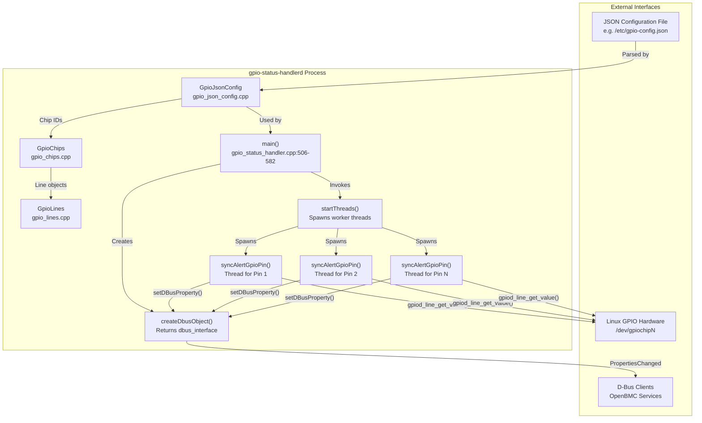
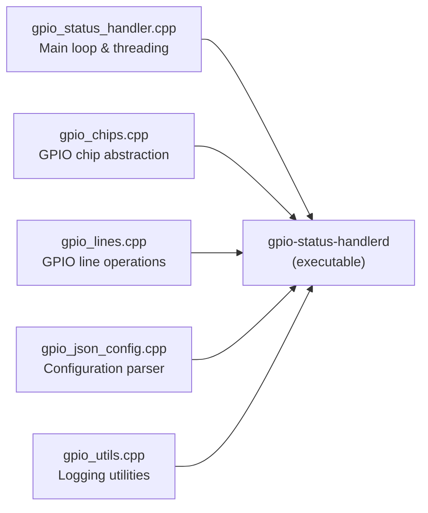
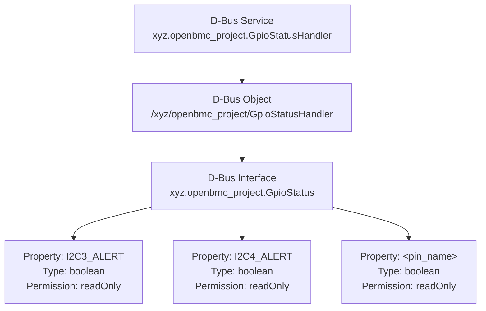
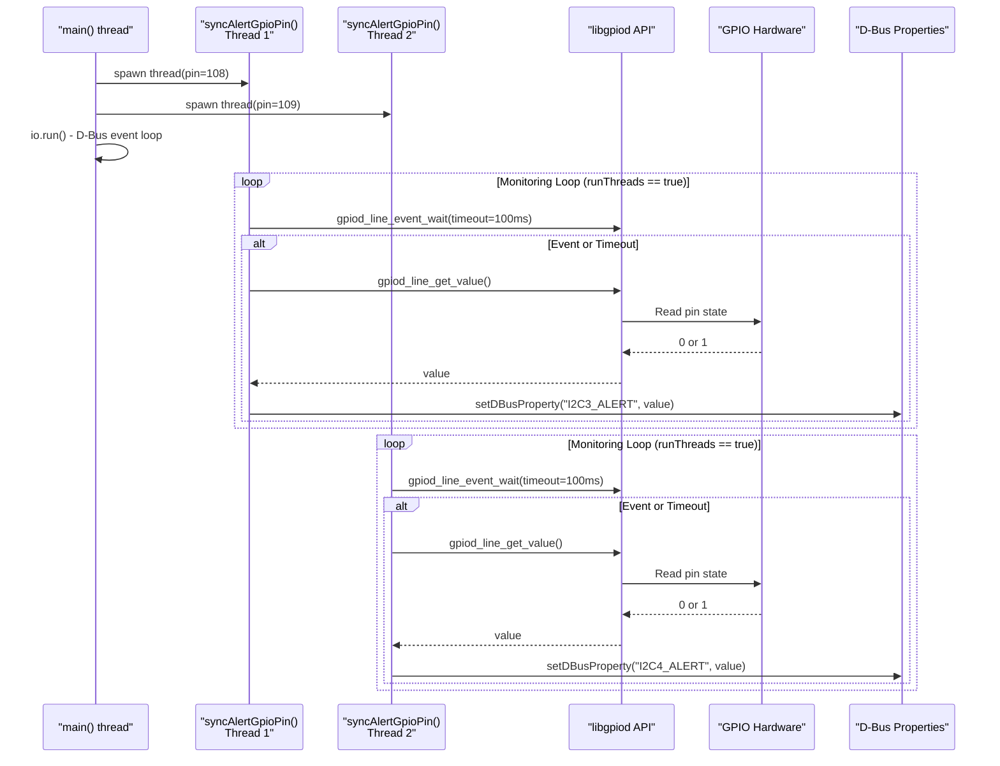
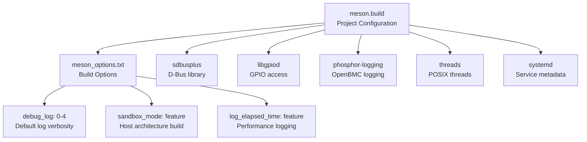
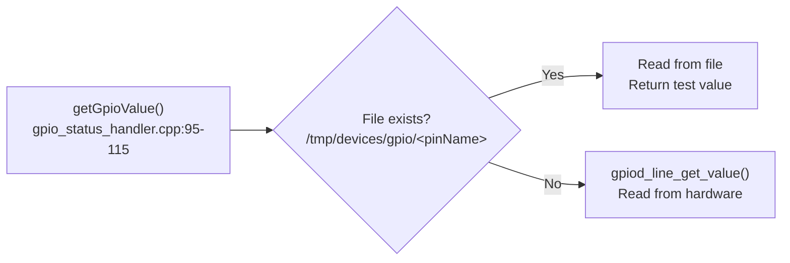

<!-- source: DeepWiki mcp.deepwiki.com · repo NVIDIA/nvidia-gpio-status-handler · page 1 Home · fetched 2026-10-26 -->

# Home

<details>
<summary>Relevant source files</summary>

The following files were used as context for generating this wiki page:

- [.clang-format](.clang-format)
- [README.md](README.md)
- [gpio_json_config.cpp](gpio_json_config.cpp)
- [gpio_json_config.hpp](gpio_json_config.hpp)
- [gpio_status_handler.cpp](gpio_status_handler.cpp)
- [meson.build](meson.build)
- [meson_options.txt](meson_options.txt)

</details>


## Overview

The **nvidia-gpio-status-handler** is a specialized OpenBMC daemon that monitors NVIDIA GPIO pin states on BMC hardware and exposes them as D-Bus properties. The daemon continuously reads GPIO pin values through the Linux GPIO character device interface and publishes state changes to the D-Bus system bus, enabling other OpenBMC services to react to hardware events.

This documentation covers the architecture, build process, configuration, and development workflows for the `gpio-status-handlerd` daemon. For details on specific topics:
- Architecture and internal design: see [Architecture](#2)
- Build system and compilation: see [Building the Project](#3)
- JSON configuration and runtime options: see [Configuration](#4)
- Development workflows and testing: see [Development Guide](#5)
- OpenBMC integration: see [Deployment to OpenBMC](#6)

**Sources:** [README.md:1-3](), [gpio_status_handler.cpp:397-505]()

---

## System Purpose

The daemon serves as a **GPIO-to-D-Bus bridge** in OpenBMC environments, addressing the need to make hardware GPIO state observable to BMC management software without requiring each service to directly interact with GPIO hardware. Key characteristics:

| Aspect | Description |
|--------|-------------|
| **Input** | GPIO pin states from `/dev/gpiochipN` character devices via `libgpiod` |
| **Output** | Boolean properties on D-Bus interface `xyz.openbmc_project.GpioStatus` |
| **Configuration** | JSON file mapping GPIO pins to D-Bus property names |
| **Threading Model** | One monitoring thread per configured GPIO pin |
| **Event Detection** | Hybrid polling + event-driven using `gpiod_line_event_wait()` |

**Sources:** [gpio_status_handler.cpp:25-27](), [gpio_status_handler.cpp:117-176](), [README.md:1-4]()

---

## System Architecture Overview



**System Initialization and Runtime Flow**

The daemon's execution follows this sequence:

1. **Configuration Phase:** `main()` instantiates `GpioJsonConfig` which parses and validates the JSON file
2. **Hardware Setup:** `GpioChips` opens GPIO character devices, `GpioLines` requests specific lines
3. **D-Bus Registration:** `createDbusObject()` registers service name `xyz.openbmc_project.GpioStatusHandler` and creates boolean properties for each configured pin
4. **Thread Deployment:** `startThreads()` spawns one `syncAlertGpioPin()` thread per GPIO pin
5. **Monitoring Loop:** Each thread calls `gpiod_line_event_wait()` with timeout, reads pin state, and calls `setDBusProperty()` on changes

**Sources:** [gpio_status_handler.cpp:506-582](), [gpio_status_handler.cpp:289-342](), [gpio_status_handler.cpp:177-255](), [gpio_status_handler.cpp:354-379]()

---

## Core Components

### Executable and Source Files



| Component | File | Primary Responsibility |
|-----------|------|------------------------|
| **Main Daemon** | `gpio_status_handler.cpp` | Process lifecycle, thread orchestration, D-Bus service creation |
| **Configuration Parser** | `gpio_json_config.cpp` | JSON validation and semantic checking |
| **GPIO Chip Manager** | `gpio_chips.cpp` | Opening `/dev/gpiochipN` devices |
| **GPIO Line Manager** | `gpio_lines.cpp` | Requesting and managing `gpiod_line_t*` handles |
| **Utilities** | `gpio_utils.cpp` | Logging helpers and error reporting |

**Sources:** [meson.build:94-105](), [gpio_status_handler.cpp:1-16]()

---

## D-Bus Interface Specification

### Service Registration



The daemon registers on the D-Bus system bus with these identifiers (defined as constants in [gpio_status_handler.cpp:25-27]()):

```cpp
constexpr auto dbusObjectPath = "/xyz/openbmc_project/GpioStatusHandler";
constexpr auto dbusServiceName = "xyz.openbmc_project.GpioStatusHandler";
constexpr auto dbusInterfaceName = "xyz.openbmc_project.GpioStatus";
```

Properties are dynamically registered based on the JSON configuration. Each GPIO pin name becomes a boolean property. Clients can query the service:

```bash
busctl introspect xyz.openbmc_project.GpioStatusHandler \
    /xyz/openbmc_project/GpioStatusHandler \
    xyz.openbmc_project.GpioStatus
```

**Sources:** [gpio_status_handler.cpp:25-27](), [gpio_status_handler.cpp:354-379](), [gpio_status_handler.cpp:438-449]()

---

## Configuration Format

The daemon requires a JSON configuration file as its first command-line argument. The structure maps GPIO pin names to hardware specifications:

```json
{
  "I2C3_ALERT" : {
    "gpio_chip" : 0,
    "gpio_pin" : 108,
    "initial" : false,
    "read_period_sec" : 0.5
  },
  "I2C4_ALERT" : {
    "gpio_chip" : 1,
    "gpio_pin" : 32,
    "initial" : true,
    "read_period_sec" : 4
  }
}
```

| Key | Type | Description | Validation |
|-----|------|-------------|------------|
| `gpio_chip` | unsigned int | GPIO chip number (maps to `/dev/gpiochipN`) | [gpio_json_config.cpp:155-156]() |
| `gpio_pin` | unsigned int | Pin offset within the chip | [gpio_json_config.cpp:157-158]() |
| `initial` | boolean | Initial D-Bus property value before first read | [gpio_json_config.cpp:159-160]() |
| `read_period_sec` | positive number | Minimum polling period in seconds | [gpio_json_config.cpp:161-162]() |

The pin name (e.g., `"I2C3_ALERT"`) becomes the D-Bus property name and must contain only alphanumeric characters and underscores. See [Configuration](#4) for complete schema documentation.

**Sources:** [gpio_json_config.hpp:16-31](), [gpio_json_config.cpp:22-42](), [gpio_json_config.cpp:165-189]()

---

## Threading and Monitoring Model

### Per-Pin Thread Architecture



The function `syncAlertGpioPin()` implements a hybrid event-driven and polling model:

1. **Event Wait:** Calls `gpiod_line_event_wait()` with timeout `lineEventWaitTimeoutNs = 1e8` (100ms)
2. **State Read:** On event or timeout, reads actual pin value via `gpiod_line_get_value()`
3. **D-Bus Update:** Updates property through mutex-protected `setDBusProperty()`
4. **Period Tracking:** Enforces minimum update interval from `read_period_sec` configuration

The `readPeriodTicks` parameter controls how many timeout intervals constitute one polling period [gpio_status_handler.cpp:311-313]().

**Sources:** [gpio_status_handler.cpp:177-255](), [gpio_status_handler.cpp:35](), [gpio_status_handler.cpp:289-342](), [gpio_status_handler.cpp:53-93]()

---

## Build System and Dependencies

### Build Configuration

The project uses **Meson** build system (minimum version 1.1.1) with C++23 standard:



### Key Build Options

| Option | Type | Default | Effect |
|--------|------|---------|--------|
| `debug_log` | integer (0-4) | 0 | Compile-time default log level (0=disabled, 4=max verbosity) |
| `sandbox_mode` | feature | auto | Enable x86-64 host development builds |
| `log_elapsed_time` | feature | disabled | Add timestamp logging for performance analysis |

The build produces the `gpio-status-handlerd` executable installed to `/usr/bin` (configurable via `bindir`). See [Building the Project](#3) for detailed build instructions.

**Sources:** [meson.build:1-106](), [meson_options.txt:1-22]()

---

## Runtime Operation

### Command-Line Interface

The daemon accepts these arguments:

```bash
gpio-status-handlerd <config.json> [-l <log_level>] [-L <log_file>]
```

| Argument | Description | Values |
|----------|-------------|--------|
| `<config.json>` | Required: path to JSON configuration file | File path |
| `-l <log_level>` | Optional: runtime log verbosity override | 0=none, 1=error, 2=warning, 3=info |
| `-L <log_file>` | Optional: redirect logs to file instead of journald | File path |

**Example:**
```bash
gpio-status-handlerd /etc/gpio-alert-config.json -l 3 -L /tmp/gpio-debug.log
```

**Sources:** [README.md:118-126](), [README.md:99-111]()

---

## Error Injection Mode (EINJ)

For testing without GPIO hardware, the daemon supports **EINJ mode**, activated when files appear in `/tmp/devices/gpio/`:



To inject a GPIO state:
```bash
mkdir -p /tmp/devices/gpio
echo "1" > /tmp/devices/gpio/I2C3_ALERT
```

The daemon will read from this file instead of hardware [gpio_status_handler.cpp:102-111]().

**Sources:** [gpio_status_handler.cpp:95-115]()

---

## Quick Start

### 1. Create Configuration File

Create `/etc/gpio-alerts.json`:
```json
{
  "PSU_ALERT": {
    "gpio_chip": 0,
    "gpio_pin": 45,
    "initial": false,
    "read_period_sec": 1.0
  }
}
```

### 2. Build and Install

```bash
meson setup builddir
ninja -C builddir
sudo ninja -C builddir install
```

### 3. Run Daemon

```bash
sudo gpio-status-handlerd /etc/gpio-alerts.json
```

### 4. Query D-Bus

```bash
busctl get-property xyz.openbmc_project.GpioStatusHandler \
    /xyz/openbmc_project/GpioStatusHandler \
    xyz.openbmc_project.GpioStatus \
    PSU_ALERT
```

**Sources:** [README.md:22-28](), [gpio_status_handler.cpp:397-505]()

---

## Logging and Diagnostics

The daemon integrates with `phosphor-logging` for structured logging. Log messages include these custom fields:

| Field | Usage | Example |
|-------|-------|---------|
| `FILE` | JSON parsing errors | Configuration file path |
| `FUNCALL` | libgpiod function calls | `gpiod_line_event_wait(...)` |
| `RESULT` | Return value from libgpiod | `-1` |
| `ERRNO` | Error number | `22` |
| `ERRNO_STR` | Error description | `"Invalid argument"` |
| `GPIO_CHIP` | Chip identifier | `"gpiochip0"` |
| `GPIO_PIN_NAME` | Logical pin name | `"I2C3_ALERT"` |
| `GPIO_PIN_NUM` | Pin offset | `108` |
| `EXCEPTION` | C++ exception messages | Exception details |

View logs in real-time:
```bash
journalctl --unit=xyz.openbmc_project.GpioStatusHandler -p 0..7 --follow
```

**Sources:** [gpio_status_handler.cpp:469-489](), [README.md:98-126]()

---

## Further Reading

- **[Architecture](#2)** - Detailed component interaction, threading model, and D-Bus service implementation
- **[Building the Project](#3)** - Comprehensive build instructions, dependency management, and cross-compilation
- **[Configuration](#4)** - Complete JSON schema reference and runtime parameter documentation  
- **[Development Guide](#5)** - Development workflows, testing strategies, and code organization
- **[Deployment to OpenBMC](#6)** - Integration with OpenBMC build system and systemd service configuration

---

