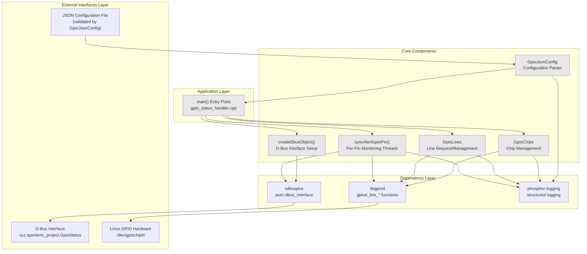
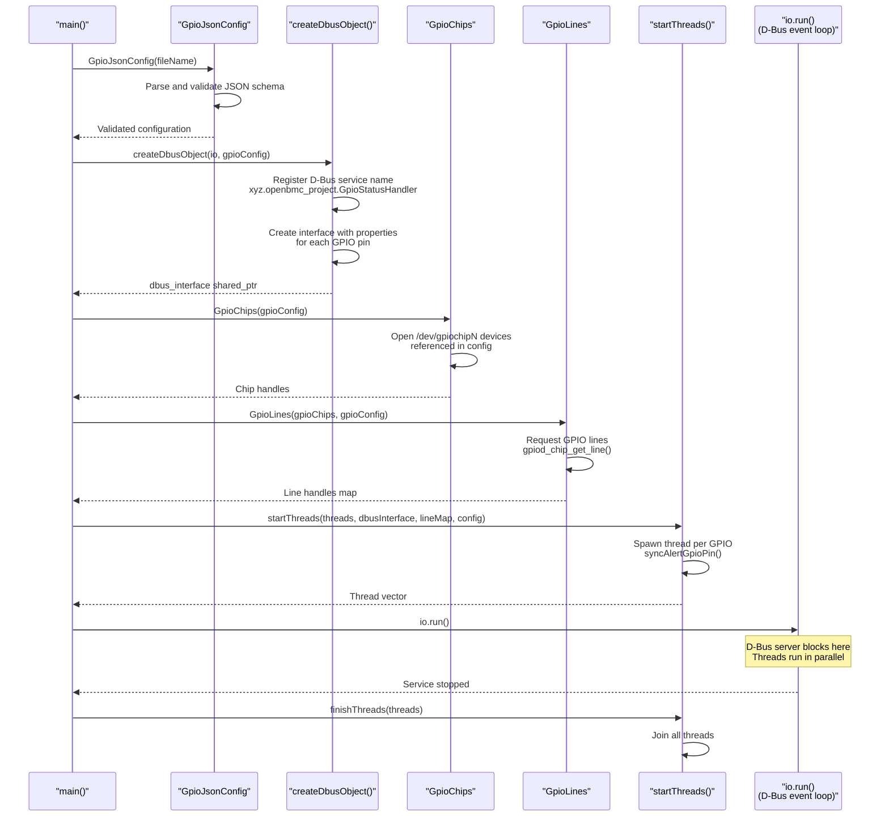
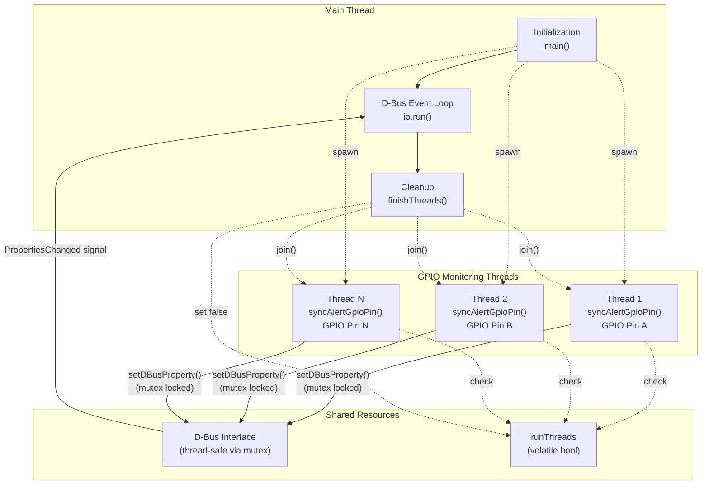
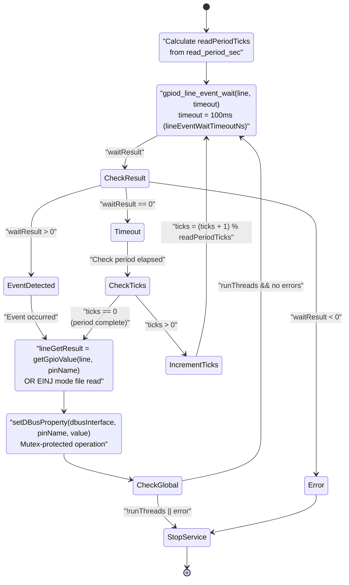
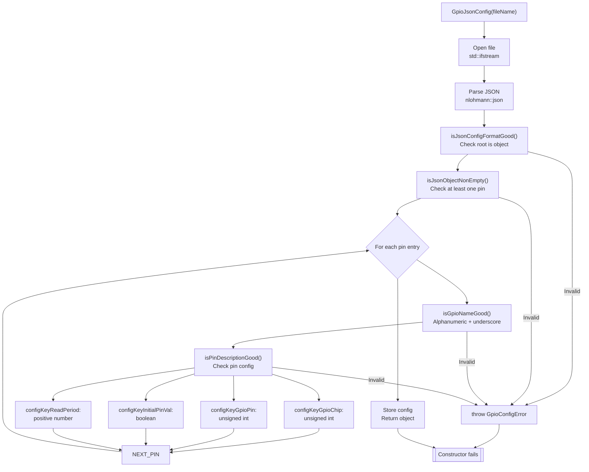
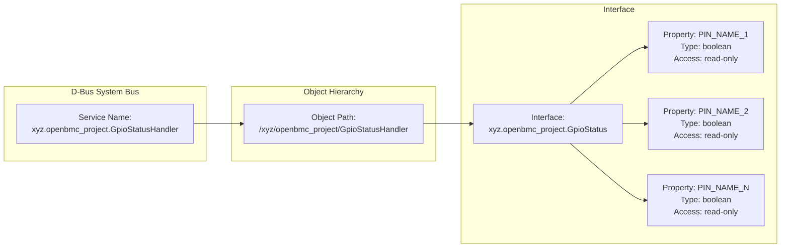
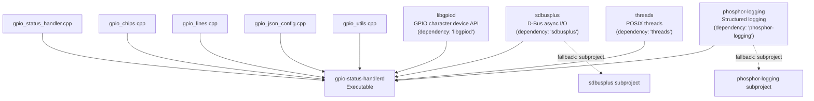

<!-- source: DeepWiki mcp.deepwiki.com · repo NVIDIA/nvidia-gpio-status-handler · page 2 Architecture · fetched 2026-10-26 -->

# Architecture

Relevant source files

The following files were used as context for generating this wiki page:

- [.clang-format](.clang-format)
- [gpio_json_config.cpp](gpio_json_config.cpp)
- [gpio_json_config.hpp](gpio_json_config.hpp)
- [gpio_status_handler.cpp](gpio_status_handler.cpp)
- [meson.build](meson.build)
- [meson_options.txt](meson_options.txt)

This document describes the technical design and internal structure of the `nvidia-gpio-status-handler` daemon. It provides an overview of the system's layered architecture, component interactions, and execution model. For detailed information about individual components, see [System Components](#2.1). For D-Bus interface specifications, see [D-Bus Service](#2.2). For threading and monitoring implementation, see [GPIO Monitoring Implementation](#2.3).

## Architectural Overview

The `nvidia-gpio-status-handler` is designed as a single-process, multi-threaded daemon that bridges Linux GPIO hardware with the OpenBMC D-Bus ecosystem. The architecture follows a layered model with clear separation between configuration, hardware abstraction, monitoring logic, and external interfaces.

**Layered Architecture:**

| Layer | Components | Purpose |
|-------|-----------|---------|
| **External Interfaces** | JSON config, D-Bus service, GPIO hardware | System boundaries - input configuration, output status, hardware access |
| **Application** | `main()` function | Orchestration, initialization, error handling |
| **Core Components** | `GpioJsonConfig`, `GpioChips`, `GpioLines`, monitoring threads | Business logic, GPIO abstraction, state synchronization |
| **Dependencies** | `libgpiod`, `sdbusplus`, `phosphor-logging` | External library abstractions |

**Sources:** [gpio_status_handler.cpp:506-582](), [meson.build:94-105]()

## Component Initialization Flow

The daemon follows a strict initialization sequence to ensure all resources are properly configured before monitoring begins.

**Initialization Steps:**

1. **Configuration Loading** ([gpio_status_handler.cpp:514]()): `GpioJsonConfig` parses JSON and validates schema
2. **D-Bus Setup** ([gpio_status_handler.cpp:516-517]()): `createDbusObject()` registers service and creates properties
3. **Chip Opening** ([gpio_status_handler.cpp:519]()): `GpioChips` opens `/dev/gpiochipN` devices
4. **Line Requesting** ([gpio_status_handler.cpp:521]()): `GpioLines` requests individual GPIO lines
5. **Thread Spawning** ([gpio_status_handler.cpp:524-525]()): `startThreads()` creates monitoring threads
6. **Event Loop** ([gpio_status_handler.cpp:534]()): `io.run()` blocks on D-Bus event loop

**Sources:** [gpio_status_handler.cpp:506-552](), [gpio_status_handler.cpp:354-379](), [gpio_status_handler.cpp:289-342]()

## Execution Model

The daemon operates with a single-threaded D-Bus event loop and multiple GPIO monitoring threads. Each GPIO pin gets a dedicated thread that polls for state changes and updates the corresponding D-Bus property.

**Thread Safety:**

- **Shared D-Bus Interface**: Protected by `setDBusPropMutex` ([gpio_status_handler.cpp:39](), [gpio_status_handler.cpp:59]())
- **Global Run Flag**: Volatile `runThreads` variable for coordinated shutdown ([gpio_status_handler.cpp:38]())
- **Exception Handling**: Thread exceptions stored in `lastThreadException` ([gpio_status_handler.cpp:40](), [gpio_status_handler.cpp:80]())

**Sources:** [gpio_status_handler.cpp:37-41](), [gpio_status_handler.cpp:53-93](), [gpio_status_handler.cpp:264-277]()

## GPIO Monitoring Loop

Each monitoring thread runs the `syncAlertGpioPin()` function, which implements a hybrid polling and event-driven model. The loop waits for GPIO events with a timeout, then reads the pin state and updates the D-Bus property.

**Key Variables:**

- `lineEventWaitTimeoutNs` = 100ms: Maximum wait time per iteration ([gpio_status_handler.cpp:35]())
- `readPeriodTicks`: Number of timeout periods per full polling cycle ([gpio_status_handler.cpp:311-313]())
- `ticks`: Counter tracking progress through polling period ([gpio_status_handler.cpp:189](), [gpio_status_handler.cpp:247]())

**Sources:** [gpio_status_handler.cpp:177-255](), [gpio_status_handler.cpp:95-115]()

## Configuration Schema Validation

The `GpioJsonConfig` class ([gpio_json_config.hpp:33]()) enforces strict validation on the JSON configuration file. All configuration errors are detected at startup before any hardware access occurs.

**Validation Rules:**

| Field | Type | Constraints | Constant |
|-------|------|-------------|----------|
| Pin name (key) | `string` | Non-empty, alphanumeric + `_` | - |
| `gpio_chip` | `unsigned int` | Valid chip number | `configKeyGpioChip` ([gpio_json_config.cpp:22]()) |
| `gpio_pin` | `unsigned int` | Valid pin offset | `configKeyGpioPin` ([gpio_json_config.cpp:23]()) |
| `initial` | `boolean` | Initial D-Bus property value | `configKeyInitialPinVal` ([gpio_json_config.cpp:24]()) |
| `read_period_sec` | `number` | Positive value (seconds) | `configKeyReadPeriod` ([gpio_json_config.cpp:25]()) |

**Sources:** [gpio_json_config.cpp:201-212](), [gpio_json_config.cpp:152-163](), [gpio_json_config.cpp:165-189](), [gpio_json_config.hpp:8-72]()

## D-Bus Service Registration

The daemon registers a single D-Bus service with one interface containing boolean properties for each configured GPIO pin. All properties are read-only from the client perspective.

**Constants:**

- `dbusServiceName`: `"xyz.openbmc_project.GpioStatusHandler"` ([gpio_status_handler.cpp:26]())
- `dbusObjectPath`: `"/xyz/openbmc_project/GpioStatusHandler"` ([gpio_status_handler.cpp:25]())
- `dbusInterfaceName`: `"xyz.openbmc_project.GpioStatus"` ([gpio_status_handler.cpp:27]())

Properties are created dynamically from the configuration via `register_property()` ([gpio_status_handler.cpp:373-375]()) with initial values from the `configKeyInitialPinVal` field.

**Sources:** [gpio_status_handler.cpp:25-27](), [gpio_status_handler.cpp:354-379]()

## Build Configuration Impact

The build system provides compile-time options that significantly affect the architecture's behavior. These options enable different deployment modes without code changes.

| Option | Effect on Architecture | Macro Defined |
|--------|------------------------|---------------|
| `debug_log=0-4` | Sets default log verbosity | `DEF_DBG_LEVEL` ([meson.build:34]()) |
| `sandbox_mode=enabled` | Enables x86-64 development builds | `SANDBOX_MODE` ([meson.build:39]()) |
| `log_elapsed_time=enabled` | Adds performance instrumentation | `LOG_ELAPSED_TIME` ([meson.build:43]()) |

**Conditional Compilation:**

- `ENABLE_GSH_LOGS`: Activated when `debug_log > 0`, controls logging calls ([gpio_status_handler.cpp:45-47]())
- `SANDBOX_MODE`: Allows host system development without BMC hardware
- EINJ mode: Always available, activated by creating `/tmp/devices/gpio/` files ([gpio_status_handler.cpp:103-111]())

**Sources:** [meson.build:31-44](), [meson_options.txt:1-21]()

## Dependency Graph

The executable depends on several external libraries, each serving a specific architectural role.

**Dependency Resolution:**

All dependencies support Meson subproject fallback ([meson.build:64-87]()), allowing the build system to fetch and build them locally if not found on the system.

**Sources:** [meson.build:62-105]()

---

