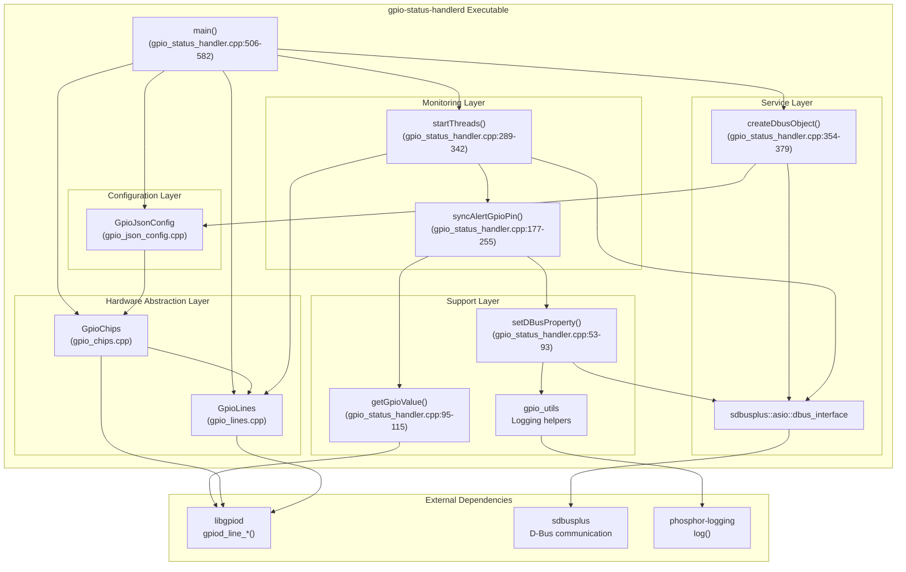
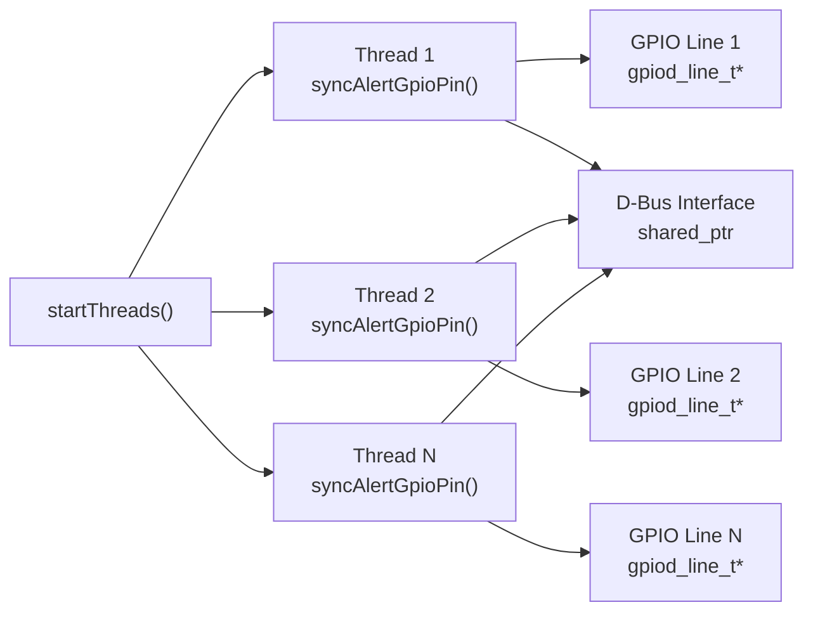
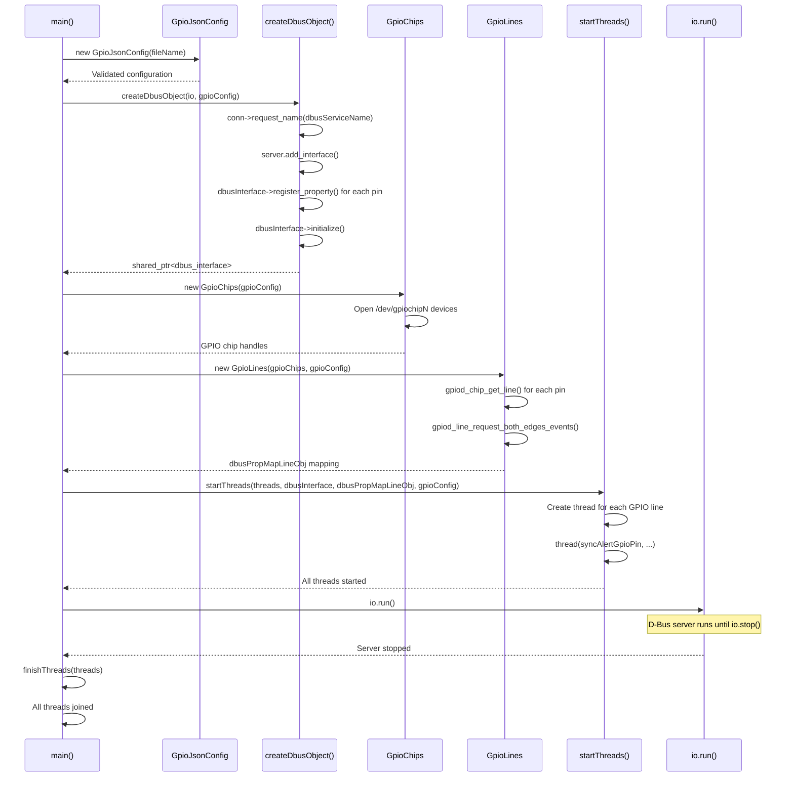
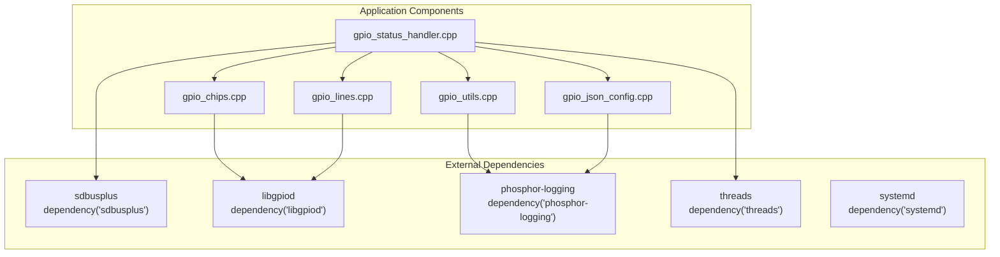

<!-- source: DeepWiki mcp.deepwiki.com · repo NVIDIA/nvidia-gpio-status-handler · page 2.1 System Components · fetched 2026-10-26 -->

# System Components

<details>
<summary>Relevant source files</summary>

The following files were used as context for generating this wiki page:

- [.clang-format](.clang-format)
- [gpio_json_config.cpp](gpio_json_config.cpp)
- [gpio_json_config.hpp](gpio_json_config.hpp)
- [gpio_status_handler.cpp](gpio_status_handler.cpp)
- [meson.build](meson.build)
- [meson_options.txt](meson_options.txt)

</details>


This document describes the high-level architecture of the nvidia-gpio-status-handler daemon, identifying the major components, their responsibilities, and how they interact. For detailed information about the D-Bus service interface, see [D-Bus Service](#2.2). For threading model and event-driven monitoring implementation details, see [GPIO Monitoring Implementation](#2.3).

## Overview

The nvidia-gpio-status-handler is implemented as a single executable (`gpio-status-handlerd`) that consists of five C++ modules working together to monitor GPIO hardware and expose status via D-Bus. The system follows a layered architecture where configuration parsing leads to hardware abstraction, which then drives multi-threaded monitoring that updates D-Bus properties.

## Core Components

The system is composed of the following primary components:

| Component | Source Files | Primary Responsibility |
|-----------|-------------|------------------------|
| Main Orchestrator | [gpio_status_handler.cpp]() | Program entry point, thread management, D-Bus server lifecycle |
| Configuration Parser | [gpio_json_config.cpp](), [gpio_json_config.hpp]() | JSON configuration file parsing and validation |
| GPIO Chip Abstraction | gpio_chips.cpp, gpio_chips.hpp | Management of GPIO chip device handles |
| GPIO Line Abstraction | gpio_lines.cpp, gpio_lines.hpp | Management of individual GPIO line handles |
| Utility Functions | gpio_utils.cpp, gpio_utils.hpp | Logging helpers and shared functions |

Sources: [meson.build:94-105](), [gpio_status_handler.cpp:1-16]()

## Component Architecture



**Component Relationships and Data Flow**

This diagram maps system functionality directly to code entities. Each box references specific functions or classes that implement the component.

Sources: [gpio_status_handler.cpp:1-582](), [meson.build:94-105]()

## Component Responsibilities

### Main Orchestrator

The main orchestrator in [gpio_status_handler.cpp:506-582]() implements the program's entry point and coordinates the initialization sequence:

1. Parse JSON configuration file (creates `GpioJsonConfig` object)
2. Initialize D-Bus interface via `createDbusObject()`
3. Open GPIO chips (creates `GpioChips` object)
4. Request GPIO lines (creates `GpioLines` object)
5. Start monitoring threads via `startThreads()`
6. Run D-Bus I/O loop via `io.run()`
7. Wait for threads to complete via `finishThreads()`

The orchestrator also maintains global state including:
- `io` - boost::asio::io_context for D-Bus operations [gpio_status_handler.cpp:37]()
- `runThreads` - volatile flag controlling thread execution [gpio_status_handler.cpp:38]()
- `setDBusPropMutex` - mutex protecting D-Bus property updates [gpio_status_handler.cpp:39]()

Sources: [gpio_status_handler.cpp:506-582](), [gpio_status_handler.cpp:37-41]()

### Configuration Parser

The `GpioJsonConfig` class [gpio_json_config.hpp:33-72]() encapsulates configuration file parsing and validation. It reads JSON configuration defining:

| Configuration Key | Type | Purpose | Validation |
|-------------------|------|---------|------------|
| `gpio_chip` | unsigned int | GPIO chip number (e.g., 0 for /dev/gpiochip0) | Must be unsigned integer |
| `gpio_pin` | unsigned int | GPIO pin offset on chip | Must be unsigned integer |
| `initial` | boolean | Initial D-Bus property value before first read | Must be boolean |
| `read_period_sec` | positive number | Minimum polling period in seconds | Must be positive number |

The parser performs semantic validation beyond syntax checking, throwing `GpioConfigError` exceptions for malformed configurations [gpio_json_config.cpp:214-216](). Validation includes checking that GPIO names contain only alphanumeric characters and underscores [gpio_json_config.cpp:165-189]().

For complete JSON schema documentation, see [JSON Configuration Schema](#4.1).

Sources: [gpio_json_config.hpp:33-72](), [gpio_json_config.cpp:201-212]()

### GPIO Hardware Abstraction

The hardware abstraction layer consists of two classes that wrap libgpiod operations:

**GpioChips** - Manages GPIO chip device handles (`gpiod_chip_t*`), opening one `/dev/gpiochipN` device per unique chip specified in configuration. Responsible for maintaining chip handles for the daemon's lifetime.

**GpioLines** - Manages GPIO line handles (`gpiod_line_t*`), requesting lines from chips and configuring them for event monitoring. Creates a mapping from GPIO pin names to line handles stored in `dbusPropMapLineObj` [gpio_status_handler.cpp:291]().

Both classes follow RAII principles, ensuring proper resource cleanup through their destructors.

Sources: [gpio_status_handler.cpp:519-521](), [meson.build:97-98]()

### D-Bus Service Layer

The D-Bus service implementation uses sdbusplus to create a D-Bus object at a well-defined interface:

| D-Bus Element | Value | Source |
|---------------|-------|--------|
| Service Name | `xyz.openbmc_project.GpioStatusHandler` | [gpio_status_handler.cpp:26]() |
| Object Path | `/xyz/openbmc_project/GpioStatusHandler` | [gpio_status_handler.cpp:25]() |
| Interface Name | `xyz.openbmc_project.GpioStatus` | [gpio_status_handler.cpp:27]() |

The `createDbusObject()` function [gpio_status_handler.cpp:354-379]() registers one boolean property per GPIO pin defined in the configuration. All properties are read-only (`PropertyPermission::readOnly`) [gpio_status_handler.cpp:375]() and emit `PropertiesChanged` signals when updated.

The `setDBusProperty()` function [gpio_status_handler.cpp:53-93]() provides thread-safe property updates using `setDBusPropMutex` to serialize concurrent access from multiple monitoring threads.

Sources: [gpio_status_handler.cpp:25-27](), [gpio_status_handler.cpp:354-379]()

### Monitoring Layer

The monitoring layer implements a multi-threaded architecture where each configured GPIO pin is monitored by a dedicated thread:



**Thread Creation and Management**

The `startThreads()` function [gpio_status_handler.cpp:289-342]() creates monitoring threads by iterating over `dbusPropMapLineObj` and spawning a thread for each entry [gpio_status_handler.cpp:330-332](). Each thread executes `syncAlertGpioPin()` with parameters including the GPIO line handle, D-Bus interface, and polling configuration.

The monitoring loop implements hybrid event-driven and polling monitoring using `gpiod_line_event_wait()` with a timeout defined by `lineEventWaitTimeoutNs` (100ms) [gpio_status_handler.cpp:35](). This balances responsiveness to GPIO events with periodic polling as a fallback mechanism.

For detailed monitoring implementation, see [GPIO Monitoring Implementation](#2.3).

Sources: [gpio_status_handler.cpp:289-342](), [gpio_status_handler.cpp:177-255]()

## System Initialization Sequence



**Initialization Steps Mapped to Code**

Each step in the sequence corresponds to specific code locations in [gpio_status_handler.cpp:506-582]():

1. Configuration parsing: [gpio_status_handler.cpp:514]()
2. D-Bus object creation: [gpio_status_handler.cpp:516-517]()
3. GPIO chip opening: [gpio_status_handler.cpp:519]()
4. GPIO line requesting: [gpio_status_handler.cpp:521]()
5. Thread startup: [gpio_status_handler.cpp:524-525]()
6. D-Bus I/O loop: [gpio_status_handler.cpp:534]()
7. Thread cleanup: [gpio_status_handler.cpp:550]()

Sources: [gpio_status_handler.cpp:506-582]()

## Key Interfaces and Data Structures

### Inter-Component Data Passing

The following data structures facilitate communication between components:

**`dbusPropMapLineObj`** - A `map<string, gpiod_line_t*>` maintained by `GpioLines` that maps D-Bus property names (GPIO pin names) to libgpiod line handles. This is the primary data structure connecting the hardware abstraction layer to the monitoring layer [gpio_status_handler.cpp:291]().

**`gpioConfig.getConfig()`** - Returns `const nlohmann::json&` containing the parsed configuration, accessed by multiple components to retrieve pin-specific settings like `read_period_sec` [gpio_status_handler.cpp:310]().

**`dbusInterface`** - A `shared_ptr<sdbusplus::asio::dbus_interface>` passed to all monitoring threads, enabling thread-safe property updates via `set_property()` [gpio_status_handler.cpp:75]().

Sources: [gpio_status_handler.cpp:289-342](), [gpio_json_config.hpp:68]()

### EINJ Testing Mode

The system includes an error injection (EINJ) mode for testing without hardware. When files exist in `/tmp/devices/gpio/{pinName}`, the `getGpioValue()` function [gpio_status_handler.cpp:95-115]() reads from the filesystem instead of hardware:

```cpp
std::ifstream ifs("/tmp/devices/gpio/" + pinName);
if (ifs) {
    int value = 0;
    ifs >> value;
    return value;
}
// Otherwise read from HW
return gpiod_line_get_value(line);
```

This allows simulating GPIO state changes by writing to files, enabling integration testing without physical GPIO hardware. For more testing details, see [Testing and Debugging](#5.2).

Sources: [gpio_status_handler.cpp:95-115]()

## Build Configuration and Component Selection

The meson build system [meson.build]() allows conditional compilation of components based on build options:

| Build Option | Effect | Code Impact |
|--------------|--------|-------------|
| `debug_log` | Sets default log verbosity | Defines `DEF_DBG_LEVEL` macro [meson.build:31-37]() |
| `sandbox_mode` | Enables host development | Defines `SANDBOX_MODE` macro [meson.build:38-40]() |
| `api_stubs` | Uses mock GPIO APIs | Compiles stub implementations instead of real APIs |
| `log_elapsed_time` | Adds performance timing | Defines `LOG_ELAPSED_TIME` macro [meson.build:42-44]() |

These options enable building different variants of the same components for development vs. production deployment. For complete build configuration details, see [Build Options](#3.3).

Sources: [meson.build:30-44](), [meson_options.txt:1-21]()

## Component Dependencies



**Dependency Hierarchy**

All components link against the same set of external dependencies specified in [meson.build:62-105](). The dependency layer provides:

- **sdbusplus**: Asynchronous D-Bus communication via `sdbusplus::asio::*` classes
- **libgpiod**: GPIO hardware access via `gpiod_*()` C API functions
- **phosphor-logging**: Structured logging via `log<level::*>()` template functions
- **threads**: POSIX threads via `std::thread`
- **systemd**: Service management (not directly used in code, but required for deployment)

The build system uses fallback subprojects for dependencies not found on the system [meson.build:64-71]().

Sources: [meson.build:62-105]()

---

