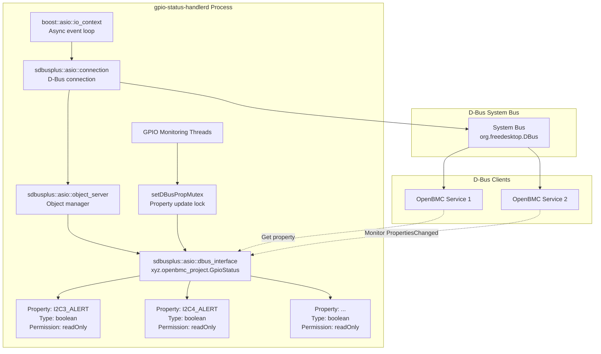
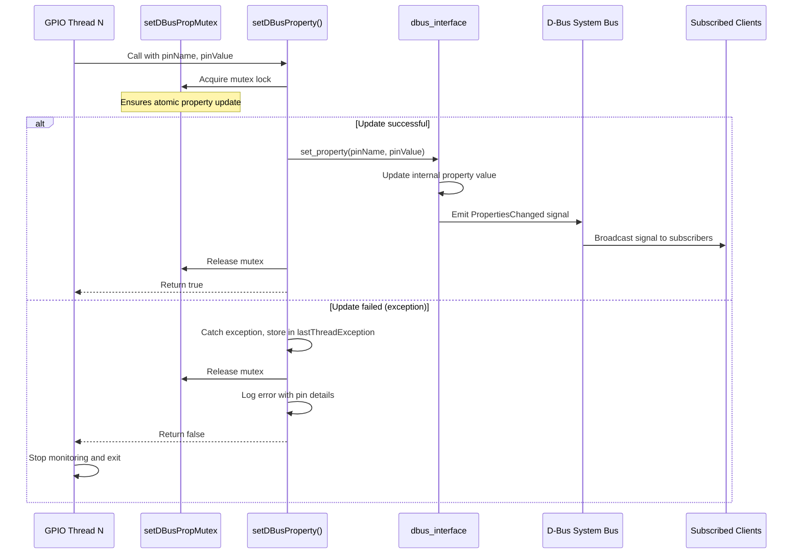
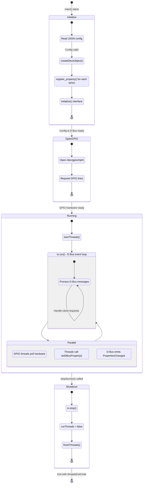
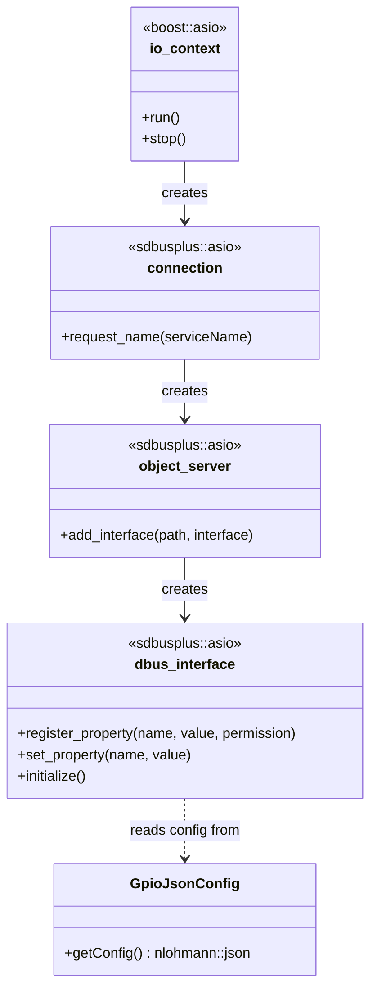

<!-- source: DeepWiki mcp.deepwiki.com · repo NVIDIA/nvidia-gpio-status-handler · page 2.2 D-Bus Service · fetched 2026-10-26 -->

# D-Bus Service

<details>
<summary>Relevant source files</summary>

The following files were used as context for generating this wiki page:

- [.clang-format](.clang-format)
- [gpio_json_config.cpp](gpio_json_config.cpp)
- [gpio_json_config.hpp](gpio_json_config.hpp)
- [gpio_status_handler.cpp](gpio_status_handler.cpp)

</details>


## Purpose and Scope

This page documents the D-Bus service implementation that exposes GPIO pin states to OpenBMC system components. The service creates read-only boolean properties on the D-Bus system bus, with each property representing the current state of a configured GPIO pin. 

For information about the GPIO monitoring threads that update these properties, see [GPIO Monitoring Implementation](#2.3). For configuration of GPIO pins, see [JSON Configuration Schema](#4.1).

---

## Service Identification

The D-Bus service is identified by three constants that define its location on the system bus:

| Constant | Value | Purpose |
|----------|-------|---------|
| `dbusServiceName` | `xyz.openbmc_project.GpioStatusHandler` | Well-known service name requested on the system bus |
| `dbusObjectPath` | `/xyz/openbmc_project/GpioStatusHandler` | Object path where the interface is registered |
| `dbusInterfaceName` | `xyz.openbmc_project.GpioStatus` | Interface containing GPIO status properties |

These identifiers follow OpenBMC D-Bus naming conventions and enable clients to locate and interact with the service.

**Sources:** [gpio_status_handler.cpp:25-27]()

---

## D-Bus Service Architecture



**D-Bus Service Component Structure**

The service architecture consists of multiple layers built on the `sdbusplus` library for asynchronous D-Bus communication.

**Sources:** [gpio_status_handler.cpp:37](), [gpio_status_handler.cpp:354-379]()

---

## Interface Creation and Initialization

The D-Bus interface is created by the `createDbusObject()` function during daemon startup:

```mermaid
sequenceDiagram
    participant MAIN as main()
    participant CREATE as createDbusObject()
    participant IO as io_context
    participant CONN as connection
    participant SERVER as object_server
    participant IFACE as dbus_interface
    participant CONFIG as GpioJsonConfig
    
    MAIN->>CREATE: Call with io, gpioConfig
    CREATE->>IO: Reference io_context
    CREATE->>CONN: Create connection(io)
    CREATE->>CONN: request_name(dbusServiceName)
    Note over CONN: Requests "xyz.openbmc_project.GpioStatusHandler"
    
    CREATE->>SERVER: Create object_server(conn)
    CREATE->>SERVER: add_interface(dbusObjectPath, dbusInterfaceName)
    Note over SERVER: Path: "/xyz/openbmc_project/GpioStatusHandler"<br/>Interface: "xyz.openbmc_project.GpioStatus"
    SERVER-->>IFACE: Returns interface pointer
    
    loop For each GPIO pin in config
        CREATE->>CONFIG: Get pin name and initial value
        CONFIG-->>CREATE: pinName, initialPinVal
        CREATE->>IFACE: register_property(pinName, initialPinVal, readOnly)
        Note over IFACE: Creates boolean property<br/>with initial value
    end
    
    CREATE->>IFACE: initialize()
    Note over IFACE: Publishes interface to D-Bus
    CREATE-->>MAIN: Returns dbus_interface pointer
```

**D-Bus Interface Initialization Sequence**

The initialization process creates a shared `dbus_interface` object that is later passed to all GPIO monitoring threads for property updates.

**Sources:** [gpio_status_handler.cpp:354-379](), [gpio_status_handler.cpp:516-517]()

---

## Property Registration

Properties are dynamically registered based on the JSON configuration file. Each GPIO pin defined in the configuration becomes a boolean property on the `xyz.openbmc_project.GpioStatus` interface.

### Registration Process

The `createDbusObject()` function iterates over the configuration and registers properties:

```cpp
// Pseudocode representation from gpio_status_handler.cpp:370-377
for (auto it = gpioConfig.getConfig().cbegin(); 
     it != gpioConfig.getConfig().cend(); ++it)
{
    string pinName = it.key();  // e.g., "I2C3_ALERT"
    bool initialValue = it.value()[configKeyInitialPinVal];
    
    dbusInterface->register_property(
        pinName, 
        initialValue,
        sdbusplus::asio::PropertyPermission::readOnly
    );
}
dbusInterface->initialize();
```

### Property Characteristics

| Characteristic | Value | Description |
|----------------|-------|-------------|
| Type | `boolean` | All properties are boolean type |
| Permission | `readOnly` | Properties cannot be modified by clients |
| Name | User-defined | Property name matches GPIO pin name from config |
| Initial Value | From config | Set to `initial` field from JSON before first GPIO read |
| Emits | `PropertiesChanged` | Signal sent automatically when property value changes |

**Sources:** [gpio_status_handler.cpp:370-377](), [gpio_json_config.hpp:42-45]()

---

## Property Update Mechanism

GPIO monitoring threads update D-Bus properties through the `setDBusProperty()` function, which ensures thread-safe updates:



**Property Update Flow with Thread Safety**

The `setDBusPropMutex` ensures that only one thread can update properties at a time, preventing race conditions when multiple GPIO threads attempt simultaneous updates.

**Sources:** [gpio_status_handler.cpp:53-93](), [gpio_status_handler.cpp:39]()

---

## Thread Safety and Concurrency

The D-Bus service handles concurrent property updates from multiple GPIO monitoring threads through several mechanisms:

### Mutex Protection

The global `setDBusPropMutex` protects the critical section where properties are updated:

```cpp
// From gpio_status_handler.cpp:59-83
{
    lock_guard<mutex> lock(setDBusPropMutex);
    try
    {
        dbusInterface->set_property(pinName, pinValue);
        success = true;
    }
    catch (...)
    {
        lastThreadException = std::current_exception();
        success = false;
    }
}
```

### Exception Handling

Failed property updates are captured and stored in `lastThreadException`, allowing the main thread to retrieve and report errors after GPIO threads terminate.

### Asynchronous Architecture

The service uses `boost::asio::io_context` to manage the D-Bus event loop asynchronously. This allows the main thread to handle D-Bus messages while GPIO monitoring threads independently poll hardware and queue property updates.

**Sources:** [gpio_status_handler.cpp:39-41](), [gpio_status_handler.cpp:53-93](), [gpio_status_handler.cpp:381-395]()

---

## Client Interaction

OpenBMC services interact with GPIO status properties through standard D-Bus operations:

### Reading Property Values

Clients can query the current state of a GPIO pin:

```bash
# Using busctl to read a property
busctl get-property xyz.openbmc_project.GpioStatusHandler \
    /xyz/openbmc_project/GpioStatusHandler \
    xyz.openbmc_project.GpioStatus \
    I2C3_ALERT
```

Expected response: `b true` or `b false` (boolean value)

### Monitoring Property Changes

Clients can subscribe to `PropertiesChanged` signals to receive notifications when GPIO states change:

```bash
# Using busctl to monitor changes
busctl monitor --match="type='signal',\
interface='org.freedesktop.DBus.Properties',\
member='PropertiesChanged',\
path='/xyz/openbmc_project/GpioStatusHandler'"
```

### Introspection

The D-Bus interface can be introspected to discover available properties:

```bash
# Introspect the interface
busctl introspect xyz.openbmc_project.GpioStatusHandler \
    /xyz/openbmc_project/GpioStatusHandler \
    xyz.openbmc_project.GpioStatus
```

Example output:
```
NAME            TYPE      SIGNATURE RESULT/VALUE FLAGS
.I2C3_ALERT     property  b         false        emits-change
.I2C4_ALERT     property  b         false        emits-change
```

**Sources:** [gpio_status_handler.cpp:443-450]() (documentation comments)

---

## Service Lifecycle



**D-Bus Service Lifecycle State Machine**

The service progresses through initialization, operation, and shutdown phases. The D-Bus interface remains active throughout the `Running` state, processing client requests while GPIO threads update properties.

**Sources:** [gpio_status_handler.cpp:506-582]() (main function), [gpio_status_handler.cpp:43-51]() (stopService)

---

## Error Handling

The D-Bus service implements comprehensive error handling for property updates:

### Update Failures

When `set_property()` throws an exception:
1. The exception is caught and stored in `lastThreadException`
2. An error message is logged with pin details (chip name, pin number, pin name)
3. The function returns `false` to the calling thread
4. The monitoring thread detects the failure and calls `stopService(1)`
5. The main thread retrieves and displays the exception via `showLastThreadException()`

### Logging Integration

All D-Bus operations are logged through the `phosphor-logging` framework with structured fields:

- `GPIO_CHIP`: The chip name (e.g., "gpiochip0")
- `GPIO_PIN_NAME`: The property name (e.g., "I2C3_ALERT")
- `GPIO_PIN_NUM`: The pin number (e.g., 108)
- `EXCEPTION`: Exception details if applicable

**Sources:** [gpio_status_handler.cpp:78-92](), [gpio_status_handler.cpp:381-395]()

---

## Implementation Details

### Key Data Structures



**D-Bus Service Class Relationships**

**Sources:** [gpio_status_handler.cpp:8]() (includes), [gpio_status_handler.cpp:354-379]()

---

## Configuration to D-Bus Property Mapping

The service translates JSON configuration entries directly into D-Bus properties:

| JSON Config | D-Bus Property |
|-------------|----------------|
| Top-level key (e.g., `"I2C3_ALERT"`) | Property name |
| `"initial": false` | Initial property value before first GPIO read |
| `"gpio_chip": 0` | Used for logging, not exposed to D-Bus |
| `"gpio_pin": 108` | Used for logging, not exposed to D-Bus |
| `"read_period_sec": 0.5` | Determines update frequency, not exposed to D-Bus |

Example transformation:

```json
{
  "I2C3_ALERT": {
    "gpio_chip": 0,
    "gpio_pin": 108,
    "initial": false,
    "read_period_sec": 0.5
  }
}
```

Results in D-Bus property:
- Interface: `xyz.openbmc_project.GpioStatus`
- Property name: `I2C3_ALERT`
- Type: `boolean`
- Initial value: `false`
- Permission: `readOnly`

**Sources:** [gpio_status_handler.cpp:370-377](), [gpio_json_config.hpp:18-31]()

---

