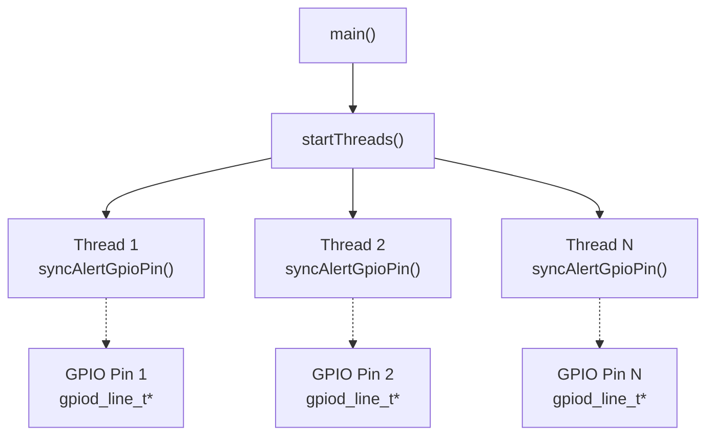
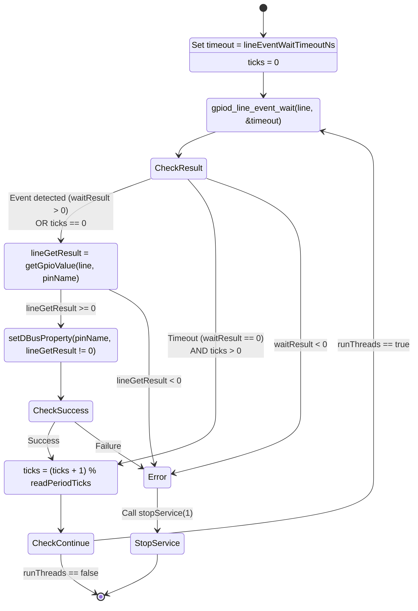
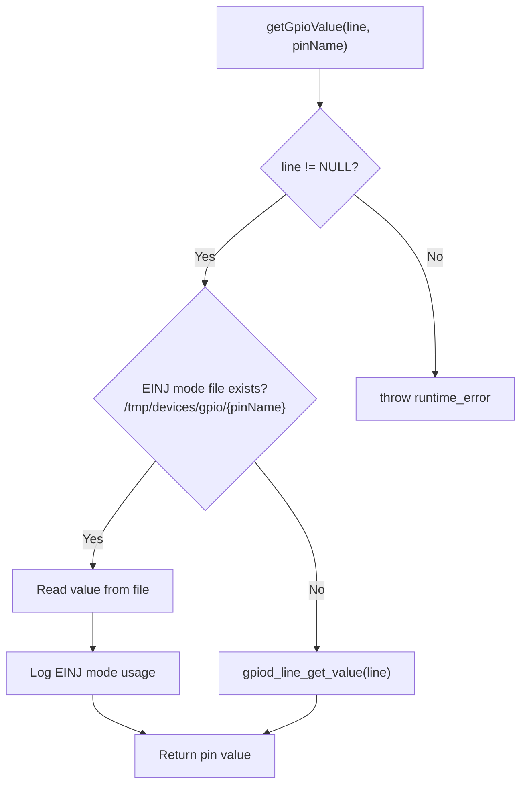
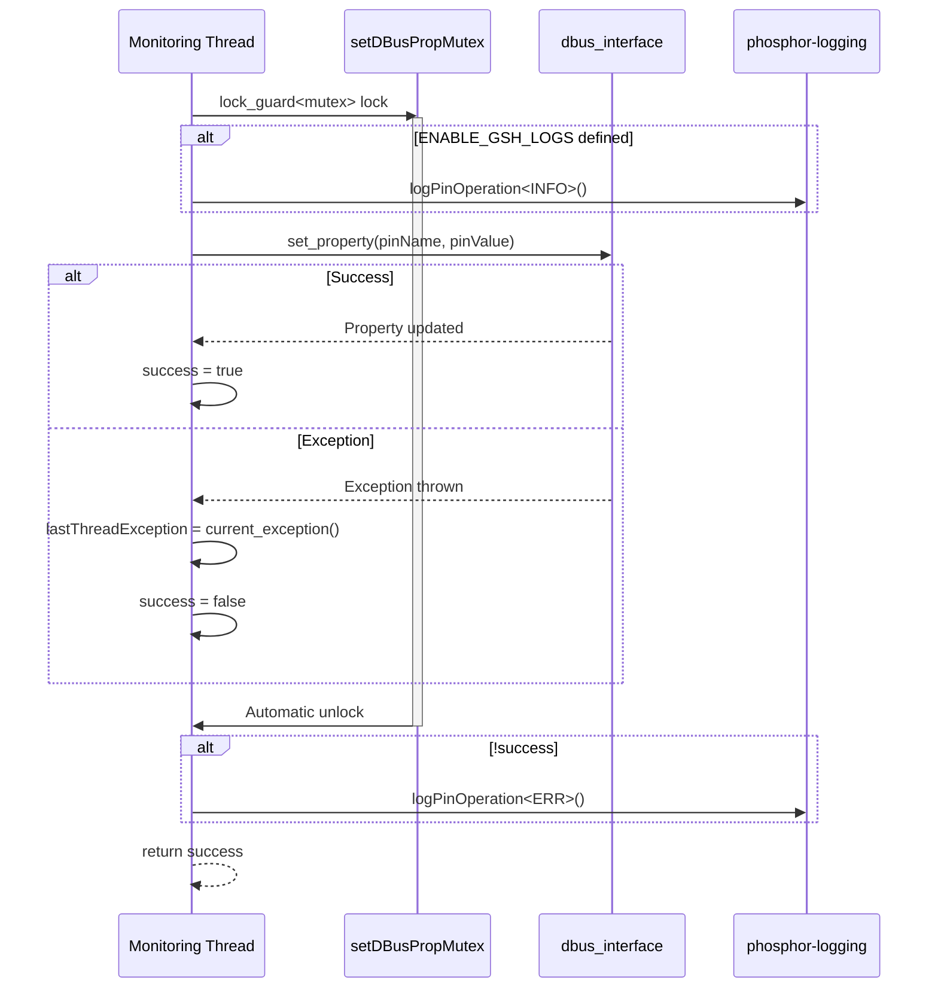
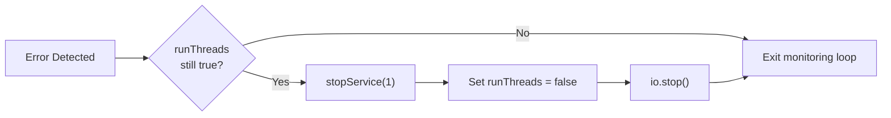

<!-- source: DeepWiki mcp.deepwiki.com · repo NVIDIA/nvidia-gpio-status-handler · page 2.3 GPIO Monitoring Implementation · fetched 2026-10-26 -->

# GPIO Monitoring Implementation

<details>
<summary>Relevant source files</summary>

The following files were used as context for generating this wiki page:

- [.clang-format](.clang-format)
- [gpio_json_config.cpp](gpio_json_config.cpp)
- [gpio_json_config.hpp](gpio_json_config.hpp)
- [gpio_status_handler.cpp](gpio_status_handler.cpp)

</details>


This page explains the internal implementation of the GPIO monitoring subsystem, including the threading model, event detection mechanism, polling strategy, and how GPIO state changes propagate to D-Bus properties. For information about the D-Bus interface exposed to clients, see [D-Bus Service](#2.2). For build-time configuration options that affect monitoring behavior, see [Build Options](#3.3).

## Overview

The GPIO monitoring implementation uses a multi-threaded architecture where each configured GPIO pin is monitored by a dedicated thread. Each thread employs a hybrid event-driven and polling approach: it waits for GPIO line events using `libgpiod` primitives with a configurable timeout, ensuring both low-latency response to state changes and periodic validation of pin states. When a state change is detected, the monitoring thread updates the corresponding D-Bus property through a thread-safe update mechanism.

**Sources:** [gpio_status_handler.cpp:117-255]()

## Thread Architecture

### One Thread Per GPIO Pin

The system spawns exactly one monitoring thread for each GPIO pin defined in the JSON configuration. This design ensures that:

- Each pin can have an independent read period
- Blocking operations on one pin do not affect others
- The system scales naturally with the number of monitored pins

The `startThreads()` function creates all monitoring threads during initialization:



**Diagram: Thread Creation Architecture**

Each thread receives:
- A shared pointer to the D-Bus interface (`sdbusplus::asio::dbus_interface`)
- A pointer to its GPIO line object (`gpiod_line_t*`)
- The pin's identifying information (chip name, pin name, pin number)
- The configured read period in ticks (`readPeriodTicks`)

**Sources:** [gpio_status_handler.cpp:289-342]()

### Thread Lifecycle Management

| Component | Role | File Location |
|-----------|------|---------------|
| `runThreads` | Global volatile boolean flag coordinating thread execution | [gpio_status_handler.cpp:38]() |
| `startThreads()` | Spawns all monitoring threads and sets `runThreads = true` | [gpio_status_handler.cpp:289-342]() |
| `finishThreads()` | Joins all threads after shutdown | [gpio_status_handler.cpp:264-277]() |
| `stopService()` | Sets `runThreads = false` and stops I/O context | [gpio_status_handler.cpp:43-51]() |

The threads coordinate via the shared `runThreads` flag. When any thread encounters a fatal error, it calls `stopService()`, which triggers all threads to exit their monitoring loops.

**Sources:** [gpio_status_handler.cpp:38-51](), [gpio_status_handler.cpp:264-342]()

## Monitoring Loop Implementation

### Core Loop: syncAlertGpioPin()

The `syncAlertGpioPin()` function implements the core monitoring logic for a single GPIO pin. It runs in an infinite loop until `runThreads` becomes false or an error occurs.



**Diagram: syncAlertGpioPin() State Machine**

The loop operates with these key variables:

| Variable | Type | Purpose |
|----------|------|---------|
| `waitResult` | `int` | Result from `gpiod_line_event_wait()`: -1=error, 0=timeout, 1=event |
| `lineGetResult` | `int` | Result from `getGpioValue()`: -1=error, 0=low, 1=high |
| `setDBusPropOk` | `bool` | Success status of D-Bus property update |
| `ticks` | `uint64_t` | Counter for implementing read period |

**Sources:** [gpio_status_handler.cpp:177-255]()

### Hybrid Event-Driven and Polling Mechanism

The monitoring implementation combines two strategies:

1. **Event-Driven**: Responds immediately when GPIO line state changes
2. **Periodic Polling**: Validates state at configured intervals even without events

This hybrid approach is visualized in the code comments at [gpio_status_handler.cpp:126-149]():

```
Timeline
GPIO line:                    state change
1                                    --------------------------------------
                                    /
0 ------------------------------------

Loop iterations                         timeout period
(no longer than timeout):                  <----->
  |-------|-------|-------|------|----|-------|-------|-------|------|-------

Readings:
  ^------------------------------^----^------------------------------^-------
  0                              0    1                              1
   <---------------------------->      <---------------------------->
         polling period                        polling period

DBus property:                  event detected
t                                    --------------------------------------
                                    /
f ------------------------------------
```

**Key Constants:**

- `lineEventWaitTimeoutNs = 1e8` (100 milliseconds) - Maximum wait time per `gpiod_line_event_wait()` call
- `readPeriodTicks` - Calculated as `readPeriodSec * 1e9 / lineEventWaitTimeoutNs`, minimum value of 1

**Sources:** [gpio_status_handler.cpp:35](), [gpio_status_handler.cpp:311-313]()

## GPIO Value Reading

### getGpioValue() Function

The `getGpioValue()` function provides the abstraction for reading GPIO pin state:



**Diagram: getGpioValue() Logic Flow**

This function supports two modes:

1. **Normal Mode**: Reads directly from hardware via `gpiod_line_get_value()`
2. **EINJ Mode**: Reads from filesystem at `/tmp/devices/gpio/{pinName}` for testing

The EINJ (Error Injection) mode allows testing without physical GPIO hardware. When the file exists, the function reads the simulated pin value and logs the operation.

**Sources:** [gpio_status_handler.cpp:95-115]()

## D-Bus Property Updates

### Thread-Safe Property Updates

The `setDBusProperty()` function updates D-Bus properties in a thread-safe manner using a mutex:



**Diagram: setDBusProperty() Execution Sequence**

The function takes these parameters:

| Parameter | Type | Description |
|-----------|------|-------------|
| `dbusInterface` | `shared_ptr<sdbusplus::asio::dbus_interface>` | Shared D-Bus interface object |
| `pinName` | `const string&` | Name of the property to update |
| `chipName` | `const string&` | GPIO chip name (for logging) |
| `pinNum` | `int` | GPIO pin number (for logging) |
| `pinValue` | `bool` | New pin state (true=high, false=low) |

**Critical Design Points:**

1. **Mutex Protection**: The `setDBusPropMutex` ensures only one thread updates D-Bus properties at a time
2. **Exception Handling**: All exceptions are caught and stored in `lastThreadException` to prevent thread termination
3. **Noexcept Guarantee**: The function is marked `noexcept` and never throws, always returning a success boolean

**Sources:** [gpio_status_handler.cpp:39](), [gpio_status_handler.cpp:53-93]()

### D-Bus Property Change Propagation

When `set_property()` succeeds, the `sdbusplus` library automatically:

1. Updates the property value in the D-Bus object
2. Emits a `PropertiesChanged` signal on the D-Bus system bus
3. Notifies all subscribed clients

This is handled internally by the `sdbusplus::asio::dbus_interface` object created in `createDbusObject()`.

**Sources:** [gpio_status_handler.cpp:354-379]()

## Error Handling and Shutdown

### Error Detection Points

The monitoring system detects errors at three critical points in the loop:

| Error Point | Detection | Response |
|-------------|-----------|----------|
| GPIO event wait failure | `gpiod_line_event_wait()` returns -1 | Log error with errno, exit loop |
| GPIO value read failure | `getGpioValue()` returns -1 | Log error with errno, exit loop |
| D-Bus update failure | `setDBusProperty()` returns false | Log error, exit loop |

All errors trigger the same shutdown sequence:



**Diagram: Error Handling Flow**

The `stopService()` function coordinates shutdown:
- Sets `threadsExitCode` to the provided exit code
- Sets `runThreads = false` to signal all threads
- Calls `io.stop()` to terminate the D-Bus I/O context

**Sources:** [gpio_status_handler.cpp:43-51](), [gpio_status_handler.cpp:200-254]()

### Exception Propagation

Exceptions from monitoring threads are captured and re-thrown in the main thread:

1. Any exception in `setDBusProperty()` is stored in `lastThreadException` ([gpio_status_handler.cpp:80]())
2. After all threads finish, `showLastThreadException()` is called ([gpio_status_handler.cpp:551]())
3. The stored exception is re-thrown and logged ([gpio_status_handler.cpp:381-395]())

This ensures exceptions don't terminate monitoring threads prematurely while still reporting errors to the main thread.

**Sources:** [gpio_status_handler.cpp:40](), [gpio_status_handler.cpp:78-82](), [gpio_status_handler.cpp:381-395]()

## Read Period Configuration

### Tick-Based Period Implementation

The read period specified in the JSON configuration (in seconds) is converted to a tick count:

```c++
uint64_t readPeriodTicks = max((uint64_t)1, 
    (uint64_t)(readPeriodSec * 1e9 / lineEventWaitTimeoutNs));
```

This calculation:
- Converts seconds to nanoseconds (`* 1e9`)
- Divides by the timeout period (`lineEventWaitTimeoutNs = 1e8 ns`)
- Ensures minimum of 1 tick

**Example Calculations:**

| `readPeriodSec` | Calculation | `readPeriodTicks` | Actual Period |
|-----------------|-------------|-------------------|---------------|
| 0.05 | 0.05 * 1e9 / 1e8 | 1 (min) | 0.1 seconds |
| 0.5 | 0.5 * 1e9 / 1e8 | 5 | 0.5 seconds |
| 4.0 | 4.0 * 1e9 / 1e8 | 40 | 4.0 seconds |

The tick counter wraps using modulo arithmetic:
```c++
ticks = (ticks + 1) % readPeriodTicks;
```

When `ticks == 0`, a GPIO read is triggered regardless of whether an event occurred.

**Sources:** [gpio_status_handler.cpp:308-313](), [gpio_status_handler.cpp:247]()

## Code Entity Mapping

### Key Functions and Their Roles

| Function | Location | Purpose |
|----------|----------|---------|
| `syncAlertGpioPin()` | [gpio_status_handler.cpp:177-255]() | Main monitoring loop executed by each thread |
| `startThreads()` | [gpio_status_handler.cpp:289-342]() | Creates one thread per GPIO pin |
| `finishThreads()` | [gpio_status_handler.cpp:264-277]() | Joins all threads during shutdown |
| `getGpioValue()` | [gpio_status_handler.cpp:95-115]() | Reads GPIO state (supports EINJ mode) |
| `setDBusProperty()` | [gpio_status_handler.cpp:53-93]() | Thread-safe D-Bus property update |
| `stopService()` | [gpio_status_handler.cpp:43-51]() | Coordinates graceful shutdown |
| `showLastThreadException()` | [gpio_status_handler.cpp:381-395]() | Reports captured thread exceptions |

### Global State Variables

| Variable | Type | Purpose |
|----------|------|---------|
| `io` | `boost::asio::io_context` | D-Bus event loop context |
| `runThreads` | `volatile bool` | Coordination flag for thread execution |
| `setDBusPropMutex` | `std::mutex` | Protects D-Bus property updates |
| `lastThreadException` | `exception_ptr` | Stores exception from monitoring threads |
| `threadsExitCode` | `int` | Exit code for the service |

**Sources:** [gpio_status_handler.cpp:37-41]()

## EINJ Mode for Testing

The EINJ (Error Injection) mode provides a filesystem-based GPIO simulator for testing without hardware. When enabled:

1. Create directory: `/tmp/devices/gpio/`
2. For each GPIO pin named `{pinName}`, create file: `/tmp/devices/gpio/{pinName}`
3. Write `0` or `1` to simulate low/high state
4. The monitoring thread reads from file instead of hardware

**Example:**
```bash
mkdir -p /tmp/devices/gpio
echo "1" > /tmp/devices/gpio/I2C3_ALERT
```

This causes the I2C3_ALERT property to read as `true` (high).

The EINJ mode check occurs in `getGpioValue()` before every hardware read, allowing dynamic enable/disable by creating/removing the file.

**Sources:** [gpio_status_handler.cpp:102-111]()

---

