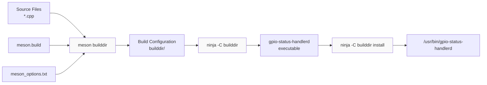
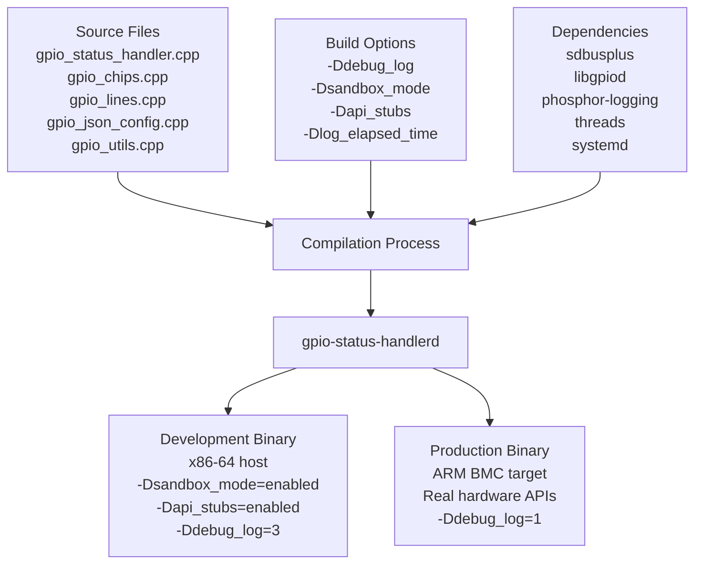
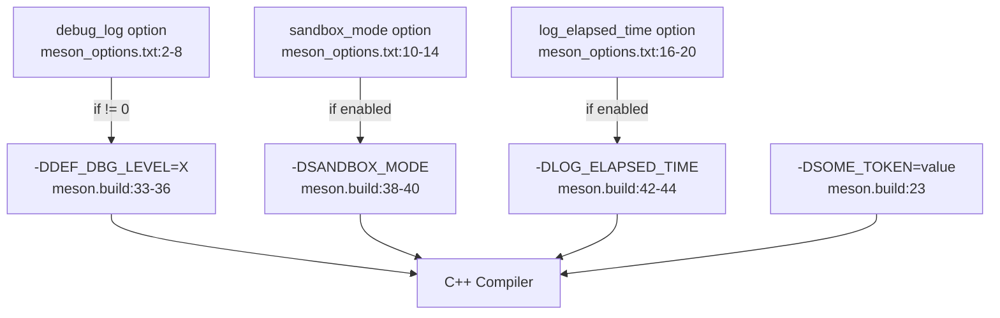
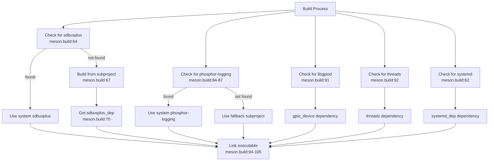
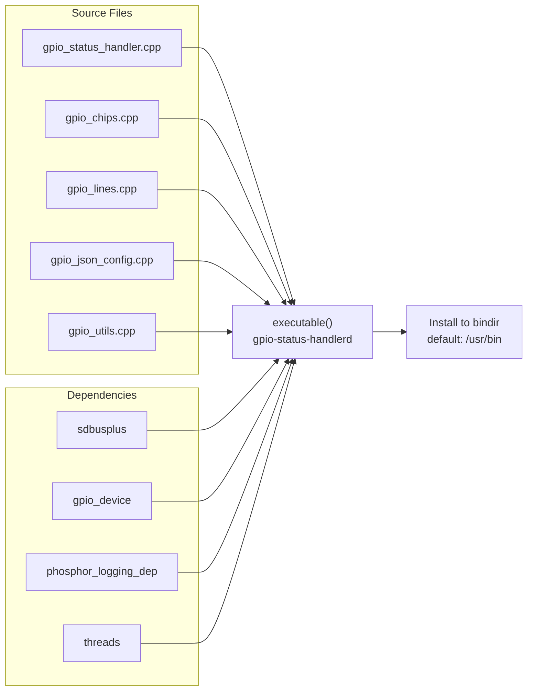

<!-- source: DeepWiki mcp.deepwiki.com · repo NVIDIA/nvidia-gpio-status-handler · page 3 Building the Project · fetched 2026-10-26 -->

# Building the Project

Relevant source files

The following files were used as context for generating this wiki page:

- [README.md](README.md)
- [meson.build](meson.build)
- [meson_options.txt](meson_options.txt)

This page provides comprehensive guidance on compiling the `nvidia-gpio-status-handler` daemon from source using the Meson build system. It covers the build process overview, dependency management, compilation options, and the steps required to produce executable binaries for different deployment targets.

For detailed build system internals, see [Build System Overview](#3.1). For dependency documentation, see [Dependencies](#3.2). For configuration options, see [Build Options](#3.3). For step-by-step compilation instructions, see [Compilation Guide](#3.4).

## Build Process Overview

The `nvidia-gpio-status-handler` project uses the **Meson build system** with **Ninja** as the backend. The build is defined in [meson.build:1-106]() and produces a single executable named `gpio-status-handlerd`.

The build process follows this general workflow:

**Sources:** [meson.build:1-106](), [README.md:22-28]()

## Build System Components

The build system consists of the following key files:

| File | Purpose | Key Content |
|------|---------|-------------|
| `meson.build` | Main build definition | Project metadata, dependencies, compilation rules |
| `meson_options.txt` | Configurable build options | `debug_log`, `sandbox_mode`, `log_elapsed_time` |
| `subprojects/` | Fallback dependencies | `sdbusplus.wrap`, `phosphor-logging.wrap` |

The project requires C++23 standard ([meson.build:7-8](), [meson.build:26-28]()) and enforces this requirement during configuration.

**Sources:** [meson.build:1-8](), [meson.build:26-28](), [meson_options.txt:1-21]()

## Compilation Targets

The build produces a single executable with different configurations depending on build options:

**Sources:** [meson.build:94-105](), [README.md:34-38]()

## Build Configuration

Build behavior is controlled through three mechanisms:

### 1. Project Metadata
Defined in [meson.build:1-8]():
- **Project name:** `c++ nvidia-gpio-status-handler`
- **Language:** C++ (cpp)
- **Version:** 0.1
- **License:** MIT
- **Meson version requirement:** ≥1.1.1
- **C++ standard:** C++23

### 2. Compile-Time Options
Defined in [meson_options.txt:1-21]():

| Option | Type | Default | Description |
|--------|------|---------|-------------|
| `debug_log` | integer (0-4) | 0 | Default logging verbosity level |
| `sandbox_mode` | feature | auto | Enable host development mode |
| `log_elapsed_time` | feature | disabled | Enable performance instrumentation |

These options are processed in [meson.build:30-44]() and converted to preprocessor definitions.

### 3. Compiler Arguments
Global and project-specific arguments are set in [meson.build:22-44]():

**Sources:** [meson.build:22-44](), [meson_options.txt:1-21]()

## Dependency Resolution

The build system uses a sophisticated dependency resolution mechanism that supports both system-installed libraries and fallback subprojects:

**Sources:** [meson.build:62-92]()

## Executable Definition

The final executable is defined in [meson.build:94-105]():

**Sources:** [meson.build:94-105]()

## Quick Start Commands

Basic build commands for common scenarios:

| Scenario | Commands |
|----------|----------|
| **Standard build** | `meson builddir` `ninja -C builddir` |
| **Development build** | `meson builddir -Dsandbox_mode=enabled -Dapi_stubs=enabled -Ddebug_log=3` `ninja -C builddir` |
| **Production build** | `meson builddir -Ddebug_log=1` `ninja -C builddir` `ninja -C builddir install` |
| **Clean build** | `ninja -C builddir clean` |
| **Reconfigure** | `cd builddir && meson configure -Ddebug_log=2` |
| **Complete rebuild** | `rm -rf builddir` `meson builddir` `ninja -C builddir` |

**Sources:** [README.md:22-50](), [README.md:75-96]()

## Build Output

A successful build produces:

1. **Executable:** `builddir/gpio-status-handlerd`
2. **Installation path:** Determined by `get_option('prefix') + '/' + get_option('bindir')` ([meson.build:20]()), typically `/usr/bin/gpio-status-handlerd`

The binary size and behavior vary significantly based on build options:

| Configuration | Binary Characteristics |
|---------------|------------------------|
| Debug (level 3-4) | Larger binary, verbose logging, performance instrumentation available |
| Production (level 0-1) | Smaller binary, minimal logging, optimized for deployment |
| Sandbox mode | x86-64 target, no hardware dependencies |
| Hardware mode | ARM target, real GPIO/D-Bus APIs |

**Sources:** [meson.build:94-105](), [README.md:98-121]()

## Next Steps

- For build system architecture details, see [Build System Overview](#3.1)
- For dependency documentation and fallback mechanisms, see [Dependencies](#3.2)
- For comprehensive build option explanations, see [Build Options](#3.3)
- For step-by-step compilation instructions, see [Compilation Guide](#3.4)
- For runtime configuration after building, see [Configuration](#4)

---

