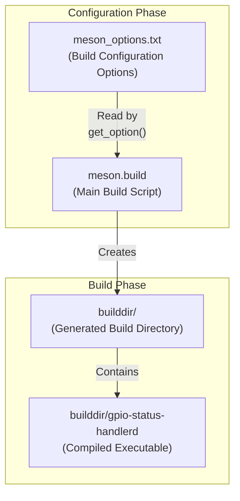
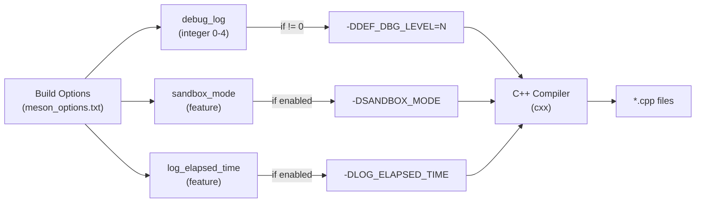
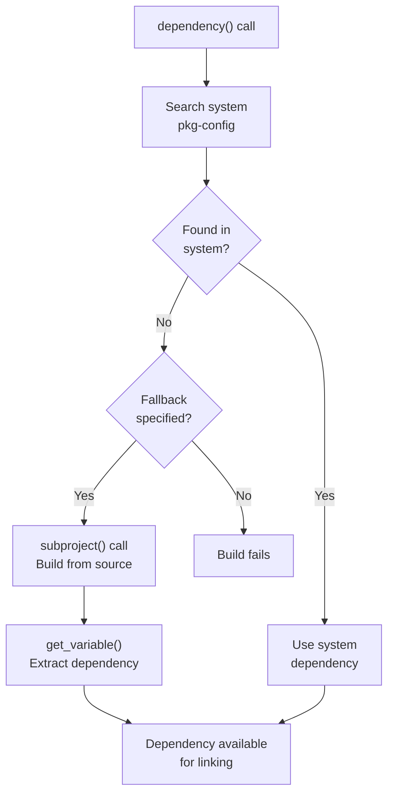
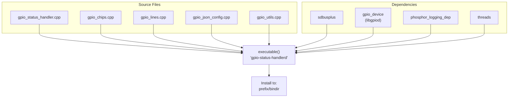
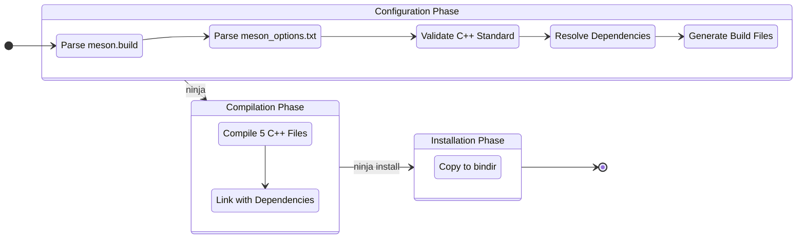

<!-- source: DeepWiki mcp.deepwiki.com · repo NVIDIA/nvidia-gpio-status-handler · page 3.1 Build System Overview · fetched 2026-10-26 -->

# Build System Overview

<details>
<summary>Relevant source files</summary>

The following files were used as context for generating this wiki page:

- [meson.build](meson.build)
- [meson_options.txt](meson_options.txt)

</details>


## Purpose and Scope

This page explains the Meson build system configuration for `nvidia-gpio-status-handler`, including the structure of build files, how build options are integrated, and how dependencies are resolved during compilation. This covers the build system's organization and mechanics, but not the step-by-step compilation process (see [Compilation Guide](#3.4)) or detailed build option effects (see [Build Options](#3.3)). For information about the external libraries and dependencies themselves, see [Dependencies](#3.2).

---

## Build System Technology

The project uses **Meson** as its build system, requiring version 1.1.1 or higher [meson.build:6](). Meson is a modern build system that provides fast configuration, native dependency management, and cross-compilation support—critical for OpenBMC environments where the build host (typically x86-64) differs from the target BMC architecture (typically ARM).

**Project Metadata:**

| Property | Value | Source |
|----------|-------|--------|
| Project Name | `c++ nvidia-gpio-status-handler` | [meson.build:1-2]() |
| Language | `cpp` | [meson.build:3]() |
| Version | `0.1` | [meson.build:4]() |
| License | MIT | [meson.build:5]() |
| C++ Standard | `c++23` | [meson.build:7]() |
| Minimum Meson | `1.1.1` | [meson.build:6]() |

The C++ standard is enforced at [meson.build:26-28](), where the build will fail with an error if a different standard is specified.

**Sources:** [meson.build:1-28]()

---

## Build File Structure

The build system consists of two primary files that define the compilation process:



**Build File Responsibilities:**

| File | Lines | Purpose |
|------|-------|---------|
| `meson.build` | 106 lines | Main build script defining project metadata, dependencies, compiler flags, and build targets |
| `meson_options.txt` | 22 lines | Declares user-configurable build options with types, ranges, and default values |

The configuration phase reads both files to generate the build directory, while the build phase uses the generated configuration to compile the executable.

**Sources:** [meson.build:1-106](), [meson_options.txt:1-22]()

---

## Project Configuration and Compiler Setup

### Global Compiler Arguments

The build system configures the C++ compiler through global arguments that affect all compilation units:



The option-to-compiler-flag translation occurs at:
- **debug_log**: [meson.build:31-37]() - Sets `DEF_DBG_LEVEL` preprocessor macro
- **sandbox_mode**: [meson.build:38-40]() - Defines `SANDBOX_MODE` when enabled
- **log_elapsed_time**: [meson.build:42-44]() - Defines `LOG_ELAPSED_TIME` when enabled

A generic token (`-DSOME_TOKEN=value`) is also added at [meson.build:23](), though this appears to be a placeholder.

**Sources:** [meson.build:23-44](), [meson_options.txt:1-22]()

---

## Dependency Resolution Mechanism

The build system must resolve five external dependencies. For `sdbusplus` and `phosphor-logging`, it implements a **fallback subproject mechanism** that enables building without system-installed packages.

### Dependency Resolution Flow



### Dependency Declarations

**Simple Dependencies (No Fallback):**

```
systemd_dep = dependency('systemd')           [line 62]
gpio_device = dependency('libgpiod')          [line 91]
threads = dependency('threads')               [line 92]
```

These dependencies must be available in the system; the build fails if they're missing.

**Complex Dependencies (With Fallback):**

The `sdbusplus` dependency demonstrates the complete fallback pattern [meson.build:64-81]():

1. **Initial search** with `required: false` [meson.build:64]()
2. **Check if found or internal** [meson.build:66]()
3. **Build subproject** if needed [meson.build:67]()
4. **Extract dependency** from subproject [meson.build:70]()
5. **Extract tools** (`sdbus++`, `sdbus++-gen-meson`) [meson.build:73-81]()

The `phosphor-logging` dependency uses simplified syntax [meson.build:84-87]():

```
phosphor_logging_dep = dependency(
    'phosphor-logging',
    fallback: ['phosphor-logging', 'phosphor_logging_dep'],
)
```

This is equivalent to the manual `sdbusplus` pattern but more concise.

**Sources:** [meson.build:62-92]()

---

## Executable Target Definition

The final build target is the `gpio-status-handlerd` executable, defined at [meson.build:94-105]():



**Executable Configuration:**

| Property | Value | Line |
|----------|-------|------|
| Target Name | `gpio-status-handlerd` | [meson.build:95]() |
| Source Files | 5 C++ files (handler, chips, lines, config, utils) | [meson.build:96-100]() |
| Include Directories | Implicit (project root) | [meson.build:101]() |
| Dependencies | sdbusplus, libgpiod, phosphor-logging, threads | [meson.build:102]() |
| Install Directory | `${prefix}/bin` | [meson.build:103]() |
| Install | Enabled | [meson.build:104]() |

The `implicit_include_directories: true` setting at [meson.build:101]() means the compiler automatically searches the project root for header files.

**Sources:** [meson.build:94-105]()

---

## Build Process Overview

The complete build process from configuration to installation:



**Phase Details:**

1. **Configuration Phase** (`meson setup builddir`):
   - Parses `meson.build` and `meson_options.txt`
   - Validates C++ standard requirement [meson.build:26-28]()
   - Resolves all dependencies [meson.build:62-92]()
   - Generates build files in `builddir/`

2. **Compilation Phase** (`ninja -C builddir`):
   - Compiles each source file with configured flags
   - Links object files with resolved dependencies
   - Produces `builddir/gpio-status-handlerd`

3. **Installation Phase** (`ninja -C builddir install`):
   - Copies executable to `${prefix}/bin/` [meson.build:103]()

**Sources:** [meson.build:1-106]()

---

## Build System Extension Points

The build system provides several extension mechanisms:

### Feature Map Framework

Lines [meson.build:50-60]() define a generic feature map framework:

```
feature_map = {}

foreach option_key, option_value : feature_map
    if (get_option(option_key).enabled())
        summary(option_key, option_value, section: 'Enabled Features')
        add_global_arguments(option_value, language: lang)
    endif
endforeach
```

This infrastructure allows adding new feature flags without modifying the iteration logic. Currently unused (`feature_map` is empty), but demonstrates extensibility.

### Dependency Addition

New dependencies can be added by:
1. Declaring them with `dependency()` [meson.build:62-92]()
2. Adding them to the `dependencies` array in `executable()` [meson.build:102]()
3. Optionally providing fallback subprojects for dependencies not universally available

### Source File Addition

New source files are automatically compiled when added to the `executable()` call [meson.build:96-100](). Header files are found via `implicit_include_directories: true` [meson.build:101]().

**Sources:** [meson.build:50-105]()

---

## Summary

The Meson build system for `nvidia-gpio-status-handler` provides:

- **Flexible configuration** through user-defined options in `meson_options.txt`
- **Robust dependency management** with fallback subprojects for OpenBMC-specific libraries
- **Simple target definition** with explicit source file and dependency lists
- **Cross-compilation support** via Meson's native toolchain handling
- **Extensibility** through feature maps and modular dependency declarations

The build configuration transforms three user-facing options (`debug_log`, `sandbox_mode`, `log_elapsed_time`) into preprocessor macros, resolves five dependencies (three with fallbacks), and compiles five source files into a single executable installed to the system binary directory.

**Sources:** [meson.build:1-106](), [meson_options.txt:1-22]()

---

