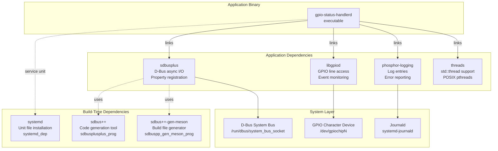
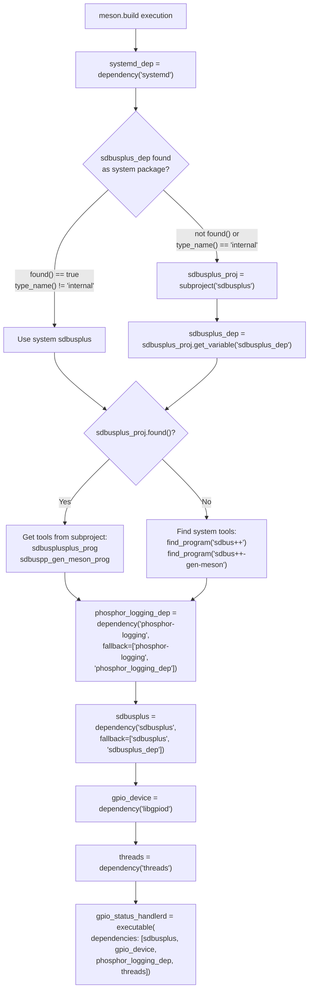

<!-- source: DeepWiki mcp.deepwiki.com · repo NVIDIA/nvidia-gpio-status-handler · page 3.2 Dependencies · fetched 2026-10-26 -->

# Dependencies

<details>
<summary>Relevant source files</summary>

The following files were used as context for generating this wiki page:

- [meson.build](meson.build)
- [meson_options.txt](meson_options.txt)

</details>


This page documents the external dependencies required to build and run `nvidia-gpio-status-handler`. It covers the purpose of each dependency, how they are declared in the Meson build system, and the fallback subproject mechanism that enables compilation when system packages are unavailable.

For information about build system configuration, see [Build System Overview](#3.1). For details on compile-time configuration options, see [Build Options](#3.3).

---

## Overview

The `gpio-status-handlerd` daemon depends on five external libraries and one system component. These dependencies are declared in [meson.build:62-92]() and linked into the final executable at [meson.build:94-105](). The build system uses Meson's dependency resolution with fallback subprojects to support both system-installed packages and locally-built alternatives.

**Dependency Summary Table**

| Dependency | Purpose | Meson Variable | Fallback Support |
|------------|---------|----------------|------------------|
| `systemd` | Service management integration | `systemd_dep` | No |
| `sdbusplus` | D-Bus communication and property management | `sdbusplus_dep` | Yes |
| `phosphor-logging` | Structured logging for OpenBMC | `phosphor_logging_dep` | Yes |
| `libgpiod` | GPIO hardware abstraction via character device | `gpio_device` | No |
| `threads` | POSIX threads for concurrent GPIO monitoring | `threads` | No |

Sources: [meson.build:62-92]()

---

## Dependency Architecture

The following diagram shows how dependencies are organized into functional layers and how they relate to system components.



Sources: [meson.build:62-105]()

---

## Core Dependencies

### sdbusplus

**Purpose**: Provides C++ bindings for D-Bus communication, enabling the daemon to expose GPIO status as D-Bus properties and send `PropertiesChanged` signals.

**Declaration**: [meson.build:64-71](), [meson.build:89]()

**Fallback Mechanism**: 
- Primary: System-installed `sdbusplus` package via `pkg-config`
- Fallback: Subproject in `subprojects/sdbusplus/`
- The build system declares `sdbusplus_dep` twice: once with explicit fallback handling and once using Meson's automatic fallback syntax

**Related Tools**:
- `sdbusplusplus_prog`: The `sdbus++` code generator ([meson.build:74-80]())
- `sdbuspp_gen_meson_prog`: The `sdbus++-gen-meson` build file generator ([meson.build:75-80]())

**Usage**: Linked into executable at [meson.build:102]()

The code checks if `sdbusplus_dep` is found as a system dependency or internal (subproject) type at [meson.build:66](). If not found, it retrieves the dependency from the subproject at [meson.build:70]().

Sources: [meson.build:64-81](), [meson.build:89]()

### libgpiod

**Purpose**: Provides a user-space library for interacting with GPIO lines via the Linux kernel's GPIO character device interface (`/dev/gpiochipN`). Abstracts low-level `ioctl` operations and provides event-driven monitoring.

**Declaration**: [meson.build:91]()

```
gpio_device = dependency('libgpiod')
```

**Fallback Mechanism**: None. This dependency must be available as a system package.

**Usage**: Linked into executable at [meson.build:102]()

**Key Features Used**:
- GPIO line request and configuration
- Event-driven monitoring via `gpiod_line_event_wait()`
- Pin value reads

Sources: [meson.build:91]()

### phosphor-logging

**Purpose**: Provides structured logging capabilities integrated with OpenBMC's logging infrastructure. Enables log entries to be written to the systemd journal with appropriate severity levels and metadata.

**Declaration**: [meson.build:84-87]()

```
phosphor_logging_dep = dependency(
    'phosphor-logging',
    fallback: ['phosphor-logging', 'phosphor_logging_dep'],
)
```

**Fallback Mechanism**:
- Primary: System-installed `phosphor-logging` package
- Fallback: Subproject in `subprojects/phosphor-logging/`, exporting `phosphor_logging_dep`

**Usage**: Linked into executable at [meson.build:102]()

**Integration**: The daemon uses this library to log GPIO state changes, configuration errors, and operational status at various verbosity levels controlled by build-time and runtime options (see [Logging Configuration](#4.3)).

Sources: [meson.build:84-87]()

### threads

**Purpose**: Provides POSIX thread support for spawning concurrent GPIO monitoring threads. Each configured GPIO pin gets its own monitoring thread.

**Declaration**: [meson.build:92]()

```
threads = dependency('threads')
```

**Fallback Mechanism**: None. This is a standard system dependency provided by the C++ standard library and POSIX runtime.

**Usage**: Linked into executable at [meson.build:102]()

**Architecture Impact**: The daemon spawns one thread per GPIO line (see [GPIO Monitoring Implementation](#2.3)). Thread synchronization is handled by the D-Bus library's asynchronous property update mechanism.

Sources: [meson.build:92]()

### systemd

**Purpose**: Provides metadata for systemd service integration, particularly the installation paths for unit files.

**Declaration**: [meson.build:62]()

```
systemd_dep = dependency('systemd')
```

**Fallback Mechanism**: None. This dependency is required for OpenBMC deployment.

**Usage**: Not linked into the executable. Used only for build-time configuration to determine systemd unit file installation paths. The daemon is managed by systemd at runtime (see [Deployment to OpenBMC](#6)).

Sources: [meson.build:62]()

---

## Dependency Resolution Flow

The following diagram illustrates how the Meson build system resolves dependencies, showing the fallback mechanism for `sdbusplus` and `phosphor-logging`.



Sources: [meson.build:62-105]()

---

## Dependency Integration in Executable

The final executable is built by linking all runtime dependencies. The build declaration at [meson.build:94-105]() shows this integration:

```
gpio_status_handlerd = executable(
    'gpio-status-handlerd',
    'gpio_status_handler.cpp',
    'gpio_chips.cpp',
    'gpio_lines.cpp',
    'gpio_json_config.cpp',
    'gpio_utils.cpp',
    implicit_include_directories: true,
    dependencies: [sdbusplus, gpio_device, phosphor_logging_dep, threads],
    install_dir: bindir,
    install: true,
)
```

**Note**: The `systemd_dep` is notably absent from the `dependencies` list because it is only used for build configuration, not runtime linking.

**Source Files and Dependencies Mapping**

| Source File | Primary Dependencies Used |
|-------------|---------------------------|
| `gpio_status_handler.cpp` | `sdbusplus`, `phosphor-logging`, `threads` |
| `gpio_chips.cpp` | `libgpiod`, `phosphor-logging` |
| `gpio_lines.cpp` | `libgpiod`, `phosphor-logging` |
| `gpio_json_config.cpp` | `phosphor-logging` |
| `gpio_utils.cpp` | `phosphor-logging` |

Sources: [meson.build:94-105]()

---

## Fallback Subproject Mechanism

The build system uses Meson's subproject feature to handle missing system dependencies. This enables compilation in environments where OpenBMC-specific packages are not available, such as developer workstations.

**Supported Fallbacks**

1. **sdbusplus**: Subproject at `subprojects/sdbusplus/`
   - Exports: `sdbusplus_dep`, `sdbusplusplus_prog`, `sdbuspp_gen_meson_prog`
   - Implementation: [meson.build:64-81]()

2. **phosphor-logging**: Subproject at `subprojects/phosphor-logging/`
   - Exports: `phosphor_logging_dep`
   - Implementation: [meson.build:84-87]()

**No Fallback Available**

The following dependencies must be available as system packages:
- `systemd`: Required for OpenBMC integration
- `libgpiod`: Standard Linux GPIO library
- `threads`: Standard POSIX/C++ threading support

**Subproject Directory Structure**

```
nvidia-gpio-status-handler/
├── meson.build
└── subprojects/
    ├── sdbusplus/
    │   └── meson.build (exports sdbusplus_dep)
    └── phosphor-logging/
        └── meson.build (exports phosphor_logging_dep)
```

When a system dependency is not found, Meson automatically searches for a matching subproject directory and builds it as part of the main build.

Sources: [meson.build:64-87]()

---

## Build-Time vs. Runtime Dependencies

The following table clarifies which dependencies are needed at different stages:

| Dependency | Build Time | Link Time | Runtime | Purpose |
|------------|------------|-----------|---------|---------|
| `systemd` | ✓ | ✗ | ✗ | Provides unit file installation paths |
| `sdbusplus` | ✓ | ✓ | ✓ | D-Bus communication library |
| `phosphor-logging` | ✓ | ✓ | ✓ | Logging framework |
| `libgpiod` | ✓ | ✓ | ✓ | GPIO hardware access |
| `threads` | ✓ | ✓ | ✓ | Thread support |
| `sdbus++` (tool) | ✓ | ✗ | ✗ | Code generation for D-Bus interfaces |
| `sdbus++-gen-meson` (tool) | ✓ | ✗ | ✗ | Build file generation |

**Runtime Environment Requirements**:
- D-Bus system bus must be available at `/run/dbus/system_bus_socket`
- GPIO character devices must exist at `/dev/gpiochipN`
- systemd journal must be available for log output

Sources: [meson.build:62-105]()

---

