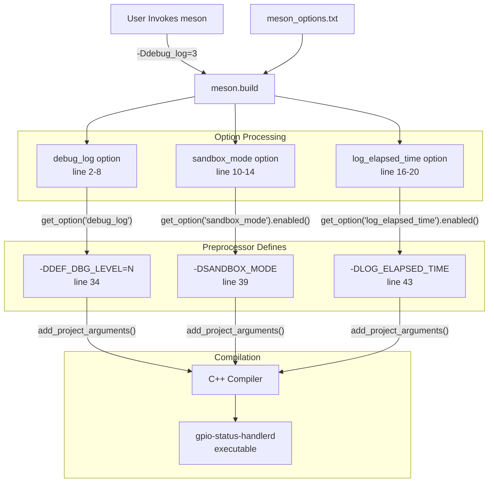
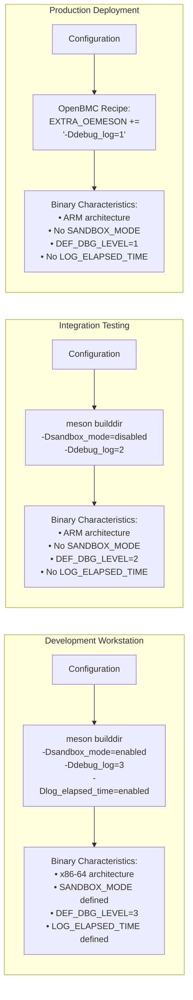
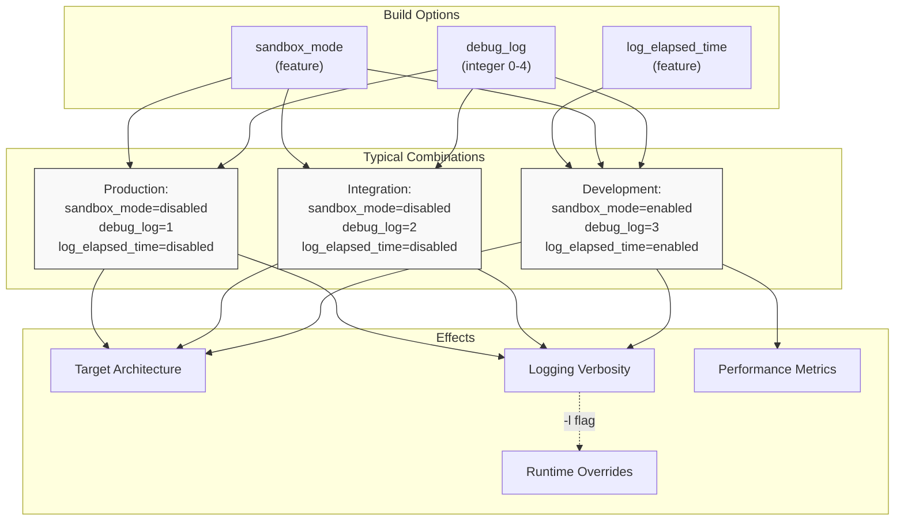

<!-- source: DeepWiki mcp.deepwiki.com · repo NVIDIA/nvidia-gpio-status-handler · page 3.3 Build Options · fetched 2026-10-26 -->

# Build Options

<details>
<summary>Relevant source files</summary>

The following files were used as context for generating this wiki page:

- [README.md](README.md)
- [meson.build](meson.build)
- [meson_options.txt](meson_options.txt)

</details>


## Purpose and Scope

This page documents the compile-time configuration options available when building the nvidia-gpio-status-handler daemon. These options control logging verbosity, target architecture, and instrumentation features. Build options are set during the Meson configuration phase and affect the generated binary's behavior and capabilities.

For information about the overall build process and step-by-step compilation instructions, see [Compilation Guide](#3.4). For runtime configuration including command-line flags, see [Command-Line Options](#4.2).

## Available Build Options

The nvidia-gpio-status-handler build system provides three primary compile-time options defined in [meson_options.txt:1-21]():

| Option | Type | Default | Valid Values | Purpose |
|--------|------|---------|--------------|---------|
| `debug_log` | integer | `0` | `0` to `4` | Sets the default logging verbosity level compiled into the binary |
| `sandbox_mode` | feature | `auto` | `enabled`, `disabled`, `auto` | Enables development mode for host architecture without BMC hardware |
| `log_elapsed_time` | feature | `disabled` | `enabled`, `disabled` | Adds timing instrumentation to log output |

**Note:** The README.md documentation references an `api_stubs` option [README.md:36-37](), but this option is not present in the current [meson_options.txt](). This may indicate outdated documentation or a deprecated feature.

*Sources: meson_options.txt, README.md, meson.build*

## Build Option Processing Flow



*Sources: meson.build:30-44, meson_options.txt:1-21*

## debug_log Option

### Description

The `debug_log` option sets the default logging verbosity level that is compiled into the binary. This value becomes the initial log level when the daemon starts, though it can be overridden at runtime using the `-l` command-line flag (see [Logging Configuration](#4.3)).

### Configuration

**Option Definition:** [meson_options.txt:1-8]()
```
type: 'integer'
min: 0
max: 4
value: 0 (default)
```

**Build System Processing:** [meson.build:31-37]()
```
debug_log_level = get_option('debug_log')
if debug_log_level != 0
    add_project_arguments(
        '-DDEF_DBG_LEVEL=' + debug_log_level.to_string(),
        language: lang,
    )
endif
```

### Log Level Values

| Level | Value | Description | Use Case |
|-------|-------|-------------|----------|
| Disabled | `0` | No logging output | Development builds where logging is controlled entirely at runtime |
| Error | `1` | Error messages only (production default) | Production deployments; minimizes overhead |
| Warning | `2` | Errors + warnings | Integration testing |
| Debug | `3` | Errors + warnings + debug messages | Active development and troubleshooting |
| Info | `4` | All messages including informational | Maximum verbosity for detailed diagnostics |

*Sources: README.md:101-111, meson.build:31-37*

### Usage Examples

**Production Build (error logging only):**
```bash
$ meson builddir -Ddebug_log=1
$ ninja -C builddir
```

**Development Build (full debug output):**
```bash
$ meson builddir -Ddebug_log=3
$ ninja -C builddir
```

**OpenBMC Integration (specified in recipe):**
```
EXTRA_OEMESON += "-Ddebug_log=1"
```
*Referenced in: [README.md:113-116]()*

### Effects on Binary

When `debug_log != 0`, the preprocessor macro `DEF_DBG_LEVEL` is defined with the specified level. This affects:

1. **Default Log Level**: The daemon initializes with this verbosity level
2. **Compile-Time Optimization**: Some log statements may be optimized out if below the compiled level
3. **Runtime Override**: The `-l` flag can increase or decrease verbosity at startup

*Sources: meson.build:31-37, README.md:98-126*

## sandbox_mode Option

### Description

The `sandbox_mode` option enables compilation for host CPU architecture (typically x86-64) rather than the target BMC ARM architecture. This allows developers to build, run, and debug the daemon on their development workstation without requiring BMC hardware.

### Configuration

**Option Definition:** [meson_options.txt:9-14]()
```
type: 'feature'
value: 'auto' (default)
description: 'Sandbox mode enablement'
```

**Build System Processing:** [meson.build:38-40]()
```
if get_option('sandbox_mode').enabled()
    add_project_arguments('-DSANDBOX_MODE', language: lang)
endif
```

### Mode Comparison

| Aspect | Sandbox Mode Disabled | Sandbox Mode Enabled |
|--------|----------------------|---------------------|
| **Target Architecture** | ARM (BMC) | x86-64 (host) |
| **GPIO Hardware** | Real `/dev/gpiochipN` devices | Simulated or stub interfaces |
| **D-Bus Service** | System bus | Session bus (typically) |
| **Use Case** | Production/integration deployment | Local development and debugging |
| **Preprocessor Define** | (none) | `-DSANDBOX_MODE` |

*Sources: meson_options.txt:9-14, README.md:36-38*

### Usage Examples

**Enable Sandbox Mode:**
```bash
$ meson builddir -Dsandbox_mode=enabled
$ ninja -C builddir
```

**Explicitly Disable (BMC target):**
```bash
$ meson builddir -Dsandbox_mode=disabled
$ ninja -C builddir
```

**Auto Detection (default):**
```bash
$ meson builddir  # Uses 'auto', typically disables on OpenBMC SDK
$ ninja -C builddir
```

*Referenced in: [README.md:62-67]()*

### Code Impact

When `-DSANDBOX_MODE` is defined, source code can use conditional compilation to:

1. **Mock Hardware Access**: Use filesystem-based simulation instead of actual GPIO devices
2. **Adjust Service Names**: Connect to development D-Bus instances
3. **Enable Test Interfaces**: Activate EINJ (error injection) mode automatically

The specific code paths affected by this macro would be found in the implementation files (gpio_status_handler.cpp, gpio_chips.cpp, etc.).

*Sources: meson.build:38-40, high-level architecture diagrams*

## log_elapsed_time Option

### Description

The `log_elapsed_time` option adds timing instrumentation to log output, showing elapsed time measurements for operations. This is useful for performance profiling and identifying bottlenecks during development.

### Configuration

**Option Definition:** [meson_options.txt:15-20]()
```
type: 'feature'
value: 'disabled' (default)
description: 'Enable generation of the Elpased time logs'
```

**Build System Processing:** [meson.build:42-44]()
```
if get_option('log_elapsed_time').enabled()
    add_project_arguments('-DLOG_ELAPSED_TIME', language: lang)
endif
```

### Usage Examples

**Enable Timing Instrumentation:**
```bash
$ meson builddir -Dlog_elapsed_time=enabled
$ ninja -C builddir
```

**Disable (default):**
```bash
$ meson builddir  # log_elapsed_time defaults to disabled
$ ninja -C builddir
```

### Effects on Binary

When enabled, the `-DLOG_ELAPSED_TIME` preprocessor macro is defined. This causes:

1. **Timing Code Inclusion**: Performance measurement code is compiled in
2. **Log Format Changes**: Log messages include timestamp deltas
3. **Minimal Runtime Overhead**: Timing code only executes when logging is active
4. **Debug Aid**: Helps identify slow operations in GPIO monitoring or D-Bus updates

**Note:** This option is typically combined with `debug_log=3` or higher to see the timing information in the output.

*Sources: meson_options.txt:15-20, meson.build:42-44*

## Configuration Patterns for Different Environments



*Sources: README.md:31-97, meson.build:30-44*

## Option Reconfiguration

For projects already configured with `meson builddir`, options can be changed without recreating the build directory.

### Viewing Current Options

```bash
$ cd builddir
$ meson configure
```

This displays all project options with their current and possible values [README.md:82-90]().

### Changing Options

```bash
$ cd builddir
$ meson configure -Ddebug_log=2 -Dlog_elapsed_time=enabled
$ cd ..
$ ninja -C builddir
```

Multiple options can be changed in a single command. After reconfiguration, rebuild with `ninja`.

*Sources: README.md:75-96*

## Preprocessor Macro Summary

The following table shows the direct mapping between build options and the C++ preprocessor macros they generate:

| Build Option | Condition | Preprocessor Macro | Value Format |
|--------------|-----------|-------------------|--------------|
| `debug_log=N` | `N != 0` | `DEF_DBG_LEVEL` | Integer value of N |
| `sandbox_mode=enabled` | Enabled | `SANDBOX_MODE` | Defined (no value) |
| `log_elapsed_time=enabled` | Enabled | `LOG_ELAPSED_TIME` | Defined (no value) |

These macros are added via `add_project_arguments()` in [meson.build:33-44]() and are available to all compilation units in the project.

*Sources: meson.build:30-44*

## Build Option Dependencies and Interactions



### Independence

All build options are independent and can be combined in any valid way. There are no mandatory co-enablements or mutual exclusions.

### Recommended Combinations

- **Rapid Development**: Enable all options for maximum visibility
- **BMC Testing**: Disable sandbox, enable moderate logging
- **Production**: Minimal logging, no instrumentation, standard architecture

*Sources: High-level architecture diagram 2 and 5, meson.build:30-44*

## Relationship to Runtime Configuration

Build options set **default behavior** compiled into the binary. Runtime configuration can modify some of these behaviors:

| Build Option | Runtime Override | Override Mechanism |
|--------------|------------------|-------------------|
| `debug_log` | **Yes** | `-l <level>` command-line flag (see [Command-Line Options](#4.2)) |
| `sandbox_mode` | **No** | Must be set at compile-time; affects binary architecture |
| `log_elapsed_time` | **No** | Must be set at compile-time; timing code must be present |

The `debug_log` option provides compile-time defaults but can be overridden at every daemon invocation. Options that affect architecture or compiled code paths cannot be changed at runtime.

*Sources: README.md:98-126, meson.build:30-44*

---

