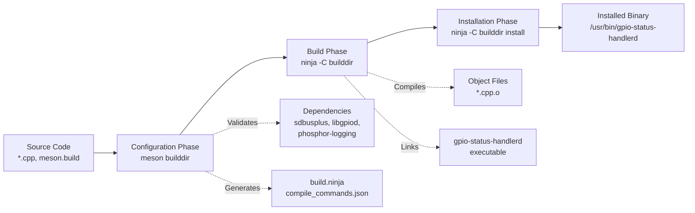
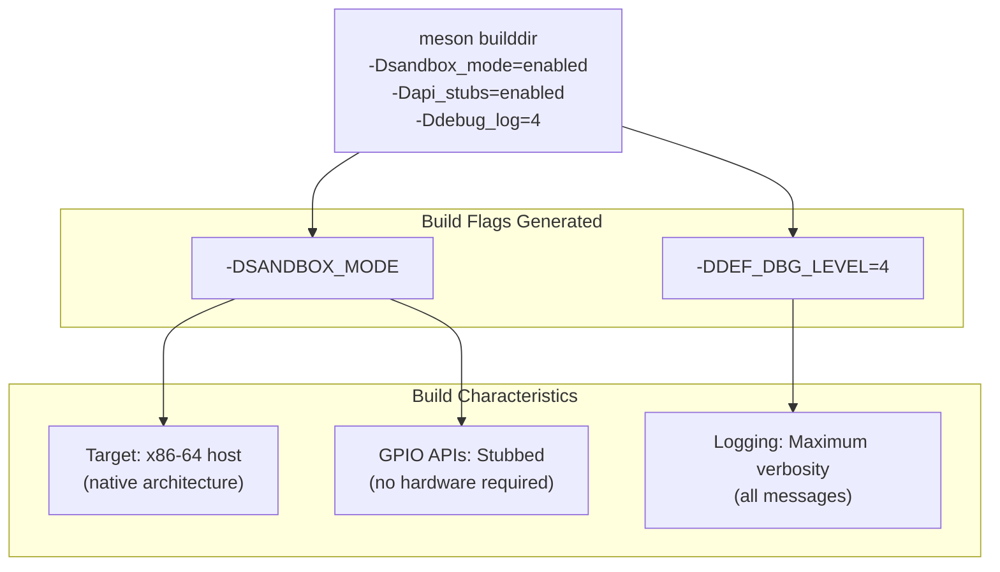
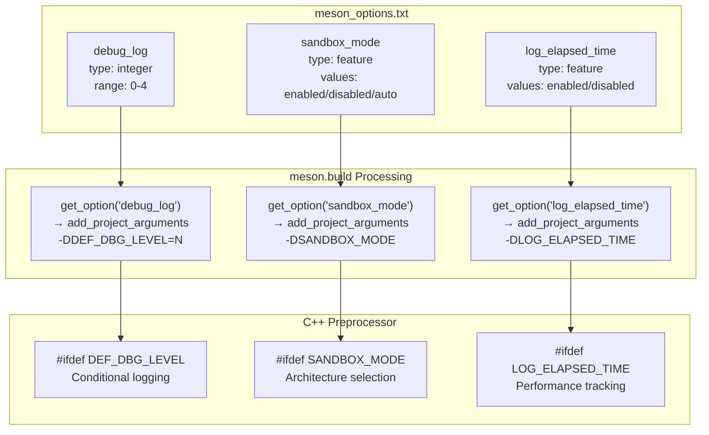

<!-- source: DeepWiki mcp.deepwiki.com · repo NVIDIA/nvidia-gpio-status-handler · page 3.4 Compilation Guide · fetched 2026-10-26 -->

# Compilation Guide

<details>
<summary>Relevant source files</summary>

The following files were used as context for generating this wiki page:

- [README.md](README.md)
- [meson.build](meson.build)
- [meson_options.txt](meson_options.txt)

</details>


## Purpose and Scope

This document provides step-by-step instructions for compiling the `nvidia-gpio-status-handler` daemon from source code. It covers environment setup, configuration, compilation, and installation procedures for both development and production environments.

For information about the underlying build system architecture, see [Build System Overview](#3.1). For details on available compile-time configuration options, see [Build Options](#3.3). For dependency requirements and the fallback subproject mechanism, see [Dependencies](#3.2).

---

## Prerequisites

### System Requirements

The following table lists supported platforms and required packages:

| Operating System | Build Tools | Additional Requirements |
|-----------------|-------------|------------------------|
| Ubuntu 20.04 | `g++`, `meson` (≥1.1.1), `ninja-build`, `pkg-config`, `autoconf`, `autoconf-archive`, `libtool-bin` | OpenBMC SDK (for BMC target builds) |
| Cygwin | `g++`, `meson` (≥1.1.1), `ninja-build`, `pkg-config`, `autoconf`, `autoconf-archive`, `libtool-bin` | OpenBMC SDK, manual package installation via [Cygwin setup utility](https://www.cygwin.com/setup-x86_64.exe) |
| Other Linux | C++23-capable compiler, `meson` (≥1.1.1), `ninja-build`, `pkg-config` | Development headers for dependencies |

**Compiler Requirements:**
- C++23 standard support (enforced at [meson.build:26-28]())
- GCC 11+ or Clang 15+ recommended

Sources: [README.md:6-20](), [meson.build:6-8](), [meson.build:26-28]()

### Required Dependencies

The build system requires the following runtime dependencies:

| Dependency | Purpose | Fallback Behavior |
|-----------|---------|------------------|
| `sdbusplus` | D-Bus communication library | Fetched as subproject if not found ([meson.build:64-71]()) |
| `libgpiod` | GPIO hardware abstraction | Must be installed system-wide ([meson.build:91]()) |
| `phosphor-logging` | Structured logging framework | Fetched as subproject if not found ([meson.build:84-87]()) |
| `threads` | POSIX threads support | System-provided ([meson.build:92]()) |
| `systemd` | Service management | System-provided ([meson.build:62]()) |

**Installation Methods:**

1. **Automated Setup (Linux):**
   ```bash
   sudo scripts/setup_bldenv
   ```
   This script installs all required packages and dependencies ([README.md:16-19]()).

2. **Manual Installation (Ubuntu/Debian):**
   ```bash
   sudo apt-get install g++ meson ninja-build pkg-config \
                        autoconf autoconf-archive libtool-bin \
                        libgpiod-dev libsystemd-dev
   ```

3. **OpenBMC SDK:**
   For cross-compilation to BMC targets, install the OpenBMC SDK following the [official instructions](https://github.com/openbmc/docs/blob/master/development/dev-environment.md#download-and-install-sdk) ([README.md:14]()).

Sources: [meson.build:62-92](), [README.md:6-19]()

---

## Basic Compilation Workflow

The compilation process follows a standard Meson workflow consisting of three phases: configuration, build, and installation.

### Compilation Process Overview



Sources: [meson.build:1-106](), [README.md:22-28]()

### Step 1: Configuration

Navigate to the source directory and run:

```bash
meson builddir
```

This command:
- Creates a `builddir` directory for build artifacts
- Validates the C++23 compiler ([meson.build:26-28]())
- Discovers system-installed dependencies ([meson.build:62-92]())
- Downloads missing dependencies as subprojects ([meson.build:64-87]())
- Generates `build.ninja` and compilation database

**Output artifacts:**
- `builddir/build.ninja` - Ninja build rules
- `builddir/compile_commands.json` - Compiler invocation database for IDEs
- `builddir/meson-info/` - Build metadata

Sources: [meson.build:1-106](), [README.md:25]()

### Step 2: Build

Compile the daemon:

```bash
ninja -C builddir
```

This command:
- Compiles five C++ source files: `gpio_status_handler.cpp`, `gpio_chips.cpp`, `gpio_lines.cpp`, `gpio_json_config.cpp`, `gpio_utils.cpp` ([meson.build:94-105]())
- Links against `sdbusplus`, `libgpiod`, `phosphor-logging`, and `threads` ([meson.build:102]())
- Produces the `gpio-status-handlerd` executable

**Build output location:**
- `builddir/gpio-status-handlerd` - Main executable

Sources: [meson.build:94-105](), [README.md:26]()

### Step 3: Installation (Optional)

Install the daemon to the system:

```bash
ninja -C builddir install
```

This command:
- Installs `gpio-status-handlerd` to `/usr/bin` (or custom `--prefix` location) ([meson.build:103-104]())
- Requires root privileges: `sudo ninja -C builddir install`

Sources: [meson.build:103-104](), [README.md:27]()

---

## Build Scenarios

Different deployment environments require different build configurations. The following sections detail three common scenarios.

### Development Build Configuration



**Purpose:** Enables rapid development and debugging on x86-64 workstations without BMC hardware.

**Configuration command:**
```bash
meson builddir -Dsandbox_mode=enabled -Dapi_stubs=enabled -Ddebug_log=4
ninja -C builddir
```

**Effects:**
- `sandbox_mode=enabled`: Defines `SANDBOX_MODE` preprocessor macro ([meson.build:38-40]()), enabling x86-64 target compilation
- `api_stubs=enabled`: Enables stub implementations for APIs that require BMC hardware (see [Development Modes](#5.1))
- `debug_log=4`: Sets maximum compile-time log level ([meson.build:31-37]()), enabling all diagnostic output

**Runtime execution:**
```bash
./builddir/gpio-status-handlerd -l 3 -L /tmp/debug.log
```

Sources: [meson.build:31-44](), [README.md:56-67](), [meson_options.txt:1-20]()

### Integration Build Configuration

**Purpose:** Cross-compilation for ARM-based BMC targets with moderate logging for integration testing.

**Configuration command:**
```bash
# Source OpenBMC SDK environment
source /opt/openbmc-sdk/environment-setup-armv7ahf-neon-openbmc-linux-gnueabi

# Configure and build
meson builddir -Ddebug_log=2
ninja -C builddir
```

**Effects:**
- `sandbox_mode=auto`: Defaults to disabled for cross-compilation (no `SANDBOX_MODE` macro)
- `api_stubs=auto`: Defaults to disabled (real GPIO and D-Bus implementations)
- `debug_log=2`: Enables error and warning messages ([meson.build:31-37]())

**Cross-compilation details:**
- Compiler: ARM cross-toolchain from OpenBMC SDK
- Architecture: ARM Cortex-A series (BMC SoCs)
- Sysroot: Contains ARM-compiled dependencies

Sources: [README.md:14](), [meson.build:31-40](), [meson_options.txt:1-20]()

### Production Build Configuration

**Purpose:** Optimized binary for deployment to production BMC systems with minimal logging overhead.

**OpenBMC Recipe Configuration:**
```bitbake
EXTRA_OEMESON += "-Ddebug_log=1"
```

**Effects:**
- `debug_log=1`: Error-only logging ([meson.build:31-37]()), minimizing performance impact
- `sandbox_mode=disabled`: Production BMC target
- `api_stubs=disabled`: Full hardware integration
- `log_elapsed_time=disabled`: No performance instrumentation ([meson.build:42-44]())

**Build location:**
- Integrated into OpenBMC Yocto build system
- Cross-compiled during BMC image generation
- Installed to BMC root filesystem at `/usr/bin/gpio-status-handlerd`

Sources: [README.md:113-116](), [meson.build:31-44](), [meson_options.txt:1-20]()

---

## Build Configuration Management

### Viewing Current Configuration

For projects already configured, inspect build options:

```bash
cd builddir
meson configure
```

**Example output:**
```
Project options                Current Value                    Possible Values                  Description
  ---------------                -------------                    ---------------                  -----------
  api_stubs                      auto                             [enabled, disabled, auto]        Manager API stubs enablement
  sandbox_mode                   enabled                          [enabled, disabled, auto]        Sandbox mode enablement
  debug_log                      0                                [0, 1, 2, 3, 4]                  Default debug log Level
```

Sources: [README.md:76-90]()

### Modifying Configuration

Change options without reconfiguring from scratch:

```bash
cd builddir
meson configure -Ddebug_log=3 -Dsandbox_mode=disabled
ninja  # Rebuild with new settings
```

**Configuration persistence:**
- Options stored in `builddir/meson-private/coredata.dat`
- Persistent across incremental builds
- Overridden by explicit `-D` flags

Sources: [README.md:92-96]()

### Configuration-to-Compilation Mapping



Sources: [meson.build:31-44](), [meson_options.txt:1-20]()

---

## Cleaning Build Artifacts

### Incremental Clean

Remove compiled objects while preserving configuration:

```bash
ninja -C builddir clean
```

**Removes:**
- Object files (`*.o`)
- `gpio-status-handlerd` executable
- Intermediate build artifacts

**Preserves:**
- `build.ninja` and configuration
- Dependency subprojects
- Compilation database

Sources: [README.md:40-45]()

### Complete Clean

Erase all build artifacts and start fresh:

```bash
rm -rf builddir
```

**Use cases:**
- Switching between development and production configurations
- Resolving persistent build errors
- Clearing cached dependency detection

Sources: [README.md:47-50]()

### Uninstallation

Remove installed binaries:

```bash
ninja -C builddir uninstall
```

**Removes:**
- `/usr/bin/gpio-status-handlerd` (or custom prefix location)
- Requires original `builddir` directory for uninstall manifest

Sources: [README.md:44]()

---

## Verification

### Build Success Indicators

**Configuration phase:**
```
The Meson build system
Version: 1.1.1
Source dir: /path/to/nvidia-gpio-status-handler
Build dir: /path/to/nvidia-gpio-status-handler/builddir
Build type: native build
Project name: c++ nvidia-gpio-status-handler
Project version: 0.1
```

**Build phase:**
```
[1/6] Compiling C++ object gpio_status_handler.cpp.o
[2/6] Compiling C++ object gpio_chips.cpp.o
[3/6] Compiling C++ object gpio_lines.cpp.o
[4/6] Compiling C++ object gpio_json_config.cpp.o
[5/6] Compiling C++ object gpio_utils.cpp.o
[6/6] Linking target gpio-status-handlerd
```

Sources: [meson.build:94-105]()

### Testing the Executable

**Check binary exists:**
```bash
ls -lh builddir/gpio-status-handlerd
```

**Expected output:**
```
-rwxr-xr-x 1 user user 2.3M Jan 15 10:30 builddir/gpio-status-handlerd
```

**Verify runtime dependencies (Linux):**
```bash
ldd builddir/gpio-status-handlerd
```

**Expected shared library dependencies:**
- `libgpiod.so` (GPIO hardware abstraction)
- `libsdbusplus.so` (D-Bus communication)
- `libpthread.so` (Thread support)
- `libstdc++.so` (C++ standard library)

**Test execution (sandbox mode):**
```bash
./builddir/gpio-status-handlerd --help
```

For full runtime testing procedures, see [Testing and Debugging](#5.2).

Sources: [meson.build:102]()

---

## Troubleshooting

### Common Build Failures

#### C++ Standard Error

**Symptom:**
```
meson.build:27:0: ERROR: This project requires c++20 support c++17
```

**Cause:** Meson configured with incompatible C++ standard ([meson.build:26-28]())

**Resolution:**
```bash
rm -rf builddir
meson builddir  # Uses default_options: ['cpp_std=c++23']
```

#### Missing Dependencies

**Symptom:**
```
meson.build:91:0: ERROR: Dependency "libgpiod" not found
```

**Cause:** `libgpiod` not installed system-wide

**Resolution:**
```bash
# Ubuntu/Debian
sudo apt-get install libgpiod-dev

# Rebuild
ninja -C builddir
```

**Note:** `sdbusplus` and `phosphor-logging` are automatically fetched as subprojects if missing ([meson.build:64-87]()), but `libgpiod` requires manual installation.

#### Subproject Download Failures

**Symptom:**
```
ERROR: Failed to download subproject sdbusplus
```

**Cause:** Network connectivity issues or missing Git

**Resolution:**
```bash
# Ensure Git is installed
sudo apt-get install git

# Manually clone subprojects
mkdir -p subprojects
cd subprojects
git clone https://github.com/openbmc/sdbusplus.git
git clone https://github.com/openbmc/phosphor-logging.git

# Rebuild
cd ..
meson builddir
```

#### Compiler Not Found (Cross-compilation)

**Symptom:**
```
ERROR: C++ compiler not found
```

**Cause:** OpenBMC SDK environment not sourced

**Resolution:**
```bash
source /opt/openbmc-sdk/environment-setup-armv7ahf-neon-openbmc-linux-gnueabi
meson builddir --wipe
```

Sources: [meson.build:19](), [meson.build:91](), [meson.build:64-87]()

### Build Performance Optimization

#### Parallel Compilation

Leverage multiple CPU cores:

```bash
ninja -C builddir -j$(nproc)
```

**Effect:** Compiles multiple source files simultaneously

#### Incremental Builds

After modifying a single source file:

```bash
# Modify gpio_utils.cpp
ninja -C builddir
```

**Ninja automatically:**
- Detects changed files
- Recompiles only affected translation units
- Relinks the executable

**Rebuild time:** Typically <5 seconds for single-file changes

Sources: [README.md:26]()

### Debugging Build Issues

#### Verbose Build Output

See full compiler invocations:

```bash
ninja -C builddir -v
```

**Example output:**
```
c++ -Ibuilddir -I. -DDEF_DBG_LEVEL=4 -DSANDBOX_MODE -std=c++23 \
    -c gpio_status_handler.cpp -o builddir/gpio_status_handler.cpp.o
```

#### Inspect Compiler Flags

View preprocessor macros:

```bash
cd builddir
cat compile_commands.json | grep -o '\-D[A-Z_]*' | sort -u
```

**Expected macros:**
- `-DDEF_DBG_LEVEL=N` (if `debug_log > 0`)
- `-DSANDBOX_MODE` (if `sandbox_mode=enabled`)
- `-DLOG_ELAPSED_TIME` (if `log_elapsed_time=enabled`)

Sources: [meson.build:31-44]()

---

## Summary

The compilation workflow consists of three phases:

1. **Configuration** (`meson builddir`): Discovers dependencies and generates build rules
2. **Build** (`ninja -C builddir`): Compiles five C++ source files and links dependencies
3. **Installation** (`ninja -C builddir install`): Deploys to system directories

Three build scenarios are supported:
- **Development:** `sandbox_mode=enabled`, `api_stubs=enabled`, `debug_log=4`
- **Integration:** Cross-compilation with `debug_log=2`
- **Production:** OpenBMC recipe with `debug_log=1`

For information on runtime configuration and logging control, see [Configuration](#4).

Sources: [meson.build:1-106](), [meson_options.txt:1-20](), [README.md:1-126]()

---

