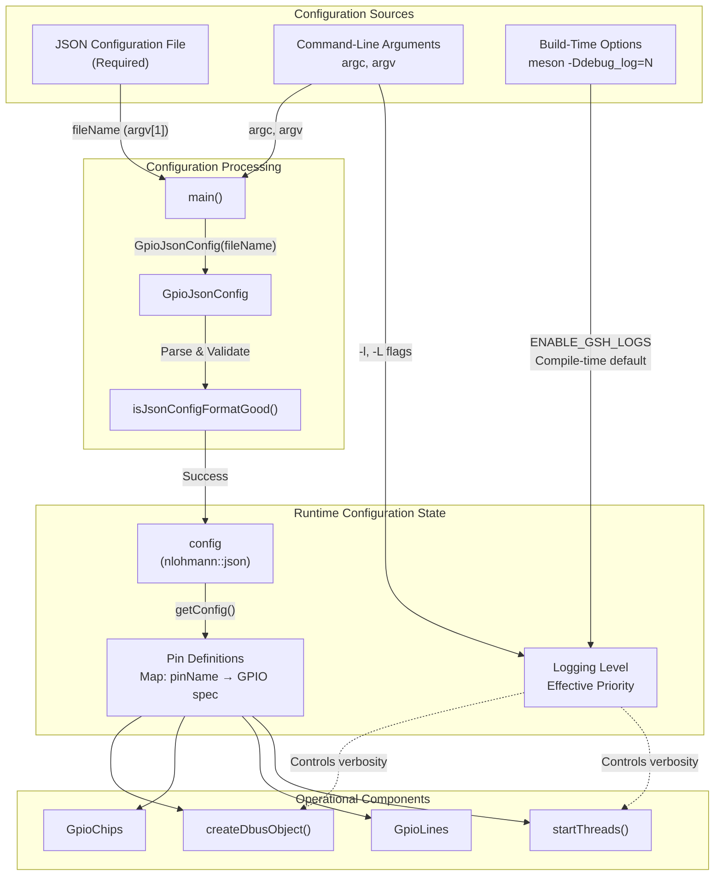
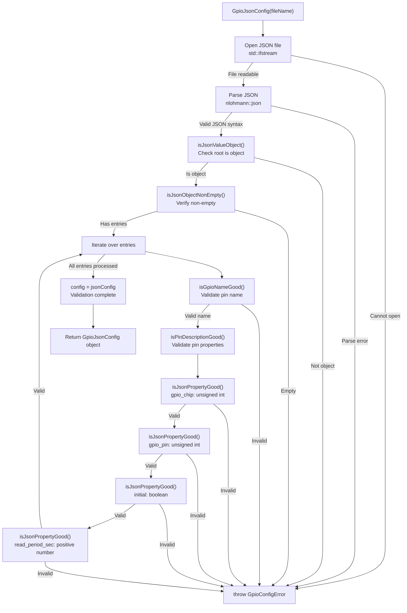
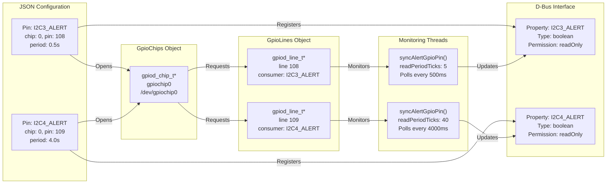

<!-- source: DeepWiki mcp.deepwiki.com · repo NVIDIA/nvidia-gpio-status-handler · page 4 Configuration · fetched 2026-10-26 -->

# Configuration

<details>
<summary>Relevant source files</summary>

The following files were used as context for generating this wiki page:

- [.clang-format](.clang-format)
- [README.md](README.md)
- [gpio_json_config.cpp](gpio_json_config.cpp)
- [gpio_json_config.hpp](gpio_json_config.hpp)
- [gpio_status_handler.cpp](gpio_status_handler.cpp)

</details>


## Overview

The `gpio-status-handlerd` daemon requires configuration to define which GPIO pins to monitor and how to monitor them. Configuration is provided through three mechanisms:

1. **JSON Configuration File** - Defines GPIO pins, their hardware locations, and monitoring parameters (required at startup)
2. **Command-Line Arguments** - Controls runtime behavior such as logging verbosity and output destination
3. **Build-Time Options** - Sets compile-time defaults for logging and operational modes

For detailed information on each mechanism, see:
- JSON file format and schema: [JSON Configuration Schema](#4.1)
- Runtime command-line flags: [Command-Line Options](#4.2)
- Logging system configuration: [Logging Configuration](#4.3)

For information about build system configuration and compilation options, see [Build Options](#3.3).

**Sources:** [gpio_status_handler.cpp:397-505](), [README.md:98-126]()

## Configuration Architecture



**Diagram: Configuration Flow from Sources to Runtime Components**

This diagram shows how configuration data flows from external sources through validation into the operational components of the daemon. The `GpioJsonConfig` class validates the JSON file format, while command-line arguments override logging defaults set at build time.

**Sources:** [gpio_status_handler.cpp:506-582](), [gpio_json_config.cpp:218-256]()

## Configuration File Specification

The daemon requires a JSON configuration file path as its first command-line argument. Without this argument, the program terminates with an error message.

```cpp
// From gpio_status_handler.cpp:506-582
int main(int argc, char* argv[])
{
    if (argc > 1)
    {
        string fileName = argv[1];
        GpioJsonConfig gpioConfig(fileName);
        // ... continue initialization
    }
    else
    {
        // Print error and exit
    }
}
```

### Configuration File Location

The configuration file path is specified as the first positional argument when invoking the daemon:

```bash
gpio-status-handlerd /path/to/config.json
```

**Sources:** [gpio_status_handler.cpp:506-582](), [README.md:1-126]()

## Configuration Properties

The following table summarizes the configuration properties defined in the JSON file:

| Property Key | JSON Type | Description | Validated By |
|--------------|-----------|-------------|--------------|
| `gpio_chip` | Unsigned Integer | GPIO chip number (e.g., 0 for `/dev/gpiochip0`) | `isJsonValueUnsignedInt()` |
| `gpio_pin` | Unsigned Integer | GPIO pin/line number on the specified chip | `isJsonValueUnsignedInt()` |
| `initial` | Boolean | Initial D-Bus property value before first hardware read | `isJsonValueBoolean()` |
| `read_period_sec` | Positive Number | Minimum polling interval in seconds (can be fractional) | `isJsonValuePositiveNumber()` |

**Property Key Constants:**

- `GpioJsonConfig::configKeyGpioChip` = `"gpio_chip"` ([gpio_json_config.cpp:22]())
- `GpioJsonConfig::configKeyGpioPin` = `"gpio_pin"` ([gpio_json_config.cpp:23]())
- `GpioJsonConfig::configKeyInitialPinVal` = `"initial"` ([gpio_json_config.cpp:24]())
- `GpioJsonConfig::configKeyReadPeriod` = `"read_period_sec"` ([gpio_json_config.cpp:25]())

**Sources:** [gpio_json_config.cpp:22-42](), [gpio_json_config.hpp:36-48]()

## JSON Configuration Validation



**Diagram: JSON Configuration Validation Flow**

The validation process ensures that each GPIO pin definition contains all required properties with correct types. If validation fails at any step, a `GpioConfigError` exception is thrown, causing the daemon to terminate with an error message.

**Sources:** [gpio_json_config.cpp:201-256](), [gpio_json_config.cpp:78-163]()

## Configuration Example

The following example demonstrates a valid configuration file monitoring two GPIO pins:

```json
{
  "I2C3_ALERT" : {
    "gpio_chip" : 0,
    "gpio_pin" : 108,
    "initial" : false,
    "read_period_sec" : 0.5
  },
  "I2C4_ALERT" : {
    "gpio_chip" : 0,
    "gpio_pin" : 109,
    "initial" : false,
    "read_period_sec" : 4
  }
}
```

This configuration results in:
- Two D-Bus properties: `I2C3_ALERT` and `I2C4_ALERT` on the `xyz.openbmc_project.GpioStatus` interface
- Both pins monitored on `/dev/gpiochip0` (lines 108 and 109)
- `I2C3_ALERT` polled every 0.5 seconds minimum
- `I2C4_ALERT` polled every 4 seconds minimum
- Both properties initialized to `false` before first hardware read

**GPIO Pin Name Requirements:**
- Non-empty string
- Contains only alphanumeric characters (A-Z, a-z, 0-9) and underscores (`_`)
- Validated by `isGpioNameGood()` ([gpio_json_config.cpp:165-189]())

**Sources:** [gpio_status_handler.cpp:397-450](), [gpio_json_config.cpp:27-42]()

## Configuration Constants

The following constants are defined in the main daemon file:

| Constant | Value | Purpose | Line Reference |
|----------|-------|---------|----------------|
| `dbusObjectPath` | `"/xyz/openbmc_project/GpioStatusHandler"` | D-Bus object path for GPIO properties | [gpio_status_handler.cpp:25]() |
| `dbusServiceName` | `"xyz.openbmc_project.GpioStatusHandler"` | D-Bus service name claimed by daemon | [gpio_status_handler.cpp:26]() |
| `dbusInterfaceName` | `"xyz.openbmc_project.GpioStatus"` | D-Bus interface exposing GPIO properties | [gpio_status_handler.cpp:27]() |
| `lineEventWaitTimeoutNs` | `1e8` (100ms) | GPIO event wait timeout in nanoseconds | [gpio_status_handler.cpp:35]() |

The `lineEventWaitTimeoutNs` constant defines the resolution of the `read_period_sec` parameter. The actual polling period is calculated as:

```cpp
uint64_t readPeriodTicks = max((uint64_t)1,
    (uint64_t)(readPeriodSec * 1e9 / lineEventWaitTimeoutNs));
```

**Example Calculations:**

| `read_period_sec` | Calculated Ticks | Effective Period |
|-------------------|------------------|------------------|
| 0.5 | 5 | 500ms (5 × 100ms) |
| 1.0 | 10 | 1000ms (10 × 100ms) |
| 0.05 | 1 | 100ms (minimum) |

**Sources:** [gpio_status_handler.cpp:25-35](), [gpio_status_handler.cpp:308-313]()

## Configuration to Runtime Mapping



**Diagram: Configuration Data Flow to Runtime Components**

This diagram illustrates how JSON configuration entries are transformed into runtime objects. Each GPIO pin definition results in:
1. A `gpiod_chip_t*` pointer opened by `GpioChips`
2. A `gpiod_line_t*` pointer requested by `GpioLines`
3. A D-Bus property registered by `createDbusObject()`
4. A monitoring thread spawned by `startThreads()`

**Sources:** [gpio_status_handler.cpp:354-379](), [gpio_status_handler.cpp:289-342]()

## Error Injection Mode (EINJ)

The daemon supports an error injection testing mode that bypasses hardware GPIO reads. When a file exists at `/tmp/devices/gpio/{pinName}`, the daemon reads the pin value from this file instead of calling `gpiod_line_get_value()`.

**EINJ Mode Detection:**
```cpp
// From gpio_status_handler.cpp:102-111
std::ifstream ifs("/tmp/devices/gpio/" + pinName);
if (ifs)
{
    int value = 0;
    ifs >> value;
    log<level::ERR>("EINJ", entry("PINNAME=%s", pinName.c_str()),
                    entry("PINVALUE=%d", value));
    return value;
}
```

**Usage Example:**
```bash
# Enable EINJ mode for I2C3_ALERT pin
mkdir -p /tmp/devices/gpio
echo 1 > /tmp/devices/gpio/I2C3_ALERT

# Daemon will now read value 1 (high) for this pin
# instead of reading from actual GPIO hardware
```

This mode is useful for testing without GPIO hardware or for simulating GPIO state changes. For more information on testing and debugging, see [Testing and Debugging](#5.2).

**Sources:** [gpio_status_handler.cpp:95-115]()

## Configuration Error Handling

Configuration errors result in program termination with detailed error messages logged to the system journal. The daemon distinguishes between several error categories:

| Error Category | Exception Type | Example Scenarios |
|----------------|----------------|-------------------|
| File Access | `std::exception` | File not found, permission denied |
| JSON Syntax | `nlohmann::json::exception` | Malformed JSON, unexpected tokens |
| JSON Semantics | `GpioConfigError` | Wrong types, missing properties, invalid names |
| Hardware Access | `std::exception` | Cannot open GPIO chip, line request failure |

**Error Logging Tags:**

When configuration errors occur, structured log entries include:
- `FILE`: Configuration file path
- `EXCEPTION`: Exception message with details
- `GPIO_CHIP`, `GPIO_PIN_NAME`, `GPIO_PIN_NUM`: Context for GPIO-specific errors

**Sources:** [gpio_status_handler.cpp:554-570](), [gpio_json_config.cpp:214-255]()

---

