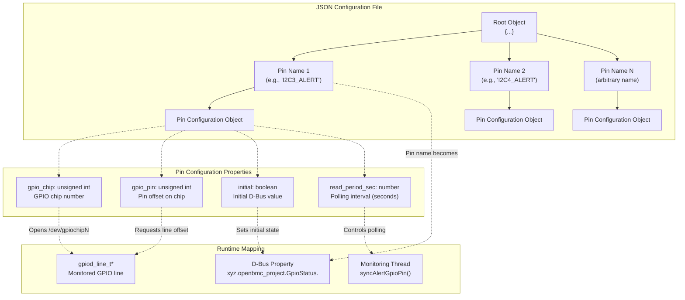
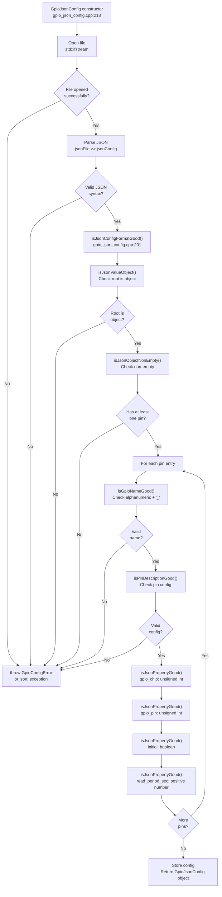
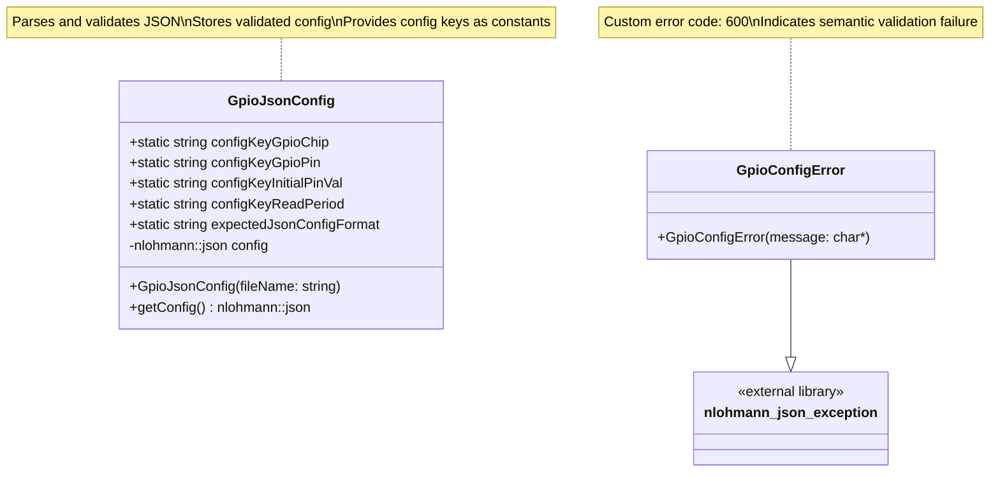
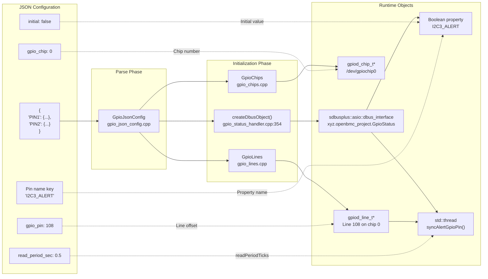

<!-- source: DeepWiki mcp.deepwiki.com · repo NVIDIA/nvidia-gpio-status-handler · page 4.1 JSON Configuration Schema · fetched 2026-10-26 -->

# JSON Configuration Schema

<details>
<summary>Relevant source files</summary>

The following files were used as context for generating this wiki page:

- [.clang-format](.clang-format)
- [README.md](README.md)
- [gpio_json_config.cpp](gpio_json_config.cpp)
- [gpio_json_config.hpp](gpio_json_config.hpp)
- [gpio_status_handler.cpp](gpio_status_handler.cpp)

</details>


This document defines the JSON configuration file format used by `nvidia-gpio-status-handler` to specify which GPIO pins to monitor and how to expose them via D-Bus. The configuration file is the primary input to the daemon and determines all monitored pins, their polling behavior, and their initial states.

For information about command-line options that control runtime behavior, see [Command-Line Options](#4.2). For details on the build system configuration, see [Build Options](#3.3).

## Purpose and Scope

The JSON configuration file serves as the declarative interface for defining:
- Which GPIO chips and pins to monitor
- The logical name for each pin (exposed as D-Bus property names)
- Initial property values before hardware is polled
- Per-pin polling intervals

The daemon reads this file on startup and validates it before attempting to interact with GPIO hardware or register D-Bus services. A malformed configuration file will cause the daemon to exit with an error.

**Sources:** [gpio_json_config.hpp:8-32](), [gpio_status_handler.cpp:397-419]()

## Configuration File Structure



**Sources:** [gpio_json_config.cpp:27-42](), [gpio_status_handler.cpp:289-342](), [gpio_status_handler.cpp:354-379]()

## Top-Level Format

The configuration file must contain a single JSON object at the root level. Each key in this object represents a GPIO pin to monitor, and the corresponding value is a configuration object for that pin.

| Requirement | Description |
|-------------|-------------|
| Type | JSON object (`{}`) |
| Empty allowed | No - at least one pin must be configured |
| Key format | Alphanumeric characters and underscore only |
| Key uniqueness | Each pin name must be unique |
| Value type | Configuration object (see below) |

**Pin Name Constraints:**
- Must not be empty
- Must contain only: `a-z`, `A-Z`, `0-9`, `_`
- Becomes the D-Bus property name on the `xyz.openbmc_project.GpioStatus` interface

**Sources:** [gpio_json_config.cpp:165-189](), [gpio_json_config.cpp:191-211]()

## Pin Configuration Properties

Each pin configuration object must contain exactly four properties:

| Property | Type | Constraints | Purpose |
|----------|------|-------------|---------|
| `gpio_chip` | unsigned integer | ≥ 0 | GPIO chip number (maps to `/dev/gpiochipN`) |
| `gpio_pin` | unsigned integer | ≥ 0 | Pin offset within the chip (line number) |
| `initial` | boolean | `true` or `false` | Initial D-Bus property value before first hardware read |
| `read_period_sec` | number | > 0 | Minimum time in seconds between D-Bus property updates |

### Property Details

#### `gpio_chip`
Identifies the GPIO character device to use. The value `N` corresponds to the Linux device `/dev/gpiochipN`. The daemon opens this device using `libgpiod` functions.

**Code mapping:** Passed to `GpioChips` constructor, used in `gpiod_chip_open_by_number()` calls.

**Sources:** [gpio_json_config.cpp:22](), [gpio_chips.cpp]()

#### `gpio_pin`
Specifies the line offset on the GPIO chip. This is the same number shown in `gpioinfo` output for the chip.

**Code mapping:** Passed to `GpioLines` constructor, used in `gpiod_chip_get_line()` calls.

**Sources:** [gpio_json_config.cpp:23](), [gpio_lines.cpp]()

#### `initial`
Sets the initial boolean value of the D-Bus property before the daemon reads the actual GPIO state. This prevents clients from seeing an undefined state during daemon startup.

**Code mapping:** Used in `createDbusObject()` at [gpio_status_handler.cpp:373-375]() when calling `register_property()`.

**Sources:** [gpio_json_config.cpp:24](), [gpio_status_handler.cpp:373-375]()

#### `read_period_sec`
Defines the maximum time interval between D-Bus property updates for this pin. The daemon polls more frequently if GPIO events are detected, but guarantees an update at least every `read_period_sec` seconds.

**Resolution:** The actual polling resolution is limited by `lineEventWaitTimeoutNs = 1e8` nanoseconds (0.1 seconds) defined at [gpio_status_handler.cpp:35](). The `read_period_sec` value is converted to "ticks" where each tick is 0.1 seconds.

**Calculation:** `readPeriodTicks = max(1, read_period_sec * 1e9 / lineEventWaitTimeoutNs)`

**Code mapping:** Used in `startThreads()` at [gpio_status_handler.cpp:308-313](), passed to `syncAlertGpioPin()` thread function.

**Sources:** [gpio_json_config.cpp:25](), [gpio_status_handler.cpp:308-313](), [gpio_status_handler.cpp:177-182]()

## Validation Flow

The daemon performs comprehensive validation when parsing the configuration file:



**Sources:** [gpio_json_config.cpp:218-255](), [gpio_json_config.cpp:201-212](), [gpio_json_config.cpp:152-163]()

## Configuration Schema Reference

### Complete JSON Schema

```json
{
  "<pin_name>": {
    "gpio_chip": <unsigned_integer>,
    "gpio_pin": <unsigned_integer>,
    "initial": <boolean>,
    "read_period_sec": <positive_number>
  },
  ...
}
```

### Validation Rules Summary

| Component | Validation Function | Location |
|-----------|---------------------|----------|
| Root object | `isJsonValueObject()` | [gpio_json_config.cpp:89-97]() |
| Non-empty root | `isJsonObjectNonEmpty()` | [gpio_json_config.cpp:191-199]() |
| Pin name | `isGpioNameGood()` | [gpio_json_config.cpp:165-189]() |
| Pin description | `isPinDescriptionGood()` | [gpio_json_config.cpp:152-163]() |
| `gpio_chip` type | `isJsonValueUnsignedInt()` | [gpio_json_config.cpp:109-117]() |
| `gpio_pin` type | `isJsonValueUnsignedInt()` | [gpio_json_config.cpp:109-117]() |
| `initial` type | `isJsonValueBoolean()` | [gpio_json_config.cpp:99-107]() |
| `read_period_sec` type | `isJsonValuePositiveNumber()` | [gpio_json_config.cpp:119-128]() |

**Sources:** [gpio_json_config.cpp:89-163]()

## Example Configurations

### Minimal Configuration

Single GPIO pin with default settings:

```json
{
  "PWR_BUTTON": {
    "gpio_chip": 0,
    "gpio_pin": 42,
    "initial": false,
    "read_period_sec": 1.0
  }
}
```

### Multi-Pin Configuration

Multiple pins on different chips with varying poll rates:

```json
{
  "I2C3_ALERT": {
    "gpio_chip": 0,
    "gpio_pin": 108,
    "initial": false,
    "read_period_sec": 0.5
  },
  "I2C4_ALERT": {
    "gpio_chip": 0,
    "gpio_pin": 109,
    "initial": false,
    "read_period_sec": 4.0
  },
  "FPGA_READY": {
    "gpio_chip": 1,
    "gpio_pin": 32,
    "initial": true,
    "read_period_sec": 2.0
  }
}
```

**Sources:** [gpio_json_config.cpp:27-42](), [gpio_status_handler.cpp:402-416]()

### Fast Polling Configuration

Pin requiring rapid state detection (minimum resolution 0.1s):

```json
{
  "CRITICAL_ALERT": {
    "gpio_chip": 0,
    "gpio_pin": 55,
    "initial": false,
    "read_period_sec": 0.1
  }
}
```

**Note:** Values less than 0.1 seconds will be rounded up to 0.1 seconds due to `lineEventWaitTimeoutNs` at [gpio_status_handler.cpp:35]().

## Error Handling

The daemon performs fail-fast validation and exits immediately upon encountering configuration errors.

### Exception Types

| Exception Class | Thrown When | Defined At |
|----------------|-------------|------------|
| `GpioConfigError` | Semantic validation fails | [gpio_json_config.hpp:77-81]() |
| `nlohmann::json::exception` | JSON syntax error | nlohmann library |
| `std::exception` | File I/O error | Standard library |

### Error Messages

The daemon logs detailed error messages using `phosphor-logging` that include:

- **For type errors:** Expected type, actual type, and context
- **For file errors:** File path and stream state bits
- **For semantic errors:** Specific validation rule violated

**Example error output:**

```
Error when parsing value of the attribute 'gpio_chip': expected value of type 'unsigned int'. Got '"not_a_number"' (type: string)
```

**Sources:** [gpio_json_config.cpp:78-87](), [gpio_json_config.cpp:245-254](), [gpio_status_handler.cpp:554-563]()

## Implementation Classes



### Key Methods

#### `GpioJsonConfig::GpioJsonConfig(const std::string& fileName)`
Constructor that opens, parses, validates, and stores the configuration file.

**Steps:**
1. Opens file with `std::ifstream`
2. Parses JSON with `operator>>`
3. Validates format with `isJsonConfigFormatGood()`
4. Stores in `config` member
5. Throws exception on any failure

**Location:** [gpio_json_config.cpp:218-255]()

#### `GpioJsonConfig::getConfig()`
Returns the validated configuration as a `nlohmann::json` object. Always returns valid configuration since constructor ensures validity.

**Location:** [gpio_json_config.cpp:44-47]()

**Sources:** [gpio_json_config.hpp:33-72](), [gpio_json_config.cpp:214-257]()

## Configuration-to-Runtime Mapping

The following diagram shows how configuration elements map to runtime objects:



**Sources:** [gpio_status_handler.cpp:506-582](), [gpio_status_handler.cpp:354-379](), [gpio_status_handler.cpp:289-342]()

## Related Configuration

- **Build-time configuration:** See [Build Options](#3.3) for compile-time settings that affect configuration parsing behavior (e.g., `debug_log` level)
- **Runtime configuration:** See [Command-Line Options](#4.2) for daemon runtime parameters
- **Logging configuration:** See [Logging Configuration](#4.3) for diagnostic output control

---

