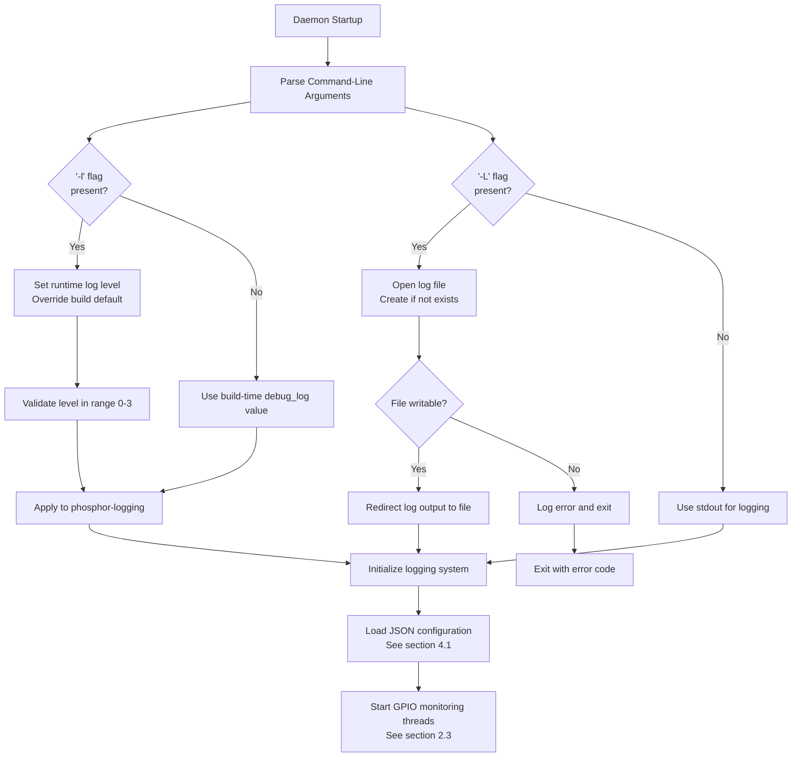
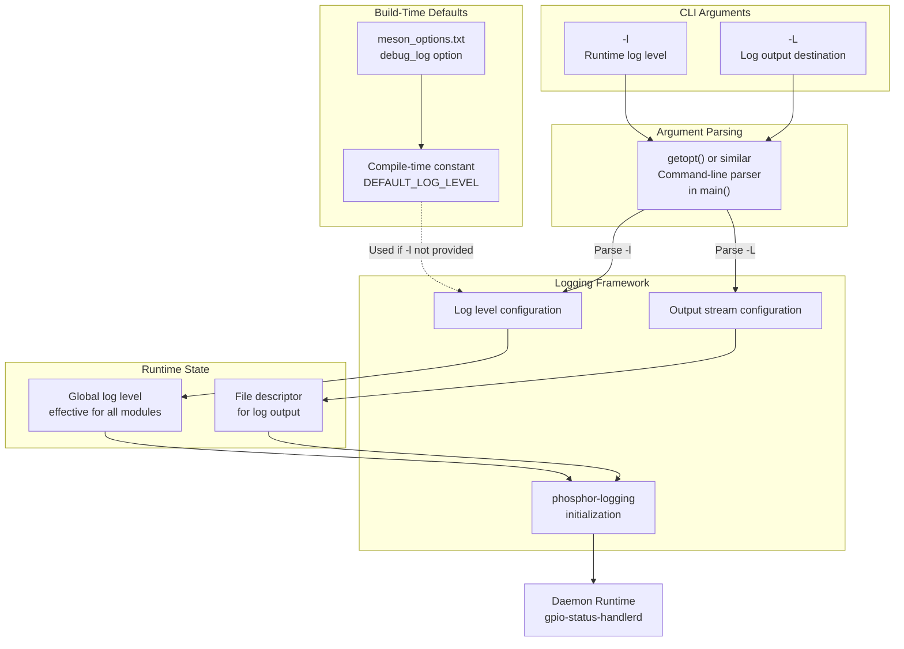

<!-- source: DeepWiki mcp.deepwiki.com · repo NVIDIA/nvidia-gpio-status-handler · page 4.2 Command-Line Options · fetched 2026-10-26 -->

# Command-Line Options

<details>
<summary>Relevant source files</summary>

The following files were used as context for generating this wiki page:

- [README.md](README.md)

</details>


## Purpose & Scope

This page documents the runtime command-line arguments accepted by the `gpio-status-handlerd` daemon executable. These arguments control operational behavior such as logging verbosity and output destination. For information about compile-time build options, see [Build Options](#3.3). For details on the logging system architecture, see [Logging Configuration](#4.3). For JSON-based GPIO pin configuration, see [JSON Configuration Schema](#4.1).

## Overview

The `gpio-status-handlerd` daemon accepts command-line arguments at startup to override build-time defaults for logging behavior. These options enable runtime control over diagnostic verbosity without requiring recompilation, which is critical for troubleshooting production deployments.

The daemon supports two primary command-line flags:
- `-l` controls the logging verbosity level
- `-L` redirects log output to a file

Both options are processed during daemon initialization and remain in effect for the entire process lifetime.

**Sources:** [README.md:98-125]()

## Available Options

### Option: `-l` (Log Level)

The `-l` flag sets the runtime logging verbosity level, overriding the compile-time default configured via the `debug_log` meson option.

| Property | Value |
|----------|-------|
| **Flag** | `-l <level>` |
| **Argument** | Integer: 0, 1, 2, or 3 |
| **Default** | Build-time value from `debug_log` option (typically 1 for production) |
| **Effect** | Controls which log messages are emitted |

#### Log Level Values

| Level | Name | Description |
|-------|------|-------------|
| `0` | None | All logging disabled; no output produced |
| `1` | Error | Error messages only (default for production) |
| `2` | Warning | Error and warning messages |
| `3` | Info | Error, warning, and informational messages (maximum verbosity) |

#### Behavior Notes

- The runtime log level can only reduce or match the compile-time `debug_log` value, not exceed it. If the binary is compiled with `debug_log=1`, setting `-l 3` will not enable info-level logging because those log statements were not compiled into the binary.
- The runtime level is applied globally to all logging statements in the daemon.
- Changes require daemon restart; the level cannot be modified while running.

**Example Usage:**
```bash
# Start daemon with maximum verbosity
gpio-status-handlerd -l 3

# Start daemon with errors only
gpio-status-handlerd -l 1

# Start daemon with logging disabled
gpio-status-handlerd -l 0
```

**Sources:** [README.md:118-121]()

### Option: `-L` (Log Output File)

The `-L` flag redirects log output from the console to a specified file path. This enables persistent logging for post-mortem analysis and avoids cluttering console output in production environments.

| Property | Value |
|----------|-------|
| **Flag** | `-L <log_file>` |
| **Argument** | File path string (absolute or relative) |
| **Default** | Standard output (console) if not specified |
| **Effect** | All log messages written to the specified file |

#### Behavior Notes

- The file is created if it does not exist.
- If the file exists, new log messages are appended (not overwritten).
- The daemon must have write permissions for the target directory.
- File descriptor remains open for the daemon's lifetime.
- No automatic log rotation is performed; external tools like `logrotate` should be used for long-running deployments.

**Example Usage:**
```bash
# Log to file in /tmp
gpio-status-handlerd -L /tmp/gpio_debug.log

# Combine with log level for detailed file logging
gpio-status-handlerd -l 3 -L /var/log/gpio_status_handler.log
```

**Sources:** [README.md:123-125]()

## Command-Line Argument Processing

The following diagram illustrates how command-line options flow through the system during daemon initialization:



**Title:** Command-Line Option Processing Flow During Daemon Initialization

**Sources:** [README.md:98-125]()

## Mapping to Code Entities

The following diagram maps command-line options to the code entities and dependencies that implement them:



**Title:** Command-Line Options to Code Entity Mapping

**Sources:** [README.md:98-125]()

## Usage Examples

### Development Scenario

During development, maximize logging to capture detailed diagnostic information:

```bash
# Development environment with verbose logging to file
gpio-status-handlerd -l 3 -L /tmp/gpio_debug.log
```

This configuration enables:
- Info-level logging (level 3) for maximum visibility
- File output to avoid console clutter
- Persistent log for post-mortem analysis

### Production Scenario

In production, minimize overhead while maintaining error visibility:

```bash
# Production deployment with error-only logging
gpio-status-handlerd -l 1
```

This configuration:
- Logs only errors (level 1)
- Outputs to console (captured by systemd journal)
- Minimizes I/O and CPU overhead

### Troubleshooting Scenario

When investigating an issue in production without redeployment:

```bash
# Temporarily increase verbosity for debugging
systemctl stop gpio-status-handler
/usr/bin/gpio-status-handlerd -l 3 -L /tmp/debug_$(date +%s).log
```

This approach:
- Stops the systemd service to avoid conflicts
- Runs the daemon manually with enhanced logging
- Timestamps the log file for later correlation
- Returns to normal operation after analysis

**Sources:** [README.md:118-125]()

## Interaction with Build Configuration

The relationship between build-time and runtime logging configuration:

| Scenario | Build: `debug_log` | Runtime: `-l` | Effective Level | Notes |
|----------|-------------------|---------------|-----------------|-------|
| Production default | `1` | (not specified) | Error | Standard configuration |
| Production debug | `1` | `0` | None | Can reduce verbosity |
| Production debug | `1` | `2` | **Error** | Cannot exceed build limit |
| Development default | `3` | (not specified) | Info | Maximum verbosity |
| Development reduced | `3` | `1` | Error | Can reduce at runtime |
| Disabled logging | `0` | `3` | **None** | No log statements compiled |

**Key Principle:** The runtime `-l` flag cannot enable log statements that were not compiled into the binary. The `debug_log` build option determines which log statements are included in the compiled executable; the `-l` flag only controls which of those statements are executed.

This design ensures that production binaries maintain minimal code size and overhead, while development binaries retain full diagnostic capability that can be selectively reduced.

**Sources:** [README.md:98-125]()

## System Integration

When deployed via systemd, command-line options are specified in the service unit file:

```ini
[Service]
ExecStart=/usr/bin/gpio-status-handlerd -l 1
```

For on-demand debugging, override the service configuration:

```bash
# Temporary override for troubleshooting
systemctl edit --runtime gpio-status-handler.service
```

Add:
```ini
[Service]
ExecStart=
ExecStart=/usr/bin/gpio-status-handlerd -l 3 -L /var/log/gpio_debug.log
```

Then restart:
```bash
systemctl restart gpio-status-handler.service
```

The runtime override is discarded after system reboot, returning to the default configuration.

**Sources:** [README.md:118-125]()

## Summary Table

| Flag | Argument Type | Default | Purpose | Related Build Option |
|------|---------------|---------|---------|---------------------|
| `-l` | Integer (0-3) | Value of `debug_log` | Set runtime log verbosity | `debug_log` |
| `-L` | File path string | stdout | Redirect log output to file | (none) |

**Sources:** [README.md:98-125]()

---

