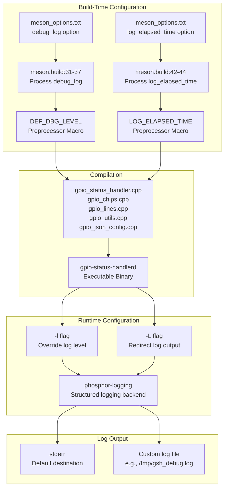
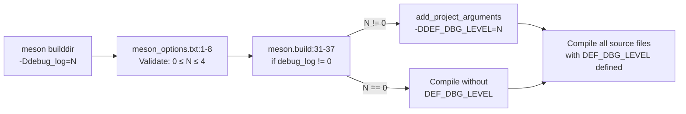
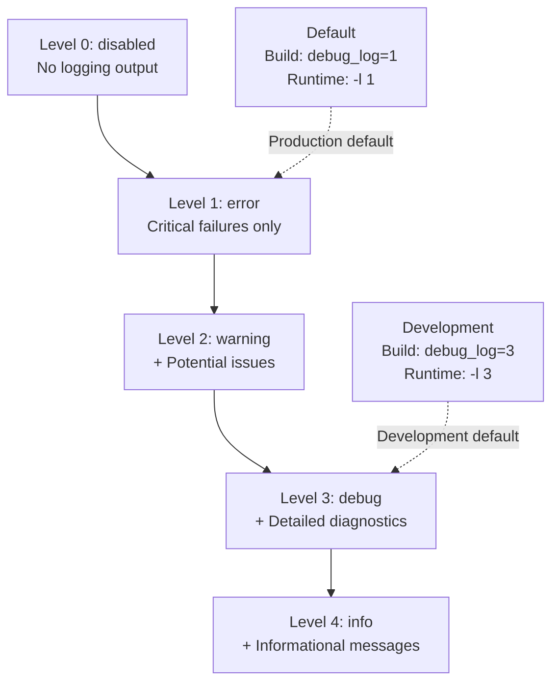
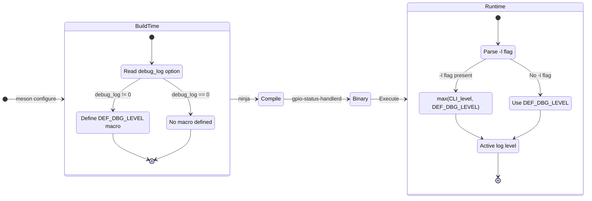

<!-- source: DeepWiki mcp.deepwiki.com · repo NVIDIA/nvidia-gpio-status-handler · page 4.3 Logging Configuration · fetched 2026-10-26 -->

# Logging Configuration

<details>
<summary>Relevant source files</summary>

The following files were used as context for generating this wiki page:

- [README.md](README.md)
- [meson.build](meson.build)
- [meson_options.txt](meson_options.txt)

</details>


This document explains the logging system in the nvidia-gpio-status-handler daemon, including build-time defaults, runtime overrides, log levels, and output control. For information about other command-line options, see [Command-Line Options](#4.2). For build-time configuration details, see [Build Options](#3.3). For debugging techniques that use logging, see [Testing and Debugging](#5.2).

## Overview

The nvidia-gpio-status-handler logging system provides a two-tier configuration mechanism that separates compile-time optimization from runtime flexibility. The system integrates with the OpenBMC `phosphor-logging` framework and supports five distinct verbosity levels, ranging from completely disabled to full diagnostic output. Administrators can set conservative defaults at build time while retaining the ability to increase verbosity on-demand during troubleshooting without recompilation.



**Logging Configuration Data Flow**

Sources: [meson.build:31-44](), [meson_options.txt:1-20](), [README.md:98-126]()

## Build-Time Logging Configuration

### debug_log Option

The `debug_log` build option sets the default logging verbosity compiled into the binary. This option is defined in [meson_options.txt:1-8]() and accepts integer values from 0 to 4.



**debug_log Build Option Processing**

When `debug_log` is set to a non-zero value, the build system defines the `DEF_DBG_LEVEL` preprocessor macro with that value. This macro is used by the application code to establish the baseline logging verbosity:

```
# Set debug_log=3 for debug-level logging by default
meson builddir -Ddebug_log=3
ninja -C builddir
```

The default value is `0`, which disables debug logging entirely unless overridden at runtime.

Sources: [meson_options.txt:1-8](), [meson.build:31-37](), [README.md:69-74]()

### log_elapsed_time Option

The `log_elapsed_time` build option enables performance instrumentation by defining the `LOG_ELAPSED_TIME` preprocessor macro. This is a feature flag (enabled/disabled) defined in [meson_options.txt:15-20]() and is disabled by default.

When enabled, the system logs timing information for critical operations, which is useful for performance analysis during development and integration testing. This option is independent of the `debug_log` level.

```
# Enable elapsed time logging for performance profiling
meson builddir -Dlog_elapsed_time=enabled
ninja -C builddir
```

Sources: [meson_options.txt:15-20](), [meson.build:42-44]()

### phosphor-logging Integration

The daemon depends on the OpenBMC `phosphor-logging` library, which provides structured logging capabilities. This dependency is declared in [meson.build:84-87]() and uses the fallback subproject mechanism for environments where the system package is unavailable.

| Component | Purpose | Configuration Point |
|-----------|---------|-------------------|
| `phosphor-logging` | Structured logging backend | [meson.build:84-87]() |
| `DEF_DBG_LEVEL` | Build-time default log level | [meson.build:33-34]() |
| `LOG_ELAPSED_TIME` | Performance instrumentation flag | [meson.build:43]() |
| Runtime `-l` flag | Runtime verbosity override | Command-line argument |
| Runtime `-L` flag | Log output redirection | Command-line argument |

Sources: [meson.build:84-87](), [meson.build:31-44]()

## Runtime Logging Configuration

### Log Level Override (-l flag)

The `-l` command-line flag allows operators to increase logging verbosity at runtime without recompiling the binary. This flag is documented in [README.md:118-121]() and accepts values from 0 to 3.

**Note:** The runtime log levels use a different indexing scheme (0-3) compared to the build-time option (0-4). The mapping is as follows:

| Runtime `-l` Value | Verbosity | Equivalent `debug_log` Value |
|-------------------|-----------|----------------------------|
| `0` | None (disabled) | `0` |
| `1` | Error | `1` |
| `2` | Error + Warning | `2` |
| `3` | Error + Warning + Info | `3-4` |

The runtime flag can only increase verbosity, not decrease it below the compiled default. For example, if the binary is built with `debug_log=2`, running with `-l 1` will still produce warning-level logs because the compiled default is higher.

```
# Run with debug-level logging
gpio-status-handlerd -l 3

# Run with error-only logging
gpio-status-handlerd -l 1
```

Sources: [README.md:118-121]()

### Log Output Redirection (-L flag)

By default, log messages are written to stderr. The `-L` command-line flag redirects log output to a specified file path, which is useful for persistent logging or when running the daemon as a systemd service.

```
# Redirect logs to a file
gpio-status-handlerd -L /tmp/gsh_debug.log

# Combine with verbose logging
gpio-status-handlerd -l 3 -L /var/log/gpio-status-handler.log
```

If the `-L` flag is not present, logs are written to stderr, which systemd captures into the journal when running as a service.

Sources: [README.md:123-126]()

## Log Level Reference

The logging system supports five distinct verbosity levels. Each level is cumulative, meaning that enabling a higher level also includes all messages from lower levels.



**Log Level Hierarchy**

| Level | Name | Build-Time Index | Runtime Index | Use Case |
|-------|------|-----------------|--------------|----------|
| 0 | disabled | `0` | `0` | Silence all logging (not recommended) |
| 1 | error | `1` | `1` | Production systems (default) |
| 2 | warning | `2` | `2` | Integration testing |
| 3 | debug | `3` | `3` | Active development |
| 4 | info | `4` | N/A | Verbose diagnostics (build-time only) |

**Production Recommendation:** Build with `debug_log=1` and use `-l 3` only during troubleshooting to minimize performance impact while retaining diagnostic capability.

**Development Recommendation:** Build with `debug_log=3` or `debug_log=4` to enable maximum visibility during active development.

Sources: [README.md:101-111](), [README.md:118-121]()

## Configuration Priority and Interaction

The relationship between build-time and runtime logging configuration follows a specific precedence model:



**Logging Configuration State Machine**

The effective log level is determined by: `max(DEF_DBG_LEVEL, runtime_-l_flag)`

This means:
- If the binary is built with `debug_log=2` and run with `-l 1`, the effective level is `2`
- If the binary is built with `debug_log=1` and run with `-l 3`, the effective level is `3`
- If the binary is built with `debug_log=0` and no `-l` flag is provided, logging is disabled

Sources: [meson.build:31-37](), [README.md:98-121]()

## Configuration Examples by Environment

Different deployment environments benefit from different logging configurations:

| Environment | Build Configuration | Runtime Configuration | Rationale |
|-------------|-------------------|---------------------|-----------|
| Development Workstation | `debug_log=3`<br/>`log_elapsed_time=enabled` | `-l 3` (or omit) | Maximum visibility for debugging |
| Integration Testing | `debug_log=2` | `-l 2` (or omit) | Capture warnings without excessive output |
| Production BMC | `debug_log=1` | (no flags) | Minimize overhead; log errors only |
| Production BMC (troubleshooting) | `debug_log=1` | `-l 3`<br/>`-L /tmp/debug.log` | On-demand diagnostics without recompilation |
| CI/CD Build | `debug_log=3` | `-l 3` | Comprehensive test logs |

**OpenBMC Recipe Example:**

For production OpenBMC builds, the recipe should specify:

```
EXTRA_OEMESON += "-Ddebug_log=1"
```

This ensures the binary has minimal overhead while operators can still enable verbose logging via systemd service overrides if needed.

Sources: [README.md:113-116]()

## Performance Considerations

Logging configuration has direct performance implications:

| Aspect | Impact | Mitigation |
|--------|--------|-----------|
| `debug_log=0` | Zero logging overhead | Only use when logging is truly unnecessary |
| `debug_log=1` | Minimal overhead (error-only) | Recommended for production |
| `debug_log=3-4` | Moderate overhead from string formatting | Use for development/debugging only |
| `log_elapsed_time=enabled` | Small overhead from timing measurements | Enable only when profiling |
| `-L` file output | I/O overhead from file writes | Use on fast storage; avoid SD cards |

The multi-threaded GPIO monitoring implementation (see [GPIO Monitoring Implementation](#2.3)) generates significant log volume at debug level due to per-thread status updates. In systems monitoring many GPIO pins, level 3 or 4 logging can produce hundreds of log messages per second.

**Recommendation:** Build production binaries with `debug_log=1` and `log_elapsed_time=disabled`. Use runtime flags (`-l 3`, `-L`) only during active troubleshooting sessions.

Sources: [meson_options.txt:1-20](), [README.md:98-126]()

---

