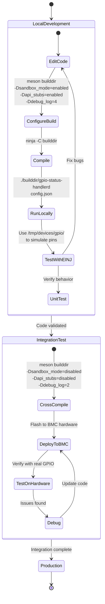
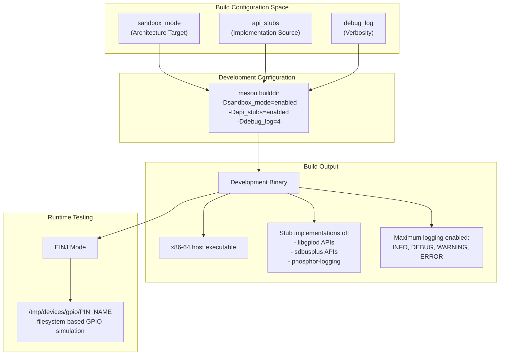
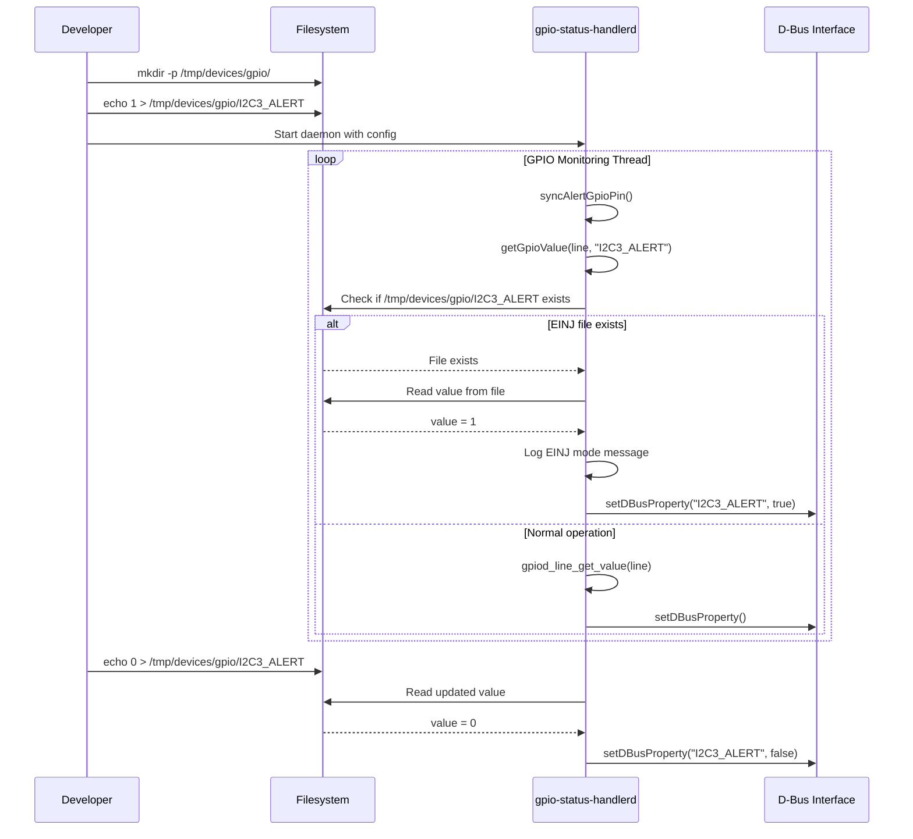
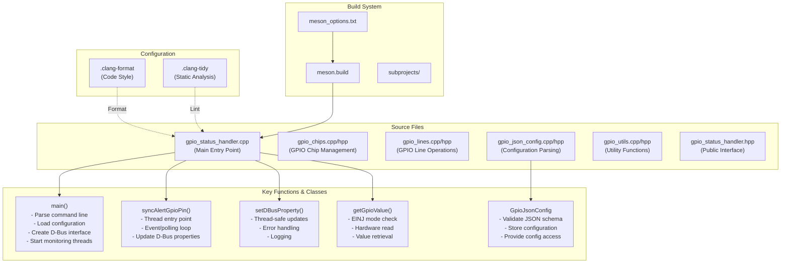

<!-- source: DeepWiki mcp.deepwiki.com · repo NVIDIA/nvidia-gpio-status-handler · page 5 Development Guide · fetched 2026-10-26 -->

# Development Guide

<details>
<summary>Relevant source files</summary>

The following files were used as context for generating this wiki page:

- [.clang-format](.clang-format)
- [README.md](README.md)
- [gpio_json_config.cpp](gpio_json_config.cpp)
- [gpio_json_config.hpp](gpio_json_config.hpp)
- [gpio_status_handler.cpp](gpio_status_handler.cpp)

</details>


This guide provides essential information for developers working on or extending the nvidia-gpio-status-handler daemon. It covers development workflows, testing strategies, code organization, and best practices for contributing to the project.

For build system details and compilation instructions, see [Building the Project](#3). For runtime configuration, see [Configuration](#4). For production deployment, see [Deployment to OpenBMC](#6).

## Development Workflow Overview

The nvidia-gpio-status-handler supports a multi-phase development workflow that enables efficient iteration without requiring BMC hardware or GPIO devices.



**Typical Development Cycle**

| Phase | Build Configuration | Runtime Environment | Testing Method |
|-------|-------------------|-------------------|----------------|
| Local Development | `sandbox_mode=enabled`<br>`api_stubs=enabled`<br>`debug_log=4` | x86-64 workstation | EINJ mode with filesystem stubs |
| Integration | `sandbox_mode=disabled`<br>`api_stubs=disabled`<br>`debug_log=2` | ARM BMC hardware | Real GPIO with debug logging |
| Production | `sandbox_mode=disabled`<br>`api_stubs=disabled`<br>`debug_log=1` | ARM BMC hardware | Production monitoring |

Sources: [README.md:1-126](), [gpio_status_handler.cpp:1-582]()

## Development Environment Setup

### Prerequisites

The development environment requires standard C++ build tools and OpenBMC dependencies:

**Required Packages:**
- `g++` - C++ compiler
- `meson` - Build system
- `ninja` - Build executor
- `pkg-config` - Dependency discovery
- `libgpiod` - GPIO device library (or API stubs)
- `sdbusplus` - D-Bus communication library
- `phosphor-logging` - OpenBMC logging framework

**Quick Setup:**
```bash
# From repository root
sudo scripts/setup_bldenv
```

This script automates the installation of all required dependencies for Ubuntu 20.04 or Cygwin environments.

For detailed dependency information and fallback mechanisms, see [Dependencies](#3.2).

Sources: [README.md:6-20]()

## Development Modes

The build system provides two key modes that enable development without BMC hardware. These modes are controlled by build-time options and significantly reduce the iteration cycle during development.



### Sandbox Mode

**Purpose:** Build the daemon for host CPU architecture (typically x86-64) instead of the target BMC architecture (ARM), enabling execution on developer workstations.

**Configuration:**
```bash
meson builddir -Dsandbox_mode=enabled
ninja -C builddir
```

**Use Cases:**
- Algorithm development and logic testing
- Debugging with familiar tools (gdb, valgrind)
- Rapid iteration without BMC access
- CI/CD pipeline integration on x86-64 runners

### API Stubs Mode

**Purpose:** Replace external dependencies (libgpiod, sdbusplus, phosphor-logging) with minimal stub implementations that compile and link but do not interact with real hardware or system services.

**Configuration:**
```bash
meson builddir -Dapi_stubs=enabled
ninja -C builddir
```

**Stub Locations:**
- GPIO stubs: `src/stubs/` directory
- Build system automatically uses stubs when enabled

**Use Cases:**
- Development without installing full OpenBMC SDK
- Testing core logic independent of external APIs
- Building on systems where dependencies are unavailable

**Combined Usage:**
```bash
# Typical development configuration
meson builddir -Dsandbox_mode=enabled -Dapi_stubs=enabled -Ddebug_log=4
```

For complete details on these modes and when to use each, see [Development Modes](#5.1).

Sources: [README.md:31-96]()

## Testing and Debugging

### EINJ Mode (Error Injection)

The daemon supports a runtime testing mode called "EINJ mode" that allows simulating GPIO pin states without physical hardware. This mode is automatically activated when specific filesystem paths exist.



**Implementation Details:**

The EINJ mode is implemented in the `getGpioValue()` function:

[gpio_status_handler.cpp:95-115]()

When the file `/tmp/devices/gpio/<PIN_NAME>` exists, the daemon reads the GPIO value from the file instead of calling `gpiod_line_get_value()`. The file should contain `0` or `1`.

**Example Test Session:**
```bash
# Setup EINJ environment
mkdir -p /tmp/devices/gpio

# Start daemon in one terminal
./builddir/gpio-status-handlerd config.json -l 3

# In another terminal, simulate GPIO changes
echo 1 > /tmp/devices/gpio/I2C3_ALERT  # Pin goes high
echo 0 > /tmp/devices/gpio/I2C3_ALERT  # Pin goes low
echo 1 > /tmp/devices/gpio/I2C4_ALERT  # Another pin

# Observe D-Bus property changes
busctl introspect xyz.openbmc_project.GpioStatusHandler \
    /xyz/openbmc_project/GpioStatusHandler \
    xyz.openbmc_project.GpioStatus
```

### Debug Logging

The daemon supports multiple logging levels controlled at both build-time and runtime.

**Build-Time Default:**
```bash
# Set default log level during build
meson builddir -Ddebug_log=4  # 0=disabled, 1=error, 2=warning, 3=info, 4=debug
```

**Runtime Override:**
```bash
# Override log level at runtime
gpio-status-handlerd config.json -l 3  # Set to info level

# Redirect logs to file
gpio-status-handlerd config.json -l 3 -L /tmp/debug.log
```

**Log Level Hierarchy:**

| Level | Value | Types of Messages |
|-------|-------|------------------|
| Disabled | 0 | No logs |
| Error | 1 | Fatal errors only |
| Warning | 2 | Errors + warnings |
| Info | 3 | Errors + warnings + info |
| Debug | 4 | All messages including verbose debug |

**Logging Macros:**

Throughout the code, logging is controlled by the `ENABLE_GSH_LOGS` preprocessor macro. When `debug_log > 0`, this macro is defined and logging statements are compiled in:

[gpio_status_handler.cpp:45-47](), [gpio_status_handler.cpp:294-296](), [gpio_status_handler.cpp:531-533]()

**Structured Logging Tags:**

The daemon uses phosphor-logging's structured logging with the following tags:
- `FILE` - Configuration file path
- `FUNCALL` - libgpiod function being called
- `RESULT` - Function return value
- `ERRNO` - System error number
- `ERRNO_STR` - Error string
- `GPIO_CHIP` - GPIO chip name (e.g., "gpiochip0")
- `GPIO_PIN_NAME` - Pin name from config (e.g., "I2C3_ALERT")
- `GPIO_PIN_NUM` - Pin number (e.g., 108)
- `EXCEPTION` - Exception message

**Example Journal Query:**
```bash
journalctl --unit=xyz.openbmc_project.GpioStatusHandler \
    --output-fields=PRIORITY,MESSAGE,GPIO_CHIP,GPIO_PIN_NAME,GPIO_PIN_NUM \
    -o verbose -p info --follow
```

For comprehensive testing and debugging techniques, see [Testing and Debugging](#5.2).

Sources: [gpio_status_handler.cpp:95-115](), [README.md:98-126](), [gpio_status_handler.cpp:397-501]()

## Code Organization

The codebase is organized into focused modules, each with a specific responsibility in the system architecture.



### Module Responsibilities

**Core Daemon Logic:**
- **gpio_status_handler.cpp** - Main entry point, thread orchestration, D-Bus service creation, GPIO monitoring loops
  - Key functions: `main()`, `syncAlertGpioPin()`, `setDBusProperty()`, `getGpioValue()`
  - D-Bus constants: `dbusObjectPath`, `dbusServiceName`, `dbusInterfaceName`
  - [gpio_status_handler.cpp:1-582]()

**Configuration Management:**
- **gpio_json_config.cpp/hpp** - JSON schema validation, configuration parsing, semantic checking
  - Key class: `GpioJsonConfig`
  - Config keys: `configKeyGpioChip`, `configKeyGpioPin`, `configKeyInitialPinVal`, `configKeyReadPeriod`
  - [gpio_json_config.cpp:1-258](), [gpio_json_config.hpp:1-84]()

**GPIO Abstraction:**
- **gpio_chips.cpp/hpp** - GPIO chip lifecycle management, device opening
  - Abstracts `/dev/gpiochipN` device access
  
- **gpio_lines.cpp/hpp** - GPIO line requests, event monitoring setup
  - Manages individual GPIO pin resources

**Helper Functions:**
- **gpio_utils.cpp/hpp** - Logging utilities, error formatting, common operations
  - Used throughout for consistent error reporting

### Coding Standards

The project enforces consistent code style using automated tools:

**Clang-Format Configuration:**

[.clang-format:1-135]()

Key style rules:
- **Indentation:** 4 spaces, no tabs
- **Column Limit:** 80 characters
- **Brace Style:** Custom (braces on new line after control statements)
- **Pointer Alignment:** Left (`char* ptr`, not `char *ptr`)
- **Line Endings:** LF (Unix-style)
- **Include Ordering:** Grouped and sorted (gtest, config.h, project headers, system headers)

**Applying Format:**
```bash
# Format all C++ files
find src include -name '*.cpp' -o -name '*.hpp' | xargs clang-format -i

# Check format without modifying
clang-format --dry-run --Werror src/*.cpp include/*.hpp
```

**Include Organization:**

The `.clang-format` file defines include block priorities:
1. Priority -1: `config.h`
2. Priority 1: Project `.h` files
3. Priority 2: Project `.hpp` files
4. Priority 3: System `.h` headers
5. Priority 4: System `.hpp` headers
6. Priority 5: Other system headers
7. Priority 7: Testing headers (gtest/gmock)

For complete code structure documentation, see [Code Organization](#5.3).

Sources: [.clang-format:1-135](), [gpio_status_handler.cpp:1-28](), [gpio_json_config.hpp:1-84]()

## Extending the System

### Adding a New GPIO Pin

To add monitoring for a new GPIO pin, only the JSON configuration file needs to be modified. No code changes are required:

```json
{
  "NEW_PIN_NAME": {
    "gpio_chip": 0,
    "gpio_pin": 110,
    "initial": false,
    "read_period_sec": 1.0
  }
}
```

The daemon will automatically:
1. Parse the new configuration entry ([gpio_json_config.cpp:218-255]())
2. Create a D-Bus property named `NEW_PIN_NAME` ([gpio_status_handler.cpp:354-379]())
3. Spawn a monitoring thread ([gpio_status_handler.cpp:289-342]())
4. Update the D-Bus property based on GPIO state

### Modifying the JSON Schema

To add new configuration parameters:

1. **Define the key constant** in [gpio_json_config.hpp]():
   ```cpp
   static const std::string configKeyNewParameter;
   ```

2. **Add validation logic** in [gpio_json_config.cpp]():
   ```cpp
   isJsonPropertyGood(jsonValue, GpioJsonConfig::configKeyNewParameter,
                      validationFunction)
   ```

3. **Access in monitoring thread** via `gpioConfig.getConfig()[pinName]["new_parameter"]`

### Customizing Monitoring Behavior

The `syncAlertGpioPin()` function implements the monitoring loop. Key customization points:

**Polling Period:**
- Controlled by `readPeriodTicks` parameter
- Calculated from JSON `read_period_sec` at [gpio_status_handler.cpp:308-313]()

**Event Detection:**
- Uses `gpiod_line_event_wait()` with timeout at [gpio_status_handler.cpp:227-243]()
- Timeout resolution controlled by `lineEventWaitTimeoutNs` constant

**Property Update Logic:**
- Thread-safe updates via `setDBusProperty()` at [gpio_status_handler.cpp:53-93]()
- Mutex-protected to prevent race conditions

### Adding New Command-Line Options

Command-line argument parsing occurs in `main()` at [gpio_status_handler.cpp:506-582](). To add new options:

1. Parse new arguments in the `main()` function
2. Store values in global or passed-down variables
3. Use in appropriate initialization code

Current options:
- `-l <level>` - Log level (0-3)
- `-L <file>` - Log output file

### Thread Safety Considerations

When extending the daemon, observe these thread safety patterns:

**D-Bus Property Updates:**
- Always use `setDBusProperty()` which includes mutex locking
- Mutex: `setDBusPropMutex` at [gpio_status_handler.cpp:39]()

**Global State:**
- `runThreads` controls thread execution ([gpio_status_handler.cpp:38]())
- Modified only by `stopService()` function
- Threads check this variable in their main loops

**Exception Handling:**
- Thread exceptions captured in `lastThreadException` ([gpio_status_handler.cpp:40]())
- Displayed via `showLastThreadException()` at daemon shutdown

Sources: [gpio_status_handler.cpp:177-255](), [gpio_json_config.cpp:218-255](), [gpio_status_handler.cpp:289-342](), [gpio_status_handler.cpp:506-582]()

## Related Documentation

- **[Development Modes](#5.1)** - Detailed coverage of sandbox mode and API stubs, including when to use each mode and configuration recipes
- **[Testing and Debugging](#5.2)** - Comprehensive guide to EINJ mode, debugging techniques, and troubleshooting common issues
- **[Code Organization](#5.3)** - In-depth examination of source file structure, module responsibilities, and coding standards
- **[Building the Project](#3)** - Complete build system documentation, dependencies, and compilation procedures
- **[Configuration](#4)** - JSON schema reference and runtime configuration options

---

