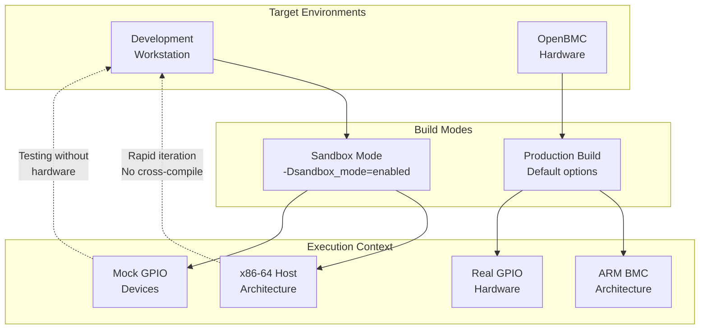
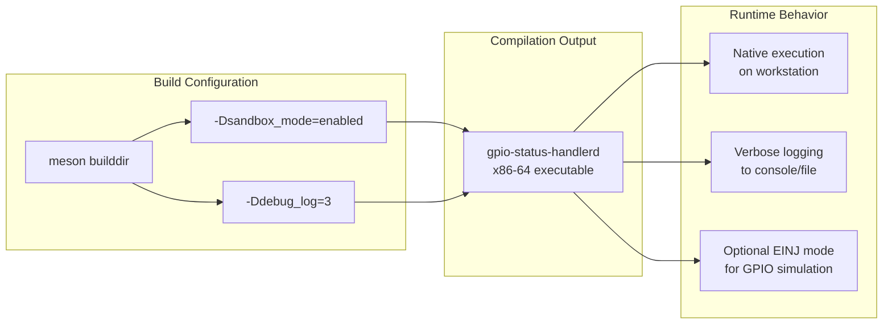
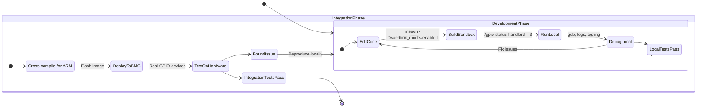

<!-- source: DeepWiki mcp.deepwiki.com · repo NVIDIA/nvidia-gpio-status-handler · page 5.1 Development Modes · fetched 2026-10-26 -->

# Development Modes

<details>
<summary>Relevant source files</summary>

The following files were used as context for generating this wiki page:

- [README.md](README.md)
- [meson.build](meson.build)
- [meson_options.txt](meson_options.txt)

</details>


## Purpose and Scope

This document explains the development-focused build configurations available in the nvidia-gpio-status-handler project. These modes enable developers to build, test, and debug the daemon on host workstations (x86-64 architecture) without requiring physical BMC hardware or GPIO devices. For information about runtime testing mechanisms, see [Testing and Debugging](#5.2). For build system configuration details, see [Build Options](#3.3).

The nvidia-gpio-status-handler provides two primary development modes:
- **Sandbox Mode**: Enables compilation for host CPU architecture (x86-64) instead of embedded ARM BMC architecture
- **API Stubs Mode**: Replaces hardware-dependent API calls with stub implementations for testing without physical devices

## Overview

Development modes address a fundamental challenge in embedded systems development: how to iterate rapidly on application logic without requiring constant deployment to target hardware. The nvidia-gpio-status-handler implements this through compile-time configuration options that alter the build output to support different development workflows.



**Diagram: Development Mode Execution Paths**

Sources: [meson.build:38-40](), [meson_options.txt:10-14](), [README.md:34-38]()

## Sandbox Mode

### What It Provides

Sandbox mode configures the build system to compile the daemon for the host development machine's CPU architecture (typically x86-64) rather than the target BMC's ARM architecture. This eliminates the need for cross-compilation toolchains and allows developers to run the executable directly on their workstations.

When sandbox mode is enabled, the build system defines the `DSANDBOX_MODE` preprocessor macro, which can be used throughout the codebase to conditionally compile architecture-specific code paths.

### Build Configuration

Sandbox mode is controlled by the `sandbox_mode` meson option:

| Option | Type | Default | Values |
|--------|------|---------|--------|
| `sandbox_mode` | feature | `auto` | `enabled`, `disabled`, `auto` |

The option is defined in [meson_options.txt:10-14]() and processed in [meson.build:38-40]():

```cpp
if get_option('sandbox_mode').enabled()
    add_project_arguments('-DSANDBOX_MODE', language: lang)
endif
```

### Enabling Sandbox Mode

For a clean build:
```bash
meson builddir -Dsandbox_mode=enabled
ninja -C builddir
```

For an already-configured project:
```bash
cd builddir
meson configure -Dsandbox_mode=enabled
cd ..
ninja -C builddir
```

### Use Cases

Sandbox mode is appropriate when:
- **Developing application logic**: Testing configuration parsing, D-Bus interface registration, or thread orchestration
- **Debugging on familiar tools**: Using IDE debuggers (gdb, lldb) on native architecture without QEMU or remote debugging
- **Rapid iteration**: Avoiding the cross-compile and deploy cycle during active development
- **Unit testing**: Running automated tests on CI infrastructure that may not support ARM cross-compilation

Sandbox mode is **not sufficient** when:
- Testing actual GPIO hardware interactions
- Validating libgpiod integration
- Performing end-to-end system integration tests with OpenBMC services

Sources: [README.md:62-67](), [README.md:34-38](), [meson_options.txt:10-14]()

## API Stubs Mode

### What It Provides

API stubs mode replaces hardware-dependent library calls (primarily `libgpiod` GPIO operations) with stub implementations that simulate hardware behavior. This allows the daemon to execute fully on systems without GPIO character devices (`/dev/gpiochipN`), returning predefined values or simple state machines instead of actual hardware state.

According to the project documentation, stub implementations are located in a `src/stubs` directory, though the specific stub files are not visible in the provided build configuration files.

### Configuration Status

The README.md documentation describes an `api_stubs` build option:

| Option | Type | Values | Description |
|--------|------|--------|-------------|
| `api_stubs` | feature | `enabled`, `disabled`, `auto` | Build using stub APIs in `src/stubs` directory |

However, this option is **not present** in the current [meson_options.txt:1-21]() file. This suggests either:
1. The option was removed in favor of alternative testing mechanisms (see EINJ mode in [Testing and Debugging](#5.2))
2. The documentation is outdated
3. Stub functionality is now automatically enabled when `sandbox_mode` is active

Developers should verify the current implementation status when attempting to use API stubs.

### Historical Usage Pattern

Based on the README documentation, the intended usage was:

```bash
# For a clean build
meson builddir -Dapi_stubs=enabled
ninja -C builddir

# For configured projects
cd builddir
meson configure -Dapi_stubs=enabled
ninja -C builddir
```

Sources: [README.md:55-60](), [README.md:34-38]()

## Combined Development Configuration

The most common development workflow combines sandbox mode with elevated debug logging to create a maximally instrumented development build:

```bash
meson builddir \
    -Dsandbox_mode=enabled \
    -Ddebug_log=3
ninja -C builddir
```

This configuration:
- Compiles for host architecture (sandbox mode)
- Enables info-level logging by default (debug_log=3)
- Allows direct execution and debugging on the development workstation



**Diagram: Development Build Configuration Flow**

Sources: [meson.build:31-40](), [README.md:69-74]()

## Development vs. Production Build Modes

The following table compares typical build configurations across the software lifecycle:

| Aspect | Development Build | Integration Build | Production Build |
|--------|------------------|-------------------|------------------|
| **Target Architecture** | x86-64 (host) | ARM (BMC) | ARM (BMC) |
| **Sandbox Mode** | `enabled` | `disabled` | `disabled` |
| **API Stubs** | `enabled` (historical) | `disabled` | `disabled` |
| **Debug Log Level** | 3-4 (info/debug) | 2 (warning) | 1 (error) |
| **Hardware Required** | None | Real BMC | Real BMC |
| **Use Case** | Local development | BMC integration testing | Production deployment |
| **Build Command** | `meson builddir -Dsandbox_mode=enabled -Ddebug_log=3` | `meson builddir -Ddebug_log=2` | Default or `-Ddebug_log=1` |

### Workflow Integration



**Diagram: Development Workflow State Machine**

The typical development cycle:
1. **Development Phase**: Iterate rapidly using sandbox mode on workstation with mock GPIO behavior (EINJ mode, see [Testing and Debugging](#5.2))
2. **Integration Phase**: Build for ARM architecture and deploy to real BMC hardware for hardware validation
3. **Production Phase**: Deploy with minimal logging to production systems

Sources: [README.md:22-74](), High-level architecture diagrams (Diagram 2, Diagram 5)

## When to Use Each Mode

### Use Sandbox Mode When:
- Developing configuration parsing logic ([gpio_json_config.cpp]())
- Testing D-Bus interface registration and property updates
- Debugging thread synchronization and lifecycle management
- Running on CI systems without embedded hardware
- Iterating on command-line argument handling
- Validating logging output formatting

### Do Not Use Sandbox Mode When:
- Testing actual GPIO line read operations via `libgpiod`
- Validating polling period accuracy and timing behavior
- Integrating with other OpenBMC services on real hardware
- Performing end-to-end system validation
- Measuring production performance characteristics

### Combine with EINJ Mode:
For development scenarios requiring GPIO behavior simulation without hardware, combine sandbox mode with EINJ (error injection) mode, which provides filesystem-based GPIO state simulation. See [Testing and Debugging](#5.2) for details on EINJ mode configuration.

Sources: [README.md:34-97](), [meson.build:38-40](), [meson_options.txt:10-14]()

---

