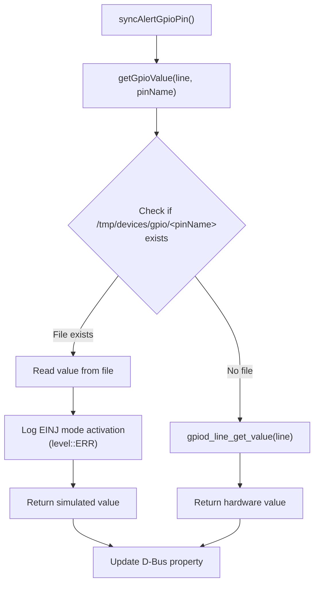
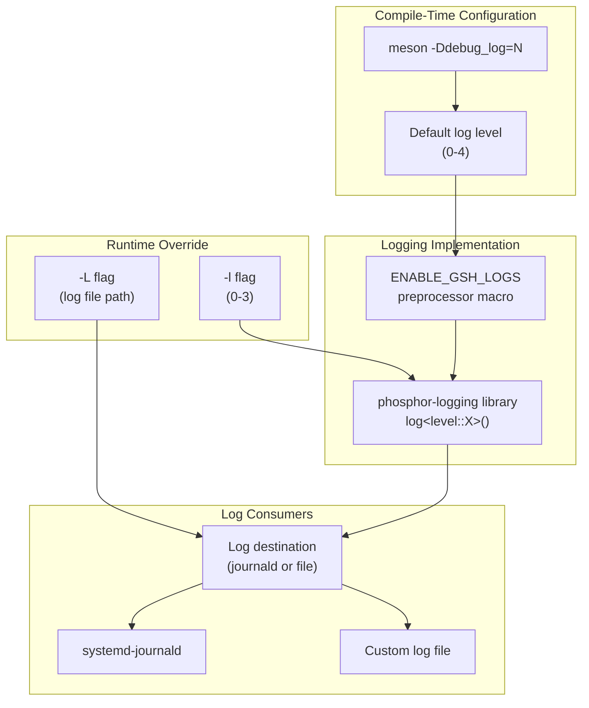
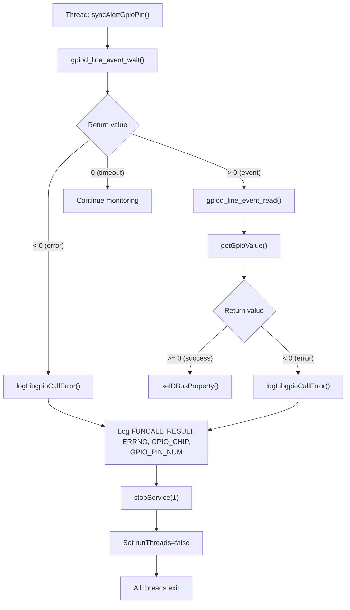
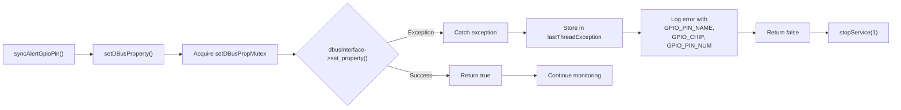

<!-- source: DeepWiki mcp.deepwiki.com · repo NVIDIA/nvidia-gpio-status-handler · page 5.2 Testing and Debugging · fetched 2026-10-26 -->

# Testing and Debugging

<details>
<summary>Relevant source files</summary>

The following files were used as context for generating this wiki page:

- [.clang-format](.clang-format)
- [README.md](README.md)
- [gpio_json_config.cpp](gpio_json_config.cpp)
- [gpio_json_config.hpp](gpio_json_config.hpp)
- [gpio_status_handler.cpp](gpio_status_handler.cpp)

</details>


This page documents the testing and debugging capabilities built into the nvidia-gpio-status-handler daemon. It covers EINJ (Error Injection) mode for simulating GPIO hardware without physical devices, runtime logging configuration, structured diagnostic output, and troubleshooting techniques.

For information about build-time development modes (sandbox mode and API stubs), see [Development Modes](#5.1). For general code organization and contribution guidelines, see [Code Organization](#5.3).

---

## EINJ Mode (Error Injection Testing)

EINJ mode is a filesystem-based GPIO simulation mechanism that allows testing the daemon's behavior without access to physical GPIO hardware. When enabled, the daemon reads GPIO pin values from files in `/tmp/devices/gpio/` instead of actual hardware devices.

### How EINJ Mode Works

The `getGpioValue` function in the GPIO monitoring loop checks for the presence of EINJ files before attempting hardware reads:



**Sources:** [gpio_status_handler.cpp:95-115]()

### EINJ File Structure

| Directory | Purpose |
|-----------|---------|
| `/tmp/devices/gpio/` | Base directory for EINJ mode files |
| `/tmp/devices/gpio/<pinName>` | Individual file per GPIO pin, containing integer value (0 or 1) |

### Enabling EINJ Mode

1. **Create the EINJ directory structure:**
   ```bash
   mkdir -p /tmp/devices/gpio
   ```

2. **Create pin value files matching your JSON configuration:**
   ```bash
   # For a pin named "I2C3_ALERT" in your config
   echo 1 > /tmp/devices/gpio/I2C3_ALERT
   echo 0 > /tmp/devices/gpio/I2C4_ALERT
   ```

3. **Start the daemon normally:**
   ```bash
   gpio-status-handlerd /etc/gpio-config.json
   ```

4. **Simulate GPIO state changes:**
   ```bash
   # Trigger a state change
   echo 0 > /tmp/devices/gpio/I2C3_ALERT
   
   # Verify D-Bus property updated
   busctl get-property xyz.openbmc_project.GpioStatusHandler \
       /xyz/openbmc_project/GpioStatusHandler \
       xyz.openbmc_project.GpioStatus I2C3_ALERT
   ```

### EINJ Mode Detection in Logs

When EINJ mode is active, each GPIO read generates a log entry with priority `ERR` and the tag `EINJ`:

```
PINNAME=I2C3_ALERT
PINVALUE=1
```

**Sources:** [gpio_status_handler.cpp:102-111]()

---

## Debug Logging System

The daemon implements a multi-level logging system with both compile-time defaults and runtime overrides.

### Logging Architecture



**Sources:** [README.md:98-126](), [gpio_status_handler.cpp:45-72]()

### Log Levels

| Level | Index | Compile-Time Flag | Runtime Flag | Description |
|-------|-------|-------------------|--------------|-------------|
| Disabled | 0 | `-Ddebug_log=0` | `-l 0` | No logging output |
| Error | 1 | `-Ddebug_log=1` (default) | `-l 1` | Critical errors only |
| Warning | 2 | `-Ddebug_log=2` | `-l 2` | Warnings + errors |
| Info | 3 | `-Ddebug_log=3` | `-l 3` | Informational messages |
| Debug | 4 | `-Ddebug_log=4` | N/A | Maximum verbosity (compile-time only) |

### Runtime Logging Configuration

**Command-Line Flags:**

```bash
# Set log level to info (3)
gpio-status-handlerd -l 3 /etc/gpio-config.json

# Redirect logs to file instead of journald
gpio-status-handlerd -L /tmp/debug.log /etc/gpio-config.json

# Combine both flags
gpio-status-handlerd -l 3 -L /tmp/gsh_debug.log /etc/gpio-config.json
```

**Sources:** [README.md:118-126](), [gpio_status_handler.cpp:506-582]()

---

## Structured Logging Fields

The daemon uses phosphor-logging's structured logging with custom tags for filtering and analysis:

### Log Entry Tags

| Tag | Purpose | Example Usage |
|-----|---------|---------------|
| `FILE` | JSON configuration file operations | `FILE=/etc/gpio-config.json` |
| `FUNCALL` | libgpiod function call identifier | `FUNCALL=gpiod_line_event_wait(<gpiochip0 108>)` |
| `RESULT` | Function call return value | `RESULT=-1` |
| `ERRNO` | Error number from failed operation | `ERRNO=5` |
| `ERRNO_STR` | Human-readable errno description | `ERRNO_STR=Input/output error` |
| `GPIO_CHIP` | GPIO chip name | `GPIO_CHIP=gpiochip0` |
| `GPIO_PIN_NAME` | Logical pin name from config | `GPIO_PIN_NAME=I2C3_ALERT` |
| `GPIO_PIN_NUM` | Physical pin number | `GPIO_PIN_NUM=108` |
| `EXCEPTION` | Exception message text | `EXCEPTION=Malformed config file` |
| `PINNAME` | EINJ mode pin name | `PINNAME=I2C3_ALERT` |
| `PINVALUE` | EINJ mode simulated value | `PINVALUE=1` |

### Querying Logs

**View all daemon logs with structured fields:**
```bash
journalctl --unit=xyz.openbmc_project.GpioStatusHandler \
    --output-fields=PRIORITY,MESSAGE,FILE,FUNCALL,RESULT,ERRNO,ERRNO_STR,\
                    GPIO_CHIP,GPIO_PIN_NAME,GPIO_PIN_NUM,EXCEPTION \
    -o verbose -p info
```

**Follow logs in real-time:**
```bash
journalctl --unit=xyz.openbmc_project.GpioStatusHandler -p 0..7 --follow
```

**Filter by specific GPIO pin:**
```bash
journalctl --unit=xyz.openbmc_project.GpioStatusHandler \
    GPIO_PIN_NAME=I2C3_ALERT
```

**Sources:** [gpio_status_handler.cpp:469-501]()

---

## Debugging Workflows

### Scenario 1: Configuration Validation Errors

When the daemon fails to start due to configuration issues:

```mermaid
sequenceDiagram
    participant USER as User
    participant DAEMON as gpio-status-handlerd
    participant CONFIG as GpioJsonConfig
    participant LOG as phosphor-logging
    
    USER->>DAEMON: Start with config file
    DAEMON->>CONFIG: GpioJsonConfig(fileName)
    CONFIG->>CONFIG: Read and parse JSON
    
    alt Configuration Valid
        CONFIG-->>DAEMON: Return config object
        DAEMON->>DAEMON: Proceed with initialization
    else JSON Syntax Error
        CONFIG->>LOG: log&lt;level::ERR&gt;()<br/>FILE, EXCEPTION tags
        CONFIG-->>DAEMON: Throw json::exception
        DAEMON->>LOG: Log exception details
        DAEMON-->>USER: Exit code 1
    else JSON Semantic Error
        CONFIG->>LOG: log&lt;level::ERR&gt;()<br/>Validation error details
        CONFIG-->>DAEMON: Throw GpioConfigError
        DAEMON->>LOG: Log configuration format
        DAEMON-->>USER: Exit code 1
    end
```

**Debugging steps:**

1. **Check configuration file syntax:**
   ```bash
   cat /etc/gpio-config.json | jq .
   ```

2. **Review validation logs:**
   ```bash
   journalctl -u xyz.openbmc_project.GpioStatusHandler FILE=/etc/gpio-config.json
   ```

3. **Common validation errors:**
   - Empty GPIO pin name ([gpio_json_config.cpp:165-173]())
   - Invalid characters in pin name ([gpio_json_config.cpp:174-188]())
   - Missing required keys ([gpio_json_config.cpp:130-142]())
   - Wrong value types ([gpio_json_config.cpp:78-127]())

**Sources:** [gpio_json_config.cpp:218-255](), [gpio_status_handler.cpp:554-564]()

### Scenario 2: GPIO Hardware Access Failures

When libgpiod operations fail:



**Debugging steps:**

1. **Verify GPIO device exists:**
   ```bash
   ls -l /dev/gpiochip*
   gpioinfo
   ```

2. **Check for permission issues:**
   ```bash
   # Daemon should run as root or gpio group
   id
   groups
   ```

3. **Review libgpiod error logs:**
   ```bash
   journalctl -u xyz.openbmc_project.GpioStatusHandler \
       FUNCALL="*gpiod*" -p err
   ```

**Sources:** [gpio_status_handler.cpp:95-115](), [gpio_status_handler.cpp:200-254]()

### Scenario 3: D-Bus Property Update Failures

When D-Bus operations fail:



**Debugging steps:**

1. **Verify D-Bus service registration:**
   ```bash
   busctl list | grep GpioStatusHandler
   ```

2. **Inspect D-Bus object:**
   ```bash
   busctl introspect xyz.openbmc_project.GpioStatusHandler \
       /xyz/openbmc_project/GpioStatusHandler \
       xyz.openbmc_project.GpioStatus
   ```

3. **Monitor D-Bus activity:**
   ```bash
   dbus-monitor --system "sender='xyz.openbmc_project.GpioStatusHandler'"
   ```

4. **Check for threading exceptions:**
   ```bash
   journalctl -u xyz.openbmc_project.GpioStatusHandler EXCEPTION="*"
   ```

**Sources:** [gpio_status_handler.cpp:53-93](), [gpio_status_handler.cpp:381-395]()

---

## Common Debug Scenarios

### Testing Without Hardware

**Using EINJ mode for development:**

```bash
# 1. Build with sandbox mode
meson builddir -Dsandbox_mode=enabled -Dapi_stubs=enabled -Ddebug_log=4
ninja -C builddir

# 2. Create test configuration
cat > /tmp/test-config.json << EOF
{
  "TEST_PIN_1": {
    "gpio_chip": 0,
    "gpio_pin": 1,
    "initial": false,
    "read_period_sec": 1.0
  }
}
EOF

# 3. Setup EINJ files
mkdir -p /tmp/devices/gpio
echo 0 > /tmp/devices/gpio/TEST_PIN_1

# 4. Run daemon with maximum logging
builddir/gpio-status-handlerd -l 3 -L /tmp/test.log /tmp/test-config.json &

# 5. Simulate GPIO events
echo 1 > /tmp/devices/gpio/TEST_PIN_1
sleep 2
echo 0 > /tmp/devices/gpio/TEST_PIN_1

# 6. Verify D-Bus updates
busctl get-property xyz.openbmc_project.GpioStatusHandler \
    /xyz/openbmc_project/GpioStatusHandler \
    xyz.openbmc_project.GpioStatus TEST_PIN_1

# 7. Review logs
grep EINJ /tmp/test.log
```

### Performance Profiling

When built with `log_elapsed_time` option, the daemon logs timing information:

```bash
# Build with timing instrumentation
meson builddir -Dlog_elapsed_time=enabled -Ddebug_log=3
ninja -C builddir

# Run and analyze timing logs
journalctl -u xyz.openbmc_project.GpioStatusHandler | grep -i elapsed
```

### Thread Synchronization Issues

Monitor thread lifecycle and synchronization:

```bash
# Enable info-level logging to see thread events
gpio-status-handlerd -l 3 /etc/gpio-config.json

# Look for thread start/stop messages
journalctl -u xyz.openbmc_project.GpioStatusHandler | grep -i thread
```

**Key log messages:**
- `"Starting gpio pins monitoring threads"` ([gpio_status_handler.cpp:295]())
- `"Setting up thread for:"` ([gpio_status_handler.cpp:317-328]())
- `"Thread started"` ([gpio_status_handler.cpp:334]())
- `"Waiting for thread #N"` ([gpio_status_handler.cpp:268-273]())
- `"Waiting for gpio monitoring threads to finish"` ([gpio_status_handler.cpp:548]())

**Sources:** [gpio_status_handler.cpp:264-277](), [gpio_status_handler.cpp:289-342]()

---

## Troubleshooting Reference

### Exit Codes

| Exit Code | Meaning | Common Causes |
|-----------|---------|---------------|
| 0 | Success (not normally reached) | N/A - daemon runs indefinitely |
| 1 | Error during initialization or runtime | Configuration error, hardware access failure, D-Bus error |

### Assertion Points

The daemon stops execution and exits with code 1 when:

1. Configuration file is missing or malformed
2. JSON semantic validation fails
3. GPIO chip cannot be opened
4. GPIO line cannot be requested
5. D-Bus service name cannot be registered
6. libgpiod function returns an error
7. D-Bus property update throws an exception

### Log Level Decision Matrix

| Use Case | Compile-Time | Runtime | Rationale |
|----------|--------------|---------|-----------|
| Production deployment | `debug_log=1` | None | Minimize overhead |
| Production troubleshooting | `debug_log=1` | `-l 3` | Enable verbose logging on-demand |
| Integration testing | `debug_log=2` | `-l 3 -L /tmp/test.log` | Capture all activity to file |
| Development | `debug_log=4` | `-l 3` | Maximum visibility |
| Hardware debugging | `debug_log=3` | `-l 3` + EINJ | Simulate hardware + full logging |

**Sources:** [README.md:98-126](), [gpio_status_handler.cpp:45-51](), [gpio_status_handler.cpp:506-582]()

---

