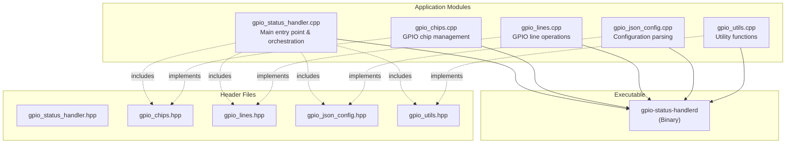
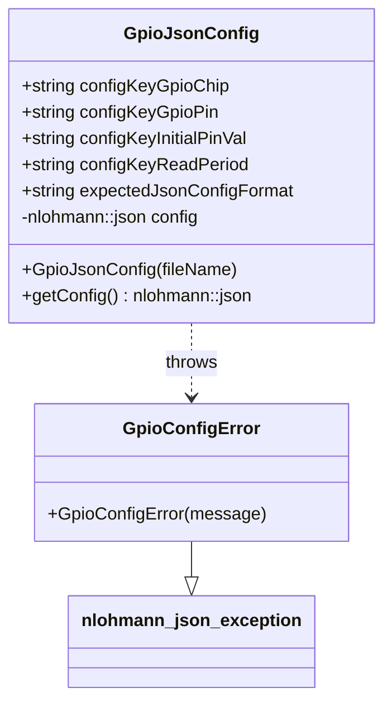
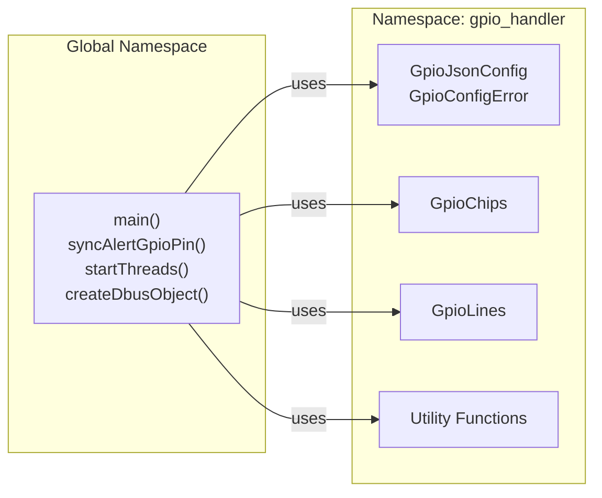
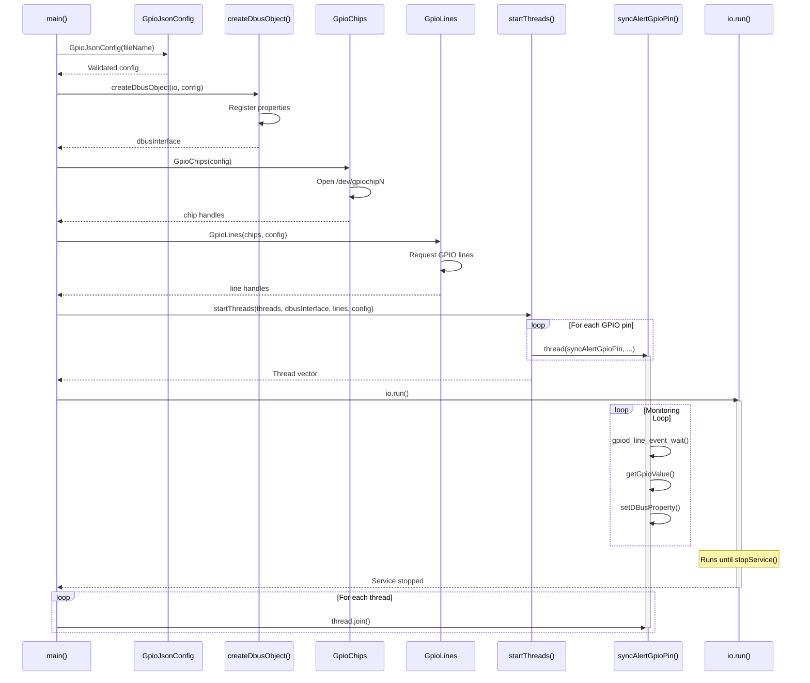
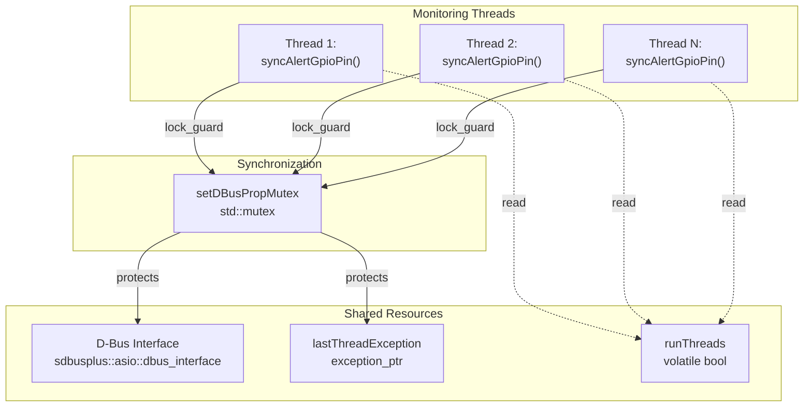
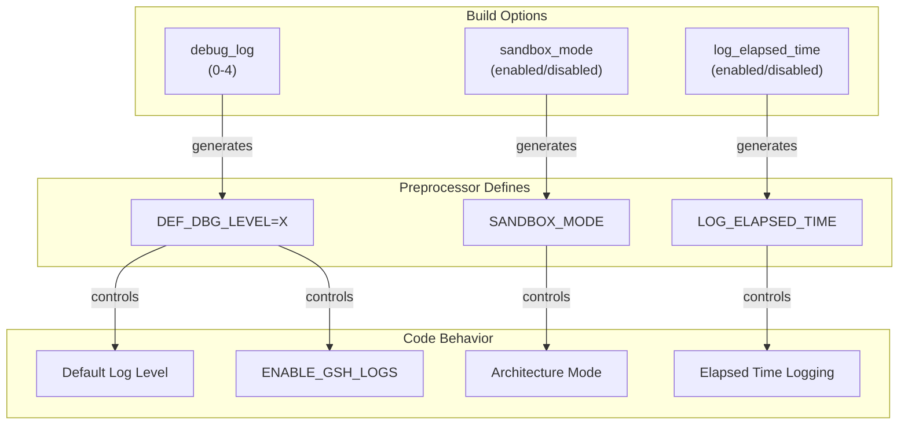

<!-- source: DeepWiki mcp.deepwiki.com · repo NVIDIA/nvidia-gpio-status-handler · page 5.3 Code Organization · fetched 2026-10-26 -->

# Code Organization

<details>
<summary>Relevant source files</summary>

The following files were used as context for generating this wiki page:

- [.beautysh-ignore](.beautysh-ignore)
- [.black-ignore](.black-ignore)
- [.clang-format](.clang-format)
- [.eslintignore](.eslintignore)
- [.flake8-ignore](.flake8-ignore)
- [.isort-ignore](.isort-ignore)
- [.markdownlint-ignore](.markdownlint-ignore)
- [.prettierignore](.prettierignore)
- [.shellcheck-ignore](.shellcheck-ignore)
- [gpio_json_config.cpp](gpio_json_config.cpp)
- [gpio_json_config.hpp](gpio_json_config.hpp)
- [gpio_status_handler.cpp](gpio_status_handler.cpp)
- [meson.build](meson.build)
- [meson_options.txt](meson_options.txt)

</details>


This page describes the source code structure of `nvidia-gpio-status-handler`, including the purpose and responsibilities of each C++ module, key classes and functions, and the coding standards enforced through linter and formatter configurations. For information about building the project, see [Building the Project](#3). For details on development modes that affect code behavior, see [Development Modes](#5.1).

## Source File Structure

The project consists of a single executable (`gpio-status-handlerd`) built from five C++ implementation files, each with specific responsibilities in the system architecture.

### Module Organization Diagram



**Sources:** [meson.build:94-105]()

### Build Configuration

The executable is defined in the Meson build system as follows:

| Build Target | Source Files | Dependencies |
|--------------|--------------|--------------|
| `gpio-status-handlerd` | `gpio_status_handler.cpp`<br/>`gpio_chips.cpp`<br/>`gpio_lines.cpp`<br/>`gpio_json_config.cpp`<br/>`gpio_utils.cpp` | `sdbusplus`<br/>`libgpiod`<br/>`phosphor-logging`<br/>`threads` |

**Sources:** [meson.build:94-105]()

## Core Module Descriptions

### gpio_status_handler.cpp - Main Daemon Logic

This is the primary application module containing the `main()` function and the core orchestration logic for the daemon.

**Key Responsibilities:**
- Application entry point and command-line argument processing
- D-Bus service initialization and registration
- GPIO monitoring thread lifecycle management
- Event-driven GPIO status synchronization

**Key Functions:**

| Function | Line Range | Purpose |
|----------|-----------|---------|
| `main()` | [gpio_status_handler.cpp:506-582]() | Entry point, initializes all subsystems |
| `syncAlertGpioPin()` | [gpio_status_handler.cpp:177-255]() | Thread entry function for per-GPIO monitoring |
| `startThreads()` | [gpio_status_handler.cpp:289-342]() | Spawns monitoring threads for each GPIO pin |
| `finishThreads()` | [gpio_status_handler.cpp:264-277]() | Joins all monitoring threads on shutdown |
| `createDbusObject()` | [gpio_status_handler.cpp:354-379]() | Creates D-Bus interface with properties |
| `setDBusProperty()` | [gpio_status_handler.cpp:53-93]() | Thread-safe D-Bus property updater |
| `getGpioValue()` | [gpio_status_handler.cpp:95-115]() | Reads GPIO value with EINJ mode support |
| `stopService()` | [gpio_status_handler.cpp:43-51]() | Signals all threads to stop execution |

**Key Constants:**

```cpp
constexpr auto dbusObjectPath = "/xyz/openbmc_project/GpioStatusHandler";
constexpr auto dbusServiceName = "xyz.openbmc_project.GpioStatusHandler";
constexpr auto dbusInterfaceName = "xyz.openbmc_project.GpioStatus";
constexpr uint64_t lineEventWaitTimeoutNs = 1e8l; // 100ms
```

**Sources:** [gpio_status_handler.cpp:1-583]()

### gpio_json_config.cpp - Configuration Parser

This module handles JSON configuration file parsing and validation.

**Key Responsibilities:**
- Read and parse JSON configuration from filesystem
- Validate configuration schema and data types
- Provide validated configuration data to other modules

**Key Classes:**



**Configuration Keys:**

| Constant | Value | Purpose |
|----------|-------|---------|
| `configKeyGpioChip` | `"gpio_chip"` | GPIO chip number |
| `configKeyGpioPin` | `"gpio_pin"` | GPIO pin number on chip |
| `configKeyInitialPinVal` | `"initial"` | Initial D-Bus property value |
| `configKeyReadPeriod` | `"read_period_sec"` | Minimum polling period |

**Validation Functions:**

| Function | Line Range | Purpose |
|----------|-----------|---------|
| `isJsonConfigFormatGood()` | [gpio_json_config.cpp:201-212]() | Top-level config validation |
| `isPinDescriptionGood()` | [gpio_json_config.cpp:152-163]() | Per-pin entry validation |
| `isGpioNameGood()` | [gpio_json_config.cpp:165-189]() | GPIO name format validation |
| `isJsonPropertyGood()` | [gpio_json_config.cpp:144-150]() | Property type validation |

**Sources:** [gpio_json_config.cpp:1-258](), [gpio_json_config.hpp:1-84]()

### gpio_chips.cpp - GPIO Chip Abstraction

This module manages the lifetime of `gpiod_chip` objects representing physical GPIO chips.

**Key Responsibilities:**
- Open GPIO chip devices (`/dev/gpiochipN`)
- Maintain mapping of chip numbers to `gpiod_chip*` handles
- Resource cleanup on destruction

**Expected Interface Pattern:**
```cpp
class GpioChips {
public:
    GpioChips(const GpioJsonConfig& config);
    ~GpioChips(); // Closes all chip handles
    gpiod_chip_t* getChip(unsigned chipNum) const;
private:
    std::map<unsigned, gpiod_chip_t*> chips;
};
```

**Sources:** Inferred from [meson.build:97]() and [gpio_status_handler.cpp:519]()

### gpio_lines.cpp - GPIO Line Operations

This module requests and manages GPIO line handles for monitoring.

**Key Responsibilities:**
- Request GPIO lines from chips for event monitoring
- Configure line attributes (input mode, edge detection)
- Provide mapping from pin names to `gpiod_line*` handles
- Resource cleanup on destruction

**Expected Interface Pattern:**
```cpp
class GpioLines {
public:
    GpioLines(const GpioChips& chips, const GpioJsonConfig& config);
    ~GpioLines(); // Releases all line handles
    const std::map<std::string, gpiod_line_t*>& getDbusPropMapLineObj() const;
private:
    std::map<std::string, gpiod_line_t*> dbusPropMapLineObj;
};
```

**Sources:** Inferred from [meson.build:98]() and [gpio_status_handler.cpp:521-525]()

### gpio_utils.cpp - Utility Functions

This module provides shared utility functions used across other modules.

**Expected Utilities:**
- Logging helpers for GPIO operations
- Error handling and reporting functions
- Common type conversions

**Expected Functions:**
```cpp
template<typename T>
void logPinOperation(const char* msg, const string& pinName, 
                     const string& chipName, unsigned pinNum);

void logLibgpioCallError(const stringstream& funcall, int result, 
                         int errnoVal, const string& pinName,
                         const string& chipName, unsigned pinNum);

phosphor::logging::entry pinNameEntry(const string& pinName);
```

**Sources:** Inferred from [meson.build:100]() and usage in [gpio_status_handler.cpp:69-70, 221-222]() and [gpio_json_config.cpp:171]()

## Namespace Organization

All project-specific code resides in the `gpio_handler` namespace to avoid symbol conflicts with system libraries and other OpenBMC components.



**Sources:** [gpio_json_config.cpp:15](), [gpio_status_handler.cpp:19]()

## Function Call Flow

The following diagram maps the execution flow from `main()` through key initialization and runtime functions:



**Sources:** [gpio_status_handler.cpp:506-582]()

## Code Quality Standards

### Formatter Configuration

The project uses `clang-format` with a custom configuration based on LLVM style with OpenBMC-specific modifications.

**Key Style Settings:**

| Setting | Value | Purpose |
|---------|-------|---------|
| Standard | C++23 | [meson.build:7]() |
| Column Limit | 80 | [.clang-format:52]() |
| Indent Width | 4 spaces | [.clang-format:86]() |
| Pointer Alignment | Left | [.clang-format:108]() |
| Break Before Braces | Custom (Allman style) | [.clang-format:26-44]() |
| Include Blocks | Regroup | [.clang-format:65]() |

**Include Order Priority:**

1. Priority -1: `config.h` (if exists)
2. Priority 1: Local headers with `.h` extension
3. Priority 2: Local headers with `.hpp` extension
4. Priority 3: System C headers (`<*.h>`)
5. Priority 4: System C++ headers (`<*.hpp>`)
6. Priority 5: Other system headers
7. Priority 6: Third-party headers
8. Priority 7: Test headers (`gtest`, `gmock`)

**Sources:** [.clang-format:1-135]()

### Linter Ignore Files

The project includes ignore files for various linters, all configured to ignore all files (`*`), indicating that these tools are not currently enforced:

| Tool | Purpose | Ignore File |
|------|---------|-------------|
| beautysh | Bash script formatter | [.beautysh-ignore:1]() |
| markdownlint | Markdown linter | [.markdownlint-ignore:1]() |
| shellcheck | Shell script linter | [.shellcheck-ignore:1]() |
| prettier | Multi-language formatter | [.prettierignore:1]() |
| flake8 | Python linter | [.flake8-ignore:1]() |
| eslint | JavaScript linter | [.eslintignore:1]() |
| black | Python formatter | [.black-ignore:1]() |
| isort | Python import sorter | [.isort-ignore:1]() |

**Note:** Only C++ code quality is enforced through `clang-format`. Other language tools are disabled, likely because the project contains no shell scripts, Python, JavaScript, or Markdown documentation requiring linting.

**Sources:** [.beautysh-ignore:1](), [.markdownlint-ignore:1](), [.shellcheck-ignore:1](), [.prettierignore:1](), [.flake8-ignore:1](), [.eslintignore:1](), [.black-ignore:1](), [.isort-ignore:1]()

## Thread Safety Mechanisms

The multi-threaded architecture employs specific synchronization primitives to ensure safe concurrent access to shared resources.



**Key Synchronization Variables:**

| Variable | Type | Purpose | Line Reference |
|----------|------|---------|----------------|
| `setDBusPropMutex` | `std::mutex` | Protects D-Bus property updates | [gpio_status_handler.cpp:39]() |
| `runThreads` | `volatile bool` | Global thread shutdown flag | [gpio_status_handler.cpp:38]() |
| `lastThreadException` | `exception_ptr` | Stores first thread exception | [gpio_status_handler.cpp:40]() |
| `threadsExitCode` | `int` | Exit code from thread failure | [gpio_status_handler.cpp:41]() |

**Critical Section:**
The `setDBusProperty()` function uses RAII-style locking to ensure only one thread updates D-Bus properties at a time:

```cpp
lock_guard<mutex> lock(setDBusPropMutex);
dbusInterface->set_property(pinName, pinValue);
```

**Sources:** [gpio_status_handler.cpp:38-41, 59]()

## Build-Time Code Generation

The project relies on conditional compilation to adapt behavior based on build configuration:



**Conditional Compilation Blocks:**

| Directive | Purpose | Occurrences |
|-----------|---------|-------------|
| `#ifdef ENABLE_GSH_LOGS` | Enable verbose logging | Multiple throughout [gpio_status_handler.cpp]() |
| `#ifdef SANDBOX_MODE` | Development mode behavior | Not visible in provided files |
| `#ifdef LOG_ELAPSED_TIME` | Performance instrumentation | Not visible in provided files |

**Build Configuration:**
- `debug_log` sets `DEF_DBG_LEVEL` macro: [meson.build:31-37]()
- `sandbox_mode` sets `SANDBOX_MODE` macro: [meson.build:38-40]()
- `log_elapsed_time` sets `LOG_ELAPSED_TIME` macro: [meson.build:42-44]()

**Sources:** [meson.build:31-44](), [meson_options.txt:1-21]()

---

