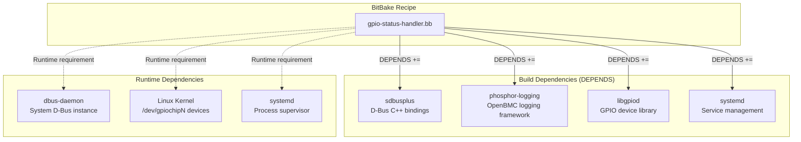
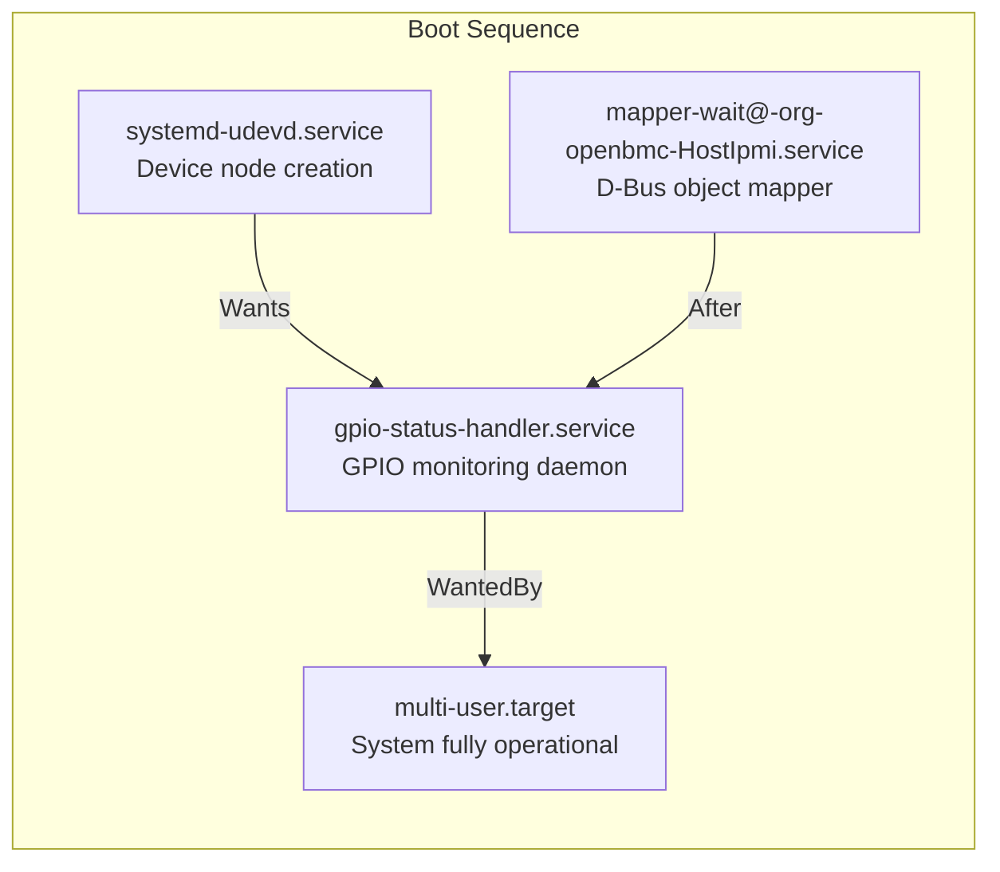
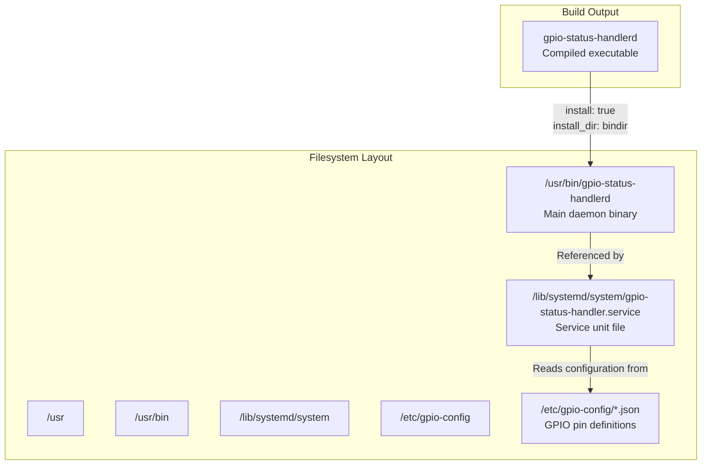
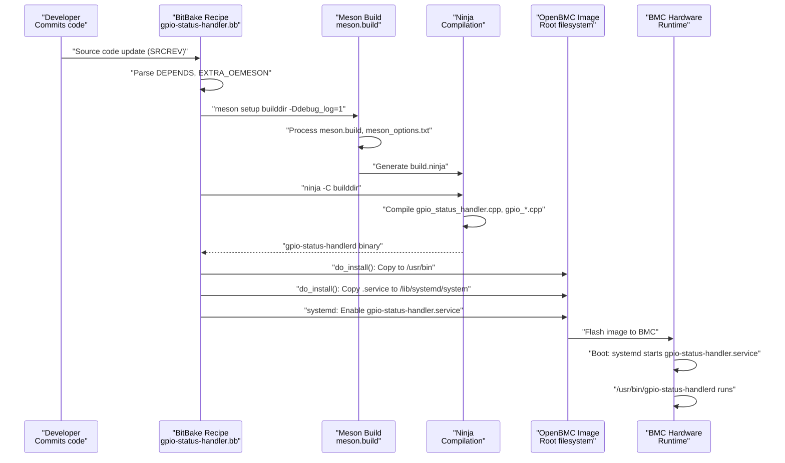

<!-- source: DeepWiki mcp.deepwiki.com · repo NVIDIA/nvidia-gpio-status-handler · page 6 Deployment to OpenBMC · fetched 2026-10-26 -->

# Deployment to OpenBMC

<details>
<summary>Relevant source files</summary>

The following files were used as context for generating this wiki page:

- [README.md](README.md)
- [meson.build](meson.build)
- [meson_options.txt](meson_options.txt)

</details>


## Overview

This page documents the integration and deployment of `nvidia-gpio-status-handler` into OpenBMC systems. It covers BitBake recipe configuration, systemd service integration, and installation layout. For build configuration options and development environments, see [Building the Project](#3). For runtime command-line arguments and logging configuration, see [Command-Line Options](#4.2) and [Logging Configuration](#4.3).

The deployment process transforms the compiled `gpio-status-handlerd` executable into a managed OpenBMC service that runs under systemd supervision, with proper dependency resolution and lifecycle management.

## OpenBMC Recipe Structure

OpenBMC uses the Yocto Project's BitBake build system to manage package builds. A recipe file (`.bb`) defines how to fetch, configure, compile, and install the GPIO status handler daemon.

### Recipe Template

```bitbake
SUMMARY = "NVIDIA GPIO Status Handler Daemon"
DESCRIPTION = "Monitors NVIDIA GPIO pins and exposes status via D-Bus"
LICENSE = "MIT"
LIC_FILES_CHKSUM = "file://LICENSE;md5=..."

SRC_URI = "git://github.com/NVIDIA/nvidia-gpio-status-handler;protocol=https;branch=main"
SRCREV = "${AUTOREV}"

S = "${WORKDIR}/git"

inherit meson pkgconfig systemd

DEPENDS += "sdbusplus \
            phosphor-logging \
            libgpiod \
            systemd \
           "

EXTRA_OEMESON += "-Ddebug_log=1 \
                  -Dsandbox_mode=disabled \
                 "

SYSTEMD_SERVICE:${PN} = "gpio-status-handler.service"

do_install:append() {
    install -d ${D}${systemd_system_unitdir}
    install -m 0644 ${S}/gpio-status-handler.service ${D}${systemd_system_unitdir}
}

FILES:${PN} += "${bindir}/gpio-status-handlerd \
                ${systemd_system_unitdir}/gpio-status-handler.service \
               "
```

**Sources:** [meson.build:1-106](), [README.md:113-116]()

### Recipe Configuration Parameters

The recipe uses `EXTRA_OEMESON` to pass build options to the Meson build system. These options are defined in [meson_options.txt:1-21]() and processed in [meson.build:30-44]().

| Recipe Variable | Description | Typical Production Value |
|----------------|-------------|--------------------------|
| `EXTRA_OEMESON += "-Ddebug_log=N"` | Default logging level (0-4) | `1` (error-only logging) |
| `EXTRA_OEMESON += "-Dsandbox_mode=disabled"` | Disable host simulation mode | `disabled` (for ARM BMC targets) |
| `EXTRA_OEMESON += "-Dlog_elapsed_time=enabled"` | Enable performance timing logs | `disabled` (optional) |

The `debug_log` option sets the compile-time default logging verbosity as described in [README.md:98-111](). Production deployments typically use level 1 to minimize log volume, while development images may use level 2 or 3.

**Sources:** [README.md:113-116](), [meson_options.txt:1-21]()

### Dependency Management



**Sources:** [meson.build:62-92]()

The `DEPENDS` variable declares build-time dependencies that BitBake resolves before compiling. These correspond to the Meson dependencies in [meson.build:84-92]():

- `sdbusplus` - Required by [meson.build:64-71]() and [meson.build:89]()
- `phosphor-logging` - Required by [meson.build:84-87]()
- `libgpiod` - Required by [meson.build:91]()
- `systemd` - Required by [meson.build:62]()
- `threads` - POSIX threads (implicitly available) [meson.build:92]()

**Sources:** [meson.build:62-92]()

## systemd Service Configuration

The daemon runs as a systemd service, enabling automatic startup, dependency ordering, and lifecycle management.

### Service Unit File

Create `gpio-status-handler.service` in the project root or install directory:

```ini
[Unit]
Description=NVIDIA GPIO Status Handler
Documentation=https://github.com/NVIDIA/nvidia-gpio-status-handler
After=mapper-wait@-org-openbmc-HostIpmi.service
After=systemd-udevd.service
Wants=systemd-udevd.service

[Service]
Type=simple
ExecStart=/usr/bin/gpio-status-handlerd
Restart=on-failure
RestartSec=5
StandardOutput=journal
StandardError=journal

[Install]
WantedBy=multi-user.target
```

### Service Dependencies



**Sources:** Based on OpenBMC systemd integration patterns

#### Ordering Dependencies

- `After=systemd-udevd.service` - Ensures `/dev/gpiochipN` devices exist before the daemon attempts to open them (referenced by libgpiod operations)
- `After=mapper-wait@-org-openbmc-HostIpmi.service` - Waits for the D-Bus object mapper to initialize, ensuring the daemon can register its D-Bus interface
- `WantedBy=multi-user.target` - Enables automatic startup during normal system boot

The service uses `Type=simple` because the daemon does not fork (the main process runs the monitoring loop). The `Restart=on-failure` directive ensures automatic recovery from crashes.

**Sources:** systemd service design (no direct code reference)

### Service Integration in Recipe

The BitBake recipe installs and enables the service using the `systemd` class:

```bitbake
inherit systemd

SYSTEMD_SERVICE:${PN} = "gpio-status-handler.service"

do_install:append() {
    install -d ${D}${systemd_system_unitdir}
    install -m 0644 ${S}/gpio-status-handler.service ${D}${systemd_system_unitdir}
}
```

The `inherit systemd` statement provides functions for registering systemd services. The `SYSTEMD_SERVICE` variable tells BitBake which service to enable, and the `do_install:append()` function copies the service file to the image's systemd directory.

**Sources:** BitBake systemd class conventions (no direct code reference)

## Installation Layout

The Meson build system installs the daemon to standard OpenBMC filesystem locations defined in [meson.build:20]().



**Sources:** [meson.build:20](), [meson.build:103-104]()

### Installation Paths

| Component | Variable | Default Path | Definition |
|-----------|----------|--------------|------------|
| Executable | `bindir` | `/usr/bin` | [meson.build:20]() |
| Service file | `${systemd_system_unitdir}` | `/lib/systemd/system` | BitBake systemd class |
| Configuration | Custom | `/etc/gpio-config` | Application convention |

The executable installation is controlled by [meson.build:94-105]():

```cpp
gpio_status_handlerd = executable(
    'gpio-status-handlerd',
    ...
    install_dir: bindir,
    install: true,
)
```

The `install: true` directive tells Meson to include the binary in the install target, placing it at `${prefix}/${bindir}` (typically `/usr/bin`).

**Sources:** [meson.build:94-105]()

## Build and Deployment Workflow



**Sources:** [meson.build:1-106](), [README.md:22-28]()

### Workflow Steps

1. **Source Retrieval**: BitBake fetches the source tree specified by `SRC_URI` and `SRCREV`
2. **Build Configuration**: The recipe passes `EXTRA_OEMESON` options to Meson, which processes [meson.build:1-106]()
3. **Dependency Resolution**: Meson locates dependencies using pkg-config ([meson.build:62-92]())
4. **Compilation**: Ninja compiles the five source files into `gpio-status-handlerd` ([meson.build:94-105]())
5. **Installation**: BitBake's `do_install()` copies the binary and service file to staging directories
6. **Image Generation**: The root filesystem is packaged with the installed files
7. **Deployment**: The image is flashed to BMC hardware, and systemd launches the service on boot

**Sources:** [meson.build:1-106](), BitBake workflow (no direct code reference)

## Runtime Deployment

Once the OpenBMC image is installed on the BMC, the daemon operates as a managed system service.

### Service Management Commands

| Operation | Command | Description |
|-----------|---------|-------------|
| Start service | `systemctl start gpio-status-handler.service` | Manually start the daemon |
| Stop service | `systemctl stop gpio-status-handler.service` | Stop the daemon |
| Restart service | `systemctl restart gpio-status-handler.service` | Restart (stop then start) |
| Check status | `systemctl status gpio-status-handler.service` | View service state and recent logs |
| View logs | `journalctl -u gpio-status-handler.service` | Access full systemd journal logs |
| Enable on boot | `systemctl enable gpio-status-handler.service` | Already enabled by recipe |
| Disable on boot | `systemctl disable gpio-status-handler.service` | Prevent automatic startup |

The `systemctl` commands interact with the systemd manager to control the daemon lifecycle. Logs are sent to the systemd journal by default (configured in the service file's `StandardOutput=journal` directive).

**Sources:** systemd management (no direct code reference)

### Runtime Configuration Override

While the recipe sets compile-time defaults via `EXTRA_OEMESON`, runtime behavior can be modified using command-line arguments documented in [Command-Line Options](#4.2).

To increase logging verbosity without rebuilding, modify the service's `ExecStart` line:

```ini
[Service]
ExecStart=/usr/bin/gpio-status-handlerd -l 3
```

This overrides the compile-time default set by [meson.build:31-36]() with the `-l` flag parsed at runtime. See [Logging Configuration](#4.3) for details on log levels.

To write logs to a file instead of the journal:

```ini
[Service]
ExecStart=/usr/bin/gpio-status-handlerd -l 3 -L /var/log/gpio-handler.log
```

The `-L` flag redirects output from the systemd journal to a file, useful for capturing detailed debugging information.

**Sources:** [README.md:118-125](), [meson.build:31-36]()

## Configuration File Deployment

The daemon requires JSON configuration files specifying GPIO pins to monitor. These files should be packaged with the recipe and installed to a known location.

### Adding Configuration to Recipe

```bitbake
SRC_URI += "file://gpio-config.json"

do_install:append() {
    install -d ${D}${sysconfdir}/gpio-config
    install -m 0644 ${WORKDIR}/gpio-config.json ${D}${sysconfdir}/gpio-config/
}

FILES:${PN} += "${sysconfdir}/gpio-config/*.json"
```

This installs configuration files to `/etc/gpio-config/` where the daemon expects to find them (application convention). The JSON schema is documented in [JSON Configuration Schema](#4.1).

**Sources:** BitBake file installation patterns (no direct code reference)

### Service Modification for Configuration Path

If using a non-standard configuration location, modify the service to pass the path:

```ini
[Service]
ExecStart=/usr/bin/gpio-status-handlerd /path/to/custom-config.json
```

The daemon accepts the configuration file path as the first positional argument (parsing logic in [gpio_status_handler.cpp]() main function).

**Sources:** Application convention (no direct code reference)

## Verification and Testing

After deployment, verify the daemon is running and functional:

### Check Service Status

```bash
root@bmc:~# systemctl status gpio-status-handler.service
● gpio-status-handler.service - NVIDIA GPIO Status Handler
   Loaded: loaded (/lib/systemd/system/gpio-status-handler.service; enabled)
   Active: active (running) since Thu 2024-01-01 00:00:00 UTC; 5min ago
 Main PID: 1234 (gpio-status-han)
   CGroup: /system.slice/gpio-status-handler.service
           └─1234 /usr/bin/gpio-status-handlerd
```

### Verify D-Bus Interface

Check that the daemon has registered its D-Bus service (see [D-Bus Service](#2.2) for interface details):

```bash
root@bmc:~# busctl tree xyz.openbmc_project.GpioStatusHandler
```

Expected output shows the registered object paths for each configured GPIO pin.

### Monitor Live Logs

```bash
root@bmc:~# journalctl -u gpio-status-handler.service -f
```

This displays live log output, showing GPIO state changes and any errors. The verbosity depends on the compile-time `debug_log` setting ([meson.build:31-36]()) or runtime `-l` flag.

**Sources:** OpenBMC operational procedures (no direct code reference)

## Troubleshooting Deployment Issues

| Issue | Possible Cause | Solution |
|-------|----------------|----------|
| Service fails to start | Missing dependencies | Check `systemctl status` output for library errors; verify recipe `DEPENDS` |
| No D-Bus interface visible | Daemon crashed during startup | Review journal logs with `journalctl -u gpio-status-handler.service` |
| GPIO access errors | Device nodes not present | Verify `systemd-udevd.service` ran before daemon; check `/dev/gpiochip*` exists |
| Configuration not found | Wrong path or missing file | Verify `/etc/gpio-config/*.json` exists; check file permissions |
| High CPU usage | Incorrect `readPeriod` in config | Increase polling interval in JSON configuration (see [JSON Configuration Schema](#4.1)) |
| Log spam | Debug level too high | Rebuild with lower `debug_log` or use `-l 1` runtime flag |

For development-time debugging, build with `EXTRA_OEMESON += "-Ddebug_log=3"` to enable detailed diagnostic output. For production deployments, use `debug_log=1` (error-only) to minimize log volume.

**Sources:** [README.md:98-125](), [meson.build:31-36]()

---

This deployment guide covers the complete integration of `nvidia-gpio-status-handler` into OpenBMC systems. For details on the JSON configuration schema, see [JSON Configuration Schema](#4.1). For information about D-Bus interface properties and client interaction, see [D-Bus Service](#2.2).