# Page: Home

# Home

<details>
<summary>Relevant source files</summary>

The following files were used as context for generating this wiki page:

- [.clang-format](.clang-format)
- [README.md](README.md)
- [gpio_json_config.cpp](gpio_json_config.cpp)
- [gpio_json_config.hpp](gpio_json_config.hpp)
- [gpio_status_handler.cpp](gpio_status_handler.cpp)
- [meson.build](meson.build)
- [meson_options.txt](meson_options.txt)

</details>


## Overview

The **nvidia-gpio-status-handler** is a specialized OpenBMC daemon that monitors NVIDIA GPIO pin states on BMC hardware and exposes them as D-Bus properties. The daemon continuously reads GPIO pin values through the Linux GPIO character device interface and publishes state changes to the D-Bus system bus, enabling other OpenBMC services to react to hardware events.

This documentation covers the architecture, build process, configuration, and development workflows for the `gpio-status-handlerd` daemon. For details on specific topics:
- Architecture and internal design: see [Architecture](#2)
- Build system and compilation: see [Building the Project](#3)
- JSON configuration and runtime options: see [Configuration](#4)
- Development workflows and testing: see [Development Guide](#5)
- OpenBMC integration: see [Deployment to OpenBMC](#6)

**Sources:** [README.md:1-3](), [gpio_status_handler.cpp:397-505]()

---

## System Purpose

The daemon serves as a **GPIO-to-D-Bus bridge** in OpenBMC environments, addressing the need to make hardware GPIO state observable to BMC management software without requiring each service to directly interact with GPIO hardware. Key characteristics:

| Aspect | Description |
|--------|-------------|
| **Input** | GPIO pin states from `/dev/gpiochipN` character devices via `libgpiod` |
| **Output** | Boolean properties on D-Bus interface `xyz.openbmc_project.GpioStatus` |
| **Configuration** | JSON file mapping GPIO pins to D-Bus property names |
| **Threading Model** | One monitoring thread per configured GPIO pin |
| **Event Detection** | Hybrid polling + event-driven using `gpiod_line_event_wait()` |

**Sources:** [gpio_status_handler.cpp:25-27](), [gpio_status_handler.cpp:117-176](), [README.md:1-4]()

---

## System Architecture Overview

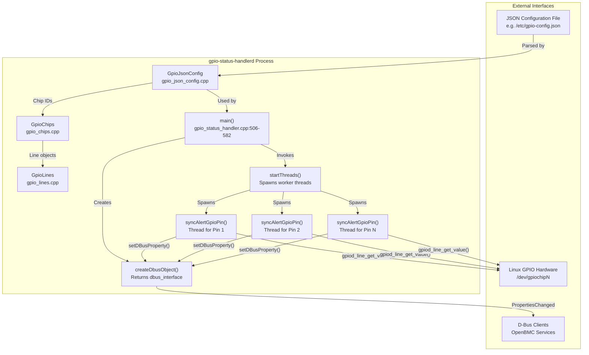

**System Initialization and Runtime Flow**

The daemon's execution follows this sequence:

1. **Configuration Phase:** `main()` instantiates `GpioJsonConfig` which parses and validates the JSON file
2. **Hardware Setup:** `GpioChips` opens GPIO character devices, `GpioLines` requests specific lines
3. **D-Bus Registration:** `createDbusObject()` registers service name `xyz.openbmc_project.GpioStatusHandler` and creates boolean properties for each configured pin
4. **Thread Deployment:** `startThreads()` spawns one `syncAlertGpioPin()` thread per GPIO pin
5. **Monitoring Loop:** Each thread calls `gpiod_line_event_wait()` with timeout, reads pin state, and calls `setDBusProperty()` on changes

**Sources:** [gpio_status_handler.cpp:506-582](), [gpio_status_handler.cpp:289-342](), [gpio_status_handler.cpp:177-255](), [gpio_status_handler.cpp:354-379]()

---

## Core Components

### Executable and Source Files

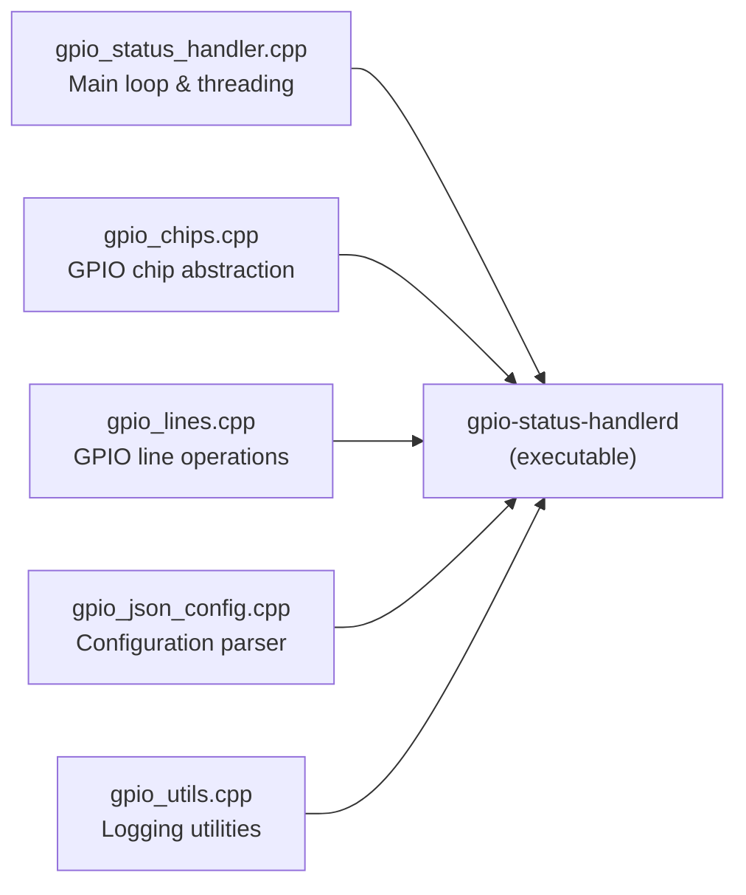

| Component | File | Primary Responsibility |
|-----------|------|------------------------|
| **Main Daemon** | `gpio_status_handler.cpp` | Process lifecycle, thread orchestration, D-Bus service creation |
| **Configuration Parser** | `gpio_json_config.cpp` | JSON validation and semantic checking |
| **GPIO Chip Manager** | `gpio_chips.cpp` | Opening `/dev/gpiochipN` devices |
| **GPIO Line Manager** | `gpio_lines.cpp` | Requesting and managing `gpiod_line_t*` handles |
| **Utilities** | `gpio_utils.cpp` | Logging helpers and error reporting |

**Sources:** [meson.build:94-105](), [gpio_status_handler.cpp:1-16]()

---

## D-Bus Interface Specification

### Service Registration

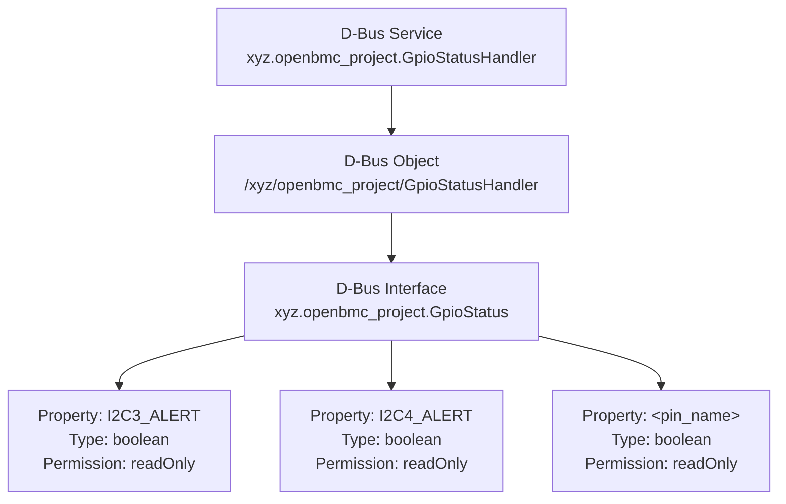

The daemon registers on the D-Bus system bus with these identifiers (defined as constants in [gpio_status_handler.cpp:25-27]()):

```cpp
constexpr auto dbusObjectPath = "/xyz/openbmc_project/GpioStatusHandler";
constexpr auto dbusServiceName = "xyz.openbmc_project.GpioStatusHandler";
constexpr auto dbusInterfaceName = "xyz.openbmc_project.GpioStatus";
```

Properties are dynamically registered based on the JSON configuration. Each GPIO pin name becomes a boolean property. Clients can query the service:

```bash
busctl introspect xyz.openbmc_project.GpioStatusHandler \
    /xyz/openbmc_project/GpioStatusHandler \
    xyz.openbmc_project.GpioStatus
```

**Sources:** [gpio_status_handler.cpp:25-27](), [gpio_status_handler.cpp:354-379](), [gpio_status_handler.cpp:438-449]()

---

## Configuration Format

The daemon requires a JSON configuration file as its first command-line argument. The structure maps GPIO pin names to hardware specifications:

```json
{
  "I2C3_ALERT" : {
    "gpio_chip" : 0,
    "gpio_pin" : 108,
    "initial" : false,
    "read_period_sec" : 0.5
  },
  "I2C4_ALERT" : {
    "gpio_chip" : 1,
    "gpio_pin" : 32,
    "initial" : true,
    "read_period_sec" : 4
  }
}
```

| Key | Type | Description | Validation |
|-----|------|-------------|------------|
| `gpio_chip` | unsigned int | GPIO chip number (maps to `/dev/gpiochipN`) | [gpio_json_config.cpp:155-156]() |
| `gpio_pin` | unsigned int | Pin offset within the chip | [gpio_json_config.cpp:157-158]() |
| `initial` | boolean | Initial D-Bus property value before first read | [gpio_json_config.cpp:159-160]() |
| `read_period_sec` | positive number | Minimum polling period in seconds | [gpio_json_config.cpp:161-162]() |

The pin name (e.g., `"I2C3_ALERT"`) becomes the D-Bus property name and must contain only alphanumeric characters and underscores. See [Configuration](#4) for complete schema documentation.

**Sources:** [gpio_json_config.hpp:16-31](), [gpio_json_config.cpp:22-42](), [gpio_json_config.cpp:165-189]()

---

## Threading and Monitoring Model

### Per-Pin Thread Architecture

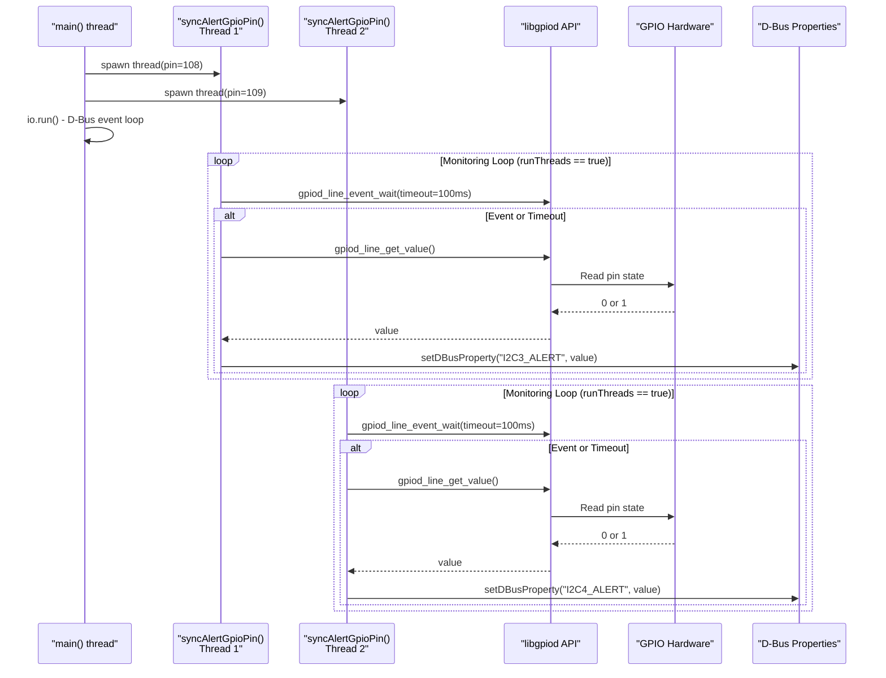

The function `syncAlertGpioPin()` implements a hybrid event-driven and polling model:

1. **Event Wait:** Calls `gpiod_line_event_wait()` with timeout `lineEventWaitTimeoutNs = 1e8` (100ms)
2. **State Read:** On event or timeout, reads actual pin value via `gpiod_line_get_value()`
3. **D-Bus Update:** Updates property through mutex-protected `setDBusProperty()`
4. **Period Tracking:** Enforces minimum update interval from `read_period_sec` configuration

The `readPeriodTicks` parameter controls how many timeout intervals constitute one polling period [gpio_status_handler.cpp:311-313]().

**Sources:** [gpio_status_handler.cpp:177-255](), [gpio_status_handler.cpp:35](), [gpio_status_handler.cpp:289-342](), [gpio_status_handler.cpp:53-93]()

---

## Build System and Dependencies

### Build Configuration

The project uses **Meson** build system (minimum version 1.1.1) with C++23 standard:

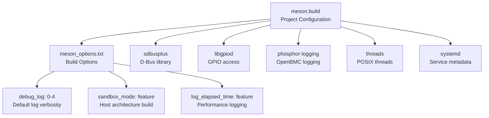

### Key Build Options

| Option | Type | Default | Effect |
|--------|------|---------|--------|
| `debug_log` | integer (0-4) | 0 | Compile-time default log level (0=disabled, 4=max verbosity) |
| `sandbox_mode` | feature | auto | Enable x86-64 host development builds |
| `log_elapsed_time` | feature | disabled | Add timestamp logging for performance analysis |

The build produces the `gpio-status-handlerd` executable installed to `/usr/bin` (configurable via `bindir`). See [Building the Project](#3) for detailed build instructions.

**Sources:** [meson.build:1-106](), [meson_options.txt:1-22]()

---

## Runtime Operation

### Command-Line Interface

The daemon accepts these arguments:

```bash
gpio-status-handlerd <config.json> [-l <log_level>] [-L <log_file>]
```

| Argument | Description | Values |
|----------|-------------|--------|
| `<config.json>` | Required: path to JSON configuration file | File path |
| `-l <log_level>` | Optional: runtime log verbosity override | 0=none, 1=error, 2=warning, 3=info |
| `-L <log_file>` | Optional: redirect logs to file instead of journald | File path |

**Example:**
```bash
gpio-status-handlerd /etc/gpio-alert-config.json -l 3 -L /tmp/gpio-debug.log
```

**Sources:** [README.md:118-126](), [README.md:99-111]()

---

## Error Injection Mode (EINJ)

For testing without GPIO hardware, the daemon supports **EINJ mode**, activated when files appear in `/tmp/devices/gpio/`:

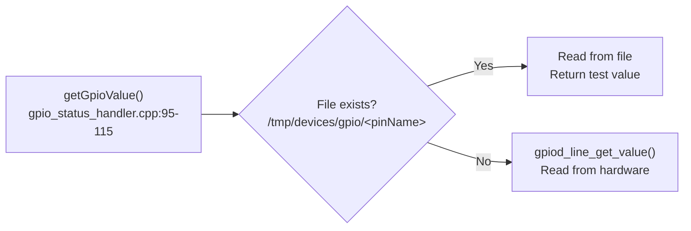

To inject a GPIO state:
```bash
mkdir -p /tmp/devices/gpio
echo "1" > /tmp/devices/gpio/I2C3_ALERT
```

The daemon will read from this file instead of hardware [gpio_status_handler.cpp:102-111]().

**Sources:** [gpio_status_handler.cpp:95-115]()

---

## Quick Start

### 1. Create Configuration File

Create `/etc/gpio-alerts.json`:
```json
{
  "PSU_ALERT": {
    "gpio_chip": 0,
    "gpio_pin": 45,
    "initial": false,
    "read_period_sec": 1.0
  }
}
```

### 2. Build and Install

```bash
meson setup builddir
ninja -C builddir
sudo ninja -C builddir install
```

### 3. Run Daemon

```bash
sudo gpio-status-handlerd /etc/gpio-alerts.json
```

### 4. Query D-Bus

```bash
busctl get-property xyz.openbmc_project.GpioStatusHandler \
    /xyz/openbmc_project/GpioStatusHandler \
    xyz.openbmc_project.GpioStatus \
    PSU_ALERT
```

**Sources:** [README.md:22-28](), [gpio_status_handler.cpp:397-505]()

---

## Logging and Diagnostics

The daemon integrates with `phosphor-logging` for structured logging. Log messages include these custom fields:

| Field | Usage | Example |
|-------|-------|---------|
| `FILE` | JSON parsing errors | Configuration file path |
| `FUNCALL` | libgpiod function calls | `gpiod_line_event_wait(...)` |
| `RESULT` | Return value from libgpiod | `-1` |
| `ERRNO` | Error number | `22` |
| `ERRNO_STR` | Error description | `"Invalid argument"` |
| `GPIO_CHIP` | Chip identifier | `"gpiochip0"` |
| `GPIO_PIN_NAME` | Logical pin name | `"I2C3_ALERT"` |
| `GPIO_PIN_NUM` | Pin offset | `108` |
| `EXCEPTION` | C++ exception messages | Exception details |

View logs in real-time:
```bash
journalctl --unit=xyz.openbmc_project.GpioStatusHandler -p 0..7 --follow
```

**Sources:** [gpio_status_handler.cpp:469-489](), [README.md:98-126]()

---

## Further Reading

- **[Architecture](#2)** - Detailed component interaction, threading model, and D-Bus service implementation
- **[Building the Project](#3)** - Comprehensive build instructions, dependency management, and cross-compilation
- **[Configuration](#4)** - Complete JSON schema reference and runtime parameter documentation  
- **[Development Guide](#5)** - Development workflows, testing strategies, and code organization
- **[Deployment to OpenBMC](#6)** - Integration with OpenBMC build system and systemd service configuration

---

# Page: Architecture

# Architecture

<details>
<summary>Relevant source files</summary>

The following files were used as context for generating this wiki page:

- [.clang-format](.clang-format)
- [gpio_json_config.cpp](gpio_json_config.cpp)
- [gpio_json_config.hpp](gpio_json_config.hpp)
- [gpio_status_handler.cpp](gpio_status_handler.cpp)
- [meson.build](meson.build)
- [meson_options.txt](meson_options.txt)

</details>


This document describes the technical design and internal structure of the `nvidia-gpio-status-handler` daemon. It provides an overview of the system's layered architecture, component interactions, and execution model. For detailed information about individual components, see [System Components](#2.1). For D-Bus interface specifications, see [D-Bus Service](#2.2). For threading and monitoring implementation, see [GPIO Monitoring Implementation](#2.3).

## Architectural Overview

The `nvidia-gpio-status-handler` is designed as a single-process, multi-threaded daemon that bridges Linux GPIO hardware with the OpenBMC D-Bus ecosystem. The architecture follows a layered model with clear separation between configuration, hardware abstraction, monitoring logic, and external interfaces.

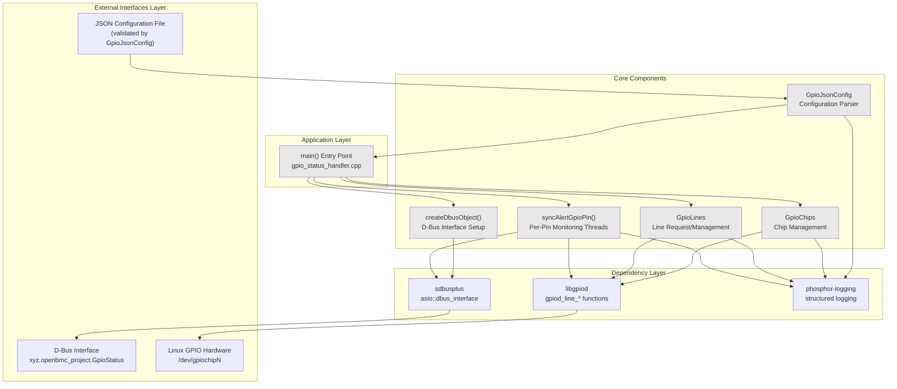

**Layered Architecture:**

| Layer | Components | Purpose |
|-------|-----------|---------|
| **External Interfaces** | JSON config, D-Bus service, GPIO hardware | System boundaries - input configuration, output status, hardware access |
| **Application** | `main()` function | Orchestration, initialization, error handling |
| **Core Components** | `GpioJsonConfig`, `GpioChips`, `GpioLines`, monitoring threads | Business logic, GPIO abstraction, state synchronization |
| **Dependencies** | `libgpiod`, `sdbusplus`, `phosphor-logging` | External library abstractions |

**Sources:** [gpio_status_handler.cpp:506-582](), [meson.build:94-105]()

## Component Initialization Flow

The daemon follows a strict initialization sequence to ensure all resources are properly configured before monitoring begins.

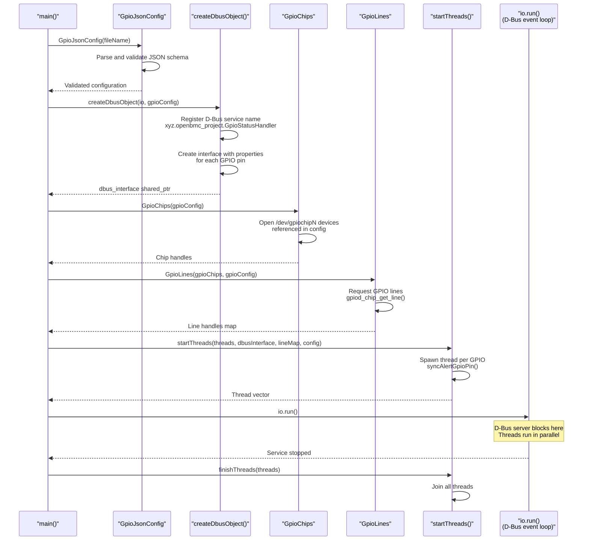

**Initialization Steps:**

1. **Configuration Loading** ([gpio_status_handler.cpp:514]()): `GpioJsonConfig` parses JSON and validates schema
2. **D-Bus Setup** ([gpio_status_handler.cpp:516-517]()): `createDbusObject()` registers service and creates properties
3. **Chip Opening** ([gpio_status_handler.cpp:519]()): `GpioChips` opens `/dev/gpiochipN` devices
4. **Line Requesting** ([gpio_status_handler.cpp:521]()): `GpioLines` requests individual GPIO lines
5. **Thread Spawning** ([gpio_status_handler.cpp:524-525]()): `startThreads()` creates monitoring threads
6. **Event Loop** ([gpio_status_handler.cpp:534]()): `io.run()` blocks on D-Bus event loop

**Sources:** [gpio_status_handler.cpp:506-552](), [gpio_status_handler.cpp:354-379](), [gpio_status_handler.cpp:289-342]()

## Execution Model

The daemon operates with a single-threaded D-Bus event loop and multiple GPIO monitoring threads. Each GPIO pin gets a dedicated thread that polls for state changes and updates the corresponding D-Bus property.

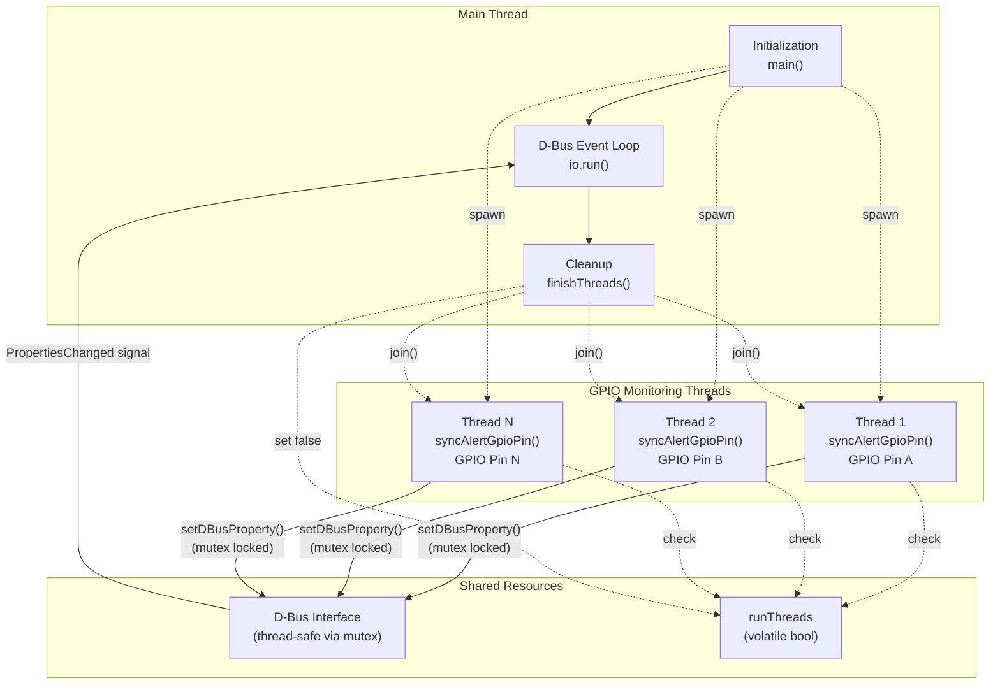

**Thread Safety:**

- **Shared D-Bus Interface**: Protected by `setDBusPropMutex` ([gpio_status_handler.cpp:39](), [gpio_status_handler.cpp:59]())
- **Global Run Flag**: Volatile `runThreads` variable for coordinated shutdown ([gpio_status_handler.cpp:38]())
- **Exception Handling**: Thread exceptions stored in `lastThreadException` ([gpio_status_handler.cpp:40](), [gpio_status_handler.cpp:80]())

**Sources:** [gpio_status_handler.cpp:37-41](), [gpio_status_handler.cpp:53-93](), [gpio_status_handler.cpp:264-277]()

## GPIO Monitoring Loop

Each monitoring thread runs the `syncAlertGpioPin()` function, which implements a hybrid polling and event-driven model. The loop waits for GPIO events with a timeout, then reads the pin state and updates the D-Bus property.

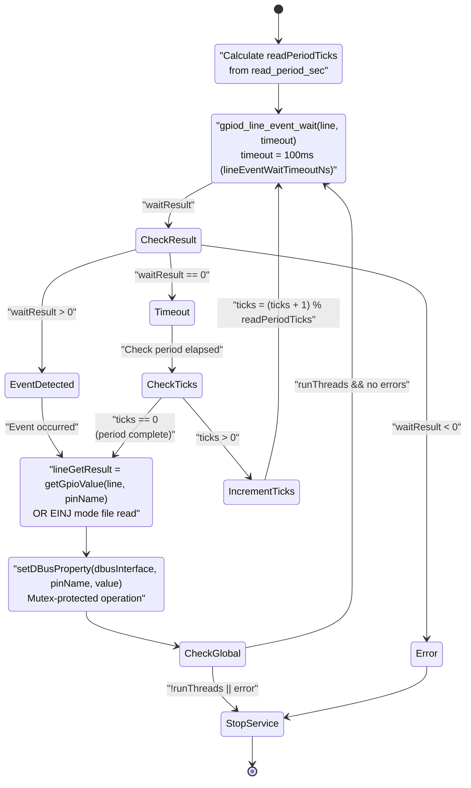

**Key Variables:**

- `lineEventWaitTimeoutNs` = 100ms: Maximum wait time per iteration ([gpio_status_handler.cpp:35]())
- `readPeriodTicks`: Number of timeout periods per full polling cycle ([gpio_status_handler.cpp:311-313]())
- `ticks`: Counter tracking progress through polling period ([gpio_status_handler.cpp:189](), [gpio_status_handler.cpp:247]())

**Sources:** [gpio_status_handler.cpp:177-255](), [gpio_status_handler.cpp:95-115]()

## Configuration Schema Validation

The `GpioJsonConfig` class ([gpio_json_config.hpp:33]()) enforces strict validation on the JSON configuration file. All configuration errors are detected at startup before any hardware access occurs.

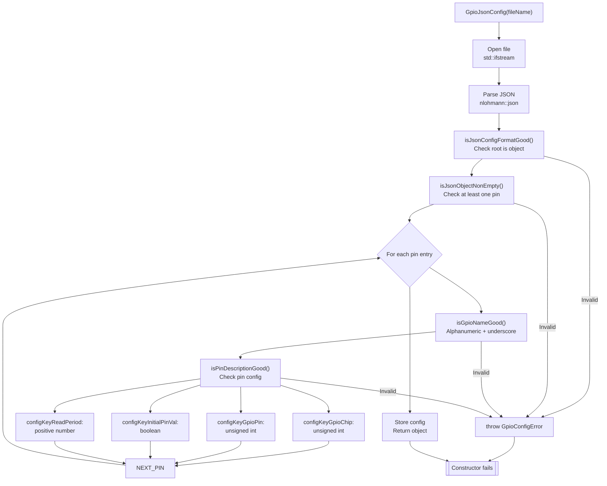

**Validation Rules:**

| Field | Type | Constraints | Constant |
|-------|------|-------------|----------|
| Pin name (key) | `string` | Non-empty, alphanumeric + `_` | - |
| `gpio_chip` | `unsigned int` | Valid chip number | `configKeyGpioChip` ([gpio_json_config.cpp:22]()) |
| `gpio_pin` | `unsigned int` | Valid pin offset | `configKeyGpioPin` ([gpio_json_config.cpp:23]()) |
| `initial` | `boolean` | Initial D-Bus property value | `configKeyInitialPinVal` ([gpio_json_config.cpp:24]()) |
| `read_period_sec` | `number` | Positive value (seconds) | `configKeyReadPeriod` ([gpio_json_config.cpp:25]()) |

**Sources:** [gpio_json_config.cpp:201-212](), [gpio_json_config.cpp:152-163](), [gpio_json_config.cpp:165-189](), [gpio_json_config.hpp:8-72]()

## D-Bus Service Registration

The daemon registers a single D-Bus service with one interface containing boolean properties for each configured GPIO pin. All properties are read-only from the client perspective.

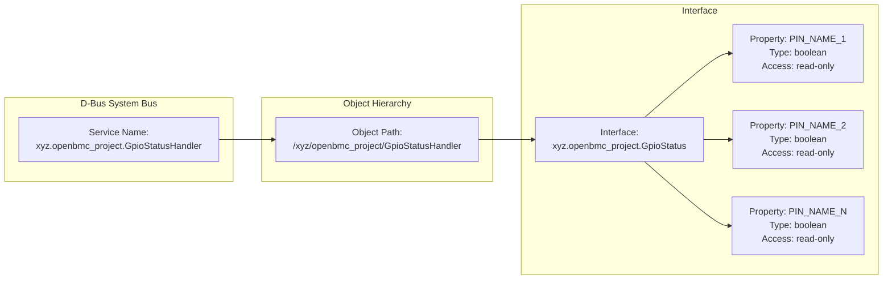

**Constants:**

- `dbusServiceName`: `"xyz.openbmc_project.GpioStatusHandler"` ([gpio_status_handler.cpp:26]())
- `dbusObjectPath`: `"/xyz/openbmc_project/GpioStatusHandler"` ([gpio_status_handler.cpp:25]())
- `dbusInterfaceName`: `"xyz.openbmc_project.GpioStatus"` ([gpio_status_handler.cpp:27]())

Properties are created dynamically from the configuration via `register_property()` ([gpio_status_handler.cpp:373-375]()) with initial values from the `configKeyInitialPinVal` field.

**Sources:** [gpio_status_handler.cpp:25-27](), [gpio_status_handler.cpp:354-379]()

## Build Configuration Impact

The build system provides compile-time options that significantly affect the architecture's behavior. These options enable different deployment modes without code changes.

| Option | Effect on Architecture | Macro Defined |
|--------|------------------------|---------------|
| `debug_log=0-4` | Sets default log verbosity | `DEF_DBG_LEVEL` ([meson.build:34]()) |
| `sandbox_mode=enabled` | Enables x86-64 development builds | `SANDBOX_MODE` ([meson.build:39]()) |
| `log_elapsed_time=enabled` | Adds performance instrumentation | `LOG_ELAPSED_TIME` ([meson.build:43]()) |

**Conditional Compilation:**

- `ENABLE_GSH_LOGS`: Activated when `debug_log > 0`, controls logging calls ([gpio_status_handler.cpp:45-47]())
- `SANDBOX_MODE`: Allows host system development without BMC hardware
- EINJ mode: Always available, activated by creating `/tmp/devices/gpio/` files ([gpio_status_handler.cpp:103-111]())

**Sources:** [meson.build:31-44](), [meson_options.txt:1-21]()

## Dependency Graph

The executable depends on several external libraries, each serving a specific architectural role.

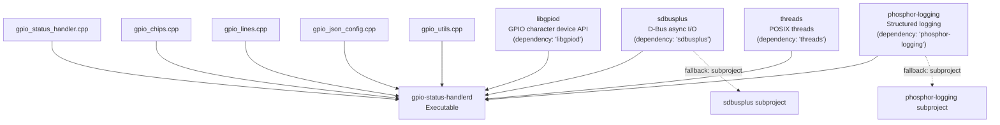

**Dependency Resolution:**

All dependencies support Meson subproject fallback ([meson.build:64-87]()), allowing the build system to fetch and build them locally if not found on the system.

**Sources:** [meson.build:62-105]()

---

# Page: System Components

# System Components

<details>
<summary>Relevant source files</summary>

The following files were used as context for generating this wiki page:

- [.clang-format](.clang-format)
- [gpio_json_config.cpp](gpio_json_config.cpp)
- [gpio_json_config.hpp](gpio_json_config.hpp)
- [gpio_status_handler.cpp](gpio_status_handler.cpp)
- [meson.build](meson.build)
- [meson_options.txt](meson_options.txt)

</details>


This document describes the high-level architecture of the nvidia-gpio-status-handler daemon, identifying the major components, their responsibilities, and how they interact. For detailed information about the D-Bus service interface, see [D-Bus Service](#2.2). For threading model and event-driven monitoring implementation details, see [GPIO Monitoring Implementation](#2.3).

## Overview

The nvidia-gpio-status-handler is implemented as a single executable (`gpio-status-handlerd`) that consists of five C++ modules working together to monitor GPIO hardware and expose status via D-Bus. The system follows a layered architecture where configuration parsing leads to hardware abstraction, which then drives multi-threaded monitoring that updates D-Bus properties.

## Core Components

The system is composed of the following primary components:

| Component | Source Files | Primary Responsibility |
|-----------|-------------|------------------------|
| Main Orchestrator | [gpio_status_handler.cpp]() | Program entry point, thread management, D-Bus server lifecycle |
| Configuration Parser | [gpio_json_config.cpp](), [gpio_json_config.hpp]() | JSON configuration file parsing and validation |
| GPIO Chip Abstraction | gpio_chips.cpp, gpio_chips.hpp | Management of GPIO chip device handles |
| GPIO Line Abstraction | gpio_lines.cpp, gpio_lines.hpp | Management of individual GPIO line handles |
| Utility Functions | gpio_utils.cpp, gpio_utils.hpp | Logging helpers and shared functions |

Sources: [meson.build:94-105](), [gpio_status_handler.cpp:1-16]()

## Component Architecture

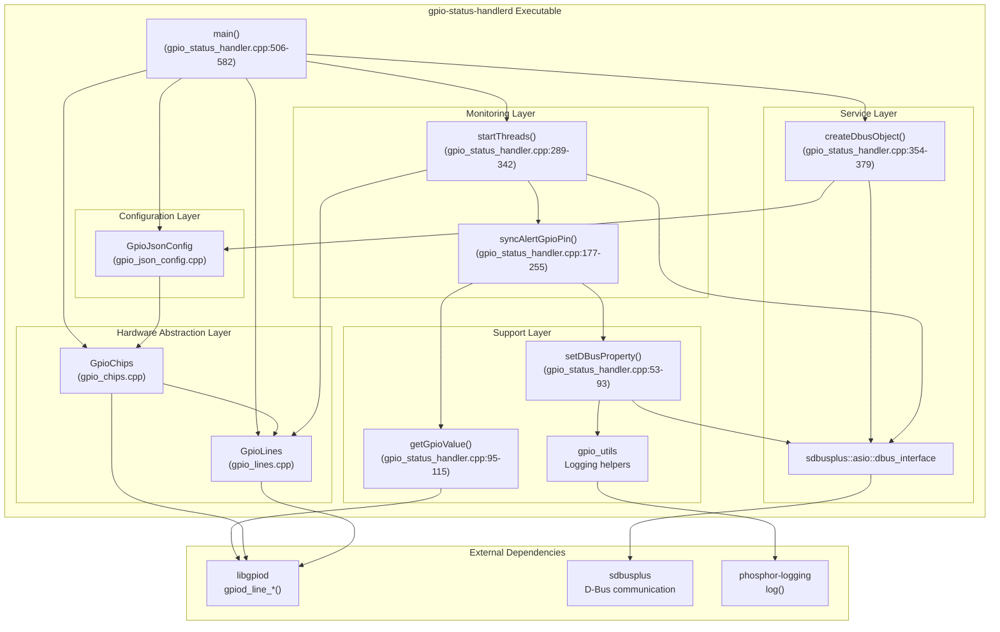

**Component Relationships and Data Flow**

This diagram maps system functionality directly to code entities. Each box references specific functions or classes that implement the component.

Sources: [gpio_status_handler.cpp:1-582](), [meson.build:94-105]()

## Component Responsibilities

### Main Orchestrator

The main orchestrator in [gpio_status_handler.cpp:506-582]() implements the program's entry point and coordinates the initialization sequence:

1. Parse JSON configuration file (creates `GpioJsonConfig` object)
2. Initialize D-Bus interface via `createDbusObject()`
3. Open GPIO chips (creates `GpioChips` object)
4. Request GPIO lines (creates `GpioLines` object)
5. Start monitoring threads via `startThreads()`
6. Run D-Bus I/O loop via `io.run()`
7. Wait for threads to complete via `finishThreads()`

The orchestrator also maintains global state including:
- `io` - boost::asio::io_context for D-Bus operations [gpio_status_handler.cpp:37]()
- `runThreads` - volatile flag controlling thread execution [gpio_status_handler.cpp:38]()
- `setDBusPropMutex` - mutex protecting D-Bus property updates [gpio_status_handler.cpp:39]()

Sources: [gpio_status_handler.cpp:506-582](), [gpio_status_handler.cpp:37-41]()

### Configuration Parser

The `GpioJsonConfig` class [gpio_json_config.hpp:33-72]() encapsulates configuration file parsing and validation. It reads JSON configuration defining:

| Configuration Key | Type | Purpose | Validation |
|-------------------|------|---------|------------|
| `gpio_chip` | unsigned int | GPIO chip number (e.g., 0 for /dev/gpiochip0) | Must be unsigned integer |
| `gpio_pin` | unsigned int | GPIO pin offset on chip | Must be unsigned integer |
| `initial` | boolean | Initial D-Bus property value before first read | Must be boolean |
| `read_period_sec` | positive number | Minimum polling period in seconds | Must be positive number |

The parser performs semantic validation beyond syntax checking, throwing `GpioConfigError` exceptions for malformed configurations [gpio_json_config.cpp:214-216](). Validation includes checking that GPIO names contain only alphanumeric characters and underscores [gpio_json_config.cpp:165-189]().

For complete JSON schema documentation, see [JSON Configuration Schema](#4.1).

Sources: [gpio_json_config.hpp:33-72](), [gpio_json_config.cpp:201-212]()

### GPIO Hardware Abstraction

The hardware abstraction layer consists of two classes that wrap libgpiod operations:

**GpioChips** - Manages GPIO chip device handles (`gpiod_chip_t*`), opening one `/dev/gpiochipN` device per unique chip specified in configuration. Responsible for maintaining chip handles for the daemon's lifetime.

**GpioLines** - Manages GPIO line handles (`gpiod_line_t*`), requesting lines from chips and configuring them for event monitoring. Creates a mapping from GPIO pin names to line handles stored in `dbusPropMapLineObj` [gpio_status_handler.cpp:291]().

Both classes follow RAII principles, ensuring proper resource cleanup through their destructors.

Sources: [gpio_status_handler.cpp:519-521](), [meson.build:97-98]()

### D-Bus Service Layer

The D-Bus service implementation uses sdbusplus to create a D-Bus object at a well-defined interface:

| D-Bus Element | Value | Source |
|---------------|-------|--------|
| Service Name | `xyz.openbmc_project.GpioStatusHandler` | [gpio_status_handler.cpp:26]() |
| Object Path | `/xyz/openbmc_project/GpioStatusHandler` | [gpio_status_handler.cpp:25]() |
| Interface Name | `xyz.openbmc_project.GpioStatus` | [gpio_status_handler.cpp:27]() |

The `createDbusObject()` function [gpio_status_handler.cpp:354-379]() registers one boolean property per GPIO pin defined in the configuration. All properties are read-only (`PropertyPermission::readOnly`) [gpio_status_handler.cpp:375]() and emit `PropertiesChanged` signals when updated.

The `setDBusProperty()` function [gpio_status_handler.cpp:53-93]() provides thread-safe property updates using `setDBusPropMutex` to serialize concurrent access from multiple monitoring threads.

Sources: [gpio_status_handler.cpp:25-27](), [gpio_status_handler.cpp:354-379]()

### Monitoring Layer

The monitoring layer implements a multi-threaded architecture where each configured GPIO pin is monitored by a dedicated thread:

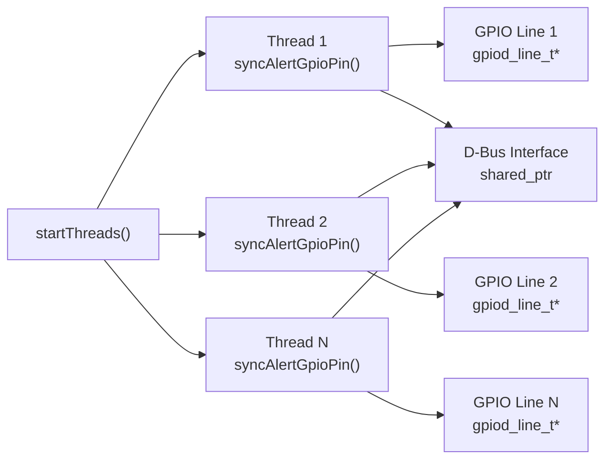

**Thread Creation and Management**

The `startThreads()` function [gpio_status_handler.cpp:289-342]() creates monitoring threads by iterating over `dbusPropMapLineObj` and spawning a thread for each entry [gpio_status_handler.cpp:330-332](). Each thread executes `syncAlertGpioPin()` with parameters including the GPIO line handle, D-Bus interface, and polling configuration.

The monitoring loop implements hybrid event-driven and polling monitoring using `gpiod_line_event_wait()` with a timeout defined by `lineEventWaitTimeoutNs` (100ms) [gpio_status_handler.cpp:35](). This balances responsiveness to GPIO events with periodic polling as a fallback mechanism.

For detailed monitoring implementation, see [GPIO Monitoring Implementation](#2.3).

Sources: [gpio_status_handler.cpp:289-342](), [gpio_status_handler.cpp:177-255]()

## System Initialization Sequence

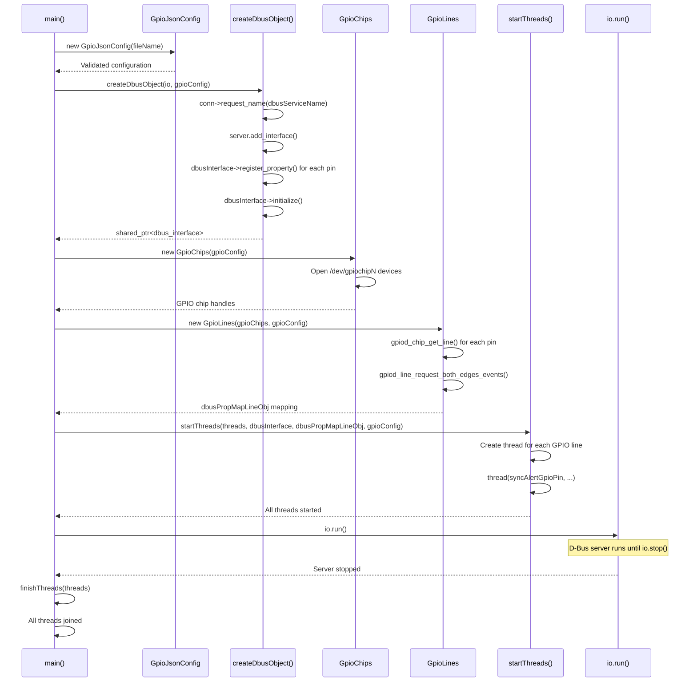

**Initialization Steps Mapped to Code**

Each step in the sequence corresponds to specific code locations in [gpio_status_handler.cpp:506-582]():

1. Configuration parsing: [gpio_status_handler.cpp:514]()
2. D-Bus object creation: [gpio_status_handler.cpp:516-517]()
3. GPIO chip opening: [gpio_status_handler.cpp:519]()
4. GPIO line requesting: [gpio_status_handler.cpp:521]()
5. Thread startup: [gpio_status_handler.cpp:524-525]()
6. D-Bus I/O loop: [gpio_status_handler.cpp:534]()
7. Thread cleanup: [gpio_status_handler.cpp:550]()

Sources: [gpio_status_handler.cpp:506-582]()

## Key Interfaces and Data Structures

### Inter-Component Data Passing

The following data structures facilitate communication between components:

**`dbusPropMapLineObj`** - A `map<string, gpiod_line_t*>` maintained by `GpioLines` that maps D-Bus property names (GPIO pin names) to libgpiod line handles. This is the primary data structure connecting the hardware abstraction layer to the monitoring layer [gpio_status_handler.cpp:291]().

**`gpioConfig.getConfig()`** - Returns `const nlohmann::json&` containing the parsed configuration, accessed by multiple components to retrieve pin-specific settings like `read_period_sec` [gpio_status_handler.cpp:310]().

**`dbusInterface`** - A `shared_ptr<sdbusplus::asio::dbus_interface>` passed to all monitoring threads, enabling thread-safe property updates via `set_property()` [gpio_status_handler.cpp:75]().

Sources: [gpio_status_handler.cpp:289-342](), [gpio_json_config.hpp:68]()

### EINJ Testing Mode

The system includes an error injection (EINJ) mode for testing without hardware. When files exist in `/tmp/devices/gpio/{pinName}`, the `getGpioValue()` function [gpio_status_handler.cpp:95-115]() reads from the filesystem instead of hardware:

```cpp
std::ifstream ifs("/tmp/devices/gpio/" + pinName);
if (ifs) {
    int value = 0;
    ifs >> value;
    return value;
}
// Otherwise read from HW
return gpiod_line_get_value(line);
```

This allows simulating GPIO state changes by writing to files, enabling integration testing without physical GPIO hardware. For more testing details, see [Testing and Debugging](#5.2).

Sources: [gpio_status_handler.cpp:95-115]()

## Build Configuration and Component Selection

The meson build system [meson.build]() allows conditional compilation of components based on build options:

| Build Option | Effect | Code Impact |
|--------------|--------|-------------|
| `debug_log` | Sets default log verbosity | Defines `DEF_DBG_LEVEL` macro [meson.build:31-37]() |
| `sandbox_mode` | Enables host development | Defines `SANDBOX_MODE` macro [meson.build:38-40]() |
| `api_stubs` | Uses mock GPIO APIs | Compiles stub implementations instead of real APIs |
| `log_elapsed_time` | Adds performance timing | Defines `LOG_ELAPSED_TIME` macro [meson.build:42-44]() |

These options enable building different variants of the same components for development vs. production deployment. For complete build configuration details, see [Build Options](#3.3).

Sources: [meson.build:30-44](), [meson_options.txt:1-21]()

## Component Dependencies

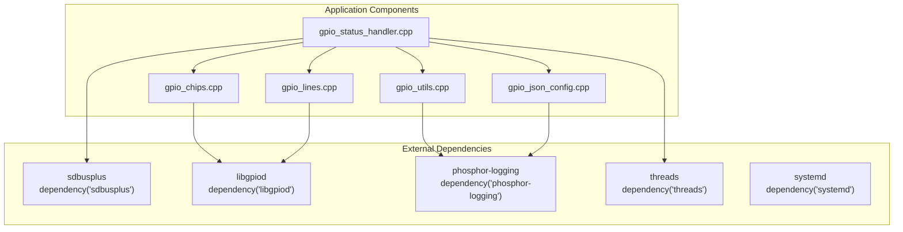

**Dependency Hierarchy**

All components link against the same set of external dependencies specified in [meson.build:62-105](). The dependency layer provides:

- **sdbusplus**: Asynchronous D-Bus communication via `sdbusplus::asio::*` classes
- **libgpiod**: GPIO hardware access via `gpiod_*()` C API functions
- **phosphor-logging**: Structured logging via `log<level::*>()` template functions
- **threads**: POSIX threads via `std::thread`
- **systemd**: Service management (not directly used in code, but required for deployment)

The build system uses fallback subprojects for dependencies not found on the system [meson.build:64-71]().

Sources: [meson.build:62-105]()

---

# Page: D-Bus Service

# D-Bus Service

<details>
<summary>Relevant source files</summary>

The following files were used as context for generating this wiki page:

- [.clang-format](.clang-format)
- [gpio_json_config.cpp](gpio_json_config.cpp)
- [gpio_json_config.hpp](gpio_json_config.hpp)
- [gpio_status_handler.cpp](gpio_status_handler.cpp)

</details>


## Purpose and Scope

This page documents the D-Bus service implementation that exposes GPIO pin states to OpenBMC system components. The service creates read-only boolean properties on the D-Bus system bus, with each property representing the current state of a configured GPIO pin. 

For information about the GPIO monitoring threads that update these properties, see [GPIO Monitoring Implementation](#2.3). For configuration of GPIO pins, see [JSON Configuration Schema](#4.1).

---

## Service Identification

The D-Bus service is identified by three constants that define its location on the system bus:

| Constant | Value | Purpose |
|----------|-------|---------|
| `dbusServiceName` | `xyz.openbmc_project.GpioStatusHandler` | Well-known service name requested on the system bus |
| `dbusObjectPath` | `/xyz/openbmc_project/GpioStatusHandler` | Object path where the interface is registered |
| `dbusInterfaceName` | `xyz.openbmc_project.GpioStatus` | Interface containing GPIO status properties |

These identifiers follow OpenBMC D-Bus naming conventions and enable clients to locate and interact with the service.

**Sources:** [gpio_status_handler.cpp:25-27]()

---

## D-Bus Service Architecture

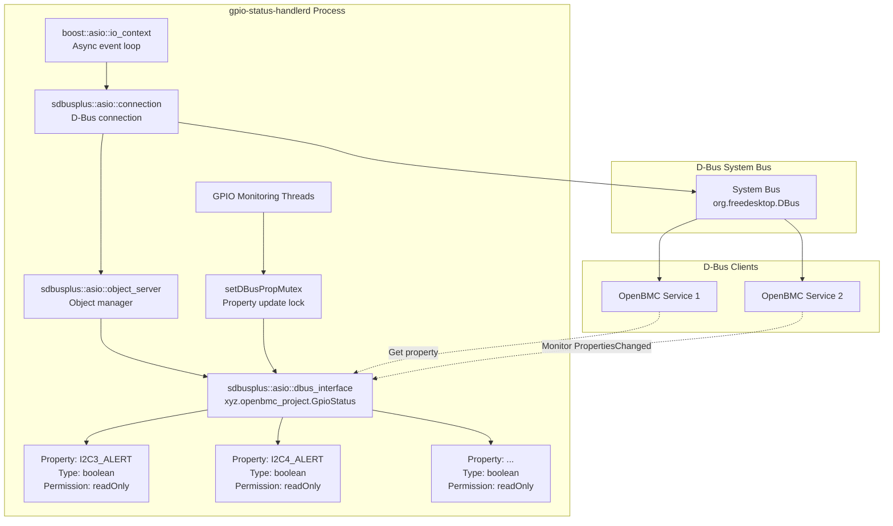

**D-Bus Service Component Structure**

The service architecture consists of multiple layers built on the `sdbusplus` library for asynchronous D-Bus communication.

**Sources:** [gpio_status_handler.cpp:37](), [gpio_status_handler.cpp:354-379]()

---

## Interface Creation and Initialization

The D-Bus interface is created by the `createDbusObject()` function during daemon startup:

```mermaid
sequenceDiagram
    participant MAIN as main()
    participant CREATE as createDbusObject()
    participant IO as io_context
    participant CONN as connection
    participant SERVER as object_server
    participant IFACE as dbus_interface
    participant CONFIG as GpioJsonConfig
    
    MAIN->>CREATE: Call with io, gpioConfig
    CREATE->>IO: Reference io_context
    CREATE->>CONN: Create connection(io)
    CREATE->>CONN: request_name(dbusServiceName)
    Note over CONN: Requests "xyz.openbmc_project.GpioStatusHandler"
    
    CREATE->>SERVER: Create object_server(conn)
    CREATE->>SERVER: add_interface(dbusObjectPath, dbusInterfaceName)
    Note over SERVER: Path: "/xyz/openbmc_project/GpioStatusHandler"<br/>Interface: "xyz.openbmc_project.GpioStatus"
    SERVER-->>IFACE: Returns interface pointer
    
    loop For each GPIO pin in config
        CREATE->>CONFIG: Get pin name and initial value
        CONFIG-->>CREATE: pinName, initialPinVal
        CREATE->>IFACE: register_property(pinName, initialPinVal, readOnly)
        Note over IFACE: Creates boolean property<br/>with initial value
    end
    
    CREATE->>IFACE: initialize()
    Note over IFACE: Publishes interface to D-Bus
    CREATE-->>MAIN: Returns dbus_interface pointer
```

**D-Bus Interface Initialization Sequence**

The initialization process creates a shared `dbus_interface` object that is later passed to all GPIO monitoring threads for property updates.

**Sources:** [gpio_status_handler.cpp:354-379](), [gpio_status_handler.cpp:516-517]()

---

## Property Registration

Properties are dynamically registered based on the JSON configuration file. Each GPIO pin defined in the configuration becomes a boolean property on the `xyz.openbmc_project.GpioStatus` interface.

### Registration Process

The `createDbusObject()` function iterates over the configuration and registers properties:

```cpp
// Pseudocode representation from gpio_status_handler.cpp:370-377
for (auto it = gpioConfig.getConfig().cbegin(); 
     it != gpioConfig.getConfig().cend(); ++it)
{
    string pinName = it.key();  // e.g., "I2C3_ALERT"
    bool initialValue = it.value()[configKeyInitialPinVal];
    
    dbusInterface->register_property(
        pinName, 
        initialValue,
        sdbusplus::asio::PropertyPermission::readOnly
    );
}
dbusInterface->initialize();
```

### Property Characteristics

| Characteristic | Value | Description |
|----------------|-------|-------------|
| Type | `boolean` | All properties are boolean type |
| Permission | `readOnly` | Properties cannot be modified by clients |
| Name | User-defined | Property name matches GPIO pin name from config |
| Initial Value | From config | Set to `initial` field from JSON before first GPIO read |
| Emits | `PropertiesChanged` | Signal sent automatically when property value changes |

**Sources:** [gpio_status_handler.cpp:370-377](), [gpio_json_config.hpp:42-45]()

---

## Property Update Mechanism

GPIO monitoring threads update D-Bus properties through the `setDBusProperty()` function, which ensures thread-safe updates:

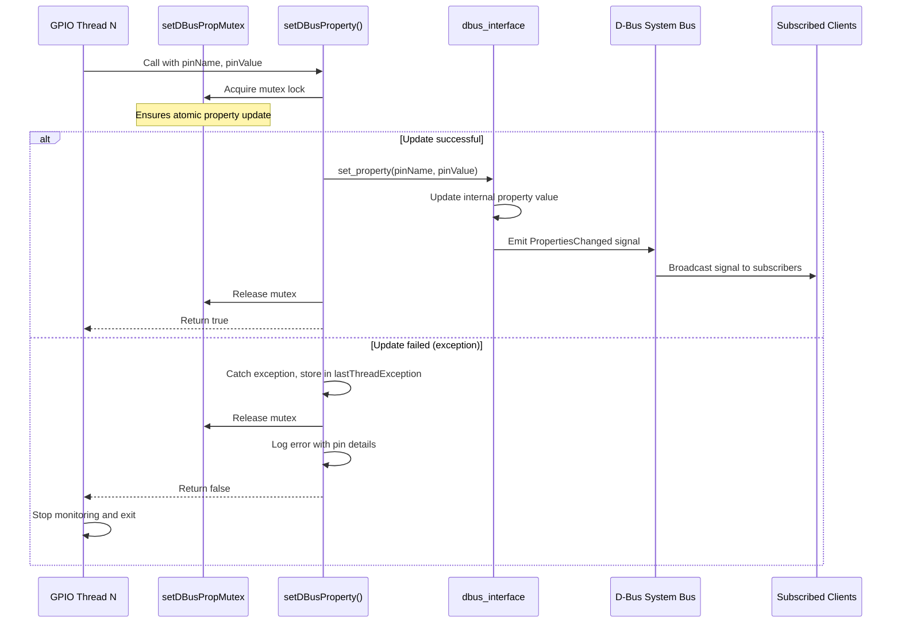

**Property Update Flow with Thread Safety**

The `setDBusPropMutex` ensures that only one thread can update properties at a time, preventing race conditions when multiple GPIO threads attempt simultaneous updates.

**Sources:** [gpio_status_handler.cpp:53-93](), [gpio_status_handler.cpp:39]()

---

## Thread Safety and Concurrency

The D-Bus service handles concurrent property updates from multiple GPIO monitoring threads through several mechanisms:

### Mutex Protection

The global `setDBusPropMutex` protects the critical section where properties are updated:

```cpp
// From gpio_status_handler.cpp:59-83
{
    lock_guard<mutex> lock(setDBusPropMutex);
    try
    {
        dbusInterface->set_property(pinName, pinValue);
        success = true;
    }
    catch (...)
    {
        lastThreadException = std::current_exception();
        success = false;
    }
}
```

### Exception Handling

Failed property updates are captured and stored in `lastThreadException`, allowing the main thread to retrieve and report errors after GPIO threads terminate.

### Asynchronous Architecture

The service uses `boost::asio::io_context` to manage the D-Bus event loop asynchronously. This allows the main thread to handle D-Bus messages while GPIO monitoring threads independently poll hardware and queue property updates.

**Sources:** [gpio_status_handler.cpp:39-41](), [gpio_status_handler.cpp:53-93](), [gpio_status_handler.cpp:381-395]()

---

## Client Interaction

OpenBMC services interact with GPIO status properties through standard D-Bus operations:

### Reading Property Values

Clients can query the current state of a GPIO pin:

```bash
# Using busctl to read a property
busctl get-property xyz.openbmc_project.GpioStatusHandler \
    /xyz/openbmc_project/GpioStatusHandler \
    xyz.openbmc_project.GpioStatus \
    I2C3_ALERT
```

Expected response: `b true` or `b false` (boolean value)

### Monitoring Property Changes

Clients can subscribe to `PropertiesChanged` signals to receive notifications when GPIO states change:

```bash
# Using busctl to monitor changes
busctl monitor --match="type='signal',\
interface='org.freedesktop.DBus.Properties',\
member='PropertiesChanged',\
path='/xyz/openbmc_project/GpioStatusHandler'"
```

### Introspection

The D-Bus interface can be introspected to discover available properties:

```bash
# Introspect the interface
busctl introspect xyz.openbmc_project.GpioStatusHandler \
    /xyz/openbmc_project/GpioStatusHandler \
    xyz.openbmc_project.GpioStatus
```

Example output:
```
NAME            TYPE      SIGNATURE RESULT/VALUE FLAGS
.I2C3_ALERT     property  b         false        emits-change
.I2C4_ALERT     property  b         false        emits-change
```

**Sources:** [gpio_status_handler.cpp:443-450]() (documentation comments)

---

## Service Lifecycle

```mermaid
stateDiagram-v2
    [*] --> Initialize: main() starts
    
    state Initialize {
        [*] --> ParseConfig
        ParseConfig: Read JSON config
        ParseConfig --> CreateDBus: Config valid
        CreateDBus: createDbusObject()
        CreateDBus --> RegisterProps
        RegisterProps: register_property() for each GPIO
        RegisterProps --> InitInterface
        InitInterface: initialize() interface
        InitInterface --> [*]
    }
    
    Initialize --> OpenGPIO: Config & D-Bus ready
    
    state OpenGPIO {
        [*] --> CreateChips
        CreateChips: Open /dev/gpiochipN
        CreateChips --> RequestLines
        RequestLines: Request GPIO lines
        RequestLines --> [*]
    }
    
    OpenGPIO --> Running: GPIO hardware ready
    
    state Running {
        [*] --> StartThreads
        StartThreads: startThreads()
        StartThreads --> IOLoop
        IOLoop: io.run() - D-Bus event loop
        
        state IOLoop {
            [*] --> WaitEvents
            WaitEvents: Process D-Bus messages
            WaitEvents --> WaitEvents: Handle client requests
        }
        
        state Parallel {
            MonitorGPIO: GPIO threads poll hardware
            UpdateProps: Threads call setDBusProperty()
            EmitSignals: D-Bus emits PropertiesChanged
        }
        
        IOLoop --> Parallel
        Parallel --> IOLoop
    }
    
    Running --> Shutdown: stopService() called
    
    state Shutdown {
        [*] --> StopIO
        StopIO: io.stop()
        StopIO --> SetFlag
        SetFlag: runThreads = false
        SetFlag --> JoinThreads
        JoinThreads: finishThreads()
        JoinThreads --> [*]
    }
    
    Shutdown --> [*]: Exit with threadsExitCode
```

**D-Bus Service Lifecycle State Machine**

The service progresses through initialization, operation, and shutdown phases. The D-Bus interface remains active throughout the `Running` state, processing client requests while GPIO threads update properties.

**Sources:** [gpio_status_handler.cpp:506-582]() (main function), [gpio_status_handler.cpp:43-51]() (stopService)

---

## Error Handling

The D-Bus service implements comprehensive error handling for property updates:

### Update Failures

When `set_property()` throws an exception:
1. The exception is caught and stored in `lastThreadException`
2. An error message is logged with pin details (chip name, pin number, pin name)
3. The function returns `false` to the calling thread
4. The monitoring thread detects the failure and calls `stopService(1)`
5. The main thread retrieves and displays the exception via `showLastThreadException()`

### Logging Integration

All D-Bus operations are logged through the `phosphor-logging` framework with structured fields:

- `GPIO_CHIP`: The chip name (e.g., "gpiochip0")
- `GPIO_PIN_NAME`: The property name (e.g., "I2C3_ALERT")
- `GPIO_PIN_NUM`: The pin number (e.g., 108)
- `EXCEPTION`: Exception details if applicable

**Sources:** [gpio_status_handler.cpp:78-92](), [gpio_status_handler.cpp:381-395]()

---

## Implementation Details

### Key Data Structures

```mermaid
classDiagram
    class io_context {
        <<boost::asio>>
        +run()
        +stop()
    }
    
    class connection {
        <<sdbusplus::asio>>
        +request_name(serviceName)
    }
    
    class object_server {
        <<sdbusplus::asio>>
        +add_interface(path, interface)
    }
    
    class dbus_interface {
        <<sdbusplus::asio>>
        +register_property(name, value, permission)
        +set_property(name, value)
        +initialize()
    }
    
    class GpioJsonConfig {
        +getConfig() nlohmann::json
    }
    
    io_context --> connection : creates
    connection --> object_server : creates
    object_server --> dbus_interface : creates
    dbus_interface ..> GpioJsonConfig : reads config from
```

**D-Bus Service Class Relationships**

**Sources:** [gpio_status_handler.cpp:8]() (includes), [gpio_status_handler.cpp:354-379]()

---

## Configuration to D-Bus Property Mapping

The service translates JSON configuration entries directly into D-Bus properties:

| JSON Config | D-Bus Property |
|-------------|----------------|
| Top-level key (e.g., `"I2C3_ALERT"`) | Property name |
| `"initial": false` | Initial property value before first GPIO read |
| `"gpio_chip": 0` | Used for logging, not exposed to D-Bus |
| `"gpio_pin": 108` | Used for logging, not exposed to D-Bus |
| `"read_period_sec": 0.5` | Determines update frequency, not exposed to D-Bus |

Example transformation:

```json
{
  "I2C3_ALERT": {
    "gpio_chip": 0,
    "gpio_pin": 108,
    "initial": false,
    "read_period_sec": 0.5
  }
}
```

Results in D-Bus property:
- Interface: `xyz.openbmc_project.GpioStatus`
- Property name: `I2C3_ALERT`
- Type: `boolean`
- Initial value: `false`
- Permission: `readOnly`

**Sources:** [gpio_status_handler.cpp:370-377](), [gpio_json_config.hpp:18-31]()

---

# Page: GPIO Monitoring Implementation

# GPIO Monitoring Implementation

<details>
<summary>Relevant source files</summary>

The following files were used as context for generating this wiki page:

- [.clang-format](.clang-format)
- [gpio_json_config.cpp](gpio_json_config.cpp)
- [gpio_json_config.hpp](gpio_json_config.hpp)
- [gpio_status_handler.cpp](gpio_status_handler.cpp)

</details>


This page explains the internal implementation of the GPIO monitoring subsystem, including the threading model, event detection mechanism, polling strategy, and how GPIO state changes propagate to D-Bus properties. For information about the D-Bus interface exposed to clients, see [D-Bus Service](#2.2). For build-time configuration options that affect monitoring behavior, see [Build Options](#3.3).

## Overview

The GPIO monitoring implementation uses a multi-threaded architecture where each configured GPIO pin is monitored by a dedicated thread. Each thread employs a hybrid event-driven and polling approach: it waits for GPIO line events using `libgpiod` primitives with a configurable timeout, ensuring both low-latency response to state changes and periodic validation of pin states. When a state change is detected, the monitoring thread updates the corresponding D-Bus property through a thread-safe update mechanism.

**Sources:** [gpio_status_handler.cpp:117-255]()

## Thread Architecture

### One Thread Per GPIO Pin

The system spawns exactly one monitoring thread for each GPIO pin defined in the JSON configuration. This design ensures that:

- Each pin can have an independent read period
- Blocking operations on one pin do not affect others
- The system scales naturally with the number of monitored pins

The `startThreads()` function creates all monitoring threads during initialization:

```mermaid
graph TD
    main["main()"]
    startThreads["startThreads()"]
    thread1["Thread 1<br/>syncAlertGpioPin()"]
    thread2["Thread 2<br/>syncAlertGpioPin()"]
    threadN["Thread N<br/>syncAlertGpioPin()"]
    
    main --> startThreads
    startThreads --> thread1
    startThreads --> thread2
    startThreads --> threadN
    
    thread1 -.-> gpio1["GPIO Pin 1<br/>gpiod_line_t*"]
    thread2 -.-> gpio2["GPIO Pin 2<br/>gpiod_line_t*"]
    threadN -.-> gpioN["GPIO Pin N<br/>gpiod_line_t*"]
```

**Diagram: Thread Creation Architecture**

Each thread receives:
- A shared pointer to the D-Bus interface (`sdbusplus::asio::dbus_interface`)
- A pointer to its GPIO line object (`gpiod_line_t*`)
- The pin's identifying information (chip name, pin name, pin number)
- The configured read period in ticks (`readPeriodTicks`)

**Sources:** [gpio_status_handler.cpp:289-342]()

### Thread Lifecycle Management

| Component | Role | File Location |
|-----------|------|---------------|
| `runThreads` | Global volatile boolean flag coordinating thread execution | [gpio_status_handler.cpp:38]() |
| `startThreads()` | Spawns all monitoring threads and sets `runThreads = true` | [gpio_status_handler.cpp:289-342]() |
| `finishThreads()` | Joins all threads after shutdown | [gpio_status_handler.cpp:264-277]() |
| `stopService()` | Sets `runThreads = false` and stops I/O context | [gpio_status_handler.cpp:43-51]() |

The threads coordinate via the shared `runThreads` flag. When any thread encounters a fatal error, it calls `stopService()`, which triggers all threads to exit their monitoring loops.

**Sources:** [gpio_status_handler.cpp:38-51](), [gpio_status_handler.cpp:264-342]()

## Monitoring Loop Implementation

### Core Loop: syncAlertGpioPin()

The `syncAlertGpioPin()` function implements the core monitoring logic for a single GPIO pin. It runs in an infinite loop until `runThreads` becomes false or an error occurs.

```mermaid
stateDiagram-v2
    [*] --> Initialize
    Initialize: Set timeout = lineEventWaitTimeoutNs
    Initialize: ticks = 0
    
    Initialize --> WaitForEvent
    
    WaitForEvent: gpiod_line_event_wait(line, &timeout)
    WaitForEvent --> CheckResult
    
    CheckResult --> ReadValue: Event detected (waitResult > 0)<br/>OR ticks == 0
    CheckResult --> IncrementTicks: Timeout (waitResult == 0)<br/>AND ticks > 0
    CheckResult --> Error: waitResult < 0
    
    ReadValue: lineGetResult = getGpioValue(line, pinName)
    ReadValue --> UpdateDBus: lineGetResult >= 0
    ReadValue --> Error: lineGetResult < 0
    
    UpdateDBus: setDBusProperty(pinName, lineGetResult != 0)
    UpdateDBus --> CheckSuccess
    
    CheckSuccess --> IncrementTicks: Success
    CheckSuccess --> Error: Failure
    
    IncrementTicks: ticks = (ticks + 1) % readPeriodTicks
    IncrementTicks --> CheckContinue
    
    CheckContinue --> WaitForEvent: runThreads == true
    CheckContinue --> [*]: runThreads == false
    
    Error --> StopService: Call stopService(1)
    StopService --> [*]
```

**Diagram: syncAlertGpioPin() State Machine**

The loop operates with these key variables:

| Variable | Type | Purpose |
|----------|------|---------|
| `waitResult` | `int` | Result from `gpiod_line_event_wait()`: -1=error, 0=timeout, 1=event |
| `lineGetResult` | `int` | Result from `getGpioValue()`: -1=error, 0=low, 1=high |
| `setDBusPropOk` | `bool` | Success status of D-Bus property update |
| `ticks` | `uint64_t` | Counter for implementing read period |

**Sources:** [gpio_status_handler.cpp:177-255]()

### Hybrid Event-Driven and Polling Mechanism

The monitoring implementation combines two strategies:

1. **Event-Driven**: Responds immediately when GPIO line state changes
2. **Periodic Polling**: Validates state at configured intervals even without events

This hybrid approach is visualized in the code comments at [gpio_status_handler.cpp:126-149]():

```
Timeline
GPIO line:                    state change
1                                    --------------------------------------
                                    /
0 ------------------------------------

Loop iterations                         timeout period
(no longer than timeout):                  <----->
  |-------|-------|-------|------|----|-------|-------|-------|------|-------

Readings:
  ^------------------------------^----^------------------------------^-------
  0                              0    1                              1
   <---------------------------->      <---------------------------->
         polling period                        polling period

DBus property:                  event detected
t                                    --------------------------------------
                                    /
f ------------------------------------
```

**Key Constants:**

- `lineEventWaitTimeoutNs = 1e8` (100 milliseconds) - Maximum wait time per `gpiod_line_event_wait()` call
- `readPeriodTicks` - Calculated as `readPeriodSec * 1e9 / lineEventWaitTimeoutNs`, minimum value of 1

**Sources:** [gpio_status_handler.cpp:35](), [gpio_status_handler.cpp:311-313]()

## GPIO Value Reading

### getGpioValue() Function

The `getGpioValue()` function provides the abstraction for reading GPIO pin state:

```mermaid
flowchart TD
    entry["getGpioValue(line, pinName)"]
    checkLine{"line != NULL?"}
    checkEINJ{"EINJ mode file exists?<br/>/tmp/devices/gpio/{pinName}"}
    readEINJ["Read value from file"]
    logEINJ["Log EINJ mode usage"]
    readHW["gpiod_line_get_value(line)"]
    returnVal["Return pin value"]
    throwErr["throw runtime_error"]
    
    entry --> checkLine
    checkLine -->|No| throwErr
    checkLine -->|Yes| checkEINJ
    checkEINJ -->|Yes| readEINJ
    readEINJ --> logEINJ
    logEINJ --> returnVal
    checkEINJ -->|No| readHW
    readHW --> returnVal
```

**Diagram: getGpioValue() Logic Flow**

This function supports two modes:

1. **Normal Mode**: Reads directly from hardware via `gpiod_line_get_value()`
2. **EINJ Mode**: Reads from filesystem at `/tmp/devices/gpio/{pinName}` for testing

The EINJ (Error Injection) mode allows testing without physical GPIO hardware. When the file exists, the function reads the simulated pin value and logs the operation.

**Sources:** [gpio_status_handler.cpp:95-115]()

## D-Bus Property Updates

### Thread-Safe Property Updates

The `setDBusProperty()` function updates D-Bus properties in a thread-safe manner using a mutex:

```mermaid
sequenceDiagram
    participant Thread as Monitoring Thread
    participant Mutex as setDBusPropMutex
    participant DBus as dbus_interface
    participant Log as phosphor-logging
    
    Thread->>Mutex: lock_guard<mutex> lock
    activate Mutex
    
    alt ENABLE_GSH_LOGS defined
        Thread->>Log: logPinOperation<INFO>()
    end
    
    Thread->>DBus: set_property(pinName, pinValue)
    
    alt Success
        DBus-->>Thread: Property updated
        Thread->>Thread: success = true
    else Exception
        DBus-->>Thread: Exception thrown
        Thread->>Thread: lastThreadException = current_exception()
        Thread->>Thread: success = false
    end
    
    Mutex->>Thread: Automatic unlock
    deactivate Mutex
    
    alt !success
        Thread->>Log: logPinOperation<ERR>()
    end
    
    Thread-->>Thread: return success
```

**Diagram: setDBusProperty() Execution Sequence**

The function takes these parameters:

| Parameter | Type | Description |
|-----------|------|-------------|
| `dbusInterface` | `shared_ptr<sdbusplus::asio::dbus_interface>` | Shared D-Bus interface object |
| `pinName` | `const string&` | Name of the property to update |
| `chipName` | `const string&` | GPIO chip name (for logging) |
| `pinNum` | `int` | GPIO pin number (for logging) |
| `pinValue` | `bool` | New pin state (true=high, false=low) |

**Critical Design Points:**

1. **Mutex Protection**: The `setDBusPropMutex` ensures only one thread updates D-Bus properties at a time
2. **Exception Handling**: All exceptions are caught and stored in `lastThreadException` to prevent thread termination
3. **Noexcept Guarantee**: The function is marked `noexcept` and never throws, always returning a success boolean

**Sources:** [gpio_status_handler.cpp:39](), [gpio_status_handler.cpp:53-93]()

### D-Bus Property Change Propagation

When `set_property()` succeeds, the `sdbusplus` library automatically:

1. Updates the property value in the D-Bus object
2. Emits a `PropertiesChanged` signal on the D-Bus system bus
3. Notifies all subscribed clients

This is handled internally by the `sdbusplus::asio::dbus_interface` object created in `createDbusObject()`.

**Sources:** [gpio_status_handler.cpp:354-379]()

## Error Handling and Shutdown

### Error Detection Points

The monitoring system detects errors at three critical points in the loop:

| Error Point | Detection | Response |
|-------------|-----------|----------|
| GPIO event wait failure | `gpiod_line_event_wait()` returns -1 | Log error with errno, exit loop |
| GPIO value read failure | `getGpioValue()` returns -1 | Log error with errno, exit loop |
| D-Bus update failure | `setDBusProperty()` returns false | Log error, exit loop |

All errors trigger the same shutdown sequence:

```mermaid
graph LR
    err["Error Detected"]
    check{"runThreads<br/>still true?"}
    stop["stopService(1)"]
    set["Set runThreads = false"]
    ioStop["io.stop()"]
    exitLoop["Exit monitoring loop"]
    
    err --> check
    check -->|Yes| stop
    stop --> set
    set --> ioStop
    check -->|No| exitLoop
    ioStop --> exitLoop
```

**Diagram: Error Handling Flow**

The `stopService()` function coordinates shutdown:
- Sets `threadsExitCode` to the provided exit code
- Sets `runThreads = false` to signal all threads
- Calls `io.stop()` to terminate the D-Bus I/O context

**Sources:** [gpio_status_handler.cpp:43-51](), [gpio_status_handler.cpp:200-254]()

### Exception Propagation

Exceptions from monitoring threads are captured and re-thrown in the main thread:

1. Any exception in `setDBusProperty()` is stored in `lastThreadException` ([gpio_status_handler.cpp:80]())
2. After all threads finish, `showLastThreadException()` is called ([gpio_status_handler.cpp:551]())
3. The stored exception is re-thrown and logged ([gpio_status_handler.cpp:381-395]())

This ensures exceptions don't terminate monitoring threads prematurely while still reporting errors to the main thread.

**Sources:** [gpio_status_handler.cpp:40](), [gpio_status_handler.cpp:78-82](), [gpio_status_handler.cpp:381-395]()

## Read Period Configuration

### Tick-Based Period Implementation

The read period specified in the JSON configuration (in seconds) is converted to a tick count:

```c++
uint64_t readPeriodTicks = max((uint64_t)1, 
    (uint64_t)(readPeriodSec * 1e9 / lineEventWaitTimeoutNs));
```

This calculation:
- Converts seconds to nanoseconds (`* 1e9`)
- Divides by the timeout period (`lineEventWaitTimeoutNs = 1e8 ns`)
- Ensures minimum of 1 tick

**Example Calculations:**

| `readPeriodSec` | Calculation | `readPeriodTicks` | Actual Period |
|-----------------|-------------|-------------------|---------------|
| 0.05 | 0.05 * 1e9 / 1e8 | 1 (min) | 0.1 seconds |
| 0.5 | 0.5 * 1e9 / 1e8 | 5 | 0.5 seconds |
| 4.0 | 4.0 * 1e9 / 1e8 | 40 | 4.0 seconds |

The tick counter wraps using modulo arithmetic:
```c++
ticks = (ticks + 1) % readPeriodTicks;
```

When `ticks == 0`, a GPIO read is triggered regardless of whether an event occurred.

**Sources:** [gpio_status_handler.cpp:308-313](), [gpio_status_handler.cpp:247]()

## Code Entity Mapping

### Key Functions and Their Roles

| Function | Location | Purpose |
|----------|----------|---------|
| `syncAlertGpioPin()` | [gpio_status_handler.cpp:177-255]() | Main monitoring loop executed by each thread |
| `startThreads()` | [gpio_status_handler.cpp:289-342]() | Creates one thread per GPIO pin |
| `finishThreads()` | [gpio_status_handler.cpp:264-277]() | Joins all threads during shutdown |
| `getGpioValue()` | [gpio_status_handler.cpp:95-115]() | Reads GPIO state (supports EINJ mode) |
| `setDBusProperty()` | [gpio_status_handler.cpp:53-93]() | Thread-safe D-Bus property update |
| `stopService()` | [gpio_status_handler.cpp:43-51]() | Coordinates graceful shutdown |
| `showLastThreadException()` | [gpio_status_handler.cpp:381-395]() | Reports captured thread exceptions |

### Global State Variables

| Variable | Type | Purpose |
|----------|------|---------|
| `io` | `boost::asio::io_context` | D-Bus event loop context |
| `runThreads` | `volatile bool` | Coordination flag for thread execution |
| `setDBusPropMutex` | `std::mutex` | Protects D-Bus property updates |
| `lastThreadException` | `exception_ptr` | Stores exception from monitoring threads |
| `threadsExitCode` | `int` | Exit code for the service |

**Sources:** [gpio_status_handler.cpp:37-41]()

## EINJ Mode for Testing

The EINJ (Error Injection) mode provides a filesystem-based GPIO simulator for testing without hardware. When enabled:

1. Create directory: `/tmp/devices/gpio/`
2. For each GPIO pin named `{pinName}`, create file: `/tmp/devices/gpio/{pinName}`
3. Write `0` or `1` to simulate low/high state
4. The monitoring thread reads from file instead of hardware

**Example:**
```bash
mkdir -p /tmp/devices/gpio
echo "1" > /tmp/devices/gpio/I2C3_ALERT
```

This causes the I2C3_ALERT property to read as `true` (high).

The EINJ mode check occurs in `getGpioValue()` before every hardware read, allowing dynamic enable/disable by creating/removing the file.

**Sources:** [gpio_status_handler.cpp:102-111]()

---

# Page: Building the Project

# Building the Project

<details>
<summary>Relevant source files</summary>

The following files were used as context for generating this wiki page:

- [README.md](README.md)
- [meson.build](meson.build)
- [meson_options.txt](meson_options.txt)

</details>


This page provides comprehensive guidance on compiling the `nvidia-gpio-status-handler` daemon from source using the Meson build system. It covers the build process overview, dependency management, compilation options, and the steps required to produce executable binaries for different deployment targets.

For detailed build system internals, see [Build System Overview](#3.1). For dependency documentation, see [Dependencies](#3.2). For configuration options, see [Build Options](#3.3). For step-by-step compilation instructions, see [Compilation Guide](#3.4).

## Build Process Overview

The `nvidia-gpio-status-handler` project uses the **Meson build system** with **Ninja** as the backend. The build is defined in [meson.build:1-106]() and produces a single executable named `gpio-status-handlerd`.

The build process follows this general workflow:

```mermaid
graph LR
    A["Source Files<br/>*.cpp"] --> B["meson builddir"]
    C["meson.build"] --> B
    D["meson_options.txt"] --> B
    B --> E["Build Configuration<br/>builddir/"]
    E --> F["ninja -C builddir"]
    F --> G["gpio-status-handlerd<br/>executable"]
    G --> H["ninja -C builddir install"]
    H --> I["/usr/bin/gpio-status-handlerd"]
    
    style B fill:#f9f9f9
    style F fill:#f9f9f9
    style H fill:#f9f9f9
```

**Sources:** [meson.build:1-106](), [README.md:22-28]()

## Build System Components

The build system consists of the following key files:

| File | Purpose | Key Content |
|------|---------|-------------|
| `meson.build` | Main build definition | Project metadata, dependencies, compilation rules |
| `meson_options.txt` | Configurable build options | `debug_log`, `sandbox_mode`, `log_elapsed_time` |
| `subprojects/` | Fallback dependencies | `sdbusplus.wrap`, `phosphor-logging.wrap` |

The project requires C++23 standard ([meson.build:7-8](), [meson.build:26-28]()) and enforces this requirement during configuration.

**Sources:** [meson.build:1-8](), [meson.build:26-28](), [meson_options.txt:1-21]()

## Compilation Targets

The build produces a single executable with different configurations depending on build options:

```mermaid
graph TD
    SRC["Source Files<br/>gpio_status_handler.cpp<br/>gpio_chips.cpp<br/>gpio_lines.cpp<br/>gpio_json_config.cpp<br/>gpio_utils.cpp"]
    
    SRC --> COMPILE["Compilation Process"]
    
    OPTS["Build Options<br/>-Ddebug_log<br/>-Dsandbox_mode<br/>-Dapi_stubs<br/>-Dlog_elapsed_time"]
    
    OPTS --> COMPILE
    
    DEPS["Dependencies<br/>sdbusplus<br/>libgpiod<br/>phosphor-logging<br/>threads<br/>systemd"]
    
    DEPS --> COMPILE
    
    COMPILE --> EXE["gpio-status-handlerd"]
    
    EXE --> DEV["Development Binary<br/>x86-64 host<br/>-Dsandbox_mode=enabled<br/>-Dapi_stubs=enabled<br/>-Ddebug_log=3"]
    
    EXE --> PROD["Production Binary<br/>ARM BMC target<br/>Real hardware APIs<br/>-Ddebug_log=1"]
```

**Sources:** [meson.build:94-105](), [README.md:34-38]()

## Build Configuration

Build behavior is controlled through three mechanisms:

### 1. Project Metadata
Defined in [meson.build:1-8]():
- **Project name:** `c++ nvidia-gpio-status-handler`
- **Language:** C++ (cpp)
- **Version:** 0.1
- **License:** MIT
- **Meson version requirement:** ≥1.1.1
- **C++ standard:** C++23

### 2. Compile-Time Options
Defined in [meson_options.txt:1-21]():

| Option | Type | Default | Description |
|--------|------|---------|-------------|
| `debug_log` | integer (0-4) | 0 | Default logging verbosity level |
| `sandbox_mode` | feature | auto | Enable host development mode |
| `log_elapsed_time` | feature | disabled | Enable performance instrumentation |

These options are processed in [meson.build:30-44]() and converted to preprocessor definitions.

### 3. Compiler Arguments
Global and project-specific arguments are set in [meson.build:22-44]():

```mermaid
graph TD
    OPT_DEBUG["debug_log option<br/>meson_options.txt:2-8"]
    OPT_SANDBOX["sandbox_mode option<br/>meson_options.txt:10-14"]
    OPT_TIME["log_elapsed_time option<br/>meson_options.txt:16-20"]
    
    OPT_DEBUG --> |"if != 0"| ARG_DEBUG["-DDEF_DBG_LEVEL=X<br/>meson.build:33-36"]
    OPT_SANDBOX --> |"if enabled"| ARG_SANDBOX["-DSANDBOX_MODE<br/>meson.build:38-40"]
    OPT_TIME --> |"if enabled"| ARG_TIME["-DLOG_ELAPSED_TIME<br/>meson.build:42-44"]
    
    ARG_DEBUG --> COMPILER["C++ Compiler"]
    ARG_SANDBOX --> COMPILER
    ARG_TIME --> COMPILER
    
    GLOBAL["-DSOME_TOKEN=value<br/>meson.build:23"] --> COMPILER
```

**Sources:** [meson.build:22-44](), [meson_options.txt:1-21]()

## Dependency Resolution

The build system uses a sophisticated dependency resolution mechanism that supports both system-installed libraries and fallback subprojects:

```mermaid
graph TD
    START["Build Process"] --> CHECK_SDBUS["Check for sdbusplus<br/>meson.build:64"]
    
    CHECK_SDBUS --> |"found"| SYSTEM_SDBUS["Use system sdbusplus"]
    CHECK_SDBUS --> |"not found"| SUBPROJ_SDBUS["Build from subproject<br/>meson.build:67"]
    
    SUBPROJ_SDBUS --> GET_VAR["Get sdbusplus_dep<br/>meson.build:70"]
    
    START --> CHECK_PLOG["Check for phosphor-logging<br/>meson.build:84-87"]
    CHECK_PLOG --> |"not found"| FALLBACK_PLOG["Use fallback subproject"]
    CHECK_PLOG --> |"found"| SYSTEM_PLOG["Use system phosphor-logging"]
    
    START --> CHECK_GPIO["Check for libgpiod<br/>meson.build:91"]
    CHECK_GPIO --> GPIO_DEP["gpio_device dependency"]
    
    START --> CHECK_THREADS["Check for threads<br/>meson.build:92"]
    CHECK_THREADS --> THREADS_DEP["threads dependency"]
    
    START --> CHECK_SYSTEMD["Check for systemd<br/>meson.build:62"]
    CHECK_SYSTEMD --> SYSTEMD_DEP["systemd_dep dependency"]
    
    SYSTEM_SDBUS --> LINK["Link executable<br/>meson.build:94-105"]
    GET_VAR --> LINK
    SYSTEM_PLOG --> LINK
    FALLBACK_PLOG --> LINK
    GPIO_DEP --> LINK
    THREADS_DEP --> LINK
    SYSTEMD_DEP --> LINK
```

**Sources:** [meson.build:62-92]()

## Executable Definition

The final executable is defined in [meson.build:94-105]():

```mermaid
graph LR
    subgraph "Source Files"
        SRC1["gpio_status_handler.cpp"]
        SRC2["gpio_chips.cpp"]
        SRC3["gpio_lines.cpp"]
        SRC4["gpio_json_config.cpp"]
        SRC5["gpio_utils.cpp"]
    end
    
    subgraph "Dependencies"
        DEP1["sdbusplus"]
        DEP2["gpio_device"]
        DEP3["phosphor_logging_dep"]
        DEP4["threads"]
    end
    
    SRC1 --> EXE["executable()<br/>gpio-status-handlerd"]
    SRC2 --> EXE
    SRC3 --> EXE
    SRC4 --> EXE
    SRC5 --> EXE
    
    DEP1 --> EXE
    DEP2 --> EXE
    DEP3 --> EXE
    DEP4 --> EXE
    
    EXE --> INSTALL["Install to bindir<br/>default: /usr/bin"]
```

**Sources:** [meson.build:94-105]()

## Quick Start Commands

Basic build commands for common scenarios:

| Scenario | Commands |
|----------|----------|
| **Standard build** | `meson builddir`<br/>`ninja -C builddir` |
| **Development build** | `meson builddir -Dsandbox_mode=enabled -Dapi_stubs=enabled -Ddebug_log=3`<br/>`ninja -C builddir` |
| **Production build** | `meson builddir -Ddebug_log=1`<br/>`ninja -C builddir`<br/>`ninja -C builddir install` |
| **Clean build** | `ninja -C builddir clean` |
| **Reconfigure** | `cd builddir && meson configure -Ddebug_log=2` |
| **Complete rebuild** | `rm -rf builddir`<br/>`meson builddir`<br/>`ninja -C builddir` |

**Sources:** [README.md:22-50](), [README.md:75-96]()

## Build Output

A successful build produces:

1. **Executable:** `builddir/gpio-status-handlerd`
2. **Installation path:** Determined by `get_option('prefix') + '/' + get_option('bindir')` ([meson.build:20]()), typically `/usr/bin/gpio-status-handlerd`

The binary size and behavior vary significantly based on build options:

| Configuration | Binary Characteristics |
|---------------|------------------------|
| Debug (level 3-4) | Larger binary, verbose logging, performance instrumentation available |
| Production (level 0-1) | Smaller binary, minimal logging, optimized for deployment |
| Sandbox mode | x86-64 target, no hardware dependencies |
| Hardware mode | ARM target, real GPIO/D-Bus APIs |

**Sources:** [meson.build:94-105](), [README.md:98-121]()

## Next Steps

- For build system architecture details, see [Build System Overview](#3.1)
- For dependency documentation and fallback mechanisms, see [Dependencies](#3.2)
- For comprehensive build option explanations, see [Build Options](#3.3)
- For step-by-step compilation instructions, see [Compilation Guide](#3.4)
- For runtime configuration after building, see [Configuration](#4)

---

# Page: Build System Overview

# Build System Overview

<details>
<summary>Relevant source files</summary>

The following files were used as context for generating this wiki page:

- [meson.build](meson.build)
- [meson_options.txt](meson_options.txt)

</details>


## Purpose and Scope

This page explains the Meson build system configuration for `nvidia-gpio-status-handler`, including the structure of build files, how build options are integrated, and how dependencies are resolved during compilation. This covers the build system's organization and mechanics, but not the step-by-step compilation process (see [Compilation Guide](#3.4)) or detailed build option effects (see [Build Options](#3.3)). For information about the external libraries and dependencies themselves, see [Dependencies](#3.2).

---

## Build System Technology

The project uses **Meson** as its build system, requiring version 1.1.1 or higher [meson.build:6](). Meson is a modern build system that provides fast configuration, native dependency management, and cross-compilation support—critical for OpenBMC environments where the build host (typically x86-64) differs from the target BMC architecture (typically ARM).

**Project Metadata:**

| Property | Value | Source |
|----------|-------|--------|
| Project Name | `c++ nvidia-gpio-status-handler` | [meson.build:1-2]() |
| Language | `cpp` | [meson.build:3]() |
| Version | `0.1` | [meson.build:4]() |
| License | MIT | [meson.build:5]() |
| C++ Standard | `c++23` | [meson.build:7]() |
| Minimum Meson | `1.1.1` | [meson.build:6]() |

The C++ standard is enforced at [meson.build:26-28](), where the build will fail with an error if a different standard is specified.

**Sources:** [meson.build:1-28]()

---

## Build File Structure

The build system consists of two primary files that define the compilation process:

```mermaid
graph TD
    MESON_BUILD["meson.build<br/>(Main Build Script)"]
    MESON_OPTIONS["meson_options.txt<br/>(Build Configuration Options)"]
    BUILDDIR["builddir/<br/>(Generated Build Directory)"]
    BINARY["builddir/gpio-status-handlerd<br/>(Compiled Executable)"]
    
    MESON_OPTIONS -->|"Read by<br/>get_option()"| MESON_BUILD
    MESON_BUILD -->|"Creates"| BUILDDIR
    BUILDDIR -->|"Contains"| BINARY
    
    subgraph "Configuration Phase"
        MESON_OPTIONS
        MESON_BUILD
    end
    
    subgraph "Build Phase"
        BUILDDIR
        BINARY
    end
```

**Build File Responsibilities:**

| File | Lines | Purpose |
|------|-------|---------|
| `meson.build` | 106 lines | Main build script defining project metadata, dependencies, compiler flags, and build targets |
| `meson_options.txt` | 22 lines | Declares user-configurable build options with types, ranges, and default values |

The configuration phase reads both files to generate the build directory, while the build phase uses the generated configuration to compile the executable.

**Sources:** [meson.build:1-106](), [meson_options.txt:1-22]()

---

## Project Configuration and Compiler Setup

### Global Compiler Arguments

The build system configures the C++ compiler through global arguments that affect all compilation units:

```mermaid
flowchart LR
    OPTIONS["Build Options<br/>(meson_options.txt)"]
    
    DEBUG_LOG["debug_log<br/>(integer 0-4)"]
    SANDBOX["sandbox_mode<br/>(feature)"]
    LOG_TIME["log_elapsed_time<br/>(feature)"]
    
    DEFINE_DEBUG["-DDEF_DBG_LEVEL=N"]
    DEFINE_SANDBOX["-DSANDBOX_MODE"]
    DEFINE_LOG_TIME["-DLOG_ELAPSED_TIME"]
    
    COMPILER["C++ Compiler<br/>(cxx)"]
    
    OPTIONS --> DEBUG_LOG
    OPTIONS --> SANDBOX
    OPTIONS --> LOG_TIME
    
    DEBUG_LOG -->|"if != 0"| DEFINE_DEBUG
    SANDBOX -->|"if enabled"| DEFINE_SANDBOX
    LOG_TIME -->|"if enabled"| DEFINE_LOG_TIME
    
    DEFINE_DEBUG --> COMPILER
    DEFINE_SANDBOX --> COMPILER
    DEFINE_LOG_TIME --> COMPILER
    
    COMPILER --> SOURCE_FILES["*.cpp files"]
```

The option-to-compiler-flag translation occurs at:
- **debug_log**: [meson.build:31-37]() - Sets `DEF_DBG_LEVEL` preprocessor macro
- **sandbox_mode**: [meson.build:38-40]() - Defines `SANDBOX_MODE` when enabled
- **log_elapsed_time**: [meson.build:42-44]() - Defines `LOG_ELAPSED_TIME` when enabled

A generic token (`-DSOME_TOKEN=value`) is also added at [meson.build:23](), though this appears to be a placeholder.

**Sources:** [meson.build:23-44](), [meson_options.txt:1-22]()

---

## Dependency Resolution Mechanism

The build system must resolve five external dependencies. For `sdbusplus` and `phosphor-logging`, it implements a **fallback subproject mechanism** that enables building without system-installed packages.

### Dependency Resolution Flow

```mermaid
flowchart TD
    START["dependency() call"]
    
    SYSTEM_SEARCH["Search system<br/>pkg-config"]
    FOUND{"Found in<br/>system?"}
    
    SUBPROJECT_REQUIRED{"Fallback<br/>specified?"}
    SUBPROJECT_BUILD["subproject() call<br/>Build from source"]
    SUBPROJECT_VAR["get_variable()<br/>Extract dependency"]
    
    SYSTEM_DEP["Use system<br/>dependency"]
    FINAL["Dependency available<br/>for linking"]
    
    START --> SYSTEM_SEARCH
    SYSTEM_SEARCH --> FOUND
    
    FOUND -->|"Yes"| SYSTEM_DEP
    FOUND -->|"No"| SUBPROJECT_REQUIRED
    
    SUBPROJECT_REQUIRED -->|"Yes"| SUBPROJECT_BUILD
    SUBPROJECT_REQUIRED -->|"No"| ERROR["Build fails"]
    
    SUBPROJECT_BUILD --> SUBPROJECT_VAR
    SUBPROJECT_VAR --> FINAL
    SYSTEM_DEP --> FINAL
```

### Dependency Declarations

**Simple Dependencies (No Fallback):**

```
systemd_dep = dependency('systemd')           [line 62]
gpio_device = dependency('libgpiod')          [line 91]
threads = dependency('threads')               [line 92]
```

These dependencies must be available in the system; the build fails if they're missing.

**Complex Dependencies (With Fallback):**

The `sdbusplus` dependency demonstrates the complete fallback pattern [meson.build:64-81]():

1. **Initial search** with `required: false` [meson.build:64]()
2. **Check if found or internal** [meson.build:66]()
3. **Build subproject** if needed [meson.build:67]()
4. **Extract dependency** from subproject [meson.build:70]()
5. **Extract tools** (`sdbus++`, `sdbus++-gen-meson`) [meson.build:73-81]()

The `phosphor-logging` dependency uses simplified syntax [meson.build:84-87]():

```
phosphor_logging_dep = dependency(
    'phosphor-logging',
    fallback: ['phosphor-logging', 'phosphor_logging_dep'],
)
```

This is equivalent to the manual `sdbusplus` pattern but more concise.

**Sources:** [meson.build:62-92]()

---

## Executable Target Definition

The final build target is the `gpio-status-handlerd` executable, defined at [meson.build:94-105]():

```mermaid
graph TB
    subgraph "Source Files"
        SRC1["gpio_status_handler.cpp"]
        SRC2["gpio_chips.cpp"]
        SRC3["gpio_lines.cpp"]
        SRC4["gpio_json_config.cpp"]
        SRC5["gpio_utils.cpp"]
    end
    
    subgraph "Dependencies"
        DEP1["sdbusplus"]
        DEP2["gpio_device<br/>(libgpiod)"]
        DEP3["phosphor_logging_dep"]
        DEP4["threads"]
    end
    
    EXECUTABLE["executable()<br/>'gpio-status-handlerd'"]
    
    INSTALL["Install to:<br/>prefix/bindir"]
    
    SRC1 --> EXECUTABLE
    SRC2 --> EXECUTABLE
    SRC3 --> EXECUTABLE
    SRC4 --> EXECUTABLE
    SRC5 --> EXECUTABLE
    
    DEP1 --> EXECUTABLE
    DEP2 --> EXECUTABLE
    DEP3 --> EXECUTABLE
    DEP4 --> EXECUTABLE
    
    EXECUTABLE --> INSTALL
```

**Executable Configuration:**

| Property | Value | Line |
|----------|-------|------|
| Target Name | `gpio-status-handlerd` | [meson.build:95]() |
| Source Files | 5 C++ files (handler, chips, lines, config, utils) | [meson.build:96-100]() |
| Include Directories | Implicit (project root) | [meson.build:101]() |
| Dependencies | sdbusplus, libgpiod, phosphor-logging, threads | [meson.build:102]() |
| Install Directory | `${prefix}/bin` | [meson.build:103]() |
| Install | Enabled | [meson.build:104]() |

The `implicit_include_directories: true` setting at [meson.build:101]() means the compiler automatically searches the project root for header files.

**Sources:** [meson.build:94-105]()

---

## Build Process Overview

The complete build process from configuration to installation:

```mermaid
stateDiagram-v2
    direction LR
    
    [*] --> ReadConfig
    
    state "Configuration Phase" as CONFIG {
        ReadConfig: Parse meson.build
        ReadOptions: Parse meson_options.txt
        ValidateStandard: Validate C++ Standard
        ResolveDeps: Resolve Dependencies
        GenerateBuild: Generate Build Files
        
        ReadConfig --> ReadOptions
        ReadOptions --> ValidateStandard
        ValidateStandard --> ResolveDeps
        ResolveDeps --> GenerateBuild
    }
    
    state "Compilation Phase" as BUILD {
        CompileUnits: Compile 5 C++ Files
        LinkExecutable: Link with Dependencies
        
        CompileUnits --> LinkExecutable
    }
    
    state "Installation Phase" as INSTALL {
        CopyBinary: Copy to bindir
    }
    
    CONFIG --> BUILD: ninja
    BUILD --> INSTALL: ninja install
    INSTALL --> [*]
```

**Phase Details:**

1. **Configuration Phase** (`meson setup builddir`):
   - Parses `meson.build` and `meson_options.txt`
   - Validates C++ standard requirement [meson.build:26-28]()
   - Resolves all dependencies [meson.build:62-92]()
   - Generates build files in `builddir/`

2. **Compilation Phase** (`ninja -C builddir`):
   - Compiles each source file with configured flags
   - Links object files with resolved dependencies
   - Produces `builddir/gpio-status-handlerd`

3. **Installation Phase** (`ninja -C builddir install`):
   - Copies executable to `${prefix}/bin/` [meson.build:103]()

**Sources:** [meson.build:1-106]()

---

## Build System Extension Points

The build system provides several extension mechanisms:

### Feature Map Framework

Lines [meson.build:50-60]() define a generic feature map framework:

```
feature_map = {}

foreach option_key, option_value : feature_map
    if (get_option(option_key).enabled())
        summary(option_key, option_value, section: 'Enabled Features')
        add_global_arguments(option_value, language: lang)
    endif
endforeach
```

This infrastructure allows adding new feature flags without modifying the iteration logic. Currently unused (`feature_map` is empty), but demonstrates extensibility.

### Dependency Addition

New dependencies can be added by:
1. Declaring them with `dependency()` [meson.build:62-92]()
2. Adding them to the `dependencies` array in `executable()` [meson.build:102]()
3. Optionally providing fallback subprojects for dependencies not universally available

### Source File Addition

New source files are automatically compiled when added to the `executable()` call [meson.build:96-100](). Header files are found via `implicit_include_directories: true` [meson.build:101]().

**Sources:** [meson.build:50-105]()

---

## Summary

The Meson build system for `nvidia-gpio-status-handler` provides:

- **Flexible configuration** through user-defined options in `meson_options.txt`
- **Robust dependency management** with fallback subprojects for OpenBMC-specific libraries
- **Simple target definition** with explicit source file and dependency lists
- **Cross-compilation support** via Meson's native toolchain handling
- **Extensibility** through feature maps and modular dependency declarations

The build configuration transforms three user-facing options (`debug_log`, `sandbox_mode`, `log_elapsed_time`) into preprocessor macros, resolves five dependencies (three with fallbacks), and compiles five source files into a single executable installed to the system binary directory.

**Sources:** [meson.build:1-106](), [meson_options.txt:1-22]()

---

# Page: Dependencies

# Dependencies

<details>
<summary>Relevant source files</summary>

The following files were used as context for generating this wiki page:

- [meson.build](meson.build)
- [meson_options.txt](meson_options.txt)

</details>


This page documents the external dependencies required to build and run `nvidia-gpio-status-handler`. It covers the purpose of each dependency, how they are declared in the Meson build system, and the fallback subproject mechanism that enables compilation when system packages are unavailable.

For information about build system configuration, see [Build System Overview](#3.1). For details on compile-time configuration options, see [Build Options](#3.3).

---

## Overview

The `gpio-status-handlerd` daemon depends on five external libraries and one system component. These dependencies are declared in [meson.build:62-92]() and linked into the final executable at [meson.build:94-105](). The build system uses Meson's dependency resolution with fallback subprojects to support both system-installed packages and locally-built alternatives.

**Dependency Summary Table**

| Dependency | Purpose | Meson Variable | Fallback Support |
|------------|---------|----------------|------------------|
| `systemd` | Service management integration | `systemd_dep` | No |
| `sdbusplus` | D-Bus communication and property management | `sdbusplus_dep` | Yes |
| `phosphor-logging` | Structured logging for OpenBMC | `phosphor_logging_dep` | Yes |
| `libgpiod` | GPIO hardware abstraction via character device | `gpio_device` | No |
| `threads` | POSIX threads for concurrent GPIO monitoring | `threads` | No |

Sources: [meson.build:62-92]()

---

## Dependency Architecture

The following diagram shows how dependencies are organized into functional layers and how they relate to system components.

```mermaid
graph TB
    subgraph "Application Binary"
        EXEC["gpio-status-handlerd<br/>executable"]
    end
    
    subgraph "Application Dependencies"
        SDBUSPLUS["sdbusplus<br/>D-Bus async I/O<br/>Property registration"]
        LIBGPIOD["libgpiod<br/>GPIO line access<br/>Event monitoring"]
        PHOSPHOR["phosphor-logging<br/>Log entries<br/>Error reporting"]
        THREADS["threads<br/>std::thread support<br/>POSIX pthreads"]
    end
    
    subgraph "Build-Time Dependencies"
        SYSTEMD["systemd<br/>Unit file installation<br/>systemd_dep"]
        SDBUSPP["sdbus++<br/>Code generation tool<br/>sdbusplusplus_prog"]
        SDBUSPP_GEN["sdbus++-gen-meson<br/>Build file generator<br/>sdbuspp_gen_meson_prog"]
    end
    
    subgraph "System Layer"
        DBUS_SYS["D-Bus System Bus<br/>/run/dbus/system_bus_socket"]
        GPIO_DEV["GPIO Character Device<br/>/dev/gpiochipN"]
        LOGGING_SYS["Journald<br/>systemd-journald"]
    end
    
    EXEC -->|links| SDBUSPLUS
    EXEC -->|links| LIBGPIOD
    EXEC -->|links| PHOSPHOR
    EXEC -->|links| THREADS
    
    EXEC -.->|service unit| SYSTEMD
    SDBUSPLUS -.->|uses| SDBUSPP
    SDBUSPLUS -.->|uses| SDBUSPP_GEN
    
    SDBUSPLUS --> DBUS_SYS
    LIBGPIOD --> GPIO_DEV
    PHOSPHOR --> LOGGING_SYS
```

Sources: [meson.build:62-105]()

---

## Core Dependencies

### sdbusplus

**Purpose**: Provides C++ bindings for D-Bus communication, enabling the daemon to expose GPIO status as D-Bus properties and send `PropertiesChanged` signals.

**Declaration**: [meson.build:64-71](), [meson.build:89]()

**Fallback Mechanism**: 
- Primary: System-installed `sdbusplus` package via `pkg-config`
- Fallback: Subproject in `subprojects/sdbusplus/`
- The build system declares `sdbusplus_dep` twice: once with explicit fallback handling and once using Meson's automatic fallback syntax

**Related Tools**:
- `sdbusplusplus_prog`: The `sdbus++` code generator ([meson.build:74-80]())
- `sdbuspp_gen_meson_prog`: The `sdbus++-gen-meson` build file generator ([meson.build:75-80]())

**Usage**: Linked into executable at [meson.build:102]()

The code checks if `sdbusplus_dep` is found as a system dependency or internal (subproject) type at [meson.build:66](). If not found, it retrieves the dependency from the subproject at [meson.build:70]().

Sources: [meson.build:64-81](), [meson.build:89]()

### libgpiod

**Purpose**: Provides a user-space library for interacting with GPIO lines via the Linux kernel's GPIO character device interface (`/dev/gpiochipN`). Abstracts low-level `ioctl` operations and provides event-driven monitoring.

**Declaration**: [meson.build:91]()

```
gpio_device = dependency('libgpiod')
```

**Fallback Mechanism**: None. This dependency must be available as a system package.

**Usage**: Linked into executable at [meson.build:102]()

**Key Features Used**:
- GPIO line request and configuration
- Event-driven monitoring via `gpiod_line_event_wait()`
- Pin value reads

Sources: [meson.build:91]()

### phosphor-logging

**Purpose**: Provides structured logging capabilities integrated with OpenBMC's logging infrastructure. Enables log entries to be written to the systemd journal with appropriate severity levels and metadata.

**Declaration**: [meson.build:84-87]()

```
phosphor_logging_dep = dependency(
    'phosphor-logging',
    fallback: ['phosphor-logging', 'phosphor_logging_dep'],
)
```

**Fallback Mechanism**:
- Primary: System-installed `phosphor-logging` package
- Fallback: Subproject in `subprojects/phosphor-logging/`, exporting `phosphor_logging_dep`

**Usage**: Linked into executable at [meson.build:102]()

**Integration**: The daemon uses this library to log GPIO state changes, configuration errors, and operational status at various verbosity levels controlled by build-time and runtime options (see [Logging Configuration](#4.3)).

Sources: [meson.build:84-87]()

### threads

**Purpose**: Provides POSIX thread support for spawning concurrent GPIO monitoring threads. Each configured GPIO pin gets its own monitoring thread.

**Declaration**: [meson.build:92]()

```
threads = dependency('threads')
```

**Fallback Mechanism**: None. This is a standard system dependency provided by the C++ standard library and POSIX runtime.

**Usage**: Linked into executable at [meson.build:102]()

**Architecture Impact**: The daemon spawns one thread per GPIO line (see [GPIO Monitoring Implementation](#2.3)). Thread synchronization is handled by the D-Bus library's asynchronous property update mechanism.

Sources: [meson.build:92]()

### systemd

**Purpose**: Provides metadata for systemd service integration, particularly the installation paths for unit files.

**Declaration**: [meson.build:62]()

```
systemd_dep = dependency('systemd')
```

**Fallback Mechanism**: None. This dependency is required for OpenBMC deployment.

**Usage**: Not linked into the executable. Used only for build-time configuration to determine systemd unit file installation paths. The daemon is managed by systemd at runtime (see [Deployment to OpenBMC](#6)).

Sources: [meson.build:62]()

---

## Dependency Resolution Flow

The following diagram illustrates how the Meson build system resolves dependencies, showing the fallback mechanism for `sdbusplus` and `phosphor-logging`.

```mermaid
flowchart TD
    START["meson.build execution"]
    
    SYSTEMD["systemd_dep = dependency('systemd')"]
    
    SDBUSPLUS_CHECK{"sdbusplus_dep found<br/>as system package?"}
    SDBUSPLUS_SYS["Use system sdbusplus"]
    SDBUSPLUS_SUBPROJ["sdbusplus_proj = subproject('sdbusplus')"]
    SDBUSPLUS_GET["sdbusplus_dep =<br/>sdbusplus_proj.get_variable('sdbusplus_dep')"]
    
    TOOLS_CHECK{"sdbusplus_proj.found()?"}
    TOOLS_SUBPROJ["Get tools from subproject:<br/>sdbusplusplus_prog<br/>sdbuspp_gen_meson_prog"]
    TOOLS_SYSTEM["Find system tools:<br/>find_program('sdbus++')<br/>find_program('sdbus++-gen-meson')"]
    
    PHOSPHOR["phosphor_logging_dep =<br/>dependency('phosphor-logging',<br/>fallback=['phosphor-logging', 'phosphor_logging_dep'])"]
    
    SDBUSPLUS2["sdbusplus =<br/>dependency('sdbusplus',<br/>fallback=['sdbusplus', 'sdbusplus_dep'])"]
    
    LIBGPIOD["gpio_device = dependency('libgpiod')"]
    THREADS["threads = dependency('threads')"]
    
    EXECUTABLE["gpio_status_handlerd = executable(<br/>dependencies: [sdbusplus, gpio_device,<br/>phosphor_logging_dep, threads])"]
    
    START --> SYSTEMD
    SYSTEMD --> SDBUSPLUS_CHECK
    
    SDBUSPLUS_CHECK -->|"found() == true<br/>type_name() != 'internal'"| SDBUSPLUS_SYS
    SDBUSPLUS_CHECK -->|"not found() or<br/>type_name() == 'internal'"| SDBUSPLUS_SUBPROJ
    
    SDBUSPLUS_SYS --> TOOLS_CHECK
    SDBUSPLUS_SUBPROJ --> SDBUSPLUS_GET
    SDBUSPLUS_GET --> TOOLS_CHECK
    
    TOOLS_CHECK -->|Yes| TOOLS_SUBPROJ
    TOOLS_CHECK -->|No| TOOLS_SYSTEM
    
    TOOLS_SUBPROJ --> PHOSPHOR
    TOOLS_SYSTEM --> PHOSPHOR
    
    PHOSPHOR --> SDBUSPLUS2
    SDBUSPLUS2 --> LIBGPIOD
    LIBGPIOD --> THREADS
    THREADS --> EXECUTABLE
```

Sources: [meson.build:62-105]()

---

## Dependency Integration in Executable

The final executable is built by linking all runtime dependencies. The build declaration at [meson.build:94-105]() shows this integration:

```
gpio_status_handlerd = executable(
    'gpio-status-handlerd',
    'gpio_status_handler.cpp',
    'gpio_chips.cpp',
    'gpio_lines.cpp',
    'gpio_json_config.cpp',
    'gpio_utils.cpp',
    implicit_include_directories: true,
    dependencies: [sdbusplus, gpio_device, phosphor_logging_dep, threads],
    install_dir: bindir,
    install: true,
)
```

**Note**: The `systemd_dep` is notably absent from the `dependencies` list because it is only used for build configuration, not runtime linking.

**Source Files and Dependencies Mapping**

| Source File | Primary Dependencies Used |
|-------------|---------------------------|
| `gpio_status_handler.cpp` | `sdbusplus`, `phosphor-logging`, `threads` |
| `gpio_chips.cpp` | `libgpiod`, `phosphor-logging` |
| `gpio_lines.cpp` | `libgpiod`, `phosphor-logging` |
| `gpio_json_config.cpp` | `phosphor-logging` |
| `gpio_utils.cpp` | `phosphor-logging` |

Sources: [meson.build:94-105]()

---

## Fallback Subproject Mechanism

The build system uses Meson's subproject feature to handle missing system dependencies. This enables compilation in environments where OpenBMC-specific packages are not available, such as developer workstations.

**Supported Fallbacks**

1. **sdbusplus**: Subproject at `subprojects/sdbusplus/`
   - Exports: `sdbusplus_dep`, `sdbusplusplus_prog`, `sdbuspp_gen_meson_prog`
   - Implementation: [meson.build:64-81]()

2. **phosphor-logging**: Subproject at `subprojects/phosphor-logging/`
   - Exports: `phosphor_logging_dep`
   - Implementation: [meson.build:84-87]()

**No Fallback Available**

The following dependencies must be available as system packages:
- `systemd`: Required for OpenBMC integration
- `libgpiod`: Standard Linux GPIO library
- `threads`: Standard POSIX/C++ threading support

**Subproject Directory Structure**

```
nvidia-gpio-status-handler/
├── meson.build
└── subprojects/
    ├── sdbusplus/
    │   └── meson.build (exports sdbusplus_dep)
    └── phosphor-logging/
        └── meson.build (exports phosphor_logging_dep)
```

When a system dependency is not found, Meson automatically searches for a matching subproject directory and builds it as part of the main build.

Sources: [meson.build:64-87]()

---

## Build-Time vs. Runtime Dependencies

The following table clarifies which dependencies are needed at different stages:

| Dependency | Build Time | Link Time | Runtime | Purpose |
|------------|------------|-----------|---------|---------|
| `systemd` | ✓ | ✗ | ✗ | Provides unit file installation paths |
| `sdbusplus` | ✓ | ✓ | ✓ | D-Bus communication library |
| `phosphor-logging` | ✓ | ✓ | ✓ | Logging framework |
| `libgpiod` | ✓ | ✓ | ✓ | GPIO hardware access |
| `threads` | ✓ | ✓ | ✓ | Thread support |
| `sdbus++` (tool) | ✓ | ✗ | ✗ | Code generation for D-Bus interfaces |
| `sdbus++-gen-meson` (tool) | ✓ | ✗ | ✗ | Build file generation |

**Runtime Environment Requirements**:
- D-Bus system bus must be available at `/run/dbus/system_bus_socket`
- GPIO character devices must exist at `/dev/gpiochipN`
- systemd journal must be available for log output

Sources: [meson.build:62-105]()

---

# Page: Build Options

# Build Options

<details>
<summary>Relevant source files</summary>

The following files were used as context for generating this wiki page:

- [README.md](README.md)
- [meson.build](meson.build)
- [meson_options.txt](meson_options.txt)

</details>


## Purpose and Scope

This page documents the compile-time configuration options available when building the nvidia-gpio-status-handler daemon. These options control logging verbosity, target architecture, and instrumentation features. Build options are set during the Meson configuration phase and affect the generated binary's behavior and capabilities.

For information about the overall build process and step-by-step compilation instructions, see [Compilation Guide](#3.4). For runtime configuration including command-line flags, see [Command-Line Options](#4.2).

## Available Build Options

The nvidia-gpio-status-handler build system provides three primary compile-time options defined in [meson_options.txt:1-21]():

| Option | Type | Default | Valid Values | Purpose |
|--------|------|---------|--------------|---------|
| `debug_log` | integer | `0` | `0` to `4` | Sets the default logging verbosity level compiled into the binary |
| `sandbox_mode` | feature | `auto` | `enabled`, `disabled`, `auto` | Enables development mode for host architecture without BMC hardware |
| `log_elapsed_time` | feature | `disabled` | `enabled`, `disabled` | Adds timing instrumentation to log output |

**Note:** The README.md documentation references an `api_stubs` option [README.md:36-37](), but this option is not present in the current [meson_options.txt](). This may indicate outdated documentation or a deprecated feature.

*Sources: meson_options.txt, README.md, meson.build*

## Build Option Processing Flow

```mermaid
graph TD
    USER["User Invokes meson"]
    OPTIONS["meson_options.txt"]
    MESON["meson.build"]
    
    subgraph "Option Processing"
        DEBUG_OPT["debug_log option<br/>line 2-8"]
        SANDBOX_OPT["sandbox_mode option<br/>line 10-14"]
        TIME_OPT["log_elapsed_time option<br/>line 16-20"]
    end
    
    subgraph "Preprocessor Defines"
        DEF_DBG["-DDEF_DBG_LEVEL=N<br/>line 34"]
        DEF_SANDBOX["-DSANDBOX_MODE<br/>line 39"]
        DEF_TIME["-DLOG_ELAPSED_TIME<br/>line 43"]
    end
    
    subgraph "Compilation"
        CPP["C++ Compiler"]
        BINARY["gpio-status-handlerd<br/>executable"]
    end
    
    USER -->|"-Ddebug_log=3"| MESON
    OPTIONS --> MESON
    
    MESON --> DEBUG_OPT
    MESON --> SANDBOX_OPT
    MESON --> TIME_OPT
    
    DEBUG_OPT -->|"get_option('debug_log')"| DEF_DBG
    SANDBOX_OPT -->|"get_option('sandbox_mode').enabled()"| DEF_SANDBOX
    TIME_OPT -->|"get_option('log_elapsed_time').enabled()"| DEF_TIME
    
    DEF_DBG -->|"add_project_arguments()"| CPP
    DEF_SANDBOX -->|"add_project_arguments()"| CPP
    DEF_TIME -->|"add_project_arguments()"| CPP
    
    CPP --> BINARY
```

*Sources: meson.build:30-44, meson_options.txt:1-21*

## debug_log Option

### Description

The `debug_log` option sets the default logging verbosity level that is compiled into the binary. This value becomes the initial log level when the daemon starts, though it can be overridden at runtime using the `-l` command-line flag (see [Logging Configuration](#4.3)).

### Configuration

**Option Definition:** [meson_options.txt:1-8]()
```
type: 'integer'
min: 0
max: 4
value: 0 (default)
```

**Build System Processing:** [meson.build:31-37]()
```
debug_log_level = get_option('debug_log')
if debug_log_level != 0
    add_project_arguments(
        '-DDEF_DBG_LEVEL=' + debug_log_level.to_string(),
        language: lang,
    )
endif
```

### Log Level Values

| Level | Value | Description | Use Case |
|-------|-------|-------------|----------|
| Disabled | `0` | No logging output | Development builds where logging is controlled entirely at runtime |
| Error | `1` | Error messages only (production default) | Production deployments; minimizes overhead |
| Warning | `2` | Errors + warnings | Integration testing |
| Debug | `3` | Errors + warnings + debug messages | Active development and troubleshooting |
| Info | `4` | All messages including informational | Maximum verbosity for detailed diagnostics |

*Sources: README.md:101-111, meson.build:31-37*

### Usage Examples

**Production Build (error logging only):**
```bash
$ meson builddir -Ddebug_log=1
$ ninja -C builddir
```

**Development Build (full debug output):**
```bash
$ meson builddir -Ddebug_log=3
$ ninja -C builddir
```

**OpenBMC Integration (specified in recipe):**
```
EXTRA_OEMESON += "-Ddebug_log=1"
```
*Referenced in: [README.md:113-116]()*

### Effects on Binary

When `debug_log != 0`, the preprocessor macro `DEF_DBG_LEVEL` is defined with the specified level. This affects:

1. **Default Log Level**: The daemon initializes with this verbosity level
2. **Compile-Time Optimization**: Some log statements may be optimized out if below the compiled level
3. **Runtime Override**: The `-l` flag can increase or decrease verbosity at startup

*Sources: meson.build:31-37, README.md:98-126*

## sandbox_mode Option

### Description

The `sandbox_mode` option enables compilation for host CPU architecture (typically x86-64) rather than the target BMC ARM architecture. This allows developers to build, run, and debug the daemon on their development workstation without requiring BMC hardware.

### Configuration

**Option Definition:** [meson_options.txt:9-14]()
```
type: 'feature'
value: 'auto' (default)
description: 'Sandbox mode enablement'
```

**Build System Processing:** [meson.build:38-40]()
```
if get_option('sandbox_mode').enabled()
    add_project_arguments('-DSANDBOX_MODE', language: lang)
endif
```

### Mode Comparison

| Aspect | Sandbox Mode Disabled | Sandbox Mode Enabled |
|--------|----------------------|---------------------|
| **Target Architecture** | ARM (BMC) | x86-64 (host) |
| **GPIO Hardware** | Real `/dev/gpiochipN` devices | Simulated or stub interfaces |
| **D-Bus Service** | System bus | Session bus (typically) |
| **Use Case** | Production/integration deployment | Local development and debugging |
| **Preprocessor Define** | (none) | `-DSANDBOX_MODE` |

*Sources: meson_options.txt:9-14, README.md:36-38*

### Usage Examples

**Enable Sandbox Mode:**
```bash
$ meson builddir -Dsandbox_mode=enabled
$ ninja -C builddir
```

**Explicitly Disable (BMC target):**
```bash
$ meson builddir -Dsandbox_mode=disabled
$ ninja -C builddir
```

**Auto Detection (default):**
```bash
$ meson builddir  # Uses 'auto', typically disables on OpenBMC SDK
$ ninja -C builddir
```

*Referenced in: [README.md:62-67]()*

### Code Impact

When `-DSANDBOX_MODE` is defined, source code can use conditional compilation to:

1. **Mock Hardware Access**: Use filesystem-based simulation instead of actual GPIO devices
2. **Adjust Service Names**: Connect to development D-Bus instances
3. **Enable Test Interfaces**: Activate EINJ (error injection) mode automatically

The specific code paths affected by this macro would be found in the implementation files (gpio_status_handler.cpp, gpio_chips.cpp, etc.).

*Sources: meson.build:38-40, high-level architecture diagrams*

## log_elapsed_time Option

### Description

The `log_elapsed_time` option adds timing instrumentation to log output, showing elapsed time measurements for operations. This is useful for performance profiling and identifying bottlenecks during development.

### Configuration

**Option Definition:** [meson_options.txt:15-20]()
```
type: 'feature'
value: 'disabled' (default)
description: 'Enable generation of the Elpased time logs'
```

**Build System Processing:** [meson.build:42-44]()
```
if get_option('log_elapsed_time').enabled()
    add_project_arguments('-DLOG_ELAPSED_TIME', language: lang)
endif
```

### Usage Examples

**Enable Timing Instrumentation:**
```bash
$ meson builddir -Dlog_elapsed_time=enabled
$ ninja -C builddir
```

**Disable (default):**
```bash
$ meson builddir  # log_elapsed_time defaults to disabled
$ ninja -C builddir
```

### Effects on Binary

When enabled, the `-DLOG_ELAPSED_TIME` preprocessor macro is defined. This causes:

1. **Timing Code Inclusion**: Performance measurement code is compiled in
2. **Log Format Changes**: Log messages include timestamp deltas
3. **Minimal Runtime Overhead**: Timing code only executes when logging is active
4. **Debug Aid**: Helps identify slow operations in GPIO monitoring or D-Bus updates

**Note:** This option is typically combined with `debug_log=3` or higher to see the timing information in the output.

*Sources: meson_options.txt:15-20, meson.build:42-44*

## Configuration Patterns for Different Environments

```mermaid
graph LR
    subgraph "Development Workstation"
        DEV_CONFIG["Configuration"]
        DEV_CMD["meson builddir<br/>-Dsandbox_mode=enabled<br/>-Ddebug_log=3<br/>-Dlog_elapsed_time=enabled"]
        DEV_RESULT["Binary Characteristics:<br/>• x86-64 architecture<br/>• SANDBOX_MODE defined<br/>• DEF_DBG_LEVEL=3<br/>• LOG_ELAPSED_TIME defined"]
        
        DEV_CONFIG --> DEV_CMD
        DEV_CMD --> DEV_RESULT
    end
    
    subgraph "Integration Testing"
        INT_CONFIG["Configuration"]
        INT_CMD["meson builddir<br/>-Dsandbox_mode=disabled<br/>-Ddebug_log=2"]
        INT_RESULT["Binary Characteristics:<br/>• ARM architecture<br/>• No SANDBOX_MODE<br/>• DEF_DBG_LEVEL=2<br/>• No LOG_ELAPSED_TIME"]
        
        INT_CONFIG --> INT_CMD
        INT_CMD --> INT_RESULT
    end
    
    subgraph "Production Deployment"
        PROD_CONFIG["Configuration"]
        PROD_CMD["OpenBMC Recipe:<br/>EXTRA_OEMESON +=<br/>'-Ddebug_log=1'"]
        PROD_RESULT["Binary Characteristics:<br/>• ARM architecture<br/>• No SANDBOX_MODE<br/>• DEF_DBG_LEVEL=1<br/>• No LOG_ELAPSED_TIME"]
        
        PROD_CONFIG --> PROD_CMD
        PROD_CMD --> PROD_RESULT
    end
```

*Sources: README.md:31-97, meson.build:30-44*

## Option Reconfiguration

For projects already configured with `meson builddir`, options can be changed without recreating the build directory.

### Viewing Current Options

```bash
$ cd builddir
$ meson configure
```

This displays all project options with their current and possible values [README.md:82-90]().

### Changing Options

```bash
$ cd builddir
$ meson configure -Ddebug_log=2 -Dlog_elapsed_time=enabled
$ cd ..
$ ninja -C builddir
```

Multiple options can be changed in a single command. After reconfiguration, rebuild with `ninja`.

*Sources: README.md:75-96*

## Preprocessor Macro Summary

The following table shows the direct mapping between build options and the C++ preprocessor macros they generate:

| Build Option | Condition | Preprocessor Macro | Value Format |
|--------------|-----------|-------------------|--------------|
| `debug_log=N` | `N != 0` | `DEF_DBG_LEVEL` | Integer value of N |
| `sandbox_mode=enabled` | Enabled | `SANDBOX_MODE` | Defined (no value) |
| `log_elapsed_time=enabled` | Enabled | `LOG_ELAPSED_TIME` | Defined (no value) |

These macros are added via `add_project_arguments()` in [meson.build:33-44]() and are available to all compilation units in the project.

*Sources: meson.build:30-44*

## Build Option Dependencies and Interactions

```mermaid
graph TD
    subgraph "Build Options"
        DEBUG_LOG["debug_log<br/>(integer 0-4)"]
        SANDBOX["sandbox_mode<br/>(feature)"]
        LOG_TIME["log_elapsed_time<br/>(feature)"]
    end
    
    subgraph "Typical Combinations"
        COMBO_DEV["Development:<br/>sandbox_mode=enabled<br/>debug_log=3<br/>log_elapsed_time=enabled"]
        COMBO_INT["Integration:<br/>sandbox_mode=disabled<br/>debug_log=2<br/>log_elapsed_time=disabled"]
        COMBO_PROD["Production:<br/>sandbox_mode=disabled<br/>debug_log=1<br/>log_elapsed_time=disabled"]
    end
    
    subgraph "Effects"
        ARCH["Target Architecture"]
        VERBOSITY["Logging Verbosity"]
        TIMING["Performance Metrics"]
        RUNTIME["Runtime Overrides"]
    end
    
    DEBUG_LOG --> COMBO_DEV
    SANDBOX --> COMBO_DEV
    LOG_TIME --> COMBO_DEV
    
    DEBUG_LOG --> COMBO_INT
    SANDBOX --> COMBO_INT
    
    DEBUG_LOG --> COMBO_PROD
    SANDBOX --> COMBO_PROD
    
    COMBO_DEV --> ARCH
    COMBO_DEV --> VERBOSITY
    COMBO_DEV --> TIMING
    
    COMBO_INT --> ARCH
    COMBO_INT --> VERBOSITY
    
    COMBO_PROD --> ARCH
    COMBO_PROD --> VERBOSITY
    
    VERBOSITY -.->|"-l flag"| RUNTIME
    
    style COMBO_DEV fill:#f9f9f9,stroke:#333
    style COMBO_INT fill:#f9f9f9,stroke:#333
    style COMBO_PROD fill:#f9f9f9,stroke:#333
```

### Independence

All build options are independent and can be combined in any valid way. There are no mandatory co-enablements or mutual exclusions.

### Recommended Combinations

- **Rapid Development**: Enable all options for maximum visibility
- **BMC Testing**: Disable sandbox, enable moderate logging
- **Production**: Minimal logging, no instrumentation, standard architecture

*Sources: High-level architecture diagram 2 and 5, meson.build:30-44*

## Relationship to Runtime Configuration

Build options set **default behavior** compiled into the binary. Runtime configuration can modify some of these behaviors:

| Build Option | Runtime Override | Override Mechanism |
|--------------|------------------|-------------------|
| `debug_log` | **Yes** | `-l <level>` command-line flag (see [Command-Line Options](#4.2)) |
| `sandbox_mode` | **No** | Must be set at compile-time; affects binary architecture |
| `log_elapsed_time` | **No** | Must be set at compile-time; timing code must be present |

The `debug_log` option provides compile-time defaults but can be overridden at every daemon invocation. Options that affect architecture or compiled code paths cannot be changed at runtime.

*Sources: README.md:98-126, meson.build:30-44*

---

# Page: Compilation Guide

# Compilation Guide

<details>
<summary>Relevant source files</summary>

The following files were used as context for generating this wiki page:

- [README.md](README.md)
- [meson.build](meson.build)
- [meson_options.txt](meson_options.txt)

</details>


## Purpose and Scope

This document provides step-by-step instructions for compiling the `nvidia-gpio-status-handler` daemon from source code. It covers environment setup, configuration, compilation, and installation procedures for both development and production environments.

For information about the underlying build system architecture, see [Build System Overview](#3.1). For details on available compile-time configuration options, see [Build Options](#3.3). For dependency requirements and the fallback subproject mechanism, see [Dependencies](#3.2).

---

## Prerequisites

### System Requirements

The following table lists supported platforms and required packages:

| Operating System | Build Tools | Additional Requirements |
|-----------------|-------------|------------------------|
| Ubuntu 20.04 | `g++`, `meson` (≥1.1.1), `ninja-build`, `pkg-config`, `autoconf`, `autoconf-archive`, `libtool-bin` | OpenBMC SDK (for BMC target builds) |
| Cygwin | `g++`, `meson` (≥1.1.1), `ninja-build`, `pkg-config`, `autoconf`, `autoconf-archive`, `libtool-bin` | OpenBMC SDK, manual package installation via [Cygwin setup utility](https://www.cygwin.com/setup-x86_64.exe) |
| Other Linux | C++23-capable compiler, `meson` (≥1.1.1), `ninja-build`, `pkg-config` | Development headers for dependencies |

**Compiler Requirements:**
- C++23 standard support (enforced at [meson.build:26-28]())
- GCC 11+ or Clang 15+ recommended

Sources: [README.md:6-20](), [meson.build:6-8](), [meson.build:26-28]()

### Required Dependencies

The build system requires the following runtime dependencies:

| Dependency | Purpose | Fallback Behavior |
|-----------|---------|------------------|
| `sdbusplus` | D-Bus communication library | Fetched as subproject if not found ([meson.build:64-71]()) |
| `libgpiod` | GPIO hardware abstraction | Must be installed system-wide ([meson.build:91]()) |
| `phosphor-logging` | Structured logging framework | Fetched as subproject if not found ([meson.build:84-87]()) |
| `threads` | POSIX threads support | System-provided ([meson.build:92]()) |
| `systemd` | Service management | System-provided ([meson.build:62]()) |

**Installation Methods:**

1. **Automated Setup (Linux):**
   ```bash
   sudo scripts/setup_bldenv
   ```
   This script installs all required packages and dependencies ([README.md:16-19]()).

2. **Manual Installation (Ubuntu/Debian):**
   ```bash
   sudo apt-get install g++ meson ninja-build pkg-config \
                        autoconf autoconf-archive libtool-bin \
                        libgpiod-dev libsystemd-dev
   ```

3. **OpenBMC SDK:**
   For cross-compilation to BMC targets, install the OpenBMC SDK following the [official instructions](https://github.com/openbmc/docs/blob/master/development/dev-environment.md#download-and-install-sdk) ([README.md:14]()).

Sources: [meson.build:62-92](), [README.md:6-19]()

---

## Basic Compilation Workflow

The compilation process follows a standard Meson workflow consisting of three phases: configuration, build, and installation.

### Compilation Process Overview

```mermaid
graph LR
    SRC["Source Code<br/>*.cpp, meson.build"]
    CONFIG["Configuration Phase<br/>meson builddir"]
    BUILD["Build Phase<br/>ninja -C builddir"]
    INSTALL["Installation Phase<br/>ninja -C builddir install"]
    BIN["Installed Binary<br/>/usr/bin/gpio-status-handlerd"]
    
    SRC --> CONFIG
    CONFIG --> BUILD
    BUILD --> INSTALL
    INSTALL --> BIN
    
    CONFIG -.->|"Validates"| DEPS["Dependencies<br/>sdbusplus, libgpiod,<br/>phosphor-logging"]
    CONFIG -.->|"Generates"| NINJA["build.ninja<br/>compile_commands.json"]
    BUILD -.->|"Compiles"| OBJS["Object Files<br/>*.cpp.o"]
    BUILD -.->|"Links"| EXE["gpio-status-handlerd<br/>executable"]
```

Sources: [meson.build:1-106](), [README.md:22-28]()

### Step 1: Configuration

Navigate to the source directory and run:

```bash
meson builddir
```

This command:
- Creates a `builddir` directory for build artifacts
- Validates the C++23 compiler ([meson.build:26-28]())
- Discovers system-installed dependencies ([meson.build:62-92]())
- Downloads missing dependencies as subprojects ([meson.build:64-87]())
- Generates `build.ninja` and compilation database

**Output artifacts:**
- `builddir/build.ninja` - Ninja build rules
- `builddir/compile_commands.json` - Compiler invocation database for IDEs
- `builddir/meson-info/` - Build metadata

Sources: [meson.build:1-106](), [README.md:25]()

### Step 2: Build

Compile the daemon:

```bash
ninja -C builddir
```

This command:
- Compiles five C++ source files: `gpio_status_handler.cpp`, `gpio_chips.cpp`, `gpio_lines.cpp`, `gpio_json_config.cpp`, `gpio_utils.cpp` ([meson.build:94-105]())
- Links against `sdbusplus`, `libgpiod`, `phosphor-logging`, and `threads` ([meson.build:102]())
- Produces the `gpio-status-handlerd` executable

**Build output location:**
- `builddir/gpio-status-handlerd` - Main executable

Sources: [meson.build:94-105](), [README.md:26]()

### Step 3: Installation (Optional)

Install the daemon to the system:

```bash
ninja -C builddir install
```

This command:
- Installs `gpio-status-handlerd` to `/usr/bin` (or custom `--prefix` location) ([meson.build:103-104]())
- Requires root privileges: `sudo ninja -C builddir install`

Sources: [meson.build:103-104](), [README.md:27]()

---

## Build Scenarios

Different deployment environments require different build configurations. The following sections detail three common scenarios.

### Development Build Configuration

```mermaid
graph TB
    DEV_CMD["meson builddir<br/>-Dsandbox_mode=enabled<br/>-Dapi_stubs=enabled<br/>-Ddebug_log=4"]
    
    subgraph "Build Flags Generated"
        SANDBOX["-DSANDBOX_MODE"]
        DEBUG["-DDEF_DBG_LEVEL=4"]
    end
    
    subgraph "Build Characteristics"
        ARCH["Target: x86-64 host<br/>(native architecture)"]
        STUBS["GPIO APIs: Stubbed<br/>(no hardware required)"]
        LOG["Logging: Maximum verbosity<br/>(all messages)"]
    end
    
    DEV_CMD --> SANDBOX
    DEV_CMD --> DEBUG
    SANDBOX --> ARCH
    SANDBOX --> STUBS
    DEBUG --> LOG
```

**Purpose:** Enables rapid development and debugging on x86-64 workstations without BMC hardware.

**Configuration command:**
```bash
meson builddir -Dsandbox_mode=enabled -Dapi_stubs=enabled -Ddebug_log=4
ninja -C builddir
```

**Effects:**
- `sandbox_mode=enabled`: Defines `SANDBOX_MODE` preprocessor macro ([meson.build:38-40]()), enabling x86-64 target compilation
- `api_stubs=enabled`: Enables stub implementations for APIs that require BMC hardware (see [Development Modes](#5.1))
- `debug_log=4`: Sets maximum compile-time log level ([meson.build:31-37]()), enabling all diagnostic output

**Runtime execution:**
```bash
./builddir/gpio-status-handlerd -l 3 -L /tmp/debug.log
```

Sources: [meson.build:31-44](), [README.md:56-67](), [meson_options.txt:1-20]()

### Integration Build Configuration

**Purpose:** Cross-compilation for ARM-based BMC targets with moderate logging for integration testing.

**Configuration command:**
```bash
# Source OpenBMC SDK environment
source /opt/openbmc-sdk/environment-setup-armv7ahf-neon-openbmc-linux-gnueabi

# Configure and build
meson builddir -Ddebug_log=2
ninja -C builddir
```

**Effects:**
- `sandbox_mode=auto`: Defaults to disabled for cross-compilation (no `SANDBOX_MODE` macro)
- `api_stubs=auto`: Defaults to disabled (real GPIO and D-Bus implementations)
- `debug_log=2`: Enables error and warning messages ([meson.build:31-37]())

**Cross-compilation details:**
- Compiler: ARM cross-toolchain from OpenBMC SDK
- Architecture: ARM Cortex-A series (BMC SoCs)
- Sysroot: Contains ARM-compiled dependencies

Sources: [README.md:14](), [meson.build:31-40](), [meson_options.txt:1-20]()

### Production Build Configuration

**Purpose:** Optimized binary for deployment to production BMC systems with minimal logging overhead.

**OpenBMC Recipe Configuration:**
```bitbake
EXTRA_OEMESON += "-Ddebug_log=1"
```

**Effects:**
- `debug_log=1`: Error-only logging ([meson.build:31-37]()), minimizing performance impact
- `sandbox_mode=disabled`: Production BMC target
- `api_stubs=disabled`: Full hardware integration
- `log_elapsed_time=disabled`: No performance instrumentation ([meson.build:42-44]())

**Build location:**
- Integrated into OpenBMC Yocto build system
- Cross-compiled during BMC image generation
- Installed to BMC root filesystem at `/usr/bin/gpio-status-handlerd`

Sources: [README.md:113-116](), [meson.build:31-44](), [meson_options.txt:1-20]()

---

## Build Configuration Management

### Viewing Current Configuration

For projects already configured, inspect build options:

```bash
cd builddir
meson configure
```

**Example output:**
```
Project options                Current Value                    Possible Values                  Description
  ---------------                -------------                    ---------------                  -----------
  api_stubs                      auto                             [enabled, disabled, auto]        Manager API stubs enablement
  sandbox_mode                   enabled                          [enabled, disabled, auto]        Sandbox mode enablement
  debug_log                      0                                [0, 1, 2, 3, 4]                  Default debug log Level
```

Sources: [README.md:76-90]()

### Modifying Configuration

Change options without reconfiguring from scratch:

```bash
cd builddir
meson configure -Ddebug_log=3 -Dsandbox_mode=disabled
ninja  # Rebuild with new settings
```

**Configuration persistence:**
- Options stored in `builddir/meson-private/coredata.dat`
- Persistent across incremental builds
- Overridden by explicit `-D` flags

Sources: [README.md:92-96]()

### Configuration-to-Compilation Mapping

```mermaid
graph TB
    subgraph "meson_options.txt"
        OPT1["debug_log<br/>type: integer<br/>range: 0-4"]
        OPT2["sandbox_mode<br/>type: feature<br/>values: enabled/disabled/auto"]
        OPT3["log_elapsed_time<br/>type: feature<br/>values: enabled/disabled"]
    end
    
    subgraph "meson.build Processing"
        PROC1["get_option('debug_log')<br/>→ add_project_arguments<br/>-DDEF_DBG_LEVEL=N"]
        PROC2["get_option('sandbox_mode')<br/>→ add_project_arguments<br/>-DSANDBOX_MODE"]
        PROC3["get_option('log_elapsed_time')<br/>→ add_project_arguments<br/>-DLOG_ELAPSED_TIME"]
    end
    
    subgraph "C++ Preprocessor"
        CPP1["#ifdef DEF_DBG_LEVEL<br/>Conditional logging"]
        CPP2["#ifdef SANDBOX_MODE<br/>Architecture selection"]
        CPP3["#ifdef LOG_ELAPSED_TIME<br/>Performance tracking"]
    end
    
    OPT1 --> PROC1
    OPT2 --> PROC2
    OPT3 --> PROC3
    
    PROC1 --> CPP1
    PROC2 --> CPP2
    PROC3 --> CPP3
```

Sources: [meson.build:31-44](), [meson_options.txt:1-20]()

---

## Cleaning Build Artifacts

### Incremental Clean

Remove compiled objects while preserving configuration:

```bash
ninja -C builddir clean
```

**Removes:**
- Object files (`*.o`)
- `gpio-status-handlerd` executable
- Intermediate build artifacts

**Preserves:**
- `build.ninja` and configuration
- Dependency subprojects
- Compilation database

Sources: [README.md:40-45]()

### Complete Clean

Erase all build artifacts and start fresh:

```bash
rm -rf builddir
```

**Use cases:**
- Switching between development and production configurations
- Resolving persistent build errors
- Clearing cached dependency detection

Sources: [README.md:47-50]()

### Uninstallation

Remove installed binaries:

```bash
ninja -C builddir uninstall
```

**Removes:**
- `/usr/bin/gpio-status-handlerd` (or custom prefix location)
- Requires original `builddir` directory for uninstall manifest

Sources: [README.md:44]()

---

## Verification

### Build Success Indicators

**Configuration phase:**
```
The Meson build system
Version: 1.1.1
Source dir: /path/to/nvidia-gpio-status-handler
Build dir: /path/to/nvidia-gpio-status-handler/builddir
Build type: native build
Project name: c++ nvidia-gpio-status-handler
Project version: 0.1
```

**Build phase:**
```
[1/6] Compiling C++ object gpio_status_handler.cpp.o
[2/6] Compiling C++ object gpio_chips.cpp.o
[3/6] Compiling C++ object gpio_lines.cpp.o
[4/6] Compiling C++ object gpio_json_config.cpp.o
[5/6] Compiling C++ object gpio_utils.cpp.o
[6/6] Linking target gpio-status-handlerd
```

Sources: [meson.build:94-105]()

### Testing the Executable

**Check binary exists:**
```bash
ls -lh builddir/gpio-status-handlerd
```

**Expected output:**
```
-rwxr-xr-x 1 user user 2.3M Jan 15 10:30 builddir/gpio-status-handlerd
```

**Verify runtime dependencies (Linux):**
```bash
ldd builddir/gpio-status-handlerd
```

**Expected shared library dependencies:**
- `libgpiod.so` (GPIO hardware abstraction)
- `libsdbusplus.so` (D-Bus communication)
- `libpthread.so` (Thread support)
- `libstdc++.so` (C++ standard library)

**Test execution (sandbox mode):**
```bash
./builddir/gpio-status-handlerd --help
```

For full runtime testing procedures, see [Testing and Debugging](#5.2).

Sources: [meson.build:102]()

---

## Troubleshooting

### Common Build Failures

#### C++ Standard Error

**Symptom:**
```
meson.build:27:0: ERROR: This project requires c++20 support c++17
```

**Cause:** Meson configured with incompatible C++ standard ([meson.build:26-28]())

**Resolution:**
```bash
rm -rf builddir
meson builddir  # Uses default_options: ['cpp_std=c++23']
```

#### Missing Dependencies

**Symptom:**
```
meson.build:91:0: ERROR: Dependency "libgpiod" not found
```

**Cause:** `libgpiod` not installed system-wide

**Resolution:**
```bash
# Ubuntu/Debian
sudo apt-get install libgpiod-dev

# Rebuild
ninja -C builddir
```

**Note:** `sdbusplus` and `phosphor-logging` are automatically fetched as subprojects if missing ([meson.build:64-87]()), but `libgpiod` requires manual installation.

#### Subproject Download Failures

**Symptom:**
```
ERROR: Failed to download subproject sdbusplus
```

**Cause:** Network connectivity issues or missing Git

**Resolution:**
```bash
# Ensure Git is installed
sudo apt-get install git

# Manually clone subprojects
mkdir -p subprojects
cd subprojects
git clone https://github.com/openbmc/sdbusplus.git
git clone https://github.com/openbmc/phosphor-logging.git

# Rebuild
cd ..
meson builddir
```

#### Compiler Not Found (Cross-compilation)

**Symptom:**
```
ERROR: C++ compiler not found
```

**Cause:** OpenBMC SDK environment not sourced

**Resolution:**
```bash
source /opt/openbmc-sdk/environment-setup-armv7ahf-neon-openbmc-linux-gnueabi
meson builddir --wipe
```

Sources: [meson.build:19](), [meson.build:91](), [meson.build:64-87]()

### Build Performance Optimization

#### Parallel Compilation

Leverage multiple CPU cores:

```bash
ninja -C builddir -j$(nproc)
```

**Effect:** Compiles multiple source files simultaneously

#### Incremental Builds

After modifying a single source file:

```bash
# Modify gpio_utils.cpp
ninja -C builddir
```

**Ninja automatically:**
- Detects changed files
- Recompiles only affected translation units
- Relinks the executable

**Rebuild time:** Typically <5 seconds for single-file changes

Sources: [README.md:26]()

### Debugging Build Issues

#### Verbose Build Output

See full compiler invocations:

```bash
ninja -C builddir -v
```

**Example output:**
```
c++ -Ibuilddir -I. -DDEF_DBG_LEVEL=4 -DSANDBOX_MODE -std=c++23 \
    -c gpio_status_handler.cpp -o builddir/gpio_status_handler.cpp.o
```

#### Inspect Compiler Flags

View preprocessor macros:

```bash
cd builddir
cat compile_commands.json | grep -o '\-D[A-Z_]*' | sort -u
```

**Expected macros:**
- `-DDEF_DBG_LEVEL=N` (if `debug_log > 0`)
- `-DSANDBOX_MODE` (if `sandbox_mode=enabled`)
- `-DLOG_ELAPSED_TIME` (if `log_elapsed_time=enabled`)

Sources: [meson.build:31-44]()

---

## Summary

The compilation workflow consists of three phases:

1. **Configuration** (`meson builddir`): Discovers dependencies and generates build rules
2. **Build** (`ninja -C builddir`): Compiles five C++ source files and links dependencies
3. **Installation** (`ninja -C builddir install`): Deploys to system directories

Three build scenarios are supported:
- **Development:** `sandbox_mode=enabled`, `api_stubs=enabled`, `debug_log=4`
- **Integration:** Cross-compilation with `debug_log=2`
- **Production:** OpenBMC recipe with `debug_log=1`

For information on runtime configuration and logging control, see [Configuration](#4).

Sources: [meson.build:1-106](), [meson_options.txt:1-20](), [README.md:1-126]()

---

# Page: Configuration

# Configuration

<details>
<summary>Relevant source files</summary>

The following files were used as context for generating this wiki page:

- [.clang-format](.clang-format)
- [README.md](README.md)
- [gpio_json_config.cpp](gpio_json_config.cpp)
- [gpio_json_config.hpp](gpio_json_config.hpp)
- [gpio_status_handler.cpp](gpio_status_handler.cpp)

</details>


## Overview

The `gpio-status-handlerd` daemon requires configuration to define which GPIO pins to monitor and how to monitor them. Configuration is provided through three mechanisms:

1. **JSON Configuration File** - Defines GPIO pins, their hardware locations, and monitoring parameters (required at startup)
2. **Command-Line Arguments** - Controls runtime behavior such as logging verbosity and output destination
3. **Build-Time Options** - Sets compile-time defaults for logging and operational modes

For detailed information on each mechanism, see:
- JSON file format and schema: [JSON Configuration Schema](#4.1)
- Runtime command-line flags: [Command-Line Options](#4.2)
- Logging system configuration: [Logging Configuration](#4.3)

For information about build system configuration and compilation options, see [Build Options](#3.3).

**Sources:** [gpio_status_handler.cpp:397-505](), [README.md:98-126]()

## Configuration Architecture

```mermaid
graph TB
    subgraph "Configuration Sources"
        JSON["JSON Configuration File<br/>(Required)"]
        CLI["Command-Line Arguments<br/>argc, argv"]
        BUILD["Build-Time Options<br/>meson -Ddebug_log=N"]
    end
    
    subgraph "Configuration Processing"
        MAIN["main()"]
        GPIOCONFIG["GpioJsonConfig"]
        VALIDATE["isJsonConfigFormatGood()"]
    end
    
    subgraph "Runtime Configuration State"
        CONFIG_OBJ["config<br/>(nlohmann::json)"]
        LOG_LEVEL["Logging Level<br/>Effective Priority"]
        PINS["Pin Definitions<br/>Map: pinName → GPIO spec"]
    end
    
    subgraph "Operational Components"
        DBUS["createDbusObject()"]
        CHIPS["GpioChips"]
        LINES["GpioLines"]
        THREADS["startThreads()"]
    end
    
    JSON -->|"fileName (argv[1])"| MAIN
    CLI -->|"argc, argv"| MAIN
    BUILD -->|"ENABLE_GSH_LOGS<br/>Compile-time default"| LOG_LEVEL
    
    MAIN -->|"GpioJsonConfig(fileName)"| GPIOCONFIG
    GPIOCONFIG -->|"Parse & Validate"| VALIDATE
    VALIDATE -->|"Success"| CONFIG_OBJ
    
    CLI -->|"-l, -L flags"| LOG_LEVEL
    
    CONFIG_OBJ -->|"getConfig()"| PINS
    PINS --> DBUS
    PINS --> CHIPS
    PINS --> LINES
    PINS --> THREADS
    
    LOG_LEVEL -.->|"Controls verbosity"| DBUS
    LOG_LEVEL -.->|"Controls verbosity"| THREADS
```

**Diagram: Configuration Flow from Sources to Runtime Components**

This diagram shows how configuration data flows from external sources through validation into the operational components of the daemon. The `GpioJsonConfig` class validates the JSON file format, while command-line arguments override logging defaults set at build time.

**Sources:** [gpio_status_handler.cpp:506-582](), [gpio_json_config.cpp:218-256]()

## Configuration File Specification

The daemon requires a JSON configuration file path as its first command-line argument. Without this argument, the program terminates with an error message.

```cpp
// From gpio_status_handler.cpp:506-582
int main(int argc, char* argv[])
{
    if (argc > 1)
    {
        string fileName = argv[1];
        GpioJsonConfig gpioConfig(fileName);
        // ... continue initialization
    }
    else
    {
        // Print error and exit
    }
}
```

### Configuration File Location

The configuration file path is specified as the first positional argument when invoking the daemon:

```bash
gpio-status-handlerd /path/to/config.json
```

**Sources:** [gpio_status_handler.cpp:506-582](), [README.md:1-126]()

## Configuration Properties

The following table summarizes the configuration properties defined in the JSON file:

| Property Key | JSON Type | Description | Validated By |
|--------------|-----------|-------------|--------------|
| `gpio_chip` | Unsigned Integer | GPIO chip number (e.g., 0 for `/dev/gpiochip0`) | `isJsonValueUnsignedInt()` |
| `gpio_pin` | Unsigned Integer | GPIO pin/line number on the specified chip | `isJsonValueUnsignedInt()` |
| `initial` | Boolean | Initial D-Bus property value before first hardware read | `isJsonValueBoolean()` |
| `read_period_sec` | Positive Number | Minimum polling interval in seconds (can be fractional) | `isJsonValuePositiveNumber()` |

**Property Key Constants:**

- `GpioJsonConfig::configKeyGpioChip` = `"gpio_chip"` ([gpio_json_config.cpp:22]())
- `GpioJsonConfig::configKeyGpioPin` = `"gpio_pin"` ([gpio_json_config.cpp:23]())
- `GpioJsonConfig::configKeyInitialPinVal` = `"initial"` ([gpio_json_config.cpp:24]())
- `GpioJsonConfig::configKeyReadPeriod` = `"read_period_sec"` ([gpio_json_config.cpp:25]())

**Sources:** [gpio_json_config.cpp:22-42](), [gpio_json_config.hpp:36-48]()

## JSON Configuration Validation

```mermaid
flowchart TD
    START["GpioJsonConfig(fileName)"]
    OPEN["Open JSON file<br/>std::ifstream"]
    PARSE["Parse JSON<br/>nlohmann::json"]
    CHECK_ROOT["isJsonValueObject()<br/>Check root is object"]
    CHECK_EMPTY["isJsonObjectNonEmpty()<br/>Verify non-empty"]
    ITERATE["Iterate over entries"]
    CHECK_NAME["isGpioNameGood()<br/>Validate pin name"]
    CHECK_DESC["isPinDescriptionGood()<br/>Validate pin properties"]
    CHECK_CHIP["isJsonPropertyGood()<br/>gpio_chip: unsigned int"]
    CHECK_PIN["isJsonPropertyGood()<br/>gpio_pin: unsigned int"]
    CHECK_INIT["isJsonPropertyGood()<br/>initial: boolean"]
    CHECK_PERIOD["isJsonPropertyGood()<br/>read_period_sec: positive number"]
    SUCCESS["config = jsonConfig<br/>Validation complete"]
    ERROR["throw GpioConfigError"]
    
    START --> OPEN
    OPEN -->|"File readable"| PARSE
    OPEN -->|"Cannot open"| ERROR
    PARSE -->|"Valid JSON syntax"| CHECK_ROOT
    PARSE -->|"Parse error"| ERROR
    CHECK_ROOT -->|"Is object"| CHECK_EMPTY
    CHECK_ROOT -->|"Not object"| ERROR
    CHECK_EMPTY -->|"Has entries"| ITERATE
    CHECK_EMPTY -->|"Empty"| ERROR
    ITERATE --> CHECK_NAME
    CHECK_NAME -->|"Valid name"| CHECK_DESC
    CHECK_NAME -->|"Invalid"| ERROR
    CHECK_DESC --> CHECK_CHIP
    CHECK_CHIP -->|"Valid"| CHECK_PIN
    CHECK_PIN -->|"Valid"| CHECK_INIT
    CHECK_INIT -->|"Valid"| CHECK_PERIOD
    CHECK_PERIOD -->|"Valid"| ITERATE
    CHECK_CHIP -->|"Invalid"| ERROR
    CHECK_PIN -->|"Invalid"| ERROR
    CHECK_INIT -->|"Invalid"| ERROR
    CHECK_PERIOD -->|"Invalid"| ERROR
    ITERATE -->|"All entries processed"| SUCCESS
    SUCCESS --> END["Return GpioJsonConfig object"]
```

**Diagram: JSON Configuration Validation Flow**

The validation process ensures that each GPIO pin definition contains all required properties with correct types. If validation fails at any step, a `GpioConfigError` exception is thrown, causing the daemon to terminate with an error message.

**Sources:** [gpio_json_config.cpp:201-256](), [gpio_json_config.cpp:78-163]()

## Configuration Example

The following example demonstrates a valid configuration file monitoring two GPIO pins:

```json
{
  "I2C3_ALERT" : {
    "gpio_chip" : 0,
    "gpio_pin" : 108,
    "initial" : false,
    "read_period_sec" : 0.5
  },
  "I2C4_ALERT" : {
    "gpio_chip" : 0,
    "gpio_pin" : 109,
    "initial" : false,
    "read_period_sec" : 4
  }
}
```

This configuration results in:
- Two D-Bus properties: `I2C3_ALERT` and `I2C4_ALERT` on the `xyz.openbmc_project.GpioStatus` interface
- Both pins monitored on `/dev/gpiochip0` (lines 108 and 109)
- `I2C3_ALERT` polled every 0.5 seconds minimum
- `I2C4_ALERT` polled every 4 seconds minimum
- Both properties initialized to `false` before first hardware read

**GPIO Pin Name Requirements:**
- Non-empty string
- Contains only alphanumeric characters (A-Z, a-z, 0-9) and underscores (`_`)
- Validated by `isGpioNameGood()` ([gpio_json_config.cpp:165-189]())

**Sources:** [gpio_status_handler.cpp:397-450](), [gpio_json_config.cpp:27-42]()

## Configuration Constants

The following constants are defined in the main daemon file:

| Constant | Value | Purpose | Line Reference |
|----------|-------|---------|----------------|
| `dbusObjectPath` | `"/xyz/openbmc_project/GpioStatusHandler"` | D-Bus object path for GPIO properties | [gpio_status_handler.cpp:25]() |
| `dbusServiceName` | `"xyz.openbmc_project.GpioStatusHandler"` | D-Bus service name claimed by daemon | [gpio_status_handler.cpp:26]() |
| `dbusInterfaceName` | `"xyz.openbmc_project.GpioStatus"` | D-Bus interface exposing GPIO properties | [gpio_status_handler.cpp:27]() |
| `lineEventWaitTimeoutNs` | `1e8` (100ms) | GPIO event wait timeout in nanoseconds | [gpio_status_handler.cpp:35]() |

The `lineEventWaitTimeoutNs` constant defines the resolution of the `read_period_sec` parameter. The actual polling period is calculated as:

```cpp
uint64_t readPeriodTicks = max((uint64_t)1,
    (uint64_t)(readPeriodSec * 1e9 / lineEventWaitTimeoutNs));
```

**Example Calculations:**

| `read_period_sec` | Calculated Ticks | Effective Period |
|-------------------|------------------|------------------|
| 0.5 | 5 | 500ms (5 × 100ms) |
| 1.0 | 10 | 1000ms (10 × 100ms) |
| 0.05 | 1 | 100ms (minimum) |

**Sources:** [gpio_status_handler.cpp:25-35](), [gpio_status_handler.cpp:308-313]()

## Configuration to Runtime Mapping

```mermaid
graph LR
    subgraph "JSON Configuration"
        PIN1["Pin: I2C3_ALERT<br/>chip: 0, pin: 108<br/>period: 0.5s"]
        PIN2["Pin: I2C4_ALERT<br/>chip: 0, pin: 109<br/>period: 4.0s"]
    end
    
    subgraph "GpioChips Object"
        CHIP0["gpiod_chip_t*<br/>gpiochip0<br/>/dev/gpiochip0"]
    end
    
    subgraph "GpioLines Object"
        LINE108["gpiod_line_t*<br/>line 108<br/>consumer: I2C3_ALERT"]
        LINE109["gpiod_line_t*<br/>line 109<br/>consumer: I2C4_ALERT"]
    end
    
    subgraph "D-Bus Interface"
        PROP1["Property: I2C3_ALERT<br/>Type: boolean<br/>Permission: readOnly"]
        PROP2["Property: I2C4_ALERT<br/>Type: boolean<br/>Permission: readOnly"]
    end
    
    subgraph "Monitoring Threads"
        THREAD1["syncAlertGpioPin()<br/>readPeriodTicks: 5<br/>Polls every 500ms"]
        THREAD2["syncAlertGpioPin()<br/>readPeriodTicks: 40<br/>Polls every 4000ms"]
    end
    
    PIN1 -->|"Opens"| CHIP0
    PIN2 -->|"Opens"| CHIP0
    CHIP0 -->|"Requests"| LINE108
    CHIP0 -->|"Requests"| LINE109
    PIN1 -->|"Registers"| PROP1
    PIN2 -->|"Registers"| PROP2
    LINE108 -->|"Monitors"| THREAD1
    LINE109 -->|"Monitors"| THREAD2
    THREAD1 -->|"Updates"| PROP1
    THREAD2 -->|"Updates"| PROP2
```

**Diagram: Configuration Data Flow to Runtime Components**

This diagram illustrates how JSON configuration entries are transformed into runtime objects. Each GPIO pin definition results in:
1. A `gpiod_chip_t*` pointer opened by `GpioChips`
2. A `gpiod_line_t*` pointer requested by `GpioLines`
3. A D-Bus property registered by `createDbusObject()`
4. A monitoring thread spawned by `startThreads()`

**Sources:** [gpio_status_handler.cpp:354-379](), [gpio_status_handler.cpp:289-342]()

## Error Injection Mode (EINJ)

The daemon supports an error injection testing mode that bypasses hardware GPIO reads. When a file exists at `/tmp/devices/gpio/{pinName}`, the daemon reads the pin value from this file instead of calling `gpiod_line_get_value()`.

**EINJ Mode Detection:**
```cpp
// From gpio_status_handler.cpp:102-111
std::ifstream ifs("/tmp/devices/gpio/" + pinName);
if (ifs)
{
    int value = 0;
    ifs >> value;
    log<level::ERR>("EINJ", entry("PINNAME=%s", pinName.c_str()),
                    entry("PINVALUE=%d", value));
    return value;
}
```

**Usage Example:**
```bash
# Enable EINJ mode for I2C3_ALERT pin
mkdir -p /tmp/devices/gpio
echo 1 > /tmp/devices/gpio/I2C3_ALERT

# Daemon will now read value 1 (high) for this pin
# instead of reading from actual GPIO hardware
```

This mode is useful for testing without GPIO hardware or for simulating GPIO state changes. For more information on testing and debugging, see [Testing and Debugging](#5.2).

**Sources:** [gpio_status_handler.cpp:95-115]()

## Configuration Error Handling

Configuration errors result in program termination with detailed error messages logged to the system journal. The daemon distinguishes between several error categories:

| Error Category | Exception Type | Example Scenarios |
|----------------|----------------|-------------------|
| File Access | `std::exception` | File not found, permission denied |
| JSON Syntax | `nlohmann::json::exception` | Malformed JSON, unexpected tokens |
| JSON Semantics | `GpioConfigError` | Wrong types, missing properties, invalid names |
| Hardware Access | `std::exception` | Cannot open GPIO chip, line request failure |

**Error Logging Tags:**

When configuration errors occur, structured log entries include:
- `FILE`: Configuration file path
- `EXCEPTION`: Exception message with details
- `GPIO_CHIP`, `GPIO_PIN_NAME`, `GPIO_PIN_NUM`: Context for GPIO-specific errors

**Sources:** [gpio_status_handler.cpp:554-570](), [gpio_json_config.cpp:214-255]()

---

# Page: JSON Configuration Schema

# JSON Configuration Schema

<details>
<summary>Relevant source files</summary>

The following files were used as context for generating this wiki page:

- [.clang-format](.clang-format)
- [README.md](README.md)
- [gpio_json_config.cpp](gpio_json_config.cpp)
- [gpio_json_config.hpp](gpio_json_config.hpp)
- [gpio_status_handler.cpp](gpio_status_handler.cpp)

</details>


This document defines the JSON configuration file format used by `nvidia-gpio-status-handler` to specify which GPIO pins to monitor and how to expose them via D-Bus. The configuration file is the primary input to the daemon and determines all monitored pins, their polling behavior, and their initial states.

For information about command-line options that control runtime behavior, see [Command-Line Options](#4.2). For details on the build system configuration, see [Build Options](#3.3).

## Purpose and Scope

The JSON configuration file serves as the declarative interface for defining:
- Which GPIO chips and pins to monitor
- The logical name for each pin (exposed as D-Bus property names)
- Initial property values before hardware is polled
- Per-pin polling intervals

The daemon reads this file on startup and validates it before attempting to interact with GPIO hardware or register D-Bus services. A malformed configuration file will cause the daemon to exit with an error.

**Sources:** [gpio_json_config.hpp:8-32](), [gpio_status_handler.cpp:397-419]()

## Configuration File Structure

```mermaid
graph TB
    subgraph "JSON Configuration File"
        ROOT["Root Object<br/>{...}"]
        
        PIN1["Pin Name 1<br/>(e.g., 'I2C3_ALERT')"]
        PIN2["Pin Name 2<br/>(e.g., 'I2C4_ALERT')"]
        PINN["Pin Name N<br/>(arbitrary name)"]
        
        PROPS1["Pin Configuration Object"]
        PROPS2["Pin Configuration Object"]
        PROPSN["Pin Configuration Object"]
        
        ROOT --> PIN1
        ROOT --> PIN2
        ROOT --> PINN
        
        PIN1 --> PROPS1
        PIN2 --> PROPS2
        PINN --> PROPSN
    end
    
    subgraph "Pin Configuration Properties"
        CHIP["gpio_chip: unsigned int<br/>GPIO chip number"]
        PIN["gpio_pin: unsigned int<br/>Pin offset on chip"]
        INIT["initial: boolean<br/>Initial D-Bus value"]
        PERIOD["read_period_sec: number<br/>Polling interval (seconds)"]
    end
    
    PROPS1 -.-> CHIP
    PROPS1 -.-> PIN
    PROPS1 -.-> INIT
    PROPS1 -.-> PERIOD
    
    subgraph "Runtime Mapping"
        DBUS_PROP["D-Bus Property<br/>xyz.openbmc_project.GpioStatus.<PinName>"]
        GPIO_LINE["gpiod_line_t*<br/>Monitored GPIO line"]
        THREAD["Monitoring Thread<br/>syncAlertGpioPin()"]
    end
    
    PIN1 -.->|"Pin name becomes"| DBUS_PROP
    CHIP -.->|"Opens /dev/gpiochipN"| GPIO_LINE
    PIN -.->|"Requests line offset"| GPIO_LINE
    PERIOD -.->|"Controls polling"| THREAD
    INIT -.->|"Sets initial state"| DBUS_PROP
```

**Sources:** [gpio_json_config.cpp:27-42](), [gpio_status_handler.cpp:289-342](), [gpio_status_handler.cpp:354-379]()

## Top-Level Format

The configuration file must contain a single JSON object at the root level. Each key in this object represents a GPIO pin to monitor, and the corresponding value is a configuration object for that pin.

| Requirement | Description |
|-------------|-------------|
| Type | JSON object (`{}`) |
| Empty allowed | No - at least one pin must be configured |
| Key format | Alphanumeric characters and underscore only |
| Key uniqueness | Each pin name must be unique |
| Value type | Configuration object (see below) |

**Pin Name Constraints:**
- Must not be empty
- Must contain only: `a-z`, `A-Z`, `0-9`, `_`
- Becomes the D-Bus property name on the `xyz.openbmc_project.GpioStatus` interface

**Sources:** [gpio_json_config.cpp:165-189](), [gpio_json_config.cpp:191-211]()

## Pin Configuration Properties

Each pin configuration object must contain exactly four properties:

| Property | Type | Constraints | Purpose |
|----------|------|-------------|---------|
| `gpio_chip` | unsigned integer | ≥ 0 | GPIO chip number (maps to `/dev/gpiochipN`) |
| `gpio_pin` | unsigned integer | ≥ 0 | Pin offset within the chip (line number) |
| `initial` | boolean | `true` or `false` | Initial D-Bus property value before first hardware read |
| `read_period_sec` | number | > 0 | Minimum time in seconds between D-Bus property updates |

### Property Details

#### `gpio_chip`
Identifies the GPIO character device to use. The value `N` corresponds to the Linux device `/dev/gpiochipN`. The daemon opens this device using `libgpiod` functions.

**Code mapping:** Passed to `GpioChips` constructor, used in `gpiod_chip_open_by_number()` calls.

**Sources:** [gpio_json_config.cpp:22](), [gpio_chips.cpp]()

#### `gpio_pin`
Specifies the line offset on the GPIO chip. This is the same number shown in `gpioinfo` output for the chip.

**Code mapping:** Passed to `GpioLines` constructor, used in `gpiod_chip_get_line()` calls.

**Sources:** [gpio_json_config.cpp:23](), [gpio_lines.cpp]()

#### `initial`
Sets the initial boolean value of the D-Bus property before the daemon reads the actual GPIO state. This prevents clients from seeing an undefined state during daemon startup.

**Code mapping:** Used in `createDbusObject()` at [gpio_status_handler.cpp:373-375]() when calling `register_property()`.

**Sources:** [gpio_json_config.cpp:24](), [gpio_status_handler.cpp:373-375]()

#### `read_period_sec`
Defines the maximum time interval between D-Bus property updates for this pin. The daemon polls more frequently if GPIO events are detected, but guarantees an update at least every `read_period_sec` seconds.

**Resolution:** The actual polling resolution is limited by `lineEventWaitTimeoutNs = 1e8` nanoseconds (0.1 seconds) defined at [gpio_status_handler.cpp:35](). The `read_period_sec` value is converted to "ticks" where each tick is 0.1 seconds.

**Calculation:** `readPeriodTicks = max(1, read_period_sec * 1e9 / lineEventWaitTimeoutNs)`

**Code mapping:** Used in `startThreads()` at [gpio_status_handler.cpp:308-313](), passed to `syncAlertGpioPin()` thread function.

**Sources:** [gpio_json_config.cpp:25](), [gpio_status_handler.cpp:308-313](), [gpio_status_handler.cpp:177-182]()

## Validation Flow

The daemon performs comprehensive validation when parsing the configuration file:

```mermaid
flowchart TD
    START["GpioJsonConfig constructor<br/>gpio_json_config.cpp:218"]
    
    OPEN["Open file<br/>std::ifstream"]
    OPEN_OK{"File opened<br/>successfully?"}
    
    PARSE["Parse JSON<br/>jsonFile >> jsonConfig"]
    PARSE_OK{"Valid JSON<br/>syntax?"}
    
    VALIDATE["isJsonConfigFormatGood()<br/>gpio_json_config.cpp:201"]
    
    CHECK_ROOT["isJsonValueObject()<br/>Check root is object"]
    ROOT_OK{"Root is<br/>object?"}
    
    CHECK_EMPTY["isJsonObjectNonEmpty()<br/>Check non-empty"]
    EMPTY_OK{"Has at least<br/>one pin?"}
    
    LOOP_START["For each pin entry"]
    
    CHECK_NAME["isGpioNameGood()<br/>Check alphanumeric + '_'"]
    NAME_OK{"Valid<br/>name?"}
    
    CHECK_DESC["isPinDescriptionGood()<br/>Check pin config"]
    DESC_OK{"Valid<br/>config?"}
    
    CHECK_CHIP["isJsonPropertyGood()<br/>gpio_chip: unsigned int"]
    CHECK_PIN["isJsonPropertyGood()<br/>gpio_pin: unsigned int"]
    CHECK_INIT["isJsonPropertyGood()<br/>initial: boolean"]
    CHECK_PERIOD["isJsonPropertyGood()<br/>read_period_sec: positive number"]
    
    MORE{"More<br/>pins?"}
    
    SUCCESS["Store config<br/>Return GpioJsonConfig object"]
    
    THROW["throw GpioConfigError<br/>or json::exception"]
    
    START --> OPEN
    OPEN --> OPEN_OK
    OPEN_OK -->|No| THROW
    OPEN_OK -->|Yes| PARSE
    PARSE --> PARSE_OK
    PARSE_OK -->|No| THROW
    PARSE_OK -->|Yes| VALIDATE
    
    VALIDATE --> CHECK_ROOT
    CHECK_ROOT --> ROOT_OK
    ROOT_OK -->|No| THROW
    ROOT_OK -->|Yes| CHECK_EMPTY
    CHECK_EMPTY --> EMPTY_OK
    EMPTY_OK -->|No| THROW
    EMPTY_OK -->|Yes| LOOP_START
    
    LOOP_START --> CHECK_NAME
    CHECK_NAME --> NAME_OK
    NAME_OK -->|No| THROW
    NAME_OK -->|Yes| CHECK_DESC
    
    CHECK_DESC --> DESC_OK
    DESC_OK -->|No| THROW
    DESC_OK -->|Yes| CHECK_CHIP
    CHECK_CHIP --> CHECK_PIN
    CHECK_PIN --> CHECK_INIT
    CHECK_INIT --> CHECK_PERIOD
    CHECK_PERIOD --> MORE
    
    MORE -->|Yes| LOOP_START
    MORE -->|No| SUCCESS
```

**Sources:** [gpio_json_config.cpp:218-255](), [gpio_json_config.cpp:201-212](), [gpio_json_config.cpp:152-163]()

## Configuration Schema Reference

### Complete JSON Schema

```json
{
  "<pin_name>": {
    "gpio_chip": <unsigned_integer>,
    "gpio_pin": <unsigned_integer>,
    "initial": <boolean>,
    "read_period_sec": <positive_number>
  },
  ...
}
```

### Validation Rules Summary

| Component | Validation Function | Location |
|-----------|---------------------|----------|
| Root object | `isJsonValueObject()` | [gpio_json_config.cpp:89-97]() |
| Non-empty root | `isJsonObjectNonEmpty()` | [gpio_json_config.cpp:191-199]() |
| Pin name | `isGpioNameGood()` | [gpio_json_config.cpp:165-189]() |
| Pin description | `isPinDescriptionGood()` | [gpio_json_config.cpp:152-163]() |
| `gpio_chip` type | `isJsonValueUnsignedInt()` | [gpio_json_config.cpp:109-117]() |
| `gpio_pin` type | `isJsonValueUnsignedInt()` | [gpio_json_config.cpp:109-117]() |
| `initial` type | `isJsonValueBoolean()` | [gpio_json_config.cpp:99-107]() |
| `read_period_sec` type | `isJsonValuePositiveNumber()` | [gpio_json_config.cpp:119-128]() |

**Sources:** [gpio_json_config.cpp:89-163]()

## Example Configurations

### Minimal Configuration

Single GPIO pin with default settings:

```json
{
  "PWR_BUTTON": {
    "gpio_chip": 0,
    "gpio_pin": 42,
    "initial": false,
    "read_period_sec": 1.0
  }
}
```

### Multi-Pin Configuration

Multiple pins on different chips with varying poll rates:

```json
{
  "I2C3_ALERT": {
    "gpio_chip": 0,
    "gpio_pin": 108,
    "initial": false,
    "read_period_sec": 0.5
  },
  "I2C4_ALERT": {
    "gpio_chip": 0,
    "gpio_pin": 109,
    "initial": false,
    "read_period_sec": 4.0
  },
  "FPGA_READY": {
    "gpio_chip": 1,
    "gpio_pin": 32,
    "initial": true,
    "read_period_sec": 2.0
  }
}
```

**Sources:** [gpio_json_config.cpp:27-42](), [gpio_status_handler.cpp:402-416]()

### Fast Polling Configuration

Pin requiring rapid state detection (minimum resolution 0.1s):

```json
{
  "CRITICAL_ALERT": {
    "gpio_chip": 0,
    "gpio_pin": 55,
    "initial": false,
    "read_period_sec": 0.1
  }
}
```

**Note:** Values less than 0.1 seconds will be rounded up to 0.1 seconds due to `lineEventWaitTimeoutNs` at [gpio_status_handler.cpp:35]().

## Error Handling

The daemon performs fail-fast validation and exits immediately upon encountering configuration errors.

### Exception Types

| Exception Class | Thrown When | Defined At |
|----------------|-------------|------------|
| `GpioConfigError` | Semantic validation fails | [gpio_json_config.hpp:77-81]() |
| `nlohmann::json::exception` | JSON syntax error | nlohmann library |
| `std::exception` | File I/O error | Standard library |

### Error Messages

The daemon logs detailed error messages using `phosphor-logging` that include:

- **For type errors:** Expected type, actual type, and context
- **For file errors:** File path and stream state bits
- **For semantic errors:** Specific validation rule violated

**Example error output:**

```
Error when parsing value of the attribute 'gpio_chip': expected value of type 'unsigned int'. Got '"not_a_number"' (type: string)
```

**Sources:** [gpio_json_config.cpp:78-87](), [gpio_json_config.cpp:245-254](), [gpio_status_handler.cpp:554-563]()

## Implementation Classes

```mermaid
classDiagram
    class GpioJsonConfig {
        +static string configKeyGpioChip
        +static string configKeyGpioPin
        +static string configKeyInitialPinVal
        +static string configKeyReadPeriod
        +static string expectedJsonConfigFormat
        -nlohmann::json config
        +GpioJsonConfig(fileName: string)
        +getConfig() nlohmann::json
    }
    
    class GpioConfigError {
        +GpioConfigError(message: char*)
    }
    
    class nlohmann_json_exception {
        <<external library>>
    }
    
    GpioConfigError --|> nlohmann_json_exception
    
    note for GpioJsonConfig "Parses and validates JSON\nStores validated config\nProvides config keys as constants"
    
    note for GpioConfigError "Custom error code: 600\nIndicates semantic validation failure"
```

### Key Methods

#### `GpioJsonConfig::GpioJsonConfig(const std::string& fileName)`
Constructor that opens, parses, validates, and stores the configuration file.

**Steps:**
1. Opens file with `std::ifstream`
2. Parses JSON with `operator>>`
3. Validates format with `isJsonConfigFormatGood()`
4. Stores in `config` member
5. Throws exception on any failure

**Location:** [gpio_json_config.cpp:218-255]()

#### `GpioJsonConfig::getConfig()`
Returns the validated configuration as a `nlohmann::json` object. Always returns valid configuration since constructor ensures validity.

**Location:** [gpio_json_config.cpp:44-47]()

**Sources:** [gpio_json_config.hpp:33-72](), [gpio_json_config.cpp:214-257]()

## Configuration-to-Runtime Mapping

The following diagram shows how configuration elements map to runtime objects:

```mermaid
graph LR
    subgraph "JSON Configuration"
        JSON_ROOT["{<br/>  'PIN1': {...},<br/>  'PIN2': {...}<br/>}"]
        PIN_NAME["Pin name key<br/>'I2C3_ALERT'"]
        GPIO_CHIP_VAL["gpio_chip: 0"]
        GPIO_PIN_VAL["gpio_pin: 108"]
        INITIAL_VAL["initial: false"]
        PERIOD_VAL["read_period_sec: 0.5"]
    end
    
    subgraph "Parse Phase"
        GPIOCONFIG["GpioJsonConfig<br/>gpio_json_config.cpp"]
    end
    
    subgraph "Initialization Phase"
        DBUS_INIT["createDbusObject()<br/>gpio_status_handler.cpp:354"]
        CHIPS_INIT["GpioChips<br/>gpio_chips.cpp"]
        LINES_INIT["GpioLines<br/>gpio_lines.cpp"]
    end
    
    subgraph "Runtime Objects"
        DBUS_IFACE["sdbusplus::asio::dbus_interface<br/>xyz.openbmc_project.GpioStatus"]
        DBUS_PROP["Boolean property<br/>I2C3_ALERT"]
        CHIP_OBJ["gpiod_chip_t*<br/>/dev/gpiochip0"]
        LINE_OBJ["gpiod_line_t*<br/>Line 108 on chip 0"]
        THREAD["std::thread<br/>syncAlertGpioPin()"]
    end
    
    JSON_ROOT --> GPIOCONFIG
    GPIOCONFIG --> DBUS_INIT
    GPIOCONFIG --> CHIPS_INIT
    GPIOCONFIG --> LINES_INIT
    
    PIN_NAME -.->|"Property name"| DBUS_PROP
    INITIAL_VAL -.->|"Initial value"| DBUS_PROP
    GPIO_CHIP_VAL -.->|"Chip number"| CHIP_OBJ
    GPIO_PIN_VAL -.->|"Line offset"| LINE_OBJ
    PERIOD_VAL -.->|"readPeriodTicks"| THREAD
    
    DBUS_INIT --> DBUS_IFACE
    DBUS_IFACE --> DBUS_PROP
    CHIPS_INIT --> CHIP_OBJ
    LINES_INIT --> LINE_OBJ
    LINE_OBJ --> THREAD
    DBUS_IFACE --> THREAD
```

**Sources:** [gpio_status_handler.cpp:506-582](), [gpio_status_handler.cpp:354-379](), [gpio_status_handler.cpp:289-342]()

## Related Configuration

- **Build-time configuration:** See [Build Options](#3.3) for compile-time settings that affect configuration parsing behavior (e.g., `debug_log` level)
- **Runtime configuration:** See [Command-Line Options](#4.2) for daemon runtime parameters
- **Logging configuration:** See [Logging Configuration](#4.3) for diagnostic output control

---

# Page: Command-Line Options

# Command-Line Options

<details>
<summary>Relevant source files</summary>

The following files were used as context for generating this wiki page:

- [README.md](README.md)

</details>


## Purpose & Scope

This page documents the runtime command-line arguments accepted by the `gpio-status-handlerd` daemon executable. These arguments control operational behavior such as logging verbosity and output destination. For information about compile-time build options, see [Build Options](#3.3). For details on the logging system architecture, see [Logging Configuration](#4.3). For JSON-based GPIO pin configuration, see [JSON Configuration Schema](#4.1).

## Overview

The `gpio-status-handlerd` daemon accepts command-line arguments at startup to override build-time defaults for logging behavior. These options enable runtime control over diagnostic verbosity without requiring recompilation, which is critical for troubleshooting production deployments.

The daemon supports two primary command-line flags:
- `-l` controls the logging verbosity level
- `-L` redirects log output to a file

Both options are processed during daemon initialization and remain in effect for the entire process lifetime.

**Sources:** [README.md:98-125]()

## Available Options

### Option: `-l` (Log Level)

The `-l` flag sets the runtime logging verbosity level, overriding the compile-time default configured via the `debug_log` meson option.

| Property | Value |
|----------|-------|
| **Flag** | `-l <level>` |
| **Argument** | Integer: 0, 1, 2, or 3 |
| **Default** | Build-time value from `debug_log` option (typically 1 for production) |
| **Effect** | Controls which log messages are emitted |

#### Log Level Values

| Level | Name | Description |
|-------|------|-------------|
| `0` | None | All logging disabled; no output produced |
| `1` | Error | Error messages only (default for production) |
| `2` | Warning | Error and warning messages |
| `3` | Info | Error, warning, and informational messages (maximum verbosity) |

#### Behavior Notes

- The runtime log level can only reduce or match the compile-time `debug_log` value, not exceed it. If the binary is compiled with `debug_log=1`, setting `-l 3` will not enable info-level logging because those log statements were not compiled into the binary.
- The runtime level is applied globally to all logging statements in the daemon.
- Changes require daemon restart; the level cannot be modified while running.

**Example Usage:**
```bash
# Start daemon with maximum verbosity
gpio-status-handlerd -l 3

# Start daemon with errors only
gpio-status-handlerd -l 1

# Start daemon with logging disabled
gpio-status-handlerd -l 0
```

**Sources:** [README.md:118-121]()

### Option: `-L` (Log Output File)

The `-L` flag redirects log output from the console to a specified file path. This enables persistent logging for post-mortem analysis and avoids cluttering console output in production environments.

| Property | Value |
|----------|-------|
| **Flag** | `-L <log_file>` |
| **Argument** | File path string (absolute or relative) |
| **Default** | Standard output (console) if not specified |
| **Effect** | All log messages written to the specified file |

#### Behavior Notes

- The file is created if it does not exist.
- If the file exists, new log messages are appended (not overwritten).
- The daemon must have write permissions for the target directory.
- File descriptor remains open for the daemon's lifetime.
- No automatic log rotation is performed; external tools like `logrotate` should be used for long-running deployments.

**Example Usage:**
```bash
# Log to file in /tmp
gpio-status-handlerd -L /tmp/gpio_debug.log

# Combine with log level for detailed file logging
gpio-status-handlerd -l 3 -L /var/log/gpio_status_handler.log
```

**Sources:** [README.md:123-125]()

## Command-Line Argument Processing

The following diagram illustrates how command-line options flow through the system during daemon initialization:

```mermaid
flowchart TD
    START["Daemon Startup"] --> PARSE["Parse Command-Line Arguments"]
    PARSE --> CHECK_L{"'-l' flag<br/>present?"}
    PARSE --> CHECK_CAP_L{"'-L' flag<br/>present?"}
    
    CHECK_L -->|Yes| SET_LEVEL["Set runtime log level<br/>Override build default"]
    CHECK_L -->|No| USE_BUILD["Use build-time debug_log value"]
    
    CHECK_CAP_L -->|Yes| OPEN_FILE["Open log file<br/>Create if not exists"]
    CHECK_CAP_L -->|No| USE_STDOUT["Use stdout for logging"]
    
    SET_LEVEL --> VALIDATE["Validate level in range 0-3"]
    VALIDATE --> APPLY_LEVEL["Apply to phosphor-logging"]
    
    OPEN_FILE --> CHECK_PERMS{"File writable?"}
    CHECK_PERMS -->|Yes| REDIRECT["Redirect log output to file"]
    CHECK_PERMS -->|No| ERROR["Log error and exit"]
    
    USE_BUILD --> APPLY_LEVEL
    USE_STDOUT --> INIT_LOG["Initialize logging system"]
    REDIRECT --> INIT_LOG
    APPLY_LEVEL --> INIT_LOG
    
    INIT_LOG --> LOAD_CONFIG["Load JSON configuration<br/>See section 4.1"]
    LOAD_CONFIG --> START_THREADS["Start GPIO monitoring threads<br/>See section 2.3"]
    
    ERROR --> EXIT["Exit with error code"]
```

**Title:** Command-Line Option Processing Flow During Daemon Initialization

**Sources:** [README.md:98-125]()

## Mapping to Code Entities

The following diagram maps command-line options to the code entities and dependencies that implement them:

```mermaid
graph TB
    subgraph "CLI Arguments"
        ARG_L["-l <level><br/>Runtime log level"]
        ARG_CAP_L["-L <log_file><br/>Log output destination"]
    end
    
    subgraph "Argument Parsing"
        GETOPT["getopt() or similar<br/>Command-line parser<br/>in main()"]
    end
    
    subgraph "Logging Framework"
        PLOG_INIT["phosphor-logging<br/>initialization"]
        PLOG_LEVEL["Log level configuration"]
        PLOG_OUTPUT["Output stream configuration"]
    end
    
    subgraph "Build-Time Defaults"
        MESON_DEBUG["meson_options.txt<br/>debug_log option"]
        BUILD_DEFAULT["Compile-time constant<br/>DEFAULT_LOG_LEVEL"]
    end
    
    subgraph "Runtime State"
        GLOBAL_LEVEL["Global log level<br/>effective for all modules"]
        FILE_HANDLE["File descriptor<br/>for log output"]
    end
    
    ARG_L --> GETOPT
    ARG_CAP_L --> GETOPT
    
    GETOPT -->|"Parse -l"| PLOG_LEVEL
    GETOPT -->|"Parse -L"| PLOG_OUTPUT
    
    PLOG_LEVEL --> GLOBAL_LEVEL
    PLOG_OUTPUT --> FILE_HANDLE
    
    MESON_DEBUG --> BUILD_DEFAULT
    BUILD_DEFAULT -.->|"Used if -l not provided"| PLOG_LEVEL
    
    GLOBAL_LEVEL --> PLOG_INIT
    FILE_HANDLE --> PLOG_INIT
    
    PLOG_INIT --> RUNTIME["Daemon Runtime<br/>gpio-status-handlerd"]
```

**Title:** Command-Line Options to Code Entity Mapping

**Sources:** [README.md:98-125]()

## Usage Examples

### Development Scenario

During development, maximize logging to capture detailed diagnostic information:

```bash
# Development environment with verbose logging to file
gpio-status-handlerd -l 3 -L /tmp/gpio_debug.log
```

This configuration enables:
- Info-level logging (level 3) for maximum visibility
- File output to avoid console clutter
- Persistent log for post-mortem analysis

### Production Scenario

In production, minimize overhead while maintaining error visibility:

```bash
# Production deployment with error-only logging
gpio-status-handlerd -l 1
```

This configuration:
- Logs only errors (level 1)
- Outputs to console (captured by systemd journal)
- Minimizes I/O and CPU overhead

### Troubleshooting Scenario

When investigating an issue in production without redeployment:

```bash
# Temporarily increase verbosity for debugging
systemctl stop gpio-status-handler
/usr/bin/gpio-status-handlerd -l 3 -L /tmp/debug_$(date +%s).log
```

This approach:
- Stops the systemd service to avoid conflicts
- Runs the daemon manually with enhanced logging
- Timestamps the log file for later correlation
- Returns to normal operation after analysis

**Sources:** [README.md:118-125]()

## Interaction with Build Configuration

The relationship between build-time and runtime logging configuration:

| Scenario | Build: `debug_log` | Runtime: `-l` | Effective Level | Notes |
|----------|-------------------|---------------|-----------------|-------|
| Production default | `1` | (not specified) | Error | Standard configuration |
| Production debug | `1` | `0` | None | Can reduce verbosity |
| Production debug | `1` | `2` | **Error** | Cannot exceed build limit |
| Development default | `3` | (not specified) | Info | Maximum verbosity |
| Development reduced | `3` | `1` | Error | Can reduce at runtime |
| Disabled logging | `0` | `3` | **None** | No log statements compiled |

**Key Principle:** The runtime `-l` flag cannot enable log statements that were not compiled into the binary. The `debug_log` build option determines which log statements are included in the compiled executable; the `-l` flag only controls which of those statements are executed.

This design ensures that production binaries maintain minimal code size and overhead, while development binaries retain full diagnostic capability that can be selectively reduced.

**Sources:** [README.md:98-125]()

## System Integration

When deployed via systemd, command-line options are specified in the service unit file:

```ini
[Service]
ExecStart=/usr/bin/gpio-status-handlerd -l 1
```

For on-demand debugging, override the service configuration:

```bash
# Temporary override for troubleshooting
systemctl edit --runtime gpio-status-handler.service
```

Add:
```ini
[Service]
ExecStart=
ExecStart=/usr/bin/gpio-status-handlerd -l 3 -L /var/log/gpio_debug.log
```

Then restart:
```bash
systemctl restart gpio-status-handler.service
```

The runtime override is discarded after system reboot, returning to the default configuration.

**Sources:** [README.md:118-125]()

## Summary Table

| Flag | Argument Type | Default | Purpose | Related Build Option |
|------|---------------|---------|---------|---------------------|
| `-l` | Integer (0-3) | Value of `debug_log` | Set runtime log verbosity | `debug_log` |
| `-L` | File path string | stdout | Redirect log output to file | (none) |

**Sources:** [README.md:98-125]()

---

# Page: Logging Configuration

# Logging Configuration

<details>
<summary>Relevant source files</summary>

The following files were used as context for generating this wiki page:

- [README.md](README.md)
- [meson.build](meson.build)
- [meson_options.txt](meson_options.txt)

</details>


This document explains the logging system in the nvidia-gpio-status-handler daemon, including build-time defaults, runtime overrides, log levels, and output control. For information about other command-line options, see [Command-Line Options](#4.2). For build-time configuration details, see [Build Options](#3.3). For debugging techniques that use logging, see [Testing and Debugging](#5.2).

## Overview

The nvidia-gpio-status-handler logging system provides a two-tier configuration mechanism that separates compile-time optimization from runtime flexibility. The system integrates with the OpenBMC `phosphor-logging` framework and supports five distinct verbosity levels, ranging from completely disabled to full diagnostic output. Administrators can set conservative defaults at build time while retaining the ability to increase verbosity on-demand during troubleshooting without recompilation.

```mermaid
graph TD
    subgraph "Build-Time Configuration"
        MESON["meson_options.txt<br/>debug_log option"]
        MESON_BUILD["meson.build:31-37<br/>Process debug_log"]
        MACRO_DBG["DEF_DBG_LEVEL<br/>Preprocessor Macro"]
        
        MESON_TIME["meson_options.txt<br/>log_elapsed_time option"]
        MESON_TIME_BUILD["meson.build:42-44<br/>Process log_elapsed_time"]
        MACRO_TIME["LOG_ELAPSED_TIME<br/>Preprocessor Macro"]
    end
    
    subgraph "Compilation"
        CPP_FILES["gpio_status_handler.cpp<br/>gpio_chips.cpp<br/>gpio_lines.cpp<br/>gpio_utils.cpp<br/>gpio_json_config.cpp"]
        BINARY["gpio-status-handlerd<br/>Executable Binary"]
    end
    
    subgraph "Runtime Configuration"
        CLI_L["-l flag<br/>Override log level"]
        CLI_LOG["-L flag<br/>Redirect log output"]
        PHOSPHOR["phosphor-logging<br/>Structured logging backend"]
    end
    
    subgraph "Log Output"
        STDERR["stderr<br/>Default destination"]
        LOGFILE["Custom log file<br/>e.g., /tmp/gsh_debug.log"]
    end
    
    MESON --> MESON_BUILD
    MESON_BUILD --> MACRO_DBG
    MACRO_DBG --> CPP_FILES
    
    MESON_TIME --> MESON_TIME_BUILD
    MESON_TIME_BUILD --> MACRO_TIME
    MACRO_TIME --> CPP_FILES
    
    CPP_FILES --> BINARY
    
    BINARY --> CLI_L
    BINARY --> CLI_LOG
    
    CLI_L --> PHOSPHOR
    CLI_LOG --> PHOSPHOR
    
    PHOSPHOR --> STDERR
    PHOSPHOR --> LOGFILE
```

**Logging Configuration Data Flow**

Sources: [meson.build:31-44](), [meson_options.txt:1-20](), [README.md:98-126]()

## Build-Time Logging Configuration

### debug_log Option

The `debug_log` build option sets the default logging verbosity compiled into the binary. This option is defined in [meson_options.txt:1-8]() and accepts integer values from 0 to 4.

```mermaid
graph LR
    INPUT["meson builddir<br/>-Ddebug_log=N"]
    VALIDATION["meson_options.txt:1-8<br/>Validate: 0 ≤ N ≤ 4"]
    PROCESSING["meson.build:31-37<br/>if debug_log != 0"]
    MACRO["add_project_arguments<br/>-DDEF_DBG_LEVEL=N"]
    COMPILE["Compile all source files<br/>with DEF_DBG_LEVEL defined"]
    
    INPUT --> VALIDATION
    VALIDATION --> PROCESSING
    PROCESSING -->|"N != 0"| MACRO
    PROCESSING -->|"N == 0"| COMPILE_NO["Compile without<br/>DEF_DBG_LEVEL"]
    MACRO --> COMPILE
    COMPILE_NO --> COMPILE
```

**debug_log Build Option Processing**

When `debug_log` is set to a non-zero value, the build system defines the `DEF_DBG_LEVEL` preprocessor macro with that value. This macro is used by the application code to establish the baseline logging verbosity:

```
# Set debug_log=3 for debug-level logging by default
meson builddir -Ddebug_log=3
ninja -C builddir
```

The default value is `0`, which disables debug logging entirely unless overridden at runtime.

Sources: [meson_options.txt:1-8](), [meson.build:31-37](), [README.md:69-74]()

### log_elapsed_time Option

The `log_elapsed_time` build option enables performance instrumentation by defining the `LOG_ELAPSED_TIME` preprocessor macro. This is a feature flag (enabled/disabled) defined in [meson_options.txt:15-20]() and is disabled by default.

When enabled, the system logs timing information for critical operations, which is useful for performance analysis during development and integration testing. This option is independent of the `debug_log` level.

```
# Enable elapsed time logging for performance profiling
meson builddir -Dlog_elapsed_time=enabled
ninja -C builddir
```

Sources: [meson_options.txt:15-20](), [meson.build:42-44]()

### phosphor-logging Integration

The daemon depends on the OpenBMC `phosphor-logging` library, which provides structured logging capabilities. This dependency is declared in [meson.build:84-87]() and uses the fallback subproject mechanism for environments where the system package is unavailable.

| Component | Purpose | Configuration Point |
|-----------|---------|-------------------|
| `phosphor-logging` | Structured logging backend | [meson.build:84-87]() |
| `DEF_DBG_LEVEL` | Build-time default log level | [meson.build:33-34]() |
| `LOG_ELAPSED_TIME` | Performance instrumentation flag | [meson.build:43]() |
| Runtime `-l` flag | Runtime verbosity override | Command-line argument |
| Runtime `-L` flag | Log output redirection | Command-line argument |

Sources: [meson.build:84-87](), [meson.build:31-44]()

## Runtime Logging Configuration

### Log Level Override (-l flag)

The `-l` command-line flag allows operators to increase logging verbosity at runtime without recompiling the binary. This flag is documented in [README.md:118-121]() and accepts values from 0 to 3.

**Note:** The runtime log levels use a different indexing scheme (0-3) compared to the build-time option (0-4). The mapping is as follows:

| Runtime `-l` Value | Verbosity | Equivalent `debug_log` Value |
|-------------------|-----------|----------------------------|
| `0` | None (disabled) | `0` |
| `1` | Error | `1` |
| `2` | Error + Warning | `2` |
| `3` | Error + Warning + Info | `3-4` |

The runtime flag can only increase verbosity, not decrease it below the compiled default. For example, if the binary is built with `debug_log=2`, running with `-l 1` will still produce warning-level logs because the compiled default is higher.

```
# Run with debug-level logging
gpio-status-handlerd -l 3

# Run with error-only logging
gpio-status-handlerd -l 1
```

Sources: [README.md:118-121]()

### Log Output Redirection (-L flag)

By default, log messages are written to stderr. The `-L` command-line flag redirects log output to a specified file path, which is useful for persistent logging or when running the daemon as a systemd service.

```
# Redirect logs to a file
gpio-status-handlerd -L /tmp/gsh_debug.log

# Combine with verbose logging
gpio-status-handlerd -l 3 -L /var/log/gpio-status-handler.log
```

If the `-L` flag is not present, logs are written to stderr, which systemd captures into the journal when running as a service.

Sources: [README.md:123-126]()

## Log Level Reference

The logging system supports five distinct verbosity levels. Each level is cumulative, meaning that enabling a higher level also includes all messages from lower levels.

```mermaid
graph TD
    L0["Level 0: disabled<br/>No logging output"]
    L1["Level 1: error<br/>Critical failures only"]
    L2["Level 2: warning<br/>+ Potential issues"]
    L3["Level 3: debug<br/>+ Detailed diagnostics"]
    L4["Level 4: info<br/>+ Informational messages"]
    
    L0 --> L1
    L1 --> L2
    L2 --> L3
    L3 --> L4
    
    DEFAULT["Default<br/>Build: debug_log=1<br/>Runtime: -l 1"]
    DEFAULT -.->|"Production default"| L1
    
    DEV["Development<br/>Build: debug_log=3<br/>Runtime: -l 3"]
    DEV -.->|"Development default"| L3
```

**Log Level Hierarchy**

| Level | Name | Build-Time Index | Runtime Index | Use Case |
|-------|------|-----------------|--------------|----------|
| 0 | disabled | `0` | `0` | Silence all logging (not recommended) |
| 1 | error | `1` | `1` | Production systems (default) |
| 2 | warning | `2` | `2` | Integration testing |
| 3 | debug | `3` | `3` | Active development |
| 4 | info | `4` | N/A | Verbose diagnostics (build-time only) |

**Production Recommendation:** Build with `debug_log=1` and use `-l 3` only during troubleshooting to minimize performance impact while retaining diagnostic capability.

**Development Recommendation:** Build with `debug_log=3` or `debug_log=4` to enable maximum visibility during active development.

Sources: [README.md:101-111](), [README.md:118-121]()

## Configuration Priority and Interaction

The relationship between build-time and runtime logging configuration follows a specific precedence model:

```mermaid
stateDiagram-v2
    direction LR
    
    [*] --> BuildTime: meson configure
    
    state BuildTime {
        [*] --> CheckDebugLog
        CheckDebugLog: Read debug_log option
        CheckDebugLog --> SetDefault: debug_log != 0
        CheckDebugLog --> NoDefault: debug_log == 0
        SetDefault: Define DEF_DBG_LEVEL macro
        NoDefault: No macro defined
        SetDefault --> [*]
        NoDefault --> [*]
    }
    
    BuildTime --> Compile: ninja
    Compile --> Binary: gpio-status-handlerd
    
    Binary --> Runtime: Execute
    
    state Runtime {
        [*] --> CheckCLI
        CheckCLI: Parse -l flag
        CheckCLI --> UseCLI: -l flag present
        CheckCLI --> UseDefault: No -l flag
        UseCLI: max(CLI_level, DEF_DBG_LEVEL)
        UseDefault: Use DEF_DBG_LEVEL
        UseCLI --> LogLevel
        UseDefault --> LogLevel
        LogLevel: Active log level
        LogLevel --> [*]
    }
```

**Logging Configuration State Machine**

The effective log level is determined by: `max(DEF_DBG_LEVEL, runtime_-l_flag)`

This means:
- If the binary is built with `debug_log=2` and run with `-l 1`, the effective level is `2`
- If the binary is built with `debug_log=1` and run with `-l 3`, the effective level is `3`
- If the binary is built with `debug_log=0` and no `-l` flag is provided, logging is disabled

Sources: [meson.build:31-37](), [README.md:98-121]()

## Configuration Examples by Environment

Different deployment environments benefit from different logging configurations:

| Environment | Build Configuration | Runtime Configuration | Rationale |
|-------------|-------------------|---------------------|-----------|
| Development Workstation | `debug_log=3`<br/>`log_elapsed_time=enabled` | `-l 3` (or omit) | Maximum visibility for debugging |
| Integration Testing | `debug_log=2` | `-l 2` (or omit) | Capture warnings without excessive output |
| Production BMC | `debug_log=1` | (no flags) | Minimize overhead; log errors only |
| Production BMC (troubleshooting) | `debug_log=1` | `-l 3`<br/>`-L /tmp/debug.log` | On-demand diagnostics without recompilation |
| CI/CD Build | `debug_log=3` | `-l 3` | Comprehensive test logs |

**OpenBMC Recipe Example:**

For production OpenBMC builds, the recipe should specify:

```
EXTRA_OEMESON += "-Ddebug_log=1"
```

This ensures the binary has minimal overhead while operators can still enable verbose logging via systemd service overrides if needed.

Sources: [README.md:113-116]()

## Performance Considerations

Logging configuration has direct performance implications:

| Aspect | Impact | Mitigation |
|--------|--------|-----------|
| `debug_log=0` | Zero logging overhead | Only use when logging is truly unnecessary |
| `debug_log=1` | Minimal overhead (error-only) | Recommended for production |
| `debug_log=3-4` | Moderate overhead from string formatting | Use for development/debugging only |
| `log_elapsed_time=enabled` | Small overhead from timing measurements | Enable only when profiling |
| `-L` file output | I/O overhead from file writes | Use on fast storage; avoid SD cards |

The multi-threaded GPIO monitoring implementation (see [GPIO Monitoring Implementation](#2.3)) generates significant log volume at debug level due to per-thread status updates. In systems monitoring many GPIO pins, level 3 or 4 logging can produce hundreds of log messages per second.

**Recommendation:** Build production binaries with `debug_log=1` and `log_elapsed_time=disabled`. Use runtime flags (`-l 3`, `-L`) only during active troubleshooting sessions.

Sources: [meson_options.txt:1-20](), [README.md:98-126]()

---

# Page: Development Guide

# Development Guide

<details>
<summary>Relevant source files</summary>

The following files were used as context for generating this wiki page:

- [.clang-format](.clang-format)
- [README.md](README.md)
- [gpio_json_config.cpp](gpio_json_config.cpp)
- [gpio_json_config.hpp](gpio_json_config.hpp)
- [gpio_status_handler.cpp](gpio_status_handler.cpp)

</details>


This guide provides essential information for developers working on or extending the nvidia-gpio-status-handler daemon. It covers development workflows, testing strategies, code organization, and best practices for contributing to the project.

For build system details and compilation instructions, see [Building the Project](#3). For runtime configuration, see [Configuration](#4). For production deployment, see [Deployment to OpenBMC](#6).

## Development Workflow Overview

The nvidia-gpio-status-handler supports a multi-phase development workflow that enables efficient iteration without requiring BMC hardware or GPIO devices.

```mermaid
stateDiagram-v2
    [*] --> LocalDevelopment
    
    state LocalDevelopment {
        [*] --> EditCode
        EditCode --> ConfigureBuild: meson builddir<br/>-Dsandbox_mode=enabled<br/>-Dapi_stubs=enabled<br/>-Ddebug_log=4
        ConfigureBuild --> Compile: ninja -C builddir
        Compile --> RunLocally: ./builddir/gpio-status-handlerd<br/>config.json
        RunLocally --> TestWithEINJ: Use /tmp/devices/gpio/<br/>to simulate pins
        TestWithEINJ --> EditCode: Fix bugs
        TestWithEINJ --> UnitTest: Verify behavior
    }
    
    LocalDevelopment --> IntegrationTest: Code validated
    
    state IntegrationTest {
        [*] --> CrossCompile: meson builddir<br/>-Dsandbox_mode=disabled<br/>-Dapi_stubs=disabled<br/>-Ddebug_log=2
        CrossCompile --> DeployToBMC: Flash to BMC hardware
        DeployToBMC --> TestOnHardware: Verify with real GPIO
        TestOnHardware --> Debug: Issues found
        Debug --> DeployToBMC: Update code
    }
    
    IntegrationTest --> Production: Integration complete
    Production --> [*]
```

**Typical Development Cycle**

| Phase | Build Configuration | Runtime Environment | Testing Method |
|-------|-------------------|-------------------|----------------|
| Local Development | `sandbox_mode=enabled`<br>`api_stubs=enabled`<br>`debug_log=4` | x86-64 workstation | EINJ mode with filesystem stubs |
| Integration | `sandbox_mode=disabled`<br>`api_stubs=disabled`<br>`debug_log=2` | ARM BMC hardware | Real GPIO with debug logging |
| Production | `sandbox_mode=disabled`<br>`api_stubs=disabled`<br>`debug_log=1` | ARM BMC hardware | Production monitoring |

Sources: [README.md:1-126](), [gpio_status_handler.cpp:1-582]()

## Development Environment Setup

### Prerequisites

The development environment requires standard C++ build tools and OpenBMC dependencies:

**Required Packages:**
- `g++` - C++ compiler
- `meson` - Build system
- `ninja` - Build executor
- `pkg-config` - Dependency discovery
- `libgpiod` - GPIO device library (or API stubs)
- `sdbusplus` - D-Bus communication library
- `phosphor-logging` - OpenBMC logging framework

**Quick Setup:**
```bash
# From repository root
sudo scripts/setup_bldenv
```

This script automates the installation of all required dependencies for Ubuntu 20.04 or Cygwin environments.

For detailed dependency information and fallback mechanisms, see [Dependencies](#3.2).

Sources: [README.md:6-20]()

## Development Modes

The build system provides two key modes that enable development without BMC hardware. These modes are controlled by build-time options and significantly reduce the iteration cycle during development.

```mermaid
graph TB
    subgraph "Build Configuration Space"
        SANDBOX["sandbox_mode<br/>(Architecture Target)"]
        STUBS["api_stubs<br/>(Implementation Source)"]
        LOGLEVEL["debug_log<br/>(Verbosity)"]
    end
    
    subgraph "Development Configuration"
        DEV_CFG["meson builddir<br/>-Dsandbox_mode=enabled<br/>-Dapi_stubs=enabled<br/>-Ddebug_log=4"]
    end
    
    subgraph "Build Output"
        DEV_BIN["Development Binary"]
        DEV_BIN --> DEV_ARCH["x86-64 host executable"]
        DEV_BIN --> DEV_IMPL["Stub implementations of:<br/>- libgpiod APIs<br/>- sdbusplus APIs<br/>- phosphor-logging"]
        DEV_BIN --> DEV_LOG["Maximum logging enabled:<br/>INFO, DEBUG, WARNING, ERROR"]
    end
    
    subgraph "Runtime Testing"
        EINJ["EINJ Mode"]
        EINJ --> FS_STUB["/tmp/devices/gpio/PIN_NAME<br/>filesystem-based GPIO simulation"]
    end
    
    SANDBOX --> DEV_CFG
    STUBS --> DEV_CFG
    LOGLEVEL --> DEV_CFG
    DEV_CFG --> DEV_BIN
    DEV_BIN --> EINJ
```

### Sandbox Mode

**Purpose:** Build the daemon for host CPU architecture (typically x86-64) instead of the target BMC architecture (ARM), enabling execution on developer workstations.

**Configuration:**
```bash
meson builddir -Dsandbox_mode=enabled
ninja -C builddir
```

**Use Cases:**
- Algorithm development and logic testing
- Debugging with familiar tools (gdb, valgrind)
- Rapid iteration without BMC access
- CI/CD pipeline integration on x86-64 runners

### API Stubs Mode

**Purpose:** Replace external dependencies (libgpiod, sdbusplus, phosphor-logging) with minimal stub implementations that compile and link but do not interact with real hardware or system services.

**Configuration:**
```bash
meson builddir -Dapi_stubs=enabled
ninja -C builddir
```

**Stub Locations:**
- GPIO stubs: `src/stubs/` directory
- Build system automatically uses stubs when enabled

**Use Cases:**
- Development without installing full OpenBMC SDK
- Testing core logic independent of external APIs
- Building on systems where dependencies are unavailable

**Combined Usage:**
```bash
# Typical development configuration
meson builddir -Dsandbox_mode=enabled -Dapi_stubs=enabled -Ddebug_log=4
```

For complete details on these modes and when to use each, see [Development Modes](#5.1).

Sources: [README.md:31-96]()

## Testing and Debugging

### EINJ Mode (Error Injection)

The daemon supports a runtime testing mode called "EINJ mode" that allows simulating GPIO pin states without physical hardware. This mode is automatically activated when specific filesystem paths exist.

```mermaid
sequenceDiagram
    participant DEV as Developer
    participant FS as Filesystem
    participant DAEMON as gpio-status-handlerd
    participant DBUS as D-Bus Interface
    
    DEV->>FS: mkdir -p /tmp/devices/gpio/
    DEV->>FS: echo 1 > /tmp/devices/gpio/I2C3_ALERT
    DEV->>DAEMON: Start daemon with config
    
    loop GPIO Monitoring Thread
        DAEMON->>DAEMON: syncAlertGpioPin()
        DAEMON->>DAEMON: getGpioValue(line, "I2C3_ALERT")
        DAEMON->>FS: Check if /tmp/devices/gpio/I2C3_ALERT exists
        
        alt EINJ file exists
            FS-->>DAEMON: File exists
            DAEMON->>FS: Read value from file
            FS-->>DAEMON: value = 1
            DAEMON->>DAEMON: Log EINJ mode message
            DAEMON->>DBUS: setDBusProperty("I2C3_ALERT", true)
        else Normal operation
            DAEMON->>DAEMON: gpiod_line_get_value(line)
            DAEMON->>DBUS: setDBusProperty()
        end
    end
    
    DEV->>FS: echo 0 > /tmp/devices/gpio/I2C3_ALERT
    DAEMON->>FS: Read updated value
    FS-->>DAEMON: value = 0
    DAEMON->>DBUS: setDBusProperty("I2C3_ALERT", false)
```

**Implementation Details:**

The EINJ mode is implemented in the `getGpioValue()` function:

[gpio_status_handler.cpp:95-115]()

When the file `/tmp/devices/gpio/<PIN_NAME>` exists, the daemon reads the GPIO value from the file instead of calling `gpiod_line_get_value()`. The file should contain `0` or `1`.

**Example Test Session:**
```bash
# Setup EINJ environment
mkdir -p /tmp/devices/gpio

# Start daemon in one terminal
./builddir/gpio-status-handlerd config.json -l 3

# In another terminal, simulate GPIO changes
echo 1 > /tmp/devices/gpio/I2C3_ALERT  # Pin goes high
echo 0 > /tmp/devices/gpio/I2C3_ALERT  # Pin goes low
echo 1 > /tmp/devices/gpio/I2C4_ALERT  # Another pin

# Observe D-Bus property changes
busctl introspect xyz.openbmc_project.GpioStatusHandler \
    /xyz/openbmc_project/GpioStatusHandler \
    xyz.openbmc_project.GpioStatus
```

### Debug Logging

The daemon supports multiple logging levels controlled at both build-time and runtime.

**Build-Time Default:**
```bash
# Set default log level during build
meson builddir -Ddebug_log=4  # 0=disabled, 1=error, 2=warning, 3=info, 4=debug
```

**Runtime Override:**
```bash
# Override log level at runtime
gpio-status-handlerd config.json -l 3  # Set to info level

# Redirect logs to file
gpio-status-handlerd config.json -l 3 -L /tmp/debug.log
```

**Log Level Hierarchy:**

| Level | Value | Types of Messages |
|-------|-------|------------------|
| Disabled | 0 | No logs |
| Error | 1 | Fatal errors only |
| Warning | 2 | Errors + warnings |
| Info | 3 | Errors + warnings + info |
| Debug | 4 | All messages including verbose debug |

**Logging Macros:**

Throughout the code, logging is controlled by the `ENABLE_GSH_LOGS` preprocessor macro. When `debug_log > 0`, this macro is defined and logging statements are compiled in:

[gpio_status_handler.cpp:45-47](), [gpio_status_handler.cpp:294-296](), [gpio_status_handler.cpp:531-533]()

**Structured Logging Tags:**

The daemon uses phosphor-logging's structured logging with the following tags:
- `FILE` - Configuration file path
- `FUNCALL` - libgpiod function being called
- `RESULT` - Function return value
- `ERRNO` - System error number
- `ERRNO_STR` - Error string
- `GPIO_CHIP` - GPIO chip name (e.g., "gpiochip0")
- `GPIO_PIN_NAME` - Pin name from config (e.g., "I2C3_ALERT")
- `GPIO_PIN_NUM` - Pin number (e.g., 108)
- `EXCEPTION` - Exception message

**Example Journal Query:**
```bash
journalctl --unit=xyz.openbmc_project.GpioStatusHandler \
    --output-fields=PRIORITY,MESSAGE,GPIO_CHIP,GPIO_PIN_NAME,GPIO_PIN_NUM \
    -o verbose -p info --follow
```

For comprehensive testing and debugging techniques, see [Testing and Debugging](#5.2).

Sources: [gpio_status_handler.cpp:95-115](), [README.md:98-126](), [gpio_status_handler.cpp:397-501]()

## Code Organization

The codebase is organized into focused modules, each with a specific responsibility in the system architecture.

```mermaid
graph TB
    subgraph "Source Files"
        MAIN["gpio_status_handler.cpp<br/>(Main Entry Point)"]
        CHIPS["gpio_chips.cpp/hpp<br/>(GPIO Chip Management)"]
        LINES["gpio_lines.cpp/hpp<br/>(GPIO Line Operations)"]
        CONFIG["gpio_json_config.cpp/hpp<br/>(Configuration Parsing)"]
        UTILS["gpio_utils.cpp/hpp<br/>(Utility Functions)"]
        HANDLER["gpio_status_handler.hpp<br/>(Public Interface)"]
    end
    
    subgraph "Key Functions & Classes"
        MAIN_FUNC["main()<br/>- Parse command line<br/>- Load configuration<br/>- Create D-Bus interface<br/>- Start monitoring threads"]
        
        SYNC_FUNC["syncAlertGpioPin()<br/>- Thread entry point<br/>- Event/polling loop<br/>- Update D-Bus properties"]
        
        GPIOJSON["GpioJsonConfig<br/>- Validate JSON schema<br/>- Store configuration<br/>- Provide config access"]
        
        SETPROP["setDBusProperty()<br/>- Thread-safe updates<br/>- Error handling<br/>- Logging"]
        
        GETVAL["getGpioValue()<br/>- EINJ mode check<br/>- Hardware read<br/>- Value retrieval"]
    end
    
    subgraph "Build System"
        MESON["meson.build"]
        OPTIONS["meson_options.txt"]
        SUBPROJ["subprojects/"]
    end
    
    subgraph "Configuration"
        CLANG[".clang-format<br/>(Code Style)"]
        CLANG_TIDY[".clang-tidy<br/>(Static Analysis)"]
    end
    
    MAIN --> MAIN_FUNC
    MAIN --> SYNC_FUNC
    MAIN --> SETPROP
    MAIN --> GETVAL
    CONFIG --> GPIOJSON
    
    MESON --> MAIN
    OPTIONS --> MESON
    CLANG -.->|"Format"| MAIN
    CLANG_TIDY -.->|"Lint"| MAIN
```

### Module Responsibilities

**Core Daemon Logic:**
- **gpio_status_handler.cpp** - Main entry point, thread orchestration, D-Bus service creation, GPIO monitoring loops
  - Key functions: `main()`, `syncAlertGpioPin()`, `setDBusProperty()`, `getGpioValue()`
  - D-Bus constants: `dbusObjectPath`, `dbusServiceName`, `dbusInterfaceName`
  - [gpio_status_handler.cpp:1-582]()

**Configuration Management:**
- **gpio_json_config.cpp/hpp** - JSON schema validation, configuration parsing, semantic checking
  - Key class: `GpioJsonConfig`
  - Config keys: `configKeyGpioChip`, `configKeyGpioPin`, `configKeyInitialPinVal`, `configKeyReadPeriod`
  - [gpio_json_config.cpp:1-258](), [gpio_json_config.hpp:1-84]()

**GPIO Abstraction:**
- **gpio_chips.cpp/hpp** - GPIO chip lifecycle management, device opening
  - Abstracts `/dev/gpiochipN` device access
  
- **gpio_lines.cpp/hpp** - GPIO line requests, event monitoring setup
  - Manages individual GPIO pin resources

**Helper Functions:**
- **gpio_utils.cpp/hpp** - Logging utilities, error formatting, common operations
  - Used throughout for consistent error reporting

### Coding Standards

The project enforces consistent code style using automated tools:

**Clang-Format Configuration:**

[.clang-format:1-135]()

Key style rules:
- **Indentation:** 4 spaces, no tabs
- **Column Limit:** 80 characters
- **Brace Style:** Custom (braces on new line after control statements)
- **Pointer Alignment:** Left (`char* ptr`, not `char *ptr`)
- **Line Endings:** LF (Unix-style)
- **Include Ordering:** Grouped and sorted (gtest, config.h, project headers, system headers)

**Applying Format:**
```bash
# Format all C++ files
find src include -name '*.cpp' -o -name '*.hpp' | xargs clang-format -i

# Check format without modifying
clang-format --dry-run --Werror src/*.cpp include/*.hpp
```

**Include Organization:**

The `.clang-format` file defines include block priorities:
1. Priority -1: `config.h`
2. Priority 1: Project `.h` files
3. Priority 2: Project `.hpp` files
4. Priority 3: System `.h` headers
5. Priority 4: System `.hpp` headers
6. Priority 5: Other system headers
7. Priority 7: Testing headers (gtest/gmock)

For complete code structure documentation, see [Code Organization](#5.3).

Sources: [.clang-format:1-135](), [gpio_status_handler.cpp:1-28](), [gpio_json_config.hpp:1-84]()

## Extending the System

### Adding a New GPIO Pin

To add monitoring for a new GPIO pin, only the JSON configuration file needs to be modified. No code changes are required:

```json
{
  "NEW_PIN_NAME": {
    "gpio_chip": 0,
    "gpio_pin": 110,
    "initial": false,
    "read_period_sec": 1.0
  }
}
```

The daemon will automatically:
1. Parse the new configuration entry ([gpio_json_config.cpp:218-255]())
2. Create a D-Bus property named `NEW_PIN_NAME` ([gpio_status_handler.cpp:354-379]())
3. Spawn a monitoring thread ([gpio_status_handler.cpp:289-342]())
4. Update the D-Bus property based on GPIO state

### Modifying the JSON Schema

To add new configuration parameters:

1. **Define the key constant** in [gpio_json_config.hpp]():
   ```cpp
   static const std::string configKeyNewParameter;
   ```

2. **Add validation logic** in [gpio_json_config.cpp]():
   ```cpp
   isJsonPropertyGood(jsonValue, GpioJsonConfig::configKeyNewParameter,
                      validationFunction)
   ```

3. **Access in monitoring thread** via `gpioConfig.getConfig()[pinName]["new_parameter"]`

### Customizing Monitoring Behavior

The `syncAlertGpioPin()` function implements the monitoring loop. Key customization points:

**Polling Period:**
- Controlled by `readPeriodTicks` parameter
- Calculated from JSON `read_period_sec` at [gpio_status_handler.cpp:308-313]()

**Event Detection:**
- Uses `gpiod_line_event_wait()` with timeout at [gpio_status_handler.cpp:227-243]()
- Timeout resolution controlled by `lineEventWaitTimeoutNs` constant

**Property Update Logic:**
- Thread-safe updates via `setDBusProperty()` at [gpio_status_handler.cpp:53-93]()
- Mutex-protected to prevent race conditions

### Adding New Command-Line Options

Command-line argument parsing occurs in `main()` at [gpio_status_handler.cpp:506-582](). To add new options:

1. Parse new arguments in the `main()` function
2. Store values in global or passed-down variables
3. Use in appropriate initialization code

Current options:
- `-l <level>` - Log level (0-3)
- `-L <file>` - Log output file

### Thread Safety Considerations

When extending the daemon, observe these thread safety patterns:

**D-Bus Property Updates:**
- Always use `setDBusProperty()` which includes mutex locking
- Mutex: `setDBusPropMutex` at [gpio_status_handler.cpp:39]()

**Global State:**
- `runThreads` controls thread execution ([gpio_status_handler.cpp:38]())
- Modified only by `stopService()` function
- Threads check this variable in their main loops

**Exception Handling:**
- Thread exceptions captured in `lastThreadException` ([gpio_status_handler.cpp:40]())
- Displayed via `showLastThreadException()` at daemon shutdown

Sources: [gpio_status_handler.cpp:177-255](), [gpio_json_config.cpp:218-255](), [gpio_status_handler.cpp:289-342](), [gpio_status_handler.cpp:506-582]()

## Related Documentation

- **[Development Modes](#5.1)** - Detailed coverage of sandbox mode and API stubs, including when to use each mode and configuration recipes
- **[Testing and Debugging](#5.2)** - Comprehensive guide to EINJ mode, debugging techniques, and troubleshooting common issues
- **[Code Organization](#5.3)** - In-depth examination of source file structure, module responsibilities, and coding standards
- **[Building the Project](#3)** - Complete build system documentation, dependencies, and compilation procedures
- **[Configuration](#4)** - JSON schema reference and runtime configuration options

---

# Page: Development Modes

# Development Modes

<details>
<summary>Relevant source files</summary>

The following files were used as context for generating this wiki page:

- [README.md](README.md)
- [meson.build](meson.build)
- [meson_options.txt](meson_options.txt)

</details>


## Purpose and Scope

This document explains the development-focused build configurations available in the nvidia-gpio-status-handler project. These modes enable developers to build, test, and debug the daemon on host workstations (x86-64 architecture) without requiring physical BMC hardware or GPIO devices. For information about runtime testing mechanisms, see [Testing and Debugging](#5.2). For build system configuration details, see [Build Options](#3.3).

The nvidia-gpio-status-handler provides two primary development modes:
- **Sandbox Mode**: Enables compilation for host CPU architecture (x86-64) instead of embedded ARM BMC architecture
- **API Stubs Mode**: Replaces hardware-dependent API calls with stub implementations for testing without physical devices

## Overview

Development modes address a fundamental challenge in embedded systems development: how to iterate rapidly on application logic without requiring constant deployment to target hardware. The nvidia-gpio-status-handler implements this through compile-time configuration options that alter the build output to support different development workflows.

```mermaid
graph TB
    subgraph "Target Environments"
        DEV["Development<br/>Workstation"]
        BMC["OpenBMC<br/>Hardware"]
    end
    
    subgraph "Build Modes"
        SANDBOX["Sandbox Mode<br/>-Dsandbox_mode=enabled"]
        NOSTUBS["Production Build<br/>Default options"]
    end
    
    subgraph "Execution Context"
        HOSTARCH["x86-64 Host<br/>Architecture"]
        ARMARCH["ARM BMC<br/>Architecture"]
        MOCKGPIO["Mock GPIO<br/>Devices"]
        REALGPIO["Real GPIO<br/>Hardware"]
    end
    
    DEV --> SANDBOX
    BMC --> NOSTUBS
    
    SANDBOX --> HOSTARCH
    SANDBOX --> MOCKGPIO
    NOSTUBS --> ARMARCH
    NOSTUBS --> REALGPIO
    
    HOSTARCH -.->|"Rapid iteration<br/>No cross-compile"| DEV
    MOCKGPIO -.->|"Testing without<br/>hardware"| DEV
```

**Diagram: Development Mode Execution Paths**

Sources: [meson.build:38-40](), [meson_options.txt:10-14](), [README.md:34-38]()

## Sandbox Mode

### What It Provides

Sandbox mode configures the build system to compile the daemon for the host development machine's CPU architecture (typically x86-64) rather than the target BMC's ARM architecture. This eliminates the need for cross-compilation toolchains and allows developers to run the executable directly on their workstations.

When sandbox mode is enabled, the build system defines the `DSANDBOX_MODE` preprocessor macro, which can be used throughout the codebase to conditionally compile architecture-specific code paths.

### Build Configuration

Sandbox mode is controlled by the `sandbox_mode` meson option:

| Option | Type | Default | Values |
|--------|------|---------|--------|
| `sandbox_mode` | feature | `auto` | `enabled`, `disabled`, `auto` |

The option is defined in [meson_options.txt:10-14]() and processed in [meson.build:38-40]():

```cpp
if get_option('sandbox_mode').enabled()
    add_project_arguments('-DSANDBOX_MODE', language: lang)
endif
```

### Enabling Sandbox Mode

For a clean build:
```bash
meson builddir -Dsandbox_mode=enabled
ninja -C builddir
```

For an already-configured project:
```bash
cd builddir
meson configure -Dsandbox_mode=enabled
cd ..
ninja -C builddir
```

### Use Cases

Sandbox mode is appropriate when:
- **Developing application logic**: Testing configuration parsing, D-Bus interface registration, or thread orchestration
- **Debugging on familiar tools**: Using IDE debuggers (gdb, lldb) on native architecture without QEMU or remote debugging
- **Rapid iteration**: Avoiding the cross-compile and deploy cycle during active development
- **Unit testing**: Running automated tests on CI infrastructure that may not support ARM cross-compilation

Sandbox mode is **not sufficient** when:
- Testing actual GPIO hardware interactions
- Validating libgpiod integration
- Performing end-to-end system integration tests with OpenBMC services

Sources: [README.md:62-67](), [README.md:34-38](), [meson_options.txt:10-14]()

## API Stubs Mode

### What It Provides

API stubs mode replaces hardware-dependent library calls (primarily `libgpiod` GPIO operations) with stub implementations that simulate hardware behavior. This allows the daemon to execute fully on systems without GPIO character devices (`/dev/gpiochipN`), returning predefined values or simple state machines instead of actual hardware state.

According to the project documentation, stub implementations are located in a `src/stubs` directory, though the specific stub files are not visible in the provided build configuration files.

### Configuration Status

The README.md documentation describes an `api_stubs` build option:

| Option | Type | Values | Description |
|--------|------|--------|-------------|
| `api_stubs` | feature | `enabled`, `disabled`, `auto` | Build using stub APIs in `src/stubs` directory |

However, this option is **not present** in the current [meson_options.txt:1-21]() file. This suggests either:
1. The option was removed in favor of alternative testing mechanisms (see EINJ mode in [Testing and Debugging](#5.2))
2. The documentation is outdated
3. Stub functionality is now automatically enabled when `sandbox_mode` is active

Developers should verify the current implementation status when attempting to use API stubs.

### Historical Usage Pattern

Based on the README documentation, the intended usage was:

```bash
# For a clean build
meson builddir -Dapi_stubs=enabled
ninja -C builddir

# For configured projects
cd builddir
meson configure -Dapi_stubs=enabled
ninja -C builddir
```

Sources: [README.md:55-60](), [README.md:34-38]()

## Combined Development Configuration

The most common development workflow combines sandbox mode with elevated debug logging to create a maximally instrumented development build:

```bash
meson builddir \
    -Dsandbox_mode=enabled \
    -Ddebug_log=3
ninja -C builddir
```

This configuration:
- Compiles for host architecture (sandbox mode)
- Enables info-level logging by default (debug_log=3)
- Allows direct execution and debugging on the development workstation

```mermaid
graph LR
    subgraph "Build Configuration"
        MESON["meson builddir"]
        OPT1["-Dsandbox_mode=enabled"]
        OPT2["-Ddebug_log=3"]
    end
    
    subgraph "Compilation Output"
        HOSTBIN["gpio-status-handlerd<br/>x86-64 executable"]
    end
    
    subgraph "Runtime Behavior"
        NATIVERUN["Native execution<br/>on workstation"]
        VERBOSELOG["Verbose logging<br/>to console/file"]
        TESTMODE["Optional EINJ mode<br/>for GPIO simulation"]
    end
    
    MESON --> OPT1
    MESON --> OPT2
    OPT1 --> HOSTBIN
    OPT2 --> HOSTBIN
    
    HOSTBIN --> NATIVERUN
    HOSTBIN --> VERBOSELOG
    HOSTBIN --> TESTMODE
```

**Diagram: Development Build Configuration Flow**

Sources: [meson.build:31-40](), [README.md:69-74]()

## Development vs. Production Build Modes

The following table compares typical build configurations across the software lifecycle:

| Aspect | Development Build | Integration Build | Production Build |
|--------|------------------|-------------------|------------------|
| **Target Architecture** | x86-64 (host) | ARM (BMC) | ARM (BMC) |
| **Sandbox Mode** | `enabled` | `disabled` | `disabled` |
| **API Stubs** | `enabled` (historical) | `disabled` | `disabled` |
| **Debug Log Level** | 3-4 (info/debug) | 2 (warning) | 1 (error) |
| **Hardware Required** | None | Real BMC | Real BMC |
| **Use Case** | Local development | BMC integration testing | Production deployment |
| **Build Command** | `meson builddir -Dsandbox_mode=enabled -Ddebug_log=3` | `meson builddir -Ddebug_log=2` | Default or `-Ddebug_log=1` |

### Workflow Integration

```mermaid
stateDiagram-v2
    direction LR
    
    [*] --> DevelopmentPhase
    
    state DevelopmentPhase {
        [*] --> EditCode
        EditCode --> BuildSandbox: meson -Dsandbox_mode=enabled
        BuildSandbox --> RunLocal: ./gpio-status-handlerd -l 3
        RunLocal --> DebugLocal: gdb, logs, testing
        DebugLocal --> EditCode: Fix issues
        DebugLocal --> LocalTestsPass
    }
    
    state IntegrationPhase {
        [*] --> BuildProduction
        BuildProduction: Cross-compile for ARM
        BuildProduction --> DeployToBMC: Flash image
        DeployToBMC --> TestOnHardware: Real GPIO devices
        TestOnHardware --> FoundIssue
        FoundIssue --> DevelopmentPhase: Reproduce locally
        TestOnHardware --> IntegrationTestsPass
    }
    
    LocalTestsPass --> IntegrationPhase
    IntegrationTestsPass --> [*]
```

**Diagram: Development Workflow State Machine**

The typical development cycle:
1. **Development Phase**: Iterate rapidly using sandbox mode on workstation with mock GPIO behavior (EINJ mode, see [Testing and Debugging](#5.2))
2. **Integration Phase**: Build for ARM architecture and deploy to real BMC hardware for hardware validation
3. **Production Phase**: Deploy with minimal logging to production systems

Sources: [README.md:22-74](), High-level architecture diagrams (Diagram 2, Diagram 5)

## When to Use Each Mode

### Use Sandbox Mode When:
- Developing configuration parsing logic ([gpio_json_config.cpp]())
- Testing D-Bus interface registration and property updates
- Debugging thread synchronization and lifecycle management
- Running on CI systems without embedded hardware
- Iterating on command-line argument handling
- Validating logging output formatting

### Do Not Use Sandbox Mode When:
- Testing actual GPIO line read operations via `libgpiod`
- Validating polling period accuracy and timing behavior
- Integrating with other OpenBMC services on real hardware
- Performing end-to-end system validation
- Measuring production performance characteristics

### Combine with EINJ Mode:
For development scenarios requiring GPIO behavior simulation without hardware, combine sandbox mode with EINJ (error injection) mode, which provides filesystem-based GPIO state simulation. See [Testing and Debugging](#5.2) for details on EINJ mode configuration.

Sources: [README.md:34-97](), [meson.build:38-40](), [meson_options.txt:10-14]()

---

# Page: Testing and Debugging

# Testing and Debugging

<details>
<summary>Relevant source files</summary>

The following files were used as context for generating this wiki page:

- [.clang-format](.clang-format)
- [README.md](README.md)
- [gpio_json_config.cpp](gpio_json_config.cpp)
- [gpio_json_config.hpp](gpio_json_config.hpp)
- [gpio_status_handler.cpp](gpio_status_handler.cpp)

</details>


This page documents the testing and debugging capabilities built into the nvidia-gpio-status-handler daemon. It covers EINJ (Error Injection) mode for simulating GPIO hardware without physical devices, runtime logging configuration, structured diagnostic output, and troubleshooting techniques.

For information about build-time development modes (sandbox mode and API stubs), see [Development Modes](#5.1). For general code organization and contribution guidelines, see [Code Organization](#5.3).

---

## EINJ Mode (Error Injection Testing)

EINJ mode is a filesystem-based GPIO simulation mechanism that allows testing the daemon's behavior without access to physical GPIO hardware. When enabled, the daemon reads GPIO pin values from files in `/tmp/devices/gpio/` instead of actual hardware devices.

### How EINJ Mode Works

The `getGpioValue` function in the GPIO monitoring loop checks for the presence of EINJ files before attempting hardware reads:

```mermaid
flowchart TD
    A["syncAlertGpioPin()"] --> B["getGpioValue(line, pinName)"]
    B --> C{"Check if /tmp/devices/gpio/&lt;pinName&gt;<br/>exists"}
    C -->|"File exists"| D["Read value from file"]
    C -->|"No file"| E["gpiod_line_get_value(line)"]
    D --> F["Log EINJ mode activation<br/>(level::ERR)"]
    F --> G["Return simulated value"]
    E --> H["Return hardware value"]
    G --> I["Update D-Bus property"]
    H --> I
```

**Sources:** [gpio_status_handler.cpp:95-115]()

### EINJ File Structure

| Directory | Purpose |
|-----------|---------|
| `/tmp/devices/gpio/` | Base directory for EINJ mode files |
| `/tmp/devices/gpio/<pinName>` | Individual file per GPIO pin, containing integer value (0 or 1) |

### Enabling EINJ Mode

1. **Create the EINJ directory structure:**
   ```bash
   mkdir -p /tmp/devices/gpio
   ```

2. **Create pin value files matching your JSON configuration:**
   ```bash
   # For a pin named "I2C3_ALERT" in your config
   echo 1 > /tmp/devices/gpio/I2C3_ALERT
   echo 0 > /tmp/devices/gpio/I2C4_ALERT
   ```

3. **Start the daemon normally:**
   ```bash
   gpio-status-handlerd /etc/gpio-config.json
   ```

4. **Simulate GPIO state changes:**
   ```bash
   # Trigger a state change
   echo 0 > /tmp/devices/gpio/I2C3_ALERT
   
   # Verify D-Bus property updated
   busctl get-property xyz.openbmc_project.GpioStatusHandler \
       /xyz/openbmc_project/GpioStatusHandler \
       xyz.openbmc_project.GpioStatus I2C3_ALERT
   ```

### EINJ Mode Detection in Logs

When EINJ mode is active, each GPIO read generates a log entry with priority `ERR` and the tag `EINJ`:

```
PINNAME=I2C3_ALERT
PINVALUE=1
```

**Sources:** [gpio_status_handler.cpp:102-111]()

---

## Debug Logging System

The daemon implements a multi-level logging system with both compile-time defaults and runtime overrides.

### Logging Architecture

```mermaid
graph TB
    subgraph "Compile-Time Configuration"
        BUILD["meson -Ddebug_log=N"]
        BUILD --> DEFAULT["Default log level<br/>(0-4)"]
    end
    
    subgraph "Runtime Override"
        CLI_L["-l flag<br/>(0-3)"]
        CLI_LOG["-L flag<br/>(log file path)"]
    end
    
    subgraph "Logging Implementation"
        ENABLE["ENABLE_GSH_LOGS<br/>preprocessor macro"]
        PLOG["phosphor-logging library<br/>log&lt;level::X&gt;()"]
    end
    
    DEFAULT --> ENABLE
    CLI_L --> PLOG
    CLI_LOG --> OUTPUT["Log destination<br/>(journald or file)"]
    ENABLE --> PLOG
    PLOG --> OUTPUT
    
    subgraph "Log Consumers"
        OUTPUT --> JOURNAL["systemd-journald"]
        OUTPUT --> FILE["Custom log file"]
    end
```

**Sources:** [README.md:98-126](), [gpio_status_handler.cpp:45-72]()

### Log Levels

| Level | Index | Compile-Time Flag | Runtime Flag | Description |
|-------|-------|-------------------|--------------|-------------|
| Disabled | 0 | `-Ddebug_log=0` | `-l 0` | No logging output |
| Error | 1 | `-Ddebug_log=1` (default) | `-l 1` | Critical errors only |
| Warning | 2 | `-Ddebug_log=2` | `-l 2` | Warnings + errors |
| Info | 3 | `-Ddebug_log=3` | `-l 3` | Informational messages |
| Debug | 4 | `-Ddebug_log=4` | N/A | Maximum verbosity (compile-time only) |

### Runtime Logging Configuration

**Command-Line Flags:**

```bash
# Set log level to info (3)
gpio-status-handlerd -l 3 /etc/gpio-config.json

# Redirect logs to file instead of journald
gpio-status-handlerd -L /tmp/debug.log /etc/gpio-config.json

# Combine both flags
gpio-status-handlerd -l 3 -L /tmp/gsh_debug.log /etc/gpio-config.json
```

**Sources:** [README.md:118-126](), [gpio_status_handler.cpp:506-582]()

---

## Structured Logging Fields

The daemon uses phosphor-logging's structured logging with custom tags for filtering and analysis:

### Log Entry Tags

| Tag | Purpose | Example Usage |
|-----|---------|---------------|
| `FILE` | JSON configuration file operations | `FILE=/etc/gpio-config.json` |
| `FUNCALL` | libgpiod function call identifier | `FUNCALL=gpiod_line_event_wait(<gpiochip0 108>)` |
| `RESULT` | Function call return value | `RESULT=-1` |
| `ERRNO` | Error number from failed operation | `ERRNO=5` |
| `ERRNO_STR` | Human-readable errno description | `ERRNO_STR=Input/output error` |
| `GPIO_CHIP` | GPIO chip name | `GPIO_CHIP=gpiochip0` |
| `GPIO_PIN_NAME` | Logical pin name from config | `GPIO_PIN_NAME=I2C3_ALERT` |
| `GPIO_PIN_NUM` | Physical pin number | `GPIO_PIN_NUM=108` |
| `EXCEPTION` | Exception message text | `EXCEPTION=Malformed config file` |
| `PINNAME` | EINJ mode pin name | `PINNAME=I2C3_ALERT` |
| `PINVALUE` | EINJ mode simulated value | `PINVALUE=1` |

### Querying Logs

**View all daemon logs with structured fields:**
```bash
journalctl --unit=xyz.openbmc_project.GpioStatusHandler \
    --output-fields=PRIORITY,MESSAGE,FILE,FUNCALL,RESULT,ERRNO,ERRNO_STR,\
                    GPIO_CHIP,GPIO_PIN_NAME,GPIO_PIN_NUM,EXCEPTION \
    -o verbose -p info
```

**Follow logs in real-time:**
```bash
journalctl --unit=xyz.openbmc_project.GpioStatusHandler -p 0..7 --follow
```

**Filter by specific GPIO pin:**
```bash
journalctl --unit=xyz.openbmc_project.GpioStatusHandler \
    GPIO_PIN_NAME=I2C3_ALERT
```

**Sources:** [gpio_status_handler.cpp:469-501]()

---

## Debugging Workflows

### Scenario 1: Configuration Validation Errors

When the daemon fails to start due to configuration issues:

```mermaid
sequenceDiagram
    participant USER as User
    participant DAEMON as gpio-status-handlerd
    participant CONFIG as GpioJsonConfig
    participant LOG as phosphor-logging
    
    USER->>DAEMON: Start with config file
    DAEMON->>CONFIG: GpioJsonConfig(fileName)
    CONFIG->>CONFIG: Read and parse JSON
    
    alt Configuration Valid
        CONFIG-->>DAEMON: Return config object
        DAEMON->>DAEMON: Proceed with initialization
    else JSON Syntax Error
        CONFIG->>LOG: log&lt;level::ERR&gt;()<br/>FILE, EXCEPTION tags
        CONFIG-->>DAEMON: Throw json::exception
        DAEMON->>LOG: Log exception details
        DAEMON-->>USER: Exit code 1
    else JSON Semantic Error
        CONFIG->>LOG: log&lt;level::ERR&gt;()<br/>Validation error details
        CONFIG-->>DAEMON: Throw GpioConfigError
        DAEMON->>LOG: Log configuration format
        DAEMON-->>USER: Exit code 1
    end
```

**Debugging steps:**

1. **Check configuration file syntax:**
   ```bash
   cat /etc/gpio-config.json | jq .
   ```

2. **Review validation logs:**
   ```bash
   journalctl -u xyz.openbmc_project.GpioStatusHandler FILE=/etc/gpio-config.json
   ```

3. **Common validation errors:**
   - Empty GPIO pin name ([gpio_json_config.cpp:165-173]())
   - Invalid characters in pin name ([gpio_json_config.cpp:174-188]())
   - Missing required keys ([gpio_json_config.cpp:130-142]())
   - Wrong value types ([gpio_json_config.cpp:78-127]())

**Sources:** [gpio_json_config.cpp:218-255](), [gpio_status_handler.cpp:554-564]()

### Scenario 2: GPIO Hardware Access Failures

When libgpiod operations fail:

```mermaid
flowchart TD
    A["Thread: syncAlertGpioPin()"] --> B["gpiod_line_event_wait()"]
    B --> C{"Return value"}
    C -->|"> 0 (event)"| D["gpiod_line_event_read()"]
    C -->|"0 (timeout)"| E["Continue monitoring"]
    C -->|"< 0 (error)"| F["logLibgpioCallError()"]
    
    D --> G["getGpioValue()"]
    G --> H{"Return value"}
    H -->|">= 0 (success)"| I["setDBusProperty()"]
    H -->|"< 0 (error)"| J["logLibgpioCallError()"]
    
    F --> K["Log FUNCALL, RESULT,<br/>ERRNO, GPIO_CHIP,<br/>GPIO_PIN_NUM"]
    J --> K
    K --> L["stopService(1)"]
    L --> M["Set runThreads=false"]
    M --> N["All threads exit"]
```

**Debugging steps:**

1. **Verify GPIO device exists:**
   ```bash
   ls -l /dev/gpiochip*
   gpioinfo
   ```

2. **Check for permission issues:**
   ```bash
   # Daemon should run as root or gpio group
   id
   groups
   ```

3. **Review libgpiod error logs:**
   ```bash
   journalctl -u xyz.openbmc_project.GpioStatusHandler \
       FUNCALL="*gpiod*" -p err
   ```

**Sources:** [gpio_status_handler.cpp:95-115](), [gpio_status_handler.cpp:200-254]()

### Scenario 3: D-Bus Property Update Failures

When D-Bus operations fail:

```mermaid
flowchart LR
    A["syncAlertGpioPin()"] --> B["setDBusProperty()"]
    B --> C["Acquire setDBusPropMutex"]
    C --> D{"dbusInterface->set_property()"}
    D -->|"Success"| E["Return true"]
    D -->|"Exception"| F["Catch exception"]
    F --> G["Store in lastThreadException"]
    G --> H["Log error with<br/>GPIO_PIN_NAME,<br/>GPIO_CHIP, GPIO_PIN_NUM"]
    H --> I["Return false"]
    I --> J["stopService(1)"]
    E --> K["Continue monitoring"]
```

**Debugging steps:**

1. **Verify D-Bus service registration:**
   ```bash
   busctl list | grep GpioStatusHandler
   ```

2. **Inspect D-Bus object:**
   ```bash
   busctl introspect xyz.openbmc_project.GpioStatusHandler \
       /xyz/openbmc_project/GpioStatusHandler \
       xyz.openbmc_project.GpioStatus
   ```

3. **Monitor D-Bus activity:**
   ```bash
   dbus-monitor --system "sender='xyz.openbmc_project.GpioStatusHandler'"
   ```

4. **Check for threading exceptions:**
   ```bash
   journalctl -u xyz.openbmc_project.GpioStatusHandler EXCEPTION="*"
   ```

**Sources:** [gpio_status_handler.cpp:53-93](), [gpio_status_handler.cpp:381-395]()

---

## Common Debug Scenarios

### Testing Without Hardware

**Using EINJ mode for development:**

```bash
# 1. Build with sandbox mode
meson builddir -Dsandbox_mode=enabled -Dapi_stubs=enabled -Ddebug_log=4
ninja -C builddir

# 2. Create test configuration
cat > /tmp/test-config.json << EOF
{
  "TEST_PIN_1": {
    "gpio_chip": 0,
    "gpio_pin": 1,
    "initial": false,
    "read_period_sec": 1.0
  }
}
EOF

# 3. Setup EINJ files
mkdir -p /tmp/devices/gpio
echo 0 > /tmp/devices/gpio/TEST_PIN_1

# 4. Run daemon with maximum logging
builddir/gpio-status-handlerd -l 3 -L /tmp/test.log /tmp/test-config.json &

# 5. Simulate GPIO events
echo 1 > /tmp/devices/gpio/TEST_PIN_1
sleep 2
echo 0 > /tmp/devices/gpio/TEST_PIN_1

# 6. Verify D-Bus updates
busctl get-property xyz.openbmc_project.GpioStatusHandler \
    /xyz/openbmc_project/GpioStatusHandler \
    xyz.openbmc_project.GpioStatus TEST_PIN_1

# 7. Review logs
grep EINJ /tmp/test.log
```

### Performance Profiling

When built with `log_elapsed_time` option, the daemon logs timing information:

```bash
# Build with timing instrumentation
meson builddir -Dlog_elapsed_time=enabled -Ddebug_log=3
ninja -C builddir

# Run and analyze timing logs
journalctl -u xyz.openbmc_project.GpioStatusHandler | grep -i elapsed
```

### Thread Synchronization Issues

Monitor thread lifecycle and synchronization:

```bash
# Enable info-level logging to see thread events
gpio-status-handlerd -l 3 /etc/gpio-config.json

# Look for thread start/stop messages
journalctl -u xyz.openbmc_project.GpioStatusHandler | grep -i thread
```

**Key log messages:**
- `"Starting gpio pins monitoring threads"` ([gpio_status_handler.cpp:295]())
- `"Setting up thread for:"` ([gpio_status_handler.cpp:317-328]())
- `"Thread started"` ([gpio_status_handler.cpp:334]())
- `"Waiting for thread #N"` ([gpio_status_handler.cpp:268-273]())
- `"Waiting for gpio monitoring threads to finish"` ([gpio_status_handler.cpp:548]())

**Sources:** [gpio_status_handler.cpp:264-277](), [gpio_status_handler.cpp:289-342]()

---

## Troubleshooting Reference

### Exit Codes

| Exit Code | Meaning | Common Causes |
|-----------|---------|---------------|
| 0 | Success (not normally reached) | N/A - daemon runs indefinitely |
| 1 | Error during initialization or runtime | Configuration error, hardware access failure, D-Bus error |

### Assertion Points

The daemon stops execution and exits with code 1 when:

1. Configuration file is missing or malformed
2. JSON semantic validation fails
3. GPIO chip cannot be opened
4. GPIO line cannot be requested
5. D-Bus service name cannot be registered
6. libgpiod function returns an error
7. D-Bus property update throws an exception

### Log Level Decision Matrix

| Use Case | Compile-Time | Runtime | Rationale |
|----------|--------------|---------|-----------|
| Production deployment | `debug_log=1` | None | Minimize overhead |
| Production troubleshooting | `debug_log=1` | `-l 3` | Enable verbose logging on-demand |
| Integration testing | `debug_log=2` | `-l 3 -L /tmp/test.log` | Capture all activity to file |
| Development | `debug_log=4` | `-l 3` | Maximum visibility |
| Hardware debugging | `debug_log=3` | `-l 3` + EINJ | Simulate hardware + full logging |

**Sources:** [README.md:98-126](), [gpio_status_handler.cpp:45-51](), [gpio_status_handler.cpp:506-582]()

---

# Page: Code Organization

# Code Organization

<details>
<summary>Relevant source files</summary>

The following files were used as context for generating this wiki page:

- [.beautysh-ignore](.beautysh-ignore)
- [.black-ignore](.black-ignore)
- [.clang-format](.clang-format)
- [.eslintignore](.eslintignore)
- [.flake8-ignore](.flake8-ignore)
- [.isort-ignore](.isort-ignore)
- [.markdownlint-ignore](.markdownlint-ignore)
- [.prettierignore](.prettierignore)
- [.shellcheck-ignore](.shellcheck-ignore)
- [gpio_json_config.cpp](gpio_json_config.cpp)
- [gpio_json_config.hpp](gpio_json_config.hpp)
- [gpio_status_handler.cpp](gpio_status_handler.cpp)
- [meson.build](meson.build)
- [meson_options.txt](meson_options.txt)

</details>


This page describes the source code structure of `nvidia-gpio-status-handler`, including the purpose and responsibilities of each C++ module, key classes and functions, and the coding standards enforced through linter and formatter configurations. For information about building the project, see [Building the Project](#3). For details on development modes that affect code behavior, see [Development Modes](#5.1).

## Source File Structure

The project consists of a single executable (`gpio-status-handlerd`) built from five C++ implementation files, each with specific responsibilities in the system architecture.

### Module Organization Diagram

```mermaid
graph TB
    subgraph "Executable"
        EXEC["gpio-status-handlerd<br/>(Binary)"]
    end
    
    subgraph "Application Modules"
        MAIN["gpio_status_handler.cpp<br/>Main entry point & orchestration"]
        CHIPS["gpio_chips.cpp<br/>GPIO chip management"]
        LINES["gpio_lines.cpp<br/>GPIO line operations"]
        CONFIG["gpio_json_config.cpp<br/>Configuration parsing"]
        UTILS["gpio_utils.cpp<br/>Utility functions"]
    end
    
    subgraph "Header Files"
        MAIN_H["gpio_status_handler.hpp"]
        CHIPS_H["gpio_chips.hpp"]
        LINES_H["gpio_lines.hpp"]
        CONFIG_H["gpio_json_config.hpp"]
        UTILS_H["gpio_utils.hpp"]
    end
    
    MAIN --> EXEC
    CHIPS --> EXEC
    LINES --> EXEC
    CONFIG --> EXEC
    UTILS --> EXEC
    
    MAIN -.->|includes| CHIPS_H
    MAIN -.->|includes| LINES_H
    MAIN -.->|includes| CONFIG_H
    MAIN -.->|includes| UTILS_H
    
    CHIPS -.->|implements| CHIPS_H
    LINES -.->|implements| LINES_H
    CONFIG -.->|implements| CONFIG_H
    UTILS -.->|implements| UTILS_H
```

**Sources:** [meson.build:94-105]()

### Build Configuration

The executable is defined in the Meson build system as follows:

| Build Target | Source Files | Dependencies |
|--------------|--------------|--------------|
| `gpio-status-handlerd` | `gpio_status_handler.cpp`<br/>`gpio_chips.cpp`<br/>`gpio_lines.cpp`<br/>`gpio_json_config.cpp`<br/>`gpio_utils.cpp` | `sdbusplus`<br/>`libgpiod`<br/>`phosphor-logging`<br/>`threads` |

**Sources:** [meson.build:94-105]()

## Core Module Descriptions

### gpio_status_handler.cpp - Main Daemon Logic

This is the primary application module containing the `main()` function and the core orchestration logic for the daemon.

**Key Responsibilities:**
- Application entry point and command-line argument processing
- D-Bus service initialization and registration
- GPIO monitoring thread lifecycle management
- Event-driven GPIO status synchronization

**Key Functions:**

| Function | Line Range | Purpose |
|----------|-----------|---------|
| `main()` | [gpio_status_handler.cpp:506-582]() | Entry point, initializes all subsystems |
| `syncAlertGpioPin()` | [gpio_status_handler.cpp:177-255]() | Thread entry function for per-GPIO monitoring |
| `startThreads()` | [gpio_status_handler.cpp:289-342]() | Spawns monitoring threads for each GPIO pin |
| `finishThreads()` | [gpio_status_handler.cpp:264-277]() | Joins all monitoring threads on shutdown |
| `createDbusObject()` | [gpio_status_handler.cpp:354-379]() | Creates D-Bus interface with properties |
| `setDBusProperty()` | [gpio_status_handler.cpp:53-93]() | Thread-safe D-Bus property updater |
| `getGpioValue()` | [gpio_status_handler.cpp:95-115]() | Reads GPIO value with EINJ mode support |
| `stopService()` | [gpio_status_handler.cpp:43-51]() | Signals all threads to stop execution |

**Key Constants:**

```cpp
constexpr auto dbusObjectPath = "/xyz/openbmc_project/GpioStatusHandler";
constexpr auto dbusServiceName = "xyz.openbmc_project.GpioStatusHandler";
constexpr auto dbusInterfaceName = "xyz.openbmc_project.GpioStatus";
constexpr uint64_t lineEventWaitTimeoutNs = 1e8l; // 100ms
```

**Sources:** [gpio_status_handler.cpp:1-583]()

### gpio_json_config.cpp - Configuration Parser

This module handles JSON configuration file parsing and validation.

**Key Responsibilities:**
- Read and parse JSON configuration from filesystem
- Validate configuration schema and data types
- Provide validated configuration data to other modules

**Key Classes:**

```mermaid
classDiagram
    class GpioJsonConfig {
        +string configKeyGpioChip
        +string configKeyGpioPin
        +string configKeyInitialPinVal
        +string configKeyReadPeriod
        +string expectedJsonConfigFormat
        +GpioJsonConfig(fileName)
        +getConfig() nlohmann::json
        -nlohmann::json config
    }
    
    class GpioConfigError {
        +GpioConfigError(message)
    }
    
    GpioConfigError --|> nlohmann_json_exception
    GpioJsonConfig ..> GpioConfigError : throws
```

**Configuration Keys:**

| Constant | Value | Purpose |
|----------|-------|---------|
| `configKeyGpioChip` | `"gpio_chip"` | GPIO chip number |
| `configKeyGpioPin` | `"gpio_pin"` | GPIO pin number on chip |
| `configKeyInitialPinVal` | `"initial"` | Initial D-Bus property value |
| `configKeyReadPeriod` | `"read_period_sec"` | Minimum polling period |

**Validation Functions:**

| Function | Line Range | Purpose |
|----------|-----------|---------|
| `isJsonConfigFormatGood()` | [gpio_json_config.cpp:201-212]() | Top-level config validation |
| `isPinDescriptionGood()` | [gpio_json_config.cpp:152-163]() | Per-pin entry validation |
| `isGpioNameGood()` | [gpio_json_config.cpp:165-189]() | GPIO name format validation |
| `isJsonPropertyGood()` | [gpio_json_config.cpp:144-150]() | Property type validation |

**Sources:** [gpio_json_config.cpp:1-258](), [gpio_json_config.hpp:1-84]()

### gpio_chips.cpp - GPIO Chip Abstraction

This module manages the lifetime of `gpiod_chip` objects representing physical GPIO chips.

**Key Responsibilities:**
- Open GPIO chip devices (`/dev/gpiochipN`)
- Maintain mapping of chip numbers to `gpiod_chip*` handles
- Resource cleanup on destruction

**Expected Interface Pattern:**
```cpp
class GpioChips {
public:
    GpioChips(const GpioJsonConfig& config);
    ~GpioChips(); // Closes all chip handles
    gpiod_chip_t* getChip(unsigned chipNum) const;
private:
    std::map<unsigned, gpiod_chip_t*> chips;
};
```

**Sources:** Inferred from [meson.build:97]() and [gpio_status_handler.cpp:519]()

### gpio_lines.cpp - GPIO Line Operations

This module requests and manages GPIO line handles for monitoring.

**Key Responsibilities:**
- Request GPIO lines from chips for event monitoring
- Configure line attributes (input mode, edge detection)
- Provide mapping from pin names to `gpiod_line*` handles
- Resource cleanup on destruction

**Expected Interface Pattern:**
```cpp
class GpioLines {
public:
    GpioLines(const GpioChips& chips, const GpioJsonConfig& config);
    ~GpioLines(); // Releases all line handles
    const std::map<std::string, gpiod_line_t*>& getDbusPropMapLineObj() const;
private:
    std::map<std::string, gpiod_line_t*> dbusPropMapLineObj;
};
```

**Sources:** Inferred from [meson.build:98]() and [gpio_status_handler.cpp:521-525]()

### gpio_utils.cpp - Utility Functions

This module provides shared utility functions used across other modules.

**Expected Utilities:**
- Logging helpers for GPIO operations
- Error handling and reporting functions
- Common type conversions

**Expected Functions:**
```cpp
template<typename T>
void logPinOperation(const char* msg, const string& pinName, 
                     const string& chipName, unsigned pinNum);

void logLibgpioCallError(const stringstream& funcall, int result, 
                         int errnoVal, const string& pinName,
                         const string& chipName, unsigned pinNum);

phosphor::logging::entry pinNameEntry(const string& pinName);
```

**Sources:** Inferred from [meson.build:100]() and usage in [gpio_status_handler.cpp:69-70, 221-222]() and [gpio_json_config.cpp:171]()

## Namespace Organization

All project-specific code resides in the `gpio_handler` namespace to avoid symbol conflicts with system libraries and other OpenBMC components.

```mermaid
graph LR
    subgraph "Namespace: gpio_handler"
        GPIOCONFIG["GpioJsonConfig<br/>GpioConfigError"]
        GPIOCHIPS["GpioChips"]
        GPIOLINES["GpioLines"]
        UTILS["Utility Functions"]
    end
    
    subgraph "Global Namespace"
        MAIN["main()<br/>syncAlertGpioPin()<br/>startThreads()<br/>createDbusObject()"]
    end
    
    MAIN -->|uses| GPIOCONFIG
    MAIN -->|uses| GPIOCHIPS
    MAIN -->|uses| GPIOLINES
    MAIN -->|uses| UTILS
```

**Sources:** [gpio_json_config.cpp:15](), [gpio_status_handler.cpp:19]()

## Function Call Flow

The following diagram maps the execution flow from `main()` through key initialization and runtime functions:

```mermaid
sequenceDiagram
    participant ENTRY as main()
    participant CONFIG as GpioJsonConfig
    participant DBUS as createDbusObject()
    participant CHIPS as GpioChips
    participant LINES as GpioLines
    participant START as startThreads()
    participant SYNC as syncAlertGpioPin()
    participant IO as io.run()
    
    ENTRY->>CONFIG: GpioJsonConfig(fileName)
    CONFIG-->>ENTRY: Validated config
    
    ENTRY->>DBUS: createDbusObject(io, config)
    DBUS->>DBUS: Register properties
    DBUS-->>ENTRY: dbusInterface
    
    ENTRY->>CHIPS: GpioChips(config)
    CHIPS->>CHIPS: Open /dev/gpiochipN
    CHIPS-->>ENTRY: chip handles
    
    ENTRY->>LINES: GpioLines(chips, config)
    LINES->>LINES: Request GPIO lines
    LINES-->>ENTRY: line handles
    
    ENTRY->>START: startThreads(threads, dbusInterface, lines, config)
    loop For each GPIO pin
        START->>SYNC: thread(syncAlertGpioPin, ...)
        activate SYNC
    end
    START-->>ENTRY: Thread vector
    
    ENTRY->>IO: io.run()
    activate IO
    
    loop Monitoring Loop
        SYNC->>SYNC: gpiod_line_event_wait()
        SYNC->>SYNC: getGpioValue()
        SYNC->>SYNC: setDBusProperty()
    end
    
    Note over IO: Runs until stopService()
    
    IO-->>ENTRY: Service stopped
    deactivate IO
    
    loop For each thread
        ENTRY->>SYNC: thread.join()
        deactivate SYNC
    end
```

**Sources:** [gpio_status_handler.cpp:506-582]()

## Code Quality Standards

### Formatter Configuration

The project uses `clang-format` with a custom configuration based on LLVM style with OpenBMC-specific modifications.

**Key Style Settings:**

| Setting | Value | Purpose |
|---------|-------|---------|
| Standard | C++23 | [meson.build:7]() |
| Column Limit | 80 | [.clang-format:52]() |
| Indent Width | 4 spaces | [.clang-format:86]() |
| Pointer Alignment | Left | [.clang-format:108]() |
| Break Before Braces | Custom (Allman style) | [.clang-format:26-44]() |
| Include Blocks | Regroup | [.clang-format:65]() |

**Include Order Priority:**

1. Priority -1: `config.h` (if exists)
2. Priority 1: Local headers with `.h` extension
3. Priority 2: Local headers with `.hpp` extension
4. Priority 3: System C headers (`<*.h>`)
5. Priority 4: System C++ headers (`<*.hpp>`)
6. Priority 5: Other system headers
7. Priority 6: Third-party headers
8. Priority 7: Test headers (`gtest`, `gmock`)

**Sources:** [.clang-format:1-135]()

### Linter Ignore Files

The project includes ignore files for various linters, all configured to ignore all files (`*`), indicating that these tools are not currently enforced:

| Tool | Purpose | Ignore File |
|------|---------|-------------|
| beautysh | Bash script formatter | [.beautysh-ignore:1]() |
| markdownlint | Markdown linter | [.markdownlint-ignore:1]() |
| shellcheck | Shell script linter | [.shellcheck-ignore:1]() |
| prettier | Multi-language formatter | [.prettierignore:1]() |
| flake8 | Python linter | [.flake8-ignore:1]() |
| eslint | JavaScript linter | [.eslintignore:1]() |
| black | Python formatter | [.black-ignore:1]() |
| isort | Python import sorter | [.isort-ignore:1]() |

**Note:** Only C++ code quality is enforced through `clang-format`. Other language tools are disabled, likely because the project contains no shell scripts, Python, JavaScript, or Markdown documentation requiring linting.

**Sources:** [.beautysh-ignore:1](), [.markdownlint-ignore:1](), [.shellcheck-ignore:1](), [.prettierignore:1](), [.flake8-ignore:1](), [.eslintignore:1](), [.black-ignore:1](), [.isort-ignore:1]()

## Thread Safety Mechanisms

The multi-threaded architecture employs specific synchronization primitives to ensure safe concurrent access to shared resources.

```mermaid
graph TB
    subgraph "Shared Resources"
        DBUS["D-Bus Interface<br/>sdbusplus::asio::dbus_interface"]
        EXCEPTION["lastThreadException<br/>exception_ptr"]
        RUN["runThreads<br/>volatile bool"]
    end
    
    subgraph "Synchronization"
        MUTEX["setDBusPropMutex<br/>std::mutex"]
    end
    
    subgraph "Monitoring Threads"
        T1["Thread 1:<br/>syncAlertGpioPin()"]
        T2["Thread 2:<br/>syncAlertGpioPin()"]
        TN["Thread N:<br/>syncAlertGpioPin()"]
    end
    
    T1 -->|lock_guard| MUTEX
    T2 -->|lock_guard| MUTEX
    TN -->|lock_guard| MUTEX
    
    MUTEX -->|protects| DBUS
    MUTEX -->|protects| EXCEPTION
    
    T1 -.->|read| RUN
    T2 -.->|read| RUN
    TN -.->|read| RUN
```

**Key Synchronization Variables:**

| Variable | Type | Purpose | Line Reference |
|----------|------|---------|----------------|
| `setDBusPropMutex` | `std::mutex` | Protects D-Bus property updates | [gpio_status_handler.cpp:39]() |
| `runThreads` | `volatile bool` | Global thread shutdown flag | [gpio_status_handler.cpp:38]() |
| `lastThreadException` | `exception_ptr` | Stores first thread exception | [gpio_status_handler.cpp:40]() |
| `threadsExitCode` | `int` | Exit code from thread failure | [gpio_status_handler.cpp:41]() |

**Critical Section:**
The `setDBusProperty()` function uses RAII-style locking to ensure only one thread updates D-Bus properties at a time:

```cpp
lock_guard<mutex> lock(setDBusPropMutex);
dbusInterface->set_property(pinName, pinValue);
```

**Sources:** [gpio_status_handler.cpp:38-41, 59]()

## Build-Time Code Generation

The project relies on conditional compilation to adapt behavior based on build configuration:

```mermaid
graph TB
    subgraph "Build Options"
        DEBUG["debug_log<br/>(0-4)"]
        SANDBOX["sandbox_mode<br/>(enabled/disabled)"]
        ELAPSED["log_elapsed_time<br/>(enabled/disabled)"]
    end
    
    subgraph "Preprocessor Defines"
        DEF_DBG["DEF_DBG_LEVEL=X"]
        DEF_SANDBOX["SANDBOX_MODE"]
        DEF_ELAPSED["LOG_ELAPSED_TIME"]
    end
    
    subgraph "Code Behavior"
        LOG_LEVEL["Default Log Level"]
        GSH_LOGS["ENABLE_GSH_LOGS"]
        ARCH_MODE["Architecture Mode"]
        TIME_LOGS["Elapsed Time Logging"]
    end
    
    DEBUG -->|generates| DEF_DBG
    SANDBOX -->|generates| DEF_SANDBOX
    ELAPSED -->|generates| DEF_ELAPSED
    
    DEF_DBG -->|controls| LOG_LEVEL
    DEF_DBG -->|controls| GSH_LOGS
    DEF_SANDBOX -->|controls| ARCH_MODE
    DEF_ELAPSED -->|controls| TIME_LOGS
```

**Conditional Compilation Blocks:**

| Directive | Purpose | Occurrences |
|-----------|---------|-------------|
| `#ifdef ENABLE_GSH_LOGS` | Enable verbose logging | Multiple throughout [gpio_status_handler.cpp]() |
| `#ifdef SANDBOX_MODE` | Development mode behavior | Not visible in provided files |
| `#ifdef LOG_ELAPSED_TIME` | Performance instrumentation | Not visible in provided files |

**Build Configuration:**
- `debug_log` sets `DEF_DBG_LEVEL` macro: [meson.build:31-37]()
- `sandbox_mode` sets `SANDBOX_MODE` macro: [meson.build:38-40]()
- `log_elapsed_time` sets `LOG_ELAPSED_TIME` macro: [meson.build:42-44]()

**Sources:** [meson.build:31-44](), [meson_options.txt:1-21]()

---

# Page: Deployment to OpenBMC

# Deployment to OpenBMC

<details>
<summary>Relevant source files</summary>

The following files were used as context for generating this wiki page:

- [README.md](README.md)
- [meson.build](meson.build)
- [meson_options.txt](meson_options.txt)

</details>


## Overview

This page documents the integration and deployment of `nvidia-gpio-status-handler` into OpenBMC systems. It covers BitBake recipe configuration, systemd service integration, and installation layout. For build configuration options and development environments, see [Building the Project](#3). For runtime command-line arguments and logging configuration, see [Command-Line Options](#4.2) and [Logging Configuration](#4.3).

The deployment process transforms the compiled `gpio-status-handlerd` executable into a managed OpenBMC service that runs under systemd supervision, with proper dependency resolution and lifecycle management.

## OpenBMC Recipe Structure

OpenBMC uses the Yocto Project's BitBake build system to manage package builds. A recipe file (`.bb`) defines how to fetch, configure, compile, and install the GPIO status handler daemon.

### Recipe Template

```bitbake
SUMMARY = "NVIDIA GPIO Status Handler Daemon"
DESCRIPTION = "Monitors NVIDIA GPIO pins and exposes status via D-Bus"
LICENSE = "MIT"
LIC_FILES_CHKSUM = "file://LICENSE;md5=..."

SRC_URI = "git://github.com/NVIDIA/nvidia-gpio-status-handler;protocol=https;branch=main"
SRCREV = "${AUTOREV}"

S = "${WORKDIR}/git"

inherit meson pkgconfig systemd

DEPENDS += "sdbusplus \
            phosphor-logging \
            libgpiod \
            systemd \
           "

EXTRA_OEMESON += "-Ddebug_log=1 \
                  -Dsandbox_mode=disabled \
                 "

SYSTEMD_SERVICE:${PN} = "gpio-status-handler.service"

do_install:append() {
    install -d ${D}${systemd_system_unitdir}
    install -m 0644 ${S}/gpio-status-handler.service ${D}${systemd_system_unitdir}
}

FILES:${PN} += "${bindir}/gpio-status-handlerd \
                ${systemd_system_unitdir}/gpio-status-handler.service \
               "
```

**Sources:** [meson.build:1-106](), [README.md:113-116]()

### Recipe Configuration Parameters

The recipe uses `EXTRA_OEMESON` to pass build options to the Meson build system. These options are defined in [meson_options.txt:1-21]() and processed in [meson.build:30-44]().

| Recipe Variable | Description | Typical Production Value |
|----------------|-------------|--------------------------|
| `EXTRA_OEMESON += "-Ddebug_log=N"` | Default logging level (0-4) | `1` (error-only logging) |
| `EXTRA_OEMESON += "-Dsandbox_mode=disabled"` | Disable host simulation mode | `disabled` (for ARM BMC targets) |
| `EXTRA_OEMESON += "-Dlog_elapsed_time=enabled"` | Enable performance timing logs | `disabled` (optional) |

The `debug_log` option sets the compile-time default logging verbosity as described in [README.md:98-111](). Production deployments typically use level 1 to minimize log volume, while development images may use level 2 or 3.

**Sources:** [README.md:113-116](), [meson_options.txt:1-21]()

### Dependency Management

```mermaid
graph TB
    subgraph "BitBake Recipe"
        RECIPE["gpio-status-handler.bb"]
    end
    
    subgraph "Build Dependencies (DEPENDS)"
        SDBUS["sdbusplus<br/>D-Bus C++ bindings"]
        PLOG["phosphor-logging<br/>OpenBMC logging framework"]
        GPIOD["libgpiod<br/>GPIO device library"]
        SYSTEMD["systemd<br/>Service management"]
    end
    
    subgraph "Runtime Dependencies"
        DBUS_DAEMON["dbus-daemon<br/>System D-Bus instance"]
        KERNEL["Linux Kernel<br/>/dev/gpiochipN devices"]
        SYSTEMD_RUNTIME["systemd<br/>Process supervisor"]
    end
    
    RECIPE -->|"DEPENDS +="| SDBUS
    RECIPE -->|"DEPENDS +="| PLOG
    RECIPE -->|"DEPENDS +="| GPIOD
    RECIPE -->|"DEPENDS +="| SYSTEMD
    
    RECIPE -.->|"Runtime requirement"| DBUS_DAEMON
    RECIPE -.->|"Runtime requirement"| KERNEL
    RECIPE -.->|"Runtime requirement"| SYSTEMD_RUNTIME
```

**Sources:** [meson.build:62-92]()

The `DEPENDS` variable declares build-time dependencies that BitBake resolves before compiling. These correspond to the Meson dependencies in [meson.build:84-92]():

- `sdbusplus` - Required by [meson.build:64-71]() and [meson.build:89]()
- `phosphor-logging` - Required by [meson.build:84-87]()
- `libgpiod` - Required by [meson.build:91]()
- `systemd` - Required by [meson.build:62]()
- `threads` - POSIX threads (implicitly available) [meson.build:92]()

**Sources:** [meson.build:62-92]()

## systemd Service Configuration

The daemon runs as a systemd service, enabling automatic startup, dependency ordering, and lifecycle management.

### Service Unit File

Create `gpio-status-handler.service` in the project root or install directory:

```ini
[Unit]
Description=NVIDIA GPIO Status Handler
Documentation=https://github.com/NVIDIA/nvidia-gpio-status-handler
After=mapper-wait@-org-openbmc-HostIpmi.service
After=systemd-udevd.service
Wants=systemd-udevd.service

[Service]
Type=simple
ExecStart=/usr/bin/gpio-status-handlerd
Restart=on-failure
RestartSec=5
StandardOutput=journal
StandardError=journal

[Install]
WantedBy=multi-user.target
```

### Service Dependencies

```mermaid
graph LR
    subgraph "Boot Sequence"
        UDEV["systemd-udevd.service<br/>Device node creation"]
        MAPPER["mapper-wait@-org-openbmc-HostIpmi.service<br/>D-Bus object mapper"]
        GPIO_SVC["gpio-status-handler.service<br/>GPIO monitoring daemon"]
        MULTI["multi-user.target<br/>System fully operational"]
    end
    
    UDEV -->|"Wants"| GPIO_SVC
    MAPPER -->|"After"| GPIO_SVC
    GPIO_SVC -->|"WantedBy"| MULTI
```

**Sources:** Based on OpenBMC systemd integration patterns

#### Ordering Dependencies

- `After=systemd-udevd.service` - Ensures `/dev/gpiochipN` devices exist before the daemon attempts to open them (referenced by libgpiod operations)
- `After=mapper-wait@-org-openbmc-HostIpmi.service` - Waits for the D-Bus object mapper to initialize, ensuring the daemon can register its D-Bus interface
- `WantedBy=multi-user.target` - Enables automatic startup during normal system boot

The service uses `Type=simple` because the daemon does not fork (the main process runs the monitoring loop). The `Restart=on-failure` directive ensures automatic recovery from crashes.

**Sources:** systemd service design (no direct code reference)

### Service Integration in Recipe

The BitBake recipe installs and enables the service using the `systemd` class:

```bitbake
inherit systemd

SYSTEMD_SERVICE:${PN} = "gpio-status-handler.service"

do_install:append() {
    install -d ${D}${systemd_system_unitdir}
    install -m 0644 ${S}/gpio-status-handler.service ${D}${systemd_system_unitdir}
}
```

The `inherit systemd` statement provides functions for registering systemd services. The `SYSTEMD_SERVICE` variable tells BitBake which service to enable, and the `do_install:append()` function copies the service file to the image's systemd directory.

**Sources:** BitBake systemd class conventions (no direct code reference)

## Installation Layout

The Meson build system installs the daemon to standard OpenBMC filesystem locations defined in [meson.build:20]().

```mermaid
graph TD
    subgraph "Build Output"
        BINARY["gpio-status-handlerd<br/>Compiled executable"]
    end
    
    subgraph "Filesystem Layout"
        PREFIX["/usr"]
        BINDIR["/usr/bin"]
        SYSTEMD_DIR["/lib/systemd/system"]
        CONFIG_DIR["/etc/gpio-config"]
        
        EXECUTABLE["/usr/bin/gpio-status-handlerd<br/>Main daemon binary"]
        SERVICE["/lib/systemd/system/gpio-status-handler.service<br/>Service unit file"]
        JSON_CONFIG["/etc/gpio-config/*.json<br/>GPIO pin definitions"]
    end
    
    BINARY -->|"install: true<br/>install_dir: bindir"| EXECUTABLE
    EXECUTABLE -->|"Referenced by"| SERVICE
    SERVICE -->|"Reads configuration from"| JSON_CONFIG
```

**Sources:** [meson.build:20](), [meson.build:103-104]()

### Installation Paths

| Component | Variable | Default Path | Definition |
|-----------|----------|--------------|------------|
| Executable | `bindir` | `/usr/bin` | [meson.build:20]() |
| Service file | `${systemd_system_unitdir}` | `/lib/systemd/system` | BitBake systemd class |
| Configuration | Custom | `/etc/gpio-config` | Application convention |

The executable installation is controlled by [meson.build:94-105]():

```cpp
gpio_status_handlerd = executable(
    'gpio-status-handlerd',
    ...
    install_dir: bindir,
    install: true,
)
```

The `install: true` directive tells Meson to include the binary in the install target, placing it at `${prefix}/${bindir}` (typically `/usr/bin`).

**Sources:** [meson.build:94-105]()

## Build and Deployment Workflow

```mermaid
sequenceDiagram
    participant DEV as "Developer<br/>Commits code"
    participant RECIPE as "BitBake Recipe<br/>gpio-status-handler.bb"
    participant MESON as "Meson Build<br/>meson.build"
    participant NINJA as "Ninja<br/>Compilation"
    participant IMAGE as "OpenBMC Image<br/>Root filesystem"
    participant BMC as "BMC Hardware<br/>Runtime"
    
    DEV->>RECIPE: "Source code update (SRCREV)"
    RECIPE->>RECIPE: "Parse DEPENDS, EXTRA_OEMESON"
    RECIPE->>MESON: "meson setup builddir -Ddebug_log=1"
    MESON->>MESON: "Process meson.build, meson_options.txt"
    MESON->>NINJA: "Generate build.ninja"
    RECIPE->>NINJA: "ninja -C builddir"
    NINJA->>NINJA: "Compile gpio_status_handler.cpp, gpio_*.cpp"
    NINJA-->>RECIPE: "gpio-status-handlerd binary"
    
    RECIPE->>IMAGE: "do_install(): Copy to /usr/bin"
    RECIPE->>IMAGE: "do_install(): Copy .service to /lib/systemd/system"
    RECIPE->>IMAGE: "systemd: Enable gpio-status-handler.service"
    
    IMAGE->>BMC: "Flash image to BMC"
    BMC->>BMC: "Boot: systemd starts gpio-status-handler.service"
    BMC->>BMC: "/usr/bin/gpio-status-handlerd runs"
```

**Sources:** [meson.build:1-106](), [README.md:22-28]()

### Workflow Steps

1. **Source Retrieval**: BitBake fetches the source tree specified by `SRC_URI` and `SRCREV`
2. **Build Configuration**: The recipe passes `EXTRA_OEMESON` options to Meson, which processes [meson.build:1-106]()
3. **Dependency Resolution**: Meson locates dependencies using pkg-config ([meson.build:62-92]())
4. **Compilation**: Ninja compiles the five source files into `gpio-status-handlerd` ([meson.build:94-105]())
5. **Installation**: BitBake's `do_install()` copies the binary and service file to staging directories
6. **Image Generation**: The root filesystem is packaged with the installed files
7. **Deployment**: The image is flashed to BMC hardware, and systemd launches the service on boot

**Sources:** [meson.build:1-106](), BitBake workflow (no direct code reference)

## Runtime Deployment

Once the OpenBMC image is installed on the BMC, the daemon operates as a managed system service.

### Service Management Commands

| Operation | Command | Description |
|-----------|---------|-------------|
| Start service | `systemctl start gpio-status-handler.service` | Manually start the daemon |
| Stop service | `systemctl stop gpio-status-handler.service` | Stop the daemon |
| Restart service | `systemctl restart gpio-status-handler.service` | Restart (stop then start) |
| Check status | `systemctl status gpio-status-handler.service` | View service state and recent logs |
| View logs | `journalctl -u gpio-status-handler.service` | Access full systemd journal logs |
| Enable on boot | `systemctl enable gpio-status-handler.service` | Already enabled by recipe |
| Disable on boot | `systemctl disable gpio-status-handler.service` | Prevent automatic startup |

The `systemctl` commands interact with the systemd manager to control the daemon lifecycle. Logs are sent to the systemd journal by default (configured in the service file's `StandardOutput=journal` directive).

**Sources:** systemd management (no direct code reference)

### Runtime Configuration Override

While the recipe sets compile-time defaults via `EXTRA_OEMESON`, runtime behavior can be modified using command-line arguments documented in [Command-Line Options](#4.2).

To increase logging verbosity without rebuilding, modify the service's `ExecStart` line:

```ini
[Service]
ExecStart=/usr/bin/gpio-status-handlerd -l 3
```

This overrides the compile-time default set by [meson.build:31-36]() with the `-l` flag parsed at runtime. See [Logging Configuration](#4.3) for details on log levels.

To write logs to a file instead of the journal:

```ini
[Service]
ExecStart=/usr/bin/gpio-status-handlerd -l 3 -L /var/log/gpio-handler.log
```

The `-L` flag redirects output from the systemd journal to a file, useful for capturing detailed debugging information.

**Sources:** [README.md:118-125](), [meson.build:31-36]()

## Configuration File Deployment

The daemon requires JSON configuration files specifying GPIO pins to monitor. These files should be packaged with the recipe and installed to a known location.

### Adding Configuration to Recipe

```bitbake
SRC_URI += "file://gpio-config.json"

do_install:append() {
    install -d ${D}${sysconfdir}/gpio-config
    install -m 0644 ${WORKDIR}/gpio-config.json ${D}${sysconfdir}/gpio-config/
}

FILES:${PN} += "${sysconfdir}/gpio-config/*.json"
```

This installs configuration files to `/etc/gpio-config/` where the daemon expects to find them (application convention). The JSON schema is documented in [JSON Configuration Schema](#4.1).

**Sources:** BitBake file installation patterns (no direct code reference)

### Service Modification for Configuration Path

If using a non-standard configuration location, modify the service to pass the path:

```ini
[Service]
ExecStart=/usr/bin/gpio-status-handlerd /path/to/custom-config.json
```

The daemon accepts the configuration file path as the first positional argument (parsing logic in [gpio_status_handler.cpp]() main function).

**Sources:** Application convention (no direct code reference)

## Verification and Testing

After deployment, verify the daemon is running and functional:

### Check Service Status

```bash
root@bmc:~# systemctl status gpio-status-handler.service
● gpio-status-handler.service - NVIDIA GPIO Status Handler
   Loaded: loaded (/lib/systemd/system/gpio-status-handler.service; enabled)
   Active: active (running) since Thu 2024-01-01 00:00:00 UTC; 5min ago
 Main PID: 1234 (gpio-status-han)
   CGroup: /system.slice/gpio-status-handler.service
           └─1234 /usr/bin/gpio-status-handlerd
```

### Verify D-Bus Interface

Check that the daemon has registered its D-Bus service (see [D-Bus Service](#2.2) for interface details):

```bash
root@bmc:~# busctl tree xyz.openbmc_project.GpioStatusHandler
```

Expected output shows the registered object paths for each configured GPIO pin.

### Monitor Live Logs

```bash
root@bmc:~# journalctl -u gpio-status-handler.service -f
```

This displays live log output, showing GPIO state changes and any errors. The verbosity depends on the compile-time `debug_log` setting ([meson.build:31-36]()) or runtime `-l` flag.

**Sources:** OpenBMC operational procedures (no direct code reference)

## Troubleshooting Deployment Issues

| Issue | Possible Cause | Solution |
|-------|----------------|----------|
| Service fails to start | Missing dependencies | Check `systemctl status` output for library errors; verify recipe `DEPENDS` |
| No D-Bus interface visible | Daemon crashed during startup | Review journal logs with `journalctl -u gpio-status-handler.service` |
| GPIO access errors | Device nodes not present | Verify `systemd-udevd.service` ran before daemon; check `/dev/gpiochip*` exists |
| Configuration not found | Wrong path or missing file | Verify `/etc/gpio-config/*.json` exists; check file permissions |
| High CPU usage | Incorrect `readPeriod` in config | Increase polling interval in JSON configuration (see [JSON Configuration Schema](#4.1)) |
| Log spam | Debug level too high | Rebuild with lower `debug_log` or use `-l 1` runtime flag |

For development-time debugging, build with `EXTRA_OEMESON += "-Ddebug_log=3"` to enable detailed diagnostic output. For production deployments, use `debug_log=1` (error-only) to minimize log volume.

**Sources:** [README.md:98-125](), [meson.build:31-36]()

---

This deployment guide covers the complete integration of `nvidia-gpio-status-handler` into OpenBMC systems. For details on the JSON configuration schema, see [JSON Configuration Schema](#4.1). For information about D-Bus interface properties and client interaction, see [D-Bus Service](#2.2).