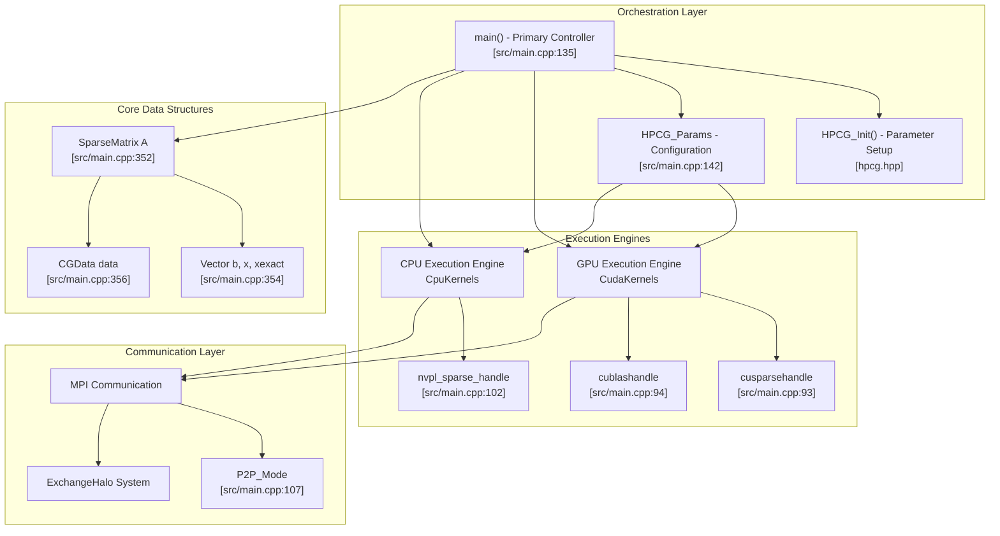
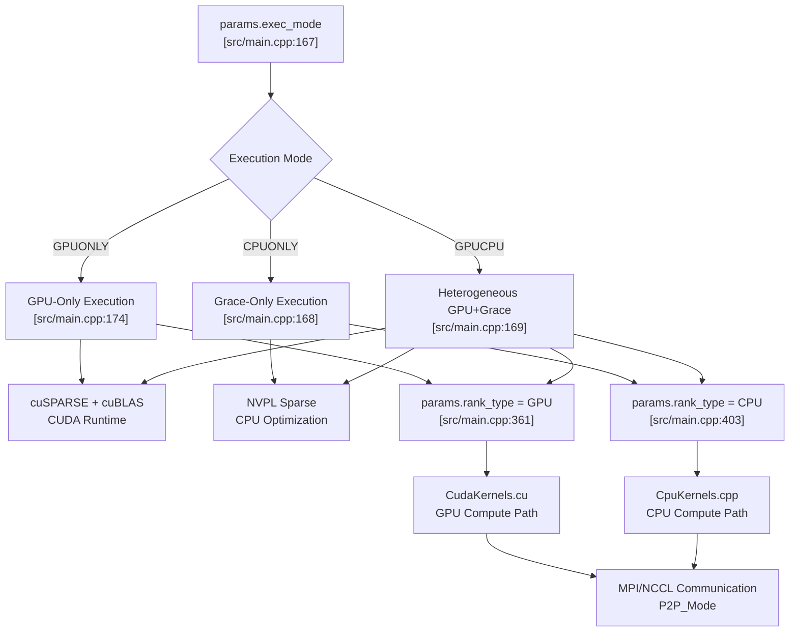
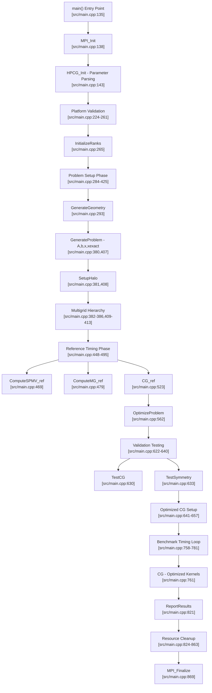
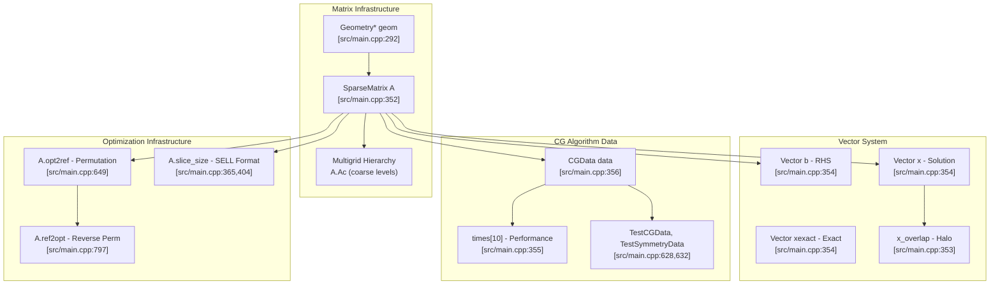
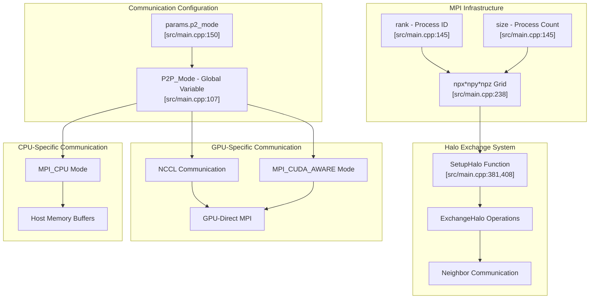

<!-- source: DeepWiki mcp.deepwiki.com · repo NVIDIA/nvidia-hpcg · page 1 Overview · fetched 2026-10-26 -->

# Overview

Relevant source files

The following files were used as context for generating this wiki page:

- [README.md](README.md)
- [src/main.cpp](src/main.cpp)

## Purpose and Scope

This document provides a comprehensive overview of the NVIDIA High Performance Conjugate Gradient (HPCG) benchmark system. NVIDIA HPCG is a high-performance computing benchmark that evaluates sparse linear algebra performance on heterogeneous systems combining NVIDIA GPUs and Grace CPUs. The system performs multigrid preconditioned conjugate gradient iterations using double precision floating point arithmetic to solve large sparse linear systems.

The benchmark is designed to exploit NVIDIA's high-performance math libraries including cuSPARSE, cuBLAS, and NVPL Sparse to achieve optimal performance for sparse matrix-vector multiplication (SpMV) and sparse triangular solvers (SpSV). For detailed information about building and compiling the system, see [Building HPCG](#2.1). For execution instructions and parameter configuration, see [Running HPCG](#2.2).

Sources: [README.md:1-25](), [src/main.cpp:15-40]()

## System Architecture Overview

The NVIDIA HPCG benchmark implements a sophisticated multi-layered architecture that orchestrates heterogeneous computing resources through a centralized controller and dual execution engines.

### Main System Components

The system centers around the `main()` function in [src/main.cpp:135]() which serves as the primary orchestrator. It manages the entire benchmark lifecycle from initialization through problem generation, optimization, validation, and final benchmarking phases.

Sources: [src/main.cpp:135-872](), [src/main.cpp:92-122]()

### Execution Mode Architecture

NVIDIA HPCG supports three distinct execution modes that determine how computational work is distributed across available hardware resources:

The execution mode is determined during initialization and affects library selection, memory allocation strategies, and computational kernel dispatch throughout the benchmark execution.

Sources: [src/main.cpp:167-169](), [src/main.cpp:361-424](), [src/main.cpp:174-235]()

## Benchmark Execution Pipeline

The NVIDIA HPCG benchmark follows a structured multi-phase execution pipeline that ensures reproducible and validated performance measurements:

### Primary Execution Phases

Each phase serves a specific purpose in ensuring benchmark validity and performance measurement accuracy. The reference timing phase establishes baseline performance metrics, while the optimization phase applies platform-specific optimizations before the final timed benchmark execution.

Sources: [src/main.cpp:135-872](), [src/main.cpp:284-425](), [src/main.cpp:758-781]()

## Core Computational Framework

The benchmark implements a sophisticated computational framework centered around sparse matrix operations and conjugate gradient solving:

### Data Structure Relationships

The `SparseMatrix` structure serves as the central data container, containing geometry information, numerical data, and optimization metadata. The system maintains multiple vector instances for different algorithmic phases and supports sophisticated permutation schemes for performance optimization.

Sources: [src/main.cpp:352-356](), [src/main.cpp:292-293](), [src/main.cpp:649-657]()

## Communication and Distribution Architecture

NVIDIA HPCG implements a flexible communication system that supports various point-to-point communication modes and distributed memory execution:

### Communication Infrastructure

The communication system validates mode compatibility with execution targets and configures appropriate data transfer mechanisms. GPU execution modes leverage CUDA-aware MPI and NCCL for optimal GPU-to-GPU communication, while CPU modes use standard MPI host-based communication.

Sources: [src/main.cpp:105-108](), [src/main.cpp:182-221](), [src/main.cpp:381](), [src/main.cpp:408]()

## Build and Platform Support

The NVIDIA HPCG benchmark supports multiple hardware architectures and provides flexible build configuration options:

### Build System Architecture

| Component | Description | Configuration Variables |
|-----------|-------------|------------------------|
| **GPU Support** | NVIDIA GPU execution with CUDA | `USE_CUDA=1` |
| **Grace Support** | NVIDIA Grace CPU execution | `USE_GRACE=1` |  
| **NCCL Support** | Advanced GPU communication | `USE_NCCL=1` |
| **Architecture** | Target processor architecture | ARM64 vs x86 |
| **Libraries** | Required external dependencies | MPI, CUDA, NVPL |

The build system generates different binary targets based on configuration:
- `xhpcg` - GPU-enabled binary when `USE_CUDA=1`
- `xhpcg-cpu` - CPU-only binary when `USE_CUDA=0` and `USE_GRACE=1`

The system performs extensive runtime validation to ensure library compatibility, including version checks for cuSPARSE (minimum 12.2) and NVPL Sparse (minimum 0.2).

Sources: [README.md:51-66](), [src/main.cpp:310-350](), [src/main.cpp:224-261]()

---

