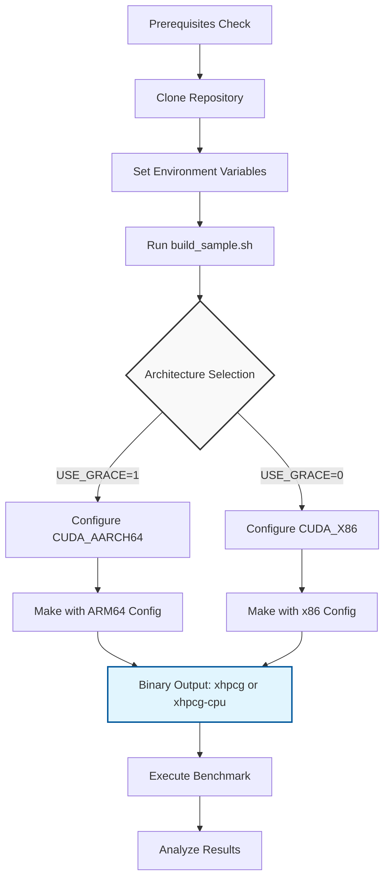
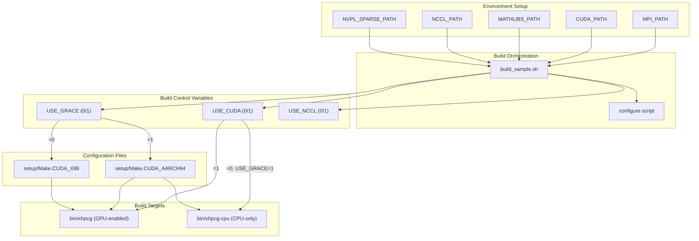
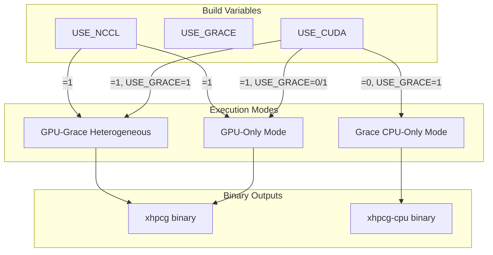

<!-- source: DeepWiki mcp.deepwiki.com · repo NVIDIA/nvidia-hpcg · page 2 Getting Started · fetched 2026-10-26 -->

# Getting Started

<details>
<summary>Relevant source files</summary>

The following files were used as context for generating this wiki page:

- [README.md](README.md)
- [build_sample.sh](build_sample.sh)

</details>


This page provides an introduction to building and running the NVIDIA HPCG benchmark, covering system prerequisites, the overall workflow, and key components involved in the build and execution process. For detailed build instructions, see [Building HPCG](#2.1). For comprehensive execution guidance, see [Running HPCG](#2.2).

## Purpose and Scope

The NVIDIA HPCG benchmark is a high-performance implementation of the HPCG (High Performance Conjugate Gradients) benchmark optimized for NVIDIA accelerated HPC systems. This implementation supports multiple execution modes including GPU-only, Grace CPU-only, and heterogeneous GPU-Grace configurations across both x86 and ARM64 architectures.

## System Overview

The NVIDIA HPCG system consists of several key components that work together to deliver optimized sparse linear algebra computations:

### Getting Started Workflow



### Build System Architecture



Sources: [build_sample.sh:1-104](), [README.md:51-66]()

## Prerequisites

The NVIDIA HPCG benchmark requires specific software components depending on the target execution mode:

| Component | Version | Required For | Purpose |
|-----------|---------|--------------|---------|
| Git | Any recent version | All builds | Repository cloning |
| MPI | OpenMPI 4.1+ or MPICH 4.0+ | All builds | Distributed computing |
| CUDA Toolkit | 12.3+ | GPU execution | CUDA runtime and development |
| cuSPARSE | 12.3+ | GPU execution | Sparse matrix operations |
| cuBLAS | 12.2+ | GPU execution | Dense linear algebra |
| GCC | 13.0+ | Grace CPU execution | Compilation toolchain |
| NVPL | 24.03+ | Grace CPU execution | Optimized math libraries |
| NCCL | 2.19+ | Multi-GPU communication | Collective communications |

Sources: [README.md:26-34]()

## Supported Platforms and Execution Modes

The benchmark supports three primary execution modes configured through build-time variables:

### Platform Support Matrix

| Platform | GPU Support | CPU Support | Heterogeneous |
|----------|-------------|-------------|---------------|
| x86 + NVIDIA GPU | ✓ (`USE_CUDA=1, USE_GRACE=0`) | Limited | No |
| ARM64 + NVIDIA GPU | ✓ (`USE_CUDA=1, USE_GRACE=1`) | ✓ (`USE_CUDA=0, USE_GRACE=1`) | ✓ (`USE_CUDA=1, USE_GRACE=1`) |

### Build Variable Configuration



Sources: [README.md:58-66](), [build_sample.sh:49-74]()

## Quick Start Workflow

### 1. Repository Setup
```bash
git clone https://github.com/NVIDIA/nvidia-hpcg
cd nvidia-hpcg
```

### 2. Environment Configuration
Set the required environment variables before building:
- `MPI_PATH`: Path to MPI installation
- `CUDA_PATH`: Path to CUDA toolkit (for GPU builds)
- `MATHLIBS_PATH`: Path to CUDA math libraries
- `NVPL_SPARSE_PATH`: Path to NVPL sparse libraries (for Grace CPU)
- `NCCL_PATH`: Path to NCCL (optional, for multi-GPU communication)

### 3. Build Execution
The `build_sample.sh` script orchestrates the entire build process, automatically configuring the appropriate makefile based on the target architecture and execution mode.

### 4. Binary Location
Built binaries are placed in both `build/bin/` and `bin/` directories:
- `xhpcg`: GPU-enabled binary (when `USE_CUDA=1`)
- `xhpcg-cpu`: CPU-only binary (when `USE_CUDA=0, USE_GRACE=1`)

Sources: [README.md:37-49](), [build_sample.sh:103-104]()

## Next Steps

- For detailed build instructions and configuration options, see [Building HPCG](#2.1)
- For comprehensive execution parameters and performance tuning, see [Running HPCG](#2.2) 
- For understanding the core system architecture, see [Core Architecture](#3)

Sources: [README.md:1-91](), [build_sample.sh:1-104]()

---

