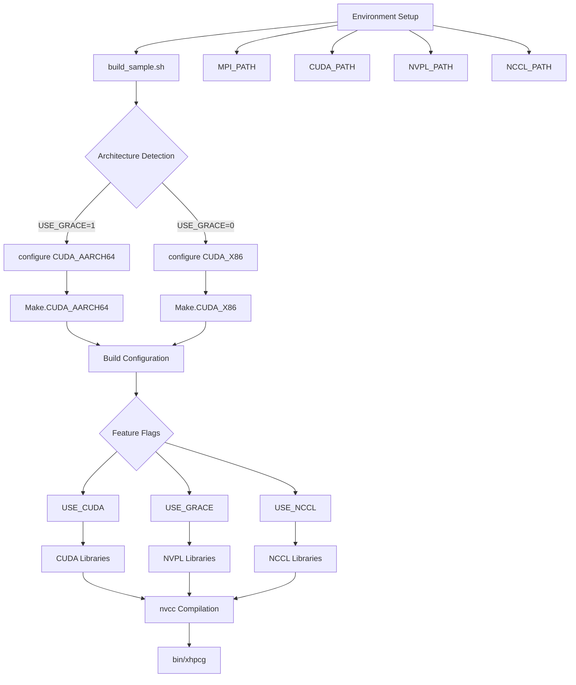
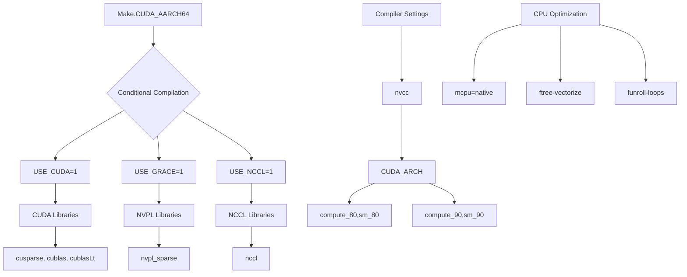
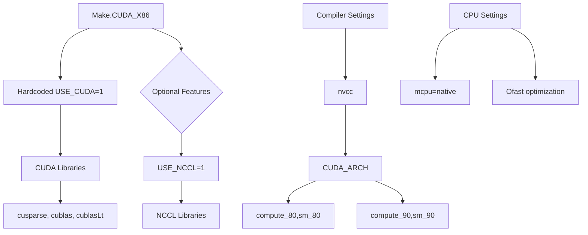
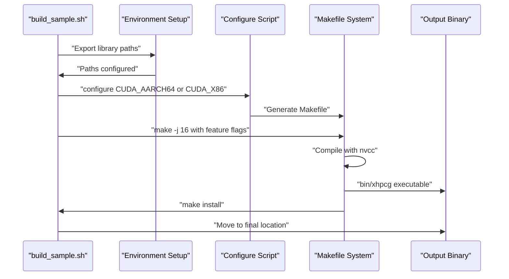

<!-- source: DeepWiki mcp.deepwiki.com · repo NVIDIA/nvidia-hpcg · page 2.1 Building HPCG · fetched 2026-10-26 -->

# Building HPCG

<details>
<summary>Relevant source files</summary>

The following files were used as context for generating this wiki page:

- [build_sample.sh](build_sample.sh)
- [setup/Make.CUDA_AARCH64](setup/Make.CUDA_AARCH64)
- [setup/Make.CUDA_X86](setup/Make.CUDA_X86)

</details>


This document provides detailed instructions for building the NVIDIA HPCG benchmark across different architectures and configurations. It covers the build system architecture, prerequisite setup, configuration options, and the compilation process for both x86 and ARM64 platforms with GPU and Grace CPU acceleration.

For information about running the compiled benchmark, see [Running HPCG](#2.2). For details about the core program structure, see [Main Program Flow](#3.1).

## Build System Overview

HPCG uses a makefile-based build system with architecture-specific configuration files that support multiple execution modes and hardware targets. The build system is designed to handle heterogeneous computing environments with both GPU and CPU acceleration paths.

### Build Architecture



Sources: [build_sample.sh:1-104](), [setup/Make.CUDA_AARCH64:1-198](), [setup/Make.CUDA_X86:1-182]()

### Build Dependencies

The build system requires several external libraries and tools depending on the target configuration:

| Component | Purpose | Required For |
|-----------|---------|-------------|
| MPI | Distributed memory parallelization | All builds |
| CUDA Toolkit | GPU acceleration and math libraries | USE_CUDA=1 |
| NVPL Sparse | Grace CPU optimization | USE_GRACE=1 |
| NCCL | GPU-direct communication | USE_NCCL=1 |
| nvcc | CUDA-capable C++ compiler | All builds |

Sources: [setup/Make.CUDA_AARCH64:110-129](), [setup/Make.CUDA_X86:110-122]()

## Prerequisites

Before building HPCG, ensure the following environment variables are configured in [build_sample.sh:21-43]():

```bash
export MPI_PATH=/path/to/mpi
export CUDA_PATH=/path/to/cuda  
export MATHLIBS_PATH=/path/to/mathlibs
export NCCL_PATH=/path/to/nccl
export NVPL_SPARSE_PATH=/path/to/nvpllibs
```

The build script automatically configures the library paths and compiler flags based on these environment variables.

Sources: [build_sample.sh:21-43]()

## Architecture-Specific Configuration

### ARM64 Configuration (Grace + GPU)

The `Make.CUDA_AARCH64` configuration targets ARM64 systems with NVIDIA Grace CPUs and optional GPU acceleration. This configuration supports all three execution modes:



The ARM64 build uses conditional compilation flags defined in [setup/Make.CUDA_AARCH64:116-129]():

- `USE_CUDA=1`: Enables GPU execution path with cuSPARSE and cuBLAS
- `USE_GRACE=1`: Enables Grace CPU optimizations with NVPL Sparse
- `USE_NCCL=1`: Enables NCCL communication for multi-GPU scaling

Sources: [setup/Make.CUDA_AARCH64:116-129](), [setup/Make.CUDA_AARCH64:149-159](), [setup/Make.CUDA_AARCH64:178-183]()

### x86 Configuration (Traditional + GPU)

The `Make.CUDA_X86` configuration targets traditional x86 systems with mandatory GPU acceleration:



Key differences from ARM64 configuration:
- CUDA is always enabled [setup/Make.CUDA_X86:141]()
- No Grace CPU support (no `USE_GRACE` conditionals)
- Simplified library dependencies

Sources: [setup/Make.CUDA_X86:116-122](), [setup/Make.CUDA_X86:141](), [setup/Make.CUDA_X86:164-171]()

## Build Configuration Options

### Compile-Time Feature Flags

Both build configurations support several compile-time options defined in `HPCG_OPTS`:

| Flag | Purpose | Default |
|------|---------|---------|
| `DHPCG_CUBIC_RADICAL_SEARCH` | Cubic search optimization | Enabled |
| `DHPCG_CONTIGUOUS_ARRAYS` | Contiguous memory layout | Enabled |
| `DHPCG_DEBUG` | Debug output | Disabled |
| `DHPCG_NO_MPI` | Disable MPI | Disabled |
| `DHPCG_NO_OPENMP` | Disable OpenMP | Disabled |

Sources: [setup/Make.CUDA_AARCH64:148-159](), [setup/Make.CUDA_X86:140-149]()

### CUDA Architecture Targets

Both configurations target modern GPU architectures with compute capability 8.0 and 9.0:

- `compute_80,sm_80`: Ada Lovelace, Ampere architectures
- `compute_90,sm_90`: Hopper architecture  
- Optional `compute_100a,sm_100a`: Blackwell architecture (when `BUILD_B100=1`)

Sources: [setup/Make.CUDA_AARCH64:179-183](), [setup/Make.CUDA_X86:164-167]()

## Build Process

### Using the Build Script

The recommended build method uses the provided build script with the following parameters:

```bash
./build_sample.sh [arg1] [commit_hash] [major_ver] [minor_ver] [use_cuda] [use_grace] [use_nccl] [build_b100]
```

Parameter mapping from [build_sample.sh:52-85]():
- `$5`: USE_CUDA (1=enabled, 0=disabled)
- `$6`: USE_GRACE (1=enabled, 0=disabled)  
- `$7`: USE_NCCL (1=enabled, 0=disabled)
- `$8`: BUILD_B100 (1=enabled, 0=disabled)

### Build Flow



The build process follows these steps from [build_sample.sh:46-104]():

1. Create `build/` directory and change to it
2. Configure architecture based on `USE_GRACE` setting
3. Run `make` with all configuration variables
4. Install the binary to final location

### Manual Build

For custom builds, the makefile can be invoked directly after running the configure script:

```bash
mkdir -p build && cd build
../configure CUDA_AARCH64  # or CUDA_X86
make -j 16 USE_CUDA=1 USE_GRACE=1 USE_NCCL=1 MPdir=/path/to/mpi [...]
```

Sources: [build_sample.sh:46-104]()

## Output

The build process generates the main executable `xhpcg` in the `bin/` directory. This binary contains all the compiled kernel implementations and can execute in the configured modes (GPU-only, CPU-only, or heterogeneous) based on runtime parameters.

The final executable integrates:
- CUDA kernels from `CudaKernels.cu` (when `USE_CUDA=1`)
- CPU kernels from `CpuKernels.cpp` (when `USE_GRACE=1`)  
- MPI communication routines
- Math library interfaces (cuSPARSE, NVPL Sparse, NCCL)

Sources: [build_sample.sh:103-104]()

---

