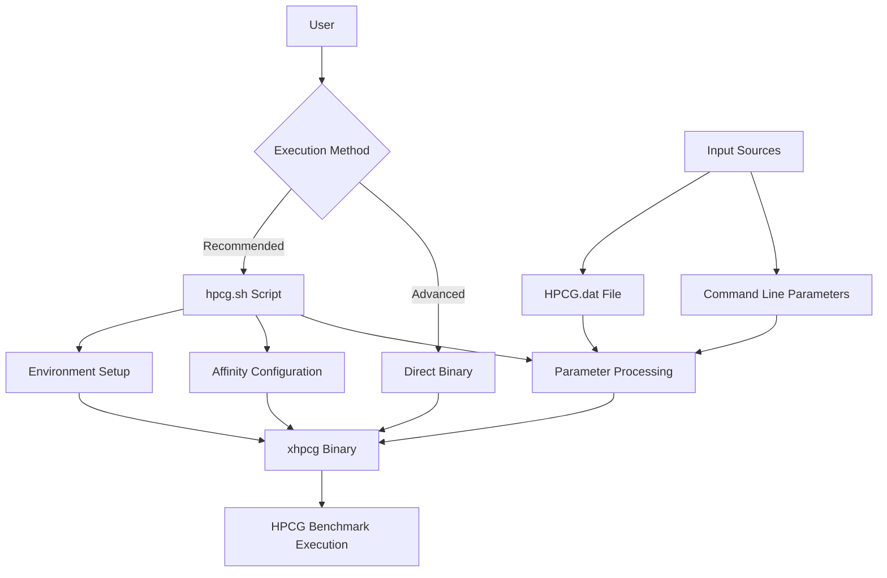
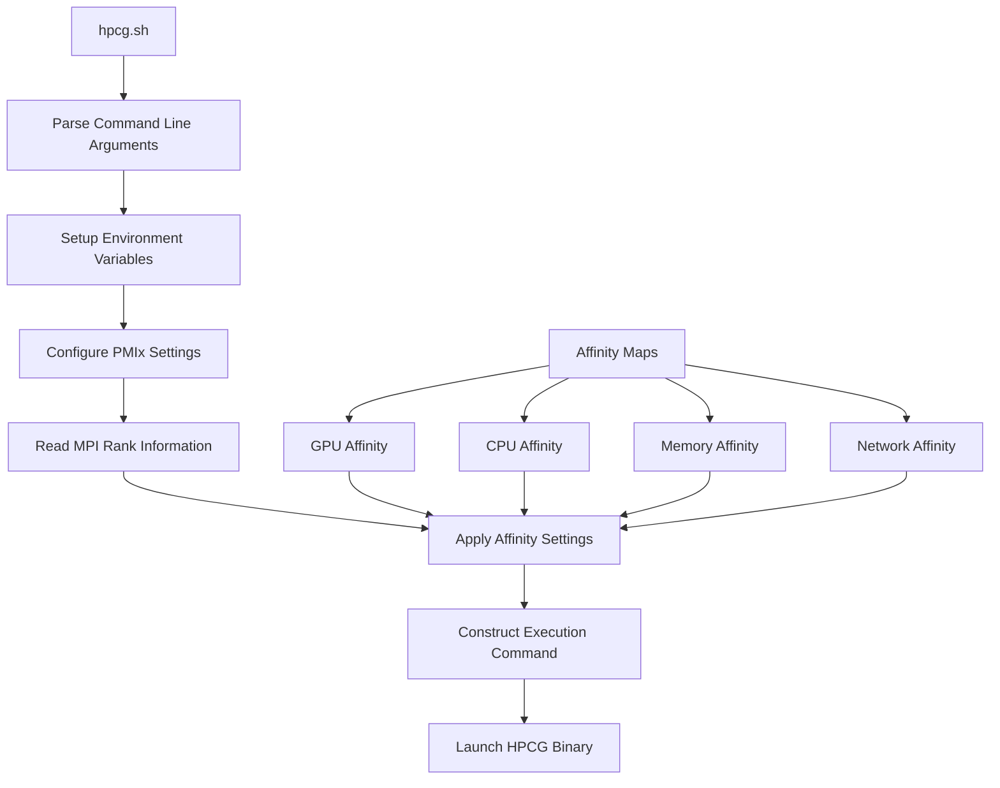
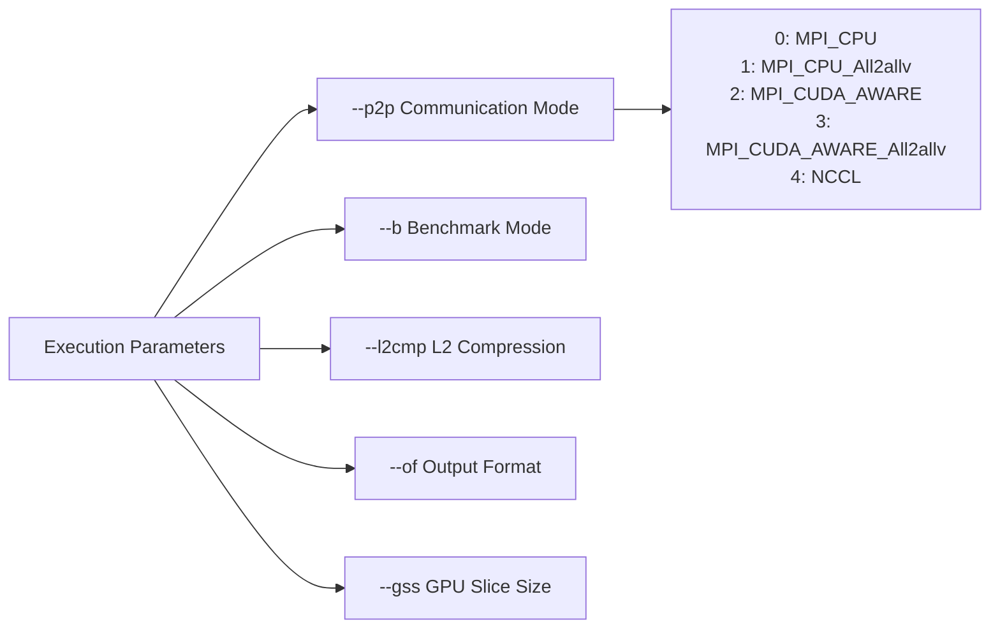
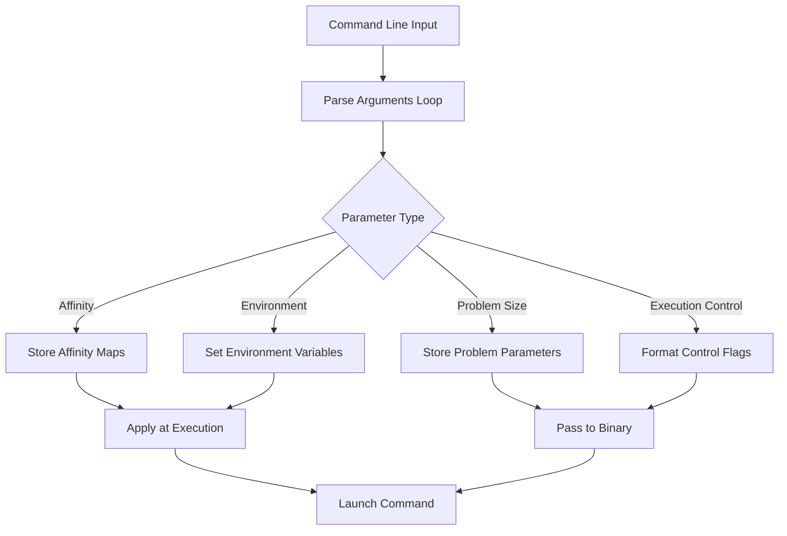
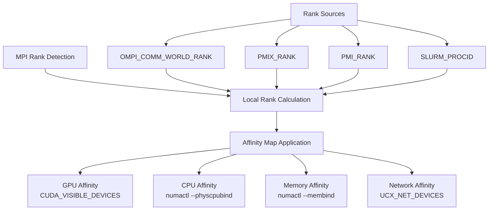
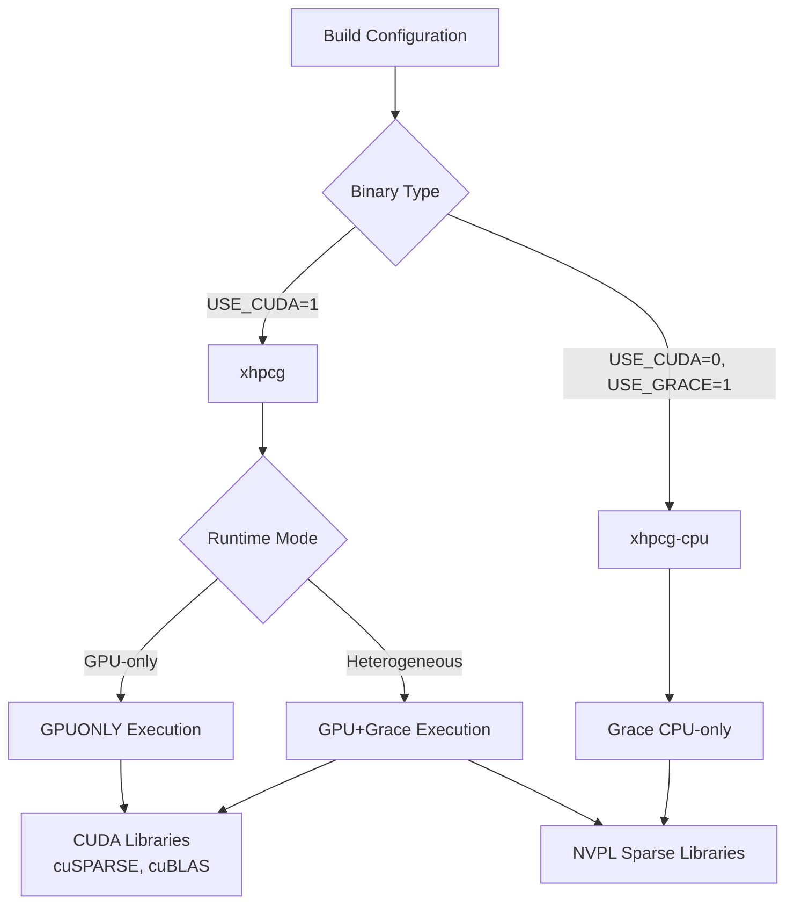
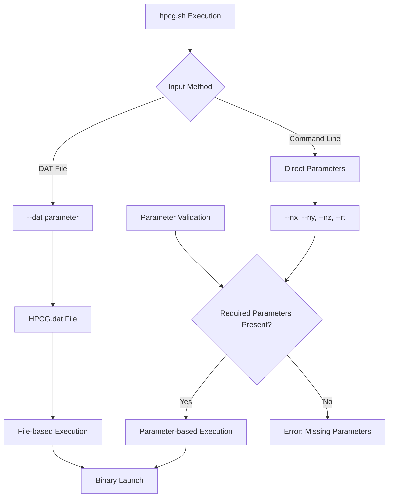

<!-- source: DeepWiki mcp.deepwiki.com · repo NVIDIA/nvidia-hpcg · page 2.2 Running HPCG · fetched 2026-10-26 -->

# Running HPCG

<details>
<summary>Relevant source files</summary>

The following files were used as context for generating this wiki page:

- [README.md](README.md)
- [bin/hpcg.sh](bin/hpcg.sh)

</details>


This document covers how to execute NVIDIA HPCG benchmarks using the provided scripts and direct invocation methods. It details parameter configuration, affinity settings, execution modes, and input specification methods.

For information about building HPCG binaries, see [Building HPCG](#2.1). For details about the main program orchestration, see [Main Program Flow](#3.1).

## Execution Methods Overview

NVIDIA HPCG can be executed in two primary ways:

1. **Script-based execution** - Using [`bin/hpcg.sh`]() wrapper script (recommended)
2. **Direct binary execution** - Calling `xhpcg` or `xhpcg-cpu` binaries directly

The script-based approach provides comprehensive environment setup, affinity management, and parameter handling, while direct execution offers maximum control for advanced users.



Sources: [README.md:68-69](), [bin/hpcg.sh:1-382]()

## Using the hpcg.sh Script

The [`hpcg.sh`]() script provides a comprehensive launcher that handles environment setup, affinity binding, and parameter management. It automatically detects the appropriate HPCG binary and configures the execution environment.

### Basic Script Structure



Sources: [bin/hpcg.sh:119-382]()

### Environment Configuration

The script automatically configures several key environment variables:

| Variable | Purpose | Default/Configuration |
|----------|---------|----------------------|
| `LD_LIBRARY_PATH` | CUDA library path | `/usr/local/cuda/lib64` |
| `UCX_WARN_UNUSED_ENV_VARS` | Suppress UCX warnings | `n` |
| `OMP_PROC_BIND` | OpenMP thread binding | `TRUE` |
| `OMP_PLACES` | OpenMP placement | `sockets` |
| `UCC_LOG_LEVEL` | UCC logging level | `error` |

Sources: [bin/hpcg.sh:26-34]()

## Parameter Configuration

The script supports extensive parameter configuration through command-line options:

### Problem Specification Parameters

| Parameter | Description | Usage |
|-----------|-------------|-------|
| `--npx <int>` | Process grid X dimension | `--npx=4` |
| `--npy <int>` | Process grid Y dimension | `--npy=2` |
| `--npz <int>` | Process grid Z dimension | `--npz=1` |
| `--nx <int>` | Local problem X dimension | Direct to binary |
| `--ny <int>` | Local problem Y dimension | Direct to binary |
| `--nz <int>` | Local problem Z dimension | Direct to binary |
| `--rt <int>` | Runtime in seconds | Direct to binary |

Sources: [bin/hpcg.sh:47-49](), [bin/hpcg.sh:253-278]()

### Execution Control Parameters



Sources: [bin/hpcg.sh:50-54](), [bin/hpcg.sh:280-297]()

### Parameter Processing Flow

The script processes parameters through a systematic approach:



Sources: [bin/hpcg.sh:122-303]()

## Affinity Configuration

The script provides sophisticated affinity management for optimal performance on multi-GPU, multi-CPU systems:

### Affinity Types and Mapping



Sources: [bin/hpcg.sh:310-332](), [bin/hpcg.sh:334-366]()

### Affinity Mapping Functions

The script implements four key affinity mapping functions:

| Function | Purpose | Configuration |
|----------|---------|---------------|
| `read_gpu_affinity_map()` | Maps MPI ranks to GPU indices | `--gpu-affinity 0:1:2:3` |
| `read_cpu_affinity_map()` | Maps MPI ranks to CPU cores | `--cpu-affinity 0-15:16-31` |
| `read_mem_affinity_map()` | Maps MPI ranks to NUMA nodes | `--mem-affinity 0:1:0:1` |
| `read_net_affinity_map()` | Maps MPI ranks to network devices | `--ucx-affinity mlx5_0:mlx5_1` |

Sources: [bin/hpcg.sh:76-100]()

## Execution Modes

NVIDIA HPCG supports three primary execution modes, determined by the binary used and runtime parameters:

### Mode Selection and Binary Mapping



Sources: [README.md:58-66]()

### Communication Mode Configuration

The `--p2p` parameter controls inter-process communication methods:

| Mode | Value | Description | Use Case |
|------|-------|-------------|----------|
| MPI_CPU | 0 | Standard MPI Send/Recv | Default, CPU-based communication |
| MPI_CPU_All2allv | 1 | MPI Alltoallv on CPU | Collective communication |
| MPI_CUDA_AWARE | 2 | GPU-Direct MPI | GPU memory direct access |
| MPI_CUDA_AWARE_All2allv | 3 | GPU-Direct Alltoallv | GPU collective communication |
| NCCL | 4 | NVIDIA Collective Communications | Optimized GPU communication |

Sources: [bin/hpcg.sh:50](), [README.md:16]()

## Input Specification Methods

HPCG accepts input through two mechanisms:

### Input Method Selection Flow



Sources: [bin/hpcg.sh:375-382]()

### Execution Command Construction

The final execution command is constructed based on input method:

**DAT File Method:**
```bash
${NUMCMD} ${CPUBIND} ${MEMBIND} ${XHPCG} ${DAT} --gss=${GSS} ${HPCG_CONTROL}
```

**Parameter Method:**
```bash
${NUMCMD} ${CPUBIND} ${MEMBIND} ${XHPCG} --nx=${NX} --ny=${NY} --nz=${NZ} --rt=${RT} --gss=${GSS} ${HPCG_CONTROL}
```

Where:
- `NUMCMD` = `numactl` if affinity binding is configured
- `CPUBIND` = `--physcpubind=${CPU}` for CPU affinity
- `MEMBIND` = `--membind=${MEM}` for memory affinity
- `XHPCG` = Path to HPCG binary
- `HPCG_CONTROL` = Concatenated control flags (`--b`, `--l2cmp`, `--p2p`, etc.)

Sources: [bin/hpcg.sh:373-382]()

## Platform-Specific Execution Guidance

The HPCG distribution includes platform-specific execution guidance:

| Platform | Documentation | Binary |
|----------|---------------|--------|
| x86_64 + GPU | `bin/RUNNING-x86` | `xhpcg` |
| ARM64 + Grace + GPU | `bin/RUNNING-aarch64` | `xhpcg` |
| Grace CPU-only | `bin/RUNNING-aarch64` | `xhpcg-cpu` |

Additional sample configurations are provided in `run_sample.sh` for common deployment scenarios.

Sources: [README.md:19](), [README.md:69]()

---

