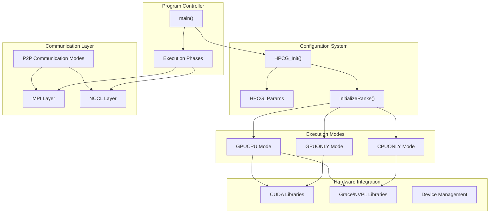
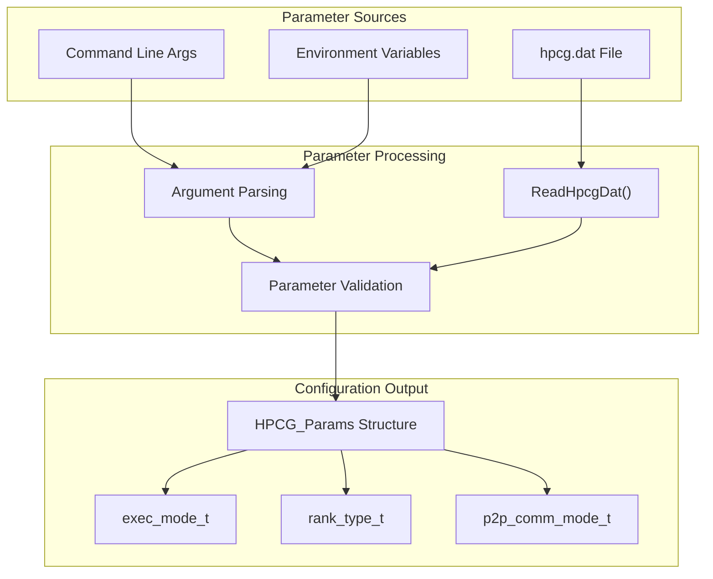
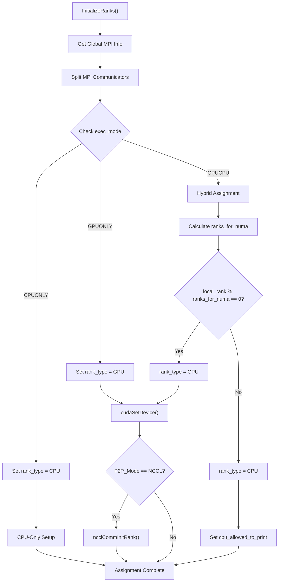
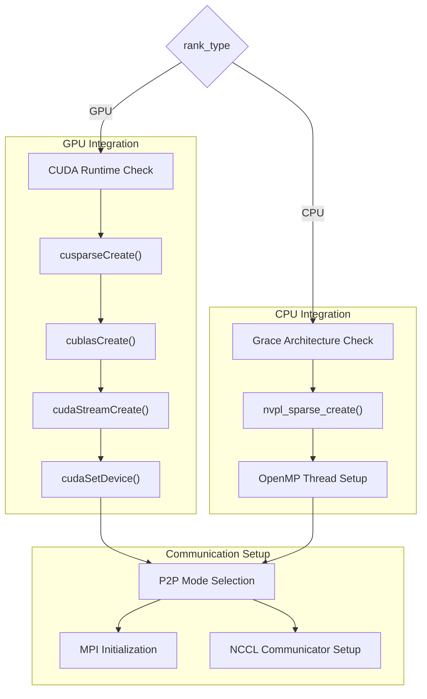
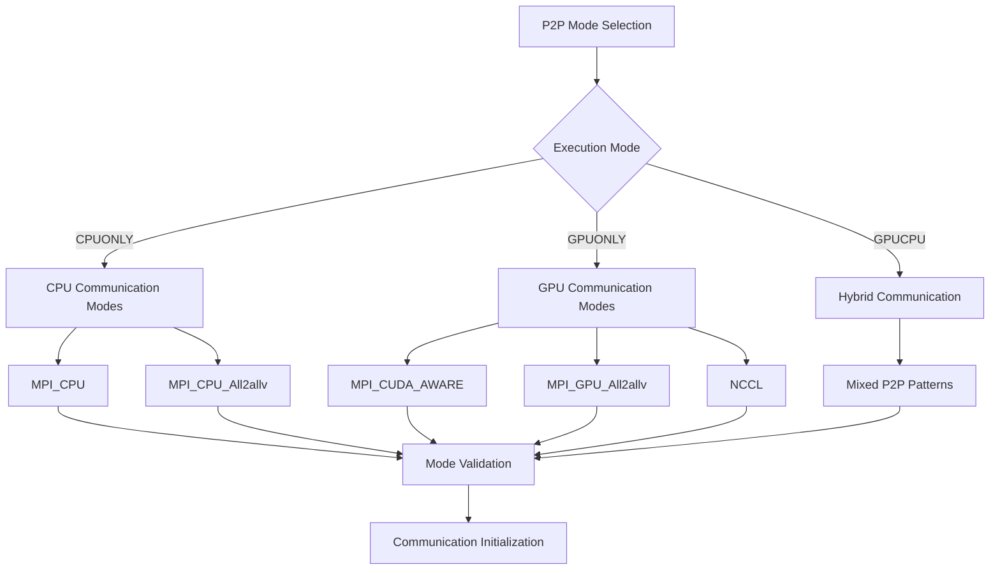

<!-- source: DeepWiki mcp.deepwiki.com · repo NVIDIA/nvidia-hpcg · page 3 Core Architecture · fetched 2026-10-26 -->

# Core Architecture

Relevant source files

The following files were used as context for generating this wiki page:

- [src/hpcg.hpp](src/hpcg.hpp)
- [src/init.cpp](src/init.cpp)
- [src/main.cpp](src/main.cpp)

This document provides an overview of the main architectural components of the NVIDIA HPCG benchmark and how they work together to orchestrate benchmark execution across heterogeneous GPU and CPU systems.

The core architecture encompasses the central program controller, parameter management system, rank assignment mechanisms, and execution mode coordination. For detailed information about specific computational implementations, see [Computational Engines](#4). For distributed computing aspects, see [Distributed Computing](#5.2).

## System Overview

The NVIDIA HPCG benchmark is built around a central orchestration architecture that coordinates execution across multiple hardware targets and communication patterns. The system supports three primary execution modes and manages complex interactions between GPU and CPU resources.

### Main Architectural Components

**Sources:** [src/main.cpp:135-872](), [src/hpcg.hpp:109-144](), [src/init.cpp:112-248]()

## Program Controller Architecture

The central program controller in `main()` orchestrates the entire benchmark execution through a well-defined sequence of phases. This controller manages hardware resources, coordinates between execution modes, and ensures proper sequencing of benchmark operations.

### Main Execution Flow

```mermaid
flowchart TD
    START["main() Entry"] --> MPI_INIT["MPI_Init()"]
    MPI_INIT --> PARAM_INIT["HPCG_Init()"]
    PARAM_INIT --> RANK_INIT["InitializeRanks()"]
    
    RANK_INIT --> VALIDATION["Parameter Validation"]
    VALIDATION --> LIB_CHECK["Library Version Checks"]
    
    LIB_CHECK --> PROBLEM_SETUP["Problem Setup Phase"]
    PROBLEM_SETUP --> GEOM_GEN["GenerateGeometry()"]
    GEOM_GEN --> SPARSE_INIT["InitializeSparseMatrix()"]
    SPARSE_INIT --> PROBLEM_GEN["GenerateProblem()"]
    PROBLEM_GEN --> HALO_SETUP["SetupHalo()"]
    HALO_SETUP --> COARSE_GEN["GenerateCoarseProblem()"]
    
    COARSE_GEN --> REF_TIMING["Reference Timing Phase"]
    REF_TIMING --> SPMV_REF["ComputeSPMV_ref()"]
    SPMV_REF --> MG_REF["ComputeMG_ref()"]
    MG_REF --> CG_REF["CG_ref()"]
    
    CG_REF --> OPTIMIZATION["OptimizeProblem()"]
    OPTIMIZATION --> VALIDATION_PHASE["Validation Phase"]
    VALIDATION_PHASE --> TEST_CG["TestCG()"]
    TEST_CG --> TEST_SYM["TestSymmetry()"]
    
    TEST_SYM --> BENCHMARK["Benchmark Phase"]
    BENCHMARK --> CG_LOOP["CG() Loop"]
    CG_LOOP --> RESULTS["ReportResults()"]
    RESULTS --> CLEANUP["Resource Cleanup"]
    CLEANUP --> END["Program Exit"]
```

**Sources:** [src/main.cpp:284-872]()

## Parameter and Configuration System

The configuration system is centered around the `HPCG_Params` structure, which encapsulates all runtime parameters and execution modes. This system supports both command-line and file-based configuration, with comprehensive parameter validation.

### Parameter Structure

| Parameter Category | Key Parameters | Purpose |
|-------------------|----------------|---------|
| **Execution Mode** | `exec_mode`, `rank_type` | Defines GPU/CPU execution strategy |
| **Problem Size** | `nx`, `ny`, `nz` | Local problem dimensions |
| **Process Grid** | `npx`, `npy`, `npz` | MPI process grid layout |
| **Communication** | `p2_mode` | Point-to-point communication method |
| **Optimization** | `use_l2compression`, `gpu_slice_size` | Performance optimization flags |
| **Runtime** | `runningTime`, `benchmark_mode` | Execution time and testing mode |

**Sources:** [src/hpcg.hpp:109-144](), [src/init.cpp:250-444]()

## Rank Assignment and Execution Modes

The rank assignment system automatically determines whether each MPI rank operates as a GPU or CPU rank based on the execution mode and available hardware. This system supports three distinct execution modes with different resource allocation strategies.

### Rank Assignment Logic

**Sources:** [src/init.cpp:112-248]()

## Hardware Integration Architecture

The system integrates with different hardware accelerators through abstracted interfaces that handle library initialization, device management, and resource allocation. Each execution mode activates specific hardware integration paths.

### Library Integration

**Sources:** [src/main.cpp:310-350](), [src/main.cpp:361-424](), [src/init.cpp:180-246]()

## Communication Architecture

The communication system supports multiple point-to-point communication modes, allowing optimization for different network configurations and hardware capabilities. The system automatically selects appropriate communication patterns based on execution mode and hardware availability.

### Supported Communication Modes

| Mode | Description | Use Case |
|------|-------------|----------|
| `MPI_CPU` | Standard MPI with CPU buffers | Basic CPU-only execution |
| `MPI_CPU_All2allv` | MPI All-to-all with CPU buffers | CPU-optimized collective operations |
| `MPI_CUDA_AWARE` | CUDA-aware MPI | GPU memory direct access |
| `MPI_GPU_All2allv` | GPU-optimized All-to-all | GPU collective operations |
| `NCCL` | NVIDIA Collective Communications | Multi-GPU scaling |

**Sources:** [src/main.cpp:106-108](), [src/init.cpp:378-389](), [src/main.cpp:181-221]()

---

