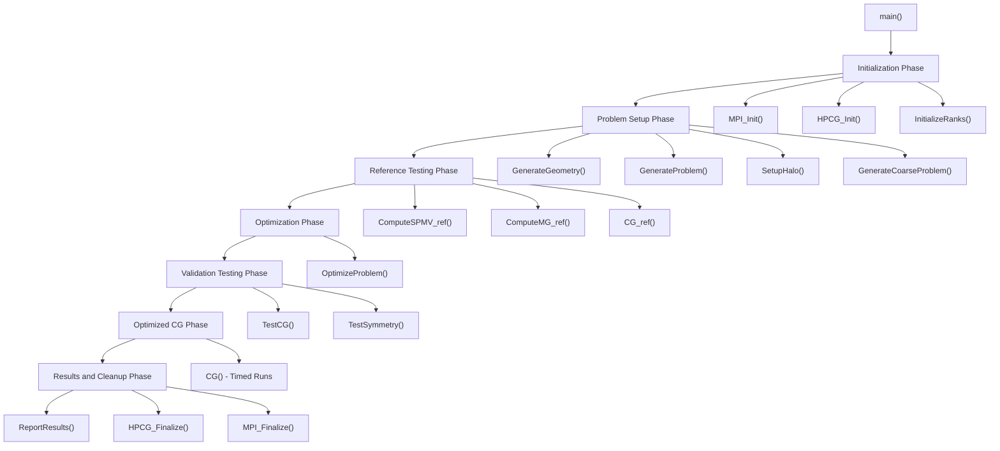
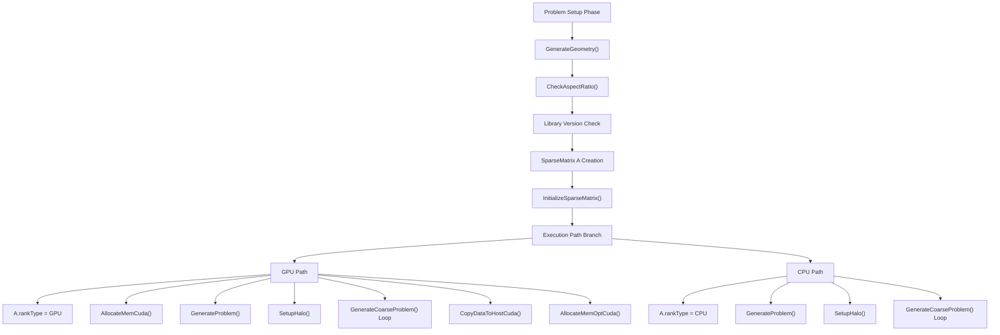
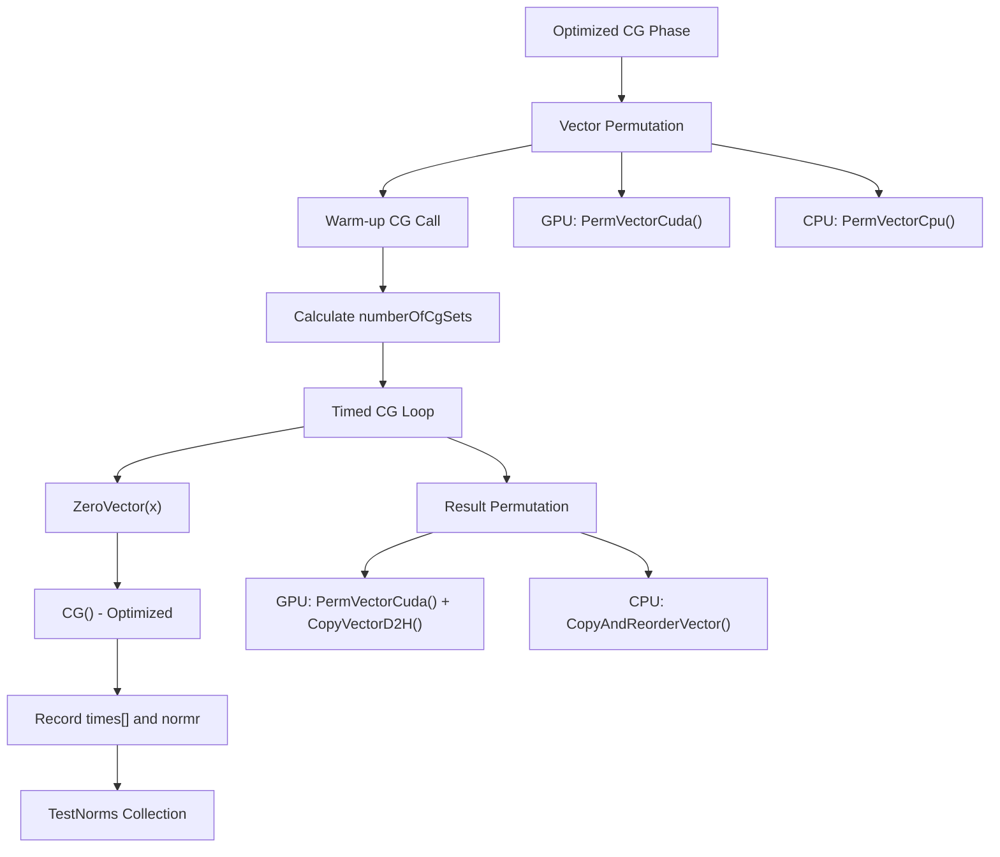
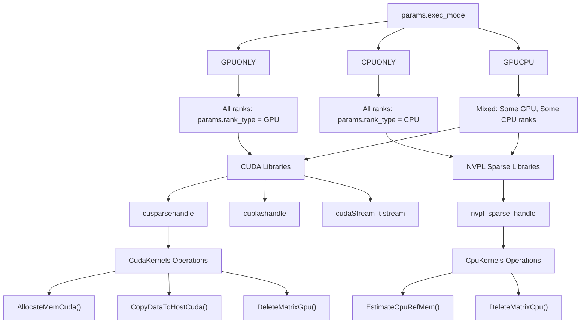

<!-- source: DeepWiki mcp.deepwiki.com · repo NVIDIA/nvidia-hpcg · page 3.1 Main Program Flow · fetched 2026-10-26 -->

# Main Program Flow

Relevant source files

The following files were used as context for generating this wiki page:

- [src/main.cpp](src/main.cpp)

## Purpose and Scope

This document describes the main program flow orchestrated by [src/main.cpp:135-872](), which serves as the central controller for the NVIDIA HPCG benchmark execution. The main program coordinates all phases of the benchmark including initialization, problem setup, validation testing, optimization, and results reporting across different execution modes (GPU-only, Grace CPU-only, and heterogeneous GPU+Grace).

For detailed information about the initialization and configuration process, see [Initialization and Configuration](#3.2). For specifics about the computational engines used in different execution modes, see [Computational Engines](#4).

## Overall Program Structure

The main program follows a well-defined sequence of execution phases, each with specific responsibilities in the benchmark lifecycle:

**Sources:** [src/main.cpp:135-872]()

## Execution Phases

### Initialization Phase

The initialization phase [src/main.cpp:137-265]() establishes the execution environment and validates configuration parameters:

| Step | Function/Operation | Purpose |
|------|-------------------|---------|
| MPI Setup | `MPI_Init()` | Initialize MPI communication |
| Parameter Parsing | `HPCG_Init()` | Parse command line and configuration |
| Mode Validation | Conditional checks | Validate execution mode compatibility |
| Rank Assignment | `InitializeRanks()` | Assign ranks to GPU/CPU execution |

The program supports three execution modes controlled by `params.exec_mode`:
- `GPUONLY`: GPU-only execution using CUDA
- `CPUONLY`: Grace CPU-only execution  
- `GPUCPU`: Heterogeneous GPU+Grace execution

**Sources:** [src/main.cpp:137-265]()

### Problem Setup Phase

The problem setup phase [src/main.cpp:284-424]() constructs the mathematical problem and data structures:

The multigrid hierarchy is constructed with `numberOfMgLevels = 4` levels, where each level creates a coarser problem using `GenerateCoarseProblem()`.

**Sources:** [src/main.cpp:284-424](), [src/main.cpp:359-424]()

### Reference Testing Phase

The reference testing phase [src/main.cpp:448-539]() measures baseline performance using unoptimized reference kernels:

- **SpMV+MG Timing**: Calls `ComputeSPMV_ref()` and `ComputeMG_ref()` for baseline sparse matrix-vector multiply and multigrid operations
- **Reference CG**: Executes `CG_ref()` with `refMaxIters = 50` to establish convergence baseline and tolerance `refTolerance`

This phase is skipped when `benchmark_mode = true` to reduce execution time.

**Sources:** [src/main.cpp:448-539](), [src/main.cpp:464-495](), [src/main.cpp:518-539]()

### Optimization Phase

The optimization phase [src/main.cpp:560-613]() prepares optimized data structures and reports memory usage:

- Calls `OptimizeProblem()` to transform matrix format and apply optimizations
- Reports GPU memory usage via `cudaMemGetInfo()` for GPU ranks
- Reports CPU memory usage via `EstimateCpuRefMem()` for CPU ranks
- Displays library versions (`cuSPARSE` or `NVPL Sparse`) and hardware information

**Sources:** [src/main.cpp:560-613]()

### Validation Testing Phase

The validation testing phase [src/main.cpp:622-639]() performs correctness verification:

- **`TestCG()`**: Validates conjugate gradient implementation correctness
- **`TestSymmetry()`**: Verifies matrix symmetry properties

These tests populate `TestCGData testcg_data` and `TestSymmetryData testsymmetry_data` structures with pass/fail counts.

**Sources:** [src/main.cpp:622-639]()

### Optimized CG Phase

The optimized CG phase [src/main.cpp:641-801]() executes the main benchmark timing:

The number of CG sets is calculated as `numberOfCgSets = int(total_runtime / opt_worst_time) + 1` to ensure the benchmark runs for the target duration.

**Sources:** [src/main.cpp:641-801](), [src/main.cpp:758-781]()

### Results and Cleanup Phase

The final phase [src/main.cpp:813-871]() reports results and performs cleanup:

- **`ReportResults()`**: Generates YAML output with benchmark results
- **Memory Cleanup**: Deletes matrices, vectors, and CG data structures
- **Library Cleanup**: Destroys CUDA handles (`cublasDestroy()`, `cusparseDestroy()`) and NVPL Sparse handles
- **Finalization**: Calls `HPCG_Finalize()` and `MPI_Finalize()`

**Sources:** [src/main.cpp:813-871]()

## Execution Mode Branching

The program implements sophisticated branching logic based on `params.exec_mode` and `params.rank_type`:

Communication modes are also validated based on execution type, with `P2P_Mode` supporting `MPI_CPU`, `MPI_CUDA_AWARE`, `NCCL`, and `MPI_GPU_All2allv`.

**Sources:** [src/main.cpp:174-235](), [src/main.cpp:361-424]()

## Key Data Structures Lifecycle

The main program manages several critical data structures throughout its execution:

| Data Structure | Type | Initialization | Usage | Cleanup |
|---------------|------|----------------|-------|---------|
| `A` | `SparseMatrix` | `InitializeSparseMatrix()` | All computational phases | `DeleteMatrixGpu()`/`DeleteMatrixCpu()` |
| `b`, `x`, `xexact` | `Vector` | `GenerateProblem()` | CG solver input/output | `DeleteVector()` |
| `data` | `CGData` | `InitializeSparseCGData()` | CG algorithm data | `DeleteCGData()` |
| `geom` | `Geometry*` | `GenerateGeometry()` | Problem geometry | Automatic cleanup |
| `times` | `std::vector<double>` | Declaration | Performance timing | Automatic cleanup |

The multigrid hierarchy is built through `curLevelMatrix` pointer traversal, where each level's `Ac` field points to the next coarser level.

**Sources:** [src/main.cpp:352-446](), [src/main.cpp:824-843]()

---

