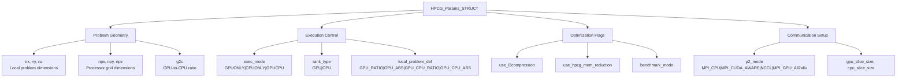
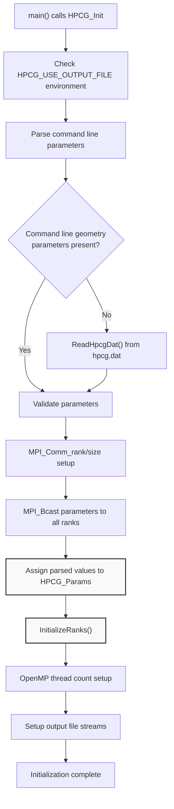
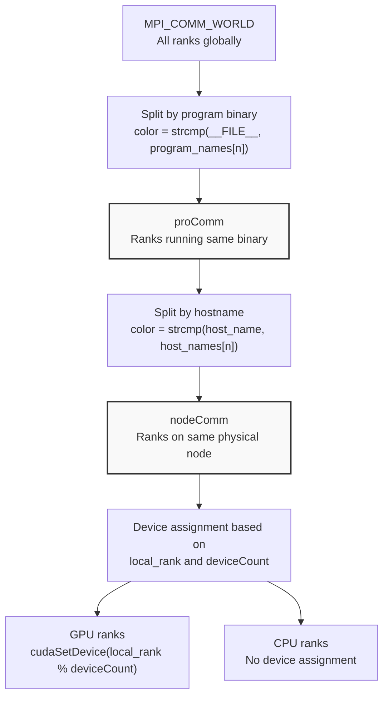

<!-- source: DeepWiki mcp.deepwiki.com · repo NVIDIA/nvidia-hpcg · page 3.2 Initialization and Configuration · fetched 2026-10-26 -->

# Initialization and Configuration

<details>
<summary>Relevant source files</summary>

The following files were used as context for generating this wiki page:

- [src/hpcg.hpp](src/hpcg.hpp)
- [src/init.cpp](src/init.cpp)

</details>


This page covers the HPCG benchmark's initialization system, which handles parameter parsing, hardware configuration, MPI setup, and execution mode selection. The initialization process establishes the runtime environment before the main benchmark execution begins.

For information about the main benchmark execution flow, see [Main Program Flow](#3.1). For details about the core data structures used throughout execution, see [Core Data Structures](#3.3).

## Parameter System

The HPCG initialization system centers around the `HPCG_Params_STRUCT` which contains all configuration parameters for the benchmark run. This structure is populated during initialization and used throughout the benchmark execution.

### Core Parameter Structure

The parameter system supports three main categories of configuration:

| Parameter Category | Key Members | Purpose |
|-------------------|-------------|---------|
| **Problem Geometry** | `nx`, `ny`, `nz`, `npx`, `npy`, `npz` | Define the 3D grid dimensions and processor decomposition |
| **Execution Control** | `exec_mode`, `rank_type`, `p2_mode`, `runningTime` | Control GPU/CPU execution and communication methods |
| **Optimization Flags** | `use_l2compression`, `use_hpcg_mem_reduction`, `benchmark_mode` | Enable performance optimizations and testing modes |



**Sources:** [src/hpcg.hpp:109-140]()

## Initialization Process Flow

The initialization follows a structured sequence handled by the `HPCG_Init` function, which coordinates parameter parsing, MPI setup, and hardware configuration.



**Sources:** [src/init.cpp:250-444]()

### Parameter Parsing Methods

HPCG supports multiple methods for specifying configuration parameters:

1. **Command Line Arguments**: Direct specification using `--nx=`, `--ny=`, etc.
2. **Configuration File**: Reading from `hpcg.dat` file when geometry parameters are not specified
3. **Environment Variables**: `HPCG_USE_OUTPUT_FILE` for output control

The parameter parsing logic in `HPCG_Init` handles both positional arguments and prefixed arguments to accommodate different MPI environments [src/init.cpp:277-288]().

## Rank Initialization and Hardware Configuration

The `InitializeRanks` function performs sophisticated MPI rank assignment and hardware configuration, supporting heterogeneous execution across GPUs and CPUs.

### MPI Communicator Hierarchy



**Sources:** [src/init.cpp:112-248]()

### Execution Mode Configuration

The rank assignment logic varies significantly based on the `exec_mode` parameter:

| Execution Mode | Rank Assignment Logic | Device Configuration |
|----------------|----------------------|---------------------|
| **CPUONLY** | All ranks assigned as CPU | No CUDA device assignment |
| **GPUONLY** | All ranks assigned as GPU | `cudaSetDevice(local_rank % deviceCount)` |
| **GPUCPU** | Mixed assignment based on `local_rank % ranks_for_numa` | GPUs get devices, CPUs get no assignment |

For the heterogeneous GPUCPU mode, the system assumes equal numbers of GPU and CPU ranks per node, with the assignment determined by `ranks_for_numa = local_procs / deviceCount` [src/init.cpp:214-245]().

## Communication Setup

The initialization system configures different communication backends based on the `p2_mode` parameter and execution requirements.

### Communication Mode Selection

The `p2_mode` parameter controls how inter-process communication is handled:

- **MPI_CPU**: Standard CPU-based MPI communication
- **MPI_CUDA_AWARE**: CUDA-aware MPI for direct GPU buffer communication  
- **MPI_GPU_All2allv**: GPU-based collective operations
- **NCCL**: NVIDIA Collective Communications Library for GPU-to-GPU communication

For NCCL mode, the initialization includes setting up the NCCL communicator with a unique ID broadcast from rank 0 [src/init.cpp:201-210]().

### Memory Initialization

GPU ranks perform initial memory allocation to "touch" pinned memory during initialization:

```cpp
double* t;
cudaMallocHost((void**)(&(t)), sizeof(double));
cudaFreeHost(t);
```

This ensures proper memory subsystem initialization before the main benchmark execution [src/init.cpp:197-199]().

## Configuration Validation and Defaults

The initialization system applies several validation rules and default values:

### Dimension Validation
- Minimum dimension size of 16 for `nx`, `ny`, `nz`
- If any dimension is less than 16, it's set to the maximum of the other dimensions or 16 [src/init.cpp:318-326]()

### Default Parameter Values
- `gpu_slice_size`: 2048 if not specified
- `cpu_slice_size`: 8 if not specified  
- `g2c`: 1 if not specified (GPU-to-CPU ratio)

### Output File Management
Output file creation is controlled by both environment variables and command-line parameters, with different behaviors for rank 0 versus other ranks in debug and release modes [src/init.cpp:424-440]().

**Sources:** [src/init.cpp:250-444](), [src/hpcg.hpp:109-150]()

---

