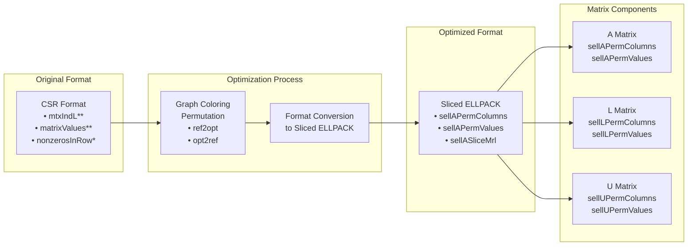
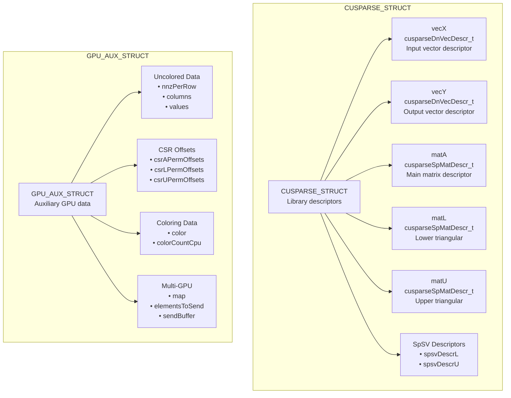
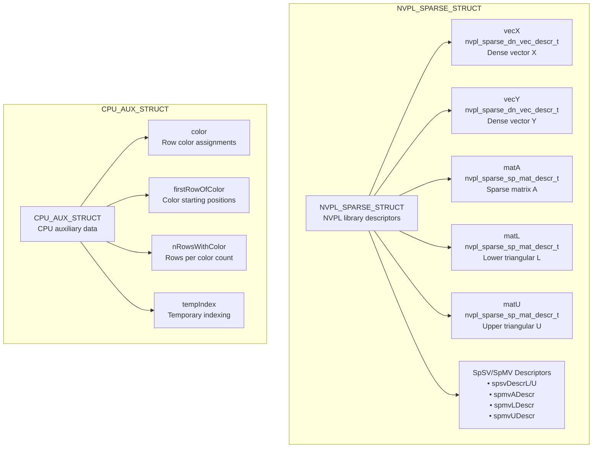
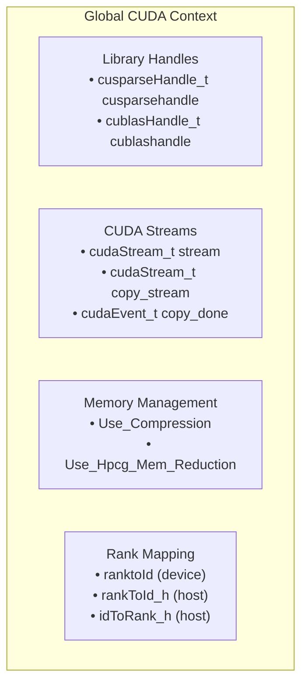
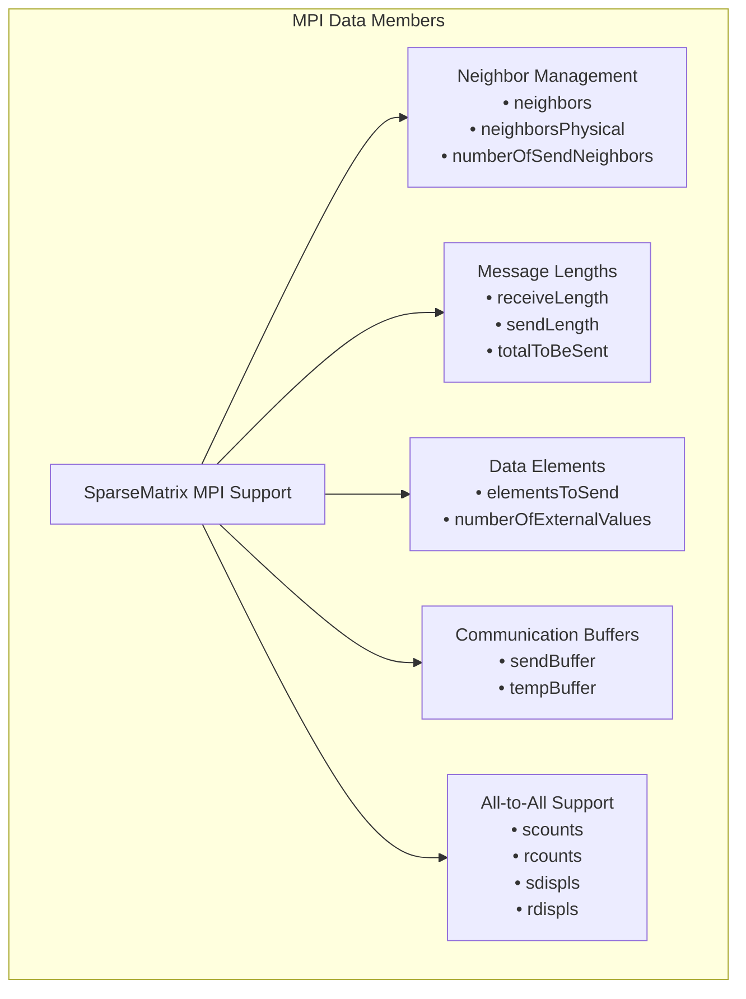

<!-- source: DeepWiki mcp.deepwiki.com · repo NVIDIA/nvidia-hpcg · page 3.3 Core Data Structures · fetched 2026-10-26 -->

# Core Data Structures

Relevant source files

The following files were used as context for generating this wiki page:

- [src/Cuda.hpp](src/Cuda.hpp)
- [src/SparseMatrix.hpp](src/SparseMatrix.hpp)

This document covers the fundamental data structures that form the foundation of NVIDIA HPCG's sparse matrix computations. These structures enable efficient execution across heterogeneous GPU and CPU architectures while supporting distributed memory parallelism.

For information about how these structures are initialized and configured, see [Initialization and Configuration](#3.2). For details on how they are used in GPU and CPU computational engines, see [GPU Acceleration (CUDA)](#4.1) and [CPU Optimization (Grace)](#4.2).

## Primary Data Structure Architecture

The core of HPCG revolves around the `SparseMatrix_STRUCT`, which serves as the central data container for sparse matrix operations across all execution modes.

### SparseMatrix Structure Overview

```mermaid
graph TB
    subgraph "SparseMatrix_STRUCT Core"
        SM["SparseMatrix_STRUCT<br/>Primary matrix container"]
        
        SM --> META["Matrix Metadata<br/>• totalNumberOfRows<br/>• localNumberOfRows<br/>• localNumberOfNonzeros"]
        
        SM --> STORAGE["Storage Arrays<br/>• matrixValues**<br/>• mtxIndL** (local indices)<br/>• mtxIndG** (global indices)<br/>• matrixDiagonal**"]
        
        SM --> GEOM["Geometry*<br/>Grid topology and<br/>domain decomposition"]
        
        SM --> MAPS["Index Mappings<br/>• globalToLocalMap<br/>• localToGlobalMap"]
    end
    
    subgraph "Optimization Data"
        SM --> PERM["Permutation Arrays<br/>• ref2opt<br/>• opt2ref<br/>• f2cPerm"]
        
        SM --> SELL["Sliced ELLPACK<br/>• sellAPermColumns<br/>• sellAPermValues<br/>• sellASliceMrl"]
        
        SM --> COLOR["Graph Coloring<br/>• totalColors<br/>• color arrays"]
    end
    
    subgraph "Architecture-Specific"
        SM --> GPU_STRUCT["CUSPARSE_STRUCT<br/>cusparseOpt"]
        SM --> GPU_AUX["GPU_AUX_STRUCT<br/>gpuAux"]
        SM --> CPU_STRUCT["NVPL_SPARSE_STRUCT<br/>nvplSparseOpt"]
        SM --> CPU_AUX["CPU_AUX_STRUCT<br/>cpuAux"]
    end
```

**SparseMatrix Structure Definition**

The `SparseMatrix_STRUCT` is defined in [src/SparseMatrix.hpp:143-226]() and contains several categories of data members:

| Category | Purpose | Key Members |
|----------|---------|-------------|
| Matrix Metadata | Size and topology information | `totalNumberOfRows`, `localNumberOfRows`, `localNumberOfNonzeros` |
| Storage Arrays | Raw matrix data | `matrixValues`, `mtxIndL`, `mtxIndG`, `matrixDiagonal` |
| Index Mappings | Global/local coordinate translation | `globalToLocalMap`, `localToGlobalMap` |
| Optimization Data | Performance enhancement structures | `ref2opt`, `opt2ref`, Sliced ELLPACK arrays |
| Architecture-Specific | GPU/CPU execution support | `cusparseOpt`, `gpuAux`, `nvplSparseOpt`, `cpuAux` |

Sources: [src/SparseMatrix.hpp:143-226]()

## Memory Layout and Storage Formats

HPCG uses multiple storage formats to optimize performance across different hardware architectures and operation types.

### Storage Format Transformation

**Sliced ELLPACK Optimization**

The Sliced ELLPACK format is used to improve memory access patterns and vectorization efficiency. Key arrays include:

- `sellASliceMrl`, `sellLSliceMrl`, `sellUSliceMrl`: Maximum row length per slice for A, L, U matrices
- `sellAPermColumns`, `sellLPermColumns`, `sellUPermColumns`: Permuted column indices
- `sellAPermValues`, `sellLPermValues`, `sellUPermValues`: Permuted matrix values

Sources: [src/SparseMatrix.hpp:191-195]()

## GPU-Specific Data Structures

When compiled with `USE_CUDA`, additional structures provide GPU acceleration support through cuSPARSE and cuBLAS libraries.

### CUDA Library Integration

**GPU Auxiliary Structure Components**

The `GPU_AUX_STRUCT` [src/SparseMatrix.hpp:86-113]() contains specialized data for GPU operations:

| Component | Purpose | Key Members |
|-----------|---------|-------------|
| Uncolored Data | Original matrix format | `nnzPerRow`, `columns`, `values` |
| Permutation Data | Reordered matrix access | `csrAPermOffsets`, `csrLPermOffsets`, `csrUPermOffsets` |
| Graph Coloring | Parallel execution optimization | `color`, `colorCountCpu` |
| Multi-GPU Support | Distributed GPU execution | `map`, `elementsToSend`, `sendBuffer` |

Sources: [src/SparseMatrix.hpp:74-84](), [src/SparseMatrix.hpp:86-113]()

## CPU-Specific Data Structures

For Grace CPU execution with `USE_GRACE`, specialized structures integrate with NVPL Sparse library for optimized CPU performance.

### NVPL Sparse Integration

**CPU Coloring Strategy**

The `CPU_AUX_STRUCT` [src/SparseMatrix.hpp:130-141]() implements a color-based parallelization strategy:

- `color`: Array mapping rows to color assignments
- `firstRowOfColor`: Starting row index for each color
- `nRowsWithColor`: Number of consecutive rows sharing the same color
- `tempIndex`: Temporary workspace for reordering operations

Sources: [src/SparseMatrix.hpp:116-128](), [src/SparseMatrix.hpp:130-141]()

## Global CUDA Context

The global CUDA execution context is managed through shared handles and configuration flags defined in the CUDA header.

### Global CUDA Resources

**Global Context Variables**

Key global variables from [src/Cuda.hpp:33-42]():

| Variable | Type | Purpose |
|----------|------|---------|
| `cusparsehandle` | `cusparseHandle_t` | Global cuSPARSE library handle |
| `cublashandle` | `cublasHandle_t` | Global cuBLAS library handle |
| `stream` | `cudaStream_t` | Primary CUDA execution stream |
| `copy_stream` | `cudaStream_t` | Dedicated stream for memory transfers |
| `Use_Compression` | `bool` | Enable CUDA L2 compression |
| `Use_Hpcg_Mem_Reduction` | `bool` | Enable aggressive memory reduction |

Sources: [src/Cuda.hpp:33-42]()

## Distributed Computing Support

The sparse matrix structure includes extensive support for MPI-based distributed memory parallelism through dedicated communication arrays and neighbor management.

### MPI Communication Structure

**MPI Communication Arrays**

The distributed memory support in [src/SparseMatrix.hpp:172-213]() includes:

- `neighbors`: Array of MPI ranks for neighboring processes
- `neighborsPhysical`: Physical topology neighbor information  
- `elementsToSend`: Local indices of data to send to neighbors
- `receiveLength`/`sendLength`: Message size arrays for each neighbor
- `sendBuffer`: Non-blocking send buffer for halo exchange

Sources: [src/SparseMatrix.hpp:172-213]()

---

