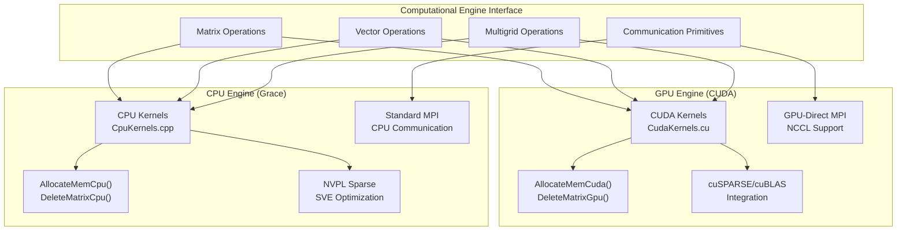
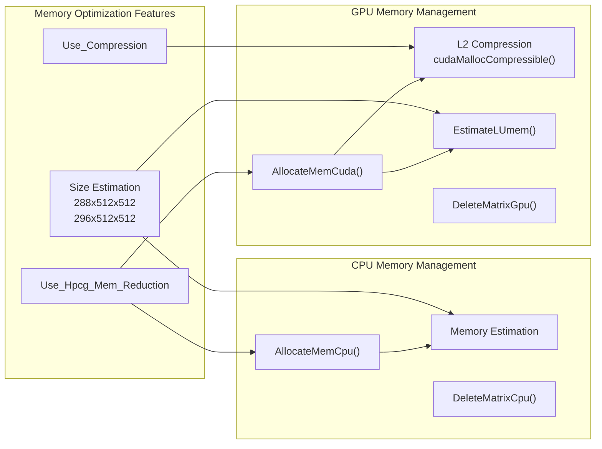
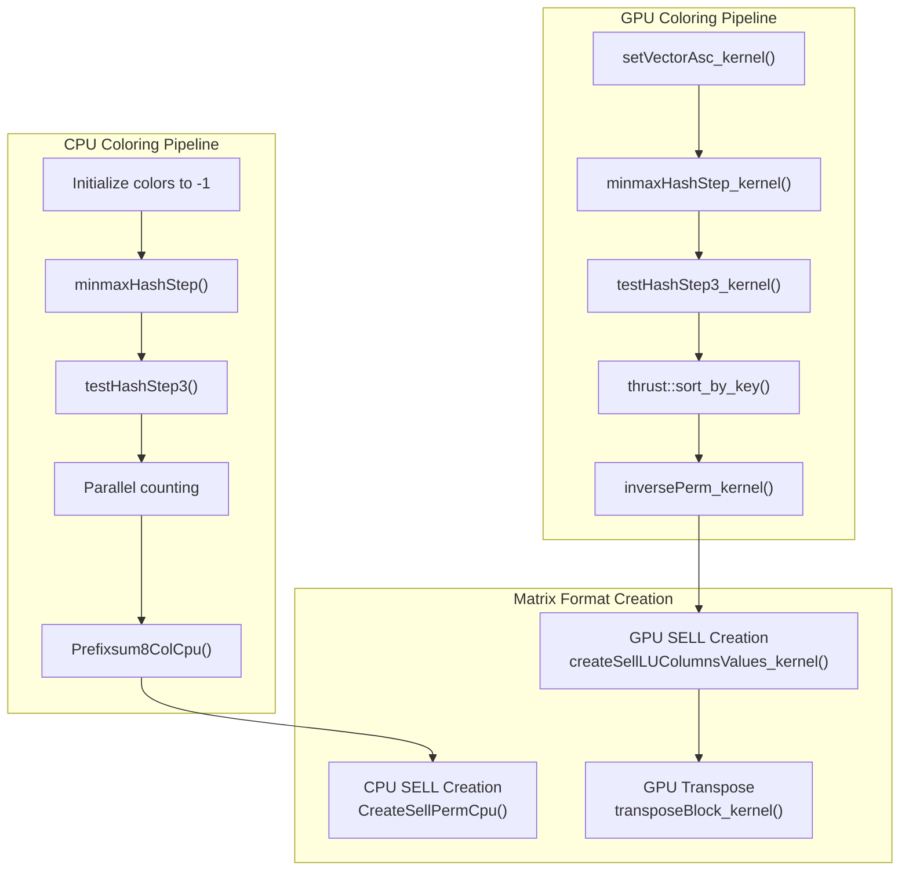
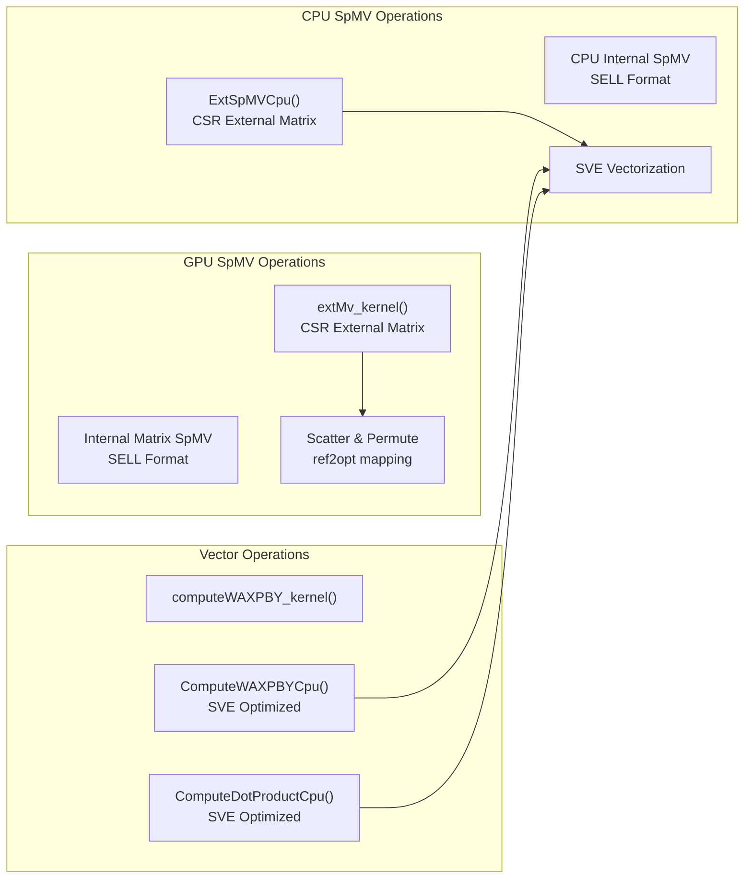
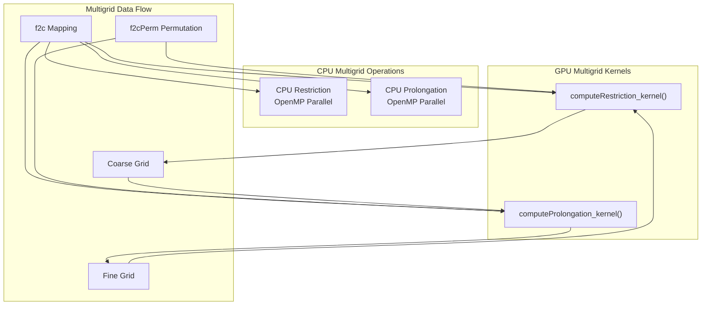
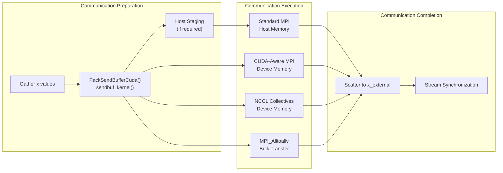

<!-- source: DeepWiki mcp.deepwiki.com · repo NVIDIA/nvidia-hpcg · page 4 Computational Engines · fetched 2026-10-26 -->

# Computational Engines

Relevant source files

The following files were used as context for generating this wiki page:

- [src/CpuKernels.cpp](src/CpuKernels.cpp)
- [src/CudaKernels.cu](src/CudaKernels.cu)

This document describes the dual computational engines that provide high-performance sparse linear algebra operations for the NVIDIA HPCG benchmark. The computational engines consist of specialized GPU (CUDA) and CPU (Grace) execution paths that handle matrix operations, vector computations, and distributed communication primitives.

For information about the overall architecture coordination, see [Core Architecture](#3). For details about specific matrix data structures used by these engines, see [Core Data Structures](#3.3). For distributed computing coordination that uses these engines, see [Distributed Computing](#5.2).

## Engine Architecture Overview

The computational engines implement a dual-path architecture supporting both GPU acceleration and CPU optimization targeting NVIDIA Grace processors:

**Sources:** [src/CudaKernels.cu:1-2427](), [src/CpuKernels.cpp:1-1351]()

## Memory Management Subsystem

Both engines implement sophisticated memory management with optimization features:

The memory management implements several key optimizations:

| Feature | GPU Implementation | CPU Implementation |
|---------|-------------------|-------------------|
| L2 Compression | `cudaMallocCompressible()` | Not available |
| Memory Reduction | Shared L/U matrices | Shared L/U matrices |
| Size Estimation | `EstimateLUmem()` with hardcoded sizes | Same estimation logic |
| Buffer Optimization | cuSPARSE SpSV buffers | NVPL SpSV buffers |

**Sources:** [src/CudaKernels.cu:173-243](), [src/CudaKernels.cu:252-343](), [src/CpuKernels.cpp:24-132]()

## Matrix Operations Engine

### Graph Coloring and Optimization

Both engines implement the Jones-Plassmann Luby graph coloring algorithm for matrix optimization:

**Sources:** [src/CudaKernels.cu:1782-1875](), [src/CpuKernels.cpp:572-703](), [src/CudaKernels.cu:1977-1993](), [src/CpuKernels.cpp:708-887]()

### Sparse Matrix Vector Multiplication (SpMV)

The engines provide optimized SpMV implementations for different matrix formats:

**Sources:** [src/CudaKernels.cu:2222-2281](), [src/CpuKernels.cpp:1334-1350](), [src/CudaKernels.cu:2126-2147](), [src/CpuKernels.cpp:1076-1258]()

## Multigrid Operations

Both engines implement multigrid restriction and prolongation operations:

**Sources:** [src/CudaKernels.cu:2098-2120](), [src/CudaKernels.cu:2071-2093]()

## Communication Integration

The engines integrate with multiple communication backends for distributed execution:

| Communication Mode | GPU Support | CPU Support | Implementation |
|-------------------|-------------|-------------|----------------|
| `MPI_CPU` | Host staging | Direct | `ExchangeHaloCuda()` with staging |
| `MPI_CUDA_AWARE` | GPU-Direct | N/A | Direct GPU memory MPI |
| `MPI_GPU_All2allv` | GPU-Direct | N/A | `MPI_Alltoallv` on GPU memory |
| `MPI_CPU_All2allv` | Host staging | Direct | `MPI_Alltoallv` with staging |
| `NCCL` | Native | N/A | `ncclSend`/`ncclRecv` operations |

The halo exchange implementation supports different P2P communication modes:

**Sources:** [src/CudaKernels.cu:1200-1348](), [src/CudaKernels.cu:1081-1156]()

## Engine Performance Features

### GPU-Specific Optimizations

- **L2 Memory Compression**: Reduces memory bandwidth requirements for large matrices
- **Cooperative Groups**: Efficient warp-level primitives for reduction operations  
- **Thrust Integration**: GPU-accelerated sorting and algorithms for matrix optimization
- **cuSPARSE Integration**: Hardware-accelerated sparse operations

### CPU-Specific Optimizations  

- **SVE Vectorization**: ARM Scalable Vector Extensions for vectorized operations
- **OpenMP Parallelization**: Multi-threaded execution across CPU cores
- **NVPL Sparse Integration**: Optimized sparse linear algebra library
- **Memory Prefetching**: Optimized memory access patterns

**Sources:** [src/CudaKernels.cu:60-139](), [src/CpuKernels.cpp:948-1070](), [src/CpuKernels.cpp:1076-1258]()

---

