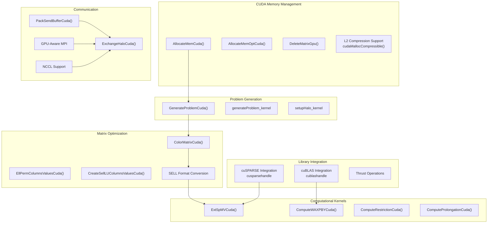
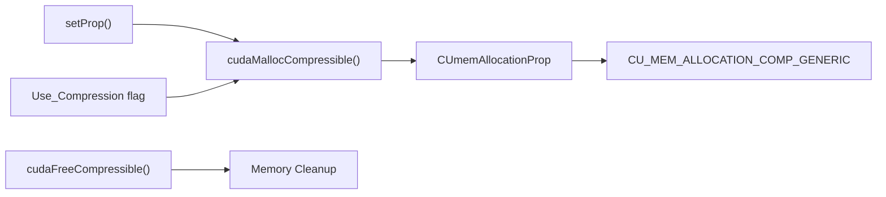
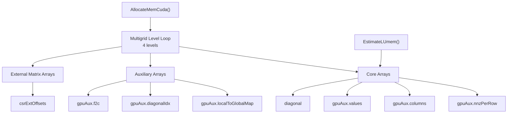
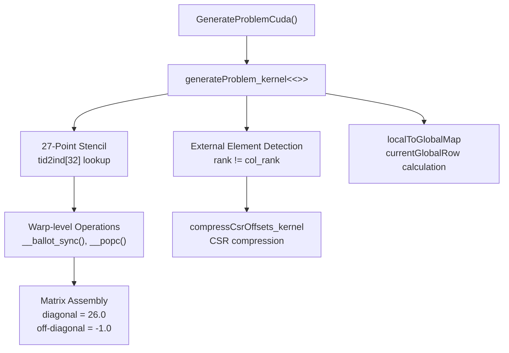
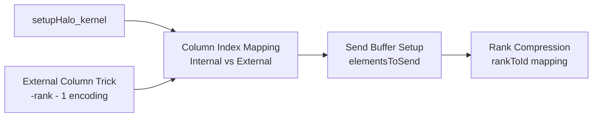
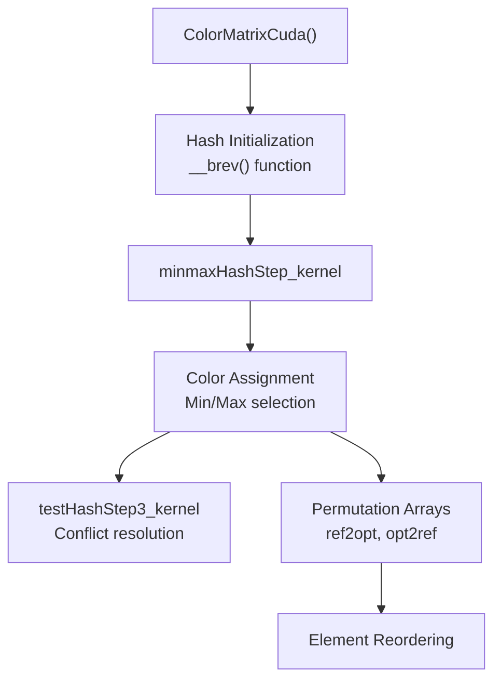
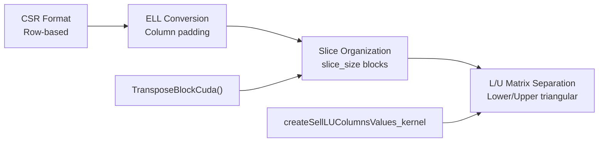
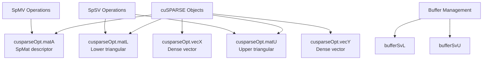
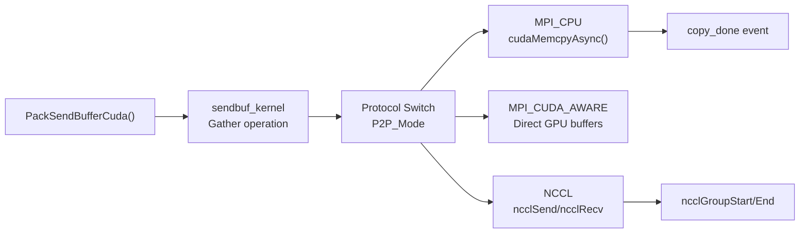

<!-- source: DeepWiki mcp.deepwiki.com · repo NVIDIA/nvidia-hpcg · page 4.1 GPU Acceleration (CUDA) · fetched 2026-10-26 -->

# GPU Acceleration (CUDA)

Relevant source files

The following files were used as context for generating this wiki page:

- [src/Cuda.hpp](src/Cuda.hpp)
- [src/CudaKernels.cu](src/CudaKernels.cu)
- [src/CudaKernels.hpp](src/CudaKernels.hpp)

This document covers the CUDA-based GPU acceleration implementation in NVIDIA HPCG, including memory management, kernel implementations, sparse matrix operations, and integration with cuSPARSE/cuBLAS libraries. The GPU acceleration provides high-performance execution paths for sparse linear algebra operations and distributed communication.

For CPU-optimized implementations on Grace processors, see [CPU Optimization (Grace)](#4.2). For overall computational architecture, see [Computational Engines](#4).

## Architecture Overview

The CUDA acceleration system provides a comprehensive GPU execution path that parallels the CPU implementation while leveraging GPU-specific optimizations.

### Core Components

**Sources:** [src/CudaKernels.cu:1-2000](), [src/CudaKernels.hpp:1-93](), [src/Cuda.hpp:1-87]()

### CUDA Runtime Context

The system maintains global CUDA runtime objects for efficient resource management:

| Object | Type | Purpose |
|--------|------|---------|
| `cusparsehandle` | `cusparseHandle_t` | cuSPARSE operations |
| `cublashandle` | `cublasHandle_t` | cuBLAS operations |
| `stream` | `cudaStream_t` | Primary execution stream |
| `copy_stream` | `cudaStream_t` | Async memory transfers |
| `copy_done` | `cudaEvent_t` | Stream synchronization |

**Sources:** [src/Cuda.hpp:33-37]()

## Memory Management

### L2 Compression Support

The CUDA implementation includes advanced memory compression capabilities for improved bandwidth utilization:

The compression system uses CUDA's virtual memory management API to enable L2 cache compression on supported hardware. The `Use_Compression` global flag controls whether compression is enabled.

**Sources:** [src/CudaKernels.cu:60-139](), [src/Cuda.hpp:41]()

### Matrix Memory Allocation

Memory allocation occurs in two phases aligned with the benchmark workflow:

#### Phase 1: Initial Allocation (`AllocateMemCuda`)

The allocation strategy uses `EstimateLUmem()` to predict memory requirements for lower and upper triangular matrices, reducing over-allocation.

**Sources:** [src/CudaKernels.cu:173-243](), [src/CudaKernels.cu:146-168]()

#### Phase 2: Optimization Allocation (`AllocateMemOptCuda`)

After matrix optimization, additional SELL format structures are allocated:

- `sellAPermColumns`, `sellLPermColumns`, `sellUPermColumns`
- `sellAPermValues`, `sellLPermValues`, `sellUPermValues`  
- `sellASliceMrl`, `sellLSliceMrl`, `sellUSliceMrl`
- Coloring arrays and cuSPARSE SpSV buffers

**Sources:** [src/CudaKernels.cu:252-343]()

## Problem Generation

### CUDA Kernel Implementation

The problem generation uses specialized CUDA kernels that handle the 27-point stencil pattern efficiently:

The kernel uses warp-level primitives for efficient neighbor detection and matrix assembly. The `tid2ind` array provides coordinate translations for the 27-point stencil pattern.

**Sources:** [src/CudaKernels.cu:506-763](), [src/CudaKernels.cu:769-833]()

### Halo Region Setup

The `setupHalo_kernel` establishes communication patterns for distributed execution:

External columns are temporarily encoded as `-rank - 1` to enable fast rank identification during communication setup.

**Sources:** [src/CudaKernels.cu:846-1023](), [src/CudaKernels.cu:1081-1178]()

## Matrix Optimization

### Graph Coloring Algorithm

The system implements the Jones-Plassmann Luby algorithm for matrix reordering:

The coloring algorithm uses bit-reversal hashing (`__brev()`) and atomic operations for conflict-free parallel coloring.

**Sources:** [src/CudaKernels.cu:1784-1850](), [src/CudaKernels.cu:1368-1454]()

### SELL Format Conversion

The optimized matrix uses Sliced ELLPACK (SELL) format for improved memory access patterns:

The SELL format organizes matrix rows into slices of configurable size (`slice_size`), with separate lower and upper triangular matrices for efficient triangular solves.

**Sources:** [src/CudaKernels.cu:1683-1738](), [src/CudaKernels.cu:1558-1583]()

## Library Integration

### cuSPARSE Integration

The system leverages cuSPARSE for optimized sparse matrix operations:

The cuSPARSE integration includes pre-allocated buffers for SpSV operations and optimized descriptors for different matrix formats.

**Sources:** [src/CudaKernels.cu:460-468](), [src/CudaKernels.cu:324-331]()

### Memory Reduction Optimizations

The `Use_Hpcg_Mem_Reduction` flag enables aggressive memory optimization:

- Shared L/U matrix values (`sellLPermValues = sellUPermValues`)
- Shared SpSV buffers (`bufferSvU = bufferSvL`)
- Hard-coded size estimates for common problem dimensions

**Sources:** [src/CudaKernels.cu:281-287](), [src/CudaKernels.cu:296-302](), [src/Cuda.hpp:42]()

## Communication Patterns

### Multi-Protocol Support

The CUDA implementation supports multiple communication protocols via the `P2P_Mode` enumeration:

| Mode | Description | Data Path |
|------|-------------|-----------|
| `MPI_CPU` | CPU-based MPI | GPU → CPU → MPI → CPU → GPU |
| `MPI_CUDA_AWARE` | GPU-aware MPI | GPU → MPI → GPU |
| `MPI_GPU_All2allv` | GPU collective | GPU → MPI_Alltoallv → GPU |
| `MPI_CPU_All2allv` | CPU collective | GPU → CPU → MPI_Alltoallv → CPU → GPU |
| `NCCL` | NVIDIA collective | GPU → NCCL → GPU |

**Sources:** [src/CudaKernels.cu:1224-1347]()

### Halo Exchange Implementation

The halo exchange system adapts to different MPI implementations and hardware capabilities, with optimized paths for GPU-aware MPI and NCCL.

**Sources:** [src/CudaKernels.cu:1185-1347](), [src/CudaKernels.cu:1200-1215]()

### Stream-based Execution

The implementation uses CUDA streams for overlapping computation and communication:

- Primary `stream` for computational kernels
- `copy_stream` for asynchronous memory transfers  
- `copy_done` event for stream synchronization

**Sources:** [src/CudaKernels.cu:1211-1213](), [src/CudaKernels.cu:1265-1267]()

---

