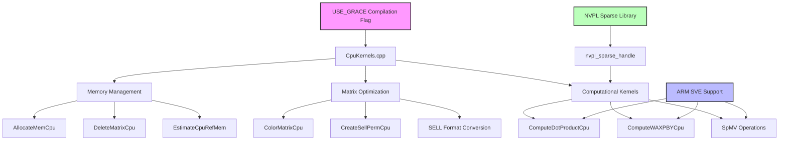
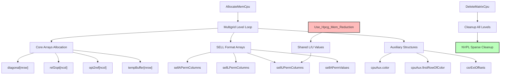
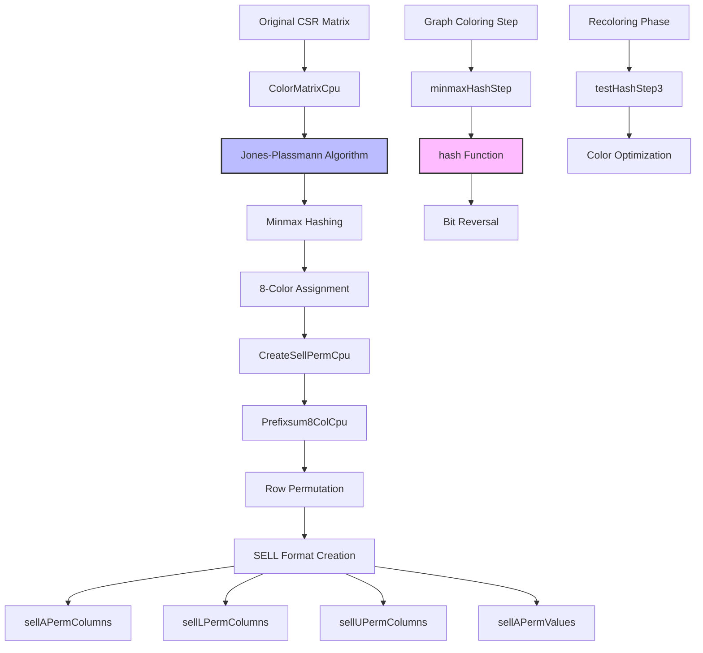
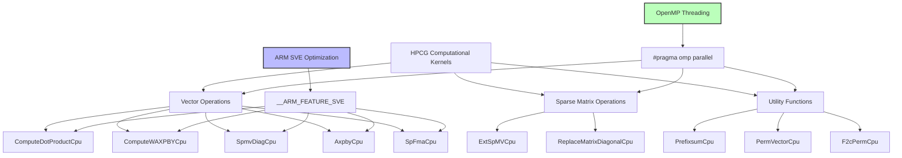
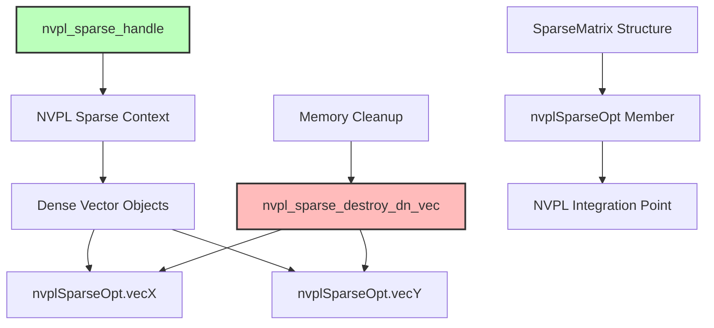
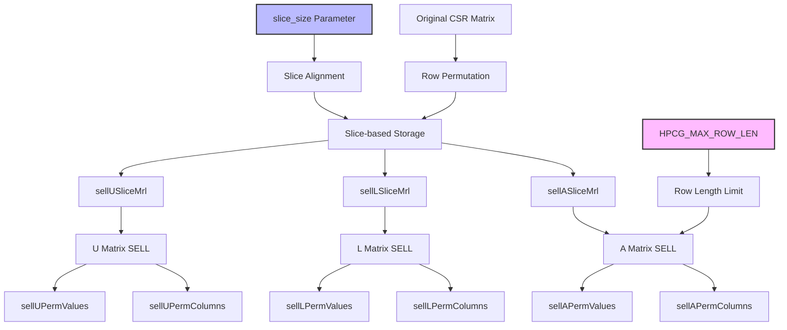

<!-- source: DeepWiki mcp.deepwiki.com · repo NVIDIA/nvidia-hpcg · page 4.2 CPU Optimization (Grace) · fetched 2026-10-26 -->

# CPU Optimization (Grace)

<details>
<summary>Relevant source files</summary>

The following files were used as context for generating this wiki page:

- [src/CpuKernels.cpp](src/CpuKernels.cpp)
- [src/CpuKernels.hpp](src/CpuKernels.hpp)

</details>


This document covers the CPU-optimized implementation of HPCG computational kernels specifically designed for NVIDIA Grace processors. The Grace CPU optimization provides high-performance sparse matrix operations through vectorization, NVPL Sparse library integration, and specialized data structures.

For GPU acceleration features, see [GPU Acceleration (CUDA)](#4.1). For general multigrid algorithm details, see [Multigrid Methods](#5.1).

## Architecture Overview

The CPU optimization layer provides a complete computational engine that mirrors the GPU functionality while leveraging ARM-specific optimizations and NVPL Sparse library capabilities.

**CPU Kernel Architecture**


Sources: [src/CpuKernels.cpp:18-21](), [src/CpuKernels.hpp:21-24]()

## Memory Management

The CPU implementation provides comprehensive memory management for all Grace-specific data structures, including optimized allocation strategies and memory reduction techniques.

**Memory Management Flow**


Sources: [src/CpuKernels.cpp:24-132](), [src/CpuKernels.cpp:134-256]()

The `AllocateMemCpu` function implements several key optimizations:
- **Memory Reduction**: When `Use_Hpcg_Mem_Reduction` is enabled, L and U matrices share storage
- **Hard-coded Sizes**: Specific optimizations for 512x512x288 and 512x512x296 problem sizes
- **Multigrid Hierarchy**: Allocates memory for 4 levels of the multigrid hierarchy

## Matrix Optimization Pipeline

The CPU implementation transforms sparse matrices through graph coloring and format conversion to enable efficient parallel processing.

**Matrix Optimization Flow**


Sources: [src/CpuKernels.cpp:572-703](), [src/CpuKernels.cpp:708-887](), [src/CpuKernels.cpp:459-472]()

The graph coloring algorithm uses several sophisticated techniques:
- **Jones-Plassmann Algorithm**: Parallel graph coloring with minmax hashing [src/CpuKernels.cpp:479-524]()
- **Bit Reversal Hashing**: Creates random ordering for conflict resolution [src/CpuKernels.cpp:459-472]()
- **Color Optimization**: Reduces color count through iterative recoloring [src/CpuKernels.cpp:624-646]()

## Computational Kernels

The CPU kernels provide optimized implementations of core HPCG operations with ARM SVE vectorization support.

**Computational Kernel Organization**


Sources: [src/CpuKernels.cpp:948-1070](), [src/CpuKernels.cpp:1076-1258](), [src/CpuKernels.cpp:1264-1350]()

### Vector Operations

The vector operations implement fundamental linear algebra primitives:

| Function | Purpose | SVE Optimized |
|----------|---------|---------------|
| `ComputeDotProductCpu` | Dot product computation | Yes |
| `ComputeWAXPBYCpu` | WAXPBY operation (w = αx + βy) | Yes |
| `SpmvDiagCpu` | Diagonal scaling | Yes |
| `AxpbyCpu` | Vector subtraction (z = x - y) | Yes |
| `SpFmaCpu` | Fused multiply-add (z += x * y) | Yes |

### ARM SVE Vectorization

The implementation leverages ARM Scalable Vector Extensions for optimal performance:

```cpp
// Example SVE optimization pattern from ComputeDotProductCpu
#if defined(__ARM_FEATURE_SVE) && !defined(INDEX_64)
    local_int_t stride = 4 * svcntd();
    svfloat64_t lres0 = svdup_f64(0.0);
    svfloat64_t sv_xv0 = svld1_f64(pg0, &xv[i]);
    lres0 = svmla_f64_m(pg0, lres0, sv_xv0, sv_xv0);
#endif
```

Sources: [src/CpuKernels.cpp:955-1002](), [src/CpuKernels.cpp:1098-1143]()

## NVPL Sparse Integration

The CPU implementation integrates with NVIDIA Performance Libraries (NVPL) Sparse for optimized sparse matrix operations.

**NVPL Sparse Integration**


Sources: [src/CpuKernels.hpp:23-24](), [src/CpuKernels.cpp:226-229]()

## Sliced ELLPACK Format

The CPU implementation uses Sliced ELLPACK (SELL) format for efficient sparse matrix storage and computation.

**SELL Format Structure**


Sources: [src/CpuKernels.cpp:744-887](), [src/CpuKernels.cpp:89-95]()

The SELL format provides several advantages:
- **Vectorization-Friendly**: Enables efficient SIMD processing
- **Load Balancing**: Reduces work imbalance across threads
- **Cache Efficiency**: Improves memory access patterns
- **Separate L/U Storage**: Enables independent processing of lower/upper triangular parts

## Compilation and Configuration

The CPU optimization features are enabled through specific compilation flags and configuration options:

| Flag | Purpose |
|------|---------|
| `USE_GRACE` | Enables all Grace CPU optimizations |
| `__ARM_FEATURE_SVE` | Enables ARM SVE vectorization |
| `INDEX_64` | Controls 64-bit indexing (disables some SVE optimizations) |
| `HPCG_NO_OPENMP` | Disables OpenMP threading |
| `HPCG_NO_MPI` | Disables MPI features |

Sources: [src/CpuKernels.cpp:18](), [src/CpuKernels.hpp:32](), [src/CpuKernels.cpp:955]()

---

