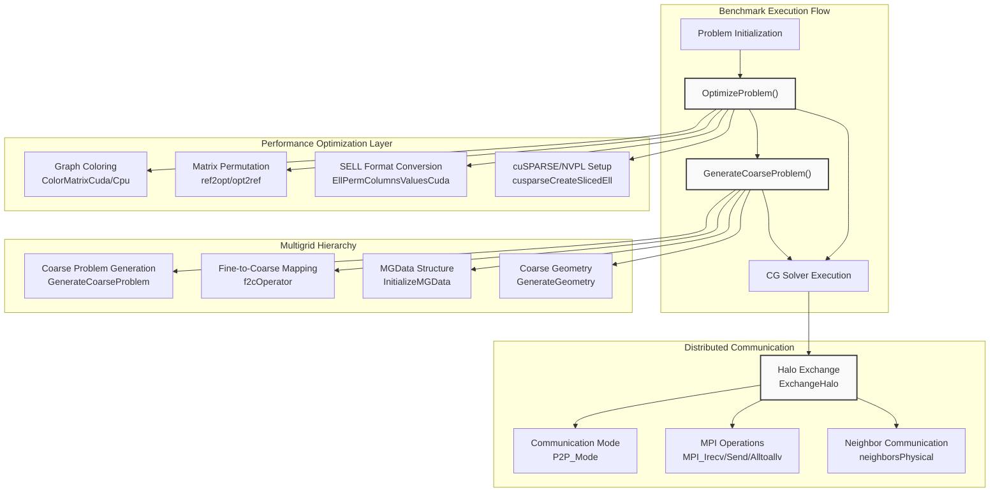
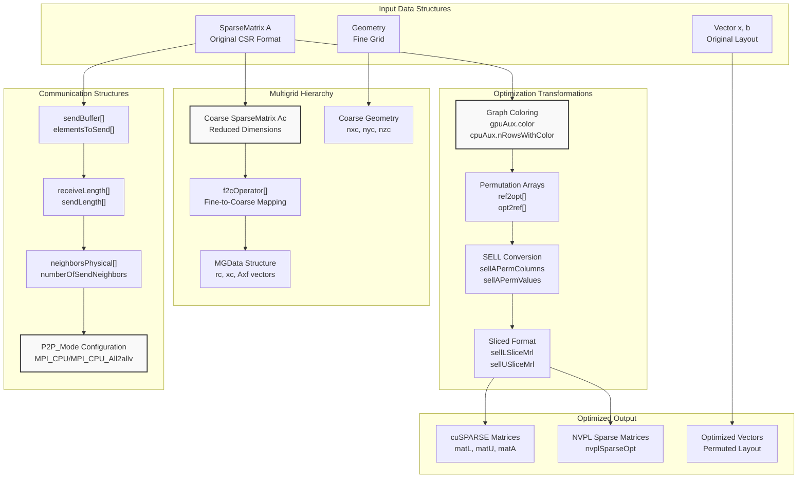

<!-- source: DeepWiki mcp.deepwiki.com · repo NVIDIA/nvidia-hpcg · page 5 Advanced Features · fetched 2026-10-26 -->

# Advanced Features

Relevant source files

The following files were used as context for generating this wiki page:

- [src/ExchangeHalo.cpp](src/ExchangeHalo.cpp)
- [src/GenerateCoarseProblem.cpp](src/GenerateCoarseProblem.cpp)
- [src/OptimizeProblem.cpp](src/OptimizeProblem.cpp)

## Purpose and Scope

This document covers the specialized functionality that enables high-performance execution in NVIDIA HPCG, including multigrid preconditioning methods, distributed memory support, and performance optimization techniques. These advanced features work together to achieve optimal performance on heterogeneous HPC systems with GPU and Grace CPU configurations.

For information about the basic computational engines that execute these optimized algorithms, see [Computational Engines](#4). For details about the core data structures these features operate on, see [Core Data Structures](#3.3).

## Advanced Features Architecture

The advanced features system consists of three interconnected subsystems that transform and optimize the benchmark execution:

### High-Level System Integration

Sources: [src/OptimizeProblem.cpp:410-427](), [src/GenerateCoarseProblem.cpp:65-157](), [src/ExchangeHalo.cpp:54-119]()

### Data Structure Transformation Pipeline

Sources: [src/OptimizeProblem.cpp:77-123](), [src/GenerateCoarseProblem.cpp:69-152](), [src/ExchangeHalo.cpp:57-66]()

## Feature Subsystems

### Multigrid Methods

Multigrid preconditioning is implemented through hierarchical coarse problem generation that reduces computational complexity. The `GenerateCoarseProblem` function creates a four-level multigrid hierarchy where each coarse level has dimensions that are half of the fine level in each direction.

Key components include:
- **Coarse grid generation**: Dimensions `nxc = nxf/2`, `nyc = nyf/2`, `nzc = nzf/2`
- **Fine-to-coarse mapping**: `f2cOperator` array maps fine grid points to coarse grid points
- **Multigrid data structure**: `MGData` contains restriction/prolongation operators and auxiliary vectors

For detailed implementation, see [Multigrid Methods](#5.1).

### Distributed Computing

MPI-based distributed memory support enables multi-node scaling through efficient boundary data exchange. The `ExchangeHalo` function implements neighbor communication with multiple communication modes optimized for different network configurations.

Key components include:
- **Communication modes**: `P2P_Mode` supports `MPI_CPU` and `MPI_CPU_All2allv`
- **Neighbor topology**: `neighborsPhysical` array defines communication partners
- **Buffer management**: `sendBuffer` and receive buffers handle boundary data

For detailed implementation, see [Distributed Computing](#5.2).

### Performance Optimization

Matrix optimization transforms the sparse matrix data structures to achieve optimal memory access patterns and leverage hardware-specific libraries. The `OptimizeProblem` function applies graph coloring, permutation, and format conversion techniques.

Key components include:
- **Graph coloring**: Eliminates data dependencies for parallel execution
- **Matrix permutation**: `ref2opt` and `opt2ref` arrays reorder matrix elements
- **SELL format**: Sliced ELLPACK format optimizes memory bandwidth utilization
- **Hardware libraries**: Integration with cuSPARSE (GPU) and NVPL Sparse (CPU)

For detailed implementation, see [Performance Optimization](#5.3).

## Integration Points

These advanced features are tightly integrated within the benchmark execution flow:

| Feature | Integration Point | Primary Function | Data Structures |
|---------|------------------|------------------|-----------------|
| Performance Optimization | After problem generation | `OptimizeProblem()` | `SparseMatrix`, permutation arrays |
| Multigrid Methods | During optimization phase | `GenerateCoarseProblem()` | `MGData`, coarse matrices |
| Distributed Computing | During solver execution | `ExchangeHalo()` | Communication buffers, neighbor lists |

The optimization phase transforms all data structures before solver execution, multigrid hierarchy is established during problem setup, and halo exchange occurs during iterative solving to maintain data consistency across distributed memory boundaries.

Sources: [src/OptimizeProblem.cpp:410-434](), [src/GenerateCoarseProblem.cpp:65-157](), [src/ExchangeHalo.cpp:38-121]()

---

