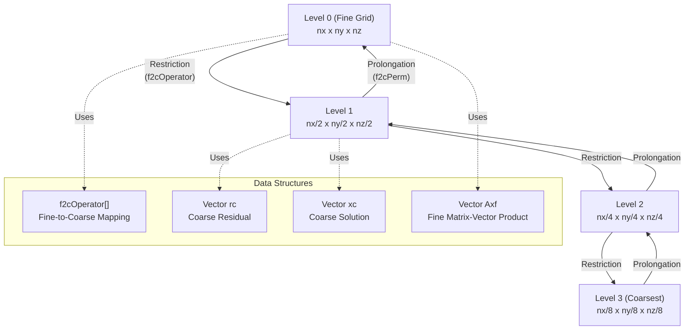
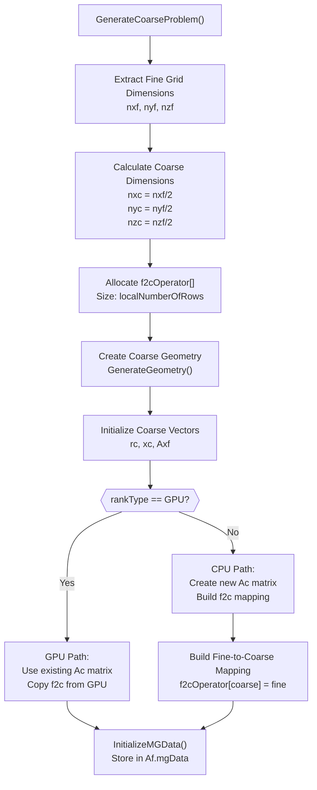
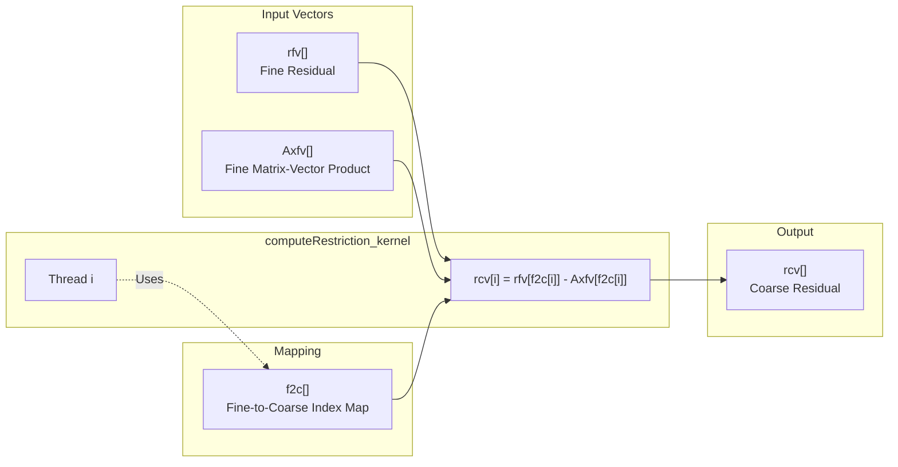
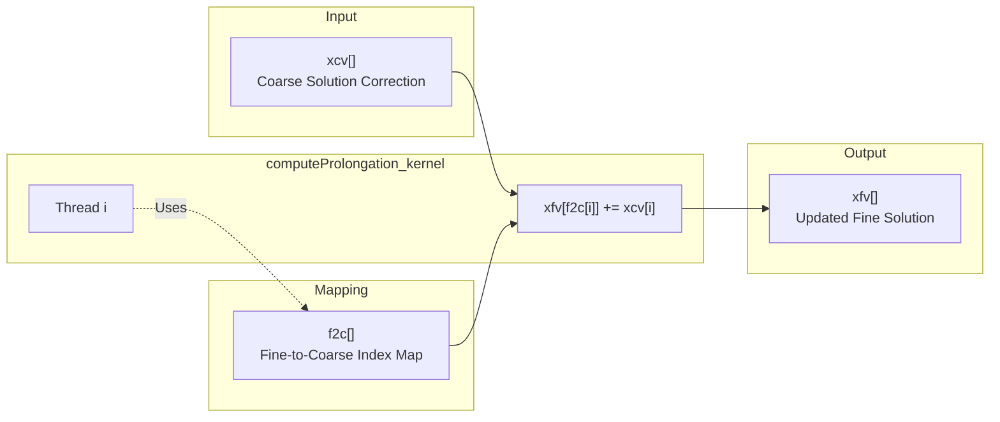
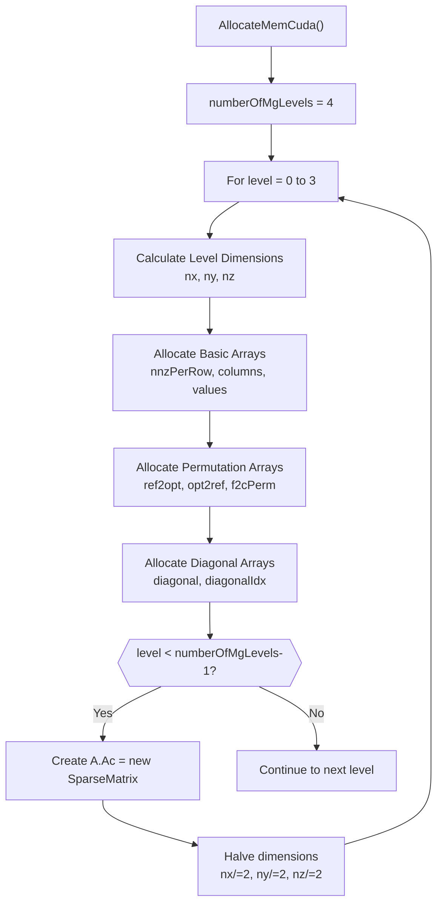

<!-- source: DeepWiki mcp.deepwiki.com · repo NVIDIA/nvidia-hpcg · page 5.1 Multigrid Methods · fetched 2026-10-26 -->

# Multigrid Methods

Relevant source files

The following files were used as context for generating this wiki page:

- [src/CudaKernels.cu](src/CudaKernels.cu)
- [src/GenerateCoarseProblem.cpp](src/GenerateCoarseProblem.cpp)

This document covers the multigrid preconditioning implementation in NVIDIA HPCG, including the hierarchical grid structure, coarse problem generation, and restriction/prolongation operations that accelerate convergence of the conjugate gradient solver.

For information about the core sparse matrix operations that multigrid operates on, see [Computational Engines](#4). For details about the distributed computing aspects of multigrid across multiple nodes, see [Distributed Computing](#5.2).

## Overview

The NVIDIA HPCG implementation uses a 4-level multigrid hierarchy to precondition the conjugate gradient method. The multigrid approach creates progressively coarser representations of the original problem, enabling efficient solution of low-frequency error components that would otherwise converge slowly with basic iterative methods.

**Multigrid Hierarchy Structure**

Sources: [src/CudaKernels.cu:180](), [src/GenerateCoarseProblem.cpp:73-79]()

## Coarse Problem Generation

The `GenerateCoarseProblem` function creates the multigrid hierarchy by constructing coarser versions of the original sparse matrix problem. Each coarse level has dimensions that are half those of the previous level.

**Coarse Problem Generation Flow**

Sources: [src/GenerateCoarseProblem.cpp:65-157](), [src/GenerateCoarseProblem.cpp:98-111](), [src/GenerateCoarseProblem.cpp:138-151]()

### Fine-to-Coarse Mapping

The core of coarse problem generation is establishing the relationship between fine and coarse grid points. For CPU execution, this mapping is computed explicitly:

| Operation | Implementation | Location |
|-----------|----------------|----------|
| Coarse Grid Indexing | `izc * nxc * nyc + iyc * nxc + ixc` | [src/GenerateCoarseProblem.cpp:148]() |
| Fine Grid Indexing | `izf * nxf * nyf + iyf * nxf + ixf` | [src/GenerateCoarseProblem.cpp:149]() |
| Mapping Storage | `f2cOperator[currentCoarseRow] = currentFineRow` | [src/GenerateCoarseProblem.cpp:150]() |

For GPU execution, the mapping is computed during problem setup and stored in the `gpuAux.f2c` array, then copied to the host for use in coarse problem generation.

Sources: [src/GenerateCoarseProblem.cpp:138-151](), [src/GenerateCoarseProblem.cpp:109]()

## Restriction and Prolongation Operations

Multigrid uses two key operations to transfer information between grid levels: restriction (fine-to-coarse) and prolongation (coarse-to-fine).

### Restriction Operation

Restriction transfers the residual from the fine grid to the coarse grid, enabling the coarse grid to solve for the low-frequency error components.

**GPU Restriction Kernel**

The restriction operation is implemented as:
- **Kernel**: `computeRestriction_kernel` - [src/CudaKernels.cu:2071-2079]()
- **Host Function**: `ComputeRestrictionCuda` - [src/CudaKernels.cu:2098-2107]()
- **Formula**: `rcv[i] = rfv[f2c[i]] - Axfv[f2c[i]]`

Sources: [src/CudaKernels.cu:2071-2079](), [src/CudaKernels.cu:2098-2107]()

### Prolongation Operation

Prolongation transfers the coarse grid correction back to the fine grid, updating the fine grid solution with the low-frequency components solved on the coarse grid.

**GPU Prolongation Kernel**

The prolongation operation is implemented as:
- **Kernel**: `computeProlongation_kernel` - [src/CudaKernels.cu:2085-2093]()
- **Host Function**: `ComputeProlongationCuda` - [src/CudaKernels.cu:2112-2120]()  
- **Formula**: `xfv[f2c[i]] += xcv[i]`

Sources: [src/CudaKernels.cu:2085-2093](), [src/CudaKernels.cu:2112-2120]()

## Data Structures and Memory Management

The multigrid implementation maintains several key data structures across the 4-level hierarchy:

### Core Multigrid Data Structures

| Structure | Purpose | Storage Location |
|-----------|---------|------------------|
| `MGData` | Container for all multigrid data | [src/GenerateCoarseProblem.cpp:97]() |
| `f2cOperator` | Fine-to-coarse mapping array | [src/GenerateCoarseProblem.cpp:80]() |
| `f2cPerm` | Permuted fine-to-coarse mapping | [src/CudaKernels.cu:202]() |
| `Vector rc` | Coarse grid residual | [src/GenerateCoarseProblem.cpp:94]() |
| `Vector xc` | Coarse grid solution | [src/GenerateCoarseProblem.cpp:95]() |
| `Vector Axf` | Fine grid matrix-vector product | [src/GenerateCoarseProblem.cpp:96]() |

### Multigrid Memory Allocation

The multigrid hierarchy allocates memory for each of the 4 levels during matrix setup:

**Memory Allocation Flow**

The memory allocation ensures each level has the necessary data structures for both the sparse matrix representation and the multigrid-specific arrays like `f2cPerm` for efficient restriction/prolongation operations.

Sources: [src/CudaKernels.cu:180-242](), [src/CudaKernels.cu:202-203]()

---

