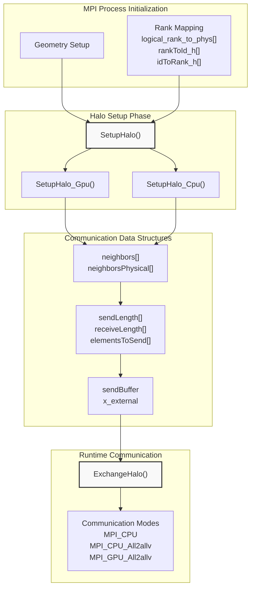
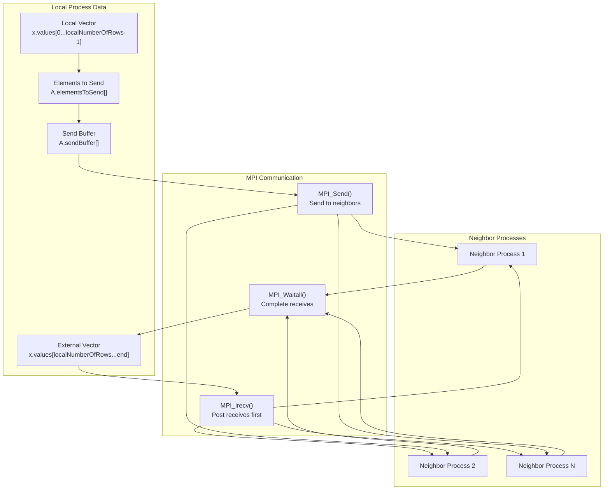
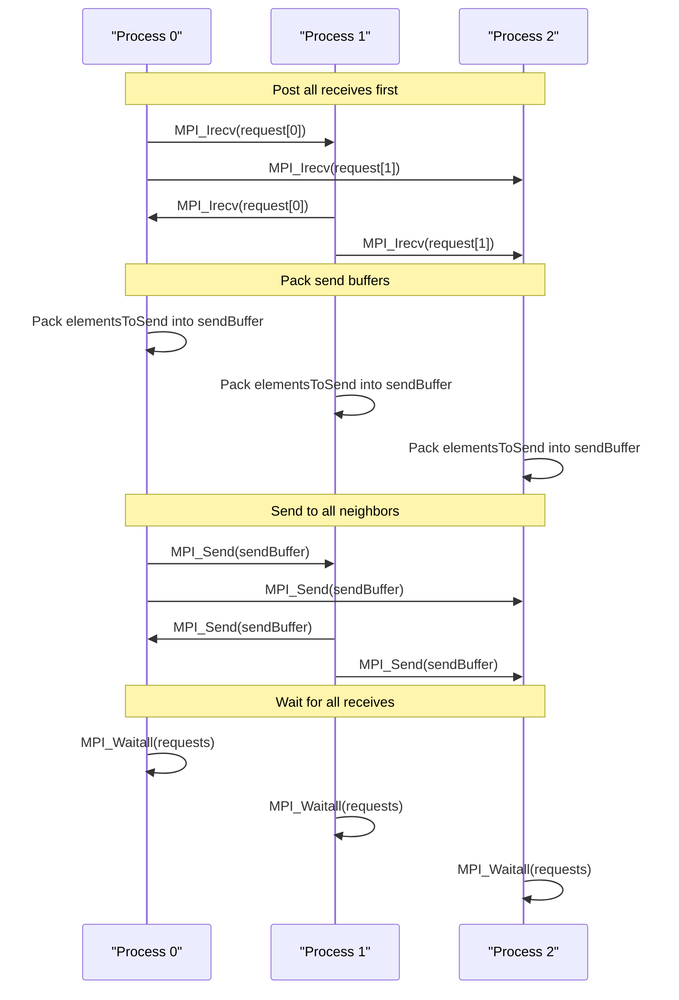
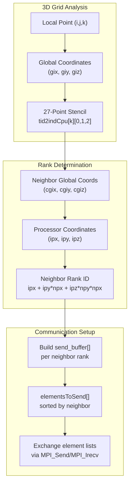
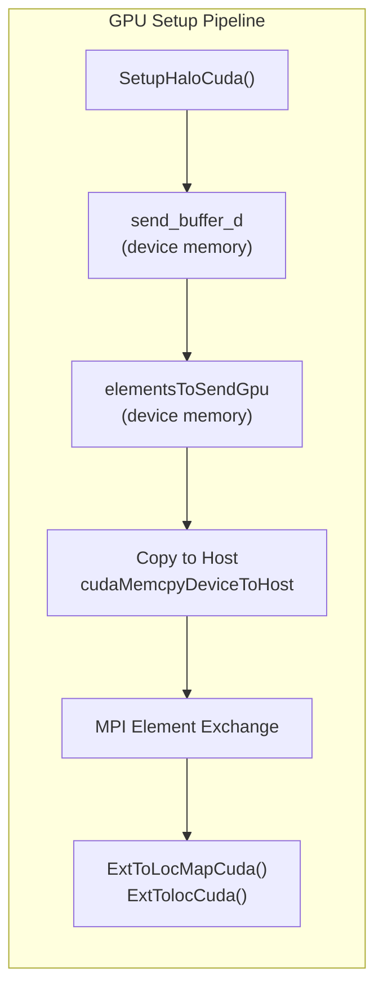
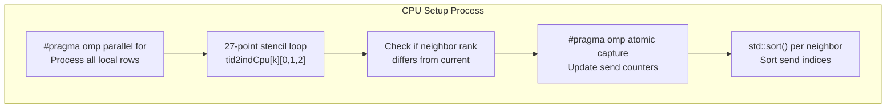
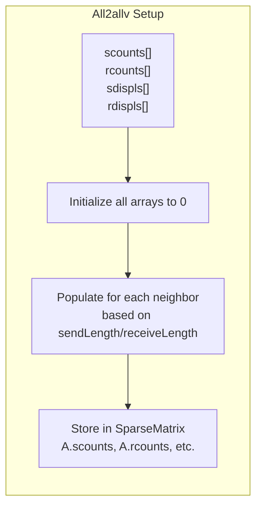

<!-- source: DeepWiki mcp.deepwiki.com · repo NVIDIA/nvidia-hpcg · page 5.2 Distributed Computing · fetched 2026-10-26 -->

# Distributed Computing

Relevant source files

The following files were used as context for generating this wiki page:

- [src/ExchangeHalo.cpp](src/ExchangeHalo.cpp)
- [src/SetupHalo.cpp](src/SetupHalo.cpp)

This document covers the MPI-based distributed memory parallelization in NVIDIA HPCG, focusing on inter-process communication mechanisms and multi-node scaling capabilities. The distributed computing system enables the benchmark to run across multiple processors and nodes through halo exchange operations that synchronize boundary data between neighboring processes.

For information about computational kernels that execute within each process, see [Computational Engines](#4). For details about multigrid hierarchical methods, see [Multigrid Methods](#5.1).

## Overview

The NVIDIA HPCG distributed computing system implements a domain decomposition approach where the 3D problem grid is partitioned across multiple MPI processes. Each process owns a local subdomain and must exchange boundary (halo) data with neighboring processes during iterative solver operations.

### Distributed Computing Architecture

Sources: [src/SetupHalo.cpp:79-256](), [src/SetupHalo.cpp:260-712](), [src/ExchangeHalo.cpp:54-119]()

## Halo Exchange Mechanism

The halo exchange is the core distributed computing operation that synchronizes boundary data between neighboring processes. The system identifies which local vector elements need to be sent to neighbors and which external elements need to be received.

### Halo Exchange Data Flow

Sources: [src/ExchangeHalo.cpp:69-107]()

## Communication Modes

The system supports multiple point-to-point communication modes controlled by the global `P2P_Mode` variable:

| Mode | Description | Implementation |
|------|-------------|----------------|
| `MPI_CPU` | Standard MPI with CPU buffers | Non-blocking receives + blocking sends |
| `MPI_CPU_All2allv` | MPI All-to-all collective | Single `MPI_Alltoallv` call |
| `MPI_GPU_All2allv` | GPU-aware All-to-all | CUDA-aware MPI collective |
| `NCCL` | NVIDIA Collective Communications | GPU-direct communication |

### MPI_CPU Communication Pattern

Sources: [src/ExchangeHalo.cpp:67-107]()

## Setup and Initialization

The halo setup phase analyzes the local matrix structure to determine which elements need communication and identifies neighboring processes.

### Neighbor Discovery Process

Sources: [src/SetupHalo.cpp:314-416]()

## Implementation Details

### GPU-Specific Setup

The GPU implementation uses CUDA kernels to identify boundary elements and prepare communication data structures:

Sources: [src/SetupHalo.cpp:119-121](), [src/SetupHalo.cpp:123-147]()

### CPU-Specific Setup

The CPU implementation processes the 27-point stencil using OpenMP parallelization:

Sources: [src/SetupHalo.cpp:314-416](), [src/SetupHalo.cpp:424-431]()

### Communication Buffer Management

The system maintains several key data structures for efficient communication:

| Structure | Type | Purpose |
|-----------|------|---------|
| `A.neighbors[]` | `int*` | Logical rank IDs of neighboring processes |
| `A.neighborsPhysical[]` | `int*` | Physical rank IDs for MPI communication |
| `A.elementsToSend[]` | `local_int_t*` | Local indices to send to each neighbor |
| `A.sendLength[]` | `local_int_t*` | Number of elements to send per neighbor |
| `A.receiveLength[]` | `local_int_t*` | Number of elements to receive per neighbor |
| `A.sendBuffer` | `double*` | Packed send buffer for MPI operations |

Sources: [src/SetupHalo.cpp:242-253](), [src/SetupHalo.cpp:682-692]()

### All-to-All Communication Setup

For `MPI_CPU_All2allv` and `MPI_GPU_All2allv` modes, the system pre-computes displacement arrays for the collective operation:

Sources: [src/SetupHalo.cpp:205-239](), [src/SetupHalo.cpp:645-678]()

---

