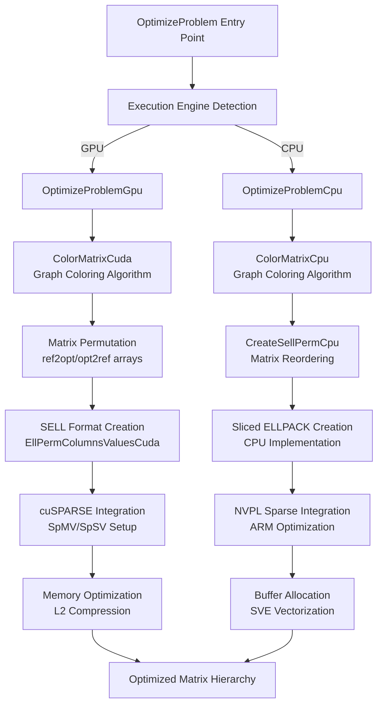
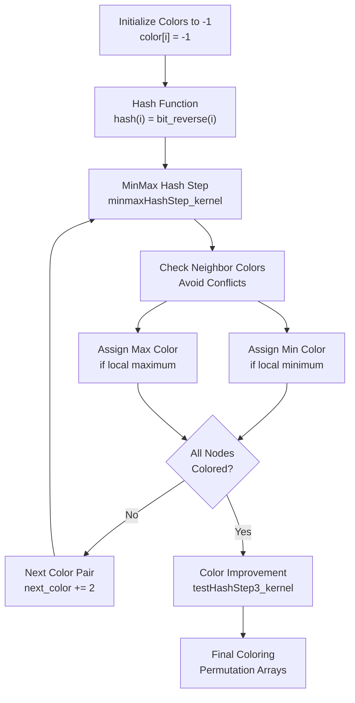
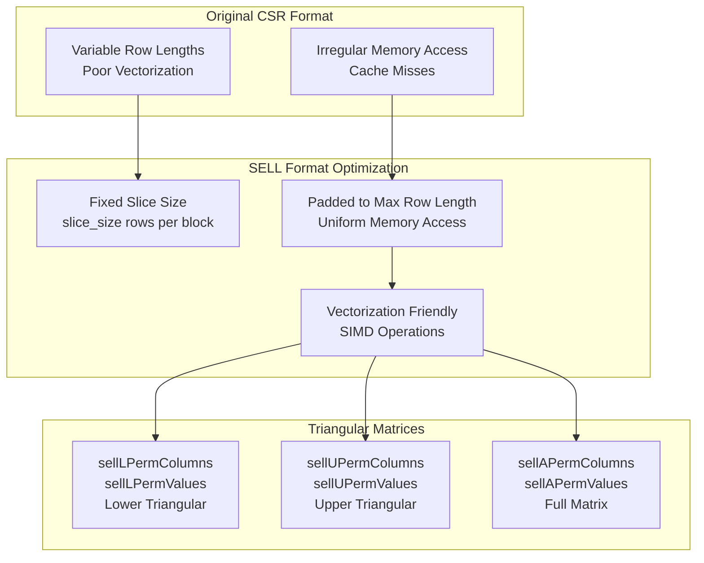
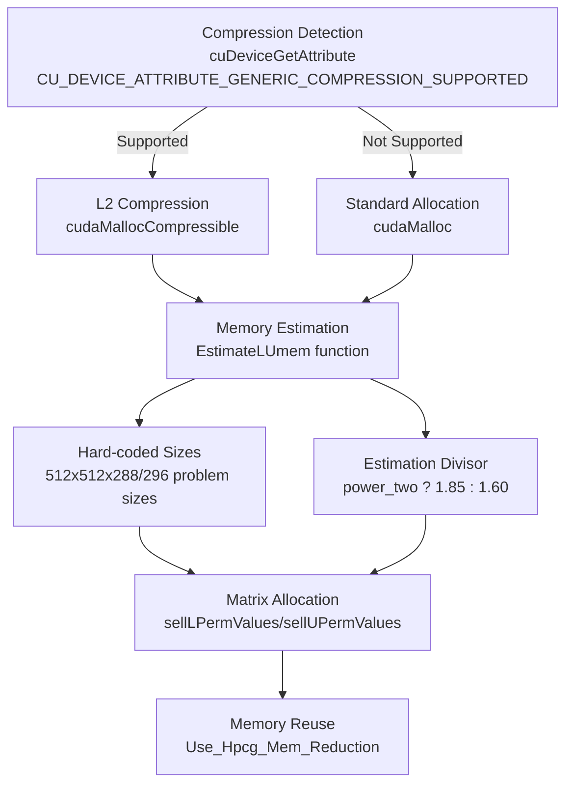
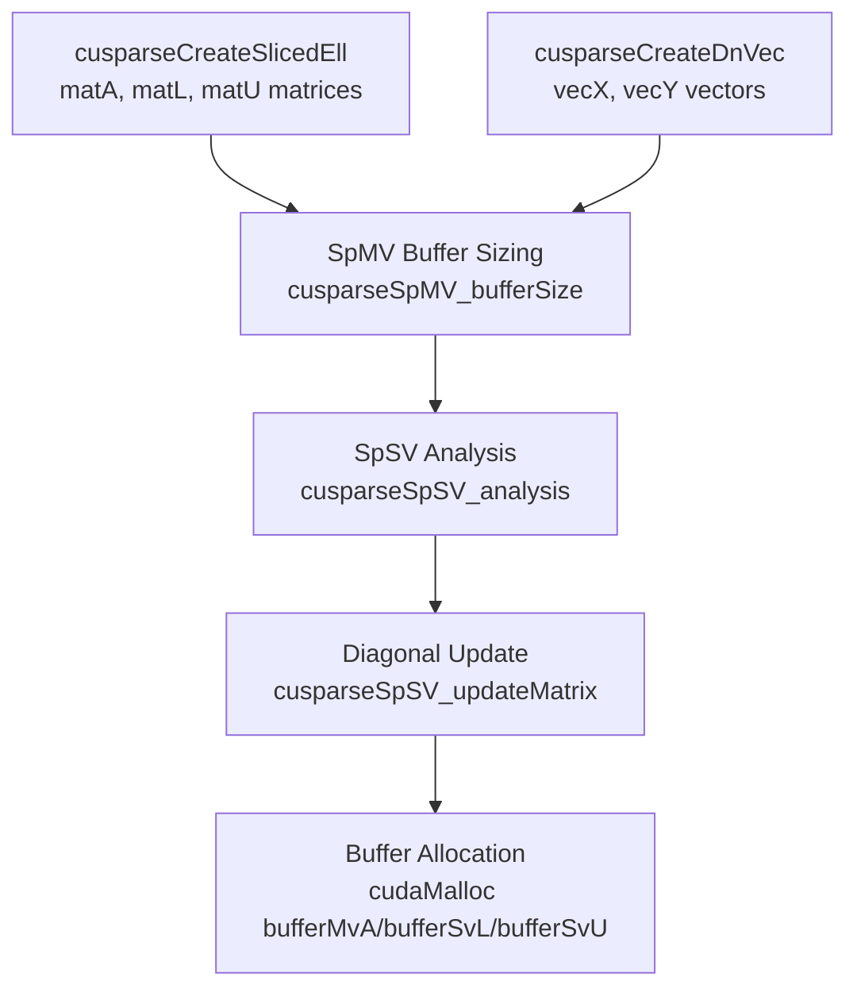
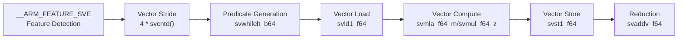

<!-- source: DeepWiki mcp.deepwiki.com · repo NVIDIA/nvidia-hpcg · page 5.3 Performance Optimization · fetched 2026-10-26 -->

# Performance Optimization

<details>
<summary>Relevant source files</summary>

The following files were used as context for generating this wiki page:

- [src/CpuKernels.cpp](src/CpuKernels.cpp)
- [src/CudaKernels.cu](src/CudaKernels.cu)
- [src/OptimizeProblem.cpp](src/OptimizeProblem.cpp)

</details>


This page covers the performance optimization techniques employed in NVIDIA HPCG to maximize sparse linear algebra performance on heterogeneous systems. The optimization phase transforms the initial problem representation into high-performance data structures optimized for the target execution engine (GPU or CPU).

For information about the core computational engines that execute these optimized structures, see [GPU Acceleration (CUDA)](#4.1) and [CPU Optimization (Grace)](#4.2). For details about the multigrid hierarchy setup, see [Multigrid Methods](#5.1).

## Optimization Pipeline Overview

The optimization process follows a structured pipeline that transforms the matrix representation and memory layout to achieve optimal performance:

**Optimization Pipeline Flow**


Sources: [src/OptimizeProblem.cpp:64-233](), [src/OptimizeProblem.cpp:237-407](), [src/OptimizeProblem.cpp:410-427]()

## Graph Coloring and Matrix Reordering

Graph coloring is the foundation of the optimization strategy, enabling parallel execution by eliminating data dependencies between matrix operations.

### Coloring Algorithm Implementation

The system uses the Jones-Plassmann Luby algorithm for both GPU and CPU implementations:

**Graph Coloring Process**


Sources: [src/CudaKernels.cu:1368-1408](), [src/CudaKernels.cu:1415-1454](), [src/CpuKernels.cpp:479-524](), [src/CpuKernels.cpp:532-567]()

### Permutation Array Generation

The coloring produces permutation arrays that reorder matrix rows and columns:

| Array | Purpose | Direction |
|-------|---------|-----------|
| `ref2opt` | Maps original indices to optimized indices | Original → Optimized |
| `opt2ref` | Maps optimized indices back to original | Optimized → Original |
| `f2cPerm` | Fine-to-coarse mapping for multigrid | Fine Level → Coarse Level |

Sources: [src/CudaKernels.cu:1782-1852](), [src/CpuKernels.cpp:708-727]()

## Matrix Format Transformation

The optimization converts matrices from the initial CSR-like format to Sliced ELLPACK (SELL) format for improved performance.

### SELL Format Benefits

**SELL Format Structure**


Sources: [src/CudaKernels.cu:1489-1552](), [src/CudaKernels.cu:1683-1738](), [src/CpuKernels.cpp:708-887]()

### Memory Layout Optimization

The SELL format improves memory access patterns through several techniques:

1. **Slice Organization**: Rows are grouped into slices of fixed size (`slice_size`)
2. **Column-Major Storage**: Within each slice, data is stored column-major for vectorization
3. **Padding Strategy**: Short rows are padded with `-1` values to maintain alignment

Sources: [src/CudaKernels.cu:1558-1583](), [src/CudaKernels.cu:1634-1662]()

## Memory Optimization Strategies

### GPU Memory Optimizations

**GPU Memory Allocation Strategy**


The GPU implementation includes sophisticated memory management:

- **L2 Compression**: Automatically detects and uses GPU L2 compression when available
- **Memory Estimation**: Uses problem-specific heuristics to minimize memory footprint
- **Buffer Reuse**: Shares buffers between L and U matrices when possible

Sources: [src/CudaKernels.cu:61-139](), [src/CudaKernels.cu:146-168](), [src/CudaKernels.cu:252-343]()

### CPU Memory Optimizations

CPU optimization focuses on efficient memory allocation and ARM-specific optimizations:

```cpp
// Memory reduction for CPU implementation
if (Use_Hpcg_Mem_Reduction) {
    A->sellUPermValues = A->sellLPermValues;  // Share L/U values
    opt_mem += 1 * estimated_size * sizeof(double);
} else {
    A->sellUPermValues = new double[estimated_size];
    opt_mem += 2 * estimated_size * sizeof(double);
}
```

Sources: [src/CpuKernels.cpp:99-109](), [src/CpuKernels.cpp:117-124]()

## Library Integration and Sparse Operations

### cuSPARSE Integration (GPU)

The GPU path integrates with cuSPARSE for high-performance sparse operations:

**cuSPARSE Operation Setup**


Sources: [src/OptimizeProblem.cpp:140-151](), [src/OptimizeProblem.cpp:181-212]()

### NVPL Sparse Integration (CPU)

The CPU path uses NVIDIA Performance Libraries for ARM processors:

Key NVPL operations configured:
- **SpMV Operations**: `nvpl_sparse_spmv_buffer_size` for matrix-vector multiply
- **SpSV Operations**: `nvpl_sparse_spsv_analysis` for triangular solves  
- **Memory Management**: Optimized buffer allocation for ARM architecture

Sources: [src/OptimizeProblem.cpp:285-295](), [src/OptimizeProblem.cpp:306-319](), [src/OptimizeProblem.cpp:330-388]()

## Vectorization and Architecture-Specific Optimizations

### ARM SVE Vectorization

The CPU implementation includes ARM Scalable Vector Extension (SVE) optimizations:

**SVE Vectorization Pattern**


SVE is applied to critical kernels:
- Dot product computation (`ComputeDotProductCpu`)
- WAXPBY operations (`ComputeWAXPBYCpu`)
- Element-wise operations (`SpmvDiagCpu`, `AxpbyCpu`)

Sources: [src/CpuKernels.cpp:955-1069](), [src/CpuKernels.cpp:1098-1252](), [src/CpuKernels.cpp:1267-1329]()

### CUDA Kernel Optimizations

GPU kernels employ several optimization techniques:

- **Cooperative Groups**: Thread synchronization and reduction operations
- **Warp-level Primitives**: `__shfl_sync` for efficient data exchange
- **Memory Coalescing**: Optimized memory access patterns in transpose operations

Sources: [src/CudaKernels.cu:530-539](), [src/CudaKernels.cu:1558-1583]()

## Optimization Results and Impact

The optimization process transforms the matrix hierarchy across all multigrid levels, providing:

1. **Memory Efficiency**: Reduced memory footprint through format conversion and compression
2. **Compute Performance**: Vectorization-friendly data layouts enable SIMD operations  
3. **Library Integration**: Leverages highly optimized vendor libraries (cuSPARSE/NVPL)
4. **Parallel Efficiency**: Graph coloring enables conflict-free parallel execution

The optimization phase is critical for achieving the performance characteristics required for the HPCG benchmark evaluation.

Sources: [src/OptimizeProblem.cpp:224-230](), [src/OptimizeProblem.cpp:397-404]()