# Page: Overview

# Overview

<details>
<summary>Relevant source files</summary>

The following files were used as context for generating this wiki page:

- [README.md](README.md)
- [src/main.cpp](src/main.cpp)

</details>


## Purpose and Scope

This document provides a comprehensive overview of the NVIDIA High Performance Conjugate Gradient (HPCG) benchmark system. NVIDIA HPCG is a high-performance computing benchmark that evaluates sparse linear algebra performance on heterogeneous systems combining NVIDIA GPUs and Grace CPUs. The system performs multigrid preconditioned conjugate gradient iterations using double precision floating point arithmetic to solve large sparse linear systems.

The benchmark is designed to exploit NVIDIA's high-performance math libraries including cuSPARSE, cuBLAS, and NVPL Sparse to achieve optimal performance for sparse matrix-vector multiplication (SpMV) and sparse triangular solvers (SpSV). For detailed information about building and compiling the system, see [Building HPCG](#2.1). For execution instructions and parameter configuration, see [Running HPCG](#2.2).

Sources: [README.md:1-25](), [src/main.cpp:15-40]()

## System Architecture Overview

The NVIDIA HPCG benchmark implements a sophisticated multi-layered architecture that orchestrates heterogeneous computing resources through a centralized controller and dual execution engines.

### Main System Components

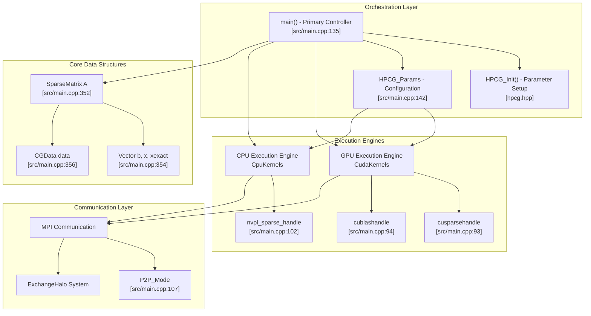

The system centers around the `main()` function in [src/main.cpp:135]() which serves as the primary orchestrator. It manages the entire benchmark lifecycle from initialization through problem generation, optimization, validation, and final benchmarking phases.

Sources: [src/main.cpp:135-872](), [src/main.cpp:92-122]()

### Execution Mode Architecture

NVIDIA HPCG supports three distinct execution modes that determine how computational work is distributed across available hardware resources:

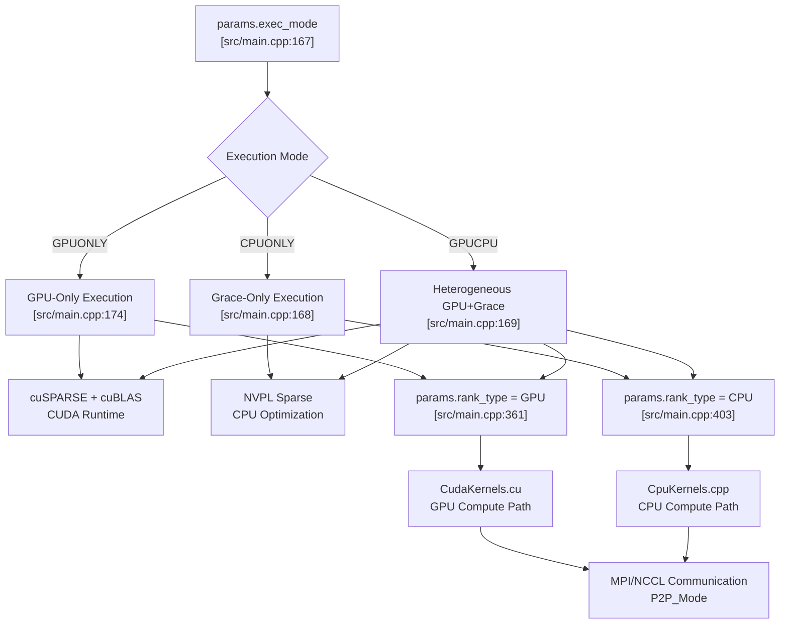

The execution mode is determined during initialization and affects library selection, memory allocation strategies, and computational kernel dispatch throughout the benchmark execution.

Sources: [src/main.cpp:167-169](), [src/main.cpp:361-424](), [src/main.cpp:174-235]()

## Benchmark Execution Pipeline

The NVIDIA HPCG benchmark follows a structured multi-phase execution pipeline that ensures reproducible and validated performance measurements:

### Primary Execution Phases

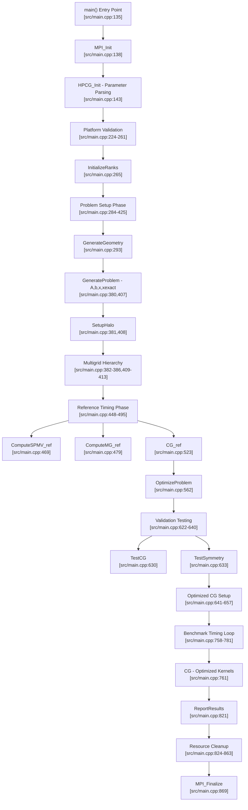

Each phase serves a specific purpose in ensuring benchmark validity and performance measurement accuracy. The reference timing phase establishes baseline performance metrics, while the optimization phase applies platform-specific optimizations before the final timed benchmark execution.

Sources: [src/main.cpp:135-872](), [src/main.cpp:284-425](), [src/main.cpp:758-781]()

## Core Computational Framework

The benchmark implements a sophisticated computational framework centered around sparse matrix operations and conjugate gradient solving:

### Data Structure Relationships

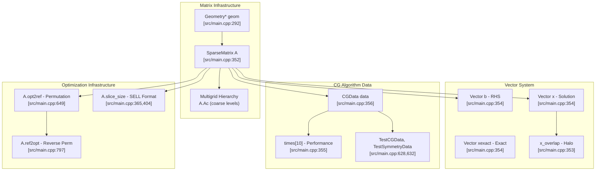

The `SparseMatrix` structure serves as the central data container, containing geometry information, numerical data, and optimization metadata. The system maintains multiple vector instances for different algorithmic phases and supports sophisticated permutation schemes for performance optimization.

Sources: [src/main.cpp:352-356](), [src/main.cpp:292-293](), [src/main.cpp:649-657]()

## Communication and Distribution Architecture

NVIDIA HPCG implements a flexible communication system that supports various point-to-point communication modes and distributed memory execution:

### Communication Infrastructure

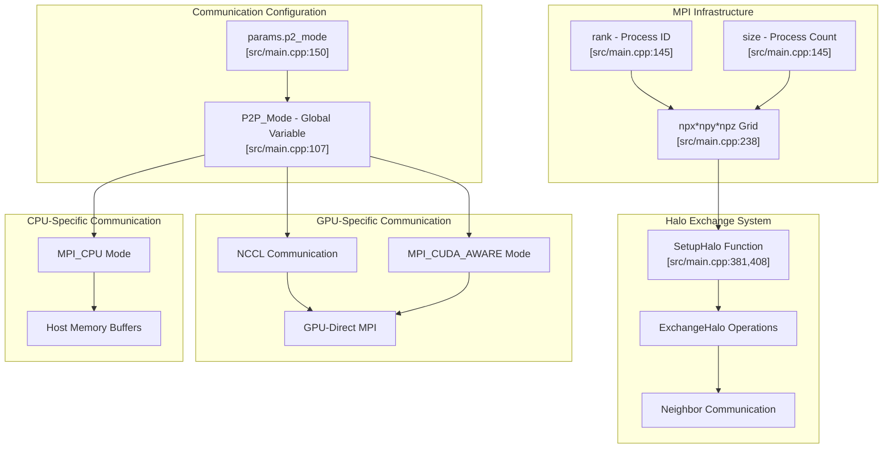

The communication system validates mode compatibility with execution targets and configures appropriate data transfer mechanisms. GPU execution modes leverage CUDA-aware MPI and NCCL for optimal GPU-to-GPU communication, while CPU modes use standard MPI host-based communication.

Sources: [src/main.cpp:105-108](), [src/main.cpp:182-221](), [src/main.cpp:381](), [src/main.cpp:408]()

## Build and Platform Support

The NVIDIA HPCG benchmark supports multiple hardware architectures and provides flexible build configuration options:

### Build System Architecture

| Component | Description | Configuration Variables |
|-----------|-------------|------------------------|
| **GPU Support** | NVIDIA GPU execution with CUDA | `USE_CUDA=1` |
| **Grace Support** | NVIDIA Grace CPU execution | `USE_GRACE=1` |  
| **NCCL Support** | Advanced GPU communication | `USE_NCCL=1` |
| **Architecture** | Target processor architecture | ARM64 vs x86 |
| **Libraries** | Required external dependencies | MPI, CUDA, NVPL |

The build system generates different binary targets based on configuration:
- `xhpcg` - GPU-enabled binary when `USE_CUDA=1`
- `xhpcg-cpu` - CPU-only binary when `USE_CUDA=0` and `USE_GRACE=1`

The system performs extensive runtime validation to ensure library compatibility, including version checks for cuSPARSE (minimum 12.2) and NVPL Sparse (minimum 0.2).

Sources: [README.md:51-66](), [src/main.cpp:310-350](), [src/main.cpp:224-261]()

---

# Page: Getting Started

# Getting Started

<details>
<summary>Relevant source files</summary>

The following files were used as context for generating this wiki page:

- [README.md](README.md)
- [build_sample.sh](build_sample.sh)

</details>


This page provides an introduction to building and running the NVIDIA HPCG benchmark, covering system prerequisites, the overall workflow, and key components involved in the build and execution process. For detailed build instructions, see [Building HPCG](#2.1). For comprehensive execution guidance, see [Running HPCG](#2.2).

## Purpose and Scope

The NVIDIA HPCG benchmark is a high-performance implementation of the HPCG (High Performance Conjugate Gradients) benchmark optimized for NVIDIA accelerated HPC systems. This implementation supports multiple execution modes including GPU-only, Grace CPU-only, and heterogeneous GPU-Grace configurations across both x86 and ARM64 architectures.

## System Overview

The NVIDIA HPCG system consists of several key components that work together to deliver optimized sparse linear algebra computations:

### Getting Started Workflow

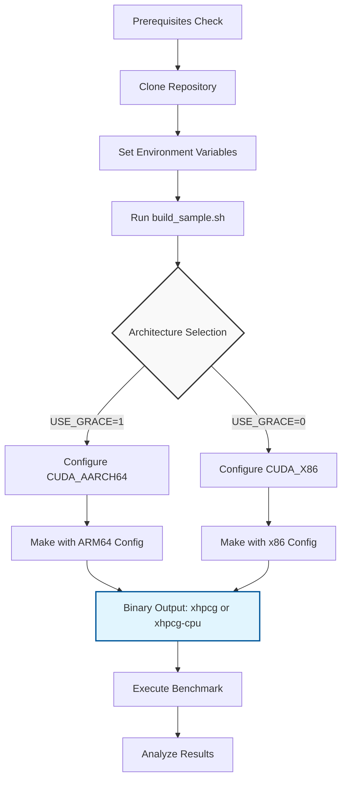

### Build System Architecture

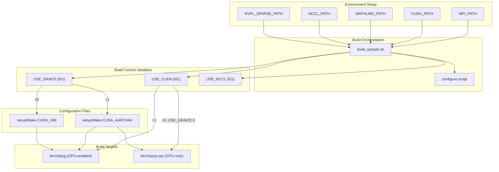

Sources: [build_sample.sh:1-104](), [README.md:51-66]()

## Prerequisites

The NVIDIA HPCG benchmark requires specific software components depending on the target execution mode:

| Component | Version | Required For | Purpose |
|-----------|---------|--------------|---------|
| Git | Any recent version | All builds | Repository cloning |
| MPI | OpenMPI 4.1+ or MPICH 4.0+ | All builds | Distributed computing |
| CUDA Toolkit | 12.3+ | GPU execution | CUDA runtime and development |
| cuSPARSE | 12.3+ | GPU execution | Sparse matrix operations |
| cuBLAS | 12.2+ | GPU execution | Dense linear algebra |
| GCC | 13.0+ | Grace CPU execution | Compilation toolchain |
| NVPL | 24.03+ | Grace CPU execution | Optimized math libraries |
| NCCL | 2.19+ | Multi-GPU communication | Collective communications |

Sources: [README.md:26-34]()

## Supported Platforms and Execution Modes

The benchmark supports three primary execution modes configured through build-time variables:

### Platform Support Matrix

| Platform | GPU Support | CPU Support | Heterogeneous |
|----------|-------------|-------------|---------------|
| x86 + NVIDIA GPU | ✓ (`USE_CUDA=1, USE_GRACE=0`) | Limited | No |
| ARM64 + NVIDIA GPU | ✓ (`USE_CUDA=1, USE_GRACE=1`) | ✓ (`USE_CUDA=0, USE_GRACE=1`) | ✓ (`USE_CUDA=1, USE_GRACE=1`) |

### Build Variable Configuration

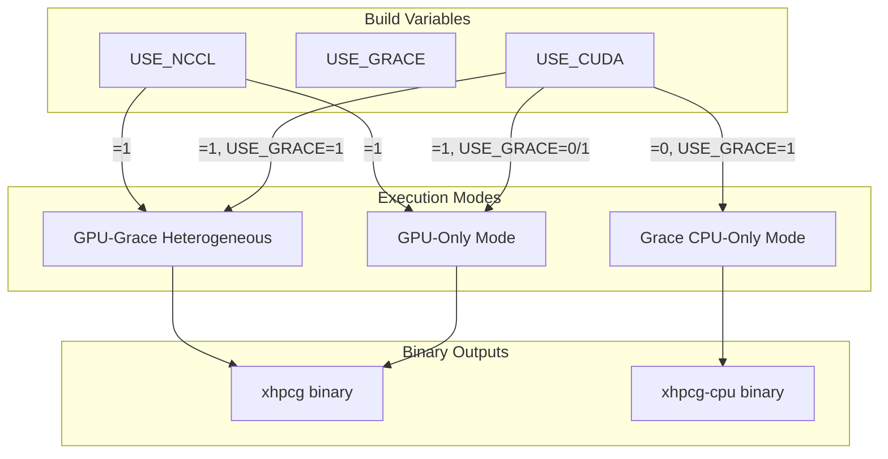

Sources: [README.md:58-66](), [build_sample.sh:49-74]()

## Quick Start Workflow

### 1. Repository Setup
```bash
git clone https://github.com/NVIDIA/nvidia-hpcg
cd nvidia-hpcg
```

### 2. Environment Configuration
Set the required environment variables before building:
- `MPI_PATH`: Path to MPI installation
- `CUDA_PATH`: Path to CUDA toolkit (for GPU builds)
- `MATHLIBS_PATH`: Path to CUDA math libraries
- `NVPL_SPARSE_PATH`: Path to NVPL sparse libraries (for Grace CPU)
- `NCCL_PATH`: Path to NCCL (optional, for multi-GPU communication)

### 3. Build Execution
The `build_sample.sh` script orchestrates the entire build process, automatically configuring the appropriate makefile based on the target architecture and execution mode.

### 4. Binary Location
Built binaries are placed in both `build/bin/` and `bin/` directories:
- `xhpcg`: GPU-enabled binary (when `USE_CUDA=1`)
- `xhpcg-cpu`: CPU-only binary (when `USE_CUDA=0, USE_GRACE=1`)

Sources: [README.md:37-49](), [build_sample.sh:103-104]()

## Next Steps

- For detailed build instructions and configuration options, see [Building HPCG](#2.1)
- For comprehensive execution parameters and performance tuning, see [Running HPCG](#2.2) 
- For understanding the core system architecture, see [Core Architecture](#3)

Sources: [README.md:1-91](), [build_sample.sh:1-104]()

---

# Page: Building HPCG

# Building HPCG

<details>
<summary>Relevant source files</summary>

The following files were used as context for generating this wiki page:

- [build_sample.sh](build_sample.sh)
- [setup/Make.CUDA_AARCH64](setup/Make.CUDA_AARCH64)
- [setup/Make.CUDA_X86](setup/Make.CUDA_X86)

</details>


This document provides detailed instructions for building the NVIDIA HPCG benchmark across different architectures and configurations. It covers the build system architecture, prerequisite setup, configuration options, and the compilation process for both x86 and ARM64 platforms with GPU and Grace CPU acceleration.

For information about running the compiled benchmark, see [Running HPCG](#2.2). For details about the core program structure, see [Main Program Flow](#3.1).

## Build System Overview

HPCG uses a makefile-based build system with architecture-specific configuration files that support multiple execution modes and hardware targets. The build system is designed to handle heterogeneous computing environments with both GPU and CPU acceleration paths.

### Build Architecture

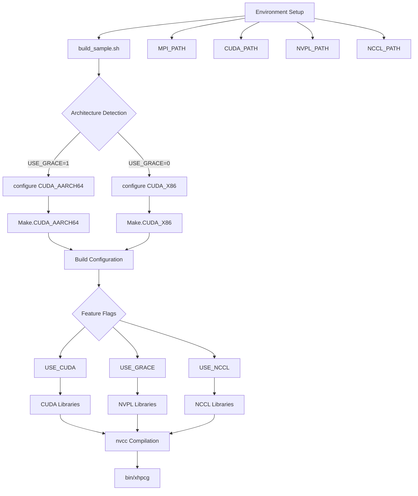

Sources: [build_sample.sh:1-104](), [setup/Make.CUDA_AARCH64:1-198](), [setup/Make.CUDA_X86:1-182]()

### Build Dependencies

The build system requires several external libraries and tools depending on the target configuration:

| Component | Purpose | Required For |
|-----------|---------|-------------|
| MPI | Distributed memory parallelization | All builds |
| CUDA Toolkit | GPU acceleration and math libraries | USE_CUDA=1 |
| NVPL Sparse | Grace CPU optimization | USE_GRACE=1 |
| NCCL | GPU-direct communication | USE_NCCL=1 |
| nvcc | CUDA-capable C++ compiler | All builds |

Sources: [setup/Make.CUDA_AARCH64:110-129](), [setup/Make.CUDA_X86:110-122]()

## Prerequisites

Before building HPCG, ensure the following environment variables are configured in [build_sample.sh:21-43]():

```bash
export MPI_PATH=/path/to/mpi
export CUDA_PATH=/path/to/cuda  
export MATHLIBS_PATH=/path/to/mathlibs
export NCCL_PATH=/path/to/nccl
export NVPL_SPARSE_PATH=/path/to/nvpllibs
```

The build script automatically configures the library paths and compiler flags based on these environment variables.

Sources: [build_sample.sh:21-43]()

## Architecture-Specific Configuration

### ARM64 Configuration (Grace + GPU)

The `Make.CUDA_AARCH64` configuration targets ARM64 systems with NVIDIA Grace CPUs and optional GPU acceleration. This configuration supports all three execution modes:

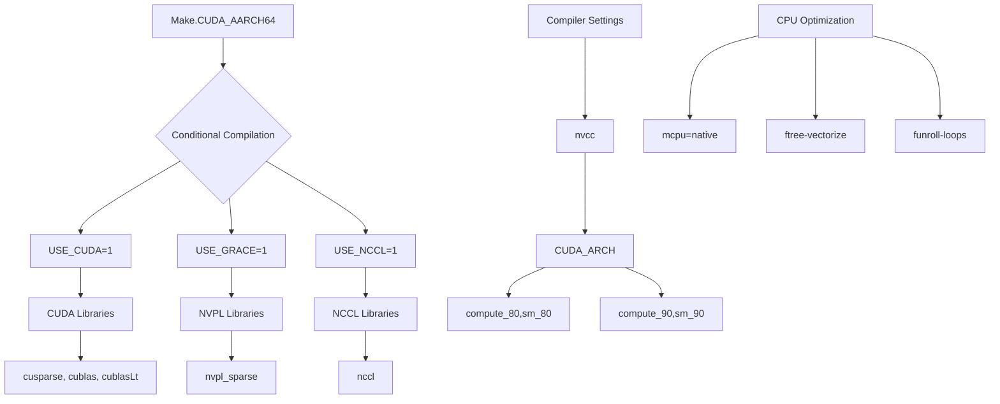

The ARM64 build uses conditional compilation flags defined in [setup/Make.CUDA_AARCH64:116-129]():

- `USE_CUDA=1`: Enables GPU execution path with cuSPARSE and cuBLAS
- `USE_GRACE=1`: Enables Grace CPU optimizations with NVPL Sparse
- `USE_NCCL=1`: Enables NCCL communication for multi-GPU scaling

Sources: [setup/Make.CUDA_AARCH64:116-129](), [setup/Make.CUDA_AARCH64:149-159](), [setup/Make.CUDA_AARCH64:178-183]()

### x86 Configuration (Traditional + GPU)

The `Make.CUDA_X86` configuration targets traditional x86 systems with mandatory GPU acceleration:

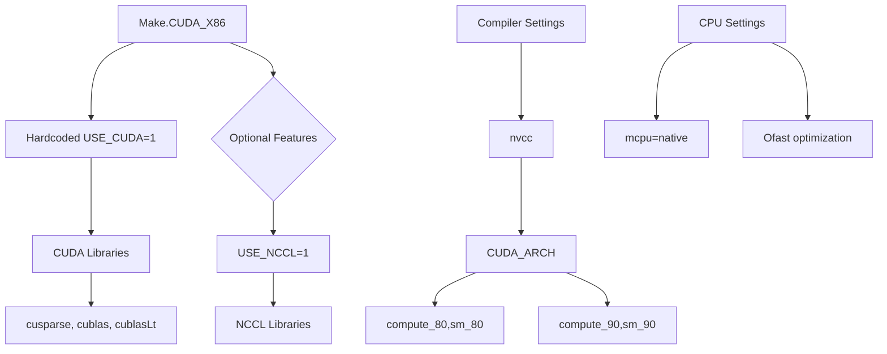

Key differences from ARM64 configuration:
- CUDA is always enabled [setup/Make.CUDA_X86:141]()
- No Grace CPU support (no `USE_GRACE` conditionals)
- Simplified library dependencies

Sources: [setup/Make.CUDA_X86:116-122](), [setup/Make.CUDA_X86:141](), [setup/Make.CUDA_X86:164-171]()

## Build Configuration Options

### Compile-Time Feature Flags

Both build configurations support several compile-time options defined in `HPCG_OPTS`:

| Flag | Purpose | Default |
|------|---------|---------|
| `DHPCG_CUBIC_RADICAL_SEARCH` | Cubic search optimization | Enabled |
| `DHPCG_CONTIGUOUS_ARRAYS` | Contiguous memory layout | Enabled |
| `DHPCG_DEBUG` | Debug output | Disabled |
| `DHPCG_NO_MPI` | Disable MPI | Disabled |
| `DHPCG_NO_OPENMP` | Disable OpenMP | Disabled |

Sources: [setup/Make.CUDA_AARCH64:148-159](), [setup/Make.CUDA_X86:140-149]()

### CUDA Architecture Targets

Both configurations target modern GPU architectures with compute capability 8.0 and 9.0:

- `compute_80,sm_80`: Ada Lovelace, Ampere architectures
- `compute_90,sm_90`: Hopper architecture  
- Optional `compute_100a,sm_100a`: Blackwell architecture (when `BUILD_B100=1`)

Sources: [setup/Make.CUDA_AARCH64:179-183](), [setup/Make.CUDA_X86:164-167]()

## Build Process

### Using the Build Script

The recommended build method uses the provided build script with the following parameters:

```bash
./build_sample.sh [arg1] [commit_hash] [major_ver] [minor_ver] [use_cuda] [use_grace] [use_nccl] [build_b100]
```

Parameter mapping from [build_sample.sh:52-85]():
- `$5`: USE_CUDA (1=enabled, 0=disabled)
- `$6`: USE_GRACE (1=enabled, 0=disabled)  
- `$7`: USE_NCCL (1=enabled, 0=disabled)
- `$8`: BUILD_B100 (1=enabled, 0=disabled)

### Build Flow

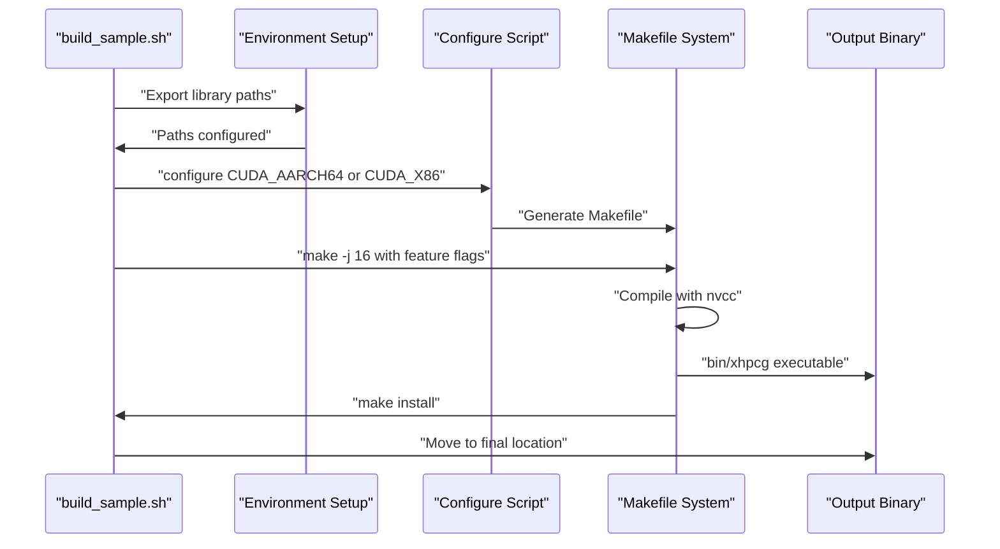

The build process follows these steps from [build_sample.sh:46-104]():

1. Create `build/` directory and change to it
2. Configure architecture based on `USE_GRACE` setting
3. Run `make` with all configuration variables
4. Install the binary to final location

### Manual Build

For custom builds, the makefile can be invoked directly after running the configure script:

```bash
mkdir -p build && cd build
../configure CUDA_AARCH64  # or CUDA_X86
make -j 16 USE_CUDA=1 USE_GRACE=1 USE_NCCL=1 MPdir=/path/to/mpi [...]
```

Sources: [build_sample.sh:46-104]()

## Output

The build process generates the main executable `xhpcg` in the `bin/` directory. This binary contains all the compiled kernel implementations and can execute in the configured modes (GPU-only, CPU-only, or heterogeneous) based on runtime parameters.

The final executable integrates:
- CUDA kernels from `CudaKernels.cu` (when `USE_CUDA=1`)
- CPU kernels from `CpuKernels.cpp` (when `USE_GRACE=1`)  
- MPI communication routines
- Math library interfaces (cuSPARSE, NVPL Sparse, NCCL)

Sources: [build_sample.sh:103-104]()

---

# Page: Running HPCG

# Running HPCG

<details>
<summary>Relevant source files</summary>

The following files were used as context for generating this wiki page:

- [README.md](README.md)
- [bin/hpcg.sh](bin/hpcg.sh)

</details>


This document covers how to execute NVIDIA HPCG benchmarks using the provided scripts and direct invocation methods. It details parameter configuration, affinity settings, execution modes, and input specification methods.

For information about building HPCG binaries, see [Building HPCG](#2.1). For details about the main program orchestration, see [Main Program Flow](#3.1).

## Execution Methods Overview

NVIDIA HPCG can be executed in two primary ways:

1. **Script-based execution** - Using [`bin/hpcg.sh`]() wrapper script (recommended)
2. **Direct binary execution** - Calling `xhpcg` or `xhpcg-cpu` binaries directly

The script-based approach provides comprehensive environment setup, affinity management, and parameter handling, while direct execution offers maximum control for advanced users.

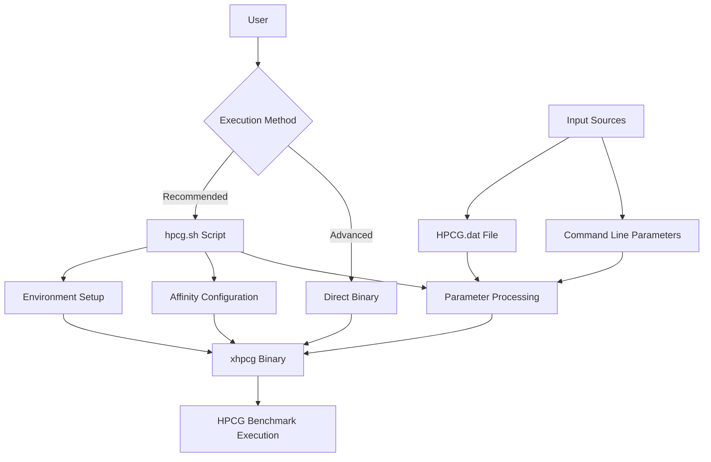

Sources: [README.md:68-69](), [bin/hpcg.sh:1-382]()

## Using the hpcg.sh Script

The [`hpcg.sh`]() script provides a comprehensive launcher that handles environment setup, affinity binding, and parameter management. It automatically detects the appropriate HPCG binary and configures the execution environment.

### Basic Script Structure

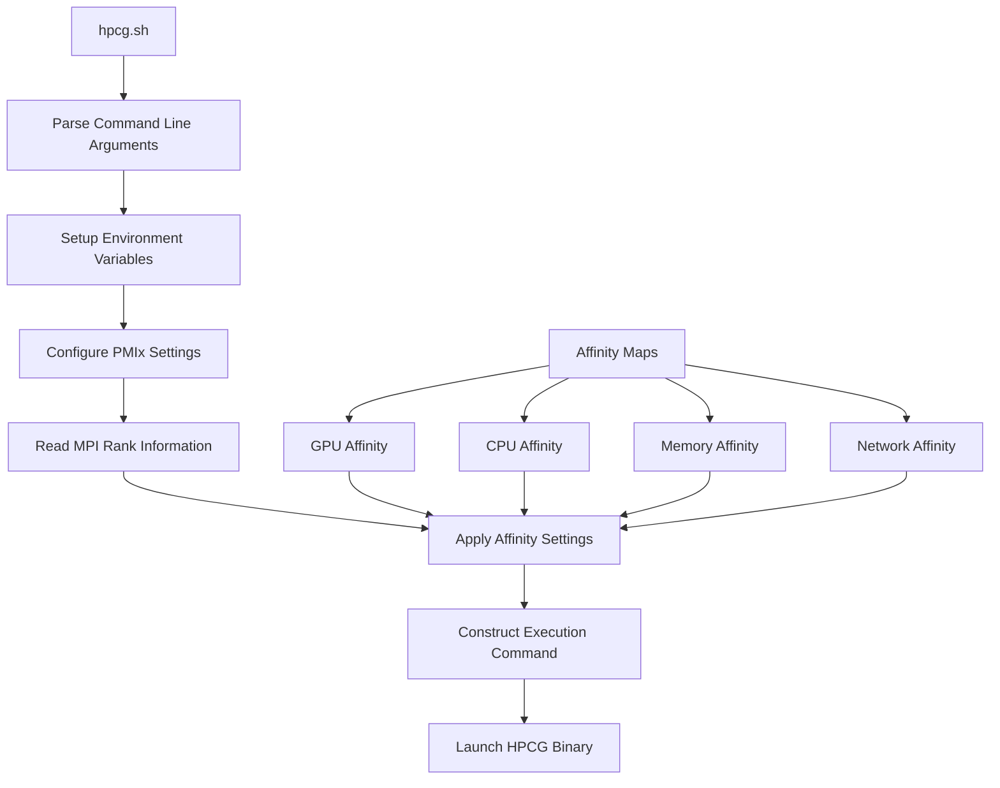

Sources: [bin/hpcg.sh:119-382]()

### Environment Configuration

The script automatically configures several key environment variables:

| Variable | Purpose | Default/Configuration |
|----------|---------|----------------------|
| `LD_LIBRARY_PATH` | CUDA library path | `/usr/local/cuda/lib64` |
| `UCX_WARN_UNUSED_ENV_VARS` | Suppress UCX warnings | `n` |
| `OMP_PROC_BIND` | OpenMP thread binding | `TRUE` |
| `OMP_PLACES` | OpenMP placement | `sockets` |
| `UCC_LOG_LEVEL` | UCC logging level | `error` |

Sources: [bin/hpcg.sh:26-34]()

## Parameter Configuration

The script supports extensive parameter configuration through command-line options:

### Problem Specification Parameters

| Parameter | Description | Usage |
|-----------|-------------|-------|
| `--npx <int>` | Process grid X dimension | `--npx=4` |
| `--npy <int>` | Process grid Y dimension | `--npy=2` |
| `--npz <int>` | Process grid Z dimension | `--npz=1` |
| `--nx <int>` | Local problem X dimension | Direct to binary |
| `--ny <int>` | Local problem Y dimension | Direct to binary |
| `--nz <int>` | Local problem Z dimension | Direct to binary |
| `--rt <int>` | Runtime in seconds | Direct to binary |

Sources: [bin/hpcg.sh:47-49](), [bin/hpcg.sh:253-278]()

### Execution Control Parameters

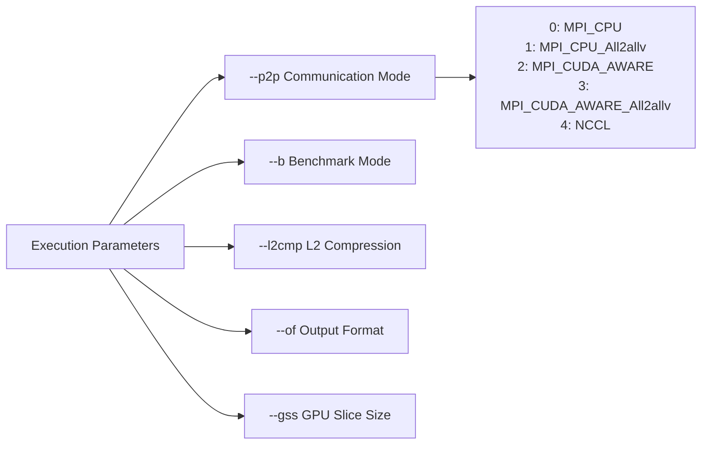

Sources: [bin/hpcg.sh:50-54](), [bin/hpcg.sh:280-297]()

### Parameter Processing Flow

The script processes parameters through a systematic approach:

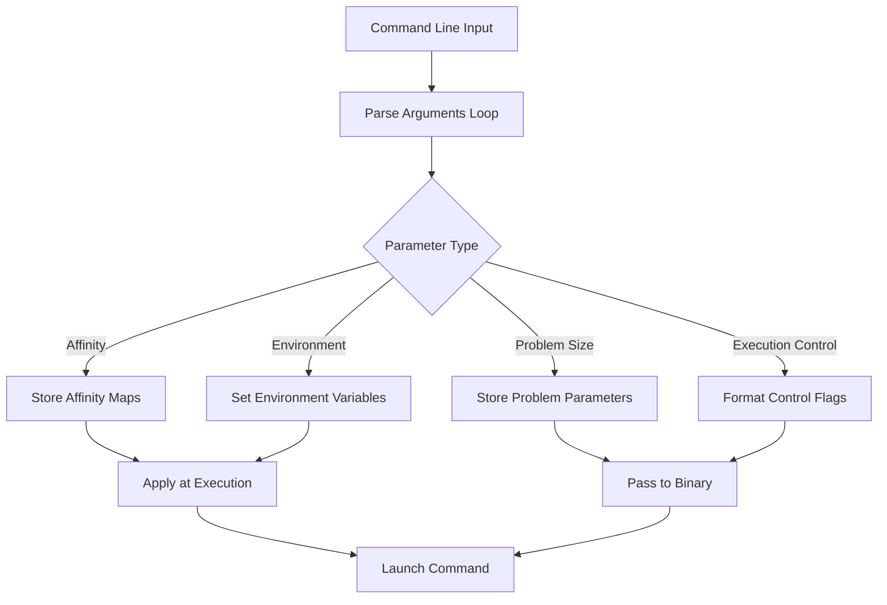

Sources: [bin/hpcg.sh:122-303]()

## Affinity Configuration

The script provides sophisticated affinity management for optimal performance on multi-GPU, multi-CPU systems:

### Affinity Types and Mapping

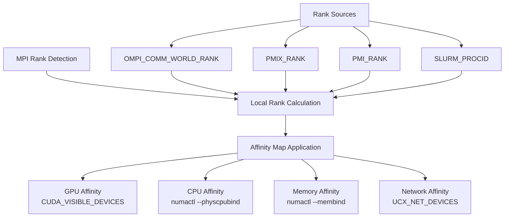

Sources: [bin/hpcg.sh:310-332](), [bin/hpcg.sh:334-366]()

### Affinity Mapping Functions

The script implements four key affinity mapping functions:

| Function | Purpose | Configuration |
|----------|---------|---------------|
| `read_gpu_affinity_map()` | Maps MPI ranks to GPU indices | `--gpu-affinity 0:1:2:3` |
| `read_cpu_affinity_map()` | Maps MPI ranks to CPU cores | `--cpu-affinity 0-15:16-31` |
| `read_mem_affinity_map()` | Maps MPI ranks to NUMA nodes | `--mem-affinity 0:1:0:1` |
| `read_net_affinity_map()` | Maps MPI ranks to network devices | `--ucx-affinity mlx5_0:mlx5_1` |

Sources: [bin/hpcg.sh:76-100]()

## Execution Modes

NVIDIA HPCG supports three primary execution modes, determined by the binary used and runtime parameters:

### Mode Selection and Binary Mapping

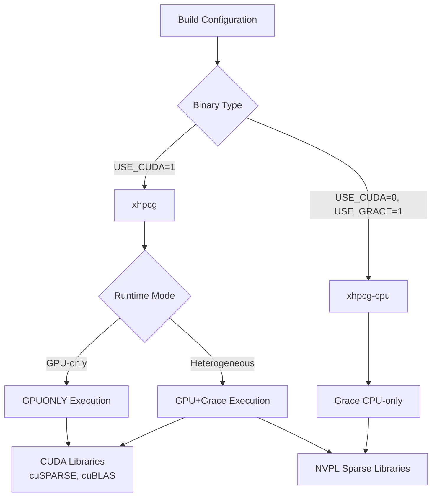

Sources: [README.md:58-66]()

### Communication Mode Configuration

The `--p2p` parameter controls inter-process communication methods:

| Mode | Value | Description | Use Case |
|------|-------|-------------|----------|
| MPI_CPU | 0 | Standard MPI Send/Recv | Default, CPU-based communication |
| MPI_CPU_All2allv | 1 | MPI Alltoallv on CPU | Collective communication |
| MPI_CUDA_AWARE | 2 | GPU-Direct MPI | GPU memory direct access |
| MPI_CUDA_AWARE_All2allv | 3 | GPU-Direct Alltoallv | GPU collective communication |
| NCCL | 4 | NVIDIA Collective Communications | Optimized GPU communication |

Sources: [bin/hpcg.sh:50](), [README.md:16]()

## Input Specification Methods

HPCG accepts input through two mechanisms:

### Input Method Selection Flow

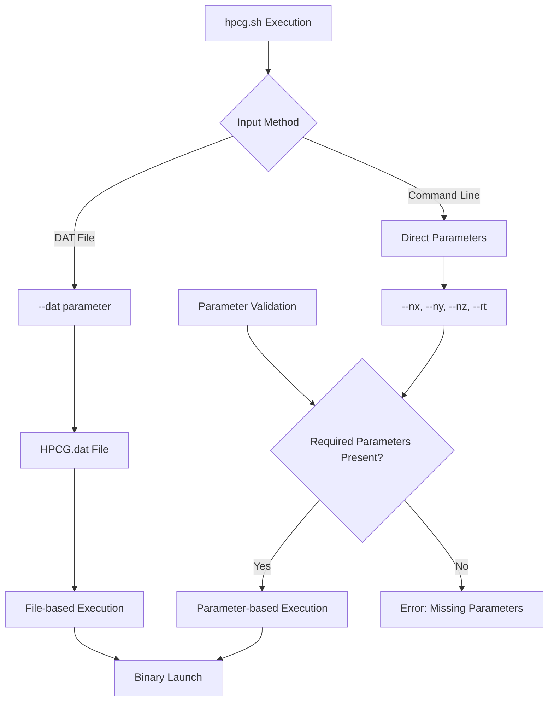

Sources: [bin/hpcg.sh:375-382]()

### Execution Command Construction

The final execution command is constructed based on input method:

**DAT File Method:**
```bash
${NUMCMD} ${CPUBIND} ${MEMBIND} ${XHPCG} ${DAT} --gss=${GSS} ${HPCG_CONTROL}
```

**Parameter Method:**
```bash
${NUMCMD} ${CPUBIND} ${MEMBIND} ${XHPCG} --nx=${NX} --ny=${NY} --nz=${NZ} --rt=${RT} --gss=${GSS} ${HPCG_CONTROL}
```

Where:
- `NUMCMD` = `numactl` if affinity binding is configured
- `CPUBIND` = `--physcpubind=${CPU}` for CPU affinity
- `MEMBIND` = `--membind=${MEM}` for memory affinity
- `XHPCG` = Path to HPCG binary
- `HPCG_CONTROL` = Concatenated control flags (`--b`, `--l2cmp`, `--p2p`, etc.)

Sources: [bin/hpcg.sh:373-382]()

## Platform-Specific Execution Guidance

The HPCG distribution includes platform-specific execution guidance:

| Platform | Documentation | Binary |
|----------|---------------|--------|
| x86_64 + GPU | `bin/RUNNING-x86` | `xhpcg` |
| ARM64 + Grace + GPU | `bin/RUNNING-aarch64` | `xhpcg` |
| Grace CPU-only | `bin/RUNNING-aarch64` | `xhpcg-cpu` |

Additional sample configurations are provided in `run_sample.sh` for common deployment scenarios.

Sources: [README.md:19](), [README.md:69]()

---

# Page: Core Architecture

# Core Architecture

<details>
<summary>Relevant source files</summary>

The following files were used as context for generating this wiki page:

- [src/hpcg.hpp](src/hpcg.hpp)
- [src/init.cpp](src/init.cpp)
- [src/main.cpp](src/main.cpp)

</details>


This document provides an overview of the main architectural components of the NVIDIA HPCG benchmark and how they work together to orchestrate benchmark execution across heterogeneous GPU and CPU systems.

The core architecture encompasses the central program controller, parameter management system, rank assignment mechanisms, and execution mode coordination. For detailed information about specific computational implementations, see [Computational Engines](#4). For distributed computing aspects, see [Distributed Computing](#5.2).

## System Overview

The NVIDIA HPCG benchmark is built around a central orchestration architecture that coordinates execution across multiple hardware targets and communication patterns. The system supports three primary execution modes and manages complex interactions between GPU and CPU resources.

### Main Architectural Components

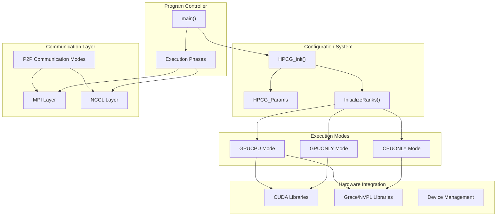

**Sources:** [src/main.cpp:135-872](), [src/hpcg.hpp:109-144](), [src/init.cpp:112-248]()

## Program Controller Architecture

The central program controller in `main()` orchestrates the entire benchmark execution through a well-defined sequence of phases. This controller manages hardware resources, coordinates between execution modes, and ensures proper sequencing of benchmark operations.

### Main Execution Flow

```mermaid
flowchart TD
    START["main() Entry"] --> MPI_INIT["MPI_Init()"]
    MPI_INIT --> PARAM_INIT["HPCG_Init()"]
    PARAM_INIT --> RANK_INIT["InitializeRanks()"]
    
    RANK_INIT --> VALIDATION["Parameter Validation"]
    VALIDATION --> LIB_CHECK["Library Version Checks"]
    
    LIB_CHECK --> PROBLEM_SETUP["Problem Setup Phase"]
    PROBLEM_SETUP --> GEOM_GEN["GenerateGeometry()"]
    GEOM_GEN --> SPARSE_INIT["InitializeSparseMatrix()"]
    SPARSE_INIT --> PROBLEM_GEN["GenerateProblem()"]
    PROBLEM_GEN --> HALO_SETUP["SetupHalo()"]
    HALO_SETUP --> COARSE_GEN["GenerateCoarseProblem()"]
    
    COARSE_GEN --> REF_TIMING["Reference Timing Phase"]
    REF_TIMING --> SPMV_REF["ComputeSPMV_ref()"]
    SPMV_REF --> MG_REF["ComputeMG_ref()"]
    MG_REF --> CG_REF["CG_ref()"]
    
    CG_REF --> OPTIMIZATION["OptimizeProblem()"]
    OPTIMIZATION --> VALIDATION_PHASE["Validation Phase"]
    VALIDATION_PHASE --> TEST_CG["TestCG()"]
    TEST_CG --> TEST_SYM["TestSymmetry()"]
    
    TEST_SYM --> BENCHMARK["Benchmark Phase"]
    BENCHMARK --> CG_LOOP["CG() Loop"]
    CG_LOOP --> RESULTS["ReportResults()"]
    RESULTS --> CLEANUP["Resource Cleanup"]
    CLEANUP --> END["Program Exit"]
```

**Sources:** [src/main.cpp:284-872]()

## Parameter and Configuration System

The configuration system is centered around the `HPCG_Params` structure, which encapsulates all runtime parameters and execution modes. This system supports both command-line and file-based configuration, with comprehensive parameter validation.

### Parameter Structure

| Parameter Category | Key Parameters | Purpose |
|-------------------|----------------|---------|
| **Execution Mode** | `exec_mode`, `rank_type` | Defines GPU/CPU execution strategy |
| **Problem Size** | `nx`, `ny`, `nz` | Local problem dimensions |
| **Process Grid** | `npx`, `npy`, `npz` | MPI process grid layout |
| **Communication** | `p2_mode` | Point-to-point communication method |
| **Optimization** | `use_l2compression`, `gpu_slice_size` | Performance optimization flags |
| **Runtime** | `runningTime`, `benchmark_mode` | Execution time and testing mode |

```mermaid
graph TB
    subgraph "Parameter Sources"
        CMD_LINE["Command Line Args"]
        HPCG_DAT["hpcg.dat File"]
        ENV_VARS["Environment Variables"]
    end
    
    subgraph "Parameter Processing"
        READ_HPCG["ReadHpcgDat()"]
        PARSE_ARGS["Argument Parsing"]
        VALIDATION["Parameter Validation"]
    end
    
    subgraph "Configuration Output"
        HPCG_PARAMS_STRUCT["HPCG_Params Structure"]
        EXEC_MODE["exec_mode_t"]
        RANK_TYPE["rank_type_t"]
        P2P_MODE["p2p_comm_mode_t"]
    end
    
    CMD_LINE --> PARSE_ARGS
    HPCG_DAT --> READ_HPCG
    ENV_VARS --> PARSE_ARGS
    
    PARSE_ARGS --> VALIDATION
    READ_HPCG --> VALIDATION
    
    VALIDATION --> HPCG_PARAMS_STRUCT
    HPCG_PARAMS_STRUCT --> EXEC_MODE
    HPCG_PARAMS_STRUCT --> RANK_TYPE
    HPCG_PARAMS_STRUCT --> P2P_MODE
```

**Sources:** [src/hpcg.hpp:109-144](), [src/init.cpp:250-444]()

## Rank Assignment and Execution Modes

The rank assignment system automatically determines whether each MPI rank operates as a GPU or CPU rank based on the execution mode and available hardware. This system supports three distinct execution modes with different resource allocation strategies.

### Rank Assignment Logic

```mermaid
graph TD
    INIT_RANKS["InitializeRanks()"] --> GET_GLOBAL["Get Global MPI Info"]
    GET_GLOBAL --> SPLIT_COMM["Split MPI Communicators"]
    SPLIT_COMM --> CHECK_MODE{"Check exec_mode"}
    
    CHECK_MODE -->|CPUONLY| CPU_ASSIGN["Set rank_type = CPU"]
    CHECK_MODE -->|GPUONLY| GPU_ASSIGN["Set rank_type = GPU"]
    CHECK_MODE -->|GPUCPU| HYBRID_ASSIGN["Hybrid Assignment"]
    
    HYBRID_ASSIGN --> CALC_RANKS["Calculate ranks_for_numa"]
    CALC_RANKS --> CHECK_LOCAL{"local_rank % ranks_for_numa == 0?"}
    
    CHECK_LOCAL -->|Yes| ASSIGN_GPU["rank_type = GPU"]
    CHECK_LOCAL -->|No| ASSIGN_CPU["rank_type = CPU"]
    
    ASSIGN_GPU --> SET_DEVICE["cudaSetDevice()"]
    ASSIGN_CPU --> SET_PRINT["Set cpu_allowed_to_print"]
    
    GPU_ASSIGN --> SET_DEVICE
    CPU_ASSIGN --> CPU_ONLY_SETUP["CPU-Only Setup"]
    
    SET_DEVICE --> NCCL_CHECK{"P2P_Mode == NCCL?"}
    NCCL_CHECK -->|Yes| NCCL_INIT["ncclCommInitRank()"]
    NCCL_CHECK -->|No| FINISH["Assignment Complete"]
    NCCL_INIT --> FINISH
    CPU_ONLY_SETUP --> FINISH
    SET_PRINT --> FINISH
```

**Sources:** [src/init.cpp:112-248]()

## Hardware Integration Architecture

The system integrates with different hardware accelerators through abstracted interfaces that handle library initialization, device management, and resource allocation. Each execution mode activates specific hardware integration paths.

### Library Integration

```mermaid
graph TB
    subgraph "GPU Integration"
        CUDA_CHECK["CUDA Runtime Check"]
        CUSPARSE_INIT["cusparseCreate()"]
        CUBLAS_INIT["cublasCreate()"]
        STREAM_CREATE["cudaStreamCreate()"]
        DEVICE_SET["cudaSetDevice()"]
    end
    
    subgraph "CPU Integration"
        GRACE_CHECK["Grace Architecture Check"]
        NVPL_INIT["nvpl_sparse_create()"]
        THREAD_SETUP["OpenMP Thread Setup"]
    end
    
    subgraph "Communication Setup"
        MPI_INIT_COMM["MPI Initialization"]
        NCCL_SETUP["NCCL Communicator Setup"]
        P2P_MODE_SELECT["P2P Mode Selection"]
    end
    
    RANK_TYPE{"rank_type"} -->|GPU| CUDA_CHECK
    RANK_TYPE -->|CPU| GRACE_CHECK
    
    CUDA_CHECK --> CUSPARSE_INIT
    CUSPARSE_INIT --> CUBLAS_INIT
    CUBLAS_INIT --> STREAM_CREATE
    STREAM_CREATE --> DEVICE_SET
    
    GRACE_CHECK --> NVPL_INIT
    NVPL_INIT --> THREAD_SETUP
    
    DEVICE_SET --> P2P_MODE_SELECT
    THREAD_SETUP --> P2P_MODE_SELECT
    
    P2P_MODE_SELECT --> MPI_INIT_COMM
    P2P_MODE_SELECT --> NCCL_SETUP
```

**Sources:** [src/main.cpp:310-350](), [src/main.cpp:361-424](), [src/init.cpp:180-246]()

## Communication Architecture

The communication system supports multiple point-to-point communication modes, allowing optimization for different network configurations and hardware capabilities. The system automatically selects appropriate communication patterns based on execution mode and hardware availability.

### Supported Communication Modes

| Mode | Description | Use Case |
|------|-------------|----------|
| `MPI_CPU` | Standard MPI with CPU buffers | Basic CPU-only execution |
| `MPI_CPU_All2allv` | MPI All-to-all with CPU buffers | CPU-optimized collective operations |
| `MPI_CUDA_AWARE` | CUDA-aware MPI | GPU memory direct access |
| `MPI_GPU_All2allv` | GPU-optimized All-to-all | GPU collective operations |
| `NCCL` | NVIDIA Collective Communications | Multi-GPU scaling |

```mermaid
graph TB
    P2P_SELECTION["P2P Mode Selection"] --> EXEC_CHECK{"Execution Mode"}
    
    EXEC_CHECK -->|CPUONLY| CPU_MODES["CPU Communication Modes"]
    EXEC_CHECK -->|GPUONLY| GPU_MODES["GPU Communication Modes"]
    EXEC_CHECK -->|GPUCPU| HYBRID_MODES["Hybrid Communication"]
    
    CPU_MODES --> MPI_CPU["MPI_CPU"]
    CPU_MODES --> MPI_CPU_ALL2ALL["MPI_CPU_All2allv"]
    
    GPU_MODES --> MPI_CUDA_AWARE["MPI_CUDA_AWARE"]
    GPU_MODES --> MPI_GPU_ALL2ALL["MPI_GPU_All2allv"]
    GPU_MODES --> NCCL["NCCL"]
    
    HYBRID_MODES --> MIXED_P2P["Mixed P2P Patterns"]
    
    MPI_CPU --> VALIDATION["Mode Validation"]
    MPI_CPU_ALL2ALL --> VALIDATION
    MPI_CUDA_AWARE --> VALIDATION
    MPI_GPU_ALL2ALL --> VALIDATION
    NCCL --> VALIDATION
    MIXED_P2P --> VALIDATION
    
    VALIDATION --> COMM_INIT["Communication Initialization"]
```

**Sources:** [src/main.cpp:106-108](), [src/init.cpp:378-389](), [src/main.cpp:181-221]()

---

# Page: Main Program Flow

# Main Program Flow

<details>
<summary>Relevant source files</summary>

The following files were used as context for generating this wiki page:

- [src/main.cpp](src/main.cpp)

</details>


## Purpose and Scope

This document describes the main program flow orchestrated by [src/main.cpp:135-872](), which serves as the central controller for the NVIDIA HPCG benchmark execution. The main program coordinates all phases of the benchmark including initialization, problem setup, validation testing, optimization, and results reporting across different execution modes (GPU-only, Grace CPU-only, and heterogeneous GPU+Grace).

For detailed information about the initialization and configuration process, see [Initialization and Configuration](#3.2). For specifics about the computational engines used in different execution modes, see [Computational Engines](#4).

## Overall Program Structure

The main program follows a well-defined sequence of execution phases, each with specific responsibilities in the benchmark lifecycle:

```mermaid
flowchart TD
    A["main()"] --> B["Initialization Phase"]
    B --> C["Problem Setup Phase"]
    C --> D["Reference Testing Phase"]
    D --> E["Optimization Phase"]
    E --> F["Validation Testing Phase"]
    F --> G["Optimized CG Phase"]
    G --> H["Results and Cleanup Phase"]
    
    B --> I["MPI_Init()"]
    B --> J["HPCG_Init()"]
    B --> K["InitializeRanks()"]
    
    C --> L["GenerateGeometry()"]
    C --> M["GenerateProblem()"]
    C --> N["SetupHalo()"]
    C --> O["GenerateCoarseProblem()"]
    
    D --> P["ComputeSPMV_ref()"]
    D --> Q["ComputeMG_ref()"]
    D --> R["CG_ref()"]
    
    E --> S["OptimizeProblem()"]
    
    F --> T["TestCG()"]
    F --> U["TestSymmetry()"]
    
    G --> V["CG() - Timed Runs"]
    
    H --> W["ReportResults()"]
    H --> X["HPCG_Finalize()"]
    H --> Y["MPI_Finalize()"]
```

**Sources:** [src/main.cpp:135-872]()

## Execution Phases

### Initialization Phase

The initialization phase [src/main.cpp:137-265]() establishes the execution environment and validates configuration parameters:

| Step | Function/Operation | Purpose |
|------|-------------------|---------|
| MPI Setup | `MPI_Init()` | Initialize MPI communication |
| Parameter Parsing | `HPCG_Init()` | Parse command line and configuration |
| Mode Validation | Conditional checks | Validate execution mode compatibility |
| Rank Assignment | `InitializeRanks()` | Assign ranks to GPU/CPU execution |

The program supports three execution modes controlled by `params.exec_mode`:
- `GPUONLY`: GPU-only execution using CUDA
- `CPUONLY`: Grace CPU-only execution  
- `GPUCPU`: Heterogeneous GPU+Grace execution

**Sources:** [src/main.cpp:137-265]()

### Problem Setup Phase

The problem setup phase [src/main.cpp:284-424]() constructs the mathematical problem and data structures:

```mermaid
flowchart TD
    A["Problem Setup Phase"] --> B["GenerateGeometry()"]
    B --> C["CheckAspectRatio()"]
    C --> D["Library Version Check"]
    D --> E["SparseMatrix A Creation"]
    E --> F["InitializeSparseMatrix()"]
    F --> G["Execution Path Branch"]
    
    G --> H["GPU Path"]
    G --> I["CPU Path"]
    
    H --> J["A.rankType = GPU"]
    H --> K["AllocateMemCuda()"]
    H --> L["GenerateProblem()"]
    H --> M["SetupHalo()"]
    H --> N["GenerateCoarseProblem() Loop"]
    H --> O["CopyDataToHostCuda()"]
    H --> P["AllocateMemOptCuda()"]
    
    I --> Q["A.rankType = CPU"]
    I --> R["GenerateProblem()"]
    I --> S["SetupHalo()"]
    I --> T["GenerateCoarseProblem() Loop"]
```

The multigrid hierarchy is constructed with `numberOfMgLevels = 4` levels, where each level creates a coarser problem using `GenerateCoarseProblem()`.

**Sources:** [src/main.cpp:284-424](), [src/main.cpp:359-424]()

### Reference Testing Phase

The reference testing phase [src/main.cpp:448-539]() measures baseline performance using unoptimized reference kernels:

- **SpMV+MG Timing**: Calls `ComputeSPMV_ref()` and `ComputeMG_ref()` for baseline sparse matrix-vector multiply and multigrid operations
- **Reference CG**: Executes `CG_ref()` with `refMaxIters = 50` to establish convergence baseline and tolerance `refTolerance`

This phase is skipped when `benchmark_mode = true` to reduce execution time.

**Sources:** [src/main.cpp:448-539](), [src/main.cpp:464-495](), [src/main.cpp:518-539]()

### Optimization Phase

The optimization phase [src/main.cpp:560-613]() prepares optimized data structures and reports memory usage:

- Calls `OptimizeProblem()` to transform matrix format and apply optimizations
- Reports GPU memory usage via `cudaMemGetInfo()` for GPU ranks
- Reports CPU memory usage via `EstimateCpuRefMem()` for CPU ranks
- Displays library versions (`cuSPARSE` or `NVPL Sparse`) and hardware information

**Sources:** [src/main.cpp:560-613]()

### Validation Testing Phase

The validation testing phase [src/main.cpp:622-639]() performs correctness verification:

- **`TestCG()`**: Validates conjugate gradient implementation correctness
- **`TestSymmetry()`**: Verifies matrix symmetry properties

These tests populate `TestCGData testcg_data` and `TestSymmetryData testsymmetry_data` structures with pass/fail counts.

**Sources:** [src/main.cpp:622-639]()

### Optimized CG Phase

The optimized CG phase [src/main.cpp:641-801]() executes the main benchmark timing:

```mermaid
flowchart TD
    A["Optimized CG Phase"] --> B["Vector Permutation"]
    B --> C["Warm-up CG Call"]
    C --> D["Calculate numberOfCgSets"]
    D --> E["Timed CG Loop"]
    E --> F["Result Permutation"]
    
    B --> G["GPU: PermVectorCuda()"]
    B --> H["CPU: PermVectorCpu()"]
    
    E --> I["ZeroVector(x)"]
    I --> J["CG() - Optimized"]
    J --> K["Record times[] and normr"]
    K --> L["TestNorms Collection"]
    
    F --> M["GPU: PermVectorCuda() + CopyVectorD2H()"]
    F --> N["CPU: CopyAndReorderVector()"]
```

The number of CG sets is calculated as `numberOfCgSets = int(total_runtime / opt_worst_time) + 1` to ensure the benchmark runs for the target duration.

**Sources:** [src/main.cpp:641-801](), [src/main.cpp:758-781]()

### Results and Cleanup Phase

The final phase [src/main.cpp:813-871]() reports results and performs cleanup:

- **`ReportResults()`**: Generates YAML output with benchmark results
- **Memory Cleanup**: Deletes matrices, vectors, and CG data structures
- **Library Cleanup**: Destroys CUDA handles (`cublasDestroy()`, `cusparseDestroy()`) and NVPL Sparse handles
- **Finalization**: Calls `HPCG_Finalize()` and `MPI_Finalize()`

**Sources:** [src/main.cpp:813-871]()

## Execution Mode Branching

The program implements sophisticated branching logic based on `params.exec_mode` and `params.rank_type`:

```mermaid
flowchart TD
    A["params.exec_mode"] --> B["GPUONLY"]
    A --> C["CPUONLY"] 
    A --> D["GPUCPU"]
    
    B --> E["All ranks: params.rank_type = GPU"]
    C --> F["All ranks: params.rank_type = CPU"]
    D --> G["Mixed: Some GPU, Some CPU ranks"]
    
    E --> H["CUDA Libraries"]
    F --> I["NVPL Sparse Libraries"]
    G --> H
    G --> I
    
    H --> J["cusparsehandle"]
    H --> K["cublashandle"]
    H --> L["cudaStream_t stream"]
    
    I --> M["nvpl_sparse_handle"]
    
    J --> N["CudaKernels Operations"]
    M --> O["CpuKernels Operations"]
    
    N --> P["AllocateMemCuda()"]
    N --> Q["CopyDataToHostCuda()"]
    N --> R["DeleteMatrixGpu()"]
    
    O --> S["EstimateCpuRefMem()"]
    O --> T["DeleteMatrixCpu()"]
```

Communication modes are also validated based on execution type, with `P2P_Mode` supporting `MPI_CPU`, `MPI_CUDA_AWARE`, `NCCL`, and `MPI_GPU_All2allv`.

**Sources:** [src/main.cpp:174-235](), [src/main.cpp:361-424]()

## Key Data Structures Lifecycle

The main program manages several critical data structures throughout its execution:

| Data Structure | Type | Initialization | Usage | Cleanup |
|---------------|------|----------------|-------|---------|
| `A` | `SparseMatrix` | `InitializeSparseMatrix()` | All computational phases | `DeleteMatrixGpu()`/`DeleteMatrixCpu()` |
| `b`, `x`, `xexact` | `Vector` | `GenerateProblem()` | CG solver input/output | `DeleteVector()` |
| `data` | `CGData` | `InitializeSparseCGData()` | CG algorithm data | `DeleteCGData()` |
| `geom` | `Geometry*` | `GenerateGeometry()` | Problem geometry | Automatic cleanup |
| `times` | `std::vector<double>` | Declaration | Performance timing | Automatic cleanup |

The multigrid hierarchy is built through `curLevelMatrix` pointer traversal, where each level's `Ac` field points to the next coarser level.

**Sources:** [src/main.cpp:352-446](), [src/main.cpp:824-843]()

---

# Page: Initialization and Configuration

# Initialization and Configuration

<details>
<summary>Relevant source files</summary>

The following files were used as context for generating this wiki page:

- [src/hpcg.hpp](src/hpcg.hpp)
- [src/init.cpp](src/init.cpp)

</details>


This page covers the HPCG benchmark's initialization system, which handles parameter parsing, hardware configuration, MPI setup, and execution mode selection. The initialization process establishes the runtime environment before the main benchmark execution begins.

For information about the main benchmark execution flow, see [Main Program Flow](#3.1). For details about the core data structures used throughout execution, see [Core Data Structures](#3.3).

## Parameter System

The HPCG initialization system centers around the `HPCG_Params_STRUCT` which contains all configuration parameters for the benchmark run. This structure is populated during initialization and used throughout the benchmark execution.

### Core Parameter Structure

The parameter system supports three main categories of configuration:

| Parameter Category | Key Members | Purpose |
|-------------------|-------------|---------|
| **Problem Geometry** | `nx`, `ny`, `nz`, `npx`, `npy`, `npz` | Define the 3D grid dimensions and processor decomposition |
| **Execution Control** | `exec_mode`, `rank_type`, `p2_mode`, `runningTime` | Control GPU/CPU execution and communication methods |
| **Optimization Flags** | `use_l2compression`, `use_hpcg_mem_reduction`, `benchmark_mode` | Enable performance optimizations and testing modes |

```mermaid
flowchart TD
    PARAMS["HPCG_Params_STRUCT"]
    
    PARAMS --> GEOM["Problem Geometry"]
    PARAMS --> EXEC["Execution Control"]
    PARAMS --> OPT["Optimization Flags"]
    PARAMS --> COMM["Communication Setup"]
    
    GEOM --> NX["nx, ny, nz<br/>Local problem dimensions"]
    GEOM --> NPX["npx, npy, npz<br/>Processor grid dimensions"]
    GEOM --> G2C["g2c<br/>GPU-to-CPU ratio"]
    
    EXEC --> EXEC_MODE["exec_mode<br/>GPUONLY|CPUONLY|GPUCPU"]
    EXEC --> RANK_TYPE["rank_type<br/>GPU|CPU"]
    EXEC --> LOCAL_DEF["local_problem_def<br/>GPU_RATIO|GPU_ABS|GPU_CPU_RATIO|GPU_CPU_ABS"]
    
    OPT --> L2COMP["use_l2compression"]
    OPT --> MEMRED["use_hpcg_mem_reduction"]
    OPT --> BENCH["benchmark_mode"]
    
    COMM --> P2P["p2_mode<br/>MPI_CPU|MPI_CUDA_AWARE|NCCL|MPI_GPU_All2allv"]
    COMM --> SLICE["gpu_slice_size, cpu_slice_size"]
```

**Sources:** [src/hpcg.hpp:109-140]()

## Initialization Process Flow

The initialization follows a structured sequence handled by the `HPCG_Init` function, which coordinates parameter parsing, MPI setup, and hardware configuration.

```mermaid
flowchart TD
    START["main() calls HPCG_Init"]
    
    START --> ENV_CHECK["Check HPCG_USE_OUTPUT_FILE environment"]
    ENV_CHECK --> PARAM_PARSE["Parse command line parameters"]
    
    PARAM_PARSE --> FILE_CHECK{"Command line geometry<br/>parameters present?"}
    FILE_CHECK -->|No| READ_DAT["ReadHpcgDat() from hpcg.dat"]
    FILE_CHECK -->|Yes| VALIDATE["Validate parameters"]
    READ_DAT --> VALIDATE
    
    VALIDATE --> MPI_SETUP["MPI_Comm_rank/size setup"]
    MPI_SETUP --> BROADCAST["MPI_Bcast parameters to all ranks"]
    
    BROADCAST --> ASSIGN_PARAMS["Assign parsed values to HPCG_Params"]
    ASSIGN_PARAMS --> INIT_RANKS["InitializeRanks()"]
    
    INIT_RANKS --> THREAD_SETUP["OpenMP thread count setup"]
    THREAD_SETUP --> FILE_SETUP["Setup output file streams"]
    FILE_SETUP --> COMPLETE["Initialization complete"]
    
    style INIT_RANKS fill:#f9f9f9,stroke:#333,stroke-width:2px
    style ASSIGN_PARAMS fill:#f9f9f9,stroke:#333,stroke-width:2px
```

**Sources:** [src/init.cpp:250-444]()

### Parameter Parsing Methods

HPCG supports multiple methods for specifying configuration parameters:

1. **Command Line Arguments**: Direct specification using `--nx=`, `--ny=`, etc.
2. **Configuration File**: Reading from `hpcg.dat` file when geometry parameters are not specified
3. **Environment Variables**: `HPCG_USE_OUTPUT_FILE` for output control

The parameter parsing logic in `HPCG_Init` handles both positional arguments and prefixed arguments to accommodate different MPI environments [src/init.cpp:277-288]().

## Rank Initialization and Hardware Configuration

The `InitializeRanks` function performs sophisticated MPI rank assignment and hardware configuration, supporting heterogeneous execution across GPUs and CPUs.

### MPI Communicator Hierarchy

```mermaid
flowchart TD
    WORLD["MPI_COMM_WORLD<br/>All ranks globally"]
    
    WORLD --> SPLIT_PROG["Split by program binary<br/>color = strcmp(__FILE__, program_names[n])"]
    SPLIT_PROG --> PROCOMM["proComm<br/>Ranks running same binary"]
    
    PROCOMM --> SPLIT_NODE["Split by hostname<br/>color = strcmp(host_name, host_names[n])"]
    SPLIT_NODE --> NODECOMM["nodeComm<br/>Ranks on same physical node"]
    
    NODECOMM --> DEVICE_ASSIGN["Device assignment based on<br/>local_rank and deviceCount"]
    
    DEVICE_ASSIGN --> GPU_RANKS["GPU ranks<br/>cudaSetDevice(local_rank % deviceCount)"]
    DEVICE_ASSIGN --> CPU_RANKS["CPU ranks<br/>No device assignment"]
    
    style PROCOMM fill:#f9f9f9,stroke:#333,stroke-width:2px
    style NODECOMM fill:#f9f9f9,stroke:#333,stroke-width:2px
```

**Sources:** [src/init.cpp:112-248]()

### Execution Mode Configuration

The rank assignment logic varies significantly based on the `exec_mode` parameter:

| Execution Mode | Rank Assignment Logic | Device Configuration |
|----------------|----------------------|---------------------|
| **CPUONLY** | All ranks assigned as CPU | No CUDA device assignment |
| **GPUONLY** | All ranks assigned as GPU | `cudaSetDevice(local_rank % deviceCount)` |
| **GPUCPU** | Mixed assignment based on `local_rank % ranks_for_numa` | GPUs get devices, CPUs get no assignment |

For the heterogeneous GPUCPU mode, the system assumes equal numbers of GPU and CPU ranks per node, with the assignment determined by `ranks_for_numa = local_procs / deviceCount` [src/init.cpp:214-245]().

## Communication Setup

The initialization system configures different communication backends based on the `p2_mode` parameter and execution requirements.

### Communication Mode Selection

The `p2_mode` parameter controls how inter-process communication is handled:

- **MPI_CPU**: Standard CPU-based MPI communication
- **MPI_CUDA_AWARE**: CUDA-aware MPI for direct GPU buffer communication  
- **MPI_GPU_All2allv**: GPU-based collective operations
- **NCCL**: NVIDIA Collective Communications Library for GPU-to-GPU communication

For NCCL mode, the initialization includes setting up the NCCL communicator with a unique ID broadcast from rank 0 [src/init.cpp:201-210]().

### Memory Initialization

GPU ranks perform initial memory allocation to "touch" pinned memory during initialization:

```cpp
double* t;
cudaMallocHost((void**)(&(t)), sizeof(double));
cudaFreeHost(t);
```

This ensures proper memory subsystem initialization before the main benchmark execution [src/init.cpp:197-199]().

## Configuration Validation and Defaults

The initialization system applies several validation rules and default values:

### Dimension Validation
- Minimum dimension size of 16 for `nx`, `ny`, `nz`
- If any dimension is less than 16, it's set to the maximum of the other dimensions or 16 [src/init.cpp:318-326]()

### Default Parameter Values
- `gpu_slice_size`: 2048 if not specified
- `cpu_slice_size`: 8 if not specified  
- `g2c`: 1 if not specified (GPU-to-CPU ratio)

### Output File Management
Output file creation is controlled by both environment variables and command-line parameters, with different behaviors for rank 0 versus other ranks in debug and release modes [src/init.cpp:424-440]().

**Sources:** [src/init.cpp:250-444](), [src/hpcg.hpp:109-150]()

---

# Page: Core Data Structures

# Core Data Structures

<details>
<summary>Relevant source files</summary>

The following files were used as context for generating this wiki page:

- [src/Cuda.hpp](src/Cuda.hpp)
- [src/SparseMatrix.hpp](src/SparseMatrix.hpp)

</details>


This document covers the fundamental data structures that form the foundation of NVIDIA HPCG's sparse matrix computations. These structures enable efficient execution across heterogeneous GPU and CPU architectures while supporting distributed memory parallelism.

For information about how these structures are initialized and configured, see [Initialization and Configuration](#3.2). For details on how they are used in GPU and CPU computational engines, see [GPU Acceleration (CUDA)](#4.1) and [CPU Optimization (Grace)](#4.2).

## Primary Data Structure Architecture

The core of HPCG revolves around the `SparseMatrix_STRUCT`, which serves as the central data container for sparse matrix operations across all execution modes.

### SparseMatrix Structure Overview

```mermaid
graph TB
    subgraph "SparseMatrix_STRUCT Core"
        SM["SparseMatrix_STRUCT<br/>Primary matrix container"]
        
        SM --> META["Matrix Metadata<br/>• totalNumberOfRows<br/>• localNumberOfRows<br/>• localNumberOfNonzeros"]
        
        SM --> STORAGE["Storage Arrays<br/>• matrixValues**<br/>• mtxIndL** (local indices)<br/>• mtxIndG** (global indices)<br/>• matrixDiagonal**"]
        
        SM --> GEOM["Geometry*<br/>Grid topology and<br/>domain decomposition"]
        
        SM --> MAPS["Index Mappings<br/>• globalToLocalMap<br/>• localToGlobalMap"]
    end
    
    subgraph "Optimization Data"
        SM --> PERM["Permutation Arrays<br/>• ref2opt<br/>• opt2ref<br/>• f2cPerm"]
        
        SM --> SELL["Sliced ELLPACK<br/>• sellAPermColumns<br/>• sellAPermValues<br/>• sellASliceMrl"]
        
        SM --> COLOR["Graph Coloring<br/>• totalColors<br/>• color arrays"]
    end
    
    subgraph "Architecture-Specific"
        SM --> GPU_STRUCT["CUSPARSE_STRUCT<br/>cusparseOpt"]
        SM --> GPU_AUX["GPU_AUX_STRUCT<br/>gpuAux"]
        SM --> CPU_STRUCT["NVPL_SPARSE_STRUCT<br/>nvplSparseOpt"]
        SM --> CPU_AUX["CPU_AUX_STRUCT<br/>cpuAux"]
    end
```

**SparseMatrix Structure Definition**

The `SparseMatrix_STRUCT` is defined in [src/SparseMatrix.hpp:143-226]() and contains several categories of data members:

| Category | Purpose | Key Members |
|----------|---------|-------------|
| Matrix Metadata | Size and topology information | `totalNumberOfRows`, `localNumberOfRows`, `localNumberOfNonzeros` |
| Storage Arrays | Raw matrix data | `matrixValues`, `mtxIndL`, `mtxIndG`, `matrixDiagonal` |
| Index Mappings | Global/local coordinate translation | `globalToLocalMap`, `localToGlobalMap` |
| Optimization Data | Performance enhancement structures | `ref2opt`, `opt2ref`, Sliced ELLPACK arrays |
| Architecture-Specific | GPU/CPU execution support | `cusparseOpt`, `gpuAux`, `nvplSparseOpt`, `cpuAux` |

Sources: [src/SparseMatrix.hpp:143-226]()

## Memory Layout and Storage Formats

HPCG uses multiple storage formats to optimize performance across different hardware architectures and operation types.

### Storage Format Transformation

```mermaid
graph LR
    subgraph "Original Format"
        CSR["CSR Format<br/>• mtxIndL**<br/>• matrixValues**<br/>• nonzerosInRow*"]
    end
    
    subgraph "Optimization Process"
        PERM["Graph Coloring<br/>Permutation<br/>• ref2opt<br/>• opt2ref"]
        
        CONVERT["Format Conversion<br/>to Sliced ELLPACK"]
    end
    
    subgraph "Optimized Format"
        SELL["Sliced ELLPACK<br/>• sellAPermColumns<br/>• sellAPermValues<br/>• sellASliceMrl"]
    end
    
    CSR --> PERM
    PERM --> CONVERT
    CONVERT --> SELL
    
    subgraph "Matrix Components"
        SELL --> SELLA["A Matrix<br/>sellAPermColumns<br/>sellAPermValues"]
        SELL --> SELLL["L Matrix<br/>sellLPermColumns<br/>sellLPermValues"] 
        SELL --> SELLU["U Matrix<br/>sellUPermColumns<br/>sellUPermValues"]
    end
```

**Sliced ELLPACK Optimization**

The Sliced ELLPACK format is used to improve memory access patterns and vectorization efficiency. Key arrays include:

- `sellASliceMrl`, `sellLSliceMrl`, `sellUSliceMrl`: Maximum row length per slice for A, L, U matrices
- `sellAPermColumns`, `sellLPermColumns`, `sellUPermColumns`: Permuted column indices
- `sellAPermValues`, `sellLPermValues`, `sellUPermValues`: Permuted matrix values

Sources: [src/SparseMatrix.hpp:191-195]()

## GPU-Specific Data Structures

When compiled with `USE_CUDA`, additional structures provide GPU acceleration support through cuSPARSE and cuBLAS libraries.

### CUDA Library Integration

```mermaid
graph TB
    subgraph "CUSPARSE_STRUCT"
        CUSPARSE["CUSPARSE_STRUCT<br/>Library descriptors"]
        
        CUSPARSE --> VECX["vecX<br/>cusparseDnVecDescr_t<br/>Input vector descriptor"]
        CUSPARSE --> VECY["vecY<br/>cusparseDnVecDescr_t<br/>Output vector descriptor"]
        
        CUSPARSE --> MATA["matA<br/>cusparseSpMatDescr_t<br/>Main matrix descriptor"]
        CUSPARSE --> MATL["matL<br/>cusparseSpMatDescr_t<br/>Lower triangular"]
        CUSPARSE --> MATU["matU<br/>cusparseSpMatDescr_t<br/>Upper triangular"]
        
        CUSPARSE --> SPSV["SpSV Descriptors<br/>• spsvDescrL<br/>• spsvDescrU"]
    end
    
    subgraph "GPU_AUX_STRUCT"
        GPU_AUX["GPU_AUX_STRUCT<br/>Auxiliary GPU data"]
        
        GPU_AUX --> UNCOLOR["Uncolored Data<br/>• nnzPerRow<br/>• columns<br/>• values"]
        
        GPU_AUX --> OFFSETS["CSR Offsets<br/>• csrAPermOffsets<br/>• csrLPermOffsets<br/>• csrUPermOffsets"]
        
        GPU_AUX --> COLORING["Coloring Data<br/>• color<br/>• colorCountCpu"]
        
        GPU_AUX --> MULTIGPU["Multi-GPU<br/>• map<br/>• elementsToSend<br/>• sendBuffer"]
    end
```

**GPU Auxiliary Structure Components**

The `GPU_AUX_STRUCT` [src/SparseMatrix.hpp:86-113]() contains specialized data for GPU operations:

| Component | Purpose | Key Members |
|-----------|---------|-------------|
| Uncolored Data | Original matrix format | `nnzPerRow`, `columns`, `values` |
| Permutation Data | Reordered matrix access | `csrAPermOffsets`, `csrLPermOffsets`, `csrUPermOffsets` |
| Graph Coloring | Parallel execution optimization | `color`, `colorCountCpu` |
| Multi-GPU Support | Distributed GPU execution | `map`, `elementsToSend`, `sendBuffer` |

Sources: [src/SparseMatrix.hpp:74-84](), [src/SparseMatrix.hpp:86-113]()

## CPU-Specific Data Structures

For Grace CPU execution with `USE_GRACE`, specialized structures integrate with NVPL Sparse library for optimized CPU performance.

### NVPL Sparse Integration

```mermaid
graph TB
    subgraph "NVPL_SPARSE_STRUCT"
        NVPL["NVPL_SPARSE_STRUCT<br/>NVPL library descriptors"]
        
        NVPL --> NVECX["vecX<br/>nvpl_sparse_dn_vec_descr_t<br/>Dense vector X"]
        NVPL --> NVECY["vecY<br/>nvpl_sparse_dn_vec_descr_t<br/>Dense vector Y"]
        
        NVPL --> NMATA["matA<br/>nvpl_sparse_sp_mat_descr_t<br/>Sparse matrix A"]
        NVPL --> NMATL["matL<br/>nvpl_sparse_sp_mat_descr_t<br/>Lower triangular L"]
        NVPL --> NMATU["matU<br/>nvpl_sparse_sp_mat_descr_t<br/>Upper triangular U"]
        
        NVPL --> NSPSV["SpSV/SpMV Descriptors<br/>• spsvDescrL/U<br/>• spmvADescr<br/>• spmvLDescr<br/>• spmvUDescr"]
    end
    
    subgraph "CPU_AUX_STRUCT"
        CPU_AUX["CPU_AUX_STRUCT<br/>CPU auxiliary data"]
        
        CPU_AUX --> CCOLOR["color<br/>Row color assignments"]
        CPU_AUX --> CFIRST["firstRowOfColor<br/>Color starting positions"]
        CPU_AUX --> CNROWS["nRowsWithColor<br/>Rows per color count"]
        CPU_AUX --> CTEMP["tempIndex<br/>Temporary indexing"]
    end
```

**CPU Coloring Strategy**

The `CPU_AUX_STRUCT` [src/SparseMatrix.hpp:130-141]() implements a color-based parallelization strategy:

- `color`: Array mapping rows to color assignments
- `firstRowOfColor`: Starting row index for each color
- `nRowsWithColor`: Number of consecutive rows sharing the same color
- `tempIndex`: Temporary workspace for reordering operations

Sources: [src/SparseMatrix.hpp:116-128](), [src/SparseMatrix.hpp:130-141]()

## Global CUDA Context

The global CUDA execution context is managed through shared handles and configuration flags defined in the CUDA header.

### Global CUDA Resources

```mermaid
graph TB
    subgraph "Global CUDA Context"
        HANDLES["Library Handles<br/>• cusparseHandle_t cusparsehandle<br/>• cublasHandle_t cublashandle"]
        
        STREAMS["CUDA Streams<br/>• cudaStream_t stream<br/>• cudaStream_t copy_stream<br/>• cudaEvent_t copy_done"]
        
        MEMORY["Memory Management<br/>• Use_Compression<br/>• Use_Hpcg_Mem_Reduction"]
        
        MAPPING["Rank Mapping<br/>• ranktoId (device)<br/>• rankToId_h (host)<br/>• idToRank_h (host)"]
    end
```

**Global Context Variables**

Key global variables from [src/Cuda.hpp:33-42]():

| Variable | Type | Purpose |
|----------|------|---------|
| `cusparsehandle` | `cusparseHandle_t` | Global cuSPARSE library handle |
| `cublashandle` | `cublasHandle_t` | Global cuBLAS library handle |
| `stream` | `cudaStream_t` | Primary CUDA execution stream |
| `copy_stream` | `cudaStream_t` | Dedicated stream for memory transfers |
| `Use_Compression` | `bool` | Enable CUDA L2 compression |
| `Use_Hpcg_Mem_Reduction` | `bool` | Enable aggressive memory reduction |

Sources: [src/Cuda.hpp:33-42]()

## Distributed Computing Support

The sparse matrix structure includes extensive support for MPI-based distributed memory parallelism through dedicated communication arrays and neighbor management.

### MPI Communication Structure

```mermaid
graph TB
    subgraph "MPI Data Members"
        MPI["SparseMatrix MPI Support"]
        
        MPI --> NEIGHBORS["Neighbor Management<br/>• neighbors<br/>• neighborsPhysical<br/>• numberOfSendNeighbors"]
        
        MPI --> LENGTHS["Message Lengths<br/>• receiveLength<br/>• sendLength<br/>• totalToBeSent"]
        
        MPI --> ELEMENTS["Data Elements<br/>• elementsToSend<br/>• numberOfExternalValues"]
        
        MPI --> BUFFERS["Communication Buffers<br/>• sendBuffer<br/>• tempBuffer"]
        
        MPI --> ALL2ALL["All-to-All Support<br/>• scounts<br/>• rcounts<br/>• sdispls<br/>• rdispls"]
    end
```

**MPI Communication Arrays**

The distributed memory support in [src/SparseMatrix.hpp:172-213]() includes:

- `neighbors`: Array of MPI ranks for neighboring processes
- `neighborsPhysical`: Physical topology neighbor information  
- `elementsToSend`: Local indices of data to send to neighbors
- `receiveLength`/`sendLength`: Message size arrays for each neighbor
- `sendBuffer`: Non-blocking send buffer for halo exchange

Sources: [src/SparseMatrix.hpp:172-213]()

---

# Page: Computational Engines

# Computational Engines

<details>
<summary>Relevant source files</summary>

The following files were used as context for generating this wiki page:

- [src/CpuKernels.cpp](src/CpuKernels.cpp)
- [src/CudaKernels.cu](src/CudaKernels.cu)

</details>


This document describes the dual computational engines that provide high-performance sparse linear algebra operations for the NVIDIA HPCG benchmark. The computational engines consist of specialized GPU (CUDA) and CPU (Grace) execution paths that handle matrix operations, vector computations, and distributed communication primitives.

For information about the overall architecture coordination, see [Core Architecture](#3). For details about specific matrix data structures used by these engines, see [Core Data Structures](#3.3). For distributed computing coordination that uses these engines, see [Distributed Computing](#5.2).

## Engine Architecture Overview

The computational engines implement a dual-path architecture supporting both GPU acceleration and CPU optimization targeting NVIDIA Grace processors:

```mermaid
graph TB
    subgraph "Computational Engine Interface"
        MATRIX_OPS["Matrix Operations"]
        VECTOR_OPS["Vector Operations"] 
        MG_OPS["Multigrid Operations"]
        COMM_OPS["Communication Primitives"]
    end
    
    subgraph "GPU Engine (CUDA)"
        GPU_MEM["AllocateMemCuda()<br/>DeleteMatrixGpu()"]
        GPU_KERN["CUDA Kernels<br/>CudaKernels.cu"]
        GPU_LIBS["cuSPARSE/cuBLAS<br/>Integration"]
        GPU_P2P["GPU-Direct MPI<br/>NCCL Support"]
    end
    
    subgraph "CPU Engine (Grace)"
        CPU_MEM["AllocateMemCpu()<br/>DeleteMatrixCpu()"]
        CPU_KERN["CPU Kernels<br/>CpuKernels.cpp"]
        CPU_LIBS["NVPL Sparse<br/>SVE Optimization"]
        CPU_P2P["Standard MPI<br/>CPU Communication"]
    end
    
    MATRIX_OPS --> GPU_KERN
    MATRIX_OPS --> CPU_KERN
    VECTOR_OPS --> GPU_KERN
    VECTOR_OPS --> CPU_KERN
    MG_OPS --> GPU_KERN
    MG_OPS --> CPU_KERN
    COMM_OPS --> GPU_P2P
    COMM_OPS --> CPU_P2P
    
    GPU_KERN --> GPU_MEM
    GPU_KERN --> GPU_LIBS
    CPU_KERN --> CPU_MEM
    CPU_KERN --> CPU_LIBS
```

**Sources:** [src/CudaKernels.cu:1-2427](), [src/CpuKernels.cpp:1-1351]()

## Memory Management Subsystem

Both engines implement sophisticated memory management with optimization features:

```mermaid
graph LR
    subgraph "GPU Memory Management"
        GPU_ALLOC["AllocateMemCuda()"]
        GPU_COMPRESS["L2 Compression<br/>cudaMallocCompressible()"]
        GPU_ESTIMATE["EstimateLUmem()"]
        GPU_DELETE["DeleteMatrixGpu()"]
    end
    
    subgraph "CPU Memory Management"
        CPU_ALLOC["AllocateMemCpu()"]
        CPU_ESTIMATE["Memory Estimation"]
        CPU_DELETE["DeleteMatrixCpu()"]
    end
    
    subgraph "Memory Optimization Features"
        REDUCTION["Use_Hpcg_Mem_Reduction"]
        COMPRESSION["Use_Compression"]
        ESTIMATE["Size Estimation<br/>288x512x512<br/>296x512x512"]
    end
    
    GPU_ALLOC --> GPU_COMPRESS
    GPU_ALLOC --> GPU_ESTIMATE
    CPU_ALLOC --> CPU_ESTIMATE
    REDUCTION --> GPU_ALLOC
    REDUCTION --> CPU_ALLOC
    COMPRESSION --> GPU_COMPRESS
    ESTIMATE --> GPU_ESTIMATE
    ESTIMATE --> CPU_ESTIMATE
```

The memory management implements several key optimizations:

| Feature | GPU Implementation | CPU Implementation |
|---------|-------------------|-------------------|
| L2 Compression | `cudaMallocCompressible()` | Not available |
| Memory Reduction | Shared L/U matrices | Shared L/U matrices |
| Size Estimation | `EstimateLUmem()` with hardcoded sizes | Same estimation logic |
| Buffer Optimization | cuSPARSE SpSV buffers | NVPL SpSV buffers |

**Sources:** [src/CudaKernels.cu:173-243](), [src/CudaKernels.cu:252-343](), [src/CpuKernels.cpp:24-132]()

## Matrix Operations Engine

### Graph Coloring and Optimization

Both engines implement the Jones-Plassmann Luby graph coloring algorithm for matrix optimization:

```mermaid
graph TD
    subgraph "GPU Coloring Pipeline"
        GPU_INIT["setVectorAsc_kernel()"]
        GPU_HASH["minmaxHashStep_kernel()"]
        GPU_TEST["testHashStep3_kernel()"]
        GPU_PERM["thrust::sort_by_key()"]
        GPU_INV["inversePerm_kernel()"]
    end
    
    subgraph "CPU Coloring Pipeline"
        CPU_INIT["Initialize colors to -1"]
        CPU_HASH["minmaxHashStep()"]
        CPU_TEST["testHashStep3()"]
        CPU_COUNT["Parallel counting"]
        CPU_PERM["Prefixsum8ColCpu()"]
    end
    
    subgraph "Matrix Format Creation"
        SELL_GPU["GPU SELL Creation<br/>createSellLUColumnsValues_kernel()"]
        SELL_CPU["CPU SELL Creation<br/>CreateSellPermCpu()"]
        TRANSPOSE["GPU Transpose<br/>transposeBlock_kernel()"]
    end
    
    GPU_INIT --> GPU_HASH
    GPU_HASH --> GPU_TEST
    GPU_TEST --> GPU_PERM
    GPU_PERM --> GPU_INV
    
    CPU_INIT --> CPU_HASH
    CPU_HASH --> CPU_TEST
    CPU_TEST --> CPU_COUNT
    CPU_COUNT --> CPU_PERM
    
    GPU_INV --> SELL_GPU
    CPU_PERM --> SELL_CPU
    SELL_GPU --> TRANSPOSE
```

**Sources:** [src/CudaKernels.cu:1782-1875](), [src/CpuKernels.cpp:572-703](), [src/CudaKernels.cu:1977-1993](), [src/CpuKernels.cpp:708-887]()

### Sparse Matrix Vector Multiplication (SpMV)

The engines provide optimized SpMV implementations for different matrix formats:

```mermaid
graph LR
    subgraph "GPU SpMV Operations"
        GPU_INTERNAL["Internal Matrix SpMV<br/>SELL Format"]
        GPU_EXTERNAL["extMv_kernel()<br/>CSR External Matrix"]
        GPU_SCATTER["Scatter & Permute<br/>ref2opt mapping"]
    end
    
    subgraph "CPU SpMV Operations"
        CPU_INTERNAL["CPU Internal SpMV<br/>SELL Format"]
        CPU_EXTERNAL["ExtSpMVCpu()<br/>CSR External Matrix"]
        CPU_SVE["SVE Vectorization"]
    end
    
    subgraph "Vector Operations"
        WAXPBY_GPU["computeWAXPBY_kernel()"]
        WAXPBY_CPU["ComputeWAXPBYCpu()<br/>SVE Optimized"]
        DOT_CPU["ComputeDotProductCpu()<br/>SVE Optimized"]
    end
    
    GPU_EXTERNAL --> GPU_SCATTER
    CPU_EXTERNAL --> CPU_SVE
    WAXPBY_CPU --> CPU_SVE
    DOT_CPU --> CPU_SVE
```

**Sources:** [src/CudaKernels.cu:2222-2281](), [src/CpuKernels.cpp:1334-1350](), [src/CudaKernels.cu:2126-2147](), [src/CpuKernels.cpp:1076-1258]()

## Multigrid Operations

Both engines implement multigrid restriction and prolongation operations:

```mermaid
graph TB
    subgraph "GPU Multigrid Kernels"
        GPU_RESTRICT["computeRestriction_kernel()"]
        GPU_PROLONG["computeProlongation_kernel()"]
    end
    
    subgraph "CPU Multigrid Operations"
        CPU_RESTRICT["CPU Restriction<br/>OpenMP Parallel"]
        CPU_PROLONG["CPU Prolongation<br/>OpenMP Parallel"]
    end
    
    subgraph "Multigrid Data Flow"
        F2C["f2c Mapping"]
        F2C_PERM["f2cPerm Permutation"]
        COARSE["Coarse Grid"]
        FINE["Fine Grid"]
    end
    
    F2C --> GPU_RESTRICT
    F2C --> CPU_RESTRICT
    F2C --> GPU_PROLONG
    F2C --> CPU_PROLONG
    
    F2C_PERM --> GPU_RESTRICT
    F2C_PERM --> GPU_PROLONG
    
    FINE --> GPU_RESTRICT
    GPU_RESTRICT --> COARSE
    COARSE --> GPU_PROLONG
    GPU_PROLONG --> FINE
```

**Sources:** [src/CudaKernels.cu:2098-2120](), [src/CudaKernels.cu:2071-2093]()

## Communication Integration

The engines integrate with multiple communication backends for distributed execution:

| Communication Mode | GPU Support | CPU Support | Implementation |
|-------------------|-------------|-------------|----------------|
| `MPI_CPU` | Host staging | Direct | `ExchangeHaloCuda()` with staging |
| `MPI_CUDA_AWARE` | GPU-Direct | N/A | Direct GPU memory MPI |
| `MPI_GPU_All2allv` | GPU-Direct | N/A | `MPI_Alltoallv` on GPU memory |
| `MPI_CPU_All2allv` | Host staging | Direct | `MPI_Alltoallv` with staging |
| `NCCL` | Native | N/A | `ncclSend`/`ncclRecv` operations |

The halo exchange implementation supports different P2P communication modes:

```mermaid
graph LR
    subgraph "Communication Preparation"
        PACK["PackSendBufferCuda()<br/>sendbuf_kernel()"]
        GATHER["Gather x values"]
        STAGE["Host Staging<br/>(if required)"]
    end
    
    subgraph "Communication Execution"
        MPI_CPU["Standard MPI<br/>Host Memory"]
        MPI_GPU["CUDA-Aware MPI<br/>Device Memory"]
        NCCL["NCCL Collectives<br/>Device Memory"]
        ALL2ALL["MPI_Alltoallv<br/>Bulk Transfer"]
    end
    
    subgraph "Communication Completion"
        SCATTER["Scatter to x_external"]
        SYNC["Stream Synchronization"]
    end
    
    GATHER --> PACK
    PACK --> STAGE
    STAGE --> MPI_CPU
    PACK --> MPI_GPU
    PACK --> NCCL
    PACK --> ALL2ALL
    
    MPI_CPU --> SCATTER
    MPI_GPU --> SCATTER
    NCCL --> SCATTER
    ALL2ALL --> SCATTER
    
    SCATTER --> SYNC
```

**Sources:** [src/CudaKernels.cu:1200-1348](), [src/CudaKernels.cu:1081-1156]()

## Engine Performance Features

### GPU-Specific Optimizations

- **L2 Memory Compression**: Reduces memory bandwidth requirements for large matrices
- **Cooperative Groups**: Efficient warp-level primitives for reduction operations  
- **Thrust Integration**: GPU-accelerated sorting and algorithms for matrix optimization
- **cuSPARSE Integration**: Hardware-accelerated sparse operations

### CPU-Specific Optimizations  

- **SVE Vectorization**: ARM Scalable Vector Extensions for vectorized operations
- **OpenMP Parallelization**: Multi-threaded execution across CPU cores
- **NVPL Sparse Integration**: Optimized sparse linear algebra library
- **Memory Prefetching**: Optimized memory access patterns

**Sources:** [src/CudaKernels.cu:60-139](), [src/CpuKernels.cpp:948-1070](), [src/CpuKernels.cpp:1076-1258]()

---

# Page: GPU Acceleration (CUDA)

# GPU Acceleration (CUDA)

<details>
<summary>Relevant source files</summary>

The following files were used as context for generating this wiki page:

- [src/Cuda.hpp](src/Cuda.hpp)
- [src/CudaKernels.cu](src/CudaKernels.cu)
- [src/CudaKernels.hpp](src/CudaKernels.hpp)

</details>


This document covers the CUDA-based GPU acceleration implementation in NVIDIA HPCG, including memory management, kernel implementations, sparse matrix operations, and integration with cuSPARSE/cuBLAS libraries. The GPU acceleration provides high-performance execution paths for sparse linear algebra operations and distributed communication.

For CPU-optimized implementations on Grace processors, see [CPU Optimization (Grace)](#4.2). For overall computational architecture, see [Computational Engines](#4).

## Architecture Overview

The CUDA acceleration system provides a comprehensive GPU execution path that parallels the CPU implementation while leveraging GPU-specific optimizations.

### Core Components

```mermaid
graph TB
    subgraph "CUDA Memory Management"
        AllocateMemCuda["AllocateMemCuda()"]
        AllocateMemOptCuda["AllocateMemOptCuda()"]
        DeleteMatrixGpu["DeleteMatrixGpu()"]
        L2Compression["L2 Compression Support<br/>cudaMallocCompressible()"]
    end
    
    subgraph "Problem Generation"
        GenerateProblemCuda["GenerateProblemCuda()"]
        generateProblem_kernel["generateProblem_kernel"]
        setupHalo_kernel["setupHalo_kernel"]
    end
    
    subgraph "Matrix Optimization"
        ColorMatrixCuda["ColorMatrixCuda()"]
        EllPermColumnsValuesCuda["EllPermColumnsValuesCuda()"]
        CreateSellLUColumnsValuesCuda["CreateSellLUColumnsValuesCuda()"]
        SELL_FORMAT["SELL Format Conversion"]
    end
    
    subgraph "Computational Kernels"
        ExtSpMVCuda["ExtSpMVCuda()"]
        ComputeWAXPBYCuda["ComputeWAXPBYCuda()"]
        ComputeRestrictionCuda["ComputeRestrictionCuda()"]
        ComputeProlongationCuda["ComputeProlongationCuda()"]
    end
    
    subgraph "Library Integration"
        CUSPARSE["cuSPARSE Integration<br/>cusparsehandle"]
        CUBLAS["cuBLAS Integration<br/>cublashandle"]
        THRUST["Thrust Operations"]
    end
    
    subgraph "Communication"
        PackSendBufferCuda["PackSendBufferCuda()"]
        ExchangeHaloCuda["ExchangeHaloCuda()"]
        GPU_AWARE_MPI["GPU-Aware MPI"]
        NCCL_SUPPORT["NCCL Support"]
    end
    
    AllocateMemCuda --> GenerateProblemCuda
    GenerateProblemCuda --> ColorMatrixCuda
    ColorMatrixCuda --> SELL_FORMAT
    SELL_FORMAT --> ExtSpMVCuda
    
    CUSPARSE --> ExtSpMVCuda
    CUBLAS --> ComputeWAXPBYCuda
    
    PackSendBufferCuda --> ExchangeHaloCuda
    GPU_AWARE_MPI --> ExchangeHaloCuda
    NCCL_SUPPORT --> ExchangeHaloCuda
```

**Sources:** [src/CudaKernels.cu:1-2000](), [src/CudaKernels.hpp:1-93](), [src/Cuda.hpp:1-87]()

### CUDA Runtime Context

The system maintains global CUDA runtime objects for efficient resource management:

| Object | Type | Purpose |
|--------|------|---------|
| `cusparsehandle` | `cusparseHandle_t` | cuSPARSE operations |
| `cublashandle` | `cublasHandle_t` | cuBLAS operations |
| `stream` | `cudaStream_t` | Primary execution stream |
| `copy_stream` | `cudaStream_t` | Async memory transfers |
| `copy_done` | `cudaEvent_t` | Stream synchronization |

**Sources:** [src/Cuda.hpp:33-37]()

## Memory Management

### L2 Compression Support

The CUDA implementation includes advanced memory compression capabilities for improved bandwidth utilization:

```mermaid
graph LR
    setProp["setProp()"] --> cudaMallocCompressible["cudaMallocCompressible()"]
    cudaMallocCompressible --> CUmemAllocationProp["CUmemAllocationProp"]
    CUmemAllocationProp --> GENERIC_COMPRESSION["CU_MEM_ALLOCATION_COMP_GENERIC"]
    cudaFreeCompressible["cudaFreeCompressible()"] --> CLEANUP["Memory Cleanup"]
    
    Use_Compression["Use_Compression flag"] --> cudaMallocCompressible
```

The compression system uses CUDA's virtual memory management API to enable L2 cache compression on supported hardware. The `Use_Compression` global flag controls whether compression is enabled.

**Sources:** [src/CudaKernels.cu:60-139](), [src/Cuda.hpp:41]()

### Matrix Memory Allocation

Memory allocation occurs in two phases aligned with the benchmark workflow:

#### Phase 1: Initial Allocation (`AllocateMemCuda`)

```mermaid
graph TD
    A["AllocateMemCuda()"] --> B["Multigrid Level Loop<br/>4 levels"]
    B --> C["Core Arrays"]
    B --> D["Auxiliary Arrays"]
    B --> E["External Matrix Arrays"]
    
    C --> nnzPerRow["gpuAux.nnzPerRow"]
    C --> columns["gpuAux.columns"]
    C --> values["gpuAux.values"]
    C --> diagonal["diagonal"]
    
    D --> localToGlobalMap["gpuAux.localToGlobalMap"]
    D --> diagonalIdx["gpuAux.diagonalIdx"]
    D --> f2c["gpuAux.f2c"]
    
    E --> csrExtOffsets["csrExtOffsets"]
    
    EstimateLUmem["EstimateLUmem()"] --> C
```

The allocation strategy uses `EstimateLUmem()` to predict memory requirements for lower and upper triangular matrices, reducing over-allocation.

**Sources:** [src/CudaKernels.cu:173-243](), [src/CudaKernels.cu:146-168]()

#### Phase 2: Optimization Allocation (`AllocateMemOptCuda`)

After matrix optimization, additional SELL format structures are allocated:

- `sellAPermColumns`, `sellLPermColumns`, `sellUPermColumns`
- `sellAPermValues`, `sellLPermValues`, `sellUPermValues`  
- `sellASliceMrl`, `sellLSliceMrl`, `sellUSliceMrl`
- Coloring arrays and cuSPARSE SpSV buffers

**Sources:** [src/CudaKernels.cu:252-343]()

## Problem Generation

### CUDA Kernel Implementation

The problem generation uses specialized CUDA kernels that handle the 27-point stencil pattern efficiently:

```mermaid
graph TB
    GenerateProblemCuda["GenerateProblemCuda()"] --> generateProblem_kernel["generateProblem_kernel<<<grid, block>>>"]
    
    generateProblem_kernel --> NEIGHBOR_SEARCH["27-Point Stencil<br/>tid2ind[32] lookup"]
    NEIGHBOR_SEARCH --> WARP_OPERATIONS["Warp-level Operations<br/>__ballot_sync(), __popc()"]
    WARP_OPERATIONS --> MATRIX_ASSEMBLY["Matrix Assembly<br/>diagonal = 26.0<br/>off-diagonal = -1.0"]
    
    generateProblem_kernel --> EXTERNAL_DETECTION["External Element Detection<br/>rank != col_rank"]
    EXTERNAL_DETECTION --> compressCsrOffsets_kernel["compressCsrOffsets_kernel<br/>CSR compression"]
    
    generateProblem_kernel --> GLOBAL_MAPPING["localToGlobalMap<br/>currentGlobalRow calculation"]
```

The kernel uses warp-level primitives for efficient neighbor detection and matrix assembly. The `tid2ind` array provides coordinate translations for the 27-point stencil pattern.

**Sources:** [src/CudaKernels.cu:506-763](), [src/CudaKernels.cu:769-833]()

### Halo Region Setup

The `setupHalo_kernel` establishes communication patterns for distributed execution:

```mermaid
graph LR
    setupHalo_kernel["setupHalo_kernel"] --> COLUMN_MAPPING["Column Index Mapping<br/>Internal vs External"]
    COLUMN_MAPPING --> SEND_BUFFER["Send Buffer Setup<br/>elementsToSend"]
    SEND_BUFFER --> RANK_COMPRESSION["Rank Compression<br/>rankToId mapping"]
    
    EXTERNAL_TRICK["External Column Trick<br/>-rank - 1 encoding"] --> COLUMN_MAPPING
```

External columns are temporarily encoded as `-rank - 1` to enable fast rank identification during communication setup.

**Sources:** [src/CudaKernels.cu:846-1023](), [src/CudaKernels.cu:1081-1178]()

## Matrix Optimization

### Graph Coloring Algorithm

The system implements the Jones-Plassmann Luby algorithm for matrix reordering:

```mermaid
graph TD
    ColorMatrixCuda["ColorMatrixCuda()"] --> HASH_INIT["Hash Initialization<br/>__brev() function"]
    HASH_INIT --> minmaxHashStep_kernel["minmaxHashStep_kernel"]
    minmaxHashStep_kernel --> COLOR_ASSIGNMENT["Color Assignment<br/>Min/Max selection"]
    COLOR_ASSIGNMENT --> testHashStep3_kernel["testHashStep3_kernel<br/>Conflict resolution"]
    
    COLOR_ASSIGNMENT --> PERMUTATION["Permutation Arrays<br/>ref2opt, opt2ref"]
    PERMUTATION --> ELEMENT_REORDERING["Element Reordering"]
```

The coloring algorithm uses bit-reversal hashing (`__brev()`) and atomic operations for conflict-free parallel coloring.

**Sources:** [src/CudaKernels.cu:1784-1850](), [src/CudaKernels.cu:1368-1454]()

### SELL Format Conversion

The optimized matrix uses Sliced ELLPACK (SELL) format for improved memory access patterns:

```mermaid
graph LR
    CSR_INPUT["CSR Format<br/>Row-based"] --> ELL_CONVERSION["ELL Conversion<br/>Column padding"]
    ELL_CONVERSION --> SLICE_ORGANIZATION["Slice Organization<br/>slice_size blocks"]
    SLICE_ORGANIZATION --> LU_SEPARATION["L/U Matrix Separation<br/>Lower/Upper triangular"]
    
    createSellLUColumnsValues_kernel["createSellLUColumnsValues_kernel"] --> LU_SEPARATION
    TransposeBlockCuda["TransposeBlockCuda()"] --> SLICE_ORGANIZATION
```

The SELL format organizes matrix rows into slices of configurable size (`slice_size`), with separate lower and upper triangular matrices for efficient triangular solves.

**Sources:** [src/CudaKernels.cu:1683-1738](), [src/CudaKernels.cu:1558-1583]()

## Library Integration

### cuSPARSE Integration

The system leverages cuSPARSE for optimized sparse matrix operations:

```mermaid
graph TB
    CUSPARSE_OBJECTS["cuSPARSE Objects"] --> matA["cusparseOpt.matA<br/>SpMat descriptor"]
    CUSPARSE_OBJECTS --> matL["cusparseOpt.matL<br/>Lower triangular"]
    CUSPARSE_OBJECTS --> matU["cusparseOpt.matU<br/>Upper triangular"]
    CUSPARSE_OBJECTS --> vecX["cusparseOpt.vecX<br/>Dense vector"]
    CUSPARSE_OBJECTS --> vecY["cusparseOpt.vecY<br/>Dense vector"]
    
    SPSV_OPERATIONS["SpSV Operations"] --> matL
    SPSV_OPERATIONS --> matU
    SPMV_OPERATIONS["SpMV Operations"] --> matA
    
    BUFFER_MANAGEMENT["Buffer Management"] --> bufferSvL["bufferSvL"]
    BUFFER_MANAGEMENT --> bufferSvU["bufferSvU"]
```

The cuSPARSE integration includes pre-allocated buffers for SpSV operations and optimized descriptors for different matrix formats.

**Sources:** [src/CudaKernels.cu:460-468](), [src/CudaKernels.cu:324-331]()

### Memory Reduction Optimizations

The `Use_Hpcg_Mem_Reduction` flag enables aggressive memory optimization:

- Shared L/U matrix values (`sellLPermValues = sellUPermValues`)
- Shared SpSV buffers (`bufferSvU = bufferSvL`)
- Hard-coded size estimates for common problem dimensions

**Sources:** [src/CudaKernels.cu:281-287](), [src/CudaKernels.cu:296-302](), [src/Cuda.hpp:42]()

## Communication Patterns

### Multi-Protocol Support

The CUDA implementation supports multiple communication protocols via the `P2P_Mode` enumeration:

| Mode | Description | Data Path |
|------|-------------|-----------|
| `MPI_CPU` | CPU-based MPI | GPU → CPU → MPI → CPU → GPU |
| `MPI_CUDA_AWARE` | GPU-aware MPI | GPU → MPI → GPU |
| `MPI_GPU_All2allv` | GPU collective | GPU → MPI_Alltoallv → GPU |
| `MPI_CPU_All2allv` | CPU collective | GPU → CPU → MPI_Alltoallv → CPU → GPU |
| `NCCL` | NVIDIA collective | GPU → NCCL → GPU |

**Sources:** [src/CudaKernels.cu:1224-1347]()

### Halo Exchange Implementation

```mermaid
graph LR
    PackSendBufferCuda["PackSendBufferCuda()"] --> sendbuf_kernel["sendbuf_kernel<br/>Gather operation"]
    sendbuf_kernel --> PROTOCOL_SWITCH["Protocol Switch<br/>P2P_Mode"]
    
    PROTOCOL_SWITCH --> MPI_CPU_PATH["MPI_CPU<br/>cudaMemcpyAsync()"]
    PROTOCOL_SWITCH --> MPI_CUDA_PATH["MPI_CUDA_AWARE<br/>Direct GPU buffers"]
    PROTOCOL_SWITCH --> NCCL_PATH["NCCL<br/>ncclSend/ncclRecv"]
    
    MPI_CPU_PATH --> copy_done["copy_done event"]
    NCCL_PATH --> ncclGroupStart["ncclGroupStart/End"]
```

The halo exchange system adapts to different MPI implementations and hardware capabilities, with optimized paths for GPU-aware MPI and NCCL.

**Sources:** [src/CudaKernels.cu:1185-1347](), [src/CudaKernels.cu:1200-1215]()

### Stream-based Execution

The implementation uses CUDA streams for overlapping computation and communication:

- Primary `stream` for computational kernels
- `copy_stream` for asynchronous memory transfers  
- `copy_done` event for stream synchronization

**Sources:** [src/CudaKernels.cu:1211-1213](), [src/CudaKernels.cu:1265-1267]()

---

# Page: CPU Optimization (Grace)

# CPU Optimization (Grace)

<details>
<summary>Relevant source files</summary>

The following files were used as context for generating this wiki page:

- [src/CpuKernels.cpp](src/CpuKernels.cpp)
- [src/CpuKernels.hpp](src/CpuKernels.hpp)

</details>


This document covers the CPU-optimized implementation of HPCG computational kernels specifically designed for NVIDIA Grace processors. The Grace CPU optimization provides high-performance sparse matrix operations through vectorization, NVPL Sparse library integration, and specialized data structures.

For GPU acceleration features, see [GPU Acceleration (CUDA)](#4.1). For general multigrid algorithm details, see [Multigrid Methods](#5.1).

## Architecture Overview

The CPU optimization layer provides a complete computational engine that mirrors the GPU functionality while leveraging ARM-specific optimizations and NVPL Sparse library capabilities.

**CPU Kernel Architecture**
```mermaid
graph TD
    A["USE_GRACE Compilation Flag"] --> B["CpuKernels.cpp"]
    B --> C["Memory Management"]
    B --> D["Matrix Optimization"]
    B --> E["Computational Kernels"]
    
    C --> F["AllocateMemCpu"]
    C --> G["DeleteMatrixCpu"]
    C --> H["EstimateCpuRefMem"]
    
    D --> I["ColorMatrixCpu"]
    D --> J["CreateSellPermCpu"]
    D --> K["SELL Format Conversion"]
    
    E --> L["ComputeDotProductCpu"]
    E --> M["ComputeWAXPBYCpu"]
    E --> N["SpMV Operations"]
    
    O["ARM SVE Support"] --> L
    O --> M
    O --> N
    
    P["NVPL Sparse Library"] --> Q["nvpl_sparse_handle"]
    Q --> E
    
    style A fill:#f9f,stroke:#333,stroke-width:2px
    style O fill:#bbf,stroke:#333,stroke-width:2px
    style P fill:#bfb,stroke:#333,stroke-width:2px
```

Sources: [src/CpuKernels.cpp:18-21](), [src/CpuKernels.hpp:21-24]()

## Memory Management

The CPU implementation provides comprehensive memory management for all Grace-specific data structures, including optimized allocation strategies and memory reduction techniques.

**Memory Management Flow**
```mermaid
graph TD
    A["AllocateMemCpu"] --> B["Multigrid Level Loop"]
    B --> C["Core Arrays Allocation"]
    B --> D["SELL Format Arrays"]
    B --> E["Auxiliary Structures"]
    
    C --> F["diagonal[nrow]"]
    C --> G["ref2opt[ncol]"]
    C --> H["opt2ref[ncol]"]
    C --> I["tempBuffer[nrow]"]
    
    D --> J["sellAPermColumns"]
    D --> K["sellLPermColumns"]
    D --> L["sellUPermColumns"]
    D --> M["sellAPermValues"]
    
    E --> N["cpuAux.color"]
    E --> O["cpuAux.firstRowOfColor"]
    E --> P["csrExtOffsets"]
    
    Q["Use_Hpcg_Mem_Reduction"] --> R["Shared L/U Values"]
    R --> L
    
    S["DeleteMatrixCpu"] --> T["Cleanup All Levels"]
    T --> U["NVPL Sparse Cleanup"]
    
    style Q fill:#fbb,stroke:#333,stroke-width:2px
    style U fill:#bfb,stroke:#333,stroke-width:2px
```

Sources: [src/CpuKernels.cpp:24-132](), [src/CpuKernels.cpp:134-256]()

The `AllocateMemCpu` function implements several key optimizations:
- **Memory Reduction**: When `Use_Hpcg_Mem_Reduction` is enabled, L and U matrices share storage
- **Hard-coded Sizes**: Specific optimizations for 512x512x288 and 512x512x296 problem sizes
- **Multigrid Hierarchy**: Allocates memory for 4 levels of the multigrid hierarchy

## Matrix Optimization Pipeline

The CPU implementation transforms sparse matrices through graph coloring and format conversion to enable efficient parallel processing.

**Matrix Optimization Flow**
```mermaid
graph TD
    A["Original CSR Matrix"] --> B["ColorMatrixCpu"]
    B --> C["Jones-Plassmann Algorithm"]
    C --> D["Minmax Hashing"]
    D --> E["8-Color Assignment"]
    
    E --> F["CreateSellPermCpu"]
    F --> G["Prefixsum8ColCpu"]
    G --> H["Row Permutation"]
    H --> I["SELL Format Creation"]
    
    I --> J["sellAPermColumns"]
    I --> K["sellLPermColumns"] 
    I --> L["sellUPermColumns"]
    I --> M["sellAPermValues"]
    
    N["Graph Coloring Step"] --> O["minmaxHashStep"]
    O --> P["hash Function"]
    P --> Q["Bit Reversal"]
    
    R["Recoloring Phase"] --> S["testHashStep3"]
    S --> T["Color Optimization"]
    
    style C fill:#bbf,stroke:#333,stroke-width:2px
    style P fill:#fbf,stroke:#333,stroke-width:2px
```

Sources: [src/CpuKernels.cpp:572-703](), [src/CpuKernels.cpp:708-887](), [src/CpuKernels.cpp:459-472]()

The graph coloring algorithm uses several sophisticated techniques:
- **Jones-Plassmann Algorithm**: Parallel graph coloring with minmax hashing [src/CpuKernels.cpp:479-524]()
- **Bit Reversal Hashing**: Creates random ordering for conflict resolution [src/CpuKernels.cpp:459-472]()
- **Color Optimization**: Reduces color count through iterative recoloring [src/CpuKernels.cpp:624-646]()

## Computational Kernels

The CPU kernels provide optimized implementations of core HPCG operations with ARM SVE vectorization support.

**Computational Kernel Organization**
```mermaid
graph TD
    A["HPCG Computational Kernels"] --> B["Vector Operations"]
    A --> C["Sparse Matrix Operations"]
    A --> D["Utility Functions"]
    
    B --> E["ComputeDotProductCpu"]
    B --> F["ComputeWAXPBYCpu"]
    B --> G["SpmvDiagCpu"]
    B --> H["AxpbyCpu"]
    B --> I["SpFmaCpu"]
    
    C --> J["ExtSpMVCpu"]
    C --> K["ReplaceMatrixDiagonalCpu"]
    
    D --> L["PrefixsumCpu"]
    D --> M["PermVectorCpu"]
    D --> N["F2cPermCpu"]
    
    O["ARM SVE Optimization"] --> P["__ARM_FEATURE_SVE"]
    P --> E
    P --> F
    P --> G
    P --> H
    P --> I
    
    Q["OpenMP Threading"] --> R["#pragma omp parallel"]
    R --> B
    R --> C
    R --> D
    
    style O fill:#bbf,stroke:#333,stroke-width:2px
    style Q fill:#bfb,stroke:#333,stroke-width:2px
```

Sources: [src/CpuKernels.cpp:948-1070](), [src/CpuKernels.cpp:1076-1258](), [src/CpuKernels.cpp:1264-1350]()

### Vector Operations

The vector operations implement fundamental linear algebra primitives:

| Function | Purpose | SVE Optimized |
|----------|---------|---------------|
| `ComputeDotProductCpu` | Dot product computation | Yes |
| `ComputeWAXPBYCpu` | WAXPBY operation (w = αx + βy) | Yes |
| `SpmvDiagCpu` | Diagonal scaling | Yes |
| `AxpbyCpu` | Vector subtraction (z = x - y) | Yes |
| `SpFmaCpu` | Fused multiply-add (z += x * y) | Yes |

### ARM SVE Vectorization

The implementation leverages ARM Scalable Vector Extensions for optimal performance:

```cpp
// Example SVE optimization pattern from ComputeDotProductCpu
#if defined(__ARM_FEATURE_SVE) && !defined(INDEX_64)
    local_int_t stride = 4 * svcntd();
    svfloat64_t lres0 = svdup_f64(0.0);
    svfloat64_t sv_xv0 = svld1_f64(pg0, &xv[i]);
    lres0 = svmla_f64_m(pg0, lres0, sv_xv0, sv_xv0);
#endif
```

Sources: [src/CpuKernels.cpp:955-1002](), [src/CpuKernels.cpp:1098-1143]()

## NVPL Sparse Integration

The CPU implementation integrates with NVIDIA Performance Libraries (NVPL) Sparse for optimized sparse matrix operations.

**NVPL Sparse Integration**
```mermaid
graph TD
    A["nvpl_sparse_handle"] --> B["NVPL Sparse Context"]
    B --> C["Dense Vector Objects"]
    C --> D["nvplSparseOpt.vecX"]
    C --> E["nvplSparseOpt.vecY"]
    
    F["Memory Cleanup"] --> G["nvpl_sparse_destroy_dn_vec"]
    G --> D
    G --> E
    
    H["SparseMatrix Structure"] --> I["nvplSparseOpt Member"]
    I --> J["NVPL Integration Point"]
    
    style A fill:#bfb,stroke:#333,stroke-width:2px
    style G fill:#fbb,stroke:#333,stroke-width:2px
```

Sources: [src/CpuKernels.hpp:23-24](), [src/CpuKernels.cpp:226-229]()

## Sliced ELLPACK Format

The CPU implementation uses Sliced ELLPACK (SELL) format for efficient sparse matrix storage and computation.

**SELL Format Structure**
```mermaid
graph TD
    A["Original CSR Matrix"] --> B["Row Permutation"]
    B --> C["Slice-based Storage"]
    
    C --> D["sellASliceMrl"]
    C --> E["sellLSliceMrl"] 
    C --> F["sellUSliceMrl"]
    
    D --> G["A Matrix SELL"]
    E --> H["L Matrix SELL"]
    F --> I["U Matrix SELL"]
    
    G --> J["sellAPermColumns"]
    G --> K["sellAPermValues"]
    H --> L["sellLPermColumns"]
    H --> M["sellLPermValues"]
    I --> N["sellUPermColumns"]
    I --> O["sellUPermValues"]
    
    P["slice_size Parameter"] --> Q["Slice Alignment"]
    Q --> C
    
    R["HPCG_MAX_ROW_LEN"] --> S["Row Length Limit"]
    S --> G
    
    style P fill:#bbf,stroke:#333,stroke-width:2px
    style R fill:#fbf,stroke:#333,stroke-width:2px
```

Sources: [src/CpuKernels.cpp:744-887](), [src/CpuKernels.cpp:89-95]()

The SELL format provides several advantages:
- **Vectorization-Friendly**: Enables efficient SIMD processing
- **Load Balancing**: Reduces work imbalance across threads
- **Cache Efficiency**: Improves memory access patterns
- **Separate L/U Storage**: Enables independent processing of lower/upper triangular parts

## Compilation and Configuration

The CPU optimization features are enabled through specific compilation flags and configuration options:

| Flag | Purpose |
|------|---------|
| `USE_GRACE` | Enables all Grace CPU optimizations |
| `__ARM_FEATURE_SVE` | Enables ARM SVE vectorization |
| `INDEX_64` | Controls 64-bit indexing (disables some SVE optimizations) |
| `HPCG_NO_OPENMP` | Disables OpenMP threading |
| `HPCG_NO_MPI` | Disables MPI features |

Sources: [src/CpuKernels.cpp:18](), [src/CpuKernels.hpp:32](), [src/CpuKernels.cpp:955]()

---

# Page: Advanced Features

# Advanced Features

<details>
<summary>Relevant source files</summary>

The following files were used as context for generating this wiki page:

- [src/ExchangeHalo.cpp](src/ExchangeHalo.cpp)
- [src/GenerateCoarseProblem.cpp](src/GenerateCoarseProblem.cpp)
- [src/OptimizeProblem.cpp](src/OptimizeProblem.cpp)

</details>


## Purpose and Scope

This document covers the specialized functionality that enables high-performance execution in NVIDIA HPCG, including multigrid preconditioning methods, distributed memory support, and performance optimization techniques. These advanced features work together to achieve optimal performance on heterogeneous HPC systems with GPU and Grace CPU configurations.

For information about the basic computational engines that execute these optimized algorithms, see [Computational Engines](#4). For details about the core data structures these features operate on, see [Core Data Structures](#3.3).

## Advanced Features Architecture

The advanced features system consists of three interconnected subsystems that transform and optimize the benchmark execution:

### High-Level System Integration

```mermaid
graph TB
    subgraph "Benchmark Execution Flow"
        INIT["Problem Initialization"]
        OPT["OptimizeProblem()"]
        MG["GenerateCoarseProblem()"]
        SOLVE["CG Solver Execution"]
    end
    
    subgraph "Performance Optimization Layer"
        GRAPH_COLOR["Graph Coloring<br/>ColorMatrixCuda/Cpu"]
        MATRIX_PERM["Matrix Permutation<br/>ref2opt/opt2ref"]
        SELL_CONV["SELL Format Conversion<br/>EllPermColumnsValuesCuda"]
        CUSPARSE_SETUP["cuSPARSE/NVPL Setup<br/>cusparseCreateSlicedEll"]
    end
    
    subgraph "Multigrid Hierarchy"
        COARSE_GEN["Coarse Problem Generation<br/>GenerateCoarseProblem"]
        F2C_OP["Fine-to-Coarse Mapping<br/>f2cOperator"]
        MG_DATA["MGData Structure<br/>InitializeMGData"]
        GEOMETRY["Coarse Geometry<br/>GenerateGeometry"]
    end
    
    subgraph "Distributed Communication"
        HALO_EX["Halo Exchange<br/>ExchangeHalo"]
        P2P_MODE["Communication Mode<br/>P2P_Mode"]
        MPI_OPS["MPI Operations<br/>MPI_Irecv/Send/Alltoallv"]
        NEIGHBOR_COMM["Neighbor Communication<br/>neighborsPhysical"]
    end
    
    INIT --> OPT
    OPT --> GRAPH_COLOR
    OPT --> MATRIX_PERM
    OPT --> SELL_CONV
    OPT --> CUSPARSE_SETUP
    
    OPT --> MG
    MG --> COARSE_GEN
    MG --> F2C_OP
    MG --> MG_DATA
    MG --> GEOMETRY
    
    SOLVE --> HALO_EX
    HALO_EX --> P2P_MODE
    HALO_EX --> MPI_OPS
    HALO_EX --> NEIGHBOR_COMM
    
    OPT --> SOLVE
    MG --> SOLVE
    
    style OPT fill:#f9f9f9,stroke:#333,stroke-width:2px
    style MG fill:#f9f9f9,stroke:#333,stroke-width:2px
    style HALO_EX fill:#f9f9f9,stroke:#333,stroke-width:2px
```

Sources: [src/OptimizeProblem.cpp:410-427](), [src/GenerateCoarseProblem.cpp:65-157](), [src/ExchangeHalo.cpp:54-119]()

### Data Structure Transformation Pipeline

```mermaid
flowchart TD
    subgraph "Input Data Structures"
        SPARSE_IN["SparseMatrix A<br/>Original CSR Format"]
        VECTOR_IN["Vector x, b<br/>Original Layout"]
        GEOM_IN["Geometry<br/>Fine Grid"]
    end
    
    subgraph "Optimization Transformations"
        COLOR["Graph Coloring<br/>gpuAux.color<br/>cpuAux.nRowsWithColor"]
        PERM["Permutation Arrays<br/>ref2opt[]<br/>opt2ref[]"]
        SELL["SELL Conversion<br/>sellAPermColumns<br/>sellAPermValues"]
        SLICE["Sliced Format<br/>sellLSliceMrl<br/>sellUSliceMrl"]
    end
    
    subgraph "Multigrid Hierarchy"
        COARSE_MAT["Coarse SparseMatrix Ac<br/>Reduced Dimensions"]
        F2C["f2cOperator[]<br/>Fine-to-Coarse Mapping"]
        MG_STRUCT["MGData Structure<br/>rc, xc, Axf vectors"]
        COARSE_GEOM["Coarse Geometry<br/>nxc, nyc, nzc"]
    end
    
    subgraph "Communication Structures"
        SEND_BUF["sendBuffer[]<br/>elementsToSend[]"]
        RECV_BUF["receiveLength[]<br/>sendLength[]"]
        NEIGHBORS["neighborsPhysical[]<br/>numberOfSendNeighbors"]
        P2P_CONFIG["P2P_Mode Configuration<br/>MPI_CPU/MPI_CPU_All2allv"]
    end
    
    subgraph "Optimized Output"
        GPU_MAT["cuSPARSE Matrices<br/>matL, matU, matA"]
        CPU_MAT["NVPL Sparse Matrices<br/>nvplSparseOpt"]
        OPT_VECTORS["Optimized Vectors<br/>Permuted Layout"]
    end
    
    SPARSE_IN --> COLOR
    COLOR --> PERM
    PERM --> SELL
    SELL --> SLICE
    
    SPARSE_IN --> COARSE_MAT
    GEOM_IN --> COARSE_GEOM
    COARSE_MAT --> F2C
    F2C --> MG_STRUCT
    
    SPARSE_IN --> SEND_BUF
    SEND_BUF --> RECV_BUF
    RECV_BUF --> NEIGHBORS
    NEIGHBORS --> P2P_CONFIG
    
    SLICE --> GPU_MAT
    SLICE --> CPU_MAT
    VECTOR_IN --> OPT_VECTORS
    
    style COLOR fill:#f9f9f9,stroke:#333,stroke-width:2px
    style COARSE_MAT fill:#f9f9f9,stroke:#333,stroke-width:2px
    style P2P_CONFIG fill:#f9f9f9,stroke:#333,stroke-width:2px
```

Sources: [src/OptimizeProblem.cpp:77-123](), [src/GenerateCoarseProblem.cpp:69-152](), [src/ExchangeHalo.cpp:57-66]()

## Feature Subsystems

### Multigrid Methods

Multigrid preconditioning is implemented through hierarchical coarse problem generation that reduces computational complexity. The `GenerateCoarseProblem` function creates a four-level multigrid hierarchy where each coarse level has dimensions that are half of the fine level in each direction.

Key components include:
- **Coarse grid generation**: Dimensions `nxc = nxf/2`, `nyc = nyf/2`, `nzc = nzf/2`
- **Fine-to-coarse mapping**: `f2cOperator` array maps fine grid points to coarse grid points
- **Multigrid data structure**: `MGData` contains restriction/prolongation operators and auxiliary vectors

For detailed implementation, see [Multigrid Methods](#5.1).

### Distributed Computing

MPI-based distributed memory support enables multi-node scaling through efficient boundary data exchange. The `ExchangeHalo` function implements neighbor communication with multiple communication modes optimized for different network configurations.

Key components include:
- **Communication modes**: `P2P_Mode` supports `MPI_CPU` and `MPI_CPU_All2allv`
- **Neighbor topology**: `neighborsPhysical` array defines communication partners
- **Buffer management**: `sendBuffer` and receive buffers handle boundary data

For detailed implementation, see [Distributed Computing](#5.2).

### Performance Optimization

Matrix optimization transforms the sparse matrix data structures to achieve optimal memory access patterns and leverage hardware-specific libraries. The `OptimizeProblem` function applies graph coloring, permutation, and format conversion techniques.

Key components include:
- **Graph coloring**: Eliminates data dependencies for parallel execution
- **Matrix permutation**: `ref2opt` and `opt2ref` arrays reorder matrix elements
- **SELL format**: Sliced ELLPACK format optimizes memory bandwidth utilization
- **Hardware libraries**: Integration with cuSPARSE (GPU) and NVPL Sparse (CPU)

For detailed implementation, see [Performance Optimization](#5.3).

## Integration Points

These advanced features are tightly integrated within the benchmark execution flow:

| Feature | Integration Point | Primary Function | Data Structures |
|---------|------------------|------------------|-----------------|
| Performance Optimization | After problem generation | `OptimizeProblem()` | `SparseMatrix`, permutation arrays |
| Multigrid Methods | During optimization phase | `GenerateCoarseProblem()` | `MGData`, coarse matrices |
| Distributed Computing | During solver execution | `ExchangeHalo()` | Communication buffers, neighbor lists |

The optimization phase transforms all data structures before solver execution, multigrid hierarchy is established during problem setup, and halo exchange occurs during iterative solving to maintain data consistency across distributed memory boundaries.

Sources: [src/OptimizeProblem.cpp:410-434](), [src/GenerateCoarseProblem.cpp:65-157](), [src/ExchangeHalo.cpp:38-121]()

---

# Page: Multigrid Methods

# Multigrid Methods

<details>
<summary>Relevant source files</summary>

The following files were used as context for generating this wiki page:

- [src/CudaKernels.cu](src/CudaKernels.cu)
- [src/GenerateCoarseProblem.cpp](src/GenerateCoarseProblem.cpp)

</details>


This document covers the multigrid preconditioning implementation in NVIDIA HPCG, including the hierarchical grid structure, coarse problem generation, and restriction/prolongation operations that accelerate convergence of the conjugate gradient solver.

For information about the core sparse matrix operations that multigrid operates on, see [Computational Engines](#4). For details about the distributed computing aspects of multigrid across multiple nodes, see [Distributed Computing](#5.2).

## Overview

The NVIDIA HPCG implementation uses a 4-level multigrid hierarchy to precondition the conjugate gradient method. The multigrid approach creates progressively coarser representations of the original problem, enabling efficient solution of low-frequency error components that would otherwise converge slowly with basic iterative methods.

**Multigrid Hierarchy Structure**

```mermaid
graph TD
    L0["Level 0 (Fine Grid)<br/>nx x ny x nz"]
    L1["Level 1<br/>nx/2 x ny/2 x nz/2"]
    L2["Level 2<br/>nx/4 x ny/4 x nz/4"]
    L3["Level 3 (Coarsest)<br/>nx/8 x ny/8 x nz/8"]
    
    L0 -->|"Restriction<br/>(f2cOperator)"| L1
    L1 -->|"Restriction"| L2
    L2 -->|"Restriction"| L3
    
    L3 -->|"Prolongation"| L2
    L2 -->|"Prolongation"| L1
    L1 -->|"Prolongation<br/>(f2cPerm)"| L0
    
    subgraph "Data Structures"
        F2C["f2cOperator[]<br/>Fine-to-Coarse Mapping"]
        RC["Vector rc<br/>Coarse Residual"]
        XC["Vector xc<br/>Coarse Solution"]
        AXF["Vector Axf<br/>Fine Matrix-Vector Product"]
    end
    
    L0 -.->|"Uses"| F2C
    L1 -.->|"Uses"| RC
    L1 -.->|"Uses"| XC
    L0 -.->|"Uses"| AXF
```

Sources: [src/CudaKernels.cu:180](), [src/GenerateCoarseProblem.cpp:73-79]()

## Coarse Problem Generation

The `GenerateCoarseProblem` function creates the multigrid hierarchy by constructing coarser versions of the original sparse matrix problem. Each coarse level has dimensions that are half those of the previous level.

**Coarse Problem Generation Flow**

```mermaid
flowchart TD
    START["GenerateCoarseProblem()"]
    
    DIMS["Extract Fine Grid Dimensions<br/>nxf, nyf, nzf"]
    COARSE_DIMS["Calculate Coarse Dimensions<br/>nxc = nxf/2<br/>nyc = nyf/2<br/>nzc = nzf/2"]
    
    F2C_ALLOC["Allocate f2cOperator[]<br/>Size: localNumberOfRows"]
    
    GEOM["Create Coarse Geometry<br/>GenerateGeometry()"]
    VECTORS["Initialize Coarse Vectors<br/>rc, xc, Axf"]
    
    GPU_CHECK{{"rankType == GPU?"}}
    
    GPU_PATH["GPU Path:<br/>Use existing Ac matrix<br/>Copy f2c from GPU"]
    CPU_PATH["CPU Path:<br/>Create new Ac matrix<br/>Build f2c mapping"]
    
    F2C_MAP["Build Fine-to-Coarse Mapping<br/>f2cOperator[coarse] = fine"]
    
    MG_INIT["InitializeMGData()<br/>Store in Af.mgData"]
    
    START --> DIMS
    DIMS --> COARSE_DIMS
    COARSE_DIMS --> F2C_ALLOC
    F2C_ALLOC --> GEOM
    GEOM --> VECTORS
    VECTORS --> GPU_CHECK
    
    GPU_CHECK -->|"Yes"| GPU_PATH
    GPU_CHECK -->|"No"| CPU_PATH
    
    GPU_PATH --> MG_INIT
    CPU_PATH --> F2C_MAP
    F2C_MAP --> MG_INIT
```

Sources: [src/GenerateCoarseProblem.cpp:65-157](), [src/GenerateCoarseProblem.cpp:98-111](), [src/GenerateCoarseProblem.cpp:138-151]()

### Fine-to-Coarse Mapping

The core of coarse problem generation is establishing the relationship between fine and coarse grid points. For CPU execution, this mapping is computed explicitly:

| Operation | Implementation | Location |
|-----------|----------------|----------|
| Coarse Grid Indexing | `izc * nxc * nyc + iyc * nxc + ixc` | [src/GenerateCoarseProblem.cpp:148]() |
| Fine Grid Indexing | `izf * nxf * nyf + iyf * nxf + ixf` | [src/GenerateCoarseProblem.cpp:149]() |
| Mapping Storage | `f2cOperator[currentCoarseRow] = currentFineRow` | [src/GenerateCoarseProblem.cpp:150]() |

For GPU execution, the mapping is computed during problem setup and stored in the `gpuAux.f2c` array, then copied to the host for use in coarse problem generation.

Sources: [src/GenerateCoarseProblem.cpp:138-151](), [src/GenerateCoarseProblem.cpp:109]()

## Restriction and Prolongation Operations

Multigrid uses two key operations to transfer information between grid levels: restriction (fine-to-coarse) and prolongation (coarse-to-fine).

### Restriction Operation

Restriction transfers the residual from the fine grid to the coarse grid, enabling the coarse grid to solve for the low-frequency error components.

**GPU Restriction Kernel**

```mermaid
graph LR
    subgraph "Input Vectors"
        RF["rfv[]<br/>Fine Residual"]
        AXF["Axfv[]<br/>Fine Matrix-Vector Product"]
    end
    
    subgraph "computeRestriction_kernel"
        THREAD["Thread i"]
        COMPUTE["rcv[i] = rfv[f2c[i]] - Axfv[f2c[i]]"]
    end
    
    subgraph "Output"
        RC["rcv[]<br/>Coarse Residual"]
    end
    
    subgraph "Mapping"
        F2C["f2c[]<br/>Fine-to-Coarse Index Map"]
    end
    
    RF --> COMPUTE
    AXF --> COMPUTE
    F2C --> COMPUTE
    COMPUTE --> RC
    
    THREAD -.->|"Uses"| F2C
```

The restriction operation is implemented as:
- **Kernel**: `computeRestriction_kernel` - [src/CudaKernels.cu:2071-2079]()
- **Host Function**: `ComputeRestrictionCuda` - [src/CudaKernels.cu:2098-2107]()
- **Formula**: `rcv[i] = rfv[f2c[i]] - Axfv[f2c[i]]`

Sources: [src/CudaKernels.cu:2071-2079](), [src/CudaKernels.cu:2098-2107]()

### Prolongation Operation

Prolongation transfers the coarse grid correction back to the fine grid, updating the fine grid solution with the low-frequency components solved on the coarse grid.

**GPU Prolongation Kernel**

```mermaid
graph LR
    subgraph "Input"
        XC["xcv[]<br/>Coarse Solution Correction"]
    end
    
    subgraph "computeProlongation_kernel"
        THREAD["Thread i"]
        UPDATE["xfv[f2c[i]] += xcv[i]"]
    end
    
    subgraph "Output"
        XF["xfv[]<br/>Updated Fine Solution"]
    end
    
    subgraph "Mapping"
        F2C["f2c[]<br/>Fine-to-Coarse Index Map"]
    end
    
    XC --> UPDATE
    F2C --> UPDATE
    UPDATE --> XF
    
    THREAD -.->|"Uses"| F2C
```

The prolongation operation is implemented as:
- **Kernel**: `computeProlongation_kernel` - [src/CudaKernels.cu:2085-2093]()
- **Host Function**: `ComputeProlongationCuda` - [src/CudaKernels.cu:2112-2120]()  
- **Formula**: `xfv[f2c[i]] += xcv[i]`

Sources: [src/CudaKernels.cu:2085-2093](), [src/CudaKernels.cu:2112-2120]()

## Data Structures and Memory Management

The multigrid implementation maintains several key data structures across the 4-level hierarchy:

### Core Multigrid Data Structures

| Structure | Purpose | Storage Location |
|-----------|---------|------------------|
| `MGData` | Container for all multigrid data | [src/GenerateCoarseProblem.cpp:97]() |
| `f2cOperator` | Fine-to-coarse mapping array | [src/GenerateCoarseProblem.cpp:80]() |
| `f2cPerm` | Permuted fine-to-coarse mapping | [src/CudaKernels.cu:202]() |
| `Vector rc` | Coarse grid residual | [src/GenerateCoarseProblem.cpp:94]() |
| `Vector xc` | Coarse grid solution | [src/GenerateCoarseProblem.cpp:95]() |
| `Vector Axf` | Fine grid matrix-vector product | [src/GenerateCoarseProblem.cpp:96]() |

### Multigrid Memory Allocation

The multigrid hierarchy allocates memory for each of the 4 levels during matrix setup:

**Memory Allocation Flow**

```mermaid
flowchart TD
    START["AllocateMemCuda()"]
    
    LEVELS["numberOfMgLevels = 4"]
    LOOP["For level = 0 to 3"]
    
    DIMS["Calculate Level Dimensions<br/>nx, ny, nz"]
    BASIC["Allocate Basic Arrays<br/>nnzPerRow, columns, values"]
    PERM["Allocate Permutation Arrays<br/>ref2opt, opt2ref, f2cPerm"]
    DIAG["Allocate Diagonal Arrays<br/>diagonal, diagonalIdx"]
    
    COARSE_CHECK{{"level < numberOfMgLevels-1?"}}
    CREATE_COARSE["Create A.Ac = new SparseMatrix"]
    CONTINUE["Continue to next level"]
    
    HALVE["Halve dimensions<br/>nx/=2, ny/=2, nz/=2"]
    
    START --> LEVELS
    LEVELS --> LOOP
    LOOP --> DIMS
    DIMS --> BASIC
    BASIC --> PERM
    PERM --> DIAG
    DIAG --> COARSE_CHECK
    
    COARSE_CHECK -->|"Yes"| CREATE_COARSE
    COARSE_CHECK -->|"No"| CONTINUE
    
    CREATE_COARSE --> HALVE
    HALVE --> LOOP
```

The memory allocation ensures each level has the necessary data structures for both the sparse matrix representation and the multigrid-specific arrays like `f2cPerm` for efficient restriction/prolongation operations.

Sources: [src/CudaKernels.cu:180-242](), [src/CudaKernels.cu:202-203]()

---

# Page: Distributed Computing

# Distributed Computing

<details>
<summary>Relevant source files</summary>

The following files were used as context for generating this wiki page:

- [src/ExchangeHalo.cpp](src/ExchangeHalo.cpp)
- [src/SetupHalo.cpp](src/SetupHalo.cpp)

</details>


This document covers the MPI-based distributed memory parallelization in NVIDIA HPCG, focusing on inter-process communication mechanisms and multi-node scaling capabilities. The distributed computing system enables the benchmark to run across multiple processors and nodes through halo exchange operations that synchronize boundary data between neighboring processes.

For information about computational kernels that execute within each process, see [Computational Engines](#4). For details about multigrid hierarchical methods, see [Multigrid Methods](#5.1).

## Overview

The NVIDIA HPCG distributed computing system implements a domain decomposition approach where the 3D problem grid is partitioned across multiple MPI processes. Each process owns a local subdomain and must exchange boundary (halo) data with neighboring processes during iterative solver operations.

### Distributed Computing Architecture

```mermaid
graph TD
    subgraph "MPI Process Initialization"
        GEOM["Geometry Setup"]
        RANK_MAP["Rank Mapping<br/>logical_rank_to_phys[]<br/>rankToId_h[]<br/>idToRank_h[]"]
    end
    
    subgraph "Halo Setup Phase"
        SETUP_HALO["SetupHalo()"]
        SETUP_GPU["SetupHalo_Gpu()"]
        SETUP_CPU["SetupHalo_Cpu()"]
    end
    
    subgraph "Communication Data Structures"
        NEIGHBORS["neighbors[]<br/>neighborsPhysical[]"]
        SEND_RECV["sendLength[]<br/>receiveLength[]<br/>elementsToSend[]"]
        BUFFERS["sendBuffer<br/>x_external"]
    end
    
    subgraph "Runtime Communication"
        EXCHANGE["ExchangeHalo()"]
        P2P_MODES["Communication Modes<br/>MPI_CPU<br/>MPI_CPU_All2allv<br/>MPI_GPU_All2allv"]
    end
    
    GEOM --> SETUP_HALO
    RANK_MAP --> SETUP_HALO
    SETUP_HALO --> SETUP_GPU
    SETUP_HALO --> SETUP_CPU
    SETUP_GPU --> NEIGHBORS
    SETUP_CPU --> NEIGHBORS
    NEIGHBORS --> SEND_RECV
    SEND_RECV --> BUFFERS
    BUFFERS --> EXCHANGE
    EXCHANGE --> P2P_MODES
    
    style SETUP_HALO fill:#f9f9f9,stroke:#333,stroke-width:2px
    style EXCHANGE fill:#f9f9f9,stroke:#333,stroke-width:2px
```

Sources: [src/SetupHalo.cpp:79-256](), [src/SetupHalo.cpp:260-712](), [src/ExchangeHalo.cpp:54-119]()

## Halo Exchange Mechanism

The halo exchange is the core distributed computing operation that synchronizes boundary data between neighboring processes. The system identifies which local vector elements need to be sent to neighbors and which external elements need to be received.

### Halo Exchange Data Flow

```mermaid
flowchart TD
    subgraph "Local Process Data"
        LOCAL_VEC["Local Vector<br/>x.values[0...localNumberOfRows-1]"]
        EXTERNAL_VEC["External Vector<br/>x.values[localNumberOfRows...end]"]
        SEND_BUF["Send Buffer<br/>A.sendBuffer[]"]
        ELEMENTS_TO_SEND["Elements to Send<br/>A.elementsToSend[]"]
    end
    
    subgraph "Neighbor Processes"
        NEIGHBOR_1["Neighbor Process 1"]
        NEIGHBOR_2["Neighbor Process 2"]
        NEIGHBOR_N["Neighbor Process N"]
    end
    
    subgraph "MPI Communication"
        MPI_IRECV["MPI_Irecv()<br/>Post receives first"]
        MPI_SEND["MPI_Send()<br/>Send to neighbors"]
        MPI_WAITALL["MPI_Waitall()<br/>Complete receives"]
    end
    
    LOCAL_VEC --> ELEMENTS_TO_SEND
    ELEMENTS_TO_SEND --> SEND_BUF
    
    EXTERNAL_VEC --> MPI_IRECV
    MPI_IRECV --> NEIGHBOR_1
    MPI_IRECV --> NEIGHBOR_2
    MPI_IRECV --> NEIGHBOR_N
    
    SEND_BUF --> MPI_SEND
    MPI_SEND --> NEIGHBOR_1
    MPI_SEND --> NEIGHBOR_2  
    MPI_SEND --> NEIGHBOR_N
    
    NEIGHBOR_1 --> MPI_WAITALL
    NEIGHBOR_2 --> MPI_WAITALL
    NEIGHBOR_N --> MPI_WAITALL
    MPI_WAITALL --> EXTERNAL_VEC
```

Sources: [src/ExchangeHalo.cpp:69-107]()

## Communication Modes

The system supports multiple point-to-point communication modes controlled by the global `P2P_Mode` variable:

| Mode | Description | Implementation |
|------|-------------|----------------|
| `MPI_CPU` | Standard MPI with CPU buffers | Non-blocking receives + blocking sends |
| `MPI_CPU_All2allv` | MPI All-to-all collective | Single `MPI_Alltoallv` call |
| `MPI_GPU_All2allv` | GPU-aware All-to-all | CUDA-aware MPI collective |
| `NCCL` | NVIDIA Collective Communications | GPU-direct communication |

### MPI_CPU Communication Pattern

```mermaid
sequenceDiagram
    participant P0 as "Process 0"
    participant P1 as "Process 1"
    participant P2 as "Process 2"
    
    Note over P0,P2: Post all receives first
    P0->>P1: MPI_Irecv(request[0])
    P0->>P2: MPI_Irecv(request[1])
    P1->>P0: MPI_Irecv(request[0])
    P1->>P2: MPI_Irecv(request[1])
    
    Note over P0,P2: Pack send buffers
    P0->>P0: Pack elementsToSend into sendBuffer
    P1->>P1: Pack elementsToSend into sendBuffer
    P2->>P2: Pack elementsToSend into sendBuffer
    
    Note over P0,P2: Send to all neighbors
    P0->>P1: MPI_Send(sendBuffer)
    P0->>P2: MPI_Send(sendBuffer)
    P1->>P0: MPI_Send(sendBuffer)
    P1->>P2: MPI_Send(sendBuffer)
    
    Note over P0,P2: Wait for all receives
    P0->>P0: MPI_Waitall(requests)
    P1->>P1: MPI_Waitall(requests)
    P2->>P2: MPI_Waitall(requests)
```

Sources: [src/ExchangeHalo.cpp:67-107]()

## Setup and Initialization

The halo setup phase analyzes the local matrix structure to determine which elements need communication and identifies neighboring processes.

### Neighbor Discovery Process

```mermaid
flowchart TD
    subgraph "3D Grid Analysis"
        LOCAL_POINT["Local Point (i,j,k)"]
        GLOBAL_COORDS["Global Coordinates<br/>(gix, giy, giz)"]
        NEIGHBORS_27["27-Point Stencil<br/>tid2indCpu[k][0,1,2]"]
    end
    
    subgraph "Rank Determination"
        NEIGHBOR_COORDS["Neighbor Global Coords<br/>(cgix, cgiy, cgiz)"]
        PROCESSOR_COORDS["Processor Coordinates<br/>(ipx, ipy, ipz)"]
        RANK_ID["Neighbor Rank ID<br/>ipx + ipy*npx + ipz*npy*npx"]
    end
    
    subgraph "Communication Setup"
        SEND_BUFFER["Build send_buffer[]<br/>per neighbor rank"]
        ELEMENTS_LIST["elementsToSend[]<br/>sorted by neighbor"]
        EXCHANGE_SETUP["Exchange element lists<br/>via MPI_Send/MPI_Irecv"]
    end
    
    LOCAL_POINT --> GLOBAL_COORDS
    GLOBAL_COORDS --> NEIGHBORS_27
    NEIGHBORS_27 --> NEIGHBOR_COORDS
    NEIGHBOR_COORDS --> PROCESSOR_COORDS
    PROCESSOR_COORDS --> RANK_ID
    RANK_ID --> SEND_BUFFER
    SEND_BUFFER --> ELEMENTS_LIST
    ELEMENTS_LIST --> EXCHANGE_SETUP
```

Sources: [src/SetupHalo.cpp:314-416]()

## Implementation Details

### GPU-Specific Setup

The GPU implementation uses CUDA kernels to identify boundary elements and prepare communication data structures:

```mermaid
graph LR
    subgraph "GPU Setup Pipeline"
        CUDA_SETUP["SetupHaloCuda()"]
        SEND_BUFFER_GPU["send_buffer_d<br/>(device memory)"]
        ELEMENTS_GPU["elementsToSendGpu<br/>(device memory)"]
        HOST_COPY["Copy to Host<br/>cudaMemcpyDeviceToHost"]
        MPI_EXCHANGE["MPI Element Exchange"]
        EXT_TO_LOC["ExtToLocMapCuda()<br/>ExtTolocCuda()"]
    end
    
    CUDA_SETUP --> SEND_BUFFER_GPU
    SEND_BUFFER_GPU --> ELEMENTS_GPU
    ELEMENTS_GPU --> HOST_COPY
    HOST_COPY --> MPI_EXCHANGE
    MPI_EXCHANGE --> EXT_TO_LOC
```

Sources: [src/SetupHalo.cpp:119-121](), [src/SetupHalo.cpp:123-147]()

### CPU-Specific Setup

The CPU implementation processes the 27-point stencil using OpenMP parallelization:

```mermaid
graph TD
    subgraph "CPU Setup Process"
        OMP_PARALLEL["#pragma omp parallel for<br/>Process all local rows"]
        STENCIL_LOOP["27-point stencil loop<br/>tid2indCpu[k][0,1,2]"]
        RANK_CHECK["Check if neighbor rank<br/>differs from current"]
        ATOMIC_UPDATE["#pragma omp atomic capture<br/>Update send counters"]
        SORT_INDICES["std::sort() per neighbor<br/>Sort send indices"]
    end
    
    OMP_PARALLEL --> STENCIL_LOOP
    STENCIL_LOOP --> RANK_CHECK
    RANK_CHECK --> ATOMIC_UPDATE
    ATOMIC_UPDATE --> SORT_INDICES
```

Sources: [src/SetupHalo.cpp:314-416](), [src/SetupHalo.cpp:424-431]()

### Communication Buffer Management

The system maintains several key data structures for efficient communication:

| Structure | Type | Purpose |
|-----------|------|---------|
| `A.neighbors[]` | `int*` | Logical rank IDs of neighboring processes |
| `A.neighborsPhysical[]` | `int*` | Physical rank IDs for MPI communication |
| `A.elementsToSend[]` | `local_int_t*` | Local indices to send to each neighbor |
| `A.sendLength[]` | `local_int_t*` | Number of elements to send per neighbor |
| `A.receiveLength[]` | `local_int_t*` | Number of elements to receive per neighbor |
| `A.sendBuffer` | `double*` | Packed send buffer for MPI operations |

Sources: [src/SetupHalo.cpp:242-253](), [src/SetupHalo.cpp:682-692]()

### All-to-All Communication Setup

For `MPI_CPU_All2allv` and `MPI_GPU_All2allv` modes, the system pre-computes displacement arrays for the collective operation:

```mermaid
graph LR
    subgraph "All2allv Setup"
        ARRAYS["scounts[]<br/>rcounts[]<br/>sdispls[]<br/>rdispls[]"]
        INIT_ZERO["Initialize all arrays to 0"]
        POPULATE["Populate for each neighbor<br/>based on sendLength/receiveLength"]
        STORE["Store in SparseMatrix<br/>A.scounts, A.rcounts, etc."]
    end
    
    ARRAYS --> INIT_ZERO
    INIT_ZERO --> POPULATE
    POPULATE --> STORE
```

Sources: [src/SetupHalo.cpp:205-239](), [src/SetupHalo.cpp:645-678]()

---

# Page: Performance Optimization

# Performance Optimization

<details>
<summary>Relevant source files</summary>

The following files were used as context for generating this wiki page:

- [src/CpuKernels.cpp](src/CpuKernels.cpp)
- [src/CudaKernels.cu](src/CudaKernels.cu)
- [src/OptimizeProblem.cpp](src/OptimizeProblem.cpp)

</details>


This page covers the performance optimization techniques employed in NVIDIA HPCG to maximize sparse linear algebra performance on heterogeneous systems. The optimization phase transforms the initial problem representation into high-performance data structures optimized for the target execution engine (GPU or CPU).

For information about the core computational engines that execute these optimized structures, see [GPU Acceleration (CUDA)](#4.1) and [CPU Optimization (Grace)](#4.2). For details about the multigrid hierarchy setup, see [Multigrid Methods](#5.1).

## Optimization Pipeline Overview

The optimization process follows a structured pipeline that transforms the matrix representation and memory layout to achieve optimal performance:

**Optimization Pipeline Flow**
```mermaid
flowchart TD
    START["OptimizeProblem Entry Point"] --> DETECT["Execution Engine Detection"]
    
    DETECT -->|GPU| GPU_PATH["OptimizeProblemGpu"]
    DETECT -->|CPU| CPU_PATH["OptimizeProblemCpu"]
    
    GPU_PATH --> GPU_COLOR["ColorMatrixCuda<br/>Graph Coloring Algorithm"]
    CPU_PATH --> CPU_COLOR["ColorMatrixCpu<br/>Graph Coloring Algorithm"]
    
    GPU_COLOR --> GPU_PERM["Matrix Permutation<br/>ref2opt/opt2ref arrays"]
    CPU_COLOR --> CPU_PERM["CreateSellPermCpu<br/>Matrix Reordering"]
    
    GPU_PERM --> GPU_SELL["SELL Format Creation<br/>EllPermColumnsValuesCuda"]
    CPU_PERM --> CPU_SELL["Sliced ELLPACK Creation<br/>CPU Implementation"]
    
    GPU_SELL --> GPU_LIB["cuSPARSE Integration<br/>SpMV/SpSV Setup"]
    CPU_SELL --> CPU_LIB["NVPL Sparse Integration<br/>ARM Optimization"]
    
    GPU_LIB --> GPU_MEM["Memory Optimization<br/>L2 Compression"]
    CPU_LIB --> CPU_MEM["Buffer Allocation<br/>SVE Vectorization"]
    
    GPU_MEM --> COMPLETE["Optimized Matrix Hierarchy"]
    CPU_MEM --> COMPLETE
```

Sources: [src/OptimizeProblem.cpp:64-233](), [src/OptimizeProblem.cpp:237-407](), [src/OptimizeProblem.cpp:410-427]()

## Graph Coloring and Matrix Reordering

Graph coloring is the foundation of the optimization strategy, enabling parallel execution by eliminating data dependencies between matrix operations.

### Coloring Algorithm Implementation

The system uses the Jones-Plassmann Luby algorithm for both GPU and CPU implementations:

**Graph Coloring Process**
```mermaid
flowchart TD
    INIT["Initialize Colors to -1<br/>color[i] = -1"] --> HASH["Hash Function<br/>hash(i) = bit_reverse(i)"]
    
    HASH --> MINMAX["MinMax Hash Step<br/>minmaxHashStep_kernel"]
    MINMAX --> CHECK_NEIGHBORS["Check Neighbor Colors<br/>Avoid Conflicts"]
    
    CHECK_NEIGHBORS --> ASSIGN_MIN["Assign Min Color<br/>if local minimum"]
    CHECK_NEIGHBORS --> ASSIGN_MAX["Assign Max Color<br/>if local maximum"]
    
    ASSIGN_MIN --> CONVERGED{"All Nodes<br/>Colored?"}
    ASSIGN_MAX --> CONVERGED
    
    CONVERGED -->|No| NEXT_ITERATION["Next Color Pair<br/>next_color += 2"]
    NEXT_ITERATION --> MINMAX
    
    CONVERGED -->|Yes| IMPROVE["Color Improvement<br/>testHashStep3_kernel"]
    IMPROVE --> COMPLETE["Final Coloring<br/>Permutation Arrays"]
```

Sources: [src/CudaKernels.cu:1368-1408](), [src/CudaKernels.cu:1415-1454](), [src/CpuKernels.cpp:479-524](), [src/CpuKernels.cpp:532-567]()

### Permutation Array Generation

The coloring produces permutation arrays that reorder matrix rows and columns:

| Array | Purpose | Direction |
|-------|---------|-----------|
| `ref2opt` | Maps original indices to optimized indices | Original → Optimized |
| `opt2ref` | Maps optimized indices back to original | Optimized → Original |
| `f2cPerm` | Fine-to-coarse mapping for multigrid | Fine Level → Coarse Level |

Sources: [src/CudaKernels.cu:1782-1852](), [src/CpuKernels.cpp:708-727]()

## Matrix Format Transformation

The optimization converts matrices from the initial CSR-like format to Sliced ELLPACK (SELL) format for improved performance.

### SELL Format Benefits

**SELL Format Structure**
```mermaid
graph TB
    subgraph "Original CSR Format"
        CSR_ROWS["Variable Row Lengths<br/>Poor Vectorization"]
        CSR_MEM["Irregular Memory Access<br/>Cache Misses"]
    end
    
    subgraph "SELL Format Optimization"
        SELL_SLICE["Fixed Slice Size<br/>slice_size rows per block"]
        SELL_PAD["Padded to Max Row Length<br/>Uniform Memory Access"]
        SELL_VEC["Vectorization Friendly<br/>SIMD Operations"]
    end
    
    subgraph "Triangular Matrices"
        SELL_L["sellLPermColumns<br/>sellLPermValues<br/>Lower Triangular"]
        SELL_U["sellUPermColumns<br/>sellUPermValues<br/>Upper Triangular"]
        SELL_A["sellAPermColumns<br/>sellAPermValues<br/>Full Matrix"]
    end
    
    CSR_ROWS --> SELL_SLICE
    CSR_MEM --> SELL_PAD
    SELL_PAD --> SELL_VEC
    
    SELL_VEC --> SELL_L
    SELL_VEC --> SELL_U
    SELL_VEC --> SELL_A
```

Sources: [src/CudaKernels.cu:1489-1552](), [src/CudaKernels.cu:1683-1738](), [src/CpuKernels.cpp:708-887]()

### Memory Layout Optimization

The SELL format improves memory access patterns through several techniques:

1. **Slice Organization**: Rows are grouped into slices of fixed size (`slice_size`)
2. **Column-Major Storage**: Within each slice, data is stored column-major for vectorization
3. **Padding Strategy**: Short rows are padded with `-1` values to maintain alignment

Sources: [src/CudaKernels.cu:1558-1583](), [src/CudaKernels.cu:1634-1662]()

## Memory Optimization Strategies

### GPU Memory Optimizations

**GPU Memory Allocation Strategy**
```mermaid
flowchart TD
    DETECT["Compression Detection<br/>cuDeviceGetAttribute<br/>CU_DEVICE_ATTRIBUTE_GENERIC_COMPRESSION_SUPPORTED"]
    
    DETECT -->|Supported| COMPRESS["L2 Compression<br/>cudaMallocCompressible"]
    DETECT -->|Not Supported| STANDARD["Standard Allocation<br/>cudaMalloc"]
    
    COMPRESS --> ESTIMATE["Memory Estimation<br/>EstimateLUmem function"]
    STANDARD --> ESTIMATE
    
    ESTIMATE --> HARDCODED["Hard-coded Sizes<br/>512x512x288/296 problem sizes"]
    ESTIMATE --> DIVISOR["Estimation Divisor<br/>power_two ? 1.85 : 1.60"]
    
    HARDCODED --> ALLOCATE["Matrix Allocation<br/>sellLPermValues/sellUPermValues"]
    DIVISOR --> ALLOCATE
    
    ALLOCATE --> REUSE["Memory Reuse<br/>Use_Hpcg_Mem_Reduction"]
```

The GPU implementation includes sophisticated memory management:

- **L2 Compression**: Automatically detects and uses GPU L2 compression when available
- **Memory Estimation**: Uses problem-specific heuristics to minimize memory footprint
- **Buffer Reuse**: Shares buffers between L and U matrices when possible

Sources: [src/CudaKernels.cu:61-139](), [src/CudaKernels.cu:146-168](), [src/CudaKernels.cu:252-343]()

### CPU Memory Optimizations

CPU optimization focuses on efficient memory allocation and ARM-specific optimizations:

```cpp
// Memory reduction for CPU implementation
if (Use_Hpcg_Mem_Reduction) {
    A->sellUPermValues = A->sellLPermValues;  // Share L/U values
    opt_mem += 1 * estimated_size * sizeof(double);
} else {
    A->sellUPermValues = new double[estimated_size];
    opt_mem += 2 * estimated_size * sizeof(double);
}
```

Sources: [src/CpuKernels.cpp:99-109](), [src/CpuKernels.cpp:117-124]()

## Library Integration and Sparse Operations

### cuSPARSE Integration (GPU)

The GPU path integrates with cuSPARSE for high-performance sparse operations:

**cuSPARSE Operation Setup**
```mermaid
graph TD
    CREATE_MAT["cusparseCreateSlicedEll<br/>matA, matL, matU matrices"]
    CREATE_VEC["cusparseCreateDnVec<br/>vecX, vecY vectors"]
    
    CREATE_MAT --> SPMV_SETUP["SpMV Buffer Sizing<br/>cusparseSpMV_bufferSize"]
    CREATE_VEC --> SPMV_SETUP
    
    SPMV_SETUP --> SPSV_SETUP["SpSV Analysis<br/>cusparseSpSV_analysis"]
    SPSV_SETUP --> DIAG_UPDATE["Diagonal Update<br/>cusparseSpSV_updateMatrix"]
    
    DIAG_UPDATE --> BUFFER_ALLOC["Buffer Allocation<br/>cudaMalloc bufferMvA/bufferSvL/bufferSvU"]
```

Sources: [src/OptimizeProblem.cpp:140-151](), [src/OptimizeProblem.cpp:181-212]()

### NVPL Sparse Integration (CPU)

The CPU path uses NVIDIA Performance Libraries for ARM processors:

Key NVPL operations configured:
- **SpMV Operations**: `nvpl_sparse_spmv_buffer_size` for matrix-vector multiply
- **SpSV Operations**: `nvpl_sparse_spsv_analysis` for triangular solves  
- **Memory Management**: Optimized buffer allocation for ARM architecture

Sources: [src/OptimizeProblem.cpp:285-295](), [src/OptimizeProblem.cpp:306-319](), [src/OptimizeProblem.cpp:330-388]()

## Vectorization and Architecture-Specific Optimizations

### ARM SVE Vectorization

The CPU implementation includes ARM Scalable Vector Extension (SVE) optimizations:

**SVE Vectorization Pattern**
```mermaid
flowchart LR
    CHECK["__ARM_FEATURE_SVE<br/>Feature Detection"] --> STRIDE["Vector Stride<br/>4 * svcntd()"]
    
    STRIDE --> PREDICATE["Predicate Generation<br/>svwhilelt_b64"]
    PREDICATE --> LOAD["Vector Load<br/>svld1_f64"]
    
    LOAD --> COMPUTE["Vector Compute<br/>svmla_f64_m/svmul_f64_z"]
    COMPUTE --> STORE["Vector Store<br/>svst1_f64"]
    
    STORE --> REDUCE["Reduction<br/>svaddv_f64"]
```

SVE is applied to critical kernels:
- Dot product computation (`ComputeDotProductCpu`)
- WAXPBY operations (`ComputeWAXPBYCpu`)
- Element-wise operations (`SpmvDiagCpu`, `AxpbyCpu`)

Sources: [src/CpuKernels.cpp:955-1069](), [src/CpuKernels.cpp:1098-1252](), [src/CpuKernels.cpp:1267-1329]()

### CUDA Kernel Optimizations

GPU kernels employ several optimization techniques:

- **Cooperative Groups**: Thread synchronization and reduction operations
- **Warp-level Primitives**: `__shfl_sync` for efficient data exchange
- **Memory Coalescing**: Optimized memory access patterns in transpose operations

Sources: [src/CudaKernels.cu:530-539](), [src/CudaKernels.cu:1558-1583]()

## Optimization Results and Impact

The optimization process transforms the matrix hierarchy across all multigrid levels, providing:

1. **Memory Efficiency**: Reduced memory footprint through format conversion and compression
2. **Compute Performance**: Vectorization-friendly data layouts enable SIMD operations  
3. **Library Integration**: Leverages highly optimized vendor libraries (cuSPARSE/NVPL)
4. **Parallel Efficiency**: Graph coloring enables conflict-free parallel execution

The optimization phase is critical for achieving the performance characteristics required for the HPCG benchmark evaluation.

Sources: [src/OptimizeProblem.cpp:224-230](), [src/OptimizeProblem.cpp:397-404]()