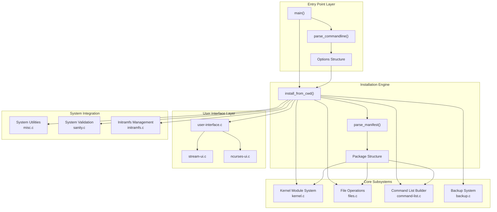
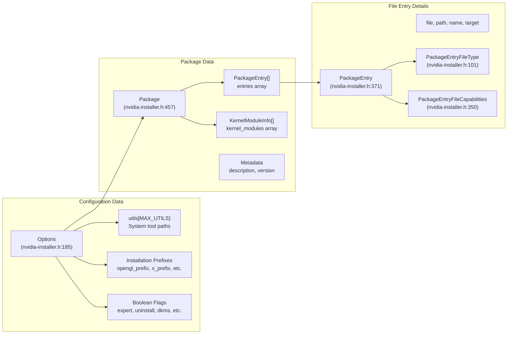
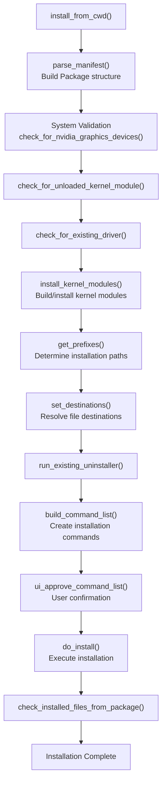

<!-- source: DeepWiki mcp.deepwiki.com · repo NVIDIA/nvidia-installer · page 1 Overview · fetched 2026-10-26 -->

# Overview

Relevant source files

The following files were used as context for generating this wiki page:

- [install-from-cwd.c](install-from-cwd.c)
- [nvidia-installer.c](nvidia-installer.c)
- [nvidia-installer.h](nvidia-installer.h)

The **nvidia-installer** is a comprehensive tool for installing, upgrading, and uninstalling NVIDIA graphics drivers on Unix and Linux systems. This repository contains a sophisticated package installation system that handles kernel module compilation, file deployment, system integration, and recovery mechanisms.

The installer supports multiple installation scenarios including driver upgrades, kernel module-only installations, uninstallation, and integration with distribution package managers. For information about the specific installation workflow phases, see [Installation Process](#3). For details about kernel module building and management, see [Kernel Module Management](#3.3).

## Architecture Overview

The nvidia-installer follows a modular architecture centered around two primary data structures: the `Options` structure that controls installation behavior, and the `Package` structure that represents the driver package being installed.

### Core System Architecture

Sources: [nvidia-installer.c:648-761](), [install-from-cwd.c:96-454](), [nvidia-installer.h:185-342](), [nvidia-installer.h:457-471]()

### Data Structure Relationships

Sources: [nvidia-installer.h:185-342](), [nvidia-installer.h:457-471](), [nvidia-installer.h:371-418](), [nvidia-installer.h:101-169]()

## Core Components

### Options Structure
The `Options` structure serves as the central configuration hub, containing over 100 configuration parameters that control every aspect of the installation process. Key categories include:

| Category | Examples | Purpose |
|----------|----------|---------|
| Installation Paths | `opengl_prefix`, `x_prefix`, `utility_prefix` | Define where files are installed |
| Boolean Flags | `expert`, `uninstall`, `no_kernel_modules` | Control installation behavior |
| System Tools | `utils[MAX_UTILS]` | Paths to required system utilities |
| Kernel Configuration | `kernel_source_path`, `kernel_name` | Kernel module build settings |
| UI Configuration | `ui.name`, `silent`, `no_questions` | User interface behavior |

Sources: [nvidia-installer.h:185-342]()

### Package Structure
The `Package` structure represents the driver package being installed, containing:

- **Metadata**: Description, version, and build directory information
- **File Entries**: Array of `PackageEntry` structures describing each file to install
- **Kernel Modules**: Array of `KernelModuleInfo` structures for kernel components
- **Build Information**: Paths and configuration for kernel module compilation

Sources: [nvidia-installer.h:457-471]()

### File Type System
The installer uses a comprehensive file type system with over 60 different `PackageEntryFileType` values, including:

- `FILE_TYPE_KERNEL_MODULE` - Compiled kernel modules
- `FILE_TYPE_OPENGL_LIB` - OpenGL library files  
- `FILE_TYPE_UTILITY_BINARY` - NVIDIA utility programs
- `FILE_TYPE_DOCUMENTATION` - Documentation files
- `FILE_TYPE_SYSTEMD_UNIT` - systemd service files

Each file type has associated capabilities defined by `PackageEntryFileCapabilities` that determine how the file should be processed.

Sources: [nvidia-installer.h:101-169](), [nvidia-installer.h:350-360]()

## Installation Workflow

The installation process follows a well-defined sequence orchestrated by `install_from_cwd()`:

Sources: [install-from-cwd.c:96-454]()

## System Integration Points

The installer integrates with numerous system components:

### System Utilities
The installer requires and locates various system utilities defined in utility enums:
- **SystemUtils**: `LDCONFIG`, `GREP`, `DMESG`, `TAIL` 
- **ModuleUtils**: `MODPROBE`, `RMMOD`, `LSMOD`, `DEPMOD`
- **DevelopUtils**: `CC`, `MAKE`, `LD` for kernel module compilation

Sources: [nvidia-installer.h:37-95]()

### User Interface Abstraction
The installer supports multiple UI implementations through a common interface:
- **Stream UI**: Console-based output for scripted installations
- **Ncurses UI**: Interactive text-based interface for manual installations
- **None UI**: Silent operation for automated deployments

For detailed information about the UI system architecture, see [User Interface System](#4).

### Build and Packaging Integration
The installer includes sophisticated build system integration for:
- Kernel module compilation from source
- Precompiled kernel interface linking
- Module signing for secure boot systems
- DKMS integration for dynamic kernel support

For comprehensive build system documentation, see [Build System](#5).

Sources: [nvidia-installer.h:316-321](), [install-from-cwd.c:193-237]()

## Key Design Principles

1. **Robustness**: Comprehensive backup and rollback capabilities ensure system recovery
2. **Flexibility**: Extensive configuration options support diverse deployment scenarios  
3. **Modularity**: Clear separation between UI, installation logic, and system operations
4. **Validation**: Multi-layer validation from command-line parsing to post-install verification
5. **Integration**: Deep integration with Linux distribution package management and system services

The nvidia-installer represents a mature, production-ready installation system designed to handle the complexities of graphics driver deployment across diverse Linux environments while maintaining system stability and providing comprehensive error recovery mechanisms.

---

