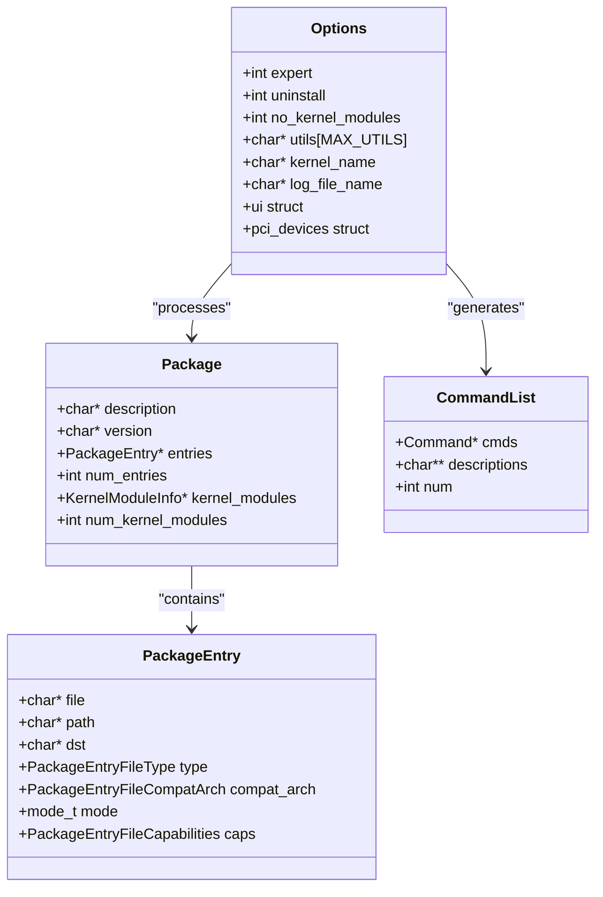
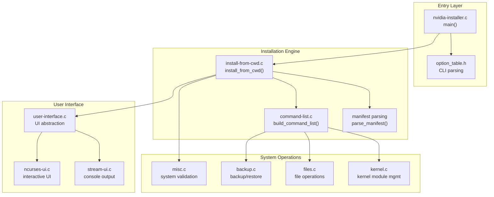
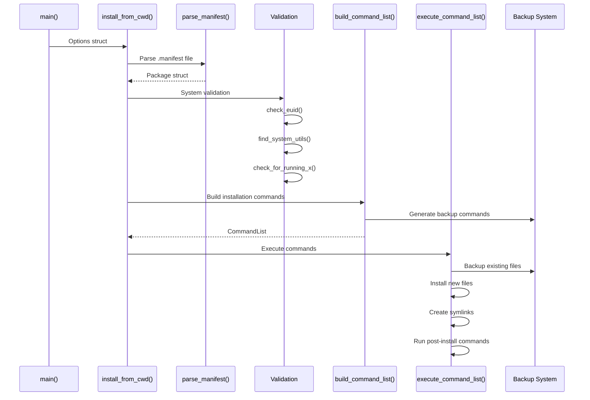
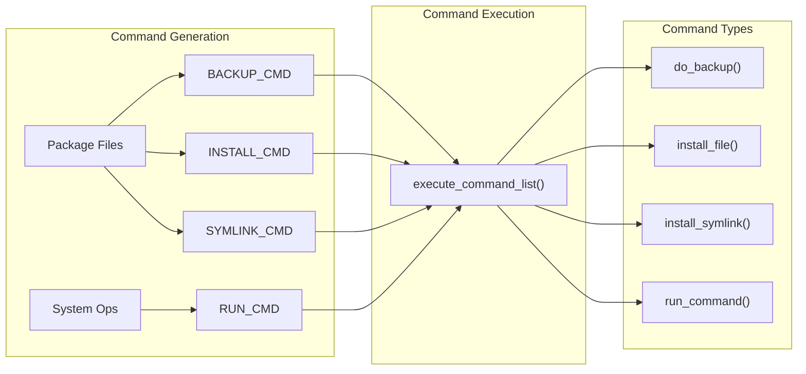
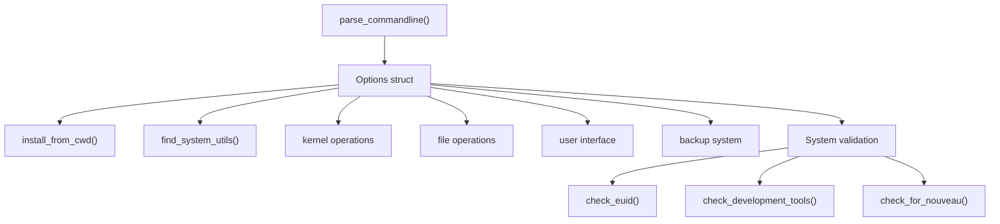

<!-- source: DeepWiki mcp.deepwiki.com · repo NVIDIA/nvidia-installer · page 2 System Architecture · fetched 2026-10-26 -->

# System Architecture

Relevant source files

The following files were used as context for generating this wiki page:

- [backup.c](backup.c)
- [command-list.c](command-list.c)
- [install-from-cwd.c](install-from-cwd.c)
- [misc.c](misc.c)
- [nvidia-installer.h](nvidia-installer.h)

This document describes the overall architectural design of nvidia-installer, detailing how the major subsystems interact and how data flows through the system during installation operations. For specific implementation details of individual subsystems, see their respective dedicated pages such as [Installation Process](#3) and [User Interface System](#4).

## Overview

The nvidia-installer follows a modular, command-driven architecture centered around a comprehensive `Options` structure that carries configuration and state throughout the system. The architecture separates concerns into distinct subsystems: command-line processing, installation orchestration, system operations, user interface abstraction, and backup/recovery management.

## Core Data Structures

The architecture is built around several key data structures defined in [nvidia-installer.h:185-472]():

Sources: [nvidia-installer.h:185-342](), [nvidia-installer.h:457-471](), [nvidia-installer.h:371-418](), [command-list.c:99-106]()

## System Architecture Overview

The system is organized into distinct functional layers that interact through well-defined interfaces:

Sources: [nvidia-installer.c](), [install-from-cwd.c:96-454](), [command-list.c:255-519](), [misc.c:548-890]()

## Installation Flow Architecture

The installation process follows a structured flow with multiple validation and decision points:

Sources: [install-from-cwd.c:96-454](), [install-from-cwd.c:726-1047](), [misc.c:100-113](), [misc.c:548-589](), [command-list.c:255-519](), [command-list.c:614-731]()

## Component Interaction Patterns

### Command List Pattern

The installer uses a command list pattern where all installation operations are first collected into a `CommandList` structure, then validated and executed atomically:

Sources: [command-list.c:77-87](), [command-list.c:255-519](), [command-list.c:614-731]()

### Options Structure Flow

The `Options` structure serves as the central configuration and state container that flows through all major subsystems:

Sources: [nvidia-installer.h:185-342](), [misc.c:100-113](), [misc.c:548-589](), [misc.c:778-827]()

## Subsystem Responsibilities

| Subsystem | Primary Functions | Key Files |
|-----------|------------------|-----------|
| Installation Engine | Orchestrates entire installation process, manifest parsing | `install-from-cwd.c` |
| Command List | Builds and executes atomic installation operations | `command-list.c` |
| System Operations | Kernel module management, file operations, validation | `kernel.c`, `files.c`, `misc.c` |
| Backup System | Safe backup/restore for rollback capability | `backup.c` |
| User Interface | Abstracted UI with multiple implementations | `user-interface.c`, `stream-ui.c`, `ncurses-ui.c` |

## Error Handling and Recovery

The architecture implements comprehensive error handling through several mechanisms:

1. **Backup System**: All operations are logged in `/var/lib/nvidia/log` allowing complete rollback via [backup.c:137-198]()
2. **Validation Gates**: Multiple validation points prevent installation on incompatible systems via [misc.c:100-113](), [misc.c:778-827]()
3. **Command List Validation**: User approval required before execution via [command-list.c:614-731]()
4. **Graceful Degradation**: Continue-after-error prompts for non-critical failures via [misc.c:905-924]()

Sources: [backup.c:137-198](), [backup.c:631-889](), [misc.c:905-924](), [command-list.c:614-731]()

## Data Flow Summary

The system follows a clear data flow pattern:

1. **Input Processing**: CLI arguments → `Options` structure
2. **Package Analysis**: `.manifest` file → `Package` structure  
3. **Command Generation**: `Package` + `Options` → `CommandList`
4. **Execution**: `CommandList` → System operations with backup logging
5. **Validation**: Post-install verification and cleanup

This architecture provides modularity, testability, and robust error recovery while maintaining clear separation of concerns between user interface, business logic, and system operations.

Sources: [nvidia-installer.h:185-342](), [install-from-cwd.c:96-454](), [command-list.c:255-519](), [backup.c:137-198]()

---

