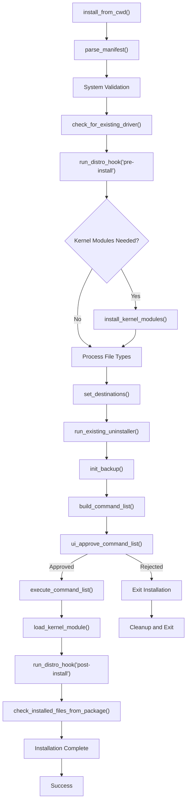
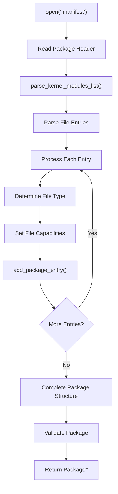
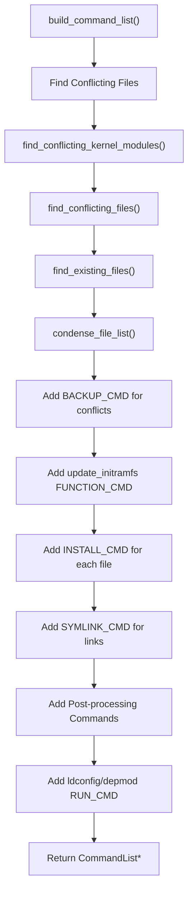
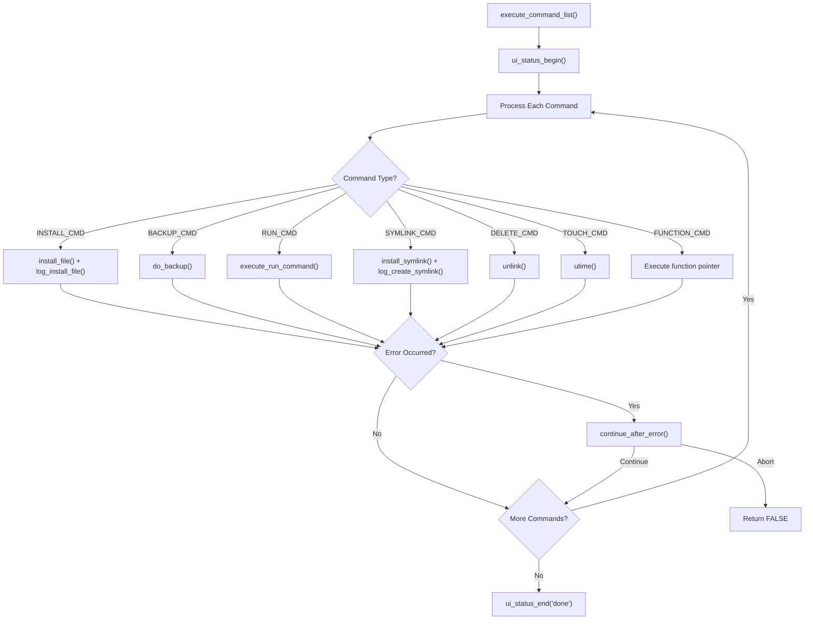
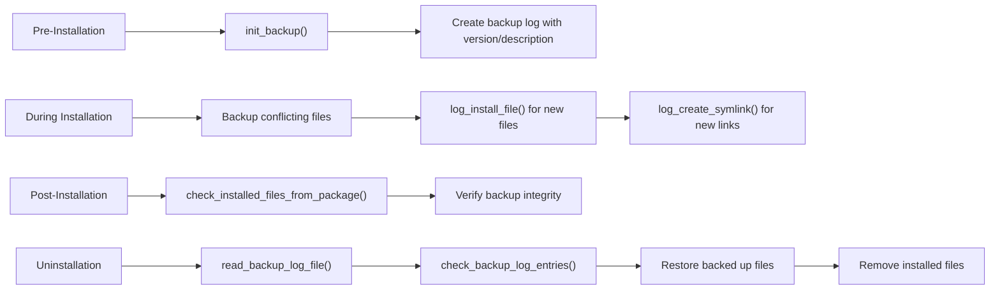
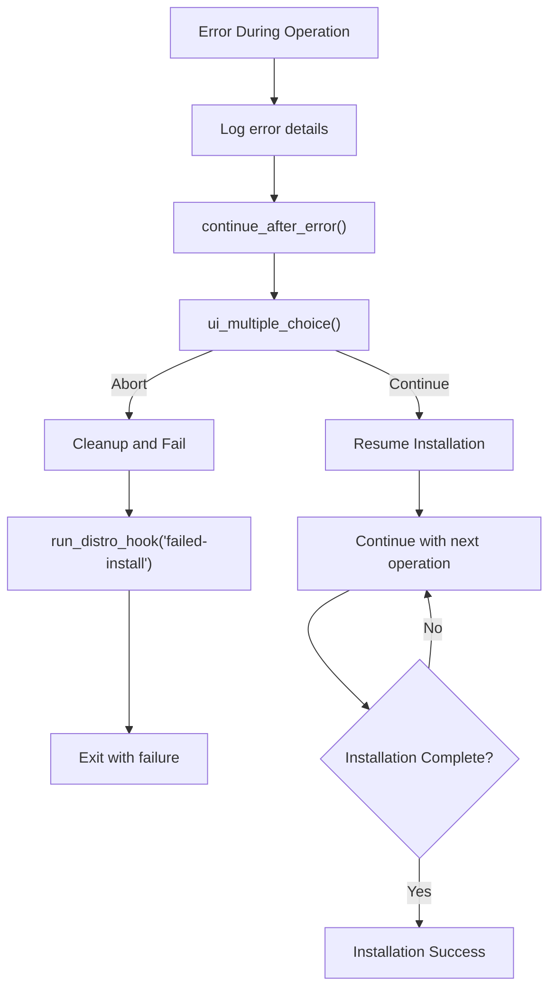

<!-- source: DeepWiki mcp.deepwiki.com · repo NVIDIA/nvidia-installer · page 3 Installation Process · fetched 2026-10-26 -->

# Installation Process

Relevant source files

The following files were used as context for generating this wiki page:

- [backup.c](backup.c)
- [command-list.c](command-list.c)
- [install-from-cwd.c](install-from-cwd.c)
- [misc.c](misc.c)

This document describes the comprehensive installation workflow implemented by nvidia-installer, covering all major phases from startup through completion. The installation process orchestrates manifest parsing, system validation, kernel module management, file operations, and recovery systems to safely install NVIDIA drivers.

For information about the command-line interface and option parsing, see [Command Line Interface](#3.1). For details about the core installation engine implementation, see [Installation Engine](#3.2). For kernel module-specific operations, see [Kernel Module Management](#3.3).

## Installation Workflow Overview

The nvidia-installer follows a multi-phase installation process designed to safely replace existing drivers while maintaining system stability through comprehensive backup and validation mechanisms.

### High-Level Installation Flow

Sources: [install-from-cwd.c:96-454]()

### Core Installation Phases

The installation process consists of six distinct phases, each with specific responsibilities and error handling:

| Phase | Primary Functions | Purpose |
|-------|------------------|---------|
| **Initialization** | `parse_manifest()`, `ui_set_title()` | Parse package data and initialize UI |
| **Validation** | `check_for_nvidia_graphics_devices()`, `check_for_running_x()` | System compatibility checks |
| **Kernel Processing** | `install_kernel_modules()`, `assisted_module_signing()` | Handle kernel module building/linking |
| **File Processing** | `set_destinations()`, `process_dot_desktop_files()` | Prepare files for installation |
| **Command Execution** | `build_command_list()`, `execute_command_list()` | Execute installation operations |
| **Finalization** | `check_installed_files_from_package()`, `run_nvidia_xconfig()` | Verify and complete installation |

Sources: [install-from-cwd.c:96-454]()

## Manifest Processing and Package Structure

The installation begins by parsing a `.manifest` file that describes all components to be installed. This process builds the internal `Package` structure that drives the entire installation.

### Manifest Parsing Flow

The manifest file structure includes:
- **Line 1**: Package description string
- **Line 2**: Version string  
- **Line 4**: Whitespace-separated list of kernel module names
- **Remaining lines**: File entries with permissions, types, and paths

Sources: [install-from-cwd.c:726-1047]()

### Package Entry Processing

Each file in the manifest becomes a `PackageEntry` with specific capabilities and installation behavior:

```mermaid
flowchart LR
    FileEntry["File Entry from Manifest"] --> ParseFields["Parse Fields"]
    ParseFields --> DetermineType["parse_manifest_file_type()"]
    DetermineType --> SetCapabilities["get_file_type_capabilities()"]
    
    SetCapabilities --> CheckArch{"Has Architecture?"}
    CheckArch -->|Yes| SetCompat["Set Compatibility Architecture"]
    CheckArch -->|No| CheckPath{"Has Path?"}
    SetCompat --> CheckPath
    
    CheckPath -->|Yes| SetPath["Set Installation Path"]
    CheckPath -->|No| CheckSymlink{"Is Symlink?"}
    SetPath --> CheckSymlink
    
    CheckSymlink -->|Yes| SetTarget["Set Symlink Target"]
    CheckSymlink -->|No| AddEntry["add_package_entry()"]
    SetTarget --> AddEntry
```

Sources: [install-from-cwd.c:838-1016](), [install-from-cwd.c:1056-1096]()

## Command List Building and Execution

The installation process builds a comprehensive list of operations to perform, allowing for user review and atomic execution with rollback capabilities.

### Command List Construction

Sources: [command-list.c:255-519]()

### Command Execution Engine

The command execution system processes each operation with progress tracking and error handling:

Sources: [command-list.c:614-731]()

## Integration with Backup System

The installation process is tightly integrated with the backup system to enable safe uninstallation and recovery from failed installations.

### Backup Integration Points

Sources: [backup.c:137-198](), [backup.c:302-332](), [backup.c:336-362]()

### Command Types and Operations

The installer supports multiple command types for different installation operations:

| Command Type | Purpose | Key Functions |
|--------------|---------|---------------|
| `INSTALL_CMD` | Install files with permissions | `install_file()`, `log_install_file()` |
| `BACKUP_CMD` | Backup existing files | `do_backup()` |
| `RUN_CMD` | Execute system commands | `run_command()` |
| `SYMLINK_CMD` | Create symbolic links | `install_symlink()`, `log_create_symlink()` |
| `DELETE_CMD` | Delete temporary files | `unlink()` |
| `FUNCTION_CMD` | Execute internal functions | Function pointer calls |

Sources: [command-list.c:77-87](), [command-list.c:626-724]()

## Error Handling and Recovery

The installation process includes comprehensive error handling with user interaction for recovery decisions:

### Error Recovery Flow

Sources: [misc.c:905-924](), [install-from-cwd.c:418-452]()

The installation process maintains transactional integrity through the backup system, allowing complete rollback of partial installations and providing detailed logging for troubleshooting failed installations.

---

