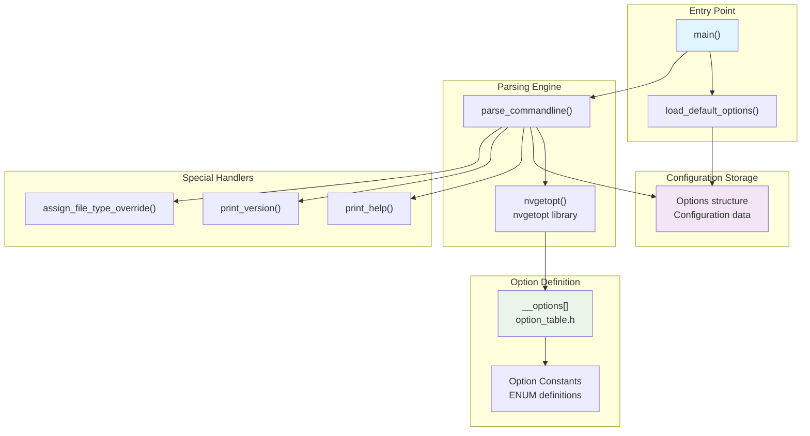
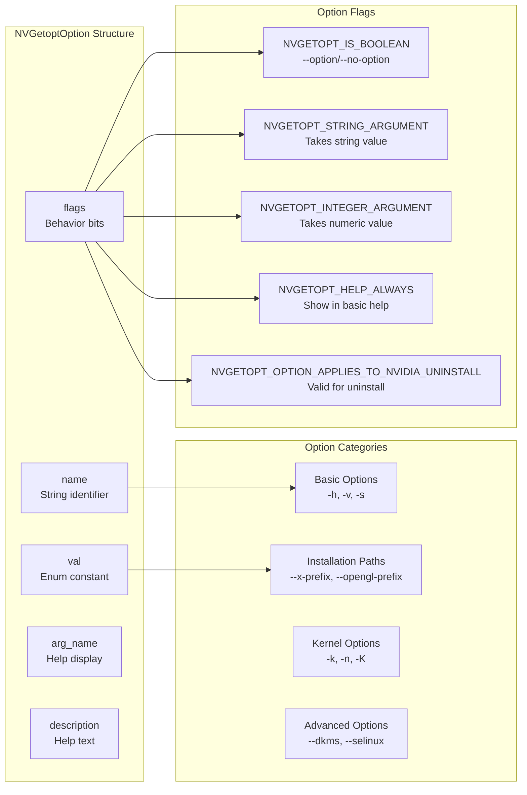
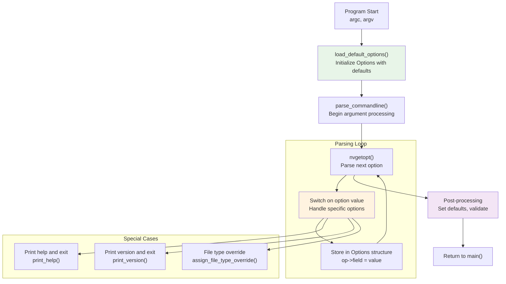
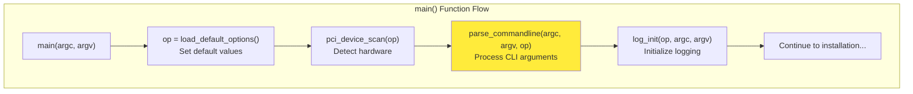
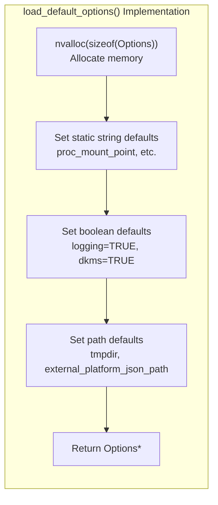
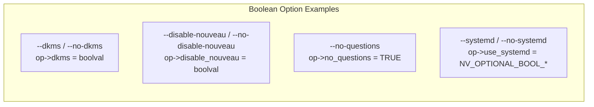
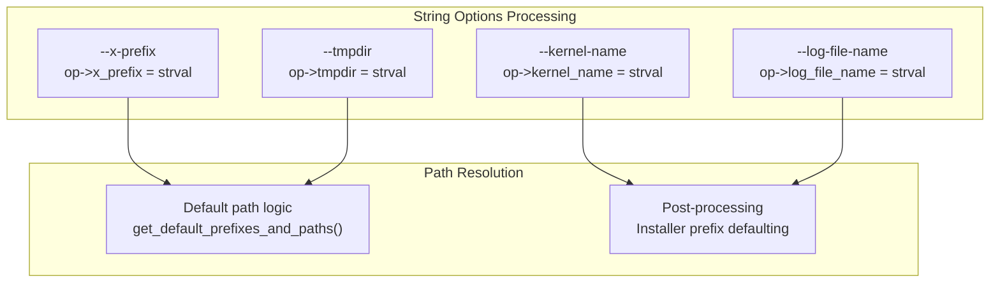
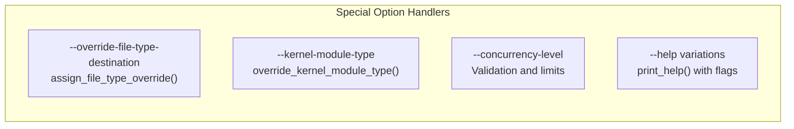
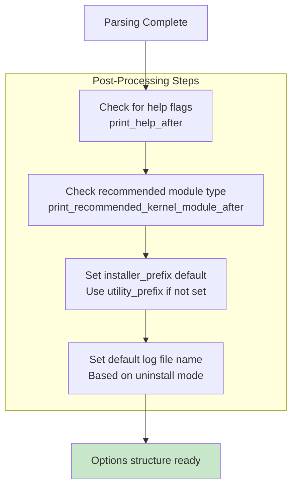

<!-- source: DeepWiki mcp.deepwiki.com · repo NVIDIA/nvidia-installer · page 3.1 Command Line Interface · fetched 2026-10-26 -->

# Command Line Interface

Relevant source files

The following files were used as context for generating this wiki page:

- [common-utils/nvgetopt.h](common-utils/nvgetopt.h)
- [nvidia-installer.c](nvidia-installer.c)
- [option_table.h](option_table.h)

## Purpose and Scope

This document covers the command-line interface (CLI) system of nvidia-installer, including argument parsing, option definitions, and how user preferences are processed and stored in the `Options` structure. The CLI system handles all user input from the command line and converts it into internal configuration data that drives the installation process.

For information about the core installation logic that uses these parsed options, see [Installation Engine](#3.2). For details about the data structures that store the parsed configuration, see [Data Structures and Configuration](#7).

## CLI Architecture Overview

The command-line interface follows a structured approach using the nvgetopt library for option parsing. The system separates option definitions from parsing logic and uses a centralized `Options` structure to store all configuration data.

**Sources:** [nvidia-installer.c:648-761](), [nvidia-installer.c:119-157](), [nvidia-installer.c:225-640](), [option_table.h:126-789]()

## Option Definition System

The CLI uses a table-driven approach to define all available command-line options. Each option is defined using the `NVGetoptOption` structure, which specifies the option name, behavior flags, and help text.

### Option Table Structure

**Sources:** [option_table.h:126-789](), [common-utils/nvgetopt.h:135-141](), [common-utils/nvgetopt.h:46-113]()

## Command Line Parsing Flow

The parsing process follows a well-defined sequence that transforms command-line arguments into a populated `Options` structure.

### Parsing Workflow

**Sources:** [nvidia-installer.c:225-640](), [nvidia-installer.c:246-585]()

## Key Functions and Their Roles

### Main Entry Point and Initialization

The `main` function orchestrates the CLI processing sequence:

**Sources:** [nvidia-installer.c:648-670]()

### Default Options Loading

The `load_default_options` function creates and initializes the `Options` structure:

**Sources:** [nvidia-installer.c:119-157]()

### Command Line Parsing Implementation

The `parse_commandline` function contains the main parsing logic with a large switch statement handling each option:

| Option Category | Examples | Lines in Code |
|-----------------|----------|---------------|
| Basic Control | `-h`, `-v`, `-s`, `-q` | [257-283]() |
| Installation Paths | `--x-prefix`, `--opengl-prefix` | [299-347]() |
| Kernel Module Options | `-k`, `-n`, `-K`, `-M` | [285-297, 555-567]() |
| Advanced Features | `--dkms`, `--selinux`, `--systemd` | [456-554]() |
| Compatibility Options | `--compat32-*` | [316-327]() |

**Sources:** [nvidia-installer.c:255-583]()

## Option Categories and Types

### Boolean Options

Boolean options can be specified with `--option` (true) or `--no-option` (false):

**Sources:** [nvidia-installer.c:456-458](), [nvidia-installer.c:284](), [nvidia-installer.c:272](), [nvidia-installer.c:542-545]()

### String Argument Options

Options that accept string arguments for paths and configuration:

**Sources:** [nvidia-installer.c:300-301](), [nvidia-installer.c:285-288](), [nvidia-installer.c:358-359](), [nvidia-installer.c:363-364]()

### Special Processing Options

Some options require custom processing logic:

**Sources:** [nvidia-installer.c:534-538](), [nvidia-installer.c:560-564](), [nvidia-installer.c:289-297](), [nvidia-installer.c:587-602]()

## Post-Processing and Validation

After parsing all arguments, the system performs validation and default resolution:

**Sources:** [nvidia-installer.c:587-632]()

The CLI system provides a robust, extensible interface that handles the complexity of nvidia-installer's many configuration options while maintaining clean separation between option definitions, parsing logic, and configuration storage.

---

