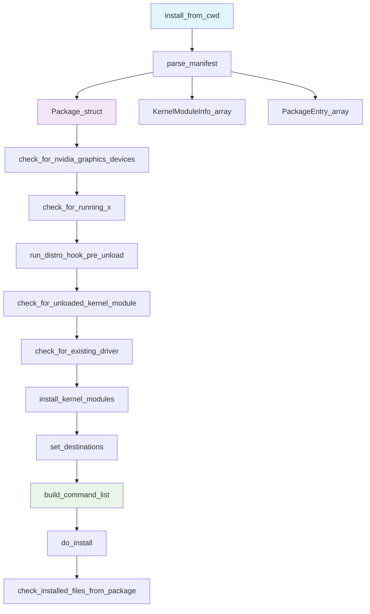
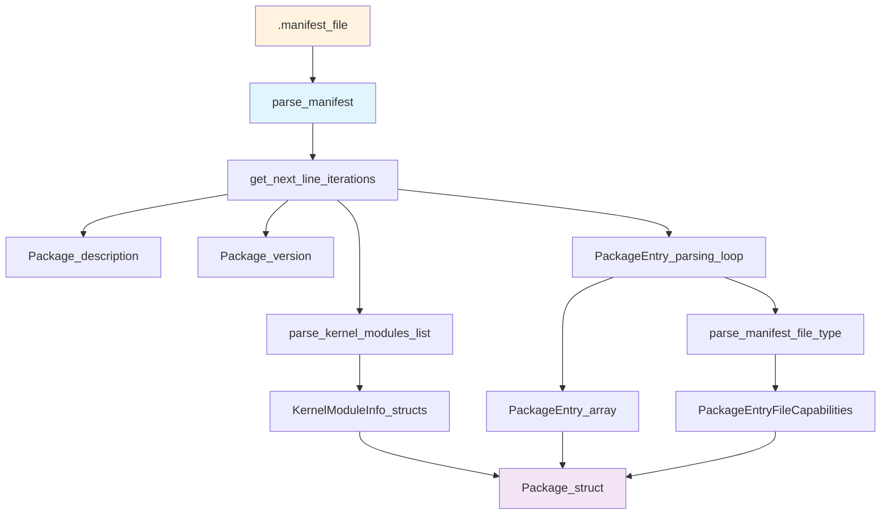
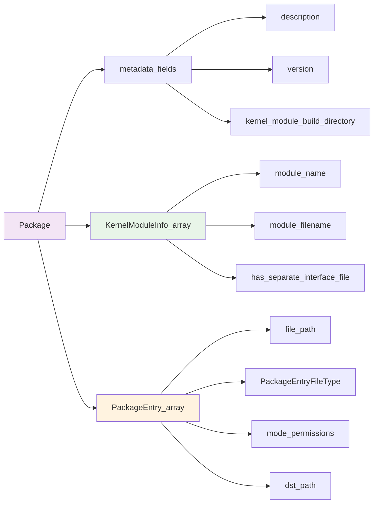
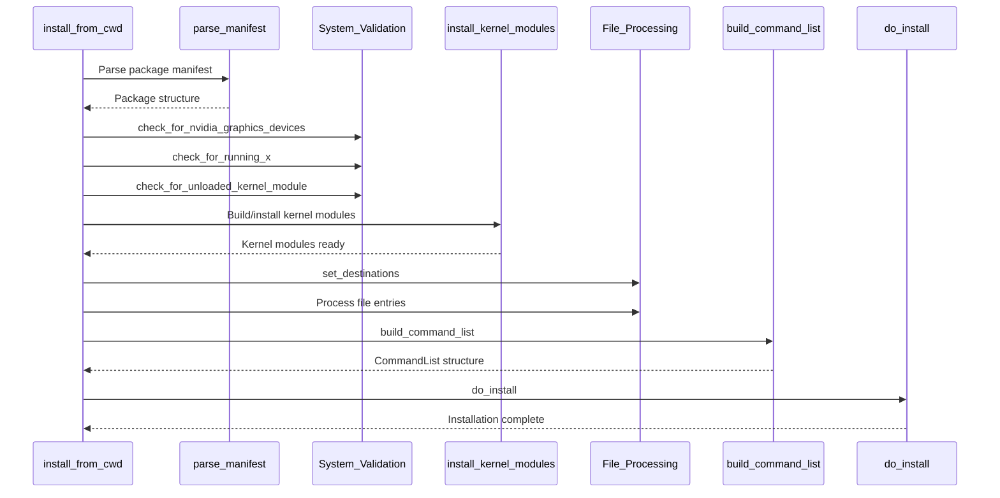
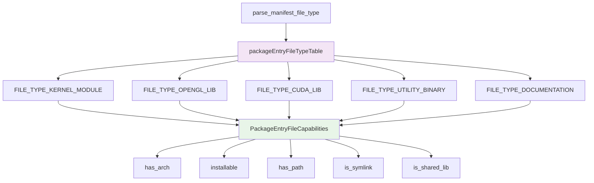
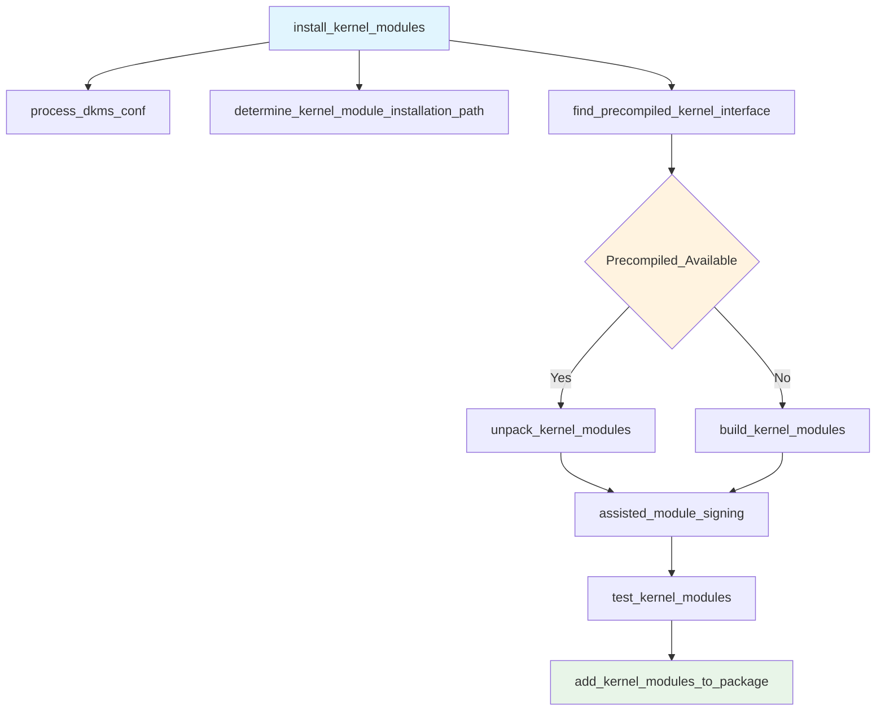
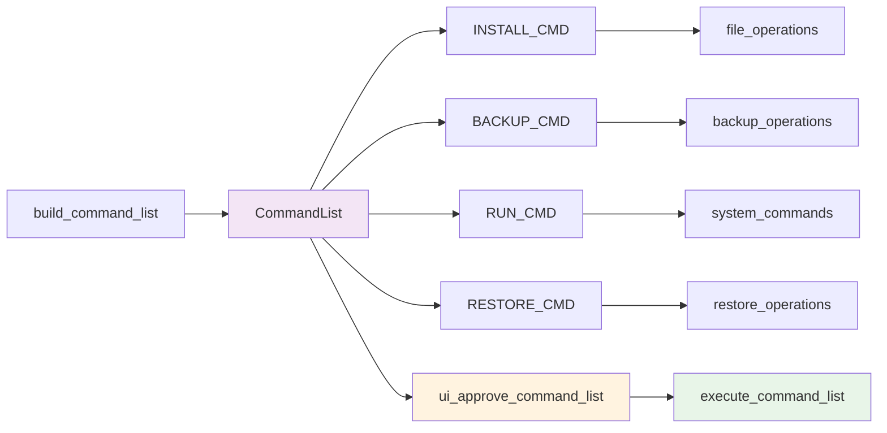
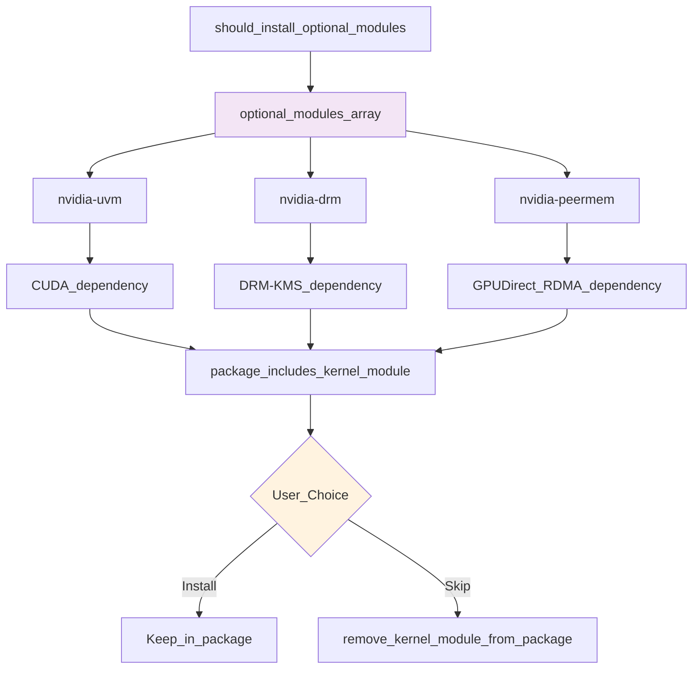

<!-- source: DeepWiki mcp.deepwiki.com · repo NVIDIA/nvidia-installer · page 3.2 Installation Engine · fetched 2026-10-26 -->

# Installation Engine

Relevant source files

The following files were used as context for generating this wiki page:

- [install-from-cwd.c](install-from-cwd.c)
- [manifest.c](manifest.c)
- [misc.c](misc.c)

The Installation Engine is the core orchestration system that manages the complete NVIDIA driver installation process. It handles manifest parsing, package validation, file processing, and coordinates with all other subsystems to perform the actual installation. This system is primarily implemented in `install-from-cwd.c` and serves as the central coordinator for the entire installation workflow.

For information about the command-line interface that feeds into this engine, see [Command Line Interface](#3.1). For details about individual subsystems like kernel module management and file operations, see [Kernel Module Management](#3.3) and [File System Operations](#3.4).

## Core Architecture

The Installation Engine follows a structured workflow that processes packages from the current working directory and orchestrates all installation activities through a central function.

**Installation Engine Core Flow**

The engine processes installations through discrete phases, each with specific responsibilities and validation points.

Sources: [install-from-cwd.c:96-454]()

## Manifest Processing System

The manifest processing system parses `.manifest` files that describe package contents and converts them into structured data for installation processing.

**Manifest to Package Structure Transformation**

The manifest file contains package metadata and file listings that get parsed into structured C data types for processing.

Sources: [install-from-cwd.c:726-1047](), [manifest.c:165-180]()

## Package Data Structure

The `Package` structure serves as the central data container for all installation information, holding both metadata and file entries.

| Field | Type | Purpose |
|-------|------|---------|
| `description` | `char*` | Human-readable package description |
| `version` | `char*` | Package version string |
| `kernel_modules` | `KernelModuleInfo*` | Array of kernel module information |
| `num_kernel_modules` | `int` | Count of kernel modules |
| `entries` | `PackageEntry*` | Array of all files to install |
| `num_entries` | `int` | Count of package entries |
| `kernel_module_build_directory` | `char*` | Build directory path |

**Package Structure Component Relationships**

Sources: [nvidia-installer.h](), [install-from-cwd.c:1056-1096]()

## Installation Orchestration

The installation process follows a well-defined sequence of phases, each with specific validation and processing steps.

**Installation Phase Sequence**

The orchestration ensures proper dependency ordering and validation before proceeding to irreversible operations.

Sources: [install-from-cwd.c:96-454](), [misc.c:932-952]()

## File Type Classification System

The installation engine uses a comprehensive file type system to categorize and process different kinds of files with appropriate handling logic.

**File Type to Capabilities Mapping**

Each file type has associated capabilities that determine how it should be processed during installation.

| Capability | Purpose |
|------------|---------|
| `has_arch` | File supports architecture-specific variants |
| `installable` | File should be installed to the system |
| `has_path` | File has an explicit installation path |
| `is_symlink` | File is a symbolic link |
| `is_shared_lib` | File is a shared library requiring special handling |

Sources: [manifest.c:55-138](), [manifest.c:144-158]()

## Kernel Module Integration

The Installation Engine coordinates closely with the kernel module management system to handle the specialized requirements of kernel module installation.

**Kernel Module Processing Flow**

The engine handles both precompiled and source-built kernel modules through a unified interface.

Sources: [install-from-cwd.c:469-551](), [install-from-cwd.c:1148-1491]()

## Command List Generation

The Installation Engine builds a comprehensive list of operations to be executed, allowing for user review and atomic execution.

**Command List Structure and Execution**

The command list provides a structured way to batch operations and allow user approval before execution.

Sources: [command-list.c](), [install-from-cwd.c:337-347]()

## Optional Module Processing

The Installation Engine handles optional kernel modules through a flexible configuration system that allows users to selectively install components.

**Optional Module Decision Flow**

The system presents users with choices about optional components based on their intended use cases.

Sources: [install-from-cwd.c:59-78](), [misc.c:1189-1234]()

---

