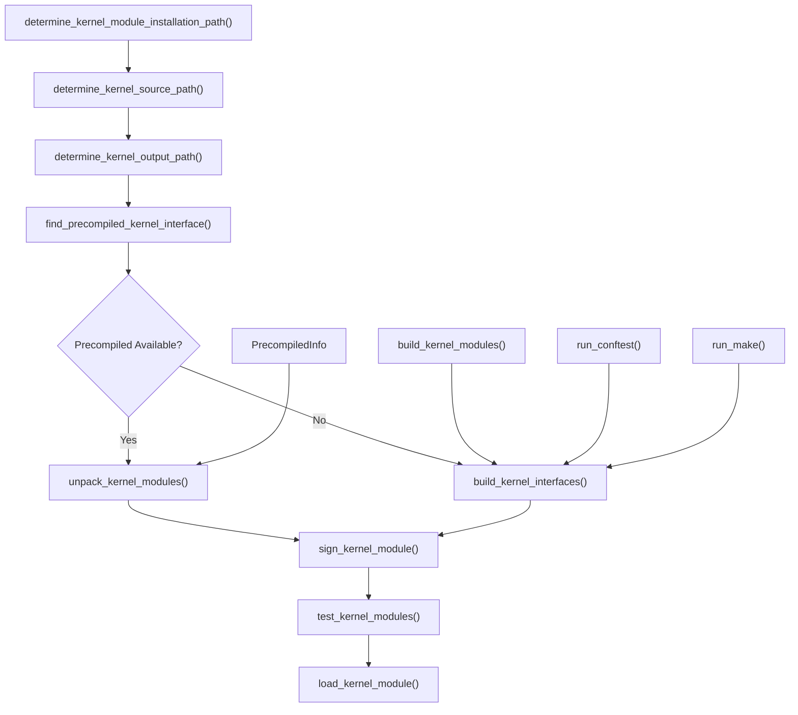
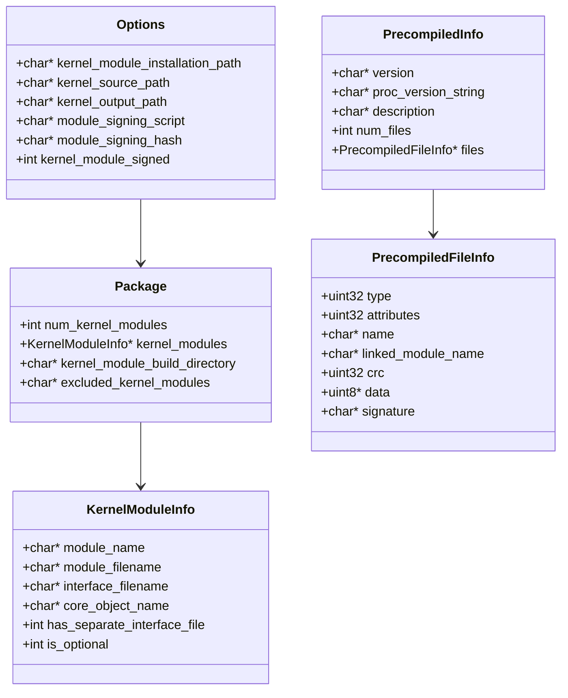
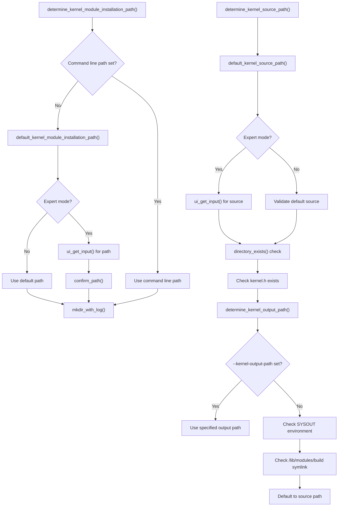
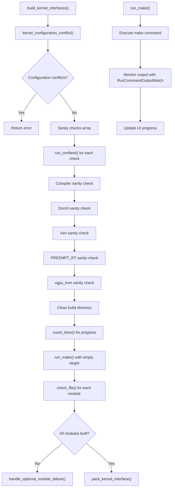
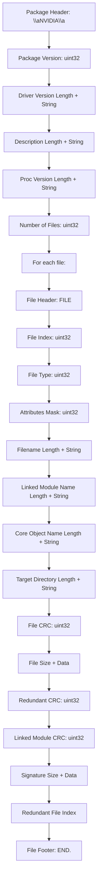
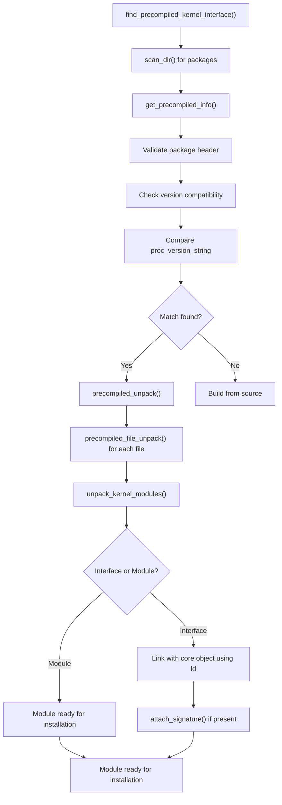
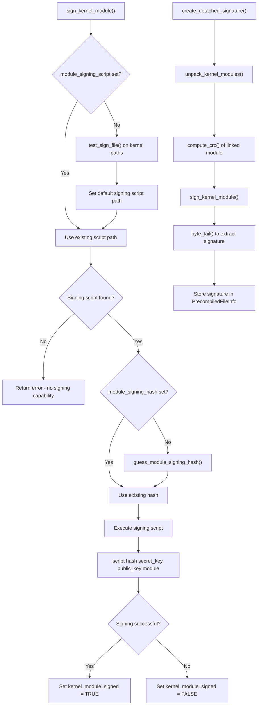
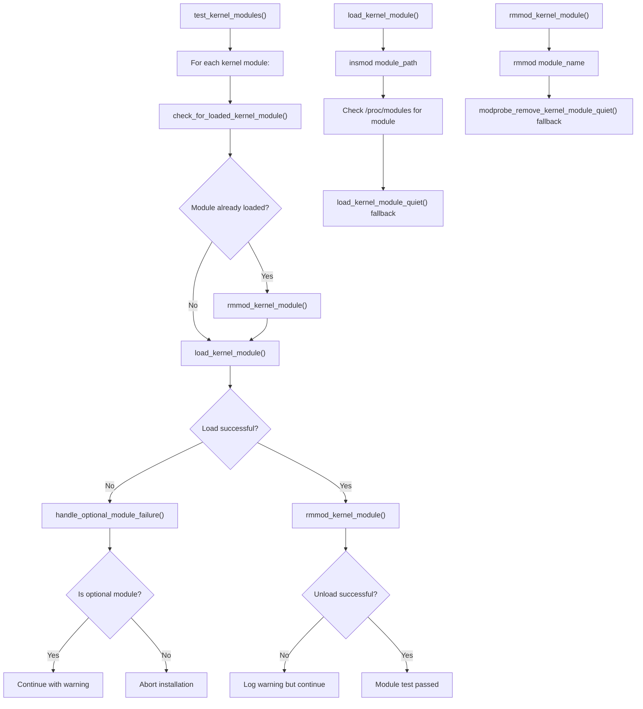

<!-- source: DeepWiki mcp.deepwiki.com · repo NVIDIA/nvidia-installer · page 3.3 Kernel Module Management · fetched 2026-10-26 -->

# Kernel Module Management

Relevant source files

The following files were used as context for generating this wiki page:

- [kernel.c](kernel.c)
- [kernel.h](kernel.h)
- [mkprecompiled.c](mkprecompiled.c)
- [precompiled.c](precompiled.c)
- [precompiled.h](precompiled.h)

## Purpose and Scope

The Kernel Module Management system handles the building, signing, testing, and installation of NVIDIA kernel modules. This system supports both building kernel modules from source code and using precompiled kernel interfaces when available. It manages the entire kernel module lifecycle from path detection through installation validation.

For information about the broader installation workflow, see [Installation Process](#3). For details about file system operations during module installation, see [File System Operations](#3.4).

## System Architecture

The kernel module management system operates through several coordinated subsystems that handle different aspects of module preparation and installation.

### Core Components Flow

Sources: [kernel.c:99-146](), [kernel.c:205-325](), [kernel.c:334-407](), [kernel.c:672-675](), [kernel.c:937-1078]()

### Data Structure Relationships

Sources: [nvidia-installer.h](), [kernel.h:26-45](), [precompiled.h:136-160]()

## Path Resolution System

The system must determine three critical paths before any kernel module operations can proceed: installation path, source path, and output path.

### Path Determination Workflow

Sources: [kernel.c:99-146](), [kernel.c:205-325](), [kernel.c:334-407]()

The path resolution system handles several scenarios:
- **Installation Path**: Defaults to `/lib/modules/$(uname -r)/kernel/drivers/video` but can be overridden
- **Source Path**: Searches `/lib/modules/$(uname -r)/source`, `/usr/src/linux`, and other common locations
- **Output Path**: Usually the same as source path, but can differ for out-of-tree builds

## Build System Integration

When precompiled interfaces are unavailable, the system builds kernel modules from source using the kernel's build system.

### Build Process Flow

Sources: [kernel.c:937-1078](), [kernel.c:556-627](), [kernel.c:62-64](), [kernel.c:945-954]()

The build system performs comprehensive validation before attempting to build:
- **Compiler Sanity Check**: Verifies the compiler can build kernel modules
- **Hypervisor Checks**: Tests for Dom0, Xen, and other virtualization conflicts
- **Kernel Configuration**: Validates kernel config options are compatible

## Precompiled Interface System

The precompiled interface system allows distribution of pre-built kernel interfaces that can be linked with core binary objects, avoiding the need to build from source.

### Precompiled Package Format

Sources: [precompiled.h:22-88](), [precompiled.c:467-626]()

### Precompiled Interface Workflow

Sources: [kernel.c:1112-1272](), [kernel.c:502-549](), [kernel.c:414-488](), [precompiled.c:151-360]()

The precompiled system supports two file types:
- **PRECOMPILED_FILE_TYPE_INTERFACE**: Kernel interface files that need linking with core objects
- **PRECOMPILED_FILE_TYPE_MODULE**: Complete kernel modules ready for installation

## Module Signing and Security

For systems with secure boot enabled, kernel modules must be cryptographically signed before they can be loaded.

### Module Signing Process

Sources: [kernel.c:703-762](), [kernel.c:771-839](), [kernel.c:682-694]()

The signing system supports both embedded and detached signatures:
- **Embedded Signatures**: Signature is part of the module file
- **Detached Signatures**: Signature is stored separately and attached during installation

## Testing and Validation

Before finalizing installation, the system tests that kernel modules can be successfully loaded and unloaded.

### Module Testing Workflow

Sources: [kernel.c:1274-1361](), [kernel.c:1363-1432](), [kernel.c:1579-1642](), [kernel.c:878-889]()

The testing system ensures that:
- Modules can be loaded without conflicts
- Modules can be cleanly unloaded
- Optional modules don't block installation if they fail
- Core modules must pass testing for installation to proceed

---

