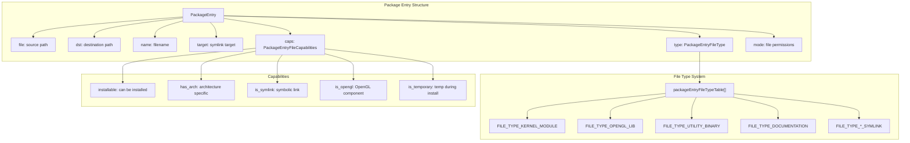
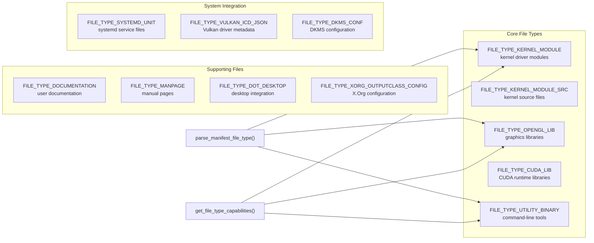
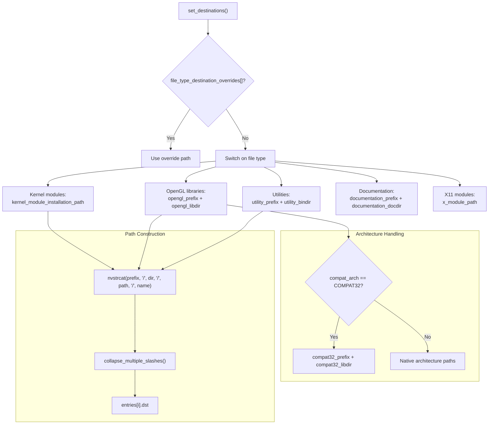
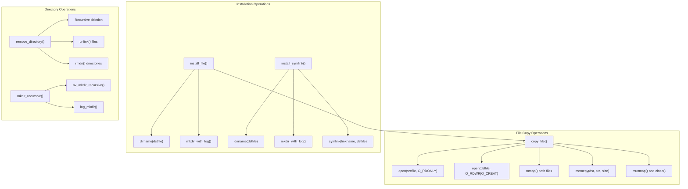
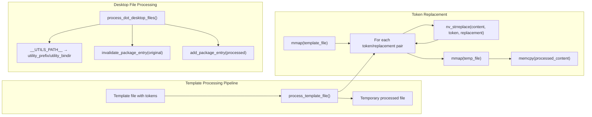
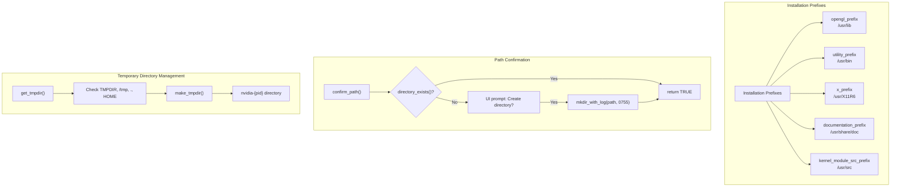

<!-- source: DeepWiki mcp.deepwiki.com · repo NVIDIA/nvidia-installer · page 3.4 File System Operations · fetched 2026-10-26 -->

# File System Operations

Relevant source files

The following files were used as context for generating this wiki page:

- [files.c](files.c)
- [files.h](files.h)
- [manifest.c](manifest.c)

## Purpose and Scope

This document covers the file system operations subsystem of nvidia-installer, which handles the installation, organization, and management of files during the driver installation process. This includes file type classification, path resolution, template processing, and the actual file system operations required to install NVIDIA driver components.

For information about the overall installation workflow, see [Installation Engine](#3.2). For details about the backup and recovery mechanisms that work with these file operations, see [Backup and Recovery System](#3.5).

## Package Entry System

The file system operations are built around the `PackageEntry` data structure, which represents individual files to be installed. Each entry contains metadata about the file type, destination path, permissions, and installation capabilities.

**Sources:** [files.c:528-894](), [manifest.c:55-138](), [nvidia-installer.h]()

## File Type Classification

The installer categorizes files into specific types, each with different installation behaviors and destination paths. The classification system is defined in `manifest.c` and drives the entire file installation process.

The `get_installable_file_type_list()` function filters file types based on installation options, while `parse_manifest_file_type()` maps string names to type enumerations during manifest parsing.

**Sources:** [manifest.c:144-180](), [manifest.c:185-225](), [files.c:549-862]()

## Path Resolution and Destination Assignment

The `set_destinations()` function is the core of the path resolution system, determining where each file should be installed based on its type, architecture, and user-specified installation prefixes.

The path resolution system handles multiple installation prefixes, architecture-specific paths for 32-bit compatibility libraries, and user overrides for expert installations.

**Sources:** [files.c:528-894](), [files.c:904-1072]()

## Core File Operations

The installer provides a comprehensive set of file system operations, implemented as robust functions with error handling and logging.

The file operations use memory mapping for efficient copying and provide atomic file replacement by unlinking existing files before creating new ones.

**Sources:** [files.c:218-312](), [files.c:1467-1515](), [files.c:56-116](), [files.c:1344-1375]()

## Template File Processing

The installer processes template files that contain placeholder tokens, replacing them with runtime-determined values. This is primarily used for `.desktop` files and configuration files.

The `nv_strreplace()` function implements string replacement without relying on external tools like `sed`, ensuring the installer works on minimal systems.

**Sources:** [files.c:1914-2054](), [files.c:2064-2118](), [files.c:1845-1903]()

## Directory and Path Management

The installer manages a complex directory structure with multiple installation prefixes and architecture-specific paths. The directory management system ensures paths exist and handles permission setting.

The system uses a hierarchical approach to find suitable temporary directories and always confirms with users before creating new directories in expert mode.

**Sources:** [files.c:1308-1334](), [files.c:1551-1594](), [files.c:904-1072]()

## Symlink Management

The installer handles symbolic links extensively, both for creating new links and resolving existing ones. This is critical for library management and maintaining compatibility.

```mermaid
flowchart TD
    subgraph "Symlink Operations"
        GetSymTarget["get_symlink_target()"]
        ReadlinkLoop["readlink() with growing buffer"]
        ResolvedTarget["get_resolved_symlink_target()"]
        
        GetSymTarget --> ReadlinkLoop
        ReadlinkLoop --> ResolvedTarget
    end
    
    subgraph "libGLX_indirect Handling"
        CheckIndirect["check_libGLX_indirect_links()"]
        CheckTarget["check_libGLX_indirect_target()"]
        FollowLinks["Follow symlink chain"]
        BasenameCmp["Compare basename to 'libGLX_indirect'"]
        InvalidateEntry["invalidate_package_entry()"]
        
        CheckIndirect --> CheckTarget
        CheckTarget --> FollowLinks
        FollowLinks --> BasenameCmp
        BasenameCmp -->|Different| InvalidateEntry
    end
    
    subgraph "Symlink Installation"
        InstallSym["install_symlink()"]
        MakeDir["mkdir_with_log(dirname)"]
        CreateLink["symlink(target, destination)"]
        
        InstallSym --> MakeDir
        MakeDir --> CreateLink
    end
```

The symlink handling includes special logic for `libGLX_indirect.so.0` to avoid conflicts with existing indirect rendering libraries from other vendors.

**Sources:** [files.c:1386-1457](), [files.c:418-518](), [files.c:1489-1515]()

## Integration Points

The file system operations integrate closely with other installer subsystems:

| Integration Point | Description | Key Functions |
|------------------|-------------|---------------|
| Command List System | File operations generate commands for backup/restore | `add_package_entry()` creates install commands |
| Package Management | Files are organized into installable packages | `set_destinations()` assigns installation paths |
| User Interface | Progress reporting and error messages | All functions use `ui_*()` for user communication |
| Kernel Module System | Special handling for kernel files | `add_kernel_modules_to_package()` |
| Template Processing | Runtime configuration generation | `process_dot_desktop_files()`, `process_dkms_conf()` |

**Sources:** [files.c:1115-1122](), [backup.c](), [command-list.c](), [user-interface.h]()

---

