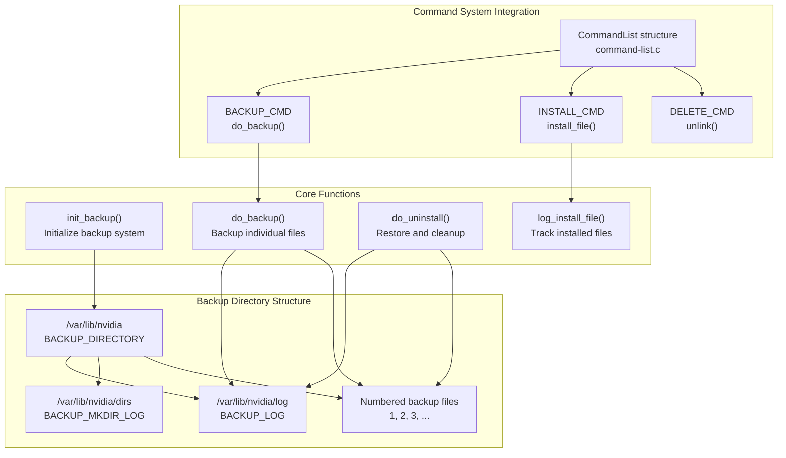
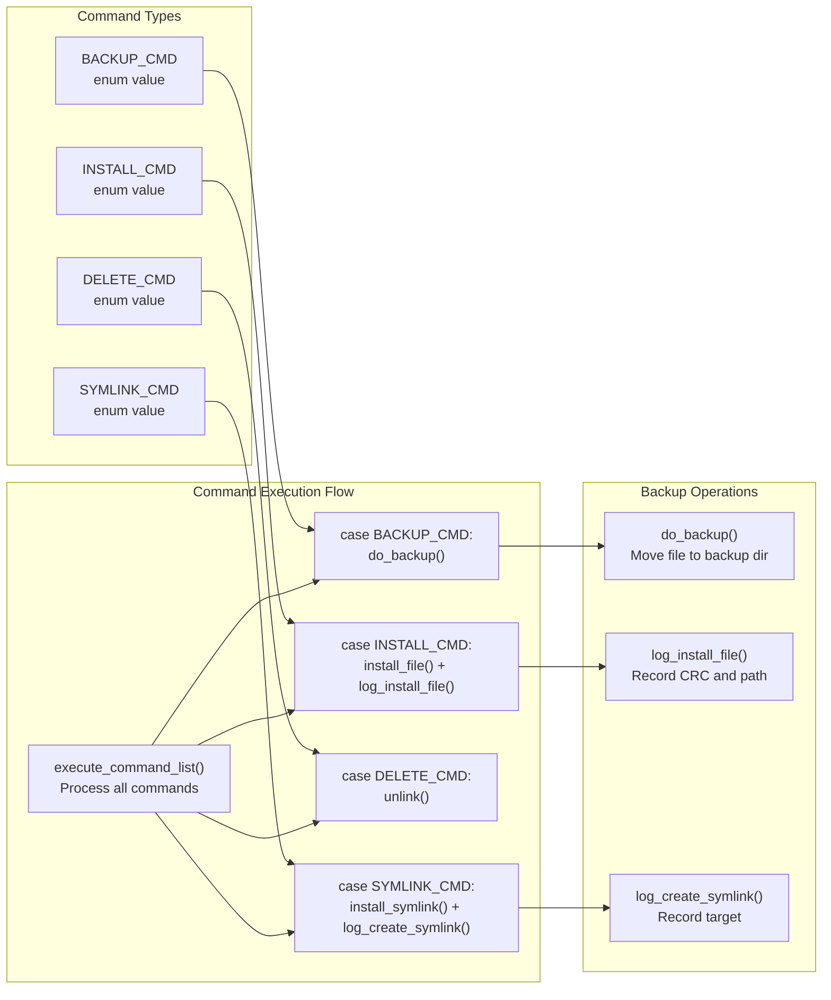
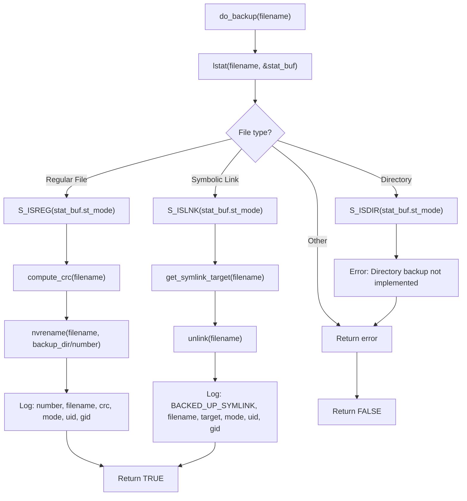
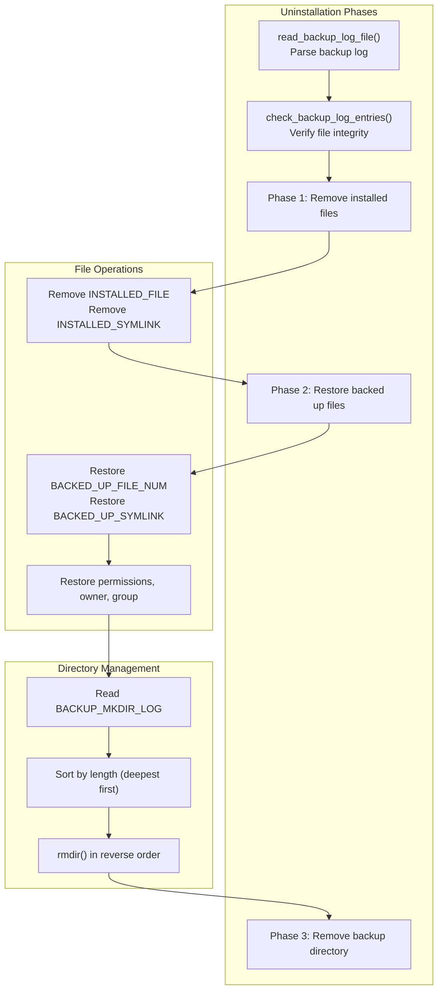
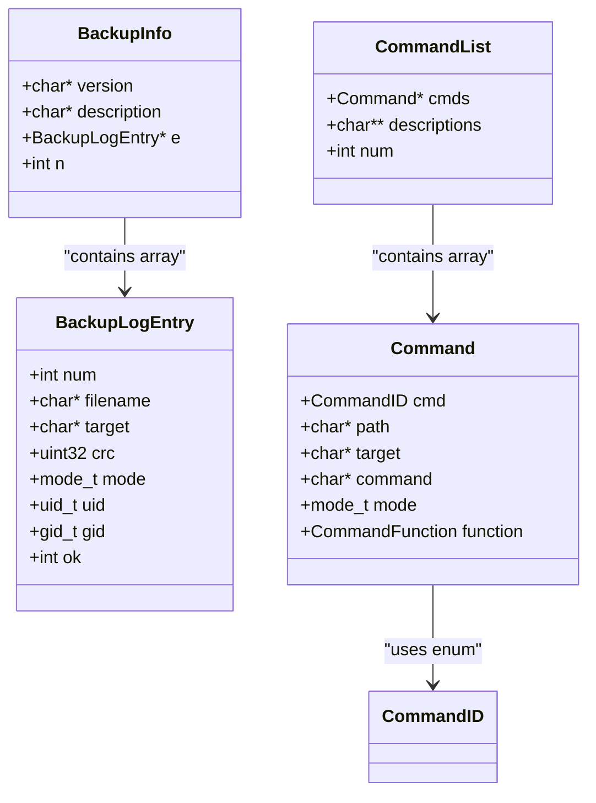
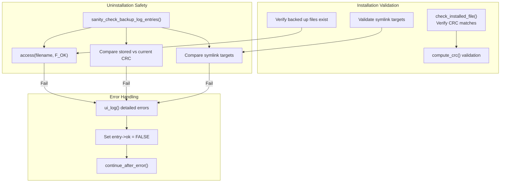

<!-- source: DeepWiki mcp.deepwiki.com · repo NVIDIA/nvidia-installer · page 3.5 Backup and Recovery System · fetched 2026-10-26 -->

# Backup and Recovery System

Relevant source files

The following files were used as context for generating this wiki page:

- [backup.c](backup.c)
- [command-list.c](command-list.c)

## Purpose and Scope

The Backup and Recovery System provides safe installation and complete uninstallation capabilities for the NVIDIA driver installer. This system ensures that any existing files that conflict with the driver installation are safely backed up before being replaced, and can be restored during uninstallation. The system also tracks all files installed by the driver to enable complete removal.

For information about the overall installation workflow, see [Installation Process](#3). For details about file system operations, see [File System Operations](#3.4).

## System Architecture

The backup system is built around a centralized backup directory and logging mechanism that coordinates with the command execution system to provide transactional installation operations.

Sources: [backup.c:46-48](), [command-list.c:77-87](), [backup.c:137-198](), [backup.c:207-298]()

## Command List Integration

The backup system integrates with the command execution system through specific command types that handle backup and installation operations in a coordinated manner.

Sources: [command-list.c:614-731](), [command-list.c:681-691](), [command-list.c:628-651](), [backup.c:302-332]()

## Backup Operations

The backup system handles different types of files and maintains detailed metadata for reliable restoration.

### Backup Process Flow

Sources: [backup.c:207-298](), [backup.c:239-255](), [backup.c:256-270](), [backup.c:271-280]()

### Backup Log Format

The backup log uses a structured format to track different types of operations:

| Entry Type | Format | Description |
|------------|--------|-------------|
| `INSTALLED_FILE` | `1: /path/to/file` `<crc>` | Files installed by the driver |
| `INSTALLED_SYMLINK` | `2: /path/to/symlink` `<target>` | Symlinks created by the driver |
| `BACKED_UP_SYMLINK` | `3: /path/to/symlink` `<target>` `<mode> <uid> <gid>` | Original symlinks that were backed up |
| `BACKED_UP_FILE_NUM` | `<num>: /path/to/file` `<crc> <mode> <uid> <gid>` | Original files moved to backup directory |

Sources: [backup.c:54-78](), [backup.c:216](), [backup.c:249-254](), [backup.c:266-269]()

## Recovery Operations

The recovery system reads the backup log and reverses all installation operations, restoring the system to its pre-installation state.

### Uninstallation Process

Sources: [backup.c:631-889](), [backup.c:697-728](), [backup.c:730-799](), [backup.c:558-622]()

## Data Structures

The backup system uses several key data structures to manage file tracking and restoration metadata.

### Core Data Structures

Sources: [backup.c:90-110](), [command-list.c:99-106](), [command-list.c:77-87]()

### Entry Type Constants

The system uses specific constants to identify different types of backup log entries:

| Constant | Value | Purpose |
|----------|-------|---------|
| `INSTALLED_FILE` | 1 | Files installed by the driver |
| `INSTALLED_SYMLINK` | 2 | Symlinks created by the driver |
| `BACKED_UP_SYMLINK` | 3 | Original symlinks that were backed up |
| `BACKED_UP_FILE_NUM` | ≥4 | Sequential numbers for backed up files |

Sources: [backup.c:216](), [backup.c:266](), [backup.c:1034]()

## File Tracking and Validation

The system implements comprehensive file validation to ensure installation integrity and safe uninstallation.

### Validation Process

Sources: [backup.c:1108-1227](), [backup.c:1619-1727](), [backup.c:1126-1135](), [backup.c:1145-1181]()

### CRC-Based File Integrity

The system uses CRC checksums to verify file integrity throughout the installation and uninstallation process:

- **During backup**: CRC is computed and stored for each backed up file
- **During installation**: CRC is computed and logged for each installed file  
- **During validation**: Current file CRC is compared against stored CRC
- **During uninstallation**: Backed up files are verified before restoration

Sources: [backup.c:240](), [backup.c:318-320](), [backup.c:1207-1215](), [backup.c:1644-1652]()

---

