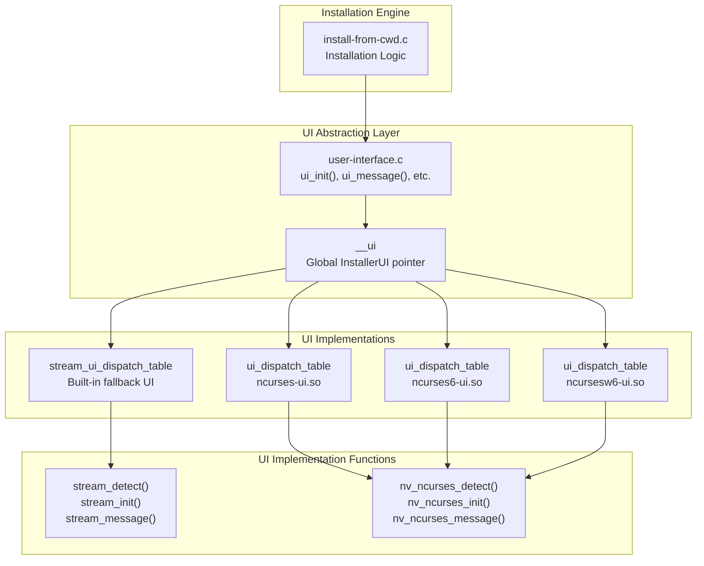
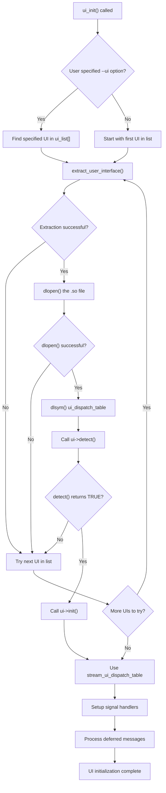
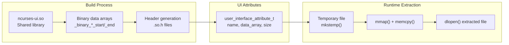
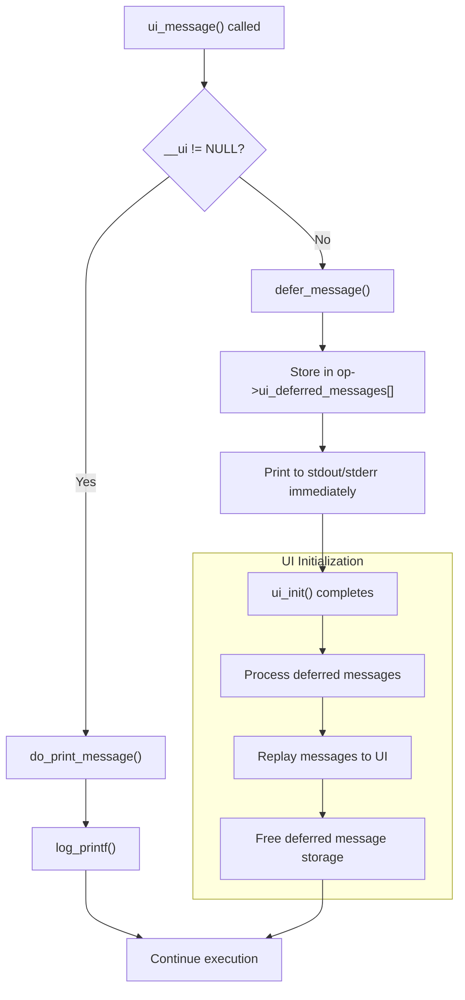
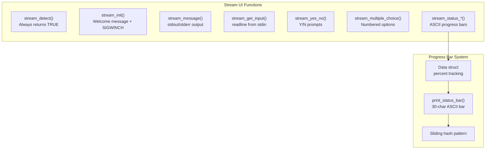
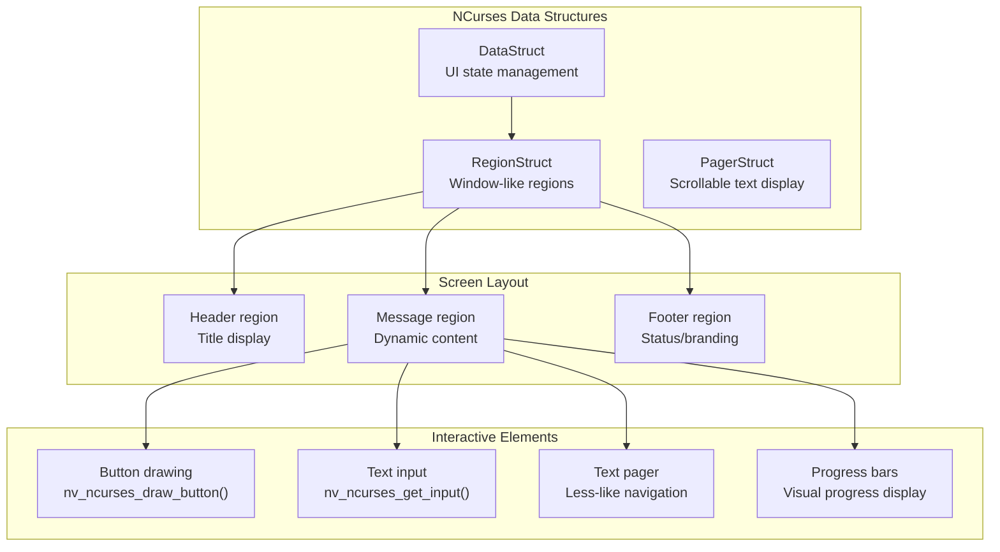
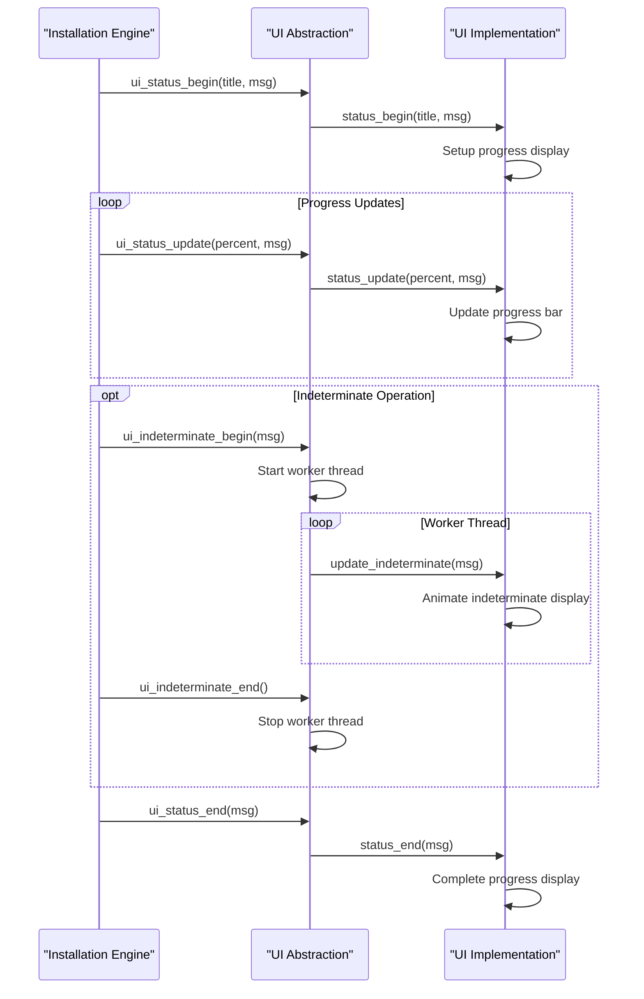
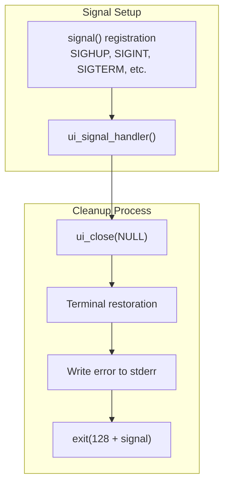
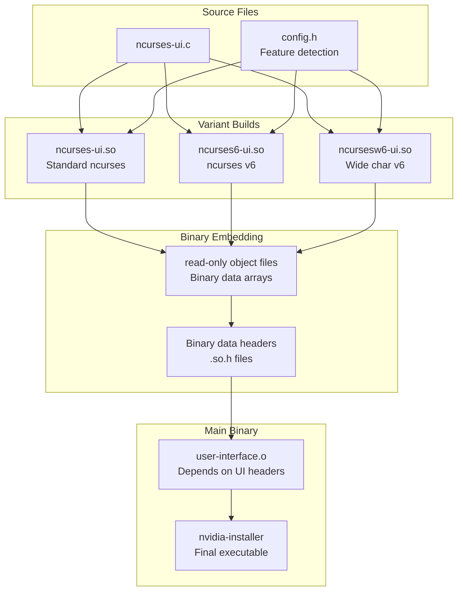

<!-- source: DeepWiki mcp.deepwiki.com · repo NVIDIA/nvidia-installer · page 4 User Interface System · fetched 2026-10-26 -->

# User Interface System

<details>
<summary>Relevant source files</summary>

The following files were used as context for generating this wiki page:

- [Makefile](Makefile)
- [ncurses-ui.c](ncurses-ui.c)
- [nvidia-installer-ui.h](nvidia-installer-ui.h)
- [stream-ui.c](stream-ui.c)
- [user-interface.c](user-interface.c)
- [user-interface.h](user-interface.h)

</details>


## Purpose and Scope

The User Interface System provides a unified abstraction layer for displaying information and collecting user input during NVIDIA driver installation. The system supports multiple UI implementations including a built-in console interface and dynamically-loaded ncurses-based graphical text interfaces, allowing the installer to adapt to different terminal environments while maintaining a consistent API for the installation engine.

For information about the overall installation workflow that drives this UI system, see [Installation Process](#3). For build system details on how UI libraries are embedded and generated, see [Build System](#5).

## Architecture Overview

The UI system implements a dispatch table pattern that allows runtime selection between different user interface implementations while providing a uniform API to the installation engine.

### UI Dispatch Table Architecture



**Sources:** [user-interface.c:39-65](), [nvidia-installer-ui.h:39-176](), [stream-ui.c:59-75](), [ncurses-ui.c:245-261]()

The `InstallerUI` structure defines the complete interface that each UI implementation must provide:

| Function Pointer | Purpose | Example Usage |
|------------------|---------|---------------|
| `detect()` | Check if UI can be used | Terminal size validation |
| `init()` | Initialize UI resources | Setup ncurses, colors |
| `message()` | Display messages | Error/warning dialogs |
| `get_input()` | Collect user input | Configuration prompts |
| `yes_no()` | Binary choice prompts | Confirmation dialogs |
| `status_begin/update/end()` | Progress indication | Installation progress |
| `approve_command_list()` | Expert mode approval | Show planned operations |

**Sources:** [nvidia-installer-ui.h:39-176]()

## UI Implementation Selection

The system attempts to load UI implementations in priority order, falling back to simpler interfaces if advanced ones fail to initialize.

### UI Selection Flow



**Sources:** [user-interface.c:116-238]()

The UI selection process follows this priority order defined in `ui_list[]`:

1. **ncurses6** - Modern ncurses v6 implementation
2. **ncurses** - Standard ncurses implementation  
3. **ncursesw6** - Wide character ncurses v6 implementation
4. **stream** - Built-in console fallback (always available)

**Sources:** [user-interface.c:120-140]()

## UI Library Embedding System

Advanced UI implementations are embedded as binary data within the main installer executable to ensure single-file distribution without external dependencies.

### Embedded Library Architecture



**Sources:** [user-interface.c:67-75](), [user-interface.c:683-754](), [Makefile:229-233]()

The extraction process in `extract_user_interface()`:

1. **Create temporary file** using `mkstemp()` in `op->tmpdir`
2. **Set file size** with `lseek()` and single byte write
3. **Memory map file** using `mmap()` with `PROT_READ | PROT_WRITE`
4. **Copy binary data** with `memcpy()` from embedded array
5. **Unmap and close** file, ready for `dlopen()`

**Sources:** [user-interface.c:683-754]()

## Message Handling System

The UI system includes a sophisticated message deferral mechanism to handle messages that arrive before UI initialization is complete.

### Message Deferral Flow



**Sources:** [user-interface.c:290-318](), [user-interface.c:216-233]()

The message level hierarchy determines how messages are displayed:

| Level | Constant | Stream Output | UI Behavior |
|-------|----------|---------------|-------------|
| Log | `NV_MSG_LEVEL_LOG` | None during status | Background logging only |
| Message | `NV_MSG_LEVEL_MESSAGE` | stdout | Standard info display |
| Warning | `NV_MSG_LEVEL_WARNING` | stderr | Warning indicators |
| Error | `NV_MSG_LEVEL_ERROR` | stderr | Error dialog/emphasis |

**Sources:** [nvidia-installer-ui.h:29-32](), [user-interface.c:290-318]()

## Stream UI Implementation

The stream UI provides a robust console-based interface that serves as the system's fallback implementation and is always compiled into the main binary.

### Stream UI Components



**Sources:** [stream-ui.c:39-75](), [stream-ui.c:95-147]()

### Stream UI Progress Bar Implementation

The stream UI renders progress using a 30-character ASCII bar with percentage display:

```
Installing kernel modules: 

  [##########                    ]  33%
```

The progress bar implementation in `print_status_bar()`:
- **Normal progress**: `#` characters fill left-to-right based on percentage
- **Indeterminate mode**: Single `#` character slides across the bar
- **Status management**: Carriage return (`\r`) for updates, newline on completion

**Sources:** [stream-ui.c:95-147]()

## NCurses UI Implementation

The ncurses UI provides a sophisticated terminal-based interface with windows, colors, and interactive elements.

### NCurses UI Architecture



**Sources:** [ncurses-ui.c:74-96](), [ncurses-ui.c:44-50](), [ncurses-ui.c:59-65]()

### NCurses Color and Display System

The ncurses UI supports both color and monochrome terminals with fallback display modes:

| Element | Color Mode | No-Color Mode |
|---------|------------|---------------|
| Header | Green on Black | Reverse video |
| Footer | Reverse video | Reverse video |
| Messages | White on Blue | Normal |
| Buttons | White on Red | Reverse (if highlighted) |
| Input | Green on Black | Reverse video |

**Sources:** [ncurses-ui.c:108-125](), [ncurses-ui.c:333-338]()

The ncurses initialization sequence:
1. **Terminal detection** - Check minimum size requirements (40x10)
2. **Color initialization** - Setup color pairs if supported
3. **Screen setup** - Clear, disable echo, enable cbreak mode
4. **Region creation** - Initialize header, footer regions
5. **Signal handling** - Setup resize handlers

**Sources:** [ncurses-ui.c:281-374]()

## Status and Progress System

Both UI implementations provide progress indication through a common interface supporting determinate and indeterminate progress modes.

### Progress System Flow



**Sources:** [user-interface.c:538-642](), [user-interface.c:575-626]()

### Indeterminate Progress Implementation

The indeterminate progress system uses a separate worker thread to animate progress indicators when completion time is unknown:

```c
// Indeterminate worker thread function
static void *indeterminate_worker(void *p) {
    while (indeterminate_get(id) == INDETERMINATE_ACTIVE) {
        __ui->update_indeterminate(op, msg);
    }
    return NULL;
}
```

**Sources:** [user-interface.c:580-593]()

## Signal Handling and Cleanup

The UI system includes comprehensive signal handling to ensure clean shutdown and proper terminal restoration.

### UI Signal Management



**Sources:** [user-interface.c:205-215](), [user-interface.c:763-821]()

The signal handler performs cleanup without relying on potentially corrupted state:
- **UI cleanup** - Call `ui_close(NULL)` to restore terminal
- **Safe output** - Use `write(2, ...)` instead of `fprintf()` for reentrancy
- **Signal identification** - Map signal numbers to names for error reporting
- **Exit code** - Use standard `128 + signal_number` exit convention

**Sources:** [user-interface.c:763-821]()

## Build System Integration

The UI system integrates closely with the build system to support multiple ncurses variants and embed UI libraries as binary data.

### UI Library Build Process



**Sources:** [Makefile:61-77](), [Makefile:201-211](), [Makefile:229-233]()

The build system handles UI library variants through feature detection:
- **Feature flags** - `BUILD_NCURSES6`, `BUILD_NCURSESW6` control which variants are built
- **Compiler flags** - `NV_INSTALLER_NCURSES6`, `NV_INSTALLER_NCURSESW6` enable conditional compilation
- **Dependency tracking** - `user-interface.o` depends on generated UI headers
- **Binary embedding** - UI shared libraries converted to object files with binary data

**Sources:** [Makefile:45-46](), [Makefile:117-118](), [Makefile:69-73]()

---

