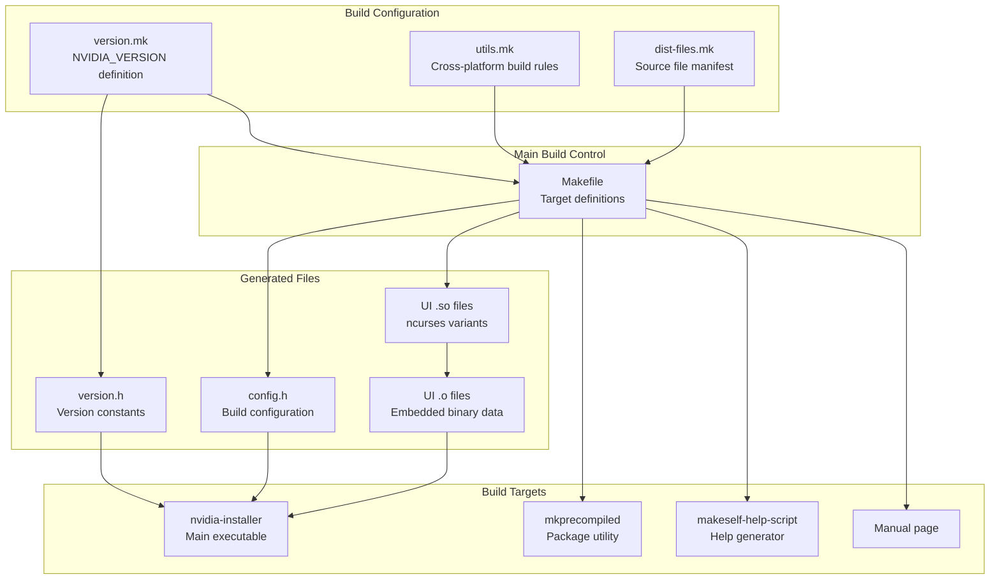
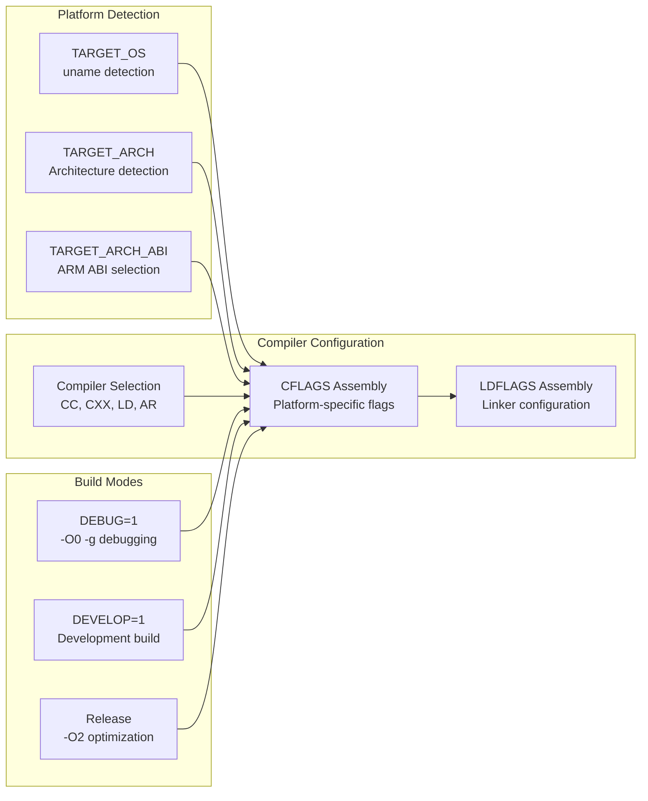
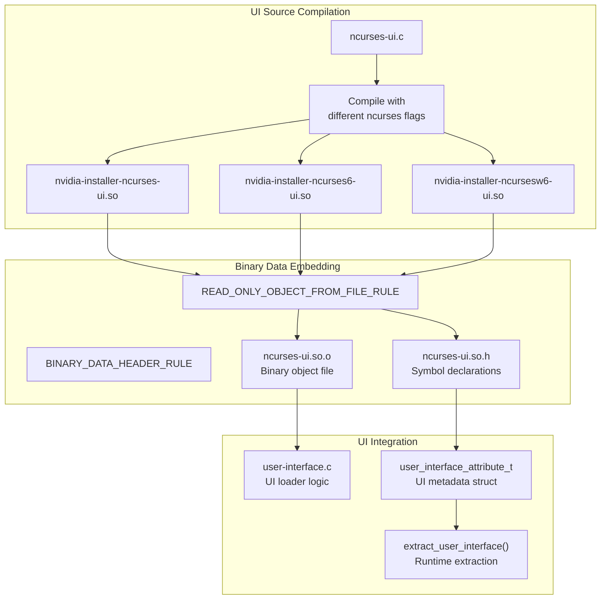
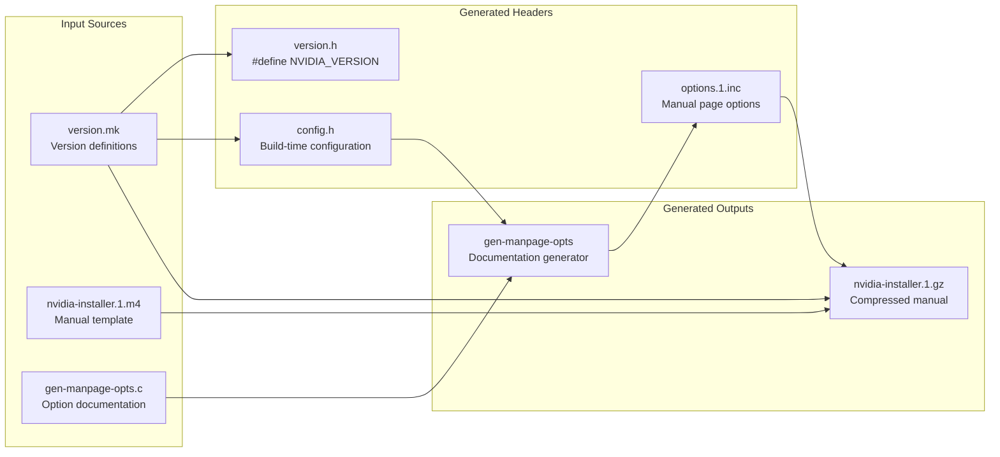

<!-- source: DeepWiki mcp.deepwiki.com · repo NVIDIA/nvidia-installer · page 5 Build System · fetched 2026-10-26 -->

# Build System

Relevant source files

The following files were used as context for generating this wiki page:

- [Makefile](Makefile)
- [dist-files.mk](dist-files.mk)
- [user-interface.c](user-interface.c)
- [utils.mk](utils.mk)
- [version.mk](version.mk)

The nvidia-installer build system is responsible for compiling the installer binary and its dependencies, managing version information, and embedding UI libraries as binary data. This system supports cross-platform compilation, multiple UI variants, and generates several utility programs alongside the main installer.

For information about the actual installation process that this build system creates binaries for, see [Installation Process](#3).

## Architecture Overview

The build system consists of three main makefile components that work together to produce the final installer binaries:

Sources: [version.mk:1-12](), [utils.mk:23-25](), [Makefile:25-29](), [dist-files.mk:20-27]()

## Version Management System

Version information is centrally managed through `version.mk`, which defines the NVIDIA driver version and automatically generates corresponding header files:

| Variable | Purpose | Example Value |
|----------|---------|---------------|
| `NVIDIA_VERSION` | Main driver version | `575.64.05` |
| `NVIDIA_NVID_VERSION` | Build identification version | `575.64.05` |
| `NVIDIA_NVID_EXTRA` | Additional version suffix | (empty) |

The version system automatically generates `version.h` with preprocessor definitions that are included throughout the codebase. The build rule ensures that any changes to version information trigger recompilation of dependent files.

Sources: [version.mk:1-12](), [Makefile:240-249]()

## Cross-Platform Build Configuration

The `utils.mk` file provides comprehensive cross-platform build support with automatic platform detection and appropriate compiler flag configuration:

The system supports multiple architectures (`x86`, `x86_64`, `aarch64`, `armv7l`, `ppc64le`) and operating systems (`Linux`, `FreeBSD`, `SunOS`), automatically setting appropriate preprocessor definitions and compiler flags.

Sources: [utils.mk:125-196](), [utils.mk:74-96]()

## UI Library Embedding System

One of the most sophisticated aspects of the build system is the UI library embedding mechanism, which allows the installer to be distributed as a single binary while supporting multiple UI implementations:

The embedding process uses `objcopy` to convert shared library files into ELF object files with symbols like `_binary_nvidia_installer_ncurses_ui_so_start` and `_binary_nvidia_installer_ncurses_ui_so_end`, which are then linked directly into the main executable.

Sources: [utils.mk:599-619](), [Makefile:201-211](), [Makefile:229-234](), [user-interface.c:120-140]()

## Build Targets and Dependencies

The build system produces several executables, each with specific purposes:

| Target | Purpose | Key Dependencies |
|--------|---------|------------------|
| `nvidia-installer` | Main installation program | UI objects, all source files, embedded libraries |
| `mkprecompiled` | Precompiled package creation utility | CRC, precompiled handling code |
| `makeself-help-script` | Help text generator for driver packages | Common utilities, option parsing |
| `makeself-help-script.sh` | Shell script wrapper | Output from makeself-help-script |

The dependency management system uses automatic dependency generation through compiler flags (`-MMD`, `-MF`, `-MP`) to track header file dependencies and ensure proper incremental builds.

Sources: [Makefile:52-55](), [Makefile:186-199](), [utils.mk:337-342]()

## Generated Files and Configuration

Several files are generated during the build process to embed configuration and version information:

The `config.h` file contains essential build-time definitions including target OS, architecture, version information, and program name that are used throughout the codebase.

Sources: [Makefile:240-249](), [Makefile:297-324](), [version.mk:7-11]()

## Build Rules and Object Generation

The build system uses sophisticated makefile functions to generate compilation rules dynamically. The `DEFINE_OBJECT_RULE` family of functions creates individual build rules for each source file, supporting both target and host compilation scenarios:

- **Target compilation**: For code that runs on the destination system
- **Host compilation**: For build-time utilities like `gen-manpage-opts`
- **Makeself compilation**: Special variant for the help script generator

The system also handles special compilation requirements, such as position-independent code (`-fPIC`) for shared libraries and architecture-specific thread-local storage models.

Sources: [utils.mk:463-499](), [Makefile:224-228](), [Makefile:235-238]()

---

