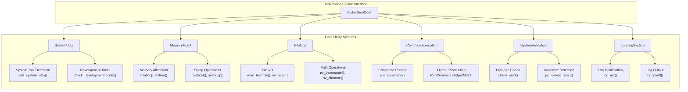
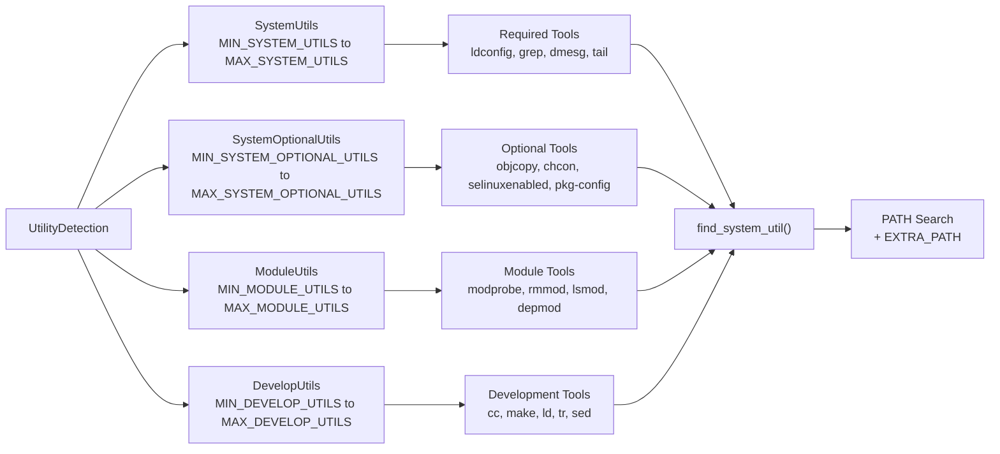
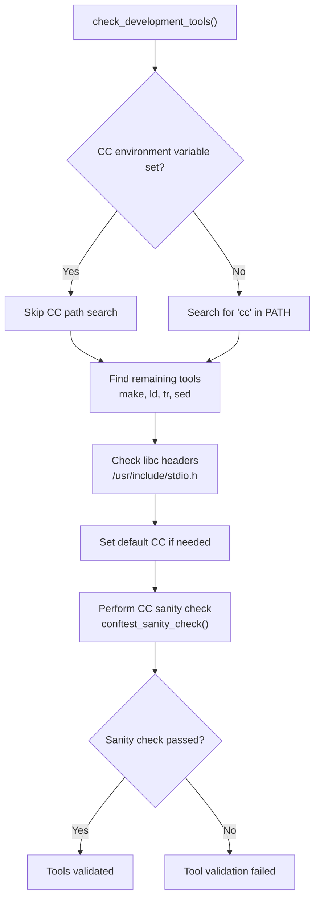
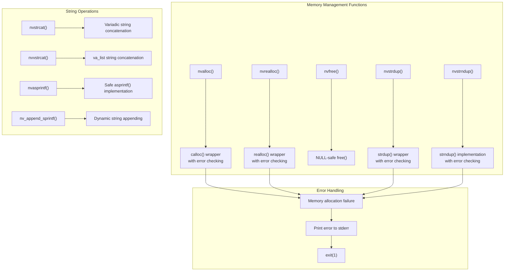
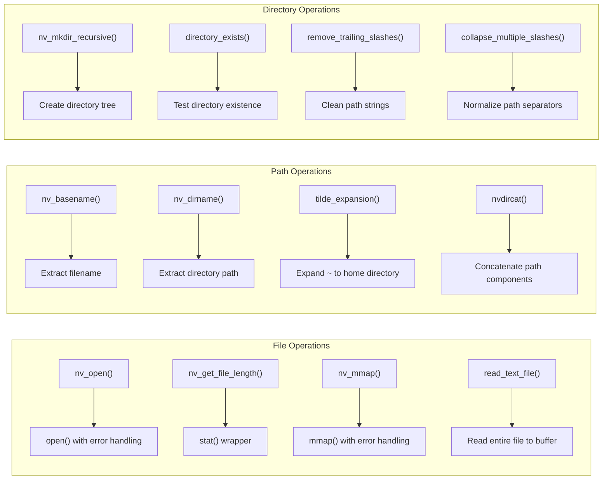
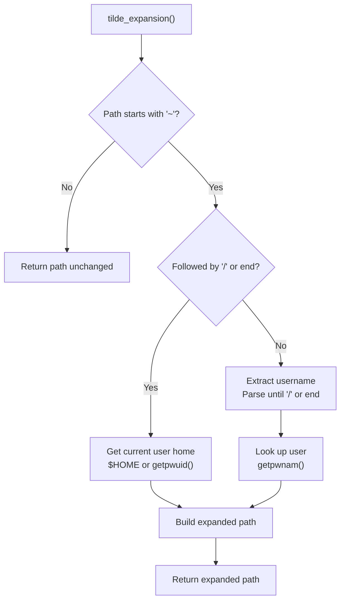
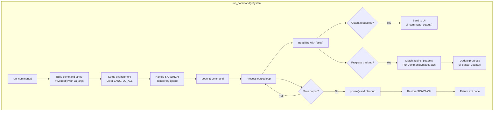
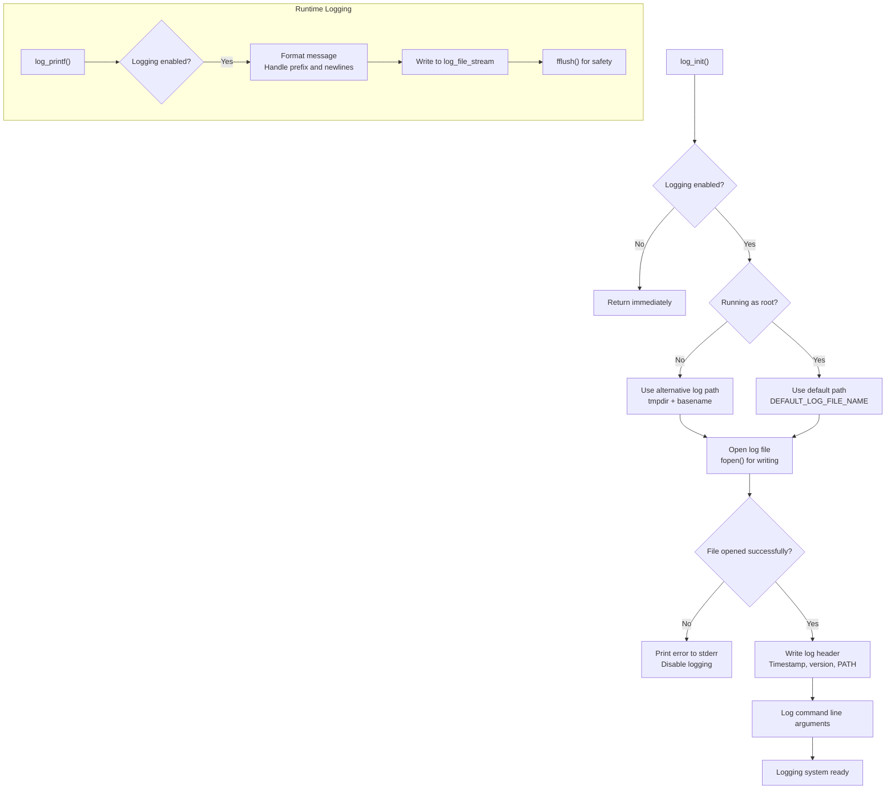
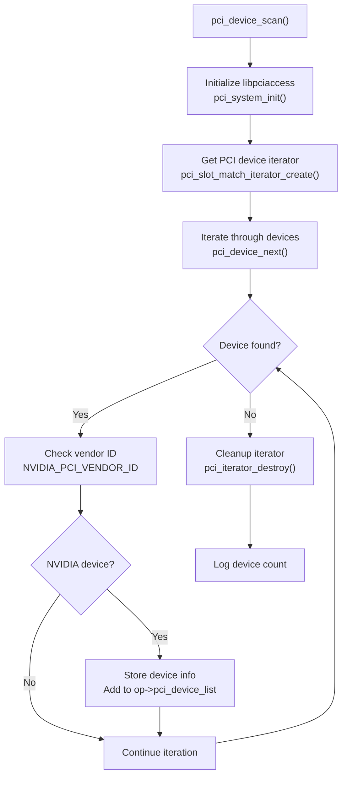

<!-- source: DeepWiki mcp.deepwiki.com · repo NVIDIA/nvidia-installer · page 6 Utilities and Support Systems · fetched 2026-10-26 -->

# Utilities and Support Systems

<details>
<summary>Relevant source files</summary>

The following files were used as context for generating this wiki page:

- [common-utils/common-utils.c](common-utils/common-utils.c)
- [common-utils/common-utils.h](common-utils/common-utils.h)
- [log.c](log.c)
- [misc.c](misc.c)
- [misc.h](misc.h)

</details>


This page documents the various utility systems that support the nvidia-installer's core functionality, including system validation, logging, memory management, and common utility functions. These systems provide foundational services used throughout the installer.

For information about the core installation workflow, see [Installation Process](#3). For details about specific validation subsystems, see [System Validation and Detection](#6.1), [Initramfs Management](#6.2), and [Common Utilities Library](#6.3).

## Overview

The nvidia-installer relies on several interconnected utility subsystems that provide essential services ranging from system validation to memory management. These utilities are primarily implemented in `misc.c` and the shared `common-utils` library, with specialized logging functionality in `log.c`.



Sources: [misc.c:1-2775](), [misc.h:1-121](), [common-utils/common-utils.h:1-144](), [common-utils/common-utils.c:1-839](), [log.c:1-157]()

## System Detection and Validation

The installer performs comprehensive system validation before beginning installation, ensuring all required tools and conditions are met.

### System Utility Detection

The system utility detection process identifies and validates required system tools, organizing them into categories based on their purpose and requirement level.



The utility detection system uses a structured approach defined in `__utils[]` array:

| Utility Type | Examples | Purpose |
|-------------|----------|---------|
| SystemUtils | `ldconfig`, `grep`, `dmesg` | Core system operations |
| SystemOptionalUtils | `selinuxenabled`, `pkg-config` | Feature-specific tools |
| ModuleUtils | `modprobe`, `rmmod`, `lsmod` | Kernel module management |
| DevelopUtils | `cc`, `make`, `ld` | Kernel module compilation |

Sources: [misc.c:500-590](), [misc.c:512-546](), [misc.c:548-590](), [misc.c:600-625]()

### Development Tools Validation

The development tools validation ensures the system can build kernel modules by checking compiler availability and performing sanity tests.



Sources: [misc.c:778-827](), [misc.c:760-776](), [misc.c:835-844]()

## Memory and String Management

The common utilities library provides robust memory management and string manipulation functions that handle error conditions gracefully.

### Memory Allocation System



All memory allocation functions in the common utilities library follow a consistent pattern: they wrap standard library functions with comprehensive error checking and terminate the program if allocation fails, ensuring memory errors are caught immediately rather than causing undefined behavior later.

Sources: [common-utils/common-utils.c:52-63](), [common-utils/common-utils.c:130-144](), [common-utils/common-utils.c:154-169](), [common-utils/common-utils.c:179-198]()

### String Processing Utilities

The installer provides specialized string processing functions for parsing configuration files, command output, and version strings.

| Function | Purpose | Key Features |
|----------|---------|--------------|
| `read_next_word()` | Extract whitespace-delimited words | Handles multiple whitespace types |
| `get_next_line()` | Parse lines with length limits | EOF detection, bounded reading |
| `extract_version_string()` | Parse NVIDIA version formats | Supports both old and new formats |
| `nvstrtolower()`/`nvstrtoupper()` | Case conversion | In-place modification |

Sources: [misc.c:67-90](), [misc.c:176-223](), [misc.c:976-1121](), [common-utils/common-utils.c:203-241]()

## File and Path Operations

The file operations system provides robust file handling with comprehensive error checking and path manipulation utilities.

### File I/O System



Sources: [common-utils/common-utils.c:455-465](), [common-utils/common-utils.c:476-489](), [common-utils/common-utils.c:516-528](), [misc.c:448-489]()

### Path Manipulation

The path manipulation system handles cross-platform path operations and user home directory expansion:



Sources: [common-utils/common-utils.c:311-362](), [common-utils/common-utils.c:616-636](), [common-utils/common-utils.c:644-652]()

## Command Execution System

The command execution system provides sophisticated command running capabilities with output capture, progress tracking, and error handling.

### Command Runner Architecture



The `RunCommandOutputMatch` structure allows callers to provide progress estimation by specifying expected output patterns:

```c
typedef struct {
    int lines;              // Expected number of matching lines
    char *initial_match;    // Optional line prefix to match
} RunCommandOutputMatch;
```

Sources: [misc.c:252-438](), [misc.h:57-65]()

### Output Processing Flow

The command execution system supports sophisticated output processing with pattern matching for progress tracking:

| Feature | Implementation | Purpose |
|---------|---------------|---------|
| Output Capture | Dynamic buffer with `nvrealloc()` | Collect all command output |
| Progress Tracking | `RunCommandOutputMatch` array | Estimate completion percentage |
| UI Integration | `ui_command_output()` calls | Real-time output display |
| Signal Handling | Temporary `SIGWINCH` ignore | Prevent child process abort |

Sources: [misc.c:340-415](), [misc.c:277-315]()

## Logging System

The logging system provides comprehensive logging capabilities with automatic initialization and structured output formatting.

### Logging Architecture



Sources: [log.c:65-117](), [log.c:127-156]()

### Log File Structure

The logging system creates structured log files with standardized headers and consistent formatting:

| Section | Content | Purpose |
|---------|---------|---------|
| Header | Program name, log file path | Identify log session |
| Timestamp | Creation time with `ctime()` | Session timing |
| Version Info | `NVIDIA_INSTALLER_VERSION` | Debugging context |
| Environment | `PATH` environment variable | Tool resolution context |
| Command Line | Full `argv[]` array | Reproduce installation |

Sources: [log.c:97-116](), [log.c:127-156]()

## Hardware Detection System

The hardware detection system identifies NVIDIA graphics hardware and validates system compatibility before installation proceeds.

### PCI Device Scanning



Sources: [misc.c:1547-1595]()

### Graphics Device Validation

The graphics device validation system ensures compatible NVIDIA hardware is present and accessible:

| Validation Step | Function | Purpose |
|----------------|----------|---------|
| PCI Scanning | `pci_device_scan()` | Enumerate all NVIDIA devices |
| Device Filtering | `check_for_nvidia_graphics_devices()` | Identify graphics-capable devices |
| Driver Conflict | `check_for_nouveau()` | Detect conflicting open-source driver |
| Module Status | `nouveau_is_present()` | Check if nouveau is loaded |

Sources: [misc.c:1598-1733](), [misc.c:2201-2224](), [misc.c:2761-2775]()

---

