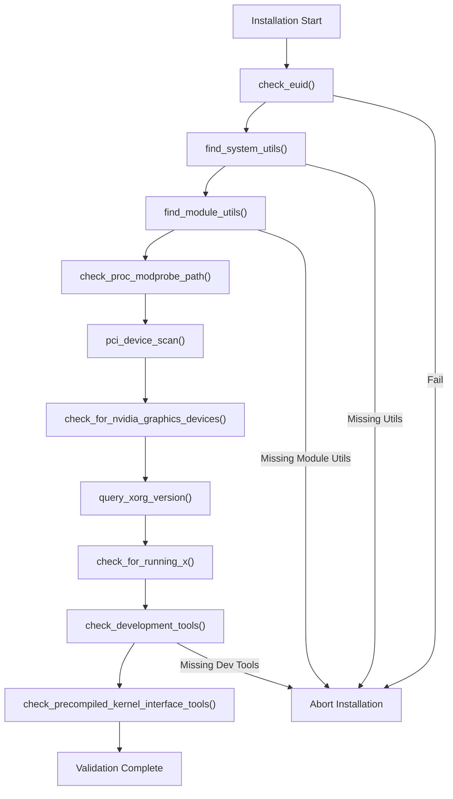
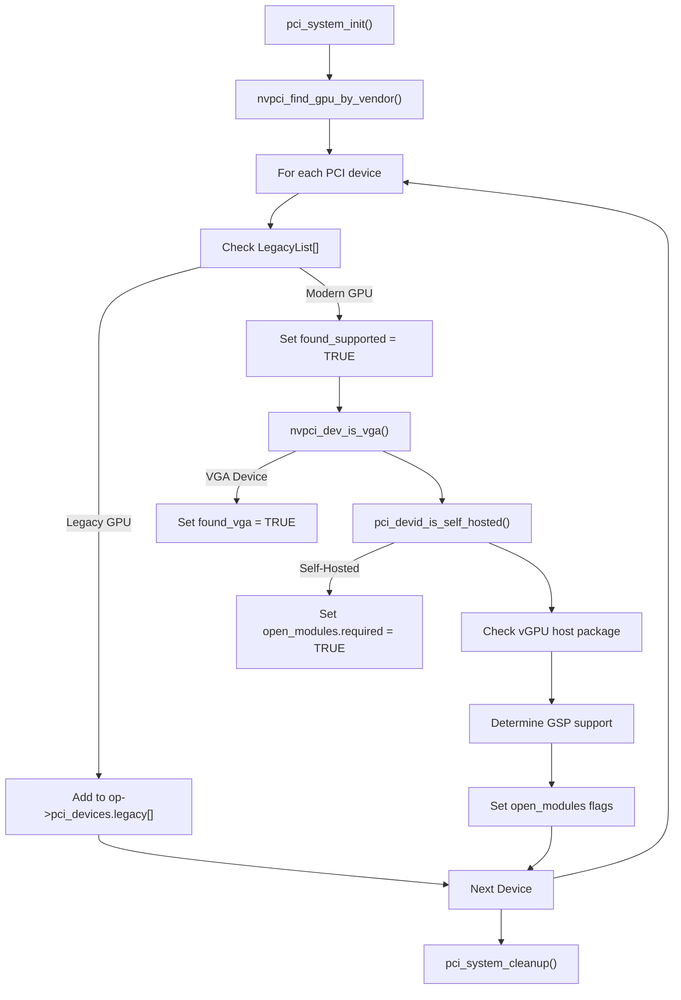
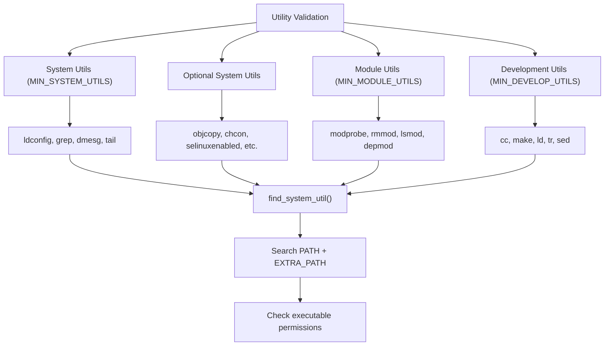
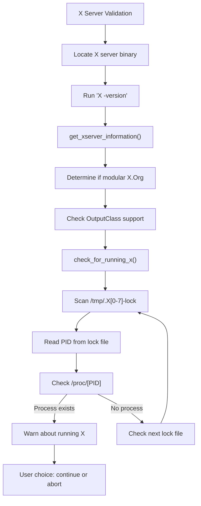
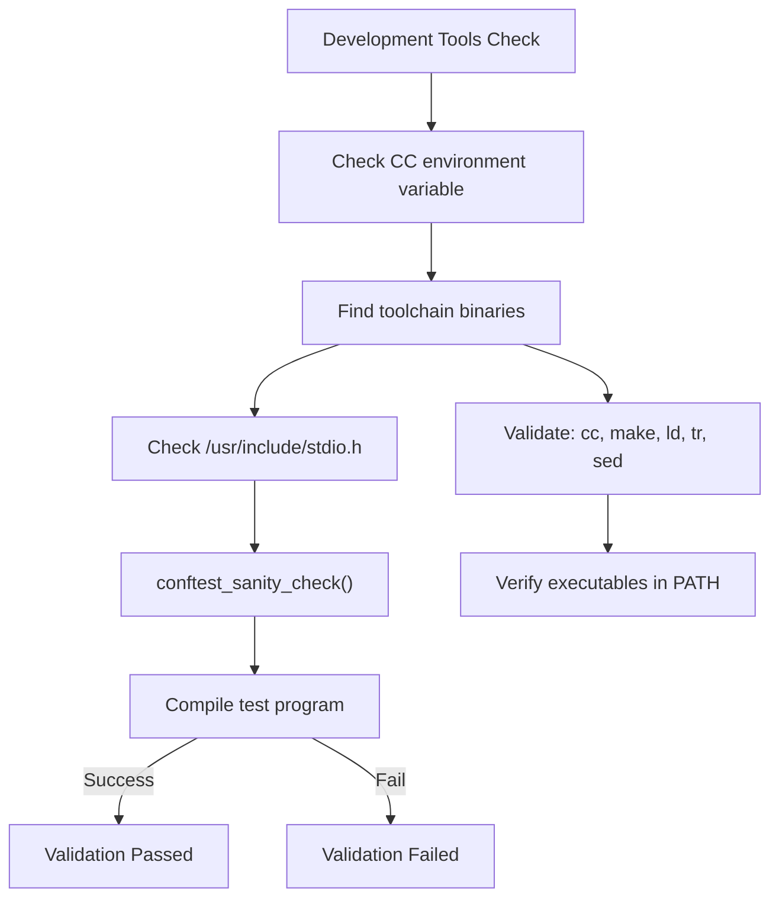
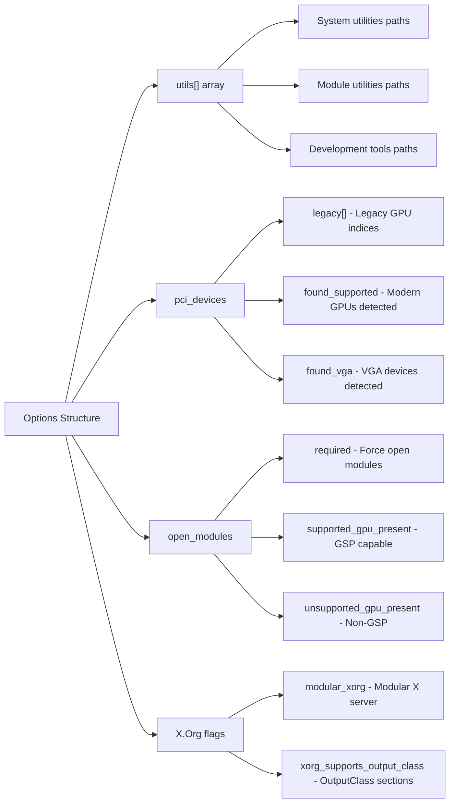
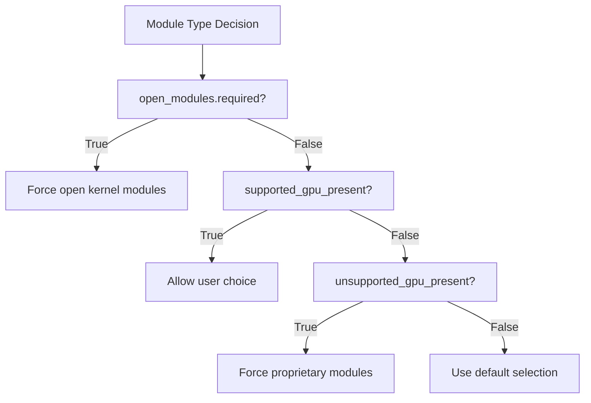

<!-- source: DeepWiki mcp.deepwiki.com · repo NVIDIA/nvidia-installer · page 6.1 System Validation and Detection · fetched 2026-10-26 -->

# System Validation and Detection

Relevant source files

The following files were used as context for generating this wiki page:

- [detect-self-hosted.h](detect-self-hosted.h)
- [misc.c](misc.c)
- [nvGpus.h](nvGpus.h)

This document covers the comprehensive system validation and hardware detection performed by the nvidia-installer before beginning the installation process. The system performs extensive checks to ensure the environment is suitable for driver installation, detects NVIDIA hardware, validates required tools, and assesses system compatibility.

For information about the main installation workflow that follows these validation steps, see [Installation Process](#3). For details about the kernel module building process that depends on these validation results, see [Kernel Module Management](#3.3).

## Overview

The system validation and detection subsystem performs pre-installation checks across multiple categories:

- **Privilege Validation**: Ensures the installer runs with appropriate permissions
- **Hardware Detection**: Scans PCI bus for NVIDIA GPUs and determines their capabilities
- **Tool Validation**: Locates and validates required system utilities and development tools
- **Environment Assessment**: Checks system state including running processes and configurations
- **Version Detection**: Queries X server and other component versions

## Validation Workflow

Sources: [misc.c:100-113](), [misc.c:548-590](), [misc.c:600-625](), [misc.c:637-752](), [misc.c:1795-1912](), [misc.c:1923-1963](), [misc.c:1544-1582](), [misc.c:1597-1663](), [misc.c:778-827](), [misc.c:835-844]()

## Hardware Detection System

The hardware detection system uses libpciaccess to scan the PCI bus and identify NVIDIA GPUs, categorizing them by capabilities and legacy status.

### PCI Device Scanning

Sources: [misc.c:1795-1812](), [misc.c:1826-1909](), [nvGpus.h:27-34](), [detect-self-hosted.h:38-42]()

### GPU Classification

The system categorizes detected GPUs into several categories:

| GPU Category | Detection Method | Data Structure |
|--------------|------------------|----------------|
| Legacy GPUs | `LegacyList[]` lookup | `op->pci_devices.legacy[]` |
| Self-Hosted | `pci_devid_is_self_hosted()` | `op->open_modules.required` |
| vGPU GSP | `nvpci_dev_is_vgpu_gsp()` | `op->open_modules.supported_gpu_present` |
| Standard Modern | Default classification | `op->pci_devices.found_supported` |

## System Utilities Validation

The installer requires various system utilities and validates their availability before proceeding.

### Utility Categories

Sources: [misc.c:512-546](), [misc.c:548-590](), [misc.c:600-625](), [misc.c:778-827](), [misc.c:853-894]()

### Tool Validation Functions

| Function | Purpose | Required Tools |
|----------|---------|----------------|
| `find_system_utils()` | Core system utilities | ldconfig, grep, dmesg, tail |
| `find_module_utils()` | Kernel module tools | modprobe, rmmod, lsmod, depmod |
| `check_development_tools()` | Compilation toolchain | cc, make, ld, tr, sed |
| `check_precompiled_kernel_interface_tools()` | Precompiled interface linking | ld (linker only) |

## Environment State Detection

### X Server Detection and Validation

Sources: [misc.c:1544-1582](), [misc.c:1597-1663](), [misc.c:1462-1526]()

### Development Environment Validation

The system performs comprehensive validation of the development environment needed for kernel module compilation:

Sources: [misc.c:778-827](), [misc.c:760-776](), [misc.c:809-827]()

## Data Structures and Configuration

### Core Validation Structures

The validation system populates several key data structures in the `Options` structure:

Sources: [misc.c:1870-1906](), [misc.c:1576-1578](), [misc.c:1508-1522]()

### GPU Detection Data

| Data Structure | Purpose | Population Method |
|----------------|---------|-------------------|
| `LegacyList[]` | Legacy GPU database | Static table in nvGpus.h |
| `GpuFlagList[]` | GPU capability flags | Static table in nvGpus.h |
| `GpuSubDeviceFlagList[]` | Subvendor-specific flags | Static table in nvGpus.h |
| `op->pci_devices.legacy[]` | Detected legacy GPUs | Runtime PCI scan |

## Validation Results and Decision Making

The validation system produces results that influence installation behavior:

### Module Type Selection

### Legacy GPU Handling

When legacy GPUs are detected, the system:

1. Builds warning messages using `LegacyStrings[]` table
2. Provides download URLs for appropriate legacy drivers
3. Offers option to continue with potential incompatibility
4. Documents the detected legacy devices in installation logs

Sources: [misc.c:1925-1963](), [nvGpus.h:57-66](), [nvGpus.h:69-1181]()

---

